# Kafka Transactions and Offsets in Spring Integration Adapters

> **Chapter:** Transactions  
> **Module:** `SPRING_INTEGRATION_ADAPTERS`  
> **Context:** Connecting external systems using inbound/outbound adapters, gateways, pollers, and `MessageChannel`; working with files, SFTP, HTTP, JMS, AMQP, Kafka, and JDBC/databases while handling errors and connection lifecycles.  
> **Goal:** Understand Kafka **consumer position**, **committed offset**, **producer transactions**, `sendOffsetsToTransaction`, and **Kafka-scoped exactly-once semantics (EOS)**; configure Spring Kafka/Spring Integration properly; and design commits, rollbacks, retries, DLT, idempotency, and reconciliation for side effects outside Kafka.

## 1. Opening Scenario: One Record, Two Outcomes

An integration service consumes records from topic `orders.in`, normalizes orders, and publishes to `orders.validated`:

```text
orders.in                  Spring Integration                  orders.validated
  record offset 104   -->  consume -> validate -> transform  -->  event
                               |
                               +--> consumer group offset commit
```

If the process is killed **after sending output yet before committing the consumer offset**, Kafka replays the input record when the consumer restarts. A second output event may appear. Conversely, if the offset commits before the broker confirms the output, a crash can lose business output.

Kafka transactions solve **one layer** of this problem by writing output records and consumer offset progress **within a single Kafka transaction**. If the transaction aborts, its output records remain invisible to `read_committed` consumers, and the offset is not committed as part of that transaction.

However, if the flow already **called an HTTP POST payment** or **committed a JDBC row**, a Kafka rollback **does not undo** operations that already occurred in those systems.

### 1.1. Questions to Answer Before Writing Code

1. Which `topic/partition/offset` is the record at?
2. Which consumer group owns the committed offset?
3. Who commits the offset: Kafka consumer auto-commit, listener container, or Kafka transaction?
4. Is the output a Kafka record or an external side effect?
5. Do failures happen before send, in a callback, during transaction commit, or after writing to a database?
6. On retry, how do you avoid repeating side effects?
7. When a poison record cannot be processed, what moves it to a DLT and what decides the source offset?
8. Does the Spring Integration flow switch threads between inbound and outbound?
9. Do downstream consumers set `isolation.level=read_committed`?
10. Did your "sent successfully" test verify broker commit and offsets, or only check a method return?

## 2. Vocabulary: Offset, Position, Committed Offset, and Transaction

| Term | Exact meaning | Common misconception |
|---|---|---|
| `topic` | Log stream divided into partitions | Not a single globally ordered queue |
| `partition` | Independently ordered append-only log | Ordering across partitions is not guaranteed |
| `offset` | Position of a record **within a partition** | Not a system-wide business sequence number |
| `consumer position` | Offset of the **next record to fetch/consume** in the consumer session | Not necessarily processed or committed |
| `committed offset` | **Next offset** a consumer group reads after restart/rebalance | Not the offset of the last committed record |
| `consumer group` | Group sharing partition assignments and committed offsets | Different groups maintain independent progress |
| `auto commit` | Consumer periodically commits position per config | Does not guarantee business handler success |
| `listener container ack` | Spring Kafka decides when to commit per `AckMode` when non-transactional | Does not mean external business transactions committed |
| `Kafka producer transaction` | Groups writes and/or offsets into one Kafka transaction | Not a distributed transaction across all adapters |
| `transactional.id` | Transactional producer identity for fencing and recovery | Not a message correlation ID |
| `producer idempotence` | Prevents duplicates from producer send retries | Does not prevent duplicates when app logic reprocesses events |
| `read_committed` | Consumer sees only committed transactional records and non-transactional records | Does not filter out all business duplicates |
| `read_uncommitted` | Consumer can see aborted transactional records as well | Unsuitable where EOS output visibility is required |

### 2.1. Offsets Are Always Scoped by Partition and Group

```text
Topic: orders.in
Partition: 0
Records: [100] [101] [102] [103] [104] [105] ...

Group "order-validation" committed offset = 104
   => after recovery, the group normally resumes at offset 104

Group "audit-reader" committed offset = 102
   => the second group maintains an independent position
```

After processing record offset `103` and committing progress properly, **the committed value is `104`**, not `103`. This follows the "next record to consume" convention. Be very cautious when calling offset APIs manually.

## 3. Poll Position Does Not Mean Processing Succeeded

`KafkaConsumer.poll()` loads a batch into memory and advances **position** before the business handler finishes.

Example:

```text
poll() returns records at offsets 200, 201, 202, 203
consumer position after fetch: 204
business handler completed so far: 200, 201
current committed group offset: 200 (or earlier)
```

At this instant:

- `position=204` **does not prove** all four records were processed.
- Committing offset `204` too early can skip records `202` and `203` after a crash.
- Keeping the old committed offset means records may be re-read after a crash.
- Spring Kafka's listener container has its own commit and seek/recovery logic; avoid raw consumer commits unless you truly manage the full lifecycle correctly.

### 3.1. Order: "Received → Processed → Confirmed"

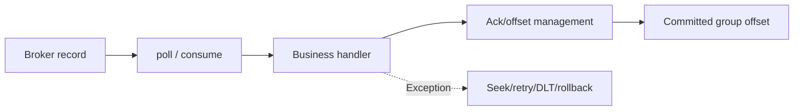

A `MessageSource` in Spring Integration can be polled by `SourcePollingChannelAdapter`; its commit mechanics **are not automatically identical** to a record-driven listener container. Verify whether you are using `KafkaMessageDrivenChannelAdapter` or `KafkaMessageSource`.

## 4. Three Layers of Guarantees to Distinguish

| Layer | Realistic guarantee | What it cannot prove |
|---|---|---|
| Producer retry with idempotence | Prevents duplicates from Kafka producer retries per session/protocol | That the business handler never sends duplicate events |
| Consumer manual/container offset commit | Controls group resume position | Atomicity with Kafka output |
| Kafka transaction + offsets | Atomic visibility of Kafka outputs and consumer offset progress when configured properly | Atomicity with JDBC, HTTP, SFTP, or JMS/AMQP |
| Business idempotency | Prevents repeating the same business operation | Does not replace all transaction/ordering guarantees |

### 4.1. At-Most-Once, At-Least-Once, and EOS in One Table

| Model | Scenario | Risk |
|---|---|---|
| **At-most-once** | Commit source offset before confirming side effects succeeded | Processing can be lost |
| **At-least-once** | Commit only after processing; retry on crash | Duplicate side effects possible |
| **Kafka EOS** | Kafka output records + source offsets commit atomically in a Kafka transaction | Code and external DB/HTTP can still duplicate |
| **Business effectively-once** | At-least-once + idempotency/dedup/outbox and reconciliation | Requires data model and operational overhead |

**There is no single Spring Boot property that turns every HTTP/JDBC/JMS/Kafka operation into end-to-end exactly-once.**

## 5. Offset Commits Without Kafka Transactions

In Spring Kafka, the listener container typically manages offsets when `enable.auto.commit=false`. Common `AckMode` options:

| `AckMode` | Idea | Notes |
|---|---|---|
| `RECORD` | After each record is processed successfully by the listener, container commits that record's offset | Does not auto-rollback HTTP/DB |
| `BATCH` | Once all records from a `poll()` are processed, container commits | Documented default `AckMode` of the container |
| `TIME` | Based on time threshold and completion of the poll batch | Commits in groups rather than immediately per record |
| `COUNT` | Based on record count and batch completion | Must understand batch-wide replay scope |
| `COUNT_TIME` | Combines count and time | Time/count boundaries are not business transactions |
| `MANUAL` | Listener calls `acknowledge()`; commits under batch-like semantics | Must retain the right `Acknowledgment` reference |
| `MANUAL_IMMEDIATE` | Listener calls ack and container can commit immediately per thread rules | Commit policy depends on exact invocation/thread |

These semantics primarily describe **non-transactional containers**. When configuring a container with Kafka transactions, offsets are **included in the Kafka transaction** with matching record/batch semantics; do not layer an independent commit mechanism on top.

### 5.1. Why `enable.auto.commit=false` Is Standard

```yaml
spring:
  kafka:
    consumer:
      enable-auto-commit: false
```

This is a key setting when letting Spring Kafka's container manage commits. In modern Spring Kafka versions, the container normally defaults `enable.auto.commit=false` unless explicitly overridden; **never rely on implicit defaults** without inspecting effective consumer properties.

### 5.2. Auto-Commit Does Not Understand Business Success

Consumer auto-commit tracks consumption position. If the application fetches records and crashes before finishing a DB write, auto-commit may already have advanced past the record. For critical flows, pick container-managed acks or proper transactions and test failure timing.

## 6. What Does a Kafka Producer Transaction Include?

A Kafka producer transaction groups producer writes and (for consume–transform–produce) **processed offsets** into one transaction.

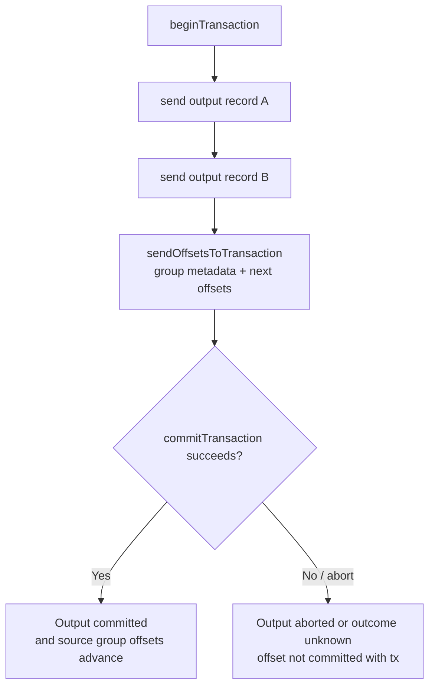

Data is written to Kafka logs and transaction state is coordinated by the broker. `read_committed` consumers see committed records; records from aborted transactions remain hidden from that consumer group.

### 6.1. A Kafka Transaction Is Not a JDBC Transaction

`KafkaTransactionManager` manages transactions for a **Kafka producer**. `DataSourceTransactionManager` manages transactions for a database. Having both managers does not automatically merge them into **one atomic transaction between Kafka and the database**.

### 6.2. Transactions Do Not Fix Non-Idempotent Business Logic

If a handler calls an HTTP payment API twice before emitting a Kafka event, Kafka can commit a single event while the payment still executed twice. EOS protects **Kafka output + offsets**, not side effects of arbitrary code running between consume and commit.

## 7. `transactional.id`, Producer ID, and Fencing

The Kafka broker uses `transactional.id` to identify a logical transactional producer across sessions and **fences** older producer instances when a new instance with the same identity claims ownership.

Rules:

- `transactional.id` must be **stable for a logical producer** without unintended contention between two active instances.
- With Spring Kafka, you typically set `transactionIdPrefix` on `DefaultKafkaProducerFactory`. The factory constructs `transactional.id` values from prefix and suffix.
- Across multiple running app instances, **the prefix must be unique per instance** per Spring Kafka documentation.
- If a fenced old instance attempts to commit, it receives `ProducerFencedException`; never treat this as a normal transient error to retry endlessly.
- Idle producers for too long can hit transactional ID expiration; Spring Kafka supports `maxAge` on producer factories in applicable versions to rotate producers before expiry.
- Transactional producer caches must be sized for concurrency and simultaneous transactions; never assume one producer can serve all threads concurrently.

### 7.1. Naming Example

```text
Pod A -> transaction-id-prefix: orders-worker-a-
        -> transactional.id: orders-worker-a-0
Pod B -> transaction-id-prefix: orders-worker-b-
        -> transactional.id: orders-worker-b-0
```

These names are illustrative. On Kubernetes, identity assignment must remain **unique and lifecycle-safe** across restarts, rollouts/canaries, and autoscaling; avoid sharing one prefix across all pods.

### 7.2. Distinguishing Consumer Group ID from Transactional ID

| Field | Purpose |
|---|---|
| `group.id` | Partition assignment and storing committed offsets of a consumer group |
| `client.id` | Client identification for metrics/tracing |
| `transactional.id` | Transactional producer identity for recovery/fencing |
| Business `eventId` | Business-level deduplication/idempotency |
| Spring `correlationId` | Request/reply tracking and error handling |

Never use `transactional.id` as a customer ID or business event ID.

## 8. `read_committed`: What Does a Consumer See After a Transaction?

Kafka consumers expose the `isolation.level` property:

```properties
isolation.level=read_committed
```

For records written by a **transactional producer**, `read_committed` delivers only records belonging to committed transactions; aborted records are withheld from the application. Non-transactional records are still read normally.

Conversely, `read_uncommitted` can read records from aborted transactions, exposing downstream consumers to outputs that upstream believed had rolled back.

### 8.1. Last Stable Offset (LSO)

`read_committed` does not always fetch up to the high watermark immediately, because an open transaction blocks visibility of records after the start of the unfinished transaction.

```text
Kafka log:
[100 committed] [101 TX open] [102 normal] [103 TX committed]

read_committed consumer:
  advances only to the Last Stable Offset
  -> may temporarily not see 102, 103 even though bytes exist on broker
```

This matters when monitoring lag/latency: a long-running open transaction or stalled producer can stall output visibility for `read_committed` consumers.

### 8.2. `read_committed` Does Not Filter Business Duplicates

If two separate transactions commit the same business event `order-1001`, downstream still receives two valid records. Use event IDs / idempotency to prevent double processing when the application layer can publish duplicates.

## 9. Transactional Consume–Transform–Produce: Happy Path

With a Spring Kafka transactional listener container, one processing cycle looks like:

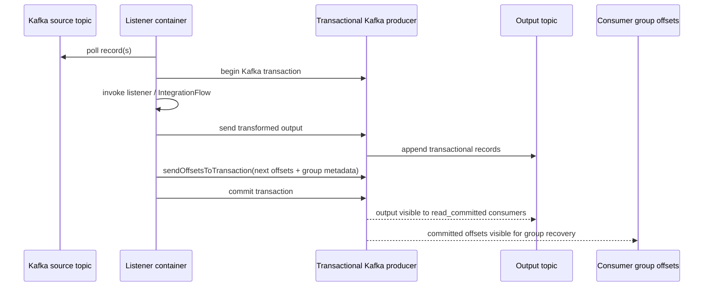

This is a **conceptual model**, not an exact trace of every internal thread and network call.

Key points:

1. The container starts a Kafka transaction when configured with an appropriate `KafkaAwareTransactionManager`/Kafka transaction manager.
2. Handler code sends output via a `KafkaTemplate` backed by the **same producer factory** as the transaction manager.
3. Once the listener completes normally, the container sends **next offsets** into the transaction.
4. Transaction commit makes Kafka output and source offset progression visible together.
5. Downstream consumers that must not see aborted outputs must use `read_committed`.

### 9.1. Scoped Strictly to Kafka

Kafka/Spring Kafka docs refer to this as EOS for **read → process → write within Kafka**. The "read" and "process" steps themselves can still execute more than once across crashes/rebalances; Kafka outputs and offsets commit atomically so Kafka state remains consistent. Sending an email inside the handler **is not part of this transaction**.

## 10. Failure Timeline: What Happens on Crash at Each Point?

| Crash point | Kafka output | Committed source offsets | What to plan for |
|---|---|---|---|
| Before processing input | No new output | Does not advance | Source resumes from committed position |
| After transform, before send | No output from transaction | Does not advance | Input is reprocessed |
| After `send()` into TX, before commit | May be written to log, transaction uncommitted/unaborted | Does not advance with TX | `read_committed` hides uncommitted output; recovery aborts/fences |
| After `sendOffsetsToTransaction()`, before commit | Output and offsets not yet atomically committed | Not visible as committed | Transaction must commit or abort; do not treat method return as done |
| Commit succeeds | Output committed | Offset advances with TX | Consumer group resumes after input |
| Commit response lost, outcome uncertain | Cannot conclude from client timeout alone | Cannot conclude from timeout alone | Reconcile transaction/offset/output; avoid blind external replay |
| After Kafka commit, before external audit write | Kafka committed | Advanced | Audit may be missing; use outbox/reconciliation if mandatory |

### 10.1. Kafka Transactions Do Not Make Late Callbacks Harmless

If code invokes async `send()` and returns before checking futures/callbacks, failures can surface at commit or callback time depending on the adapter. Never treat creating a `CompletableFuture` as broker confirmation.

### 10.2. Transaction Abort and Replay

When a listener throws an exception triggering transaction rollback, the Spring Kafka container can reposition the consumer via seek so unfinished records are fetched again. **Never call `seek()` arbitrarily from an error handler on another thread**, because the container owns partition assignment and recovery.

## 11. Spring Boot: Configuring Producer Transactions and Consumer Isolation

Sample configuration for a Kafka-in → Kafka-out flow:

```yaml
spring:
  kafka:
    bootstrap-servers: localhost:9092
    consumer:
      group-id: orders-transformer
      enable-auto-commit: false
      properties:
        isolation.level: read_committed
    producer:
      transaction-id-prefix: orders-transformer-instance-a-
      properties:
        acks: all
    listener:
      type: single
```

**Explanation:**

- `transaction-id-prefix` triggers Spring Boot auto-configuration of a transactional producer factory / Kafka transaction manager per your Boot/Spring Kafka version.
- `group-id` identifies the consumer group reading input; it is not a transaction ID.
- `enable-auto-commit=false` lets the container commit offsets transactionally without a parallel auto-commit loop.
- `isolation.level=read_committed` on the consumer prevents reading aborted transactional inputs.
- `acks=all` instructs the producer to require replica acknowledgments per policy; it does not replace transactions.
- `listener.type=single` illustrates a record listener; verify exact property names/behavior against your Boot version.
- Each **running instance** needs a distinct prefix—never copy `instance-a` across every pod.
- TLS/SASL/ACLs, topic creation, and broker settings must be configured separately per environment.

### 11.1. Do Not Just Set a Prefix and Assume EOS Works

After configuring, verify the listener container **actually holds the transaction manager**, `KafkaTemplate` shares the **same producer factory**, and downstream flows **do not break thread/transaction boundaries**. Custom manual bean configs can override Boot defaults.

### 11.2. Never Hard-Code Local Broker Settings in Production

`localhost:9092` is purely illustrative. Production needs secret management, TLS/SASL, authorized topic/group/transactional IDs, and health/readiness checks; never log credentials in error handling.

## 12. `KafkaTemplate.executeInTransaction`: Producer-Only Transactions

When a service is not consuming Kafka input directly but must send **multiple output records atomically within Kafka**, use `KafkaTemplate.executeInTransaction`:

```java
import org.springframework.kafka.core.KafkaTemplate;
import org.springframework.stereotype.Service;

@Service
public class OrderEventsPublisher {

    private final KafkaTemplate<String, String> kafka;

    public OrderEventsPublisher(KafkaTemplate<String, String> kafka) {
        this.kafka = kafka;
    }

    public void publishPair(String orderId, String validatedJson,
                            String auditJson) {
        kafka.executeInTransaction(template -> {
            template.send("orders.validated", orderId, validatedJson);
            template.send("orders.audit", orderId, auditJson);
            return null;
        });
    }
}
```

If the callback finishes normally and commits, both Kafka sends share one transaction. If the callback throws, the transaction rolls back/aborts per API.

**Do not assume this method commits source consumer offsets.** It is a **producer-only local transaction** unless the application explicitly performs consumer-initiated coordination. Calling `executeInTransaction` inside another transaction creates its own Kafka transaction per Spring Kafka docs; do not use it to "attach" onto a container transaction arbitrarily.

### 12.1. This Snippet Is Not a Distributed Transaction

If a preceding `jdbcTemplate.update(...)` already committed, `executeInTransaction` failing **does not roll back the DB**. When DB↔Kafka consistency is the goal, see the outbox and transaction synchronization sections.

### 12.2. Should You Call `flush()`?

Do not insert `flush()` after every send just to feel safe: it hurts throughput and does not replace commit. Rely on transaction commit, send results, and broker acknowledgments per contract. With asynchronous outbound adapters, check callback/`sync` settings before callers declare success.

## 13. Spring Kafka Transactional Listener: Minimal Example

This example shows a **Spring Kafka container-owned listener** illustrating Kafka-in → Kafka-out transactions. In Spring Integration, it also clarifies the mechanism underlying `KafkaMessageDrivenChannelAdapter`.

```java
import org.springframework.kafka.annotation.KafkaListener;
import org.springframework.kafka.core.KafkaTemplate;
import org.springframework.stereotype.Component;

@Component
public class OrderValidationListener {

    private final KafkaTemplate<String, String> template;

    public OrderValidationListener(
            KafkaTemplate<String, String> template) {
        this.template = template;
    }

    @KafkaListener(
        topics = "orders.in",
        groupId = "orders-transformer")
    public void handle(String input) {
        String normalized = normalizeAndValidate(input);

        // When the listener container has Kafka transactions enabled and
        // KafkaTemplate uses the matching ProducerFactory, this send joins the tx.
        template.send("orders.validated", normalized);
    }

    private String normalizeAndValidate(String input) {
        if (input == null || input.isBlank()) {
            throw new IllegalArgumentException("Empty order event");
        }
        return input.trim();
    }
}
```

**Conditions for valid EOS scope:**

1. The listener container is configured with an appropriate Kafka transaction manager.
2. `ProducerFactory` supports transactions, and `KafkaTemplate` uses the same factory.
3. Listener exceptions **propagate to the container**, not swallowed by a handler.
4. Consumer offsets are enlisted into the Kafka transaction by the container on success.
5. Input and output topics reside within a broker/cluster topology supporting transactions.
6. Consumers needing atomic visibility set `read_committed`.
7. No DB/HTTP side effects exist that you mistakenly assume roll back with Kafka.
8. Output sends are not offloaded to an out-of-transaction executor while returning success early.

A `@KafkaListener` method alone **does not enable Kafka transactions**; container and producer configuration decide.

## 14. Spring Integration: `KafkaMessageDrivenChannelAdapter` and Listener Containers

Spring Integration does not replace Spring Kafka's consumer container. `KafkaMessageDrivenChannelAdapter` wraps Spring Kafka's `KafkaMessageListenerContainer` or `ConcurrentMessageListenerContainer`, converting records into Spring Messaging `Message<?>` and sending them into an `IntegrationFlow`.

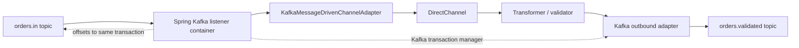

For transactional Kafka read–process–write, **the path from listener to outbound producer must stay inside an active execution/transaction boundary**. `DirectChannel` keeps processing synchronous on the same call stack; swapping in `ExecutorChannel` without explicit transaction propagation breaks that assumption.

### 14.1. Sample Java DSL: Message-Driven Inbound

```java
import org.springframework.context.annotation.Bean;
import org.springframework.context.annotation.Configuration;
import org.springframework.integration.dsl.IntegrationFlow;
import org.springframework.integration.kafka.dsl.Kafka;
import org.springframework.integration.kafka.inbound.KafkaMessageDrivenChannelAdapter;
import org.springframework.kafka.core.ConsumerFactory;

@Configuration(proxyBeanMethods = false)
class OrdersKafkaInboundFlow {

    @Bean
    IntegrationFlow ordersKafkaFlow(ConsumerFactory<String, String> cf,
                                    OrderMessageHandler handler) {
        return IntegrationFlow
            .from(Kafka.messageDrivenChannelAdapter(
                cf,
                KafkaMessageDrivenChannelAdapter.ListenerMode.record,
                "orders.in"))
            .handle(String.class, (payload, headers) -> {
                handler.process(payload);
                return null;
            })
            .get();
    }
}

interface OrderMessageHandler {
    void process(String payload);
}
```

This is an **inbound + handler sample**, not a complete EOS flow: it does not configure a transactional listener container, Kafka outbound producer, DLT, or assertions. If `handler.process()` sends output via a properly wired transactional `KafkaTemplate`, you can extend it into a Kafka-in → Kafka-out flow; verify with real transaction tests.

### 14.2. Keep Listener Container Configuration Consistent

You can build containers from a `ConcurrentKafkaListenerContainerFactory` configured with a transaction manager, or configure the container directly per version. Never construct an unrelated container instance bypassing Boot's factory and expect `spring.kafka.producer.transaction-id-prefix` to attach automatically to it.

### 14.3. Adapter Error Publisher

Spring Integration's message-driven adapter offers error channel / recovery callback options. Routing an error as an `ErrorMessage` to an error flow **does not mean the container rolls back**. If the error handler catches and swallows the exception while the listener treats it as handled, offsets may advance per policy. Test the exact error channel and transaction outcomes.

## 15. Pollable `KafkaMessageSource` vs. Message-Driven Kafka Adapter

Spring Integration provides `KafkaMessageSource` for inbound **polling adapters**:

```java
@Bean
IntegrationFlow pollableKafkaFlow(
        ConsumerFactory<String, String> consumerFactory) {
    return IntegrationFlow
        .from(Kafka.inboundChannelAdapter(
                    consumerFactory, new ConsumerProperties("orders.in")),
              endpoint -> endpoint.poller(Pollers.fixedDelay(1000)))
        .handle(String.class, (payload, headers) -> {
            // Illustrative synchronous handling.
            return null;
        })
        .get();
}
```

This DSL example requires version-compatible imports for `Kafka`, `ConsumerProperties`, and `Pollers`. It **does not automatically become a consumer-initiated Kafka transaction** merely by living inside Spring Integration.

### 15.1. Key Differences

| Trait | Message-driven | Pollable `KafkaMessageSource` |
|---|---|---|
| Who polls? | Kafka listener container | `SourcePollingChannelAdapter` / poller |
| Threads and lifecycle | Container listener threads | Scheduled poller thread(s) |
| Offsets/acks | Container `AckMode` / transaction policy | Source ack factory / consumer properties and poller processing policy |
| Error path | Listener/container + adapter recovery | Poller error handler / `errorChannel` |
| EOS read→write | Transactional listener container supports directly | Do not assume equivalent; design and test explicitly |
| Poll interval | Container polling loop | Poller schedule and Kafka `max.poll.interval.ms` must align |
| Batch handling | Listener record/batch mode | `allowMultiFetch` and source-specific semantics |

The Spring Integration reference notes that when the source polls multiple records, **all records must be processed and polling must resume within `max.poll.interval.ms`** to avoid consumer group rebalances.

### 15.2. Do Not Mix the Two Ack Models

When using a transactional Kafka listener container, never call consumer `commitSync()` inside a handler simply because you see an `offset` header. When using `KafkaMessageSource`, never borrow `AckMode.RECORD` assumptions from listener containers to infer when the source committed.

## 16. Kafka Headers in Spring Integration: Do Not Confuse Source Offsets with Output Offsets

Spring Integration Kafka adapters map Kafka metadata onto Spring `Message` headers depending on converter and version. Common headers of interest:

- Received topic, partition, key, and offset.
- Timestamp and group/client metadata when present.
- `Acknowledgment` or consumer object in certain modes/configs.
- Producer headers selecting outbound topic, key, and partition.
- Gateway correlation ID / request-reply metadata.
- Delivery-attempt / error metadata when supplied by the container.

### 16.1. Record Mode vs. Batch Mode

In `record` mode, each message usually maps to one Kafka `ConsumerRecord`; in `batch` mode, the payload can be a list and several received headers become **lists of corresponding values**.

Never blindly cast `headers.get(KafkaHeaders.OFFSET)` to `Long` in every mode, because batch mode or header naming/versions can differ. Verify exact APIs for your version and converter.

### 16.2. Never Let External Headers Control Offsets or Transactions

Kafka records carry producer-supplied headers. Accepting headers such as `app.offsetToCommit` or `transactional.id` from untrusted inputs can corrupt recovery or tenant routing. Source offsets must come from trusted consumer/container metadata and group assignments.

## 17. Kafka Outbound Adapter: Async Sends and Transaction Confirmation

A `KafkaProducerMessageHandler` in Spring Integration invokes the producer via `KafkaTemplate`. Sends can succeed or fail asynchronously depending on send configuration.

Per the Spring Integration reference, outbound Kafka handlers support channels/settings such as:

- `sendSuccessChannel` on successful confirmation.
- `sendFailureChannel` receiving an `ErrorMessage` wrapping `KafkaSendFailureException` on send failure.
- `sync` and timeout settings to await results in the handler when appropriate.
- `futuresChannel` / future correlation in certain batch modes and versions.

**Calling `KafkaTemplate.send()` does not mean the broker immediately committed the transaction.** Spring Kafka transaction commit is a separate boundary and may uncover a send failure later.

### 17.1. When a Listener Container Holds an Active Kafka Transaction

To make producer exceptions trigger rollback, ensure failures surface **before the listener returns / the transaction commits**, or are handled properly inside the transaction boundary. A callback firing after the handler returns can leave outer logic believing everything succeeded; inspect `sync`/future settings on the adapter and test against a real broker.

### 17.2. `sendFailureChannel` Is Not a Kafka DLT

A failure channel is a Spring `MessageChannel` for observing/routing send errors. A DLT is a Kafka topic written by a producer/recoverer with its own policies and broker acknowledgments. Never call `sendFailureChannel` a DLT or treat receiving an `ErrorMessage` as a rolled-back offset.

## 18. Thread Boundaries: Why `DirectChannel` Matters

A Kafka transaction binds producer resources to the execution context/thread via Spring transaction synchronization. Consider:

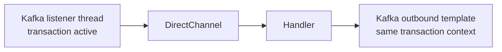

This topology keeps transaction boundaries easy to control. Adding `ExecutorChannel`:

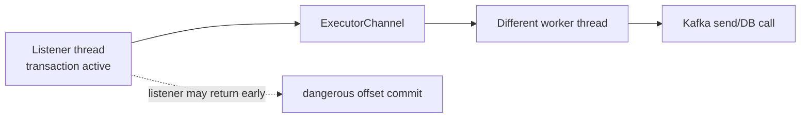

Never assume thread-bound transaction context crosses an executor automatically. If the listener returns and the container commits the offset before the worker completes, you risk **losing work** or sending outside the transaction.

### 18.1. Other Components That Break This Assumption

- `QueueChannel` with a separate consumer.
- `PublishSubscribeChannel` backed by an executor.
- `@Async` service methods.
- `CompletableFuture.supplyAsync`.
- Async HTTP/JMS/AMQP callbacks.
- Reactive chains switching threads without a matching reactive transaction model.

**Design rule:** when async decoupling is needed, treat it as a **separate durable messaging boundary** with independent transactions, retries, and idempotency—rather than stretching an imaginary Kafka transaction across threads.

## 19. Rebalances, Partition Assignments, and Offset Recovery

During a consumer group rebalance, partitions move to other instances. A new consumer normally resumes from the **committed group offset**, not an old thread's uncommitted position.

### 19.1. Causes of Rebalances

- Rolling deployments or autoscaling.
- Instance crashes or long GC pauses.
- Exceeding `max.poll.interval.ms` due to blocking handlers.
- Broker/network glitches.
- Topic partition count changes.
- Membership or assignment strategy changes.

### 19.2. What to Verify

| Scenario | Question |
|---|---|
| Handler is mid-flight when partition is revoked | Does the transaction/offset abort or reprocess? |
| New consumer receives the partition | From which offset does it resume? |
| Old worker is still calling external HTTP | Can it trigger duplicate side effects after revocation? |
| Old producer gets fenced | Is `ProducerFencedException` caught and recovered cleanly? |
| A batch of records was already fetched | Which unfinished records get re-read? |
| DLT/retries are in progress | Can rebalances cause duplicate events? |

Size `max.poll.interval.ms` to match realistic processing. Never raise it indefinitely to hide handlers blocking on HTTP: cap request timeouts, use pause/backoff, or decouple via durable stages.

### 19.3. How Do Kafka Transactions Help Here?

Kafka transactional offsets and producer fencing preserve Kafka output/offset consistency across ownership changes, yet cannot undo an HTTP POST or database transaction already committed by an old worker.

## 20. Batch Listeners: Offsets, Rollbacks, and Poison Records in Batches

A Kafka listener can run in record mode or batch mode.

```text
Record mode:
  listener(record 300) -> success -> transaction handles offset
  listener(record 301) -> exception -> abort/replay per policy

Batch mode:
  listener([300, 301, 302, 303])
      300 success
      301 success
      302 fails
      303 unprocessed
  -> container may roll back/replay the entire batch without pinpointing the bad record
```

For transactional batch listeners, the Spring Kafka reference notes that the **default after-rollback processor typically replays the whole batch** because the container does not know which exact record failed.

### 20.1. Risk with Non-Kafka Side Effects

Suppose a batch of 100 records writes each record to a database before sending a Kafka event:

- 99 rows commit in separate DB transactions.
- Record 100 fails.
- The Kafka transaction aborts, hiding Kafka outputs from `read_committed`.
- The input batch is replayed.
- The 99 prior DB writes are not rolled back by Kafka, risking duplicate writes.

Batch processing therefore requires **aligned DB transactions or business idempotency**, plus record-aware recovery when needed.

### 20.2. When to Use `BatchListenerFailedException`?

In supported configurations/versions, Spring Kafka provides `BatchListenerFailedException` to identify the failing index/record to error handling. However, **never assume every transactional batch listener automatically skips only the failing record**. Verify your listener adapter, error handler / after-rollback processor, batch type, and version.

### 20.3. Never Commit the "End-of-Batch Offset" Just Because You Read It

Committing the offset past the last record in a batch is valid only when every record in that batch is properly processed or safely recovered per contract. An error handler that merely logs is insufficient confirmation.

## 21. Transaction Rollback, `AfterRollbackProcessor`, and DLT

In Spring Kafka:

- When a **transactional listener** throws an exception, the container aborts the Kafka transaction.
- After rollback, `DefaultAfterRollbackProcessor` can seek so the consumer re-fetches unfinished records.
- A recoverer can route **poison records** to a dead-letter topic (DLT) per configured policy.
- For **non-transactional containers**, `DefaultErrorHandler` is the standard tool for retry/seek/recovery.
- If a custom error handler is used on a transactional container and rollback is desired, it must **throw an exception** rather than returning normally after partial handling.

### 21.1. Error and Recovery Flow Diagram

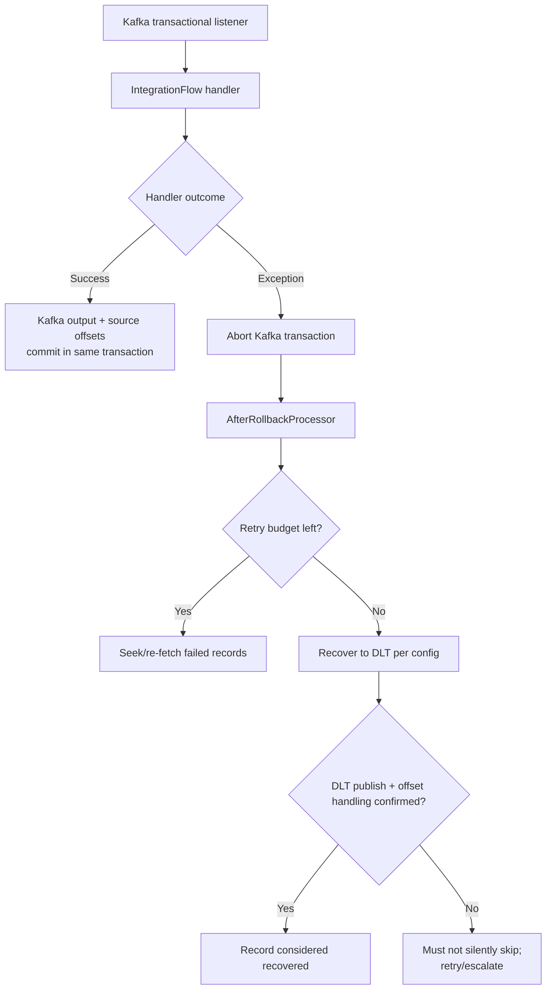

**DLT is not an automatic capability of `errorChannel`.** A DLT publish itself can fail due to ACLs, broker outages, serializers, or producer transactions.

### 21.2. Recovering Inside a New Transaction

Spring Kafka supports configurations where `DefaultAfterRollbackProcessor` executes DLT recovery in a fresh transaction and commits the recovered record's offset in that transaction, provided a recoverer, `KafkaTemplate`, and matching `commitRecovered` settings are wired.

This coordinates **DLT output + offset progress** within Kafka, but check exact APIs and versions. Never copy `DefaultErrorHandler.commitRecovered` snippets from a non-transactional container onto an after-rollback processor assuming identical semantics.

### 21.3. Non-Blocking Retries and Transactions

Per the Spring Kafka transaction reference, **non-blocking retry topics do not combine with container transactions along the same rollback path**: when a listener throws, the mechanism may commit the current transaction and forward the record to a retryable topic per strategy. When adopting retry topics, re-verify assumptions and test source offsets, retry topics, and DLT thoroughly.

### 21.4. When to Quarantine Instead of Retrying?

- Invalid JSON/schema after deserialization.
- Permanent business invariant violations that backoff cannot fix.
- Wrong tenant or unauthorized record.
- Exhausted attempt limits.
- External side effects with unknown outcomes needing manual reconciliation.

Quarantine stores should hold payload references protected by ACLs, retention, and ownership—not dump raw Kafka records onto dashboards by default.

## 22. Spring Integration `errorChannel` Does Not Directly Control Kafka Offsets

In Spring Integration, handler errors can:

- Be thrown straight back to the caller on the same thread.
- Be wrapped into an `ErrorMessage` by a `MessagePublishingErrorHandler`.
- Flow through a private or global `errorChannel`.
- Be handled by a recovery callback and turned into another result.
- Be ignored or mapped into a business reply if the app chooses.

**The Kafka listener container only knows the outcome from the exception/callback path it actually receives.** If an error handler catches the exception and returns normally as success, the container can include the offset in the transaction and commit per config, even though business work failed.

### 22.1. Illustration of Dangerous Behavior

```java
public void process(String payload) {
    try {
        callRemotePayment(payload);
    } catch (RuntimeException ex) {
        // DANGEROUS if lacking a recovery store and expecting broker redelivery:
        log.warn("Payment failed");
        return; // Container may treat this as success.
    }
}
```

To trigger retries from the Kafka source, let the exception **reach the container error-handling boundary**, or persist durable recovery before treating the record as handled.

### 22.2. An Error Flow That Only Increments Metrics Is Not Durable Recovery

```text
Kafka listener -> IntegrationFlow -> handler fails
                                   -> errorChannel
                                      -> metrics counter
                                      -> return
```

The error counter increments, yet no DLT/quarantine/DB recovery record exists. Require **durable persistence** and verified source settlement before considering errors resolved.

### 22.3. `failedMessage` and `originalMessage` Can Be Missing

`MessagingException.getFailedMessage()` identifies the message at failure time, and `ErrorMessage.getOriginalMessage()` may retain the input. However, deserialization, connection, or poll errors occurring before a Spring `Message` is constructed may **lack an original payload**. Use proper Kafka source metadata and consumer error strategies instead of fabricating dummy messages to advance offsets.

## 23. Kafka + JDBC: Two Separate Transactions

A service might execute:

```text
Kafka consume -> validate -> JDBC update -> Kafka publish
```

There are at least **two resource managers**: the database and Kafka. Spring Kafka supports transaction synchronization/chaining per configuration, yet does not create **one cross-system ACID transaction** without an appropriate distributed protocol.

### 23.1. DB Commits First, Kafka Second

In a supported Spring transaction synchronization setup where the database transaction is primary and `KafkaTemplate` joins via synchronized transactions, the commit sequence may look like:

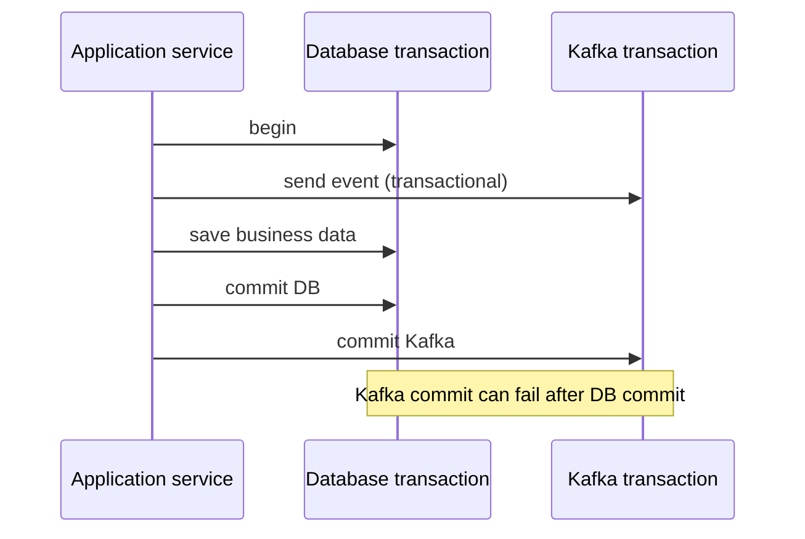

As noted in the Spring Kafka reference for applicable versions, if the secondary commit fails after the primary commit, an exception is thrown to the caller so the application can compensate or reconcile.

### 23.2. Kafka First, DB Second

You can invert transaction boundaries by design, yet when Kafka commits and the DB commit fails, downstream Kafka consumers may already receive an event with no committed business row in the DB.

**Swapping commit order only changes the type of inconsistency—it does not eliminate it.**

### 23.3. Illustrative Transaction Synchronization Example

```java
import org.springframework.kafka.core.KafkaTemplate;
import org.springframework.stereotype.Service;
import org.springframework.transaction.annotation.Transactional;

@Service
class OrderWriterService {

    private final OrderRepository repository;
    private final KafkaTemplate<String, String> template;

    OrderWriterService(OrderRepository repository,
                       KafkaTemplate<String, String> template) {
        this.repository = repository;
        this.template = template;
    }

    @Transactional("transactionManager")
    public void saveAndPublish(String id, String eventJson) {
        // Assumes transactionManager here is the DB manager,
        // KafkaTemplate is configured as transaction-capable, and
        // transaction synchronization is wired properly.
        repository.store(id);
        template.send("orders.validated", id, eventJson);
    }
}

interface OrderRepository {
    void store(String id);
}
```

This snippet **does not set up** the Kafka transaction manager or synchronization itself; it merely illustrates both resources appearing together. Verify the specific `transactionManager` bean, `KafkaTemplate`/`ProducerFactory`, commit ordering, and failure tests before using.

### 23.4. Why Does `@Transactional` Cause Confusion?

If `@Transactional` selects `DataSourceTransactionManager`, it manages the DB. If it selects `KafkaTransactionManager`, it manages the Kafka producer. Across `@Async`/`ExecutorChannel`, the caller's thread transaction context does not follow automatically.

Never write "`@Transactional` gives exactly-once between DB and Kafka" without explicitly documenting resource managers and limits.

## 24. Transactional Outbox: When DB and Kafka Must Stay Business-Consistent

When business rules dictate **if the DB commits, an event must eventually be emitted**, a transactional outbox is usually far safer than unrecovered dual-writes.

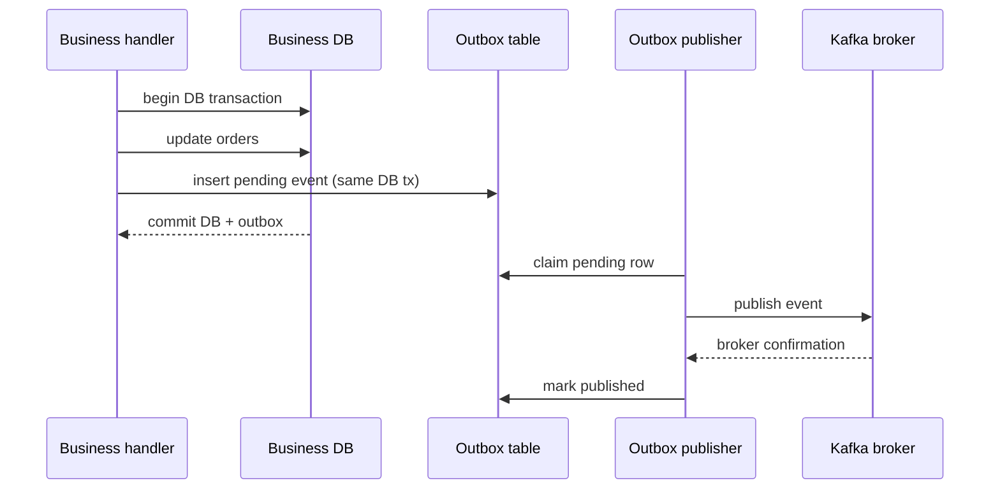

**Strength:** business updates and the commitment to "emit a Kafka event" share the same DB transaction. During a Kafka outage, the outbox row persists safely.

**Limitation:** the publisher can publish successfully and crash before marking the outbox row `PUBLISHED`, causing a resend. Downstream consumers must still be idempotent; an outbox does not guarantee zero duplicates in every scenario.

### 24.1. Illustrative DDL

```sql
CREATE TABLE order_outbox (
    event_id         VARCHAR(100) PRIMARY KEY,
    aggregate_id     VARCHAR(100) NOT NULL,
    payload_ref      VARCHAR(500) NOT NULL,
    status           VARCHAR(30) NOT NULL,
    attempt_count    INTEGER NOT NULL DEFAULT 0,
    next_attempt_at  TIMESTAMP NULL,
    created_at       TIMESTAMP NOT NULL,
    updated_at       TIMESTAMP NOT NULL
);
```

This schema is **illustrative**: add tenant scoping, indexes, transaction isolation, leasing, retention, payload encryption, and DB-specific migrations.

### 24.2. Where to Replay From When Kafka Publish Fails?

When the DB already committed and the Kafka outbound adapter fails, retry **the outbox publisher**, not the entire HTTP/JMS/SFTP/Kafka source event from the start. Replay the smallest safely repeatable step.

### 24.3. Can Outbox and Kafka Transactions Work Together?

An outbox publisher can use a Kafka producer transaction to group multiple outbound Kafka records atomically. Still, updating the outbox DB status and committing Kafka remain two separate resources; maintain idempotent processing and reconciliation.

## 25. Inbox / Deduplication: Protecting Side Effects When Kafka Input Replays

When a consumer processes a Kafka record and updates JDBC or calls an API, persist processed business event IDs:

```sql
CREATE TABLE processed_event (
    consumer_name   VARCHAR(100) NOT NULL,
    event_id        VARCHAR(150) NOT NULL,
    processed_at    TIMESTAMP NOT NULL,
    PRIMARY KEY (consumer_name, event_id)
);
```

Inside a **DB transaction**:

1. Check/insert `processed_event` via unique key.
2. Update business tables only if the event was not already processed.
3. Commit the DB transaction.
4. Let the container advance the offset per contract; if crashing before offset commit, the event replays yet DB deduplication blocks duplicate side effects.

### 25.1. Never Rely Solely on Offset as Business ID

`topic/partition/offset` identifies **a specific physical record**, whereas the same business event may be republished to a new offset or another topic. Use `eventId` or a business idempotency key to protect business operations.

### 25.2. When an Event Lacks an ID

Construct a deterministic key from source ID, aggregate/version, and operation. Payload hashes help check integrity, yet are not always unique business identities (two distinct events can share identical payloads; formatting/whitespace may change).

### 25.3. When Replaying a DLT

Preserve the original business event ID, source metadata, and retry lineage. Generating an arbitrary new event ID during DLT replay prevents deduplication from recognizing already-applied partial work.

## 26. Adapters Outside Kafka: Transaction Boundaries Do Not Propagate Automatically

`SPRING_INTEGRATION_ADAPTERS` frequently combines multiple adapters. The table below identifies what a Kafka transaction **does not** govern:

| Component | Can it join a Kafka transaction directly? | Dedicated safeguard |
|---|---|---|
| Kafka outbound sharing `ProducerFactory` | **Yes**, per transaction context and config | Kafka transaction commit + confirmation |
| Consumer group offsets | **Yes**, when container enlists offsets properly | `sendOffsetsToTransaction` / container EOS |
| JDBC / database | **Not directly** | DB transaction + outbox/inbox/dedup |
| HTTP outbound POST | **No** | Idempotency keys + status reconciliation |
| SFTP file move/download | **No** | Staging / atomic rename where supported, checksums, metadata |
| Local file archive/quarantine | **No** | Filesystem ops + state journal / compensation |
| JMS queue transaction | **No** | JMS session transactions, ack/rollback/DLQ |
| AMQP broker channel | **No** | Ack/nack, publisher confirms, DLX/DLQ |
| External SaaS API | **No** | Operation IDs, retry budgets, compensation or sagas |

### 26.1. File/SFTP → Kafka

A file poller can emit Kafka records inside a producer transaction, yet a Kafka rollback does not move files back to the source directory. File accept-once filters and local/remote staging need their own state machine.

### 26.2. JMS/AMQP → Kafka

A Kafka transaction does not commit/roll back JMS/AMQP deliveries. When receiving from JMS and publishing to Kafka, manage transactions/acks across **both brokers** using outbox/inbox, idempotency, or durable recovery flows.

### 26.3. HTTP → Kafka

When an HTTP inbound gateway receives a request and publishes to Kafka, clients need clarity on whether the API returns **accepted** or **durably committed** per contract. A Kafka producer transaction cannot "roll back" or retract an HTTP client request.

### 26.4. JDBC Poller → Kafka

A JDBC inbound adapter claims rows and sends to Kafka: a Kafka transaction does not reset rows back to `NEW` when publishing fails. Use leases, row statuses, and an outbox publisher, persisting pending state in the same DB transaction as claiming the row.

## 27. DLT, Retry Topics, and Poison Loops: Intentional Offset Decisions

An invalid record cannot retry forever. Define a **terminal rule** for advancing the source consumer past the record.

```text
input record
   -> listener attempt 1
   -> retry/backoff ...
   -> exhausted
   -> DLT publish / quarantine persist
   -> confirm durable recovery
   -> commit/advance source offset per chosen model
```

If DLT publish fails while the source offset commits, the message is lost at the business level. If DLT publish succeeds yet the source offset fails to commit, the message reprocesses and duplicates in the DLT; use idempotency and verify recovery transactions.

### 27.1. Never Label Every Exception as Retryable

Deserialization errors, schema mismatches, authorization failures, and code bugs are rarely solved by hot retries. Timeouts may be transient, yet external side-effect outcomes must be checked.

### 27.2. Multi-Layer Retry Budgets

Avoid stacking listener/container retries, Spring Integration `RequestHandlerRetryAdvice`, Kafka retry topics, caller retries, and operator replays without an overall attempt/deadline cap. One poison message can run hundreds of times if each layer resets counters.

### 27.3. Conditions for Skipping a Record

Skip/commit past a record only after a **confirmed recovery action** per policy: DLT/quarantine persisted, audited business rejection with an owner, or idempotent success. "No exception thrown" is insufficient if a handler swallowed errors.

## 28. `seek()`, Manual Commits, Pause/Resume, and Container Ownership

Kafka consumer APIs expose `seek`, `commitSync`, `commitAsync`, `pause`, and `resume`, yet in Spring Kafka/Spring Integration, the listener container owns most of the consumer lifecycle.

### 28.1. Never Call `seek()` from Non-Consumer Threads

`KafkaConsumer` is **not thread-safe**; never call `seek`/`commit` from arbitrary executors or HTTP callbacks. Spring Kafka provides `ConsumerSeekAware`, error handlers, after-rollback processors, and container APIs to interact at the proper boundaries.

### 28.2. Manual Ack in Non-Transactional Listeners

```java
import org.springframework.kafka.annotation.KafkaListener;
import org.springframework.kafka.support.Acknowledgment;
import org.springframework.stereotype.Component;

@Component
class ManualAckConsumer {

    @KafkaListener(
        topics = "orders.in",
        groupId = "orders-manual-group",
        containerFactory = "manualAckFactory")
    void listen(String event, Acknowledgment acknowledgment) {
        handle(event);

        // Valid only when containerFactory uses AckMode.MANUAL
        // or MANUAL_IMMEDIATE and handle succeeds per policy.
        acknowledgment.acknowledge();
    }

    void handle(String event) {
        // business logic
    }
}
```

`manualAckFactory` is a **separately configured bean**—it does not materialize automatically just because the method accepts `Acknowledgment`.

**Never copy this pattern into a transactional listener and unconditionally call `acknowledge()` and `commitSync()`.** With Kafka transactions enabled, the container enlists offsets into the transaction per listener mode.

### 28.3. `commitSync` vs. `commitAsync`

In non-transactional containers, `syncCommits` toggles synchronous vs. asynchronous consumer commits. A failed async callback indicates a commit issue; monitor it rather than assuming "commit requested" equals committed offset persisted on the broker.

### 28.4. Pause Is Not Rollback

Pausing a consumer stops fetching for partitions or containers per API, yet does not undo already-fetched records, roll back DB writes, or commit offsets on the application's behalf.

## 29. Kafka Request–Reply Gateways and Transactional Offsets

Spring Integration supports Kafka **inbound/outbound gateways** for request–reply, but distinguish clearly:

- Producer sends the request record.
- Consumer processes the request and sends the reply record.
- Reply consumer reads the topic, matches correlation, and enforces timeouts.
- Request and reply source offsets may belong to **completely different consumer groups**.
- Caller timeout does not prove the remote handler did not run.

### 29.1. "Gateway Timeout" Does Not Mean Kafka Transaction Aborted

An outbound gateway waits longer for the reply than for the send acknowledgment. When the caller times out, the request may already be committed on the request topic and under processing by the remote consumer. Retrying with a new ID can duplicate the operation.

### 29.2. Transaction Scope Per Stage

```text
Stage A: API caller -> Kafka request topic
Stage B: Kafka request listener -> business logic -> reply topic
Stage C: Reply consumer -> correlation -> Java/HTTP response
```

Each stage has its own transactions/acks and timeouts. No single Kafka transaction spans the network, two listener containers, and the entire HTTP wait time.

### 29.3. Safe Request–Reply Design

- Keep correlation/request IDs stable.
- Enforce business idempotency keys.
- Distinguish accepted, published, processed, and completed states.
- Configure timeouts and DLTs for both request and reply consumers.
- Persist uncertain states and support lookup/reconciliation.
- Verify request consumer and reply consumer offsets independently.

## 30. Performance, Timeouts, and Transaction Limits

Kafka transactions incur overhead for producer state, commit/abort markers, and latency. Key settings to weigh:

| Parameter | Impact and risk |
|---|---|
| `transaction.timeout.ms` | Overly long transactions get aborted by the broker; must stay within broker maximums |
| `max.poll.interval.ms` | Consumer triggers rebalance if processing exceeds interval between polls |
| `max.poll.records` | Larger batches increase max processing time before the next poll |
| Producer transaction cache size | Exhausts transactional producers under high concurrency |
| `transactional.id` prefix | Must be unique per instance; duplicates trigger fencing |
| `transactional.id.expiration.ms` | Idle producers may require refresh/`maxAge` |
| `isolation.level` | Downstream visibility and LSO latency |
| `acks` and replication | Durability of producer writes |
| `delivery.timeout.ms` | Producer send deadline; must align with transaction timeout |
| `max.block.ms` | Affects waiting for metadata or buffer capacity |
| `concurrency` | More listener threads/transactions; size producer cache accordingly |
| `pollTimeout` | Affects poll cadence and nack/backoff resolution |

### 30.1. Producer Cache Exhaustion

Spring Kafka caches transactional producers. Under insufficient capacity for concurrency or nested transactions, the app can throw `NoProducerAvailableException` depending on version/config. Never fix this with tight retry loops; size the cache/throughput and apply backoff.

### 30.2. Delays from Open Transactions

`read_committed` consumers stall visibility behind long-lived open transactions. Monitor Last Stable Offset and transaction duration—not just CPU or topic record counts.

### 30.3. Safe Optimization

- Keep transactions short; avoid slow HTTP calls inside Kafka transactions.
- Use bounded timeouts and circuit breakers for external calls.
- Measure throughput alongside transaction abort/commit rates.
- Size `max.poll.records` and concurrency to realistic workloads.
- Never share prefixes across application instances.
- Test transaction semantics across scaling and rebalances.

## 31. Observability: Three Metric Groups to Track

**Group 1 — Input Consumer**

- Consumer lag and committed offsets per group and partition.
- Rebalance/revoke events.
- Poll processing duration.
- Retry/redelivery counts.
- DLT backlog and record age.
- Skipped/recovered record counts with evidence.

**Group 2 — Producer Transaction**

- Transaction begin/commit/abort/failure counts.
- Transaction duration.
- Producer fencing and `NoProducerAvailableException`.
- Send timeouts and delivery acknowledgment failures.
- Output record rate and `read_committed` visibility latency.
- Producer cache utilization.

**Group 3 — Business Outcomes**

- Processed business event IDs and prevented duplicates.
- DB outbox pending count and oldest age.
- Unknown external side-effect outcomes.
- HTTP idempotency conflicts / pending reconciliations.
- Quarantine persistence failures.
- Divergence between source progress and confirmed outputs.

### 31.1. Illustrative Metric Names

```text
kafka_tx_commit_total{flow,outcome}
kafka_tx_abort_total{flow,category}
kafka_consumer_rebalances_total{group}
kafka_dlt_backlog_count{topic}
outbox_pending_count{flow}
business_event_duplicate_prevented_total{flow}
unknown_side_effect_outcomes_count{operation}
```

Not all of these names are **built-in defaults in Spring Kafka/Micrometer**. Wire actual metrics using your framework bindings and instrumentation.

### 31.2. Low Lag Does Not Prove Exactly-Once

A consumer can commit source offsets rapidly while dropping Kafka outputs or missing DB side effects if misconfigured. Reconcile **input event IDs, committed offsets, output event IDs, and business state**.

### 31.3. Never Use Personal or Unbounded IDs as Metric Labels

Avoid emails, raw payloads, sensitive Kafka keys, tokenized URLs, unique transaction IDs, or stack traces as metric labels. Stick to bounded-cardinality flow, transport, and error-category labels.

## 32. Security and Access Control in Transactional Kafka Flows

Kafka transactions are a consistency mechanism, not a substitute for authentication, authorization, or data protection.

### 32.1. Required Permissions

Depending on your broker/ACL model, the application may need permissions to:

- Read source topics and consumer groups.
- Write output topics and manage `transactional.id`s.
- Send outputs and commit offsets transactionally for the group.
- Write DLT/retry topics during recovery.
- Access Schema Registry or encryption keys if used.
- Read/emit to authorized audit/metrics endpoints.

Missing permissions surface as producer exceptions, commit failures, or containers failing to start; never fix them by granting broker-wide wildcards.

### 32.2. Never Log Raw Events to Debug Transactions

`ErrorMessage`, `failedMessage`, record headers, exception causes, and Kafka keys can hold PII, business secrets, or credentials. Log only essential metadata, trusted correlation IDs, error categories, and masked source references.

### 32.3. Tenant Isolation

One Kafka group may process events for multiple tenants. Idempotency keys and outbox/inbox primary keys must include **tenant scope** when required. Never let client-supplied headers dictate cross-tenant offset or recovery routing.

### 32.4. DLT Retention

A DLT may retain sensitive payloads longer than primary topics. Enforce ACLs, encryption, retention limits, auditing, secure replay, and compliant deletion policies. "Kafka committed to DLT" does not mean "keep payloads forever."

## 33. Testing Transactions with a Real Kafka Environment

A pure unit test:

```java
// Tests transform logic only; does NOT prove Kafka EOS.
assertEquals("OK:123", transform("123"));
```

cannot verify transaction commits/aborts or offsets advancing alongside Kafka outputs. Write integration tests using an appropriate **Kafka broker test container / EmbeddedKafka** and production-equivalent producer/consumer settings.

### 33.1. Test Architecture

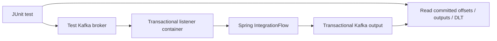

### 33.2. Assertions to Include

1. A `read_committed` consumer sees committed output on successful input.
2. On exceptions before commit, `read_committed` sees no aborted output.
3. Input source group offset does not advance past failed records when the transaction rolls back per policy.
4. Consumers reprocess records cleanly after restart/seek.
5. No unintended duplicate outputs appear across crash/rebalance scenarios.
6. DLT records publish and source offsets settle per policy.
7. Duplicate `transactional.id` fencing is detected and handled cleanly.
8. Group offsets match partition expectations without off-by-one confusion on next offset.
9. Manual/async channels do not swallow exceptions before container return.
10. DB/HTTP side effects enforce idempotency or outbox as designed.

### 33.3. Pseudocode for Verifying Aborted Records

```text
Given consumer C_in group G, input record R
When listener sends output O then throws before tx commit
Then:
  - consumer C_out with isolation.level=read_committed does not see O
  - group G offset does not include failed R as successful tx commit
  - recovery path redelivers R or publishes DLT according to configured policy
```

When `O` is unseen, verify the transaction actually aborted rather than merely hitting a short test timeout or consumer lag.

### 33.4. Comparing Against `read_uncommitted`

You can attach an extra `read_uncommitted` consumer in tests to observe records from aborted transactions and prove isolation differences. Never use `read_uncommitted` for business flows requiring EOS visibility.

## 34. Fault Injection: Crash Timing Matrix to Test

| Fault | Where injected | Kafka expectation | Non-Kafka expectation |
|---|---|---|---|
| Throw before output send | Handler | Transaction aborts; offset does not advance | No side effect or compensated |
| Throw after send, before commit | Listener | Output hidden from `read_committed` | Any prior DB/HTTP must be detected |
| Kill after `sendOffsetsToTransaction` | Container/producer | Output+offset never half-commit | External status reconciled |
| Kill after Kafka commit | Process | Output+offset committed | Post-commit audit/DB may be missing |
| Broker temporarily unavailable | Producer send/commit | Fails/aborts/retries per policy | Never auto-replays HTTP POST |
| `transactional.id` conflict | Two pods | Producer fencing, TX failure | Halts and fixes identity; no hot loop |
| Poison Kafka input record | Deserializer/handler | Retries/DLTs/skips per config | ACL-protected quarantine |
| DLT publish fails | Recoverer | Does not silently skip input | Alerts and preserves recoverability |
| Rebalance mid-processing | Listener | New owner resumes from committed offset | Old worker avoids duplicate side effects |
| `ExecutorChannel` async failure | Worker thread | TX may commit wrongly if listener returns early | Adjust durable boundary |
| DB commits, Kafka commit fails | Transaction sync | Output may be missing | Outbox/reconciliation recovers |
| Kafka commits, DB commit fails | Reverse ordering | Output already visible | Inconsistency compensated/reconciled |
| Client HTTP timeout after POST | External service | Kafka transaction independent | Idempotency/outcome verified |
| Process restarts with pending outbox | Outbox publisher | May resend | Consumer business deduplication |
| High `read_committed` lag | Long producer TX | LSO visibility blocked | Inspect transaction duration |

### 34.1. Never Assert Outcomes Without Broker Evidence

A test expecting "no Kafka output" must wait adequately and inspect transaction state/callbacks plus Last Stable Offset. A test asserting "offset rolled back" must measure the committed offset of the **exact group/partition**, not just consumer position.

## 35. Case Study: Kafka → JDBC → Kafka in an Order System

**Problem:** Topic `orders.in` carries order-creation events. The app inserts orders into PostgreSQL and emits `orders.accepted`. Across crashes, avoid duplicates and never lose outputs.

### 35.1. Naive Design

```text
Kafka record offset 50
  -> JDBC INSERT committed
  -> Kafka send() called
  -> app crash
  -> source offset uncommitted
  -> input offset 50 re-read
  -> duplicate INSERT or event sent twice
```

A Kafka producer transaction keeps outputs and source offsets consistent, yet the committed DB `INSERT` sits outside that Kafka transaction.

### 35.2. Inbox + Outbox Design

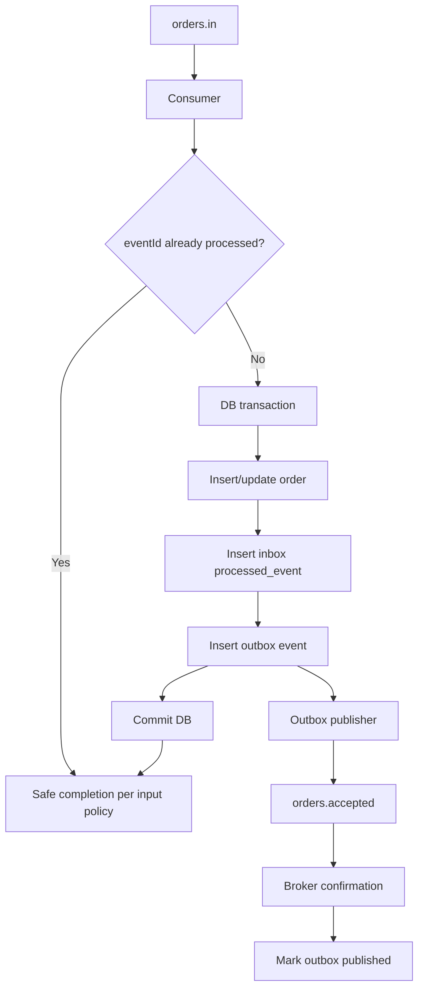

### 35.3. Four Crash Points

| Crash point | Expected behavior |
|---|---|
| Before DB commit | DB transaction rolls back; source retries |
| After DB commit, before source offset commit | Source retries; inbox dedup detects already processed |
| After Kafka publish, before marking outbox sent | Outbox retry may resend; consumers must be idempotent |
| After all commits | Source group and business state agree per evidence |

### 35.4. Pure Kafka-In → Kafka-Out

When **no external DB/HTTP side effects exist**, a transactional listener container with a shared-factory `KafkaTemplate` sending source offsets to the transaction is cleaner. Do not force an outbox database into flows that do not need one.

## 36. Troubleshooting: When Offsets or Transactions Misbehave

### 36.1. Duplicate Outputs Despite "Committed" Offsets

- Was the input event published twice under a different business ID?
- Is a producer sending outside the transaction?
- Are downstream consumers set to `read_uncommitted`?
- Does an `ExecutorChannel` run sends outside the listener transaction?
- Did a callback resend after a timeout?
- Did an outbox publisher retry after ack ambiguity?

### 36.2. Committed Offset Advances Despite Errors

- Was an exception caught and returned normally?
- Is `enable.auto.commit=true` set?
- Is the listener container genuinely transactional?
- Did an error handler's `isAckAfterHandle` or recovery policy mark it handled?
- Did DLT/quarantine persistence succeed?
- Are you confusing consumer position with committed offset?

### 36.3. `ProducerFencedException`

- Are two instances sharing the same `transactional.id` prefix/suffix?
- Did fencing happen due to restarts/rollouts or idle expiration?
- How are `ProducerFactory` `maxAge` and `transactional.id` expiration configured?
- Do you need to recreate the producer after fencing and abort the current transaction?
- Should you retry endlessly with the fenced producer? **No.**

### 36.4. `read_committed` Consumer Lags While Broker Has Records

- Is a long-running open transaction blocking LSO?
- Is an unhandled producer transaction timeout/abort blocking progress?
- Is there a consumer group assignment/rebalance or poll-interval issue?
- Are records aborted and legitimately filtered by the consumer?
- Is lag isolated to a specific partition?

### 36.5. `NoProducerAvailableException`

- Is producer cache capacity sized for concurrency/nested transactions?
- Are too many concurrent transactions open?
- Are transactions held open by slow external APIs?
- Do you have backoff and alerts rather than tight retry loops?

### 36.6. DLT Has Records Yet Input Keeps Repeating

- Was the DLT publish confirmed?
- Did the source offset commit per recoverer/transaction policy?
- Did a rebalance occur between DLT write and commit?
- Are multiple consumer groups reading the same input?
- Does the DLT record carry a business ID for deduplication?

### 36.7. Spring Integration `errorChannel` Receives Errors, Yet Kafka Does Not Retry

- Did the error channel handler swallow the exception?
- How is the adapter's recovery callback wired?
- Did the container error / after-rollback processor receive the exception?
- Is it a `KafkaMessageSource` poller or a message-driven listener?
- Did an async channel let the listener return prematurely?

## 37. Anti-Patterns to Avoid

**"Committing the offset means business side effects succeeded."** No: it only records consumer group progress in Kafka.

**"The last record's offset equals the committed offset."** Committed offset means the next offset to consume.

**"`read_committed` filters out all duplicates."** It hides aborted transactional records, not valid duplicate business events.

**"`enable.idempotence=true` means end-to-end exactly-once."** Producer retry idempotence does not prevent handlers from reprocessing events.

**"`@Transactional` alone makes Kafka + DB atomic."** Know your transaction managers and resource boundaries.

**"Kafka rollback undoes JDBC/HTTP."** No.

**"A Kafka listener automatically gets EOS when using `KafkaTemplate`."** Requires a transaction-capable producer, container config, and offsets sent to transaction.

**"`KafkaTemplate.executeInTransaction` commits input offsets automatically."** Not by default; it is a producer-only transaction.

**"Send the output record, then commit the source offset immediately."** Vulnerable to producer failures/aborts.

**"Put an `ExecutorChannel` in the middle and keep the Kafka transaction."** Thread boundaries sever the transaction context.

**"Manual `commitSync()` fixes every offset issue."** Can conflict with containers, especially transactional listeners.

**"Seeing an `ErrorMessage` means Kafka rolled back."** Error publication and container outcome are separate.

**"Handler logs the error and returns so the record will retry."** May be treated as success and committed.

**"If one item in a batch listener fails, Kafka always replays just one item."** Default transactional recovery may replay the whole batch.

**"DLT writes and source offsets are always atomic."** Only when recoverer/transaction semantics are properly configured and verified.

**"Share one `transaction-id-prefix` across two pods for convenience."** Triggers producer fencing.

**"Long-running open transactions don't affect consumers."** They stall LSO, causing lag and timeouts.

**"Kafka offsets prevent duplicate payments."** HTTP side effects require idempotency/reconciliation.

**"Caller, listener, advice, DLT, and outbox can each retry independently forever."** Causes exponential retry storms.

**"Topic, partition, offset is a global business event identity."** Republishing creates new offsets; keep separate business IDs.

**"Fix errors by raising transaction timeout endlessly."** Masks blocking handlers and stalls `read_committed` visibility.

**"Unit testing with a mocked `KafkaTemplate` proves EOS."** Requires a broker and failure/commit tests.

## 38. Production Readiness Checklist

| Question | Required evidence |
|---|---|
| Identified source topic/group/partitions? | Consumer topology |
| Distinguished position vs. committed offset? | Per-partition commit tests |
| Container has `enable.auto.commit=false`? | Effective properties |
| `AckMode` matches listener mode? | Container configuration |
| Right transaction manager configured? | `KafkaTransactionManager` / `KafkaAwareTransactionManager` |
| `ProducerFactory` supports transactions? | Transaction-capable config |
| `KafkaTemplate` shares the same factory? | Bean wiring test |
| `transactional.id` unique per instance? | Deployment identity policy |
| Tested fencing and restart behavior? | Integration/fault tests |
| `read_committed` enabled on EOS downstream consumers? | Effective consumer properties |
| Outputs + offsets committed in same transaction? | Crash-before-commit test |
| No conflicting manual commits? | Code review / commit observations |
| No unintended thread-boundary splits? | Flow diagram / async tests |
| `KafkaMessageDrivenChannelAdapter` uses the right container? | Bean wiring |
| `KafkaMessageSource` handled per its own semantics? | Poller/ack tests |
| Batch failure behavior clarified? | Batch rollback tests |
| `AfterRollbackProcessor`/DLT configured properly? | Poison record tests |
| Failed DLT write never skips and loses input? | Recoverer fault test |
| Retry budget bounded? | Retry/age metrics |
| Idempotency key enforced? | Duplicate event tests |
| JDBC side effects protected by TX + inbox/outbox? | DB crash tests |
| HTTP POST has reconciliation? | Timeout-after-remote-commit tests |
| File/SFTP states managed separately? | Filter/staging/rename tests |
| JMS/AMQP acks not inferred from Kafka offsets? | Broker tests |
| Producer send failures monitored? | Callbacks / failure channels |
| No `transactional.id` collisions when scaling? | Multi-instance tests |
| Metrics for TX aborts/commits, LSO, and lag? | Dashboard |
| ACLs set for groups, topics, and `transactional.id`s? | Security review |
| DLT/quarantine retention and permissions enforced? | Data governance |
| Restart/rebalance tests executed? | Fault-injection suite |
| Rollback plan ready for bad config deploys? | Runbook |
| Spring Kafka/Integration versions verified? | Dependency compatibility |
| Business outcomes proven end-to-end? | Source/output/DB reconciliation |

## 39. Self-Assessment Lab and Summary

### 39.1. Prompt

Build a system processing `orders.in` in two variants:

- **Variant A:** Kafka input → validate → Kafka output `orders.validated`; no non-Kafka side effects.
- **Variant B:** Kafka input → JDBC order write → Kafka output, plus an HTTP callback in certain cases.

Tasks:

1. Configure Kafka producer transactions with a unique prefix per instance.
2. Set up a transaction-aware listener container and Spring Integration message-driven adapter.
3. Set `enable.auto.commit=false` and choose record/batch mode.
4. Have the output consumer read with `read_committed`.
5. Inject an error **after send and before transaction commit**.
6. Verify aborted output stays invisible and the source offset does not advance as a successful commit.
7. Inject a process kill after Kafka transaction commit.
8. For Variant B, prove DB commits do not auto-rollback on Kafka abort.
9. Add inbox/outbox or idempotency/reconciliation for DB/HTTP.
10. Send a poison record and test after-rollback/DLT policies.
11. Test restarts, rebalances, duplicate business events, and producer fencing.
12. Summarize source offsets, output event IDs, and business states in a table.

### 39.2. Expected Results

| Criterion | Variant A | Variant B |
|---|---|---|
| Kafka output + source offsets atomic | Yes when transaction configured properly | Yes for the Kafka portion in the TX |
| DB commit rolls back with Kafka | No DB | **Not automatically** |
| Idempotent HTTP callback | N/A | Mandatory if side effects exist |
| Input reprocessing possible | Yes | Yes |
| Aborted Kafka output visible to `read_committed` | No | No within transaction scope |
| Business duplicates prevented | Via Kafka EOS + business key if needed | Requires inbox/outbox/idempotency |
| Permanent failures | Retry/DLT per policy | DLT + DB/HTTP reconciliation |
| Test evidence | Topic/partition/offset/transaction | Kafka + DB + remote outcomes |

### 39.3. Key Takeaways

A **Kafka offset** tracks progress in a **consumer group partition**; the committed offset indicates the **next record to read**, not proof that all business side effects finished. `AckMode`, auto-commit, and container-managed transactional commits are distinct mechanisms.

A **Kafka producer transaction** atomically commits Kafka outputs and **source consumer offsets** in consume–transform–produce flows when the Spring Kafka listener container, transactional producer factory, and `KafkaTemplate` are wired properly. `read_committed` hides aborted transactional records from downstream consumers. Producer fencing, unique `transactional.id`s, and thread/transaction scope boundaries are essential to that consistency.

**Kafka-scoped exactly-once is not a distributed transaction for JDBC, HTTP, JMS, AMQP, files, or SFTP.** Outside Kafka, design business idempotency, outbox/inbox patterns, source-appropriate acks/commits, and reconciliation. An `errorChannel` or DLT only helps when recovery outcomes and source offsets are verified.

The decisive question is: **"Did Kafka output records and source offsets commit together; what side effects occurred outside Kafka, and what deduplication/reconciliation protects them?"**

### References

- [Spring Kafka Reference — Exactly Once Semantics](https://docs.spring.io/spring-kafka/reference/kafka/exactly-once.html): container transactions, `sendOffsetsToTransaction`, EOS V2, and Kafka scope limits.
- [Spring Kafka Reference — Transactions](https://docs.spring.io/spring-kafka/reference/kafka/transactions.html): `KafkaTransactionManager`, producer factories, transaction ID prefixes, `KafkaTemplate.executeInTransaction`, and JDBC synchronization.
- [Spring Kafka Reference — Message Listener Containers](https://docs.spring.io/spring-kafka/reference/kafka/receiving-messages/message-listener-container.html): container `AckMode`, auto-commit, manual ack, and transactional offsets.
- [Spring Kafka Reference — Handling Exceptions](https://docs.spring.io/spring-kafka/reference/kafka/annotation-error-handling.html): `CommonErrorHandler`, `DefaultErrorHandler`, `AfterRollbackProcessor`, and DLT recovery.
- [Spring Integration Reference — Kafka Support](https://docs.spring.io/spring-integration/reference/kafka.html): `KafkaMessageDrivenChannelAdapter`, `KafkaMessageSource`, Kafka outbound/gateways, error channels, and headers.
- [Spring Integration Reference — Transaction Support](https://docs.spring.io/spring-integration/reference/transactions.html): transactions in integration flows, threading, and synchronization.
- [Spring Integration Reference — Messaging Channels](https://docs.spring.io/spring-integration/reference/channel.html): `DirectChannel`, `ExecutorChannel`, and queue boundaries.
- [Apache Kafka Documentation — Consumer Config](https://kafka.apache.org/documentation/#consumerconfigs): `enable.auto.commit`, `isolation.level`, `max.poll.interval.ms`, and offsets.
- [Apache Kafka Documentation — Producer Config](https://kafka.apache.org/documentation/#producerconfigs): `transactional.id`, `transaction.timeout.ms`, `acks`, and idempotence.

> **Application note:** Examples illustrate technical mechanics; exact APIs and auto-configuration vary across Spring Kafka 3.x/4.x, Spring Integration, and Spring Boot versions. When implementing, verify dependencies/versions, Kafka broker compatibility, producer/container wiring, and transaction boundaries, and test against a real Kafka broker. This is **STEP 4** content, not a build result or specialized Content QA pass.
