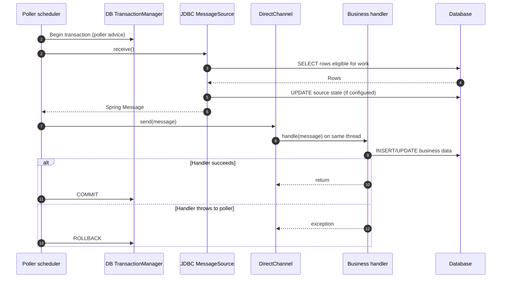
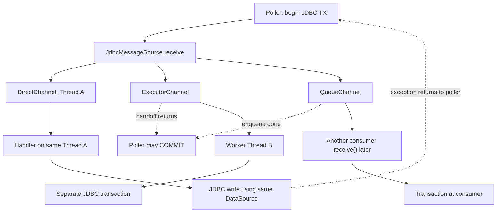
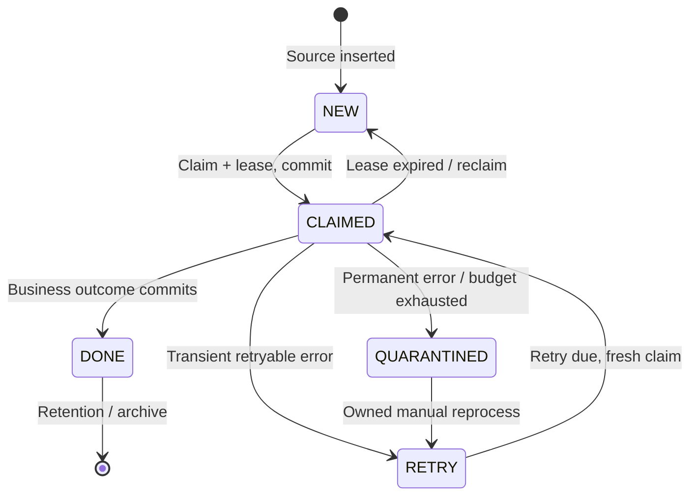
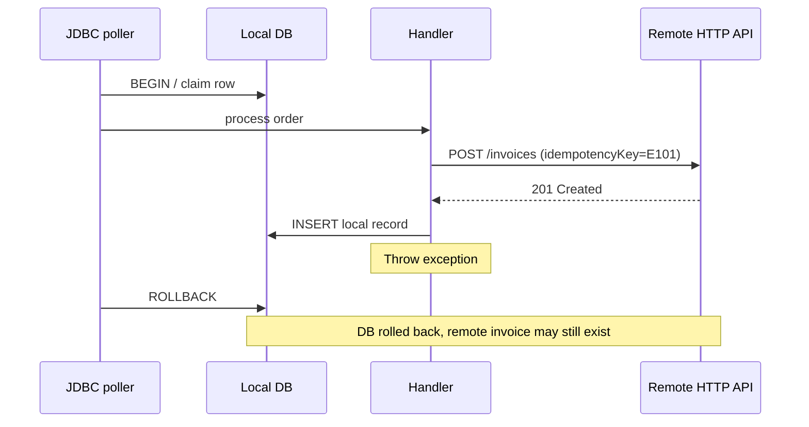
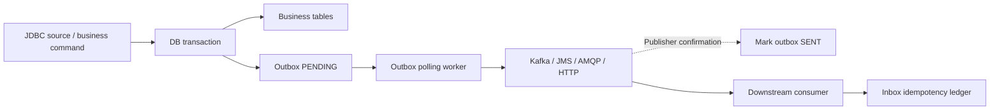
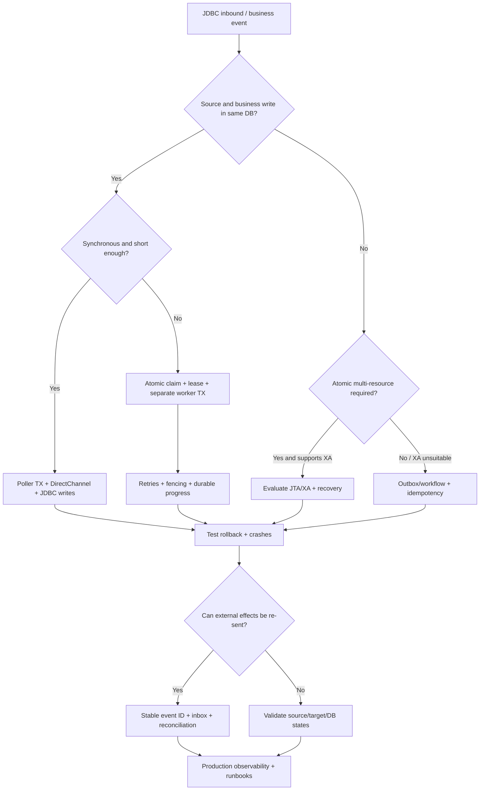

# JDBC Transaction Boundaries in Spring Integration Adapters

## 1. The Problem: Data Was Read, But Was the Work Finished?

Suppose table `integration_inbox` stores unprocessed requests. Every second, a Spring Integration **JDBC inbound channel adapter** queries rows with `status = 'NEW'`, marks them as claimed, and sends the result over a `MessageChannel` to a service activator. The handler validates business rules, writes to `purchase_order`, and emits an event to Kafka.

If the handler throws an exception right after inserting the order, what must happen?

- Does the source row revert to `NEW` so the next poll picks it up?
- Does the `purchase_order` record roll back together with the source row?
- Does Kafka roll back the event it already received alongside the database?
- If the worker already handed the task off to another thread, does the poller's transaction still apply?
- If two instances poll the same row, is each row processed by only one instance?

These are questions about **JDBC transaction boundaries**: when the transaction starts, which JDBC operations actually belong to it, when it commits or rolls back, and which activities lie **outside** that scope.

This lesson belongs to the **Transactions** chapter of the **SPRING_INTEGRATION_ADAPTERS** module, focusing on connecting external systems via **inbound/outbound adapters, gateways, pollers, and `MessageChannel`**. Alongside JDBC, we compare File, SFTP, HTTP, JMS, AMQP, and Kafka to see why a local transaction does not guarantee atomic commits across an entire integration chain.

### Learning Objectives

After this lesson, you will be able to:

1. Identify the transaction boundary when a JDBC inbound adapter is triggered by a poller.
2. Distinguish `TransactionInterceptor` on the poller from `@Transactional` on the handler.
3. Explain why `DirectChannel` normally preserves transaction context while `ExecutorChannel`, `QueueChannel`, and async callbacks can sever the boundary.
4. Design SQL claiming, locking, isolation, retries, and idempotency for multi-worker systems.
5. Configure `DataSourceTransactionManager` or `JdbcTransactionManager` for the right `DataSource`, without confusing them with JMS/Kafka transactions.
6. Handle failure windows where JDBC coordinates with outbound HTTP/JMS/AMQP/Kafka/File/SFTP.
7. Test rollbacks via **database readback, fault injection, crash/restart**, and business outcomes—not exceptions alone.

## 2. What Does a Transaction Boundary Mean?

A JDBC transaction is a set of operations against a database resource managed by a transaction manager/connection, yielding either **commit** or **rollback**. In Spring, multiple JDBC operations share the same transaction when:

- A transaction starts before the operations requiring protection.
- Components use the matching `DataSource` and transaction manager, with a connection bound to the active transaction.
- Calls execute within the transaction scope—typically the same thread for Spring imperative transactions.
- No operation opens an independent connection/transaction that breaks assumed atomicity.

**Commit** durably persists valid JDBC changes per database contract. **Rollback** discards uncommitted changes inside that transaction. Neither **undoes** an already-executed HTTP POST, an SFTP-renamed file, or a message accepted by a broker in a separate transaction.

### 2.1 A Boundary Is a Scope, Not an Annotation

`@Transactional` is a declarative way to apply a transaction via a Spring proxy/interceptor, yet it does not automatically define everything inside the scope:

- `@Transactional` on a **handler** may wrap only the handler, **excluding** the adapter's earlier `SELECT`/`UPDATE`.
- `TransactionInterceptor` placed on a **poller** can begin a transaction **before the source reads data** and extend through synchronous handlers.
- A `REQUIRES_NEW` method opens an independent transaction separate from the active one.
- A call dispatched to an executor or new thread does not automatically inherit the JDBC transaction bound to the original thread.

Therefore, the right question is not "is `@Transactional` present?"—it is "**before which operation does the transaction begin, which connection does it use, and after which operation does it end?**"

### 2.2 Four Milestones in Processing a Row

| Milestone | Operation | State on error |
|---|---|---|
| A | Poller starts transaction if advice is attached | Nothing read yet |
| B | JDBC inbound `SELECT` and optional source `UPDATE` | Source update can roll back if inside the same transaction |
| C | Synchronous handler writes business tables | Can roll back with source if sharing `DataSource`/transaction |
| D | Handler returns; poller transaction commits | JDBC changes become durable |

Without a transaction spanning B–D, the source can be marked as claimed **before** the handler finishes. When the handler fails, work risks being lost because the source row is no longer eligible for re-polling.

## 3. Which Layers Hold Transactions in Spring Integration?

### 3.1 Components to Recognize

- **`JdbcMessageSource` / JDBC inbound channel adapter:** queries the database on schedule; can run a follow-up update after select per configuration.
- **`SourcePollingChannelAdapter`:** endpoint periodically calling `MessageSource.receive()` and sending the resulting Spring message to an output channel.
- **`PollerMetadata`:** configures trigger, `maxMessagesPerPoll`, task scheduler, advice chain, and polling settings.
- **`TransactionInterceptor`:** advice that wraps the poll cycle using a transaction manager.
- **`MessageChannel`:** connects endpoints/handlers; channel type decides synchronous execution vs. handoff.
- **Service activator / transformer / router / filter:** processes data after receiving the message.
- **JDBC outbound channel adapter / gateway:** executes JDBC queries/updates from Spring messages per configuration.
- **`PlatformTransactionManager`:** coordinates begin/commit/rollback for supported resources.

Not every endpoint is a poller. A **JMS message-driven inbound adapter** typically delegates receive/ack to a listener container, whereas a JDBC inbound adapter is a polling source. Never attach transaction advice to the wrong endpoint type expecting identical results.

### 3.2 Synchronous JDBC Inbound Flow



This diagram illustrates the **capability** to share one transaction, not an automatic guarantee for every JDBC inbound adapter. You must place transaction advice properly, share the `DataSource`, and verify exceptions are not swallowed.

### 3.3 What If the Transaction Only Starts at the Handler?

```text
T0: JDBC source SELECT / UPDATE status='CLAIMED'  -- may commit separately
T1: DirectChannel dispatches message
T2: @Transactional handler opens DB transaction
T3: handler writes business row
T4: handler throws -> handler transaction rolls back
T5: source row stays CLAIMED -> work may be lost
```

**This is why you must test claim + business update rolling back together**, not just `@Transactional` on the service.

## 4. Transaction Managers in This Lesson

| Manager / mechanism | Typical scope | What it does NOT automatically protect |
|---|---|---|
| `DataSourceTransactionManager` | One JDBC `DataSource` | JMS/Kafka/HTTP/SFTP or another DB |
| `JdbcTransactionManager` | Local JDBC transaction, with Spring version exception translation | Non-JDBC resources |
| `JpaTransactionManager` | Persistence context/JPA + DB per config; JDBC sharing needs same datasource/connection | Does not become multi-broker XA |
| `JmsTransactionManager` | Local JMS session/connection | Independent DB's JDBC transaction |
| `KafkaTransactionManager` (Spring Kafka) | Kafka producer transaction within supported scope | Databases and HTTP do not auto-enlist |
| JTA/XA coordinator | Global transaction across resources **genuinely supporting/enlisting XA** | Non-XA APIs, filesystems, or SFTP |

In pure JDBC examples, point the manager to the **exact `DataSource`** used by `JdbcTemplate`, the message source, and the handler. Never combine multiple managers and assume you have a distributed transaction.

### 4.1 Transaction Contexts Typically Bind to Threads

Spring imperative transactions rely on resource/thread bindings. When a handler runs synchronously via `DirectChannel`, it joins the active transaction. When the flow crosses `ExecutorChannel`, `QueueChannel`, or `@Async`, a worker on another thread does not automatically inherit that connection/transaction.

Never pass an open JDBC `Connection` across threads to keep a transaction alive over an executor. Instead, design a **durable handoff milestone** and open a fresh transaction in the worker.

## 5. JDBC Inbound Cases: Reading, Identifying, and Marking

### 5.1 `SELECT` Alone Does Not Mean "Processed"

If an inbound adapter only executes:

```sql
SELECT id, business_key, payload
FROM integration_inbox
WHERE status = 'NEW';
```

with no claim/update/filter mechanism, the same row can be returned repeatedly on subsequent polls. With multiple instances, two pollers can fetch the exact same data. This can be acceptable if downstream processing is idempotent, yet you must never assume each row is received only once.

### 5.2 `SELECT` Then `UPDATE` Is Not Automatically an Atomic Claim Everywhere

A commonly described sequence:

```sql
-- Read step:
SELECT id, business_key, payload
FROM integration_inbox
WHERE status = 'NEW'
ORDER BY id;

-- Mark step, after selecting rows:
UPDATE integration_inbox
SET status = 'CLAIMED'
WHERE id = :id;
```

If two workers run `SELECT` concurrently before either runs `UPDATE`, both can see the same row. **Having a transaction does not eliminate all races**: isolation level, locking, conditional predicates, and claiming mechanics must match the database engine.

### 5.3 Label States Accurately

| Illustrative state | Meaning | Does NOT mean |
|---|---|---|
| `NEW` | Eligible to be picked up | Never seen before |
| `CLAIMED` | A worker/transaction acquired processing ownership | Business handler completed |
| `DONE` | Completed per defined contract | External target consumer also finished |
| `RETRY` | Eligible for scheduled retry | Should retry immediately forever |
| `QUARANTINED` | Failure requiring special handling or approval | Safe to delete right away |

In an inbound adapter, the source `UPDATE` acts as "received/claimed." **Never set `DONE` at the receive step** when `DONE` means full business completion. Keep claim transactions, business transactions, and target outcomes distinct.

### 5.4 One Poll Can Return an Entire Batch

Many JDBC inbound configs emit **one Spring message containing a list of rows**. Therefore:

- `maxMessagesPerPoll=1` limits the number of `receive()` calls per trigger cycle per poller policy, **not one row**.
- `maxRows` or a SQL `LIMIT` caps how many rows a single `receive()` returns per adapter/query.
- An exception in a handler processing the batch can roll back the entire batch in **the same transaction** at the right boundary, yet external system effects may not roll back.

Never bake a "one poll = one row" assumption into retry or monitoring logic without inspecting payload types and testing.

## 6. Verifiable Example: One DB Transaction Covering Claim and Business Write

### 6.1 Preparing Schema and Data

The SQL below illustrates a table on a database supporting standard types; adjust exact DDL syntax for your DB vendor/version.

```sql
CREATE TABLE integration_inbox (
    id           BIGINT PRIMARY KEY,
    event_id     VARCHAR(120) NOT NULL UNIQUE,
    payload      VARCHAR(4000) NOT NULL,
    status       VARCHAR(24) NOT NULL
);

CREATE TABLE purchase_order (
    order_id     BIGINT PRIMARY KEY,
    source_event VARCHAR(120) NOT NULL UNIQUE,
    total_amount DECIMAL(18, 2) NOT NULL,
    state        VARCHAR(24) NOT NULL
);

INSERT INTO integration_inbox(id, event_id, payload, status)
VALUES (101, 'event-101', '{"orderId":1001,"total":250000}', 'NEW');
```

`event_id` is a business idempotency key stable across retries. Unique constraints detect business duplicates when a worker re-receives a message. Database transactions and unique keys solve **two separate problems**: atomicity within one attempt and preventing duplicate effects across attempts.

### 6.2 Configuring the Transaction Manager

```java
@Configuration
class DatabaseTransactionConfig {

    @Bean("orderTxManager")
    PlatformTransactionManager orderTxManager(
            @Qualifier("orderDataSource") DataSource dataSource) {
        return new DataSourceTransactionManager(dataSource);
    }

    // JdbcTemplate, JdbcMessageSource, and handlers all use
    // orderDataSource; full bean wiring is omitted here for brevity.
}
```

When a project has multiple `DataSource`s, specify the manager name explicitly on advice and JDBC beans. If any component calls `DriverManager.getConnection(...)` manually to open a raw connection, it will **bypass the Spring-managed transaction**.

### 6.3 Poller Transaction Advice + `DirectChannel` (Illustrative XML)

```xml
<int:channel id="ordersInput"/>

<int-jdbc:inbound-channel-adapter
    id="ordersJdbcInbound"
    data-source="orderDataSource"
    channel="ordersInput"
    query="SELECT id, event_id, payload
           FROM integration_inbox
           WHERE status = 'NEW'"
    update="UPDATE integration_inbox
            SET status = 'CLAIMED'
            WHERE id IN (:id)">
    <int:poller fixed-delay="1000"
                max-messages-per-poll="1">
        <int:transactional
            transaction-manager="orderTxManager"
            propagation="REQUIRED"/>
    </int:poller>
</int-jdbc:inbound-channel-adapter>

<int:service-activator
    input-channel="ordersInput"
    ref="orderHandler"
    method="handle"/>
```

This is an **illustrative structure**, omitting XML namespaces, `DataSource`, handler beans, and SQL parameter binding options. Mapping `:id` from selected rows into update parameters follows JDBC inbound adapter/version conventions; verify with your actual schema and adapter. If your endpoint structures SQL differently, preserve the principle: **transaction begins before `receive()` and commits only after synchronous processing**.

### 6.4 Synchronous JDBC Handler

```java
@Component("orderHandler")
class OrderHandler {
    private final JdbcTemplate jdbc;
    private final AtomicBoolean shouldFail = new AtomicBoolean(false);

    OrderHandler(@Qualifier("orderJdbcTemplate") JdbcTemplate jdbc) {
        this.jdbc = jdbc;
    }

    public void handle(List<Map<String, Object>> rows) {
        for (Map<String, Object> row : rows) {
            long sourceId = ((Number) row.get("id")).longValue();
            String eventId = (String) row.get("event_id");

            jdbc.update(
                "INSERT INTO purchase_order " +
                "(order_id, source_event, total_amount, state) " +
                "VALUES (?, ?, ?, 'CREATED')",
                sourceId, eventId, new BigDecimal("250000")
            );
        }
        if (shouldFail.get()) {
            throw new IllegalStateException("TEST_AFTER_JDBC_WRITE");
        }
    }

    void setShouldFail(boolean fail) {
        shouldFail.set(fail);
    }
}
```

This snippet is simplified to focus on transactions; add imports, beans, and business validation before real use. `orderJdbcTemplate` must target the **same `DataSource`** as the poller transaction. The handler accepts a list of rows—do not assume the JDBC inbound source splits each row into its own Spring message automatically.

### 6.5 Expected Result When Handler Fails

Set `shouldFail = true` in a test environment, let the poller pick up the row, and wait for rollback to finish. Query tables from an **independent connection/transaction**:

```sql
SELECT status FROM integration_inbox WHERE id = 101;
-- Expected: NEW

SELECT COUNT(*) FROM purchase_order WHERE source_event = 'event-101';
-- Expected: 0
```

These two readbacks prove the source claim and business write rolled back together. If only the business insert rolled back while the source row stayed `CLAIMED`, check whether advice wraps `receive()`, whether the handler runs on the same thread, and whether source and handler share the same `DataSource`.

### 6.6 Expected Result When Handler Succeeds

Set `shouldFail = false` and poll again:

```sql
SELECT status FROM integration_inbox WHERE id = 101;
-- Expected: CLAIMED per illustrative configuration

SELECT COUNT(*) FROM purchase_order WHERE source_event = 'event-101';
-- Expected: 1
```

Here `CLAIMED` **commits** alongside the business row, though the status name does not yet express "completed" if the business contract expects `DONE`. You can add a final `DONE` update at the end of the handler within the same DB transaction. Distinguish **temporary claim** from **business completion** clearly in your state machine.

### 6.7 Why Calling Only the Handler in a Unit Test Is Not Enough

```java
assertThrows(IllegalStateException.class,
    () -> handler.handle(testRows));
```

This snippet only proves the handler throws an exception. It **does not** execute JDBC `MessageSource.receive()`, poller advice, or Spring's transaction manager. To verify the JDBC transaction boundary, run the actual endpoint with the runtime beans and configuration.

## 7. `DirectChannel`, `ExecutorChannel`, and `QueueChannel` Decide Transaction Scope

In Spring Integration, a channel is not merely a logical wire; it dictates whether execution stays **on the same call stack** or **hands off to another component**.



### 7.1 `DirectChannel`: Synchronous and Propagates Exceptions

`DirectChannel` dispatches to subscribers on the sender's thread. With a poller opening a JDBC transaction, handlers on the same call stack join that transaction when using compatible resources.

Example:

```text
Poller Thread A:
  BEGIN DB TX
  JDBC source SELECT/UPDATE
  DirectChannel.send()
    -> transformer
    -> service activator JDBC INSERT
    -> throw IllegalStateException
  ROLLBACK DB TX
```

Key requirements:

- Transaction advice wraps the source's receive step.
- Transformers/handlers do not terminate the transaction or switch threads.
- Errors are not caught and converted into normal returns.
- JDBC writes that must roll back together share the same transaction/resource.

Annotating a handler with `@Transactional(propagation = REQUIRED)` usually joins the active transaction, provided it is called through a compatible Spring proxy/advice and the manager targets the same resource. Never rely on the annotation name alone without testing.

### 7.2 `ExecutorChannel`: Handoff Is Not Completion

`ExecutorChannel` submits work to a `TaskExecutor`. Normally, the poller only knows the executor accepted the task—not whether the handler will succeed:

```text
Thread A (poller):            Thread B (worker):
BEGIN DB TX
source UPDATE CLAIMED
ExecutorChannel.send()
return from send()
COMMIT TX A
                              handler starts
                              handler DB INSERT
                              handler throws
                              TX B rolls back (if any)
```

**Outcome:** the source row is `CLAIMED` and committed, while worker B failed. Switching channels for throughput can drop re-polling ability unless durable retries or leases exist.

The fix requires changing the **handoff contract**:

- Use `CLAIMED` with a lease/expiry and worker recovery; never treat claim as `DONE`.
- Or persist into a durable queue with its own transactions and retries.
- Give the worker its own transaction, idempotency, and error state.
- Never try to "stretch the poller's JDBC transaction across threads" by holding connections open or blocking indefinitely.

### 7.3 `QueueChannel`: Enqueuing Can Succeed Before Business Processing

`QueueChannel` holds messages for a consumer to poll later. With an in-memory queue, a process crash loses messages even though the JDBC source already committed its claim. With a persistent `MessageStore`, verify the transaction governing the store and how consumers handle retries/redeliveries.

**Mandatory test:** the source enqueues a message and the process crashes before the consumer processes it; after restart, a recovery path must still process the source row or message store. `QueueChannel.send()` returning `true` **is insufficient** to prove durable persistence.

### 7.4 `PublishSubscribeChannel` and Multiple Subscribers

With synchronous publish-subscribe, one sender invokes multiple subscribers; when one subscriber fails, propagation depends on dispatcher/config. Earlier subscribers' side effects may already have committed in separate transactions or been sent externally.

Never use a single JDBC transaction as an "atomic fan-out" when subscribers talk to external systems. If a subscriber runs via an executor, analyze the source and that subscriber's transactions separately.

### 7.5 `FluxMessageChannel` and Reactive Flows

Reactive/asynchronous boundaries use a different context and transaction model than Spring's imperative thread-bound transactions. Never assume an imperative poller's `DataSourceTransactionManager` manages reactive operations automatically. For R2DBC, Spring provides reactive transactions via `R2dbcTransactionManager`; this **is not** a JDBC transaction stretching across Reactor operators.

When mixing JDBC and reactive flows, clarify who completes the subscription/processing and when the source commits. Without a durable handoff, a late callback failure will not affect an already-closed transaction.

## 8. Poller Advice vs. `@Transactional`: Same "Transaction" Name, Different Placement

### 8.1 Poller Transaction Advice

Java DSL configuration example (structural sample; verify exact APIs against your version):

```java
@Bean
IntegrationFlow jdbcOrderFlow(
        DataSource orderDataSource,
        @Qualifier("orderTxManager") PlatformTransactionManager tx,
        OrderHandler orderHandler) {

    return IntegrationFlow
        .from(
            Jdbc.inboundAdapter(orderDataSource)
                .selectQuery(
                    "SELECT id, event_id, payload " +
                    "FROM integration_inbox WHERE status='NEW'"
                )
                .updateSql(
                    "UPDATE integration_inbox " +
                    "SET status='CLAIMED' WHERE id IN (:id)"
                )
                .maxRows(10),
            endpoint -> endpoint.poller(
                Pollers.fixedDelay(Duration.ofSeconds(1))
                    .maxMessagesPerPoll(1)
                    .transactional(tx)
            )
        )
        .channel(MessageChannels.direct("ordersInput"))
        .handle(orderHandler, "handle")
        .get();
}
```

This is a **code skeleton**: imports, bean names, SQL parameter binding, and Java DSL signatures may vary across Spring Integration versions. Adapt to your version and run context/integration tests. **Core point:** poller transaction advice is applied before `receive()` and runs synchronously across `DirectChannel`.

### 8.2 `@Transactional` Placed Only on the Service

```java
@Transactional(transactionManager = "orderTxManager")
public void handle(List<Map<String, Object>> rows) {
    // Write purchase_order.
}
```

If the poller has no transaction advice, the source `SELECT`/`UPDATE` may already have committed before the handler method begins. A handler annotation cannot retroactively expand its scope over work that already happened.

In that situation, pick one clear direction:

- Wrap **both poll + handler** with appropriate poller transaction advice.
- Move receive/claim + business update into **one application service** whose transaction wraps both steps explicitly.
- Design durable source claiming + leases/retries when business processing is async, rather than expecting atomicity inside a long transaction.

### 8.3 Proxies, Self-Invocation, and Rollback Rules

Traps that make an annotation "look right" while failing to act as expected:

- **Self-invocation:** calling an annotated method on `this` inside the same bean bypasses the proxy in proxy-based transaction management.
- **Non-proxied instance:** instantiating the service with `new` instead of Spring-managed injection.
- **Wrong manager:** multiple `PlatformTransactionManager` beans exist without specifying which manager to use.
- **Checked exceptions:** default rollback covers unchecked exceptions; checked exceptions need `rollbackFor` or explicit rules.
- **Catching/swallowing:** error handlers catching exceptions and returning normally prevent the transaction interceptor from seeing rollback signals.
- **`REQUIRES_NEW`:** inner transactions can commit even when the poller transaction rolls back.
- **`NOT_SUPPORTED`:** a block suspends the active transaction.

Never change propagation merely to "shorten a long transaction" at the expense of correctness. Establish invariants first, then select propagation.

### 8.4 Retry Advice Inside or Outside the Transaction?

An advice chain can be ordered in two ways:

```text
Retry advice
  -> Transaction advice
      -> poll + process
        each attempt can open a new TX

Transaction advice
  -> Retry advice
      -> poll + process
        retries may share an already rollback-only TX
```

These are two **ordering models**, not a guarantee that every Spring Integration version builds the exact chain unless explicitly configured. In production, log/trace transaction IDs, rollback-only flags, and actual attempts to verify.

For deadlocks or transient DB failures, retrying a fresh transaction helps. However, if a prior attempt called HTTP or a broker outside the JDBC transaction, retrying can **repeat external side effects**. Always enforce event IDs / idempotency.

## 9. Isolation, Locking, and Contention Across Multiple Pollers

### 9.1 Transactions Do Not Automatically Prevent Duplicate Claims

Suppose workers A and B both run:

```sql
SELECT id FROM integration_inbox WHERE status='NEW';
```

Both can see row `101` depending on DB isolation/locking. Then one worker updates and the other attempts to update; outcomes depend on update predicates, locks, isolation, and transaction boundaries. **Never treat `@Transactional` as proof that "each row is claimed only once."**

### 9.2 Conditional `UPDATE`

A claim step can update conditionally:

```sql
UPDATE integration_inbox
SET status='CLAIMED'
WHERE id = :id
  AND status='NEW';
```

If rows updated = 0, another worker likely claimed it or the state changed. However, if the flow already selected and dispatched the payload before confirming it won the claim, duplicate processing still occurs. Design an **atomic claim + row return**, or verify the outcome **before dispatching**.

### 9.3 PostgreSQL: Claiming Batches with `FOR UPDATE SKIP LOCKED`

For queue-like workloads on PostgreSQL, row-level locks divide work cleanly across workers. Reference SQL:

```sql
-- PostgreSQL example; run inside a short transaction.
WITH candidates AS (
    SELECT id
    FROM integration_inbox
    WHERE status = 'NEW'
    ORDER BY id
    FOR UPDATE SKIP LOCKED
    LIMIT :batch_size
)
UPDATE integration_inbox AS src
SET status = 'CLAIMED'
FROM candidates AS c
WHERE src.id = c.id
RETURNING src.id, src.event_id, src.payload;
```

When multiple workers claim concurrently, `SKIP LOCKED` skips rows locked by other transactions. Keep in mind:

- Syntax is PostgreSQL-specific and **not portable verbatim** to every DB vendor.
- `ORDER BY` + `SKIP LOCKED` does not guarantee strict global processing order across all rows.
- If the claim transaction **commits before the business handler**, you need leases/reclaim or a reliable state machine if a worker dies.
- Holding locks/transactions open **while calling remote APIs** causes lock contention and DB pool exhaustion.
- On rollback, the DB claim reverts, whereas non-DB side effects do not auto-revert.

### 9.4 Long Transactions vs. Short Transactions

Two common patterns:

| Option | Strengths | Weaknesses |
|---|---|---|
| **Single TX covering poll + sync handler** | Source claim and business JDBC writes commit/roll back together | Locks/connections held for entire handler; scales poorly if slow |
| **Short claim TX + async worker** | Minimizes lock duration; scales workers flexibly | Requires leases/reclaim, idempotency, durable progress, and worker TXs |

Choose based on **atomicity** needs, throughput, latency, and topology. For fast DB-only handlers, one synchronous transaction is simple. For slow HTTP/SFTP calls, long transactions are poor fits; split into workflows/outboxes.

### 9.5 Optimistic Locking, Versioning, and Ordering

Add a `version` column and conditional update:

```sql
UPDATE integration_inbox
SET status='CLAIMED',
    version=version+1
WHERE id = :id
  AND version = :expected_version
  AND status='NEW';
```

Only the worker whose update succeeds may dispatch. When events for the same aggregate require ordering, enforce business `aggregate_version`, partition/claim sequencing, and consumer gap detection. **Transaction isolation does not replace domain ordering contracts.**

### 9.6 Isolation Levels

| Isolation | What to watch | What NOT to assume |
|---|---|---|
| `READ_COMMITTED` | Queries see only committed data per DB rules | That `SELECT`/`UPDATE` races are eliminated |
| `REPEATABLE_READ` | Snapshot/consistent reads per DB vendor | That deadlocks or duplicate work are impossible |
| `SERIALIZABLE` | DB enforces serial-equivalent outcomes | That retrying serialization failures is unnecessary |

MVCC, row locks, phantoms, and snapshot semantics differ across PostgreSQL, MySQL, SQL Server, and Oracle. Test against your **actual database engine/version**, not H2/in-memory DBs alone.

## 10. Leases and Recovery When Claims Commit Before Processing Finishes

Async flows typically use a short claim transaction followed by processing on another thread/service. A `CLAIMED` row can get stranded if the worker dies. A **lease** grants time-bounded ownership so work can be reclaimed after crashes.

### 10.1 Suggested State Machine



Note: when a claim is **uncommitted**, transaction rollback returns the row to its prior state without explicit transitions. The state machine above models **committed states** under short-transaction claiming.

### 10.2 Illustrative Schema

```sql
-- Extension example for PostgreSQL or equivalent DB.
ALTER TABLE integration_inbox
    ADD COLUMN claim_owner VARCHAR(100),
    ADD COLUMN claim_token VARCHAR(100),
    ADD COLUMN lease_until TIMESTAMP,
    ADD COLUMN attempt_count INTEGER NOT NULL DEFAULT 0,
    ADD COLUMN next_attempt_at TIMESTAMP,
    ADD COLUMN last_error_code VARCHAR(120);
```

A practical claim needs:

- `claim_owner`: owning worker/instance.
- `claim_token`: unique token **per claim attempt** to fence stale workers.
- `lease_until`: claim expiration, ideally driven by DB clock or clock-skew-safe policy.
- `attempt_count` and `next_attempt_at`: scheduled retries avoiding hot loops.
- `last_error_code`: safe error category without secrets or sensitive payloads.

### 10.3 Claiming a Batch with Expiry and Token

```sql
-- PostgreSQL example, inside a short claim transaction.
WITH chosen AS (
    SELECT id
    FROM integration_inbox
    WHERE (
        status IN ('NEW', 'RETRY')
        AND (next_attempt_at IS NULL
             OR next_attempt_at <= CURRENT_TIMESTAMP)
    ) OR (
        status = 'CLAIMED'
        AND lease_until < CURRENT_TIMESTAMP
    )
    ORDER BY id
    FOR UPDATE SKIP LOCKED
    LIMIT :batch_size
)
UPDATE integration_inbox AS src
SET status='CLAIMED',
    claim_owner=:owner,
    claim_token=:token,
    lease_until=CURRENT_TIMESTAMP + INTERVAL '30 seconds',
    attempt_count=attempt_count + 1
FROM chosen
WHERE src.id=chosen.id
RETURNING src.id, src.event_id, src.payload, src.claim_token;
```

`:token` is freshly generated per claim. Even when a batch shares a token, `(row ID, token)` uniquely identifies ownership; systems requiring per-row auditability can generate per-row tokens.

### 10.4 Only the Valid Owner Can Mark `DONE`

```sql
UPDATE integration_inbox
SET status='DONE',
    claim_owner=NULL,
    claim_token=NULL,
    lease_until=NULL
WHERE id=:source_id
  AND status='CLAIMED'
  AND claim_token=:claim_token;
```

If rows updated = **0**, the worker lost its lease or the state changed. Never ignore that result and report business success. For external side effects already executed, DB fencing alone **does not** stop duplicate external calls when both old and new workers publish. Enforce idempotency at the target.

### 10.5 Lease Renewal and Crash Recovery

Long-running handlers may need lease heartbeats/renewals, verifying current ownership before extending. If a worker loses DB connectivity and cannot renew, it may continue calling external systems after a new worker reclaims the row. Safe designs require:

- Bounded execution times, cancelling/stopping work when ownership is lost where possible.
- Fencing tokens where supported (DB/remote APIs) or idempotency event IDs.
- Reconciliation for unknown remote outcomes.
- Alerts on excessive expired leases.

Never treat leases as an end-to-end exactly-once guarantee. Leases improve **recoverability and work distribution**, while duplicate delivery remains a scenario to design for.

## 11. JDBC Outbound Channel Adapters and Outbound Gateways

Transaction boundaries apply not only to JDBC inbound adapters. When Spring messages reach JDBC outbound adapters/gateways, consider the **caller's** active transaction.

### 11.1 JDBC Outbound Channel Adapter

A JDBC outbound channel adapter converts a message into SQL inserts/updates **without necessarily returning a business reply**. Example:

```text
JMS inbound message
  -> DirectChannel
  -> transformer DTO -> SQL parameters
  -> JDBC outbound adapter INSERT/UPDATE order_summary
```

If the JMS listener container runs a local JMS session transaction and JDBC outbound uses a separate DB transaction, **the two outcomes are not automatically atomic**. If JDBC commits and JMS rolls back, redelivery runs the JDBC update again.

With an upstream JDBC source, an outbound JDBC handler can join the **poller's transaction** when sharing the thread, `DataSource`, and transaction manager. If the outbound adapter uses a **different `DataSource`**, it needs its own transaction or real XA/JTA when atomicity is demanded.

### 11.2 JDBC Outbound Gateway

A JDBC outbound gateway executes SQL and sends the result to a reply channel for query or update+result flows. Check:

- How are request payloads/headers mapped to SQL parameters?
- Does the query return a single row, a list, or a mapped object?
- Does the gateway run synchronously requiring a reply on the same call stack?
- Is a transaction active **before** the SQL executes?
- If a reply transformer throws **after the SQL update**, did the update commit?

Example:

```text
HTTP inbound gateway
  -> DirectChannel
  -> JDBC outbound gateway: UPDATE inventory ...
  -> transform reply
  -> HTTP 200
```

Without a transaction wrapping SQL and reply transformation, the DB update can commit even if HTTP response serialization fails. Conversely, holding the DB transaction open until after sending the HTTP response still **does not** make it atomic with the client: the response can drop after DB commit.

### 11.3 SQL Parameter Binding and Injection Defense

When updating mappings or writing custom adapters, bind only **data values** via prepared/named parameters. Never concatenate payloads directly into SQL:

```java
// Conceptually sound: eventId value is bound safely.
int count = jdbc.update(
    "UPDATE integration_inbox SET status=? WHERE event_id=?",
    "DONE", eventId
);
```

For dynamic table names, column names, schemas, or SQL fragments, enforce a **configured allowlist**; never let inbound messages dictate table/SQL identifiers. Test CLOB/BLOB sizes, encodings, nulls, and time zones against your driver.

### 11.4 Batch JDBC Outbound and Partial Results

A batch of N SQL statements may:

- Commit or roll back together if wrapped in one transaction.
- Commit in smaller chunks or auto-commit per statement if unwrapped.
- Hit a duplicate key, deadlock, or timeout midway through the batch.

**Tests must inspect individual rows** and transaction outcomes, not only aggregate affected row counts. On a JDBC batch update exception, preceding statements in the batch may have executed **inside the uncommitted transaction**; rollback reverts them if in one transaction, whereas auto-commit or multiple transactions leave partial commits.

## 12. Single Database or Multiple Databases?

### 12.1 Single `DataSource`, Multiple Tables

When source and business tables live in the same database, one local JDBC transaction protects:

```text
BEGIN TRANSACTION
  UPDATE integration_inbox SET status='CLAIMED' WHERE ...
  INSERT INTO purchase_order (...)
  INSERT INTO integration_outbox (...)
COMMIT
```

This is the simplest **single consistent transaction** topology in Spring Integration.

### 12.2 Two `DataSource`s or Two Databases

Suppose the adapter reads DB A and the handler writes DB B:

```text
DB A transaction: claim row
DB B transaction: insert order
```

Two independent commits have a **failure window**. `@Transactional(transactionManager="txA")` does not enlist DB B when B uses a different `DataSource`. Options:

1. **JTA/XA** when both resources support XA and coordinator/recovery operations are maintained.
2. **Saga/workflow** with durable state, idempotency, and compensation.
3. **Outbox/CDC** from the source DB to replayably propagate intent to the target DB.
4. **Claim + lease** on DB A with worker retries until DB B confirms, backed by idempotent writes.

Never put two independent transaction managers under one service method and call it "one transaction."

### 12.3 Chained Transaction Managers and Best-Effort 1PC

A configuration can commit two local transactions sequentially expecting high success rates. This is **best-effort**, not an atomic commit; crashing between the two commits leaves source and target out of sync.

If choosing this approach, explicitly document:

- Commit ordering and the failure window.
- How inconsistencies are detected.
- Retries, reconciliation, and idempotency.
- Crash tests targeting the exact gap between the two commits.

Never claim "exactly-once guaranteed" without a genuine protocol enforcing it in that scope.

## 13. JDBC Transactions vs. File/SFTP/HTTP/JMS/AMQP/Kafka

| External target or source | Confirmation contract | Can JDBC rollback undo it? | Handling strategy |
|---|---|---|---|
| **File outbound** | Filesystem write/close/rename | **No** | Temp files, manifests, idempotent filenames, reconciliation |
| **SFTP outbound** | Remote upload/rename/size/hash per server | **No** | Remote state checks, checksums, versioned retries |
| **HTTP outbound gateway** | HTTP status/response/operation ID | **No** | `Idempotency-Key`, unknown-outcome readbacks |
| **JMS outbound adapter** | JMS send/transaction commit per session | No if separate JMS TX | JMS idempotency, outbox, or XA when appropriate |
| **AMQP outbound adapter** | Publisher confirms/returns and routing policy | **No** | Confirm handling, outbox, deduplication |
| **Kafka outbound adapter** | Producer confirmations/transactions per Kafka | **No** | Outbox, stable event IDs, producer callbacks, consumer inbox |
| **JDBC to another DB** | Commit on DB B | No without coordination | XA or eventual consistency with reconciliation |

### 13.1 HTTP POST Succeeds, Then JDBC Rolls Back



The next poll may send the POST again. If the API supports idempotency, send the **same key `E101`** and verify no second invoice is created. If not, query remote status, reconcile, or compensate via saga. Test this in integration tests even when JDBC rollback works properly.

### 13.2 JMS/AMQP Consumer Redelivers After DB Commit

A message-driven listener may:

1. Receive message M.
2. Handler writes DB in a local transaction; DB **commits**.
3. JMS/AMQP broker ACK fails or consumer crashes.
4. Broker **redelivers M**.

The second delivery must not duplicate business effects. Use a stable `businessEventId`, unique constraints, and an inbox ledger inside **the same DB transaction** as business updates.

With JMS, `sessionTransacted=true` on the listener container protects JMS receive/send; it does not start a distributed transaction with the DB. With AMQP, ack/nack and publisher confirms follow separate semantics; never apply JMS `CLIENT_ACKNOWLEDGE` assumptions to AMQP.

### 13.3 Kafka Offsets Do Not Commit Atomically with JDBC

When a Kafka consumer processes records into JDBC:

- **Offset commits before DB commit:** DB errors can skip records permanently, losing business work.
- **DB commits before offset commit:** crashing between commits causes Kafka redelivery, requiring idempotency.

Kafka producer transactions and offset coordination within Kafka **do not** mean `DataSourceTransactionManager` manages Kafka. Outbox/inbox patterns typically fit best when you need at-least-once delivery plus effectively-once database effects.

### 13.4 SFTP/File Inbound and Transaction Synchronization

File inbound adapters can use transaction synchronization to move files based on poll/handler outcomes; `PseudoTransactionManager` drives callbacks yet **cannot roll back real filesystem/SSH operations**.

For example, if DB commits yet `afterCommit` file move fails, the DB stays committed while the file remains in incoming and gets re-polled. Use persistent metadata, checksums/business keys, and cleanup/reconciliation.

### 13.5 Never Hold JDBC Transactions Open Across Slow Remote Calls

If a poller opens a transaction and blocks 60 seconds on HTTP/SFTP, DB connections and locks remain held, raising deadlock and pool-exhaustion risks. A safer approach:

1. Short DB transaction persists business outcome + durable intent/outbox.
2. Commit DB.
3. Separate worker performs the remote side effect with timeouts and retries.
4. Reconcile outcomes and update state in another short transaction.

This trades atomic local execution for **eventual delivery**, delivering far stronger resilience across unstable networks.

## 14. Transactional Outbox: Closing the DB Commit – Publish Gap

### 14.1 Why Use an Outbox?

A handler updates DB and sends to Kafka:

```java
@Transactional(transactionManager = "orderTxManager")
public void process(OrderEvent event) {
    orderRepository.save(event);
    kafkaTemplate.send("orders.events", event.orderId(), event.toJson());
}
```

The annotation protects the **DB transaction**, not atomic Kafka delivery alongside it. If DB commits and Kafka fails, the event is lost. If Kafka delivers before DB rolls back, downstream sees an uncommitted event.

**Transactional outbox** replaces direct publishing with **inserting an outbox row** inside the same DB transaction as business state.

### 14.2 Sample Schema and Transaction

```sql
CREATE TABLE integration_outbox (
    event_id        VARCHAR(120) PRIMARY KEY,
    event_type      VARCHAR(120) NOT NULL,
    aggregate_id    VARCHAR(120) NOT NULL,
    payload         VARCHAR(4000) NOT NULL,
    status          VARCHAR(24) NOT NULL,
    attempt_count   INTEGER NOT NULL DEFAULT 0,
    created_at      TIMESTAMP NOT NULL DEFAULT CURRENT_TIMESTAMP
);
```

```java
@Transactional(transactionManager = "orderTxManager")
public void createOrder(OrderEvent event) {
    jdbc.update(
        "INSERT INTO purchase_order " +
        "(order_id, source_event, total_amount, state) " +
        "VALUES (?, ?, ?, 'CREATED')",
        event.orderId(), event.eventId(), event.total()
    );
    jdbc.update(
        "INSERT INTO integration_outbox " +
        "(event_id, event_type, aggregate_id, payload, status) " +
        "VALUES (?, 'OrderCreated', ?, ?, 'PENDING')",
        event.eventId(), event.orderIdAsString(), event.jsonPayload()
    );
}
```

This is a method skeleton with project-defined `OrderEvent`; if called within a poller transaction sharing the `DataSource` under `REQUIRED` propagation, it joins the active transaction. Verify actual transaction boundaries rather than relying on annotation assumptions.

### 14.3 Two Phases with Distinct Guarantees



1. **DB transaction A:** business state + outbox intent commit together.
2. **Worker transaction B:** claims the outbox event and commits short ownership.
3. **Outbound send:** calls broker/API outside the claim DB transaction.
4. **Transaction C:** marks `SENT` after receiving appropriate acknowledgment.

Between outbound send and marking `SENT`, the worker can crash. On restart, the event may be resent—intentional at-least-once delivery requiring downstream idempotency.

### 14.4 "Mark `SENT`" Must Never Precede Broker Confirmation

When Spring Integration sends a message to a `Kafka outbound adapter`, channel/handler acceptance can finish before the Kafka producer receives its async acknowledgment. Similarly, AMQP publisher confirms and JMS session commits have their own timing. Never mark an outbox row `SENT` merely because `MessageChannel.send()` returned `true`.

Verify:

- **Kafka:** future/callback or send-result mechanism matching your version.
- **JMS:** session transaction/send outcome per JMS provider and config.
- **AMQP:** publisher confirm/return when the contract demands broker acceptance and valid routing.
- **HTTP:** response/operation status per business contract; `202 Accepted` may mean accepted only.
- **SFTP:** remote file size/checksum/rename per agreed handoff protocol.

### 14.5 An Outbox Does Not Guarantee Strict Ordering by Itself

Two workers claiming `OrderCreated(v1)` and `OrderConfirmed(v2)` may publish `v2` before `v1`. If per-aggregate ordering is required by contract, enforce aggregate versions, partition keys, serialized claims, and consumer gap handling. An `ORDER BY created_at` query alone cannot guarantee publish ordering under concurrency and retries.

## 15. Idempotent Inbox: Protecting Consumers When Sources Replay

### 15.1 At-Least-Once Is Usually the Safe Assumption

After a source rollback, broker redelivery, or expired worker lease, **the same business event can be processed again**. Even when source and business updates share one DB transaction, an external producer/client may send a new event carrying the same business ID.

An inbox ledger records "consumer X processed event E" **inside the same transaction as the business side effect**:

```sql
CREATE TABLE processed_inbox (
    consumer_name VARCHAR(100) NOT NULL,
    event_id VARCHAR(120) NOT NULL,
    processed_at TIMESTAMP NOT NULL DEFAULT CURRENT_TIMESTAMP,
    PRIMARY KEY (consumer_name, event_id)
);
```

### 15.2 Idempotent Handler Pseudocode

```java
@Transactional(transactionManager = "orderTxManager")
public void apply(OrderEvent event) {
    boolean first = inbox.tryInsertIfAbsent(
        "orders-consumer", event.eventId()
    );
    if (!first) {
        return; // already processed, skip duplicate business update
    }

    orders.applyEvent(event);
    // Inbox insert and business update must belong to the same DB TX.
}
```

`tryInsertIfAbsent` is a project-implemented placeholder API, **not a built-in Spring Data method**. Back it with unique constraints and DB-specific atomic insert/upsert semantics. An unlocked `SELECT` then `INSERT` suffers race conditions when two consumers process the same event.

### 15.3 Never Mark Processed Before Actually Finishing

If the inbox row commits via `REQUIRES_NEW` before the business update and the business update later rolls back, retries see the inbox entry and **skip the unfinished work**. Both operations must commit or roll back together when representing the same business effect.

### 15.4 Limits of an Inbox

An inbox only protects side effects **inside the same transaction** as the inbox record. If the handler calls an HTTP payment API or sends an email before the inbox commits, crashes can repeat those external actions. For external APIs, use API idempotency keys or durable outbox/workflow state.

## 16. Error Handling: Do Failures Actually Roll Back the Poller?

### 16.1 `errorChannel` Does Not Create a Transaction

Spring Integration can send errors as `ErrorMessage` to `errorChannel`. What matters is **whether the final exception propagates back to the poller advice or gets handled as success**.

```java
public void handle(OrderEvent event) {
    try {
        jdbc.update("UPDATE purchase_order SET state='READY' WHERE ...");
        remoteService.send(event);
    } catch (Exception ex) {
        log.error("Processing failed", ex);
        // Dangerous: normal return can cause the poller to COMMIT.
    }
}
```

This snippet illustrates an anti-pattern only; `WHERE ...` is not runnable SQL. When policy demands source retries, the handler must propagate the error to the boundary or mark rollback. When permanent errors must be isolated, **persist durable quarantine state and commit the source** per contract to avoid infinite redelivery.

### 16.2 Classify Errors Before Deciding Rollback/Retry

| Category | Examples | Policy |
|---|---|---|
| **Transient database** | Deadlock, lock timeout, temporary DB disconnect | Roll back; retry in a fresh transaction with backoff/jitter |
| **Transient outbound** | HTTP 503, broker unavailable | Durable retry/outbox; avoid holding DB TX across network |
| **Permanent validation** | Schema-invalid payload, business rule violation | Quarantine/failed state; no hot retries |
| **Duplicate event** | `eventId` already in inbox ledger | Idempotent no-op, then confirm source |
| **Unknown outcome** | HTTP/broker send timeout when remote may have accepted | Idempotency and reconciliation before resending |
| **Misconfiguration / security** | Bad credentials, ACL denial, TLS handshake error | Alert, avoid tight retries, never disable auth |
| **Stale lease** | Old worker reclaimed | Fencing / avoid stale state writes; external idempotency |

### 16.3 Layered Retries Create Storms

Suppose:

- Poller retries 4 times.
- Handler retries JDBC 3 times.
- HTTP client retries 5 times.

When nested, a single business event can trigger **far more** HTTP attempts in one failure cycle. Enforce a **total retry budget**, max duration, backoff/jitter, circuit breakers, and one event ID across attempts.

For permanent errors, raising retry counts fixes nothing. For errors occurring after external side effects, never treat JDBC rollback as proof that retrying is safe.

### 16.4 Rollback-Only and `UnexpectedRollbackException`

An inner service marking a transaction rollback-only and catching its exception can trick an outer poller into thinking the handler succeeded. On outer commit, Spring throws `UnexpectedRollbackException`. Tests must verify:

- Did the source claim and business tables actually roll back?
- Did the error reach monitoring/alerting?
- Does the system schedule a retry or leave the source stranded?

Never treat "method returned" as guaranteed commit. Conversely, an error thrown **after commit** cannot go back and roll back the closed transaction.

### 16.5 Transaction Synchronization Callbacks

Spring supports `afterCommit` and `afterCompletion` transaction synchronization callbacks. They help trigger logic based on transaction outcome, yet:

- An `afterCommit` callback sending HTTP/Kafka may not run if the process dies beforehand; events can be lost without an outbox.
- A failing callback **does not** undo an already-committed DB transaction.
- Callbacks may execute while connections/resources are still transiently bound; new DB writes need explicit propagation instead of expecting to commit inside the finished transaction.

To guarantee an event is emitted after business commit with recovery support, insert an **outbox row inside the transaction before commit**, backed by an independent publisher.

## 17. Rollback Matrix: Name Every Failure Window Accurately

```mermaid
sequenceDiagram
    participant SRC as JDBC source
    participant TX as JDBC transaction
    participant H as Handler
    participant EXT as External broker/API
    SRC->>TX: begin; read/claim
    TX->>H: process message
    H->>TX: business DB write
    opt Direct send case (risky)
        H->>EXT: send event/HTTP request
        EXT-->>H: accepted / timeout
    end
    alt Throw before JDBC commit
        H-->>TX: exception
        TX->>SRC: roll back source + DB (if same TX)
    else Handler returns
        H-->>TX: success
        TX->>SRC: commit DB
    end
    Note over TX,EXT: Non-DB side effects do not auto-rollback
```

| Failure point | JDBC state | External state | Recovery path |
|---|---|---|---|
| Before `SELECT` | Unchanged | Not sent | Next poll picks it up |
| After source `UPDATE`, before handler | Rolls back if same TX | Not sent | Re-polled |
| Handler JDBC `INSERT`, then throws | Source + handler roll back if same TX | Not sent if external not called | Re-polled; verify rollback |
| HTTP/JMS/Kafka sent, then handler throws | DB can roll back | External may have accepted | Idempotency / reconciliation |
| DB commits, before outbound send | DB committed | Not sent | Outbox / durable pending intent |
| Outbound received, ACK not received | DB committed or pending | Outcome unknown | Idempotent retry / remote readback |
| Broker ACKed, before marking `SENT` | DB still `PENDING`/`CLAIMED` | Broker accepted | Resend may duplicate; consumer inbox |
| Claim lease expires while worker still runs | DB lets new worker claim | Old worker may still call remote | Fencing + external idempotency |
| Consumer DB commits, broker ACK incomplete | Consumer DB committed | Broker may redeliver | Inbox prevents duplicates |

**Principle:** never collapse distinct real states under a single "transaction failed" label. Record each resource's outcome: `COMMITTED`, `ROLLED_BACK`, `PENDING`, `UNKNOWN`.

## 18. Integration Testing: Proving Transaction Boundaries via Readback

### 18.1 Why Unit Tests Are Insufficient

A unit test invoking `OrderHandler.handle(...)` directly with `assertThrows` cannot prove:

- Whether the JDBC inbound adapter ran `SELECT` and `UPDATE`.
- Whether poller transaction advice wrapped `receive()` and channel dispatch.
- Whether the handler shared the same `DataSource` and transactional connection.
- Whether brokers/APIs/files received side effects before the exception.
- Whether the source row became eligible for re-polling after rollback.

To verify boundaries, run the **real endpoint or a test configuration preserving the transaction/advice chain** against an equivalent test database. Across DB vendors, use Testcontainers or a matching DB engine/version rather than extrapolating PostgreSQL behavior from H2.

### 18.2 Fixture Design

A solid integration test requires:

1. Unique `eventId` and source row ID per test.
2. Fixtures **committed before** the poller scheduler starts.
3. Poller start/stop controls and bounded waits for outcomes.
4. Fault injection placed **after source update and business insert, before commit**.
5. After the fault, stop the poller and query the DB using an **independent connection/transaction**.
6. Both positive tests for success and negative controls lacking advice.
7. DB/broker/file cleanup and resetting fault gates after tests.

Never carelessly put `@Transactional` on the test method: Spring Test's transaction rolls back fixtures at test end, making the test "pass" due to the test transaction **rather than** the poller transaction. Also, a poller on another thread cannot see uncommitted test fixtures.

### 18.3 Core Test Matrix

| Test ID | Config / fault | Expected source | Expected business |
|---|---|---|---|
| JDBC-01 | Poller advice + `DirectChannel` + handler throws | `NEW` after rollback | No order |
| JDBC-02 | Same setup, handler returns normally | `CLAIMED` or `DONE` per contract | One order |
| JDBC-03 | No poller advice, handler throws | May be `CLAIMED` as source committed separately | Handler DB rolled back |
| JDBC-04 | `ExecutorChannel` and worker throws late | Source may stay `CLAIMED` | Worker rolls back in separate TX |
| JDBC-05 | Handler catches exception and returns | Source may commit | Exposes flawed error contract |
| JDBC-06 | Handler uses `REQUIRES_NEW` | Source rolls back | Inner DB effect may persist |
| JDBC-07 | Independent DB B | DB A rolls back | DB B may already have committed |
| JDBC-08 | Two pollers claim concurrently | Conditional claim ownership | One business effect |
| JDBC-09 | Worker crashes after lease claim | Lease eventually reclaimed | Exactly one business effect |
| JDBC-10 | HTTP succeeds, then JDBC throws | JDBC rolls back | Remote side effect may exist |
| JDBC-11 | Outbox event sent, marking `SENT` fails | Event still retries | Consumer inbox blocks duplicates |
| JDBC-12 | SQL deadlock / lock timeout | Failed TX rolls back | Bounded retry in fresh TX |

**Verify expected states against your real config.** These states are not framework defaults—they are explicitly defined in these educational examples.

### 18.4 JUnit 5 Skeleton for a Poller Integration Test

```java
@SpringBootTest
class JdbcTransactionBoundaryIT {

    @Autowired JdbcTemplate jdbc;
    @Autowired OrderHandler handler;
    @Autowired TestPollerController poller; // Project-defined test helper.

    @BeforeEach
    void setUp() {
        poller.stopAndAwait();
        jdbc.update("DELETE FROM purchase_order");
        jdbc.update("DELETE FROM integration_inbox");
        jdbc.update(
            "INSERT INTO integration_inbox(id, event_id, payload, status) " +
            "VALUES (101, 'event-101', '{}', 'NEW')"
        );
        handler.setShouldFail(true);
    }

    @Test
    void pollerRollsBackSourceAndBusinessWrite() {
        poller.startAndAwaitRollback(Duration.ofSeconds(10));
        poller.stopAndAwait();

        assertEquals("NEW", jdbc.queryForObject(
            "SELECT status FROM integration_inbox WHERE id=101",
            String.class
        ));
        assertEquals(0, jdbc.queryForObject(
            "SELECT COUNT(*) FROM purchase_order " +
            "WHERE source_event='event-101'",
            Integer.class
        ));
    }

    @Test
    void nextAttemptCommitsOnce() {
        handler.setShouldFail(false);
        poller.startAndAwaitSuccess(Duration.ofSeconds(10));
        poller.stopAndAwait();

        assertEquals("CLAIMED", jdbc.queryForObject(
            "SELECT status FROM integration_inbox WHERE id=101",
            String.class
        ));
        assertEquals(1, jdbc.queryForObject(
            "SELECT COUNT(*) FROM purchase_order " +
            "WHERE source_event='event-101'",
            Integer.class
        ));
    }
}
```

`TestPollerController`, `startAndAwaitRollback`, `startAndAwaitSuccess`, and outcome instrumentation are **illustrative test abstractions**, not built-in Spring Integration APIs. In real tests, control the endpoint bean name directly, use latches/synchronizations/metrics or test listeners hooked properly, and stop the poller before assertions read back state so retries don't race assertions.

### 18.5 Place Faults Precisely

To test "rollback after business write," inject the fault **after** the JDBC `INSERT` ran inside the transaction and **before** commit. Placing the fault in a validator before SQL only proves no write ran—not that JDBC rolled back.

Likewise, to test "DB commits, then app crashes before Kafka send," inject the failure **after DB commit**. Throwing a `RuntimeException` **before** commit is not a substitute for that test.

### 18.6 Test with Deadlines Instead of Fixed Sleeps

`Thread.sleep(...)` flakes under CI load. Await conditions with a timeout and assert state only after stopping the poller or confirming the transaction outcome.

```java
// Pseudocode: awaitCondition is a project-implemented test helper.
awaitCondition(
    Duration.ofSeconds(10),
    () -> testMetrics.rollbackCount("ordersJdbcInbound") > 0
);
poller.stopAndAwait();
assertEquals("NEW", querySourceStatusFromIndependentConnection(101));
```

`testMetrics` and `querySourceStatusFromIndependentConnection` are illustrative abstractions; do not assume Micrometer or Spring Integration exposes those exact method names directly.

### 18.7 Test Negative Controls

A trustworthy check must fail when transaction guarantees are broken:

- **Remove poller advice:** source update may commit before handler throws; test must catch it.
- **Switch to `ExecutorChannel`:** worker throw no longer rolls back source; test must catch it.
- **Swap handler `DataSource`:** business row commits in another TX; test must catch it.
- **Catch exception:** source may commit; test must catch it.
- **Add `REQUIRES_NEW`:** inner business write survives; test must catch it.

Never run negative controls by editing production configs. Use scoped test-only contexts and fixtures.

## 19. Testing Concurrency, Crashes, and Unknown Commit Outcomes

### 19.1 Two Pollers Simultaneously

With two instances against a real database:

1. Insert 100 committed `NEW` source rows.
2. Start two pollers targeting the same table with proper claiming configured.
3. Inject deliberate delays at select/claim time to amplify race probability.
4. Observe claim counts and business row counts.
5. Verify each business event yields one business effect and zero rows stay permanently stuck.
6. Test deadlocks/lock timeouts and bounded retries.

**Note:** unique constraints/idempotency may ensure one business effect **even if the source was received twice**. That is valid when at-least-once is the contract; measure both deliveries and business effects so tests aren't misread.

### 19.2 Crash Immediately After Commit

A process can die between the database committing and the application receiving confirmation. The client sees a timeout or connection reset, yet the database committed. Treat the outcome as **UNKNOWN** until state is queried.

Test:

- Assign a unique event ID.
- Sever connectivity right near commit (network fault or process kill in an integration setup).
- Restart the worker and query the row by business ID and recorded transaction state.
- If committed, skip duplicating the business effect; if uncommitted, retry safely.

Never assume an exception thrown during commit always proves rollback occurred. When outcomes are uncertain, **readback and idempotency keys** are the practical recovery path.

### 19.3 Crash After Claim Lease

In short claim-transaction models:

1. Worker A claims a row with token A and commits.
2. A crashes before business completion.
3. Lease expires; worker B reclaims with token B.
4. B finishes and marks `DONE` with token B.
5. If A wakes up later, its update keyed by token A affects **0 rows**.

If A already called a remote API before dying, B may call it again. Test idempotency at the target API, not only DB fencing.

### 19.4 Restart with Pending Outbox

Insert a business row and outbox event in one transaction and commit. Keep the broker down so the event stays `PENDING`. Restart the publisher, bring up the broker, and verify:

- The outbox row is intact.
- Event ID and payload contracts are preserved.
- The event publishes after recovery per retry policy.
- Broker ACK precedes marking `SENT`.
- Consumers process once at the business level.

An outbox event may be delivered **twice** by the broker if the publisher crashes right before marking `SENT`; that is expected under an at-least-once contract when consumers deduplicate properly.

## 20. Testing Transaction Propagation and Exception Edge Cases

### 20.1 Runtime Exceptions

```java
public void failWithRuntimeException() {
    jdbc.update(
        "UPDATE integration_inbox SET status='CLAIMED' WHERE id=101"
    );
    throw new IllegalStateException("FORCE_ROLLBACK");
}
```

This normally triggers rollback under `TransactionInterceptor`/`@Transactional` defaults when escaping the scope. Verify it **reaches the poller advice** rather than being intercepted earlier by an error handler.

### 20.2 Checked Exceptions

```java
@Transactional(
    transactionManager = "orderTxManager",
    rollbackFor = IOException.class
)
public void failWithCheckedException() throws IOException {
    jdbc.update(
        "UPDATE integration_inbox SET status='CLAIMED' WHERE id=101"
    );
    throw new IOException("CHECKED_ERROR");
}
```

Under standard Spring defaults, unchecked exceptions roll back while checked exceptions require explicit rules to roll back. **If the transaction must protect the poller's `receive()`**, declare rollback rules at the poller advice scope too; an annotation on a single handler method cannot retroactively wrap the source update.

### 20.3 Catching While Marking Rollback-Only

A handler can explicitly mark the current transaction rollback-only, though that requires an active transaction context and does not replace error reporting. If an outer layer treats the return as success while commit fails, callers receive misleading signals.

Keep flows clean: **retryable errors → propagate**, **permanent errors → durable quarantine + commit per policy**, **unknown outcomes → reconciliation**. Avoid catch blocks that return "success" merely to keep queues moving.

### 20.4 `REQUIRES_NEW` Can Cause Unintended Commits

```text
Poller TX A begins
  source status='CLAIMED'
  handler calls service @Transactional(REQUIRES_NEW)
    suspend A
    TX B inserts purchase_order and COMMITS
    resume A
  handler throws exception
Poller TX A ROLLBACK

Possible result: source is NEW, yet purchase_order already exists.
```

If business rules require atomic claim + business write, this is a design bug. If TX B intentionally records independent audit attempts, name and model it clearly so audit logs are never confused with business commits.

### 20.5 One Source Handled by Multiple Handlers

When a flow passes through a transformer, router, and service activator:

- Verify exceptions at every stage propagate back to the poller.
- A filter discarding a message can cause the poller to treat the cycle as successful and commit the claim without any business effect. This is valid **only when discarding is an intentional outcome**.
- A handler calling a remote API before a later handler writes DB can leave un-rolled-back remote side effects.
- With an aggregator, group state may live in a `MessageStore` with its own transaction and will not roll back with the source if backed by a separate resource.

Define an **end-of-flow contract**: which cases count as `DONE`, `RETRY`, `REJECTED`, and `QUARANTINED`? Persist each outcome in a readable, durable store.

## 21. Performance and Operational Limits of JDBC Transactions

### 21.1 Risks of Overly Long Transactions

A poller transaction wrapping source SQL, handlers, transformers, HTTP clients, SFTP transfers, and Kafka sends holds connections and locks across slow networks. Consequences:

- **Lock contention:** other workers stall waiting on row/table locks.
- **Connection pool exhaustion:** concurrent transactions pin pool connections too long.
- **Deadlocks:** transactions update tables in conflicting orders.
- **Long-running snapshots:** databases retain extra MVCC/undo history.
- **Rising latency:** poller schedulers fall behind on new batches.
- **Retry storms:** on timeout/rollback, the same event re-runs all remote calls.

Simply increasing timeouts rarely helps. Keep transactions **short and sharply scoped**, and never couple database locks to external network latency.

### 21.2 Estimating Connection Hold Time

Example handler breakdown:

```text
JDBC SELECT + source UPDATE:      8 ms
Business validation/DB INSERT:   15 ms
HTTP POST external:             800 ms
Kafka producer confirmation:    120 ms
Misc processing:                 12 ms
---------------------------------------
Total poller TX ~               955 ms
```

These numbers are purely illustrative. Moving HTTP/Kafka outside the DB transaction via an outbox can cut transaction duration dramatically depending on DB and workload. Never derive capacity numbers from sample estimates; measure p95/p99 on real data and infrastructure.

### 21.3 Poller Tuning

| Option | Effect | Consequence if misconfigured |
|---|---|---|
| `fixedDelay` / `fixedRate` | Source polling schedule | Too frequent floods DB; too sparse adds lag |
| `maxMessagesPerPoll` | `receive()` calls per poll cycle | Confused with row count; uncontrolled batching |
| `maxRows` / SQL `LIMIT` | Caps returned rows | Single huge BLOB row can still cause OOM |
| `TaskScheduler` pool size | Concurrent poller tasks | High concurrency drives DB locks/claim races |
| JDBC fetch size | Driver row-fetch hint | Not a hard memory cap across all drivers |
| Transaction timeout | Caps TX time per manager/DB | Timeout does not undo already-sent HTTP requests |
| Connection pool max size | Concurrent DB usage | Pool exhaustion spikes pending requests |
| Retry backoff | Throttles hot retries | Too short causes storms; too long slows recovery |

### 21.4 Batching and Chunking

When processing many rows:

- Cap rows claimed per batch.
- Split batches into chunks **per business contract** when appropriate.
- Decide batch-wide vs. per-row rollback; each trades off throughput vs. consistency.
- Never commit source claims before durable handoffs are confirmed.
- Watch memory growth when one `receive()` returns large row lists.
- Preserve per-aggregate ordering or sequencing if consumers require it.

If one permanently bad row rolls back a 1,000-row batch, valid rows get stuck. You can isolate/quarantine the bad row with durable state transitions and continue the batch, respecting source semantics and auditability.

## 22. Observability: Measuring Transaction Outcomes, Not Only Handler Outcomes

### 22.1 Essential Metrics

| Category | Suggested metrics | Question answered |
|---|---|---|
| Source | `jdbc.poll.attempts`, `jdbc.rows.read` | Is the poller reading data? |
| Claim | `jdbc.claim.success`, `jdbc.claim.conflicts` | Are there claim races or lock contention? |
| Transactions | `jdbc.tx.commit`, `jdbc.tx.rollback`, `jdbc.tx.duration.p99` | Are TXs committing, rolling back, or slow? |
| Errors | `jdbc.deadlock.count`, `jdbc.lock.timeout` | How frequent are transient DB errors? |
| Pending state | `inbox.new.count`, `inbox.oldest.age` | Is unprocessed backlog growing? |
| Leases | `inbox.claimed.count`, `lease.expired.count` | Are workers stranding claims? |
| Retries | `integration.retry.attempts`, `quarantine.count` | Retry storms or poison messages? |
| Duplicates | `inbox.duplicate.suppressed` | Are redeliveries safely suppressed? |
| Outbox | `outbox.pending.count`, `outbox.oldest.age` | Committed DB work awaiting event publish? |
| Broker | Kafka lag, JMS/AMQP queue depth, DLQ | Is work backed up in transport? |
| JVM/DB | Pool active/pending, heap, GC, lock waits | Are resources bottlenecked? |

Names are **instrumentation suggestions**, not built-in Spring Integration/Micrometer defaults. Never put high-cardinality event/tenant/customer IDs into metric labels; keep correlation IDs in logs/traces.

### 22.2 Business-Event Timeline Logging

```text
traceId=trace-431
eventId=event-101
source=ordersJdbcInbound
pollerThread=poller-1
txManager=orderTxManager
sourceState=NEW
stage=jdbc-claim
claimState=CLAIMED_UNCOMMITTED

traceId=trace-431
eventId=event-101
stage=handler-write
dbWrite=ATTEMPTED
exception=IllegalStateException
txOutcome=ROLLED_BACK

traceId=trace-431
eventId=event-101
stage=readback
sourceState=NEW
businessRows=0
```

Never log "DB commit success" solely because a handler returned. On commit timeout or connection reset, record **UNKNOWN** until the client reads back the DB by event ID to decide retry vs. reconciliation.

### 22.3 Business-Impact Alerts

A poller can show a high success rate while `NEW` backlog grows because arrivals exceed throughput. Another system may show queue depth dropping while outbox pending grows because broker sends fail. Alert on:

- Oldest `NEW`/`RETRY` row age exceeding SLO.
- Steadily rising `CLAIMED`/expired leases.
- Sudden spikes in transaction rollback rates.
- Rising DB deadlocks/lock waits after deploys.
- Unowned items in quarantine or DLQ.
- Outbox pending rising while publish confirmation rate falls.
- Abnormal spikes in duplicate suppressions.
- Source business row counts diverging from destination/consumer counts.

Never alert solely on app up/down or raw exception counts.

## 23. Runbook: When a JDBC Poller Stalls, Loops on Rollbacks, or Loses Work

### Phase A — Identify Boundaries

1. Identify the exact `SourcePollingChannelAdapter` endpoint or JDBC handler involved.
2. Map source → channel → handler → outbound, noting every channel type.
3. Verify the actual transaction manager, `DataSource`, propagation, and poller advice.
4. Locate `SELECT`, `UPDATE claim`, business writes, commits, and external calls.
5. Check row counts and oldest ages across `NEW`/`CLAIMED`/`DONE`/`RETRY`/`QUARANTINED`.

### Phase B — Protect Source Data

1. During rollback/retry storms, reduce concurrency or pause the poller per runbook; never delete source rows.
2. Preserve event IDs, claim tokens/leases, and related errors for tracing.
3. Inspect remote side effects already triggered before retrying.
4. With multiple workers, never unconditionally reset claim tokens belonging to healthy workers.
5. Route poison rows to owned durable quarantine instead of infinite retries.

### Phase C — Reproduce and Classify

1. Run an integration test matching the production DB vendor/version and configuration.
2. Inject failures after source update and before commit, then read back the DB.
3. Verify whether handlers join the same transaction or use `REQUIRES_NEW`/another `DataSource`.
4. Compare `DirectChannel` vs. any async handoff paths.
5. Distinguish DB deadlocks, lock timeouts, schema errors, downstream timeouts, and auth failures.

### Phase D — Controlled Recovery

1. Fix SQL, locking, advice, config, or the downstream dependency.
2. For stuck `CLAIMED` rows, reclaim per lease/ownership policy; never mass-update blindly.
3. Reprocess `NEW`/`RETRY`/quarantined items using stable event IDs and idempotency.
4. Reconcile `purchase_order`, `integration_inbox`, outbox, broker queues, and remote targets.
5. Resume the poller at low concurrency; monitor locks, pools, rollbacks, lag, and duplicates.

### Phase E — Close Incident

Document:

- Affected rows/events.
- Which transactions committed, rolled back, or remained unknown.
- Any external side effects needing compensation or manual verification.
- Root cause: misconfigured advice, thread handoff, wrong manager, SQL claim race, broker/HTTP failure, etc.
- Added regression tests and monitoring.

**Never declare "JDBC rolled back so no data was lost" without reconciling source, business tables, and out-of-transaction targets.**

## 24. JDBC Transaction Boundary Design Checklist

### 24.1 Poller and Source

- [ ] Verified endpoint is a JDBC polling source, not confused with a JMS/Kafka message-driven listener?
- [ ] Transaction advice placed **before `receive()`** when source claims must roll back with handlers?
- [ ] Message source, handler, and transaction manager genuinely share the exact same `DataSource`?
- [ ] Distinguished `maxMessagesPerPoll` from `maxRows` and SQL `LIMIT`?
- [ ] Source query/update share the transaction and handle batches accurately?
- [ ] When a handler fails, do exceptions propagate back to poller advice?
- [ ] Atomic claiming configured for multi-instance setups, not ambiguous `SELECT` then `UPDATE`?

### 24.2 Channels and Transaction Propagation

- [ ] Identified whether flow uses `DirectChannel` or switches to `ExecutorChannel`/`QueueChannel`?
- [ ] Every async boundary has its own durable handoff, retry, and transaction?
- [ ] Audited for `REQUIRES_NEW`, `NOT_SUPPORTED`, or separate DB connections?
- [ ] Checked exceptions and rollback rules explicitly defined?
- [ ] Verified error flows cannot swallow exceptions and falsely commit the source?
- [ ] Transaction timeouts do not hold DB connections/locks across long remote calls?

### 24.3 Delivery and Recovery

- [ ] Separated local JDBC transactions from broker/HTTP/File/SFTP transaction semantics?
- [ ] Outbox/durable intent in place when DB commits before outbound completes?
- [ ] Idempotency/compensation/reconciliation in place when remote accepts before DB rolls back?
- [ ] Lease/expiry and fencing active if workers crash after claiming?
- [ ] Bounded retry budgets/backoff and DLQ/quarantine in place for permanent errors?
- [ ] Event IDs stable across retries, restarts, and producer resends?
- [ ] Consumer inbox and business updates commit atomically when duplicate protection is required?

### 24.4 Testing and Operations

- [ ] Integration tests executed against a production-equivalent DB vendor?
- [ ] Rollback after JDBC write and before commit verified via independent DB readback?
- [ ] Negative controls tested: removed advice, switched channel, mismatched `DataSource`, `REQUIRES_NEW`?
- [ ] Tested two pollers claiming the same row, deadlocks, and timeouts?
- [ ] Tested crashes after DB commit before broker ACK, and lease expirations?
- [ ] Instrumented transaction p99, connection pools, lock waits, backlogs, and DLQs?
- [ ] Have runbooks for pause/drain/resume, quarantine/reprocessing, and reconciliation?

## 25. Scenario Exercises

### Scenario A — Handler Rolls Back, Source Remains `CLAIMED`

A JDBC inbound source reads row `101` with `status=NEW`, updates it to `CLAIMED`, and sends it to `DirectChannel`. The handler has `@Transactional`, inserts a business row, and throws an exception. Afterward, the business row does not exist, yet the source row remains `CLAIMED`.

**Question:** Why didn't `@Transactional` on the handler protect `receive()`? Where must the transaction boundary start? Write a test verifying both source and business tables.

*Hint:* `TransactionInterceptor` on the poller, shared `DataSource` and connection, committed fixtures, independent readback.

### Scenario B — Switching to `ExecutorChannel`

An older flow used `DirectChannel`; after throughput tuning it switched to `ExecutorChannel`. The poller commits immediately after enqueuing, and the worker fails during processing.

**Question:** Diagram both threads and commit timing. Propose durable handoff, leases/retries, and a worker-side transaction. How do you test process crashes without losing rows?

*Hint:* Handoff ≠ business success; source state must retain a recovery path.

### Scenario C — Two Instances Double-Process

Instances A and B concurrently run `SELECT ... WHERE status='NEW'`, and both see event `E101`. Both attempt to create an order.

**Question:** Why isn't a local transaction enough? Compare `UPDATE ... WHERE status='NEW'`, row locks/`SKIP LOCKED`, leases/fencing, and unique keys. When can duplicate deliveries still occur?

*Hint:* Atomic claiming, affected row counts, isolation, and idempotency.

### Scenario D — HTTP 201 Followed by JDBC Rollback

A handler inside a poller JDBC transaction calls an HTTP API creating an invoice successfully, then a SQL insert fails. The poller rolls back the source row and polls it again.

**Question:** Why didn't the remote invoice roll back? Choose between idempotency keys, querying remote results, or workflow compensation. Should a DB transaction stay open waiting on slow HTTP calls?

*Hint:* Two-resource commit window and outbox.

### Scenario E — DB Commits, Kafka Publish Fails

A handler saves an order and calls Kafka send; DB commits, then the producer callback reports broker unavailable. No record remains to retry emitting the event.

**Question:** Design an outbox row inside the same DB transaction, an independent publisher, Kafka confirmations, and `SENT` state. What happens if a crash occurs after broker ACK and before marking `SENT`?

*Hint:* At-least-once + inbox idempotency.

### Scenario F — `REQUIRES_NEW` Causes a Partial Commit

Poller TX A claims the source; the handler invokes a `REQUIRES_NEW` service inserting a business row, that service commits, and then the handler throws. The source rolls back while the business row persists.

**Question:** Why? If partial state is unacceptable, how do you fix propagation or architecture? When does `REQUIRES_NEW` still make sense for audit/failure records?

*Hint:* Suspends outer transaction; inner commits independently.

### Scenario G — Claim Never Reclaimed

Worker A claims a row, commits `CLAIMED`, and calls a slow SFTP endpoint. A dies; the row stays `CLAIMED` indefinitely and is never polled again.

**Question:** Design `lease_until`, `attempt_count`, `next_attempt_at`, owner tokens, and a reclaim algorithm. Why isn't fencing alone enough if A already finished uploading the file?

*Hint:* Remote state readback, checksums, idempotent filenames.

### Scenario H — One JDBC Message Contains 500 Rows

The poller has `maxMessagesPerPoll=1`, yet the JDBC source returns 500 rows in one list. The handler processes 499 rows and fails on the last row.

**Question:** When do all 500 writes roll back? When do partial commits occur? Should you switch to per-row transactions or chunk batches? How do you manage retries/idempotency?

*Hint:* `maxRows`, `DirectChannel`, shared TX, batch state, and poison rows.

### Scenario I — Test "Passes" Because the Test Method Rolls Back

A JUnit test uses `@Transactional`, inserts a source fixture inside the uncommitted test transaction. The poller on another thread cannot see the data. The test later observes an empty DB and concludes rollback succeeded.

**Question:** What is the flaw in this test? How do you commit fixtures, trigger the endpoint, and verify poller rollback independently?

*Hint:* Transaction visibility, deadline/latches, DB readback.

### Scenario J — Retry Advice Repeats Outbound Side Effects

The poller retries four times, the handler retries JDBC three times, and the HTTP client retries five times. The remote API occasionally times out despite accepting requests.

**Question:** Design a retry budget, backoff, circuit breaker, and idempotency keys. Why must advice ordering and transaction scope be verified via integration tests?

*Hint:* Retries inside vs. outside TX, unknown outcomes, and duplicate work.

## 26. Anti-Patterns to Recognize

**"Just put `@Transactional` on the service activator."** If the source already ran `SELECT`/`UPDATE` and committed before the handler started, the handler's transaction does not protect reading/claiming. Design poller advice or durable claiming properly.

**"Set `status='DONE'` right inside the JDBC inbound source update."** Receiving/claiming does not mean business completion. If the handler fails after the source committed `DONE`, work is lost.

**"`SELECT` then `UPDATE` inside a transaction prevents duplicate claims."** Two workers can see the same row; use locking/conditional claims, check affected row counts, and enforce business idempotency.

**"Having a transaction means end-to-end exactly-once."** Local JDBC transactions do not wrap HTTP, JMS, AMQP, Kafka, File/SFTP, or other databases; duplicates and replays can still happen.

**"`maxMessagesPerPoll=1` means one JDBC row at a time."** A single `receive()` can return a list of rows. Check `maxRows`, SQL queries, and payload types.

**"Poller transactions protect every downstream handler."** `ExecutorChannel`, `QueueChannel`, and callbacks on other threads run after the poller transaction may already have committed.

**"Successful handoff means business work completed."** Enqueuing into a queue/executor only means the task was accepted for deferred execution.

**"JDBC outbound adapters automatically join any transaction."** They require the same thread and matching `DataSource`/transaction association—they do not auto-join JMS/Kafka or separate database transactions.

**"`REQUIRES_NEW` makes transactions safer."** It can commit inner business writes while outer source claims roll back, leaving partial state.

**"Enough retries solve bad data."** Poison rows need quarantine and ownership; infinite retries jam the system.

**"Catching, logging, and returning still triggers rollback."** If the transaction interceptor sees normal return, it commits unless marked rollback-only.

**"No exception means commit succeeded."** Commits can time out or drop connections, leaving client outcomes unknown; read back state.

**"Sending HTTP/JMS/Kafka in `afterCommit` prevents event loss."** The process can die after DB commit before the callback runs. Persist durable outbox intent when delivery is mandatory.

**"Broker send success means downstream business finished."** Broker acceptance differs from consumer processing and business commits.

**"Leases/fencing prevent ever sending duplicates."** Fencing blocks stale DB writes; old workers can still invoke remote calls before being fenced. Enforce stable event IDs and consumer idempotency.

**"`SKIP LOCKED` solves every ordering problem."** It helps claim under row locks while potentially affecting fairness/order; validate per-aggregate ordering separately.

**"Use H2 to prove transaction concurrency on PostgreSQL/MySQL."** Dialects, MVCC, and locking differ; run release tests on a production-equivalent DB vendor.

**"Seeing an exception in tests proves rollback."** Read back both source rows and business tables in an independent transaction **after** the poller's transaction ends.

**"Holding a transaction open across a 60-second HTTP call adds atomicity."** DB locks/connections stay pinned while HTTP still never participates in JDBC rollback.

**"Pseudo transactions roll back SFTP/files."** Transaction synchronization callbacks do not create atomic filesystem transactions.

## 27. Decision Roadmap by Business Requirement



Decision steps:

1. **Which resources must commit/roll back together?** One JDBC database, multiple databases, or JDBC + broker/API?
2. **Does the transaction actually wrap `receive()`?** If not, handler rollback leaves source state unprotected.
3. **Which channels break thread boundaries?** `DirectChannel` is typically synchronous; executors/queues require durable handoffs.
4. **Is transaction hold time acceptable?** If remote targets are slow, prefer outbox/worker decoupling.
5. **Can multiple instances claim concurrently?** Enforce atomic conditional claims/locks, leases, and fencing.
6. **Can messages be redelivered?** Enforce inbox/idempotent business operations.
7. **What if outcomes are unknown after crash/timeout?** Use readbacks/reconciliation and idempotent retries.
8. **Where is the proof?** Database readbacks, broker state, source state, metrics, and fault-injection tests.

### 27.1 Two Reference Architectures

**Architecture A — Short, synchronous JDBC processing:**

```text
JDBC inbound poller (DB TX begins)
  -> select/claim source rows
  -> DirectChannel
  -> validate + business JDBC writes (same DataSource/TX)
  -> source DONE if business contract requires
  -> commit DB transaction
```

Strengths: atomic source + business updates when wired correctly. Limits: does not extend transactions across remote systems, incurs lock hold time, and requires concurrent-claim safety.

**Architecture B — Asynchronous non-DB ingress and delivery:**

```text
Inbound event/command
  -> DB TX: inbox + business update + outbox PENDING
  -> COMMIT

Outbox dispatcher (separate process/thread)
  -> short TX claim + lease
  -> COMMIT claim
  -> outbound Kafka/JMS/AMQP/HTTP/SFTP
  -> receive appropriate confirmation
  -> short TX mark SENT / RETRY / QUARANTINED

Downstream consumer
  -> inbox idempotency + business transaction
  -> acknowledgment according to transport
```

Strengths: short DB transactions and independent retry/recovery. Trade-offs: eventual consistency and duplicate deliveries, requiring reconciliation, ordering, and retention design.

### 27.2 Non-Negotiables

Whichever architecture you choose:

- Never lose source data by acking/committing before durable state exists.
- Never produce duplicate business effects across retries and crashes in defined failure modes.
- Never mark `DONE`/`SENT` solely on "sent to channel" while async work remains.
- Never weaken security (TLS/SSH/ACL) to bypass protocol errors.
- Never leave poisoned rows or blocked workers stranded without ownership.
- Never claim full rollback when remote side effects sit outside the transaction.

## 28. Key Takeaways

A **JDBC transaction boundary** is not defined by an adapter name or a single annotation. It is the **actual boundary spanning begin – receive/claim – handler – commit/rollback** over the same database resource. In Spring Integration, **poller transaction advice** paired with **synchronous `DirectChannel` processing** protects JDBC source updates together with business writes, provided they share the same `DataSource` and exceptions propagate to the interceptor. `ExecutorChannel`, `QueueChannel`, `REQUIRES_NEW`, separate databases, and any remote call alter that boundary.

When operating multiple workers or external services, design **atomic claims, locking, leases/fencing, outboxes, inbox idempotency, bounded retries, and reconciliation**. A valid test must prove **committed or rolled-back state across every resource** via readbacks after faults/crashes—not logs or exceptions alone. The ultimate goal is **zero lost work, zero unintended duplicate business effects, and clean recoverability when transaction outcomes are uncertain**.

## Guided References

- **Spring Integration Reference** — JDBC Support: JDBC inbound channel adapters, outbound adapters/gateways, pollers, and transaction support.
- **Spring Integration Reference** — Message Channels, `SourcePollingChannelAdapter`, `PollingConsumer`, retry/error handling, and transaction synchronization.
- **Spring Framework Reference** — Transaction Management: `PlatformTransactionManager`, `TransactionInterceptor`, `@Transactional`, rollback rules, propagation, and resource synchronization.
- **Spring Framework JDBC Reference** — `JdbcTemplate`, `DataSourceTransactionManager`, `JdbcTransactionManager`, JDBC connection binding, and exception translation.
- **Spring Integration Reference** — File/SFTP, JMS, AMQP, Kafka, and HTTP Adapters/Gateways: acknowledgments, producer/consumer semantics, and error channels.
- **Database vendor documentation** — PostgreSQL, MySQL, SQL Server, or Oracle: isolation levels, row-level locking, deadlocks, `SKIP LOCKED`/equivalents, and transaction recovery.
- **JUnit 5 / Spring Test / Testcontainers** — integration testing with committed fixtures, fault injection, database/broker readbacks, and crashes/restarts.

All SQL, Java, XML, and test harnesses here **illustrate transaction contracts and boundaries**; DSL signatures, SQL parameter binding, and provider capabilities vary by version. Before implementing, verify against your project's **versions of Spring Integration/Spring Framework, JDBC driver, database vendor, transaction manager, and adapters/brokers**, and validate with matching integration tests. This article does not replace academic/technical QA and does not claim these snippets were compiled or executed in a specific project.
