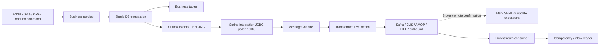
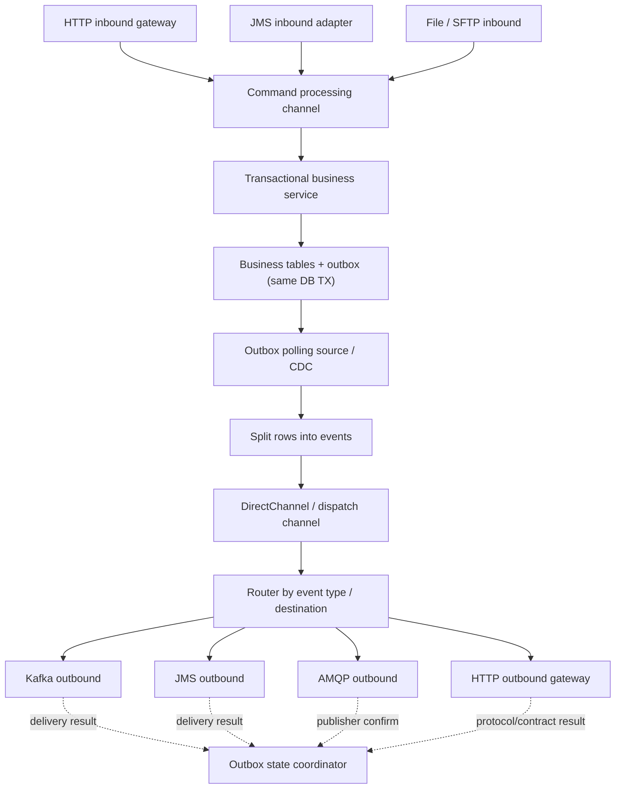
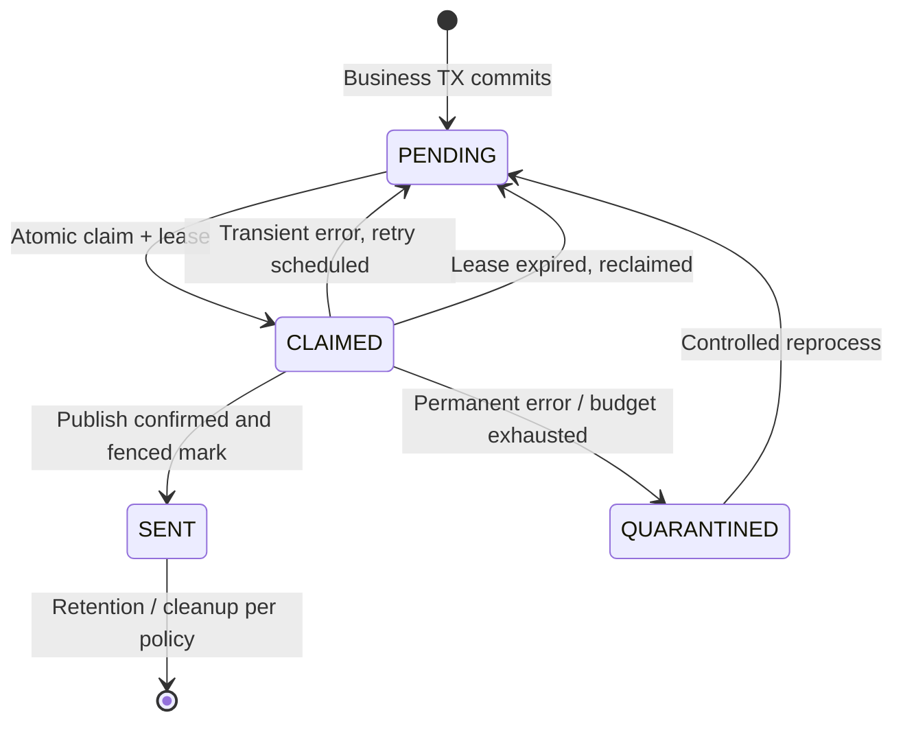

# Outbox Pattern with Adapters in Spring Integration

## 1. The Problem: Database Updates and Message Sends Do Not Commit Together

In an integration application, handling a request often involves two operations:

1. Persisting business state, such as creating an `Order` in PostgreSQL.
2. Sending an `OrderCreated` event via Kafka, JMS, AMQP, or HTTP for other systems to process.

Simply putting `@Transactional` on a Java method containing both operations **does not make the broker or HTTP endpoint join an atomic commit with the database transaction**. Two outcomes can diverge:

- DB commit succeeds while publishing fails: the target system **never learns** the order exists.
- Broker receives the message while the DB rolls back: the target system acts on an event **mismatching the source state**.
- Broker received it yet the app missed the confirmation: retries can produce **two deliveries** of the same business event.

The **transactional outbox pattern** closes the gap between **persisting business state** and **recording the intent to emit an event** by placing both inside **the same database transaction**. After commit, an independent component reads the outbox and dispatches events externally, tracks confirmations, and retries when needed.

Within the **SPRING_INTEGRATION_ADAPTERS** module, Spring Integration connects systems via inbound/outbound adapters, gateways, pollers, and `MessageChannel`. Outbox is especially well suited when an application coordinates JDBC with Kafka, JMS, AMQP, HTTP, or systems unable to share a single distributed transaction.

### Learning Objectives

After this lesson, you will be able to:

1. Show why `@Transactional`, broker acknowledgments, or poller transaction advice **do not automatically guarantee** atomic DB–broker commits.
2. Design outbox schemas, business transactions, and recoverable publisher states.
3. Wire an outbox to a Spring Integration JDBC polling adapter, `MessageChannel`, and outbound adapters/gateways.
4. Analyze failure windows, `claim`/`lease`, concurrency, retries, dead-letter/quarantine, and idempotency.
5. Distinguish **polling outbox** from **transaction-log CDC**; choose based on scale and ordering requirements.
6. Test source, broker, and consumer states across crashes, restarts, timeouts, and failovers.

## 2. Where Does the Direct Model Break?

Consider this illustrative code:

```java
@Transactional
public void placeOrder(PlaceOrder command) {
    orderRepository.save(Order.from(command));  // Database transaction
    kafkaTemplate.send("orders.events", command.orderId(), toJson(command));
}
```

This code **does not** prove data and events commit together:

- `KafkaTemplate.send` may return before the broker confirms the asynchronous send.
- When the producer sends successfully yet DB commit fails, the event has already escaped the database scope.
- If the DB commits before reliable send confirmation, the event can be lost.
- Even when configured, a Kafka producer transaction does not automatically enlist a PostgreSQL transaction.

The same issue occurs when replacing `kafkaTemplate` with a Spring Integration outbound adapter, `JmsTemplate`, `RabbitTemplate`, HTTP gateway, or SFTP outbound adapter. **The framework connects systems; it does not erase transaction boundaries between independent systems.**

### 2.1 Aligning Guarantees to Distinct Goals

| Goal | How outbox helps | What else is required |
|---|---|---|
| Never lose **intent to publish** when DB commits | Insert outbox row in the same business TX | DB backups, monitoring, retention, recovery |
| Never publish if DB rolls back | Outbox insert rolls back too | Publishers read only committed data |
| Still publishable after crashes | `PENDING` outbox row persists durably | Worker rescans, leases/reclaims, retries |
| Every event sent at least once | Retries until confirmed per contract | Tolerate duplicate deliveries |
| Consumer business effect runs only once | Outbox **does not guarantee this alone** | Idempotent consumers, unique constraints/inbox |
| Broker events strictly ordered | Not globally guaranteed automatically | Aggregate versions, partitioning/sequencing, claim/order rules |
| Target system completed business work | Broker ACK is insufficient | Consumer acknowledgment/target readback or app-level confirmation |

## 3. How Does the Outbox Pattern Work?



A basic sequence:

1. Requests arrive via a REST gateway, inbound JMS, Kafka consumer, or file adapter into an application service.
2. The service opens **one DB transaction** using the transaction manager governing that database.
3. Within the same transaction, the service updates business tables and inserts an **outbox record** holding event ID, aggregate ID, type, payload, and version.
4. DB commits. If the transaction rolls back, **neither the business update nor the outbox insert exists**.
5. An outbox dispatcher runs independently: polls eligible rows or consumes CDC events, turning them into Spring Integration messages.
6. Outbound adapters/protocols deliver the event to the destination. The dispatcher must know **what confirmation suffices to mark delivery complete**.
7. Upon sufficient confirmation, the dispatcher updates status or checkpoints; on errors or unknown outcomes, it retries or reconciles.
8. Consumers use the stable event ID to prevent duplicate business effects on redelivery.

### 3.1 Two Transactions Serve Different Roles

**Transaction A — business commit:** business rows and outbox rows commit together.

**Transaction B — publisher state transition:** claims rows, marks `SENT`, increments attempts, schedules retries, or updates checkpoints. Transaction B **does not encompass** the broker/HTTP accepting the message unless a genuine distributed transaction exists.

Between publishing and marking `SENT`, a **failure window** always exists. That is why outbox typically provides **at-least-once** semantics.

### 3.2 An Outbox Is Not a Full Business Queue

An outbox is a journal of **integration intent** protected alongside business transactions—not an unbounded store for keeping every event forever. Establish ownership, retention, backlog caps, cleanup of processed rows, and recovery plans. Durable brokers still manage topics/queues and consumer delivery per their own contracts.

## 4. Designing the Outbox Event Contract

An event should include:

| Field | Role | Notes |
|---|---|---|
| `event_id` | Immutable event identifier | Used for idempotency across publish/retry/consume |
| `aggregate_type` / `aggregate_id` | Business entity grouping | Aids routing and per-aggregate ordering |
| `aggregate_version` | Aggregate mutation sequence if applicable | Detects stale events or sequence gaps |
| `event_type` | Event kind | E.g., `OrderCreated`, `OrderCancelled` |
| `schema_version` | Data contract version | Enables backward-compatible consumer upgrades |
| `payload` | Minimal snapshot needed downstream | Watch PII, size, and encryption |
| `destination` / routing key | Intended target | Never accept arbitrarily from unverified inputs |
| `occurred_at` | Business timestamp | Never rely on timestamps alone for global order |
| `created_at` | Outbox insertion timestamp | Tracks backlog age |
| `status` | `PENDING`, `CLAIMED`, `SENT`, `FAILED`... | **Publisher** state, not business state |
| `attempt_count` / `next_attempt_at` | Bounded retry scheduling | Separates transient vs. permanent errors |
| `lease_owner` / `lease_until` / `lease_token` | Multi-dispatcher coordination | Fences stale workers; enables post-crash reclaim |
| `last_error_code` | Minimized failure code | Never store secrets or raw payloads in error columns |

Not every system needs every field. With CDC, many publisher states live in **connector offsets** or orchestration layers instead of a `status` column. Still, **event IDs, schemas, aggregate binding, and recovery contracts** must always be designed.

### 4.1 Payload Example

```json
{
  "eventId": "evt-7b2c6f",
  "eventType": "OrderCreated",
  "schemaVersion": 2,
  "aggregate": {
    "type": "Order",
    "id": "order-1042",
    "version": 1
  },
  "occurredAt": "2026-11-23T08:00:00Z",
  "data": {
    "orderId": "order-1042",
    "currency": "VND",
    "total": 259000
  }
}
```

This payload is illustrative, not a mandatory standard schema. In multi-tenant systems, enforce `tenantId` and authorization boundaries on both producers and consumers; never trust external tenant claims unverified.

### 4.2 Event vs. Command

- `OrderCreated` is a **fact/event**: the order was created and committed.
- `SendInvoice` is a **command**: asks a downstream service to perform an action.

Both can live in an outbox, yet their semantics differ. Events typically have multiple subscribers; commands typically have a specific target, a deadline, and a business outcome requiring confirmation. Never substitute broker acknowledgment for target command completion.

## 5. Database Schema for a Transactional Outbox

PostgreSQL-style schema for discussion. Key syntax, timestamps, and JSON types vary by database; never copy verbatim across engines:

```sql
CREATE TABLE purchase_order (
    id              VARCHAR(80) PRIMARY KEY,
    customer_id     VARCHAR(80) NOT NULL,
    total_amount    NUMERIC(18, 2) NOT NULL,
    state           VARCHAR(32) NOT NULL,
    version         BIGINT NOT NULL
);

CREATE TABLE integration_outbox (
    event_id          VARCHAR(80) PRIMARY KEY,
    aggregate_type    VARCHAR(80) NOT NULL,
    aggregate_id      VARCHAR(80) NOT NULL,
    aggregate_version BIGINT NOT NULL,
    event_type        VARCHAR(120) NOT NULL,
    schema_version    INTEGER NOT NULL,
    destination       VARCHAR(200) NOT NULL,
    payload           JSONB NOT NULL,
    status            VARCHAR(20) NOT NULL DEFAULT 'PENDING',
    attempt_count     INTEGER NOT NULL DEFAULT 0,
    next_attempt_at   TIMESTAMPTZ NOT NULL DEFAULT CURRENT_TIMESTAMP,
    lease_owner       VARCHAR(100),
    lease_token       VARCHAR(100),
    lease_until       TIMESTAMPTZ,
    created_at        TIMESTAMPTZ NOT NULL DEFAULT CURRENT_TIMESTAMP,
    sent_at           TIMESTAMPTZ,
    last_error_code   VARCHAR(100),
    CONSTRAINT outbox_status_check
        CHECK (status IN ('PENDING', 'CLAIMED', 'SENT', 'QUARANTINED'))
);

CREATE INDEX idx_outbox_dispatch
    ON integration_outbox (status, next_attempt_at, created_at);

CREATE INDEX idx_outbox_lease
    ON integration_outbox (status, lease_until);
```

These indexes support initial analysis; measure actual query plans. For high-volume tables, consider partitioning/retention, partial indexes, and minimizing hot updates. Never retain sensitive payloads forever just for debugging convenience.

### 5.1 Why Is the Event ID Primary Key Important?

If a business API request retries with the same `commandId`, the business service must prevent creating duplicate orders and redundant events. Unique constraints and deterministic event IDs tied to transactions/aggregates catch duplicates at the source. **An outbox alone does not replace inbound command idempotency.**

### 5.2 Should You Just Add a Boolean `published` Column?

For tiny demos, `published=false/true` suffices. Production usually needs **attempts, retry schedule, claim owner, and unknown-outcome states**. A bare boolean obscures the difference between:

- Never attempted yet.
- Sending in flight while a worker died.
- Sent successfully, failed to mark `SENT`.
- Failed permanently.
- Timed out, unknown whether the broker received it.

Avoid needless complexity, yet never pick a schema that leaves operations unable to explain row states.

## 6. Writing Business State and Outbox in the **Same** DB Transaction

Core condition: **both operations must share the same valid transactional resource**. If business updates hit a different database than the outbox, a standard `@Transactional` does not provide cross-database atomicity.

Java/Spring JDBC example (structural illustration):

```java
@Service
public class OrderApplicationService {

    private final JdbcTemplate jdbc;
    private final ObjectMapper objectMapper;

    public OrderApplicationService(JdbcTemplate jdbc, ObjectMapper objectMapper) {
        this.jdbc = jdbc;
        this.objectMapper = objectMapper;
    }

    @Transactional(
        transactionManager = "orderDbTransactionManager",
        rollbackFor = Exception.class
    )
    public void placeOrder(PlaceOrder command) throws JsonProcessingException {
        String orderId = command.orderId();
        String eventId = command.eventId(); // stable across retries

        jdbc.update(
            "INSERT INTO purchase_order(id, customer_id, total_amount, state, version) " +
            "VALUES (?, ?, ?, 'CREATED', 1)",
            orderId, command.customerId(), command.amount()
        );

        String payload = objectMapper.writeValueAsString(
            new OrderCreated(eventId, orderId, command.amount())
        );

        jdbc.update(
            "INSERT INTO integration_outbox " +
            "(event_id, aggregate_type, aggregate_id, aggregate_version, " +
            " event_type, schema_version, destination, payload, status) " +
            "VALUES (?, 'Order', ?, 1, 'OrderCreated', 1, 'orders.events', " +
            " CAST(? AS jsonb), 'PENDING')",
            eventId, orderId, payload
        );
    }
}
```

This example assumes `PlaceOrder` and `OrderCreated` are project DTOs. `CAST(? AS jsonb)` is PostgreSQL-specific. The transaction manager must point to `JdbcTemplate`'s `DataSource`. If either bean uses `REQUIRES_NEW` or a separate DB connection, **business + outbox atomicity** breaks.

### 6.1 Two Foundational Checks

**Commit case:**

```sql
SELECT state FROM purchase_order WHERE id = 'order-1042';
-- CREATED

SELECT status FROM integration_outbox WHERE aggregate_id = 'order-1042';
-- PENDING
```

**Exception thrown before commit:** neither the order nor the outbox event **exists** after rollback.

Do not wait on Kafka/JMS/HTTP to commit this transaction. The goal is avoiding holding DB locks/connections across external network waits.

### 6.2 `@Transactional` Traps

- **Self-invocation:** calling an annotated method from another method on the same instance bypasses Spring proxies in standard proxy setups.
- **Wrong transaction manager:** business and outbox writes do not share a `DataSource`/transaction.
- **Swallowed exceptions:** catching an error and returning normally lets the transaction commit even though business logic required rollback.
- **Async boundary:** inserting outbox inside `@Async`/a separate executor does not join the business transaction.
- **Checked exception rollback:** under standard Spring defaults, configure rollback rules explicitly for checked exceptions.
- **Nested/new transaction:** `REQUIRES_NEW` on the outbox write commits the outbox even if the outer business transaction rolls back.

**Prove it with an integration test:** intentionally throw between the two SQL statements and read back the database, instead of merely checking for the annotation.

## 7. Where Do Spring Integration Adapters Fit?

An outbox has two sides:

1. **Inbound / business ingress path:** HTTP/JMS/Kafka/File/SFTP inbound delivers commands into a transactional service writing business rows and outbox rows.
2. **Outbound / publisher path:** a JDBC poller or CDC picks up committed outbox events and routes them through Spring `MessageChannel`, transformers/routers, and outbound adapters/gateways.



### 7.1 JDBC Inbound Adapter and `MessageSource`

A Spring Integration JDBC inbound adapter periodically queries eligible rows. `SourcePollingChannelAdapter` uses `PollerMetadata` to call `MessageSource.receive()` and emit a Spring message. Depending on adapter and row mapper, one receive call can return **one message containing a list of rows**, not automatically one message per row.

### 7.2 `PollingConsumer` and `QueueChannel`

A `PollingConsumer` pulls from a `QueueChannel`. However, handing off to an in-memory queue before publishing **does not mean the event reached the broker** and loses work on restart. When backing a queue with a persistent `MessageStore`, verify store transactions, outbox states, and replay behavior.

### 7.3 `DirectChannel` vs. `ExecutorChannel`

`DirectChannel` invokes downstream synchronously on the current thread. `ExecutorChannel` switches to an executor, severing thread-bound transaction context. **Never mark outbox `SENT` merely because `ExecutorChannel.send()` returned true**: that may confirm only the handoff.

### 7.4 Does Poller Transaction Advice Solve Publishing Too?

No. Transaction advice wraps `receive()/update/handler` for compatible transactional resources. If a poller holds a DB transaction open during outbound Kafka/HTTP sends, the external system can receive the event before the DB rolls back. Therefore:

- Use short transactions for **claim/lease** or DB state transitions.
- Execute publishing **outside the claim transaction**.
- Mark `SENT` in another DB transaction **after appropriate confirmation**, using fencing.
- Use idempotency to handle resends when outcomes are uncertain.

This is a controllable implementation path, not the only outbox architecture. With CDC, a connector reads the committed transaction log rather than polling status columns.

## 8. Publisher States and Safe Claim/Lease Mechanics

A dispatcher rarely runs alone. When scaling to multiple replicas, all instances can see the same `PENDING` rows. Use **atomic claiming** so only one valid owner holds a row at a time, plus **reclaim** if an owner dies.

### 8.1 Reference State Machine



Not every system needs a `CLAIMED` column: some use DB row locks during reads, while others rely on CDC offsets. When using leases, define explicitly:

- **Owner:** which instance may publish.
- **Lease duration:** long enough for expected send timeouts, yet short enough that dead workers don't stall work indefinitely.
- **Lease token/version:** per-claim identifier to **fence stale workers**.
- **Retry schedule:** when a row becomes eligible again.
- **State transition guard:** updating `SENT` or rescheduling retries succeeds only while the token still matches.

### 8.2 Atomic Claim in PostgreSQL (Illustrative)

The SQL below uses `FOR UPDATE SKIP LOCKED` and `UPDATE ... RETURNING`; it is PostgreSQL-specific and **not portable verbatim across all databases**:

```sql
-- Execute inside a SHORT DB transaction; commit right after claiming.
-- :worker_id, :lease_token, :lease_seconds, :batch_size are parameters.
WITH candidates AS (
    SELECT event_id
    FROM integration_outbox
    WHERE (
            status = 'PENDING'
            AND next_attempt_at <= CURRENT_TIMESTAMP
          )
       OR (
            status = 'CLAIMED'
            AND lease_until < CURRENT_TIMESTAMP
          )
    ORDER BY created_at, event_id
    FOR UPDATE SKIP LOCKED
    LIMIT :batch_size
)
UPDATE integration_outbox AS o
SET status = 'CLAIMED',
    lease_owner = :worker_id,
    lease_token = :lease_token,
    lease_until = CURRENT_TIMESTAMP
        + (:lease_seconds * INTERVAL '1 second'),
    attempt_count = attempt_count + 1
FROM candidates AS c
WHERE o.event_id = c.event_id
RETURNING o.event_id, o.aggregate_id, o.aggregate_version,
          o.destination, o.payload, o.lease_token;
```

Concurrent claim transactions skip rows currently locked by other workers. However, **claim predicates** must be tuned for volume, indexes, fairness, and ordering. On PostgreSQL, queries combining `OR` and `ORDER BY` inside a CTE need query-plan analysis and optimization as backlogs grow. On MySQL, SQL Server, or Oracle, use equivalent native locking/claiming constructs rather than copying syntax blindly.

### 8.3 Why Commit Claims Before Publishing?

Holding DB transactions open while sending to Kafka/JMS/HTTP stretches lock and connection hold times. If a broker stalls, long transactions block other operations.

A common pattern:

1. Short TX A: claim up to N rows, write owner/token/lease, commit.
2. Outside DB TX A: publish each event and wait for protocol confirmation.
3. Short TX B: mark `SENT` **only if** state/token still belongs to this dispatcher.
4. On timeout or unknown outcome: leave row eligible for policy-driven retry; consumers deduplicate.

The trade-off is accepting that **a lease can expire mid-publish**. Two workers may send the same event. Fencing prevents the old worker from corrupting **database state**, yet cannot "unsend" a message already accepted by the broker. **Downstream idempotency remains mandatory.**

### 8.4 Marking `SENT` with Fencing

```sql
UPDATE integration_outbox
SET status = 'SENT',
    sent_at = CURRENT_TIMESTAMP,
    lease_owner = NULL,
    lease_token = NULL,
    lease_until = NULL,
    last_error_code = NULL
WHERE event_id = :event_id
  AND status = 'CLAIMED'
  AND lease_token = :lease_token;
```

If rows updated = **0**, never assume delivery failed or succeeded. Another worker may have reclaimed it, an operator may have intervened, or the token expired. Emit an alert and reconcile by event ID. Never write `UPDATE ... WHERE event_id = ?` ignoring the lease token, as a stale worker could overwrite a newer worker's state.

### 8.5 Handling Failures and Timeouts

```sql
-- Assumes transient error; :next_attempt_at computed with backoff/jitter.
UPDATE integration_outbox
SET status = 'PENDING',
    next_attempt_at = :next_attempt_at,
    last_error_code = :safe_error_code,
    lease_owner = NULL,
    lease_token = NULL,
    lease_until = NULL
WHERE event_id = :event_id
  AND status = 'CLAIMED'
  AND lease_token = :lease_token;
```

If a send **times out**, the outcome is **unknown**: the broker may have received it while the client missed the ACK. Returning the row to `PENDING` prevents losing send intent, yet may cause duplicate sends. To improve precision, publishers can query remote status by business event ID where supported—while still maintaining consumer idempotency.

### 8.6 When to Quarantine?

Schema-invalid payloads, non-existent destinations from misconfiguration, or permanent rejections cannot be fixed by rapid retries. Enforce attempt/time budgets, move rows to `QUARANTINED` or an escalated owner state, and provide a controlled reprocess path after fixes. **Never mark rows `SENT` just to shrink a backlog.**

## 9. Connecting Spring Integration JDBC Pollers to a Dispatcher

### 9.1 Approach One: JDBC Inbound Adapter Reads the Outbox Directly

A Spring Integration JDBC inbound channel adapter can:

- Poll eligible rows via `SELECT`.
- Execute an `UPDATE` to mark rows received per adapter mechanics.
- Emit a Spring message to a channel.
- Attach poller metadata: trigger, `maxMessagesPerPoll`, transaction advice, and lifecycle controls.

Typical flow:

```text
SourcePollingChannelAdapter
    -> JdbcMessageSource: SELECT / UPDATE
    -> Message<List<Map<String,Object>>>
    -> Splitter
    -> Transformer: Map -> OutboxEvent
    -> DirectChannel / outbound adapter
```

**Subtlety:** the JDBC inbound adapter's `UPDATE` executes **at receive time**, before the system knows whether the broker confirmed publishing. Setting `UPDATE status='SENT'` here marks delivery finished **too early**. Use the receive update strictly as a **claim** under a designed protocol, and **mark `SENT` separately after publish confirmation**.

Furthermore, when a receive returns **a list of rows**, `maxMessagesPerPoll=1` means one receive call, **not one row**. Use `split()` or a batch-aware handler. `maxRows` and SQL limits govern row counts per receive; never infer event counts from scheduler ticks arbitrarily.

### 9.2 Approach Two: Claim Service Feeding Batches into `IntegrationFlow`

To control leases explicitly and avoid holding DB transactions across network I/O, create a **polling source invoking a claim service**. The source returns a list of claimed rows; a splitter breaks them into events, and a dispatcher uses the appropriate outbound client/adapter.

Java DSL example **illustrating the API** (requires imports, beans, and version verification against your Spring Integration release):

```java
@Configuration
@EnableIntegration
class OutboxIntegrationConfig {

    @Bean
    IntegrationFlow outboxFlow(
            OutboxClaimService claimService,
            OutboxDispatchHandler dispatchHandler) {

        return IntegrationFlow
            .fromSupplier(
                () -> claimService.claimBatch(25),
                endpoint -> endpoint.poller(
                    Pollers.fixedDelay(Duration.ofSeconds(1))
                        .maxMessagesPerPoll(1)
                )
            )
            .split()
            .handle(dispatchHandler, "dispatch")
            .get();
    }
}
```

This is not a complete config: `claimBatch`, `OutboxEvent`, and `dispatch` are project-defined. Depending on your DSL version, factory signatures or supplier wiring may differ. The goal is illustrating **separate claim transactions** and **publishing outside the claim**.

### 9.3 Claim Service Transaction

```java
@Service
class OutboxClaimService {
    private final OutboxRepository repository;

    @Transactional(transactionManager = "orderDbTransactionManager")
    public List<OutboxRecord> claimBatch(int maxEvents) {
        String leaseToken = UUID.randomUUID().toString();
        return repository.claimAtomically(
            "outbox-worker-A", leaseToken, maxEvents, Duration.ofSeconds(30)
        );
    }
}
```

Because `claimBatch` is called through a Spring bean proxy, the transaction begins and commits before returning the list to the source. `OutboxRepository.claimAtomically` is a project-implemented abstraction backed by matching SQL transactions. Bound batch size, lease duration, and thread pools. When there is no work, return an empty list; the splitter should emit zero outbound messages on an empty list per tested DSL behavior.

### 9.4 An End-to-End Flow Should Separate Responsibilities

- **Claim service**: owns short transactions, locks/leases, and in-flight records.
- **Transformer**: validates event contracts, headers, and schema versions.
- **Router**: picks allowlisted destinations by event type/config, never trusting arbitrary client destinations.
- **Publisher**: sends via Kafka/JMS/AMQP/HTTP and collects send results.
- **State coordinator**: marks `SENT`/retry/quarantine guarded by ownership tokens.
- **Reconciler**: detects expired leases, aging pending rows, and unknown outcomes.

Keeping these responsibilities in distinct beans/modules makes failure testing independent. Neither an inbound adapter nor an outbound adapter replaces a state coordinator.

## 10. When Is It Safe to Mark `SENT`?

No generic `send()` call means the same thing across every adapter. Choose confirmation criteria per protocol:

| Destination | Send evidence to verify | What is NOT guaranteed yet |
|---|---|---|
| **Kafka** | Producer send future completes successfully per `acks` and producer config | Consumer processed or committed business logic |
| **JMS** | JMS send/session transaction completed per provider and producer semantics | Downstream consumer acked or wrote DB |
| **AMQP/RabbitMQ** | Publisher confirm/return received and unroutable messages checked per config | Consumer processed the message |
| **HTTP** | Response meets business contract, e.g., 2xx or accepted status | Server committed final outcome if API is async |
| **SFTP/File** | Remote/local write, rename/close, and readback when needed | Target system imported/parsed file contents |

**Async trap:** an outbound adapter may hand the message to a producer client and return before broker ACK. Marking `SENT` as soon as channel send returns can drop rows from the backlog even if the producer send later fails. Use reliable confirmation hooks (futures/callbacks/gateways/publisher confirms) and protect callback lifecycles.

### 10.1 Kafka: Awaiting Producer Acknowledgment per Contract

Example using `KafkaTemplate` inside a dispatcher bean; this illustrates obtaining acknowledgments, not the sole outbound adapter API:

```java
@Service
class KafkaOutboxDispatchHandler {
    private final KafkaTemplate<String, String> kafkaTemplate;
    private final OutboxRepository repository;

    public void dispatch(OutboxRecord event) {
        try {
            kafkaTemplate.send(
                "orders.events",
                event.aggregateId(),
                event.payloadJson()
            ).get(10, TimeUnit.SECONDS);

            int updated = repository.markSentIfOwned(
                event.eventId(), event.leaseToken()
            );
            if (updated != 1) {
                // Another worker may have reclaimed; must investigate.
                reportOwnershipConflict(event);
            }
        } catch (InterruptedException e) {
            Thread.currentThread().interrupt();
            repository.scheduleRetryIfOwned(
                event.eventId(), event.leaseToken(), "INTERRUPTED"
            );
            throw new IllegalStateException("Outbox dispatch interrupted", e);
        } catch (ExecutionException | TimeoutException e) {
            repository.scheduleRetryIfOwned(
                event.eventId(), event.leaseToken(), "SEND_UNCONFIRMED"
            );
            throw new IllegalStateException("Outbox send not confirmed", e);
        }
    }

    private void reportOwnershipConflict(OutboxRecord event) {
        // Metrics/audit + reconciliation; never overwrite state blindly.
    }
}
```

This is an **explanatory skeleton**, omitting constructors, imports, actual records, retry policies, and monitoring. In practice you can use async callbacks instead of blocking `get(...)`, provided callbacks capture `eventId + leaseToken` and update only while ownership holds. A completed future shows Kafka confirmed per producer settings—**not that consumers finished processing**.

When using Spring Integration's Kafka outbound adapter, inspect your version's API and completion semantics, especially for async sends. Never mark `SENT` solely because `MessageChannel.send()` returned `true`.

### 10.2 JMS: Distinguish Send from Transaction Commit

For JMS, producers may use `JmsTemplate` or the Spring Integration JMS outbound adapter. In a transacted session, calling send before `commit()` does not guarantee the message is finalized. The state coordinator must verify publish confirmation per provider/container contract and recovery semantics. **Consumer** JMS ACKs are separate from **producer** publish confirmations.

### 10.3 AMQP: Publisher Confirms and Unroutable Messages

An AMQP outbound adapter publishes to an exchange; broker publish acceptance does not prove routing to the intended queue succeeded. Configure routing, mandatory/return policies, publisher confirms, and return handling per broker/framework version. Mark `SENT` only against explicit criteria—such as "broker confirmed and message routed to intended target"—not merely a successful method return.

### 10.4 HTTP Gateway: 2xx May Mean Accepted Only

An HTTP POST to a REST API returning `202 Accepted` indicates the remote system only queued the request. If the outbox goal is **command handoff**, that may suffice; if the goal is **remote business completion**, require a callback, status query, or confirmation event. Timeouts leave an **unknown outcome**; when resending, pass a stable `Idempotency-Key` on supporting APIs.

### 10.5 SFTP/File: Verify Handoff Conditions

An outbound file adapter can write a temp file and rename it to the final path upon completion; atomic renames depend on filesystem/protocol. With SFTP, remote uploads/renames/downloads do not participate in local DB transactions. Include business IDs in filenames/manifests, separate temp from final names, check remote state on timeouts, and handle duplicate files. `status=SENT` must reflect only the defined handoff milestone—not that the remote partner already imported the file.

## 11. Crash Matrix: At Which Failure Point Is Correctness Decided?

One of the most important outbox design skills is analyzing **every crash window**. Never run only the happy path and count messages in the broker.

```mermaid
sequenceDiagram
    participant API as Business service
    participant DB as Business DB + Outbox
    participant WORKER as Outbox dispatcher
    participant BROKER as Broker / HTTP target
    participant CONSUMER as Downstream consumer
    API->>DB: Begin TX; write business + PENDING event
    DB-->>API: Commit
    WORKER->>DB: Claim event; commit lease
    DB-->>WORKER: Outbox event E
    WORKER->>BROKER: Publish E
    BROKER-->>WORKER: Confirm (may time out)
    WORKER->>DB: Mark E SENT if lease still valid
    BROKER->>CONSUMER: Deliver E (may repeat)
    CONSUMER->>CONSUMER: Deduplicate E via inbox
```

| Failure window | Business DB | Outbox | Broker / remote | Recovery path |
|---|---|---|---|---|
| Before business commit | Uncommitted | Row uncommitted | Not sent | Rollback; inbound command can retry |
| After business commit, before claim | Committed | `PENDING` | Not sent | Poll/CDC resumes after restart |
| After claim, before publish | Committed | `CLAIMED` with lease | Not sent | Lease expires; another worker reclaims |
| Broker received, ACK missed | Committed | `CLAIMED` / outcome unknown | Likely received | Retry may resend; consumer deduplicates |
| ACK received, before marking `SENT` | Committed | `CLAIMED` | Received | Retry may resend; consumer deduplicates |
| After marking `SENT` | Committed | `SENT` | Received per contract | Consumer handles via its own ack/retry |
| Old worker finishes after lease reclaimed | Committed | New worker owns row | Possibly delivered twice | DB fencing blocks stale write; downstream dedupes |
| Consumer side effect commits, broker ACK fails | Committed at consumer | Producer finished | Broker may redeliver | Consumer inbox / idempotent transaction |

### 11.1 Failure Windows Cannot Be Erased by Swapping Two Statements

Marking `SENT` **before** publishing risks losing events on crash. Publishing **before** marking `SENT` risks duplicate sends on crash. Outbox deliberately prioritizes **never losing committed events**, because duplicates can be absorbed via idempotency whereas lost events are hard to reconstruct.

### 11.2 "Exactly Once" Must State Its Scope Explicitly

A broker may support transactions or exactly-once semantics within its own boundaries. Yet across a business database, JMS/Kafka, HTTP, and a SaaS service, **there is no automatic end-to-end exactly-once guarantee**. In practice, aim for:

- **At-least-once publication** from outbox to broker/destination while retries operate.
- **Idempotent business effects** at consumers.
- **Observable reconciliation** for unknown outcomes.

Together, these deliver "one business effect per operation" within the defined scope without pretending every protocol forms a single distributed ACID transaction.

## 12. Inbox Pattern: The Receiving Side Must Also Be Idempotent

Suppose an outbox publisher sends event `E`, the broker accepts it, and the dispatcher crashes before marking `SENT`. After restart, `E` is sent again. The broker may deliver both copies to the consumer.

An **inbox ledger** records processing of event `E` **in the same DB transaction as the consumer's business update**:

```sql
CREATE TABLE processed_inbox (
    consumer_name     VARCHAR(100) NOT NULL,
    event_id          VARCHAR(80) NOT NULL,
    processed_at      TIMESTAMPTZ NOT NULL DEFAULT CURRENT_TIMESTAMP,
    PRIMARY KEY (consumer_name, event_id)
);
```

Pseudocode:

```java
@Transactional(transactionManager = "consumerDbTransactionManager")
public void handle(OrderCreated event) {
    // Atomic insert-if-absent backed by unique constraint; never use
    // unlocked SELECT then INSERT under concurrency.
    boolean firstTime = inbox.tryInsertIfAbsent("billing", event.eventId());
    if (!firstTime) {
        return; // already processed, avoid duplicate side effects
    }
    billingRepository.recordReceivable(event);
    // Inbox insert and business update COMMIT or ROLLBACK together.
}
```

`tryInsertIfAbsent` is a project-designed repository method, **not a built-in Spring Data API**. Handle duplicate keys and concurrent attempts per database vendor. If the consumer already sent an email, called a payment API, or published to another broker before committing the inbox, the ledger cannot undo those actions; use target idempotency keys, another outbox, or compensation.

### 12.1 Distinct Layers of Idempotency

| Layer | Typical key | Protects against |
|---|---|---|
| Inbound HTTP/JMS command | Command/request ID | User or producer retrying the same request |
| Business DB | Aggregate ID, unique domain constraint | Duplicate orders/payments/operations |
| Outbox event | Event ID | Re-sending the same event |
| Inbox consumer | Consumer name + Event ID | Duplicate processing inside one consumer |
| External HTTP target | API-supported idempotency key | Retries when remote outcome is unknown |
| Projection / version | Aggregate ID + version | Stale or out-of-order events |

Never replace a stable event ID with a raw Kafka offset or JMS message ID, because producers resending the same business event generate new offsets/IDs.

## 13. Event Ordering and Concurrency: More Than Just "Deliver All Events"

Suppose an order emits:

```text
OrderCreated(order-1042, version=1)
OrderConfirmed(order-1042, version=2)
OrderCancelled(order-1042, version=3)
```

If two workers claim in parallel, the worker sending version 2 may finish before version 1. If the dispatcher retries version 1 repeatedly, arrival order at broker and consumer can invert. **`ORDER BY created_at` in a claim query does not guarantee publish/consume order across concurrent workers and async systems.**

### 13.1 Three Levels to Separate

1. **Order of commits:** order in which business transactions actually committed.
2. **Order of publication:** order in which publishers emit to the broker and the broker confirms.
3. **Order of consumption:** order in which consumers apply side effects and commit.

A Kafka partition preserves ordering within a single partition per broker contract, yet concurrent publishers for the same aggregate can already scramble order **before entering the partition**.

### 13.2 Design Approaches

- Increment `aggregate_version` via transaction/optimistic locking and derive order from the authoritative source.
- Use the same partition key per aggregate when publishing to Kafka if business rules require it.
- Allow publishing the next version only after prior events satisfy readiness rules; define a policy for blocked versions.
- Use per-aggregate partition/worker ownership to bound concurrency.
- Have consumers check versions to reject or buffer out-of-order events.
- Distinguish **global total order** (very costly) from **per-aggregate order** (usually more practical).

One `QUARANTINED` event can block all subsequent events for the same aggregate when strict ordering is enforced. Define manual unblock/replay procedures instead of silently skipping events and pretending order is intact.

### 13.3 Snapshot Events vs. Delta Events

- Snapshots (`OrderStateChanged` carrying full state/version) reconcile more easily on out-of-order arrival if consumers apply the highest valid version.
- Deltas (`BalanceIncreasedBy(100)`) require delivering every event in exact count/order; enforce stricter versioning, inboxes, and gap detection.

Never choose an event model based solely on payload size. Consumer semantics and recoverability determine correctness.

## 14. Polling Outbox vs. Change Data Capture (CDC)?

Two primary approaches:

**Polling:** application/adapter periodically queries the outbox table, claims rows, and publishes.

**CDC:** a connector reads committed changes from the database transaction log and forwards records to a broker—for example via a CDC platform like Debezium and a compatible outbox event router.

| Criterion | JDBC polling | Transaction-log CDC |
|---|---|---|
| How events are captured | Scheduled SQL table queries | Reads DB transaction log post-commit |
| Latency | Depends on poll interval, batching, backlog | Near real-time possible; still depends on connector lag |
| Database load | Periodic queries/indexes/claims/updates | Log reading; requires log retention and connector resources |
| Dispatcher state | Typically status, leases, attempts | Often stored in connector offsets/checkpoints |
| Operations | Easy to start with Spring Integration JDBC | Adds CDC infrastructure, schema/offset/slot management |
| Ordering | Must design worker/concurrency rules | Follows log order, though routing/consumers still need checks |
| Backfill / replay | Uses retained outbox rows, statuses, and leases | Uses log/connector offsets; logs may expire per retention |
| Typical failures | Poll stampedes, lost leases, dirty claims, poison rows | Connector lag, dropped replication slots, schema drift, snapshot mismatches |
| Atomicity with business writes | Yes when sharing the DB transaction | Yes when sharing the DB transaction |
| End-to-end exactly-once | Not guaranteed automatically | Not guaranteed automatically |

### 14.1 CDC Does Not Remove the Need for an Outbox Transaction

If a business service updates a business row and calls Kafka outside the transaction, adding CDC on the business table **does not magically produce the right event contract**. The outbox row still provides the properly structured event with schema, ID, version, and payload committed alongside business state.

### 14.2 CDC Differs from a JDBC Inbound Adapter

Spring Integration's JDBC inbound adapter uses SQL polling. A CDC connector like Debezium reads database transaction logs via connector/DB mechanisms; never configure `Jdbc.inboundAdapter(...).poller(...)` and call it log-based CDC.

You can combine them: **CDC emits to Kafka**, and then a Spring Integration Kafka inbound adapter/flow consumes events to process/route to other adapters. In that case, acks/offsets and transactions in the Kafka consumer form their own separate boundary.

### 14.3 Watch Out During CDC Snapshots or Connector Restarts

Connectors may perform initial snapshots, resume from offsets, restore replication slots, and handle schema evolution. These can produce duplicate, missing, or reordered events depending on configuration. Verify:

- Are log retention and offset stores sufficient to resume?
- Can snapshots re-emit rows already processed downstream?
- Are outbox and payload schemas compatible with the router?
- Is the event ID preserved end-to-end?
- If a connector outage outlasts log retention, is backfill/reconciliation available?

Never treat "CDC connector RUNNING" as proof every committed event reached its target.

## 15. Retries, Backoff, Poison Events, and DLQs

### 15.1 Error Classification

| Error category | Examples | Handling |
|---|---|---|
| Transient | Broker briefly unreachable, HTTP 503, timeout | Bounded retries with exponential backoff + jitter |
| Unknown outcome | Send timeout when broker may have accepted | Retry with the same event ID; deduplicate and read back where possible |
| Permanent schema | Contract-invalid payload, missing required fields | Quarantine, fix/transform per policy, reprocess |
| Permanent config | Non-existent destination, permission denied | Critical alert; avoid tight infinite retries |
| Data conflict | Duplicate aggregate version, invalid routing | Investigate source and state; never silently skip |
| Stale worker | Lease expired and new worker reclaimed | Fencing; never overwrite newer claims |
| Capacity issue | Broker overloaded, DB pool exhausted, large backlog | Cap concurrency, batches, retry budgets; alert |

### 15.2 Never Swallow Errors and Mark `SENT`

```java
// Anti-pattern: publisher calls send, catches exception, and still marks SENT.
void wrongDispatch(OutboxRecord event) {
    try {
        sendToRemote(event);
    } catch (Exception ex) {
        log.warn("Publish failed", ex);
    }
    repository.markSent(event.eventId()); // WRONG: event may be lost.
}
```

Instead: when the outcome is unconfirmed, keep retry/unknown state and log; never assume completion. On permanent errors, move to owned quarantine rather than discarding the event.

### 15.3 Spring Integration `errorChannel`

Spring Integration can route errors as `ErrorMessage` on `errorChannel`. Clarify:

- Did the error come from a synchronous transformer/handler or an async callback?
- Does the error flow receive **`eventId`, `leaseToken`, `destination`, and `attempt`** to update the right row?
- Could swallowed exceptions let the poller think outbound succeeded when it actually failed?
- Do stacked retry layers (poller retry advice, Kafka retries, HTTP client retries, broker retries) create request storms?

**An error channel is an error-routing tool, not a transaction manager.** Error signals must feed the state coordinator properly without losing row ownership discipline.

### 15.4 Retry Budgets and Poison Messages

Define max attempts, max age, and deadlines per event type; once exceeded, transition to `QUARANTINED`/DLQ or escalate. One poison event must never lock the entire outbox table or keep pollers spinning with zero backoff. Maintain retention, access controls, and an audited reprocess mechanism.

## 16. Outbox Lifecycle: Capacity, Retention, and Security

### 16.1 Capacity Planning

An outbox adds at least one extra database write per business event plus updates for claiming and state transitions. During a broker outage, the table can grow rapidly.

Questions to answer:

- Average and peak events/second?
- Payload/event sizes and index overhead?
- Maximum broker outage duration while business writes continue?
- DB storage capacity and write amplification from status/attempt updates?
- Backpressure: when the outbox fills up, do you throttle business commands or enter degraded mode?
- Do lease reclaims and cleanups contend for locks with business traffic?

Never let backlogs grow unbounded until the business database runs out of disk. Alert on **oldest `PENDING` age**, **pending bytes/rows**, and **error rates**—not row count alone.

### 16.2 Retention and Cleanup

Keep `SENT` rows long enough for auditing/reconciliation per policy, then archive/delete via controlled jobs. Deleting too early destroys evidence of whether an event published. Keeping forever bloats the DB and retains sensitive data unnecessarily.

With partitioned tables, drop aged-out `SENT` partitions per policy. Never delete `PENDING`/`CLAIMED`/`QUARANTINED` rows merely to reclaim space without an explicit risk process and decision trail.

### 16.3 Avoid Exposing Sensitive Data via Brokers

- **Data minimization:** include only necessary fields; consider sending IDs so consumers query authorized APIs where appropriate.
- **Encryption:** TLS in transit, encryption at rest where required, least-privilege DB/broker ACLs.
- **Tenant isolation:** validate tenant/resource access both when creating events and when routing.
- **Schema validation:** reject oversized payloads or disallowed fields.
- **Logs:** never write tokens, private keys, passwords, or personal data into exceptions or metric labels.
- **Replay access:** anyone able to reprocess events can trigger real side effects; require approval and auditing.

Outbox replicas and backups are also copies of business data. Apply matching retention, backup security, and privacy compliance rules.

## 17. Metrics, Tracing, and SLOs for Outboxes

A Spring Integration scheduler running and traffic flowing to a broker does not prove every business event is arriving. Measure **the end-to-end path from business commit to downstream readiness**.

| Suggested metric | Purpose | Anomaly signal |
|---|---|---|
| `outbox.pending.count` | Unpublished event count | Growing steadily despite healthy broker |
| `outbox.oldest.pending.age` | Age of oldest waiting event | Breaches integration deadline |
| `outbox.claimed.count` / `lease.expired.count` | Currently claimed or abandoned leases | Dead workers or slow sends |
| `outbox.claim.rate` | Read/claim rate | Poller stopped or DB overloaded |
| `outbox.publish.attempts` | Total send attempts | Retry storms or poison events |
| `outbox.confirmed.rate` | Broker/target-confirmed events | Lower than event creation rate |
| `outbox.confirmation.latency` p95/p99 | Wait time for broker ACK | Network or provider slowdown |
| `outbox.sent.mark.conflicts` | Token fencing mismatches | Leases too short or worker overlap |
| `outbox.quarantined.count` | Events failing after retry budget | Long-lived schema/config bugs |
| `outbox.backlog.bytes` | DB queue storage size | Storage exhaustion risk |
| `inbox.duplicates.suppressed` | Prevented duplicate side effects | Retry or ambiguous ACK incidents |
| `integration.delivery.lag` | Business commit to publish confirmation | Event SLA violation |
| `integration.consumer.apply.lag` | Publish to confirmed business effect | Consumer lag differs from outbox lag |
| `cdc.connector.lag`, `cdc.offset.age` | Used with CDC | Falling behind transaction log |

Names above are **metric suggestions**, not built-in defaults in every Spring Integration/Micrometer/Kafka release. Avoid putting high-cardinality or sensitive IDs (`eventId`, `customerId`, `tenantId`) into metric labels; use logs/traces for per-event tracking.

### 17.1 Tracing One Event End-to-End

```text
businessCommandId=cmd-9017
aggregateId=order-1042
aggregateVersion=1
eventId=evt-7b2c6f
traceId=trace-8e2a
outboxState=CLAIMED
leaseTokenHash=redacted-or-hashed
publishAttempt=2
transport=KAFKA
publishOutcome=CONFIRMED
markSentOutcome=UPDATED
consumerOutcome=PROCESSED_ONCE
```

Never log raw lease tokens/secrets if they could be abused to hijack ownership. Logs must clearly separate `BROKER_CONFIRMED` from `BUSINESS_CONSUMED`, and `SEND_TIMEOUT_UNKNOWN` from `SEND_REJECTED`.

### 17.2 Base SLOs on Actual Latency

Examples:

- 99.9% of `OrderCreated` events confirmed by the broker within the approved deadline.
- Zero committed business events purged from the outbox without delivery evidence.
- Every `QUARANTINED` event has an owner and resolution deadline.
- Discrepancies between committed business records and emitted outbox events are reconciled.

During prolonged broker outages, an outbox preserves retryability **without maintaining normal-state latency SLOs**. Incidents must track backlog size, lag, and recovery targets once the broker recovers.

## 18. Runbook: When Outbox Backlogs Spike or Duplicates Occur

### A. Detect

1. Check new events/minute, counts of `PENDING`/`CLAIMED`/`QUARANTINED`, and oldest event age.
2. Distinguish database, poller/scheduler, broker/network, outbound adapter, schema, and consumer failures.
3. Identify affected destinations, aggregates, tenants, and critical business deadlines.
4. Inspect lease expirations, worker ownership conflicts, transaction timeouts, and retry storms.
5. Check whether any instance changed configs, schemas, keys/certificates, or routing near onset.

### B. Stabilize

1. During broker outages, allow business+outbox commits while capacity permits; avoid rolling back business work for publish failures **when eventual delivery is the agreed contract**.
2. Cap claim concurrency and retries; never crank up poll rates while targets are down.
3. Move schema-invalid events to audited `QUARANTINED` state so they cannot block the pipeline.
4. Never mass-update rows to `SENT`, delete backlogs, or strip lease tokens from live workers.
5. If storage nears capacity, trigger approved backpressure/capacity procedures and notify stakeholders of ingress impact.

### C. Recover

1. Verify broker endpoints, TLS, ACLs, routing, rate limits, and producer confirmations.
2. Inspect DB queries/indexes and verify connection pool capacity for pollers.
3. Reclaim expired leases per policy; prioritize oldest and critical events.
4. Resume workers with bounded batch sizes/concurrency while watching send latency and DB locks.
5. Confirm `SENT` criteria are met and duplicate side effects are blocked by consumers.
6. Reprocess quarantined events after schema/config fixes with required approvals.

### D. Reconcile and Close Incident

1. Compare committed business transactions against outbox rows and event logs.
2. Identify events published yet failing to mark `SENT`; use event IDs and consumer ledgers to assess impact.
3. Check aggregates for version gaps or out-of-order application at consumers.
4. Account for remaining DLQ/quarantined items, owners, and deadlines.
5. Document root cause, actual lag, duplicate counts, impact, remediation, and regression integration tests.

## 19. Designing Integration Tests

Unit testing `OutboxDispatchHandler.dispatch` covers only isolated code branches. To prove a transactional outbox actually works, use a **production-equivalent test database and broker** with controllable fault-injection paths.

### 19.1 Core Test Matrix

| Test | Expectation | Evidence |
|---|---|---|
| Business + outbox commit | Both order and event exist | DB readback in both tables |
| Exception between business insert and outbox insert | Both roll back | Neither order nor event exists |
| Exception after outbox insert, before commit | Both roll back | DB readback; broker receives nothing |
| Broker down after business commit | Outbox stays `PENDING`/`CLAIMED` and retries | Row state, retry schedule |
| Worker crashes after claim | Lease expires and row is reclaimed | Owner/token/version, eventual confirmation |
| Broker accepts, ACK arrives late | Retry may resend; event not lost | Broker events, consumer inbox |
| Broker ACK succeeds, DB `SENT` update fails | Event may resend, yet business effect runs once | Pending state, dedupe ledger |
| Stale worker returns after reclaim | Cannot overwrite new owner's state | Fencing update row count = 0 |
| Two workers claim concurrently | Cannot both win valid claim tokens | DB locks / lease owner |
| Schema-invalid payload | Quarantined after budget | Error reason, attempts, owner |
| Permanent 4xx failure | No tight infinite retries | Retry policy, quarantine |
| Kafka producer future not yet ACKed | Not marked `SENT` prematurely | Async timing, row state |
| AMQP unroutable destination | Not treated as publisher success per contract | Return/confirm, retry/quarantine |
| HTTP timeout after server commit | Retries same idempotency key; no double effect | Target ledger/readback |
| Process restarts with 1,000 pending rows | Zero lost events, no stampede | Throughput/backlog/DB pool |
| Event version 2 overtakes version 1 | Ordering or gap detected | Aggregate version/inbox |
| Consumer crashes before ACK after business commit | Duplicate delivery, zero duplicate business effects | Inbox unique constraint |
| CDC restarts after snapshot | Zero lost or skipped events per recovery contract | Offsets, event IDs, backfill |

### 19.2 Lab Exercise: Rolling Back the Source Transaction

1. Issue a test `placeOrder(order-1042)` request.
2. Inject a failure after the business `INSERT` succeeded and before the outbox `INSERT` completes.
3. Query both tables: **neither** the order nor the outbox row exists.
4. Remove the fault and retry with the same command ID per idempotency policy.
5. Verify one order and one matching event commit.
6. Confirm the dispatcher sees the row **only after commit**.

This tests the foundational invariant; if business and outbox writes live in separate transactions, the pattern is broken from the start.

### 19.3 Lab Exercise: Broker Receives, Then Worker Crashes

1. Create a `PENDING` event and let worker A claim it with lease token A.
2. Let the broker confirm receipt of the event.
3. Inject a crash **before** worker A writes `SENT`.
4. Wait for lease expiration; worker B reclaims with token B.
5. Worker B may resend the event and mark `SENT`.
6. Consumer confirms only one business effect via its inbox ledger.
7. Let worker A resume: its `SENT` update keyed by token A must affect **0 rows**.

**PASS criteria:** zero duplicate business effects, zero lost events, zero stale-worker overwrites. Broker receipt count may be 2—which is valid under an explicit at-least-once contract, not a bug.

### 19.4 Lab Exercise: Splitting a Batch into Individual Messages

For a JDBC flow returning `List<Map<String,Object>>`:

1. Insert 10 committed outbox rows.
2. Poll the source for at most 5 rows per receive.
3. Verify the source payload matches the batch shape returned by the adapter.
4. Use a `Splitter` to emit up to 5 individual event messages.
5. Verify each message preserves `eventId`, `aggregateId`, `schemaVersion`, and correlation.
6. If one event fails, clarify whether sibling events in the batch are affected and how batch rollback behaves.

Never equate `maxMessagesPerPoll=1` with publishing only one event, since a single `receive()` can hold a list.

### 19.5 Never Wrap the Test Runner in `@Transactional`

In `@SpringBootTest` or Spring Test integration tests, annotating the test method with `@Transactional` leaves fixtures uncommitted and invisible to poller threads, while test-end rollbacks mask bugs. Commit fixtures before starting pollers, then inspect rows and brokers from an independent transaction.

### 19.6 Testing Tools and Scope

Use Testcontainers for PostgreSQL, Kafka, or supported JMS/AMQP brokers alongside Spring Boot test utilities, network fault injection, and committed fixtures. Adapt setups to **your project's dependency versions**; this lesson does not assume tests were run against a live workspace.

## 20. Anti-Patterns to Avoid

**"`@Transactional` wraps both the DB write and Kafka send so events can't be lost."** Kafka/HTTP do not automatically join DB transactions. Persist send intent in an outbox inside the same DB transaction.

**"Poll the outbox and `UPDATE SENT` before sending to prevent duplicates."** Crashing after marking `SENT` loses the event permanently.

**"Outbound adapter accepted the message, so the broker confirmed it."** With async producers, channel send may prove only handoff. Check futures/confirms per protocol.

**"Broker ACK means the consumer finished processing."** Broker publish acceptance and consumer processing are separate steps; never conflate publication SLAs with business completion SLAs.

**"With a single worker, leases aren't needed."** Processes crash, restart, or overlap during deploys/failovers. Support clean reclaim and stale-update protection.

**"`SKIP LOCKED` guarantees exactly-once."** It keeps workers from contending on claims inside a transaction, yet does not close the crash window between publishing and marking `SENT`.

**"A lease token prevents duplicate sends."** Fencing blocks stale workers from updating DB state; the old worker may still have sent the event externally. Consumers must be idempotent.

**"Mark send timeouts as permanently `FAILED`."** Timeouts can mean unknown outcomes; retry or reconcile using the stable event ID.

**"`JMSMessageID` or Kafka offset is the business event ID."** When producers resend the same event, new messages get new IDs/offsets. Keep business event IDs stable.

**"An outbox automatically guarantees ordering for all events."** Multiple workers, retries, and broker partitioning can reorder events. Implement versioning and ordering rules.

**"The CDC connector is `RUNNING`, so zero events are lost."** Monitor offsets, log retention, snapshots/backfills, lag, and downstream outcomes.

**"HTTP `202` means the partner completed the business operation."** `202` often means only queued for deferred execution; confirm at the required contract level.

**"Just retry a bad event infinitely."** Poison events need owned quarantine/DLQ and controlled reprocessing.

**"Deleting all `SENT` rows is enough for operations."** Enforce audit retention and protect `PENDING`/`CLAIMED`/`QUARANTINED` rows.

**"An outbox replaces consumer idempotency."** An outbox ensures **send intent survives** alongside business commits; duplicate deliveries can still happen.

## 21. Outbox Implementation Checklist with Spring Integration Adapters

### Source and Business Transactions

- [ ] Business updates and outbox `INSERT` share the **same database transaction**?
- [ ] Events carry immutable IDs, aggregate ID/version, schema version, destination, and minimal payloads?
- [ ] Inbound commands enforce idempotency keys and unique constraints?
- [ ] Tested throwing between the two DB operations and verified both roll back?
- [ ] External messages are never sent as a synchronous precondition of DB commit?

### Publisher and State Management

- [ ] Chosen JDBC polling or CDC based on topology and volume?
- [ ] If polling, implemented atomic claims/leases, expiry/reclaim, and fencing tokens?
- [ ] Understood poller `maxMessagesPerPoll`, batch sizes, thread handoffs, and transaction boundaries?
- [ ] `SENT` updated only **after** protocol-appropriate publish confirmation?
- [ ] Send timeouts and unknown outcomes handled safely?
- [ ] Retries bounded with backoff/jitter, and poison events routed to quarantine?
- [ ] Planned backlogs, capacity headroom, and backpressure during broker outages?

### Consumers and Integration Contracts

- [ ] Consumers maintain an inbox ledger / idempotent business operations?
- [ ] Defined per-aggregate ordering requirements, versioning, and gap detection?
- [ ] Applied Kafka partition keys, JMS correlation, AMQP routing, or HTTP idempotency keys properly?
- [ ] Producer ACKs never confused with consumer business completion?
- [ ] Replay workflow avoids unintended duplicate side effects?

### Operations and Testing

- [ ] Metrics track pending age, claim conflicts, publish confirmations, quarantine, and duplicate suppression?
- [ ] Reconciliation compares committed business events against delivered events?
- [ ] Tested crashes after publish before marking `SENT`, worker reclaims, stale leases, and consumer retries?
- [ ] Enforced data minimization, backup/retention, auditing, and authorized reprocessing?
- [ ] Runbooks prepared for backlogs, routing errors, CDC offsets, and outbox quarantine?

## 22. Scenario Exercises

### Scenario A — Order Exists, Yet Kafka Has No Event

A service inserts `Order` and calls `KafkaTemplate.send` inside a `@Transactional` method. The DB commits, then the Kafka producer callback reports a network error. No event record remains to retry.

**Question:** Why wasn't the database transaction enough? Design the business+outbox transaction, publisher worker, and `SENT` criteria.

*Hint:* Single DB transaction; `PENDING` outbox; publish outside TX; broker acknowledgments and retries.

### Scenario B — Kafka Receives Two Messages

Worker A sends `E101` successfully, yet crashes before marking `SENT`. Worker B reclaims the lease and sends `E101` again. A team concludes the outbox failed because Kafka received two messages.

**Question:** Do two messages violate an at-least-once contract? What checks prove the **business effect** still ran only once?

*Hint:* Inbox ledger, unique constraints, stable event ID, target readback, and lease fencing.

### Scenario C — `ExecutorChannel` Marks `SENT` Too Early

A JDBC poller sends outbox events into an `ExecutorChannel` and marks rows `SENT` immediately when `MessageChannel.send() == true`. A worker thread later fails the HTTP call.

**Question:** Where did handoff happen, and where do transactions/publisher confirmations live? Propose how to transition `SENT` based on actual worker results.

*Hint:* Async boundaries, durable handoff, `eventId + leaseToken`, callbacks/confirmations, and retries.

### Scenario D — Two Aggregate Versions Reordered

An order emits event v4 then v5. Worker A claims v4 while the broker stalls; worker B publishes v5 first. The consumer updates final state using delta events only.

**Question:** When is strict per-aggregate order required? Propose versioning, partitioning, claim strategies, or out-of-order handling.

*Hint:* Commit order ≠ publication order; partition keys + publisher serialization; gap detection.

### Scenario E — CDC Loses Its Log Slot

An application writes to its outbox steadily, yet the CDC connector stops for a day; required transaction logs expire per retention. Upon restart, the connector cannot resume from its offset.

**Question:** Why doesn't CDC automatically prevent event loss in every scenario? What monitoring and backfill/reconciliation are required?

*Hint:* CDC offsets, replication slot/log retention, event IDs, source of truth, and diff reconciliation.

### Scenario F — HTTP `202` and Double Payment

An outbox publisher sends command `ChargeCard` over HTTP and receives `202`, yet the final result callback never arrives. An operator reprocesses the row and triggers a second charge.

**Question:** Which completion level justifies marking `SENT`? How do you attach idempotency keys and check final results when outcomes are unknown?

*Hint:* Command vs. event contracts, remote operation IDs, `ACCEPTED`/`COMPLETED` states, idempotent endpoints.

### Scenario G — Excessive Retries Fill the DB

The broker is down for 2 hours while the outbox receives 500 events/second. Workers retry every 100 ms, attempt counts explode, the DB pool saturates, and storage nearly runs out.

**Question:** Propose backoff, circuit breakers, backlog alerts, capacity headroom, backpressure, and a recovery plan. Why can't you just delete `PENDING` rows to fix it?

*Hint:* Oldest age, bounded retries, reclaim, capacity planning, and preserving send intent.

## 23. Decision Summary

When adopting the **outbox pattern with adapters**, ask in order:

1. **What is the business source of truth?** Can business tables and outbox rows commit in the same DB transaction?
2. **What is the event contract?** Business event ID, aggregate ID/version, payload/schema, destination, tenant, and event vs. command semantics.
3. **How is the outbox read?** Spring Integration JDBC poller or transaction-log CDC? Weigh latency, DB load, offsets, and replayability.
4. **How do multiple workers coordinate?** Claims/leases, fencing, retries, ordering, and poison events.
5. **When does an outbound adapter truly succeed?** Broker ACK, publisher confirm, HTTP acceptance, SFTP rename, or downstream completion? Define each explicitly.
6. **What if a crash hits between publish and marking `SENT`?** Retry with the same event ID, tolerate redelivery, and protect consumers with inbox/idempotency.
7. **Can operations prove correctness?** Metrics, oldest pending age, reconciliation, negative/fault-injection tests, and audits.

## 24. Key Takeaways

The **transactional outbox** does not create a global transaction across database and broker. It guarantees **business state and event-publishing intent commit together in one database transaction**. Spring Integration provides **JDBC polling adapters, pollers, splitters, `MessageChannel`, transformers, routers, and Kafka/JMS/AMQP/HTTP/File/SFTP outbound adapters** to implement handoffs. Because publishers still face a failure window between **successful send** and **marking `SENT`**, **at-least-once delivery, idempotent consumers, leases/fencing, retries/quarantine, ordering, and reconciliation** remain essential pieces of the design. A solid solution is judged by **never losing committed events and never producing duplicate business effects**—not simply by `send()` returning true.

## Guided References

- Spring Integration Reference — JDBC Support: [JDBC inbound channel adapter](https://docs.spring.io/spring-integration/reference/jdbc/inbound-channel-adapter.html), pollers, and source status update flows.
- Spring Integration Reference — [Message Channels](https://docs.spring.io/spring-integration/reference/channel.html) and [Transaction Support](https://docs.spring.io/spring-integration/reference/transactions.html): transaction advice, synchronization, and thread boundaries.
- Spring Integration Reference — Kafka, JMS, AMQP, HTTP adapters/gateways: outbound patterns, acknowledgments, and version-specific error handling.
- Spring Framework — Transaction Management: `@Transactional`, transaction managers, and rollback rules.
- Debezium Documentation — Outbox Event Router and CDC transaction-log processing: verify connector/DB versions and offset recovery.

SQL/Java/DSL snippets here are architectural guides, not pre-compiled or tested code. Before deploying to production, verify against your exact **Spring Integration, Spring Framework, JDBC driver, broker, and CDC connector** APIs, and prove behavior with integration tests covering crashes/restarts, slow acknowledgments, and duplicate deliveries.
