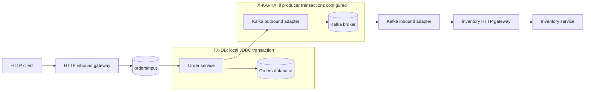
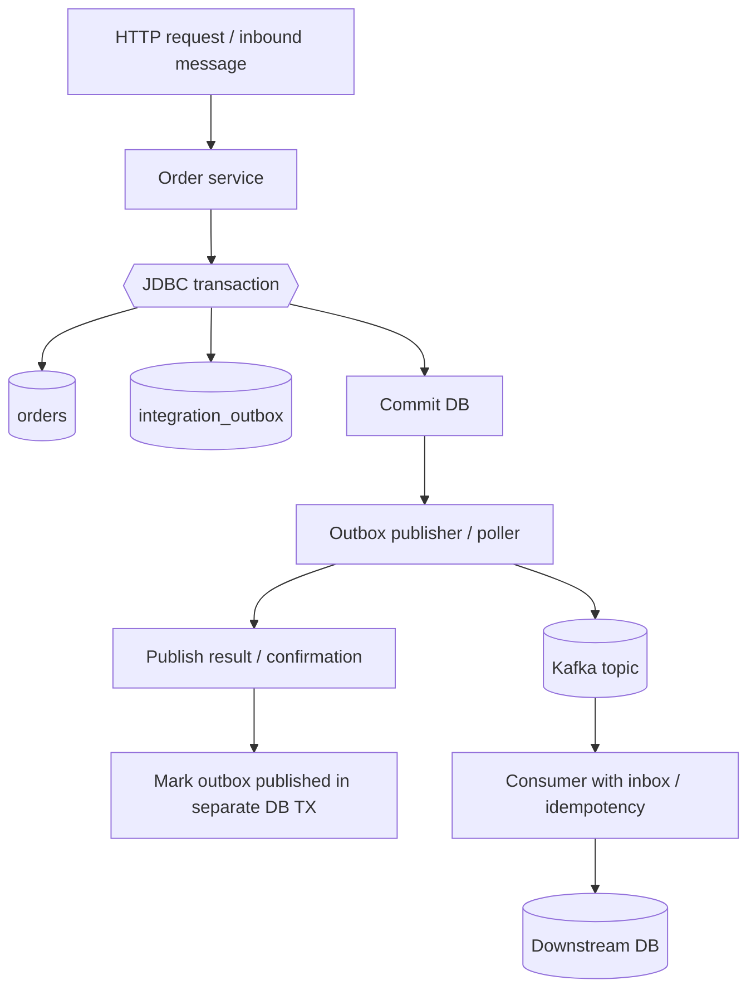
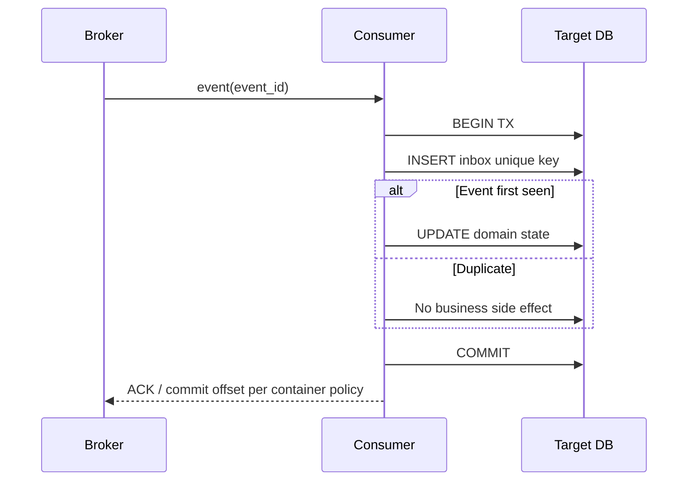
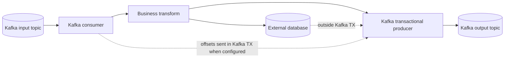
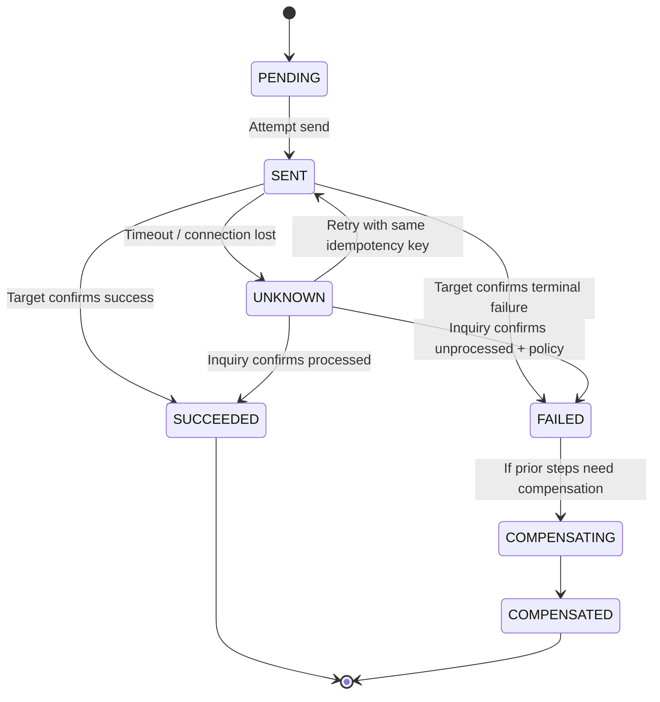
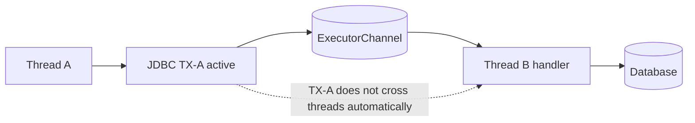
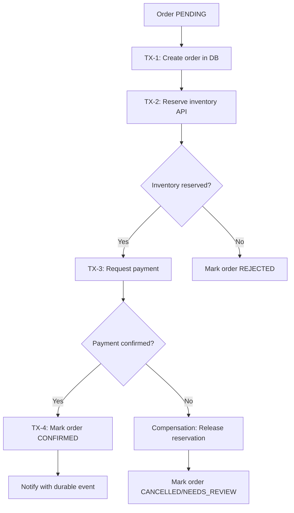
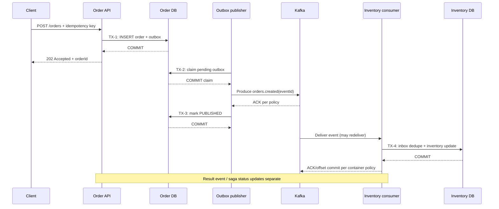

# Transaction Independence Across Systems in Spring Integration Adapters

## 1. The Practical Problem: One Business Flow, Multiple Systems, No Single Shared Commit

An integration application receives an order-creation request via an **HTTP inbound gateway**, saves the order to **PostgreSQL**, emits an event to **Kafka**, and another service updates inventory via an **HTTP outbound gateway**. Visually on a diagram, all steps belong to one "flow," tempting people to think wrapping the flow with `@Transactional` makes **everything succeed** or **everything roll back**.

In reality, what can happen is:

1. The database **COMMITS** the order.
2. The producer sends the Kafka event, yet the broker fails to respond within the timeout.
3. The caller receives HTTP 500/timeout and **retries**.
4. The order already exists in the DB, while it is unknown whether the event reached Kafka.
5. A consumer may receive the same event twice; the inventory system may process it twice without idempotency.

The issue is not just adding another annotation. **Each resource's transaction has its own scope, confirmation mechanism, and commit point**; across HTTP, File/SFTP, Kafka, JMS, AMQP, and JDBC, there is normally **no single overarching ACID transaction**.

The lesson **"Transaction Independence Across Systems"** belongs to the **Transactions** chapter of the `SPRING_INTEGRATION_ADAPTERS` module. This module focuses on external connectivity via **inbound/outbound adapters, gateways, pollers, and `MessageChannel`**, working with **files, SFTP, HTTP, JMS, AMQP, Kafka, and databases**, along with message contracts, errors, and connection lifecycles.

The core focus is designing **independent local transactions** while preserving **eventual business consistency**, handling duplicates, mid-flight failures, and recoverability.

### Target Outcomes

After this lesson, you will be able to:

- Draw **transaction boundaries** inside an `IntegrationFlow`.
- Distinguish **local ACID**, **acknowledgement**, **broker commit**, **business success**, and **eventual consistency**.
- Explain why `@Transactional` cannot roll back already-sent HTTP requests, moved files, or broker-accepted Kafka records.
- Choose cleanly among **Transactional Outbox**, **Inbox/idempotent consumers**, **Sagas/compensation**, **bounded retries**, and **reconciliation**.
- Understand the limits of Kafka producer transactions, JMS/AMQP transactions, JDBC transactions, and XA/2PC.
- Verify how `DirectChannel`, `ExecutorChannel`, `QueueChannel`, pollers, and error flows affect boundaries.
- Design failure scenarios proving **zero lost work** and **zero unintended duplicate side effects** outside contract.
- Write runbooks and metrics to handle **uncertain outcome** states during process/network crashes.

> **Core point:** "One flow" is a message routing map; it **does not mean** "one distributed ACID transaction." Every crossing into an external system needs an explicit **delivery and recovery contract**.

## 2. Three Distinct Meanings of "Transaction"

### 2.1. Local Transaction

A **local transaction** is coordinated by one specific resource or transaction manager, such as:

- A JDBC transaction within one database.
- A transacted JMS session per broker/provider.
- A Kafka producer transaction within Kafka's semantics.
- An AMQP channel transaction per broker mechanics.

Within a resource's supported scope, commit/rollback rules are well defined. **However, a local DB rollback cannot automatically roll back an HTTP response, an SFTP upload, or a Kafka record already published via a separate resource.**

### 2.2. Distributed Transaction

A **distributed transaction** requires coordinating commits across multiple resources—typically XA/JTA with **two-phase commit (2PC)** when all participating resources genuinely support the protocol.

This **differs** from placing two local transactions next to each other and calling them "atomic." Neither an HTTP gateway, File/SFTP, nor a Kafka client becomes an XA resource simply by adding `@Transactional`.

### 2.3. Business Transaction

A **business transaction** can span seconds, minutes, or days: creating an order, reserving inventory, taking payment, delivering a partner file, confirming reconciliation. Steps typically cross multiple services, brokers, and retries.

It can be realized through **multiple sequential local transactions**, with intermediate states and compensating actions when needed. That leads to **eventual consistency**: data across systems may temporarily diverge before converging to the contractually correct state.

| Scope | Example | What can roll back together? | What needs a different mechanism? |
|---|---|---|---|
| One DB transaction | Write `orders` and `outbox` on same `DataSource`/manager | Both DB changes in the same TX | Post-commit broker publish |
| One JMS transacted session | Receive and send on supported session/provider | JMS operations within that session | DB writes in another transaction |
| Kafka transaction | Produce multiple records and (in right topology) commit offsets in same Kafka TX | Kafka operations in the same TX | JDBC/HTTP/SFTP |
| HTTP call | Send request to another service | No built-in distributed rollback | Idempotency, status queries, compensation |
| SFTP upload | Push file to remote server | No shared ACID rollback with DB | Temp files, rename, manifests, reconciliation |
| Business saga | Create order → reserve stock → pay | Each step commits independently | Business compensation, state, reconciliation |

## 3. A Proper Diagram Must Show Commit Boundaries

Consider an **HTTP → JDBC → Kafka → HTTP** flow:



In this example:

- **TX-DB** covers only DB operations executed under the matching transaction manager in the same context/thread.
- **TX-KAFKA** may be a separate producer transaction when configured—it is **not created automatically** just because the flow includes a Kafka outbound adapter.
- The HTTP outbound call to the inventory service is an **external side effect**. A timeout **does not mean** the request went unprocessed.
- If service A rolls back JDBC after the broker accepted the Kafka record, DB and Kafka **can diverge**.
- The diagram depicts logical flow; to pinpoint **actual commit times**, inspect adapter configs, transaction managers, callbacks, acknowledgments, and traces/logs.

### 3.1. Distinguish Four Kinds of "Done"

| Signal | What is confirmed | What is NOT automatically confirmed |
|---|---|---|
| `MessageChannel.send() == true` | Channel accepted the message per its semantics | Broker receipt, DB commit, or downstream success |
| Handler returns normally | Handler finished without throwing | Transaction manager commit or async callback success |
| Broker ACK / publisher confirm | Broker confirmed publish per configured policy | Consumer finished processing |
| DB commit succeeds | Changes in that DB transaction committed | Other systems received events or finished work |
| HTTP 2xx/202 | Server replied per HTTP contract | Async work completed, unless guaranteed by API |
| Business `VERIFIED` | Target outcome verified per contract | Unrelated side workflows outside scope |

In code, never name an **enqueue** state `DONE` when the business requirement is **DB persisted or payment settled**.

## 4. Why Can't You Just Put `@Transactional` Around the Whole Flow?

Spring's `@Transactional` declares how to manage a **compatible transaction** when a method runs through an active proxy/aspect. It does not establish a global commit protocol over every call inside the method.

Example **insufficient to guarantee atomicity**:

```java
@Service
public class OrderPublisher {

    private final OrderRepository orderRepository;
    private final KafkaTemplate<String, String> kafkaTemplate;

    public OrderPublisher(OrderRepository orderRepository,
                          KafkaTemplate<String, String> kafkaTemplate) {
        this.orderRepository = orderRepository;
        this.kafkaTemplate = kafkaTemplate;
    }

    @Transactional
    public void createOrder(Order order) {
        orderRepository.save(order);           // DB resource
        kafkaTemplate.send(
                "orders.created",
                order.id(),
                serialize(order)                // Kafka resource
        );
    }

    private String serialize(Order order) {
        return order.toString(); // Illustrative only; never use for real schemas.
    }
}
```

**Why it is insufficient:**

1. `@Transactional` likely starts only a JDBC transaction, depending on the chosen manager.
2. `KafkaTemplate.send()` is usually asynchronous; calling it does not prove broker ACK.
3. DB commit and Kafka publish happen at two independent instants without explicit coordination.
4. If publishing succeeds while DB rolls back, a Kafka event describes an order that does not exist.
5. If DB commits first and publishing fails, the order exists without an event.
6. On network timeouts, the producer cannot tell if the broker received the record; retries can duplicate it.
7. If the method is invoked via **self-invocation** bypassing the proxy under standard Spring AOP, the annotation may not fire as expected.
8. If a handler switches threads, thread-bound transaction context **does not follow**.

**This snippet is solely an anti-pattern analysis**, not recommended production code. In particular, never use `toString()` as a real event schema.

### 4.1. "Two Synchronized Commit Orders" Still Have a Failure Window

Some Spring integrations allow **synchronizing two local transactions**, such as DB and Kafka transactions, to order commits. Yet **ordered synchronization is not an atomic distributed commit**.

If the first resource commits and the second fails to commit, the first resource **cannot automatically revert**. Flipping commit order only **relocates the failure window**—it never eliminates it.

Never write a business requirement claiming "DB and Kafka either both commit or both roll back on every crash" when the system only has **two synchronized local transactions**.

## 5. Failure-Window Analysis: Write DB First or Emit Event First?

Suppose a new order in the DB must produce an `orders.created` event for consumers to process.

### 5.1. Approach A: DB Commits Then Publishes

```text
BEGIN DB TX
  INSERT orders
COMMIT DB
PUBLISH Kafka event
```

If the process crashes **after DB `COMMIT` and before publishing**:

- DB has the order.
- Kafka has no event.
- Consumers never learn an order needs processing.
- Without a retry job or durable source, the event can be **permanently lost**.

If publishing times out, it is still unknown whether the broker received the event. Retries lacking idempotency can publish duplicates.

### 5.2. Approach B: Publish First Then DB Commits

```text
PUBLISH Kafka event
BEGIN DB TX
  INSERT orders
COMMIT DB
```

If Kafka publish succeeds yet DB insert/commit fails:

- Consumers may receive an **event describing a non-existent order**.
- If consumers call DB/API to fetch the order, they may get `404`.
- External actions may run before the order ever commits.

### 5.3. Failure Matrix

| Failure timing | DB-first | Publish-first | Consequence to manage |
|---|---|---|---|
| Before any operation | Nothing exists | Nothing exists | Retry input |
| After DB commit, before publish | **DB present, event missing** | N/A | Durable outbox / reconciliation |
| After broker ACK, before DB commit | N/A | **Event present, DB uncertain** | Never publish pre-commit, or use state flows |
| Network timeout during publish | DB present, Kafka **uncertain** | Kafka **uncertain**, DB uncertain | Idempotent event ID and query/retry |
| Process dies after publish, before completion flag | Event likely present, flag unsaved | Event present, DB uncertain | Safe retry with duplicate handling |
| Consumer processes then crashes before ACK | Side effect applied, may redeliver | Same | Inbox/idempotency; ACK after commit |
| Downstream API timeout | Unknown if target processed | Same | Idempotency key, status inquiry, compensation |

**Conclusion:** reordering two calls never makes them atomic. Persist a **durable record of intent** inside the same transaction as the business change, then deliver the event retryably.

## 6. Transactional Outbox: Persisting Publish Intent Alongside Data

### 6.1. Principle

**Transactional Outbox** atomically records both:

1. The business change, e.g., `orders`.
2. The event record to emit, e.g., `integration_outbox`.

Both changes **share the same JDBC transaction and DB resource**. After commit, a separate publisher reads the outbox, dispatches via Kafka/JMS/AMQP/HTTP, and updates publish status.



**Primary guarantee:** if the DB transaction commits, **both the business change and the intent to emit the event** persist durably in the DB. If it rolls back, no outbox event commits as an "occurred event."

**Never promise "end-to-end exactly-once" by default.** The publisher can emit the same event multiple times if it crashes after broker ACK and before marking outbox `PUBLISHED`. Consumers still require idempotency.

### 6.2. Illustrative PostgreSQL Schema

```sql
CREATE TABLE orders (
    order_id          UUID PRIMARY KEY,
    customer_ref      TEXT NOT NULL,
    status            VARCHAR(32) NOT NULL,
    created_at        TIMESTAMPTZ NOT NULL DEFAULT now()
);

CREATE TABLE integration_outbox (
    event_id          UUID PRIMARY KEY,
    aggregate_id      UUID NOT NULL,
    event_type        VARCHAR(100) NOT NULL,
    schema_version    INTEGER NOT NULL,
    payload_json      JSONB NOT NULL,
    status            VARCHAR(20) NOT NULL DEFAULT 'PENDING',
    attempt_count     INTEGER NOT NULL DEFAULT 0,
    next_attempt_at   TIMESTAMPTZ NOT NULL DEFAULT now(),
    claimed_until     TIMESTAMPTZ,
    claim_token       UUID,
    last_error_code   VARCHAR(80),
    created_at        TIMESTAMPTZ NOT NULL DEFAULT now(),
    published_at      TIMESTAMPTZ,
    CONSTRAINT outbox_status_chk CHECK (
      status IN ('PENDING','CLAIMED','PUBLISHED','QUARANTINED')
    )
);

CREATE INDEX idx_outbox_pending
    ON integration_outbox(status, next_attempt_at, created_at);

CREATE INDEX idx_outbox_claimed_lease
    ON integration_outbox(status, claimed_until);
```

This is an **academic model**, not a schema auto-generated by Spring Integration. Production requires retention, partitioning, claim/lease policies, dead-letter/quarantine, audits, versioning, and access controls. Payloads must be protected; never store passwords, access tokens, or out-of-policy sensitive data.

### 6.3. Writing Order and Outbox in the Same JDBC Transaction

Java service example using **Spring JDBC** and `@Transactional` with one `PlatformTransactionManager` managing the **same `DataSource`** for both tables:

```java
import java.util.Map;
import java.util.UUID;

import org.springframework.jdbc.core.namedparam.NamedParameterJdbcTemplate;
import org.springframework.stereotype.Service;
import org.springframework.transaction.annotation.Transactional;

@Service
public class OrderAcceptanceService {

    private final NamedParameterJdbcTemplate jdbc;

    public OrderAcceptanceService(
            NamedParameterJdbcTemplate jdbc) {
        this.jdbc = jdbc;
    }

    @Transactional
    public void accept(
            UUID eventId,
            UUID orderId,
            String customerRef,
            String eventJson) {

        jdbc.update("""
            INSERT INTO orders(order_id, customer_ref, status)
            VALUES (:orderId, :customerRef, 'ACCEPTED')
            ON CONFLICT (order_id) DO NOTHING
            """,
            Map.of(
                "orderId", orderId,
                "customerRef", customerRef
            ));

        jdbc.update("""
            INSERT INTO integration_outbox(
                event_id, aggregate_id, event_type,
                schema_version, payload_json
            )
            VALUES (
                :eventId, :orderId, 'orders.created',
                1, CAST(:payload AS jsonb)
            )
            ON CONFLICT (event_id) DO NOTHING
            """,
            Map.of(
                "eventId", eventId,
                "orderId", orderId,
                "payload", eventJson
            ));
    }
}
```

**Scope of example:**

- Both `INSERT`s share the same transaction manager/`DataSource`; zero Kafka calls appear in this transaction.
- `eventId` is a **stable logical event ID**, not regenerated on each retry.
- `ON CONFLICT DO NOTHING` prevents duplicate inserts in the snippet, yet **does not verify that payload or `customerRef` match the existing row**. Real systems need conflict checks for payload/contract mismatches and handling for divergences.
- If the order insert conflicts while a prior outbox event went unrecorded due to an out-of-band flow, reconcile; do not treat two `ON CONFLICT` clauses as complete business logic.
- If payloads carry personal data, apply encryption, access limits, and appropriate retention.
- Never reuse the same `eventId` for distinct content versions without explicit rules.
- This snippet requires Java with text blocks and matching Spring Boot/JDBC dependencies; it illustrates design, not a complete runnable system.

### 6.4. Why Shouldn't the Publisher Hold a DB Transaction While Calling Kafka?

Never hold a DB transaction open across network publishes that may time out:

```text
BEGIN DB TX
  SELECT pending outbox FOR UPDATE
  SEND Kafka (waits several seconds)
  UPDATE published
COMMIT
```

This holds row locks/connections too long, hurting throughput and increasing deadlocks when brokers slow down. **Split them**:

1. **TX-CLAIM:** claim an outbox batch, set lease/token, and commit fast.
2. **NETWORK I/O:** publish outside the DB transaction using real callbacks/ACKs.
3. **TX-MARK:** update publish status if the claim token still holds.
4. **RETRY:** on publish failure or uncertainty, let the lease expire or reschedule with backoff.

These are **independent transactions**, linked via durable state and idempotency.

### 6.5. Outbox Claiming with Concurrency and Leases

Illustrative PostgreSQL SQL:

```sql
WITH picked AS (
    SELECT event_id
    FROM integration_outbox
    WHERE (
        status = 'PENDING'
        AND next_attempt_at <= now()
    ) OR (
        status = 'CLAIMED'
        AND claimed_until < now()
    )
    ORDER BY created_at
    LIMIT 50
    FOR UPDATE SKIP LOCKED
)
UPDATE integration_outbox AS o
SET status = 'CLAIMED',
    claimed_until = now() + INTERVAL '2 minutes',
    claim_token = :claim_token,
    attempt_count = attempt_count + 1
FROM picked AS p
WHERE o.event_id = p.event_id
RETURNING o.event_id, o.payload_json, o.claim_token;
```

**`:claim_token`** is a unique UUID generated by the worker for one claim/batch cycle—**not** the business event ID. Commit the claim immediately in a local DB transaction before publishing.

When the publisher receives ACK per contract, mark:

```sql
UPDATE integration_outbox
SET status = 'PUBLISHED',
    published_at = now(),
    claimed_until = NULL
WHERE event_id = :event_id
  AND claim_token = :claim_token
  AND status = 'CLAIMED';
```

Check the affected row count: if `0`, the worker **lost its lease** and another worker claimed the event. Never overwrite state blindly. **Leases do not completely eliminate duplicate publishes**: an old worker can still succeed after its lease expires while a new worker also publishes. Consumers must be idempotent.

On confirmed failure or timeout, update `next_attempt_at`, status, and `last_error_code` guarded by the active claim token; apply exponential backoff with jitter and a `QUARANTINED` threshold so poison events don't spin forever.

### 6.6. Outbox Failure Windows

| Crash point | Durable state | Recovery behavior |
|---|---|---|
| Before business+outbox DB `COMMIT` | Both roll back | Retry input; nothing published |
| After `COMMIT`, before claim | Order + `PENDING` outbox | Next publisher claims it |
| After claim, before publish | `CLAIMED` outbox with lease | Lease expires → reclaimed |
| After broker ACK, before marking `PUBLISHED` | Event likely published, outbox still `CLAIMED` | Resend may duplicate; consumer dedupes |
| After marking `PUBLISHED` | Outbox confirmed published per contract | Not normally resent |
| Network timeout, ACK unknown | Outcome **`UNKNOWN`** | Retry may duplicate; rely on event ID, observability, reconciliation |

**Outbox solves "DB exists without durable send intent." It does not guarantee consumers process only once on its own.**

## 7. Inbox and Idempotent Consumers: Target Transactions Must Also Be Independent

A Kafka/JMS/AMQP consumer can receive the same message again due to:

- Crashing after writing to DB and before ACK/offset commit.
- Broker redelivery or listener retries.
- Outbox publisher resending after a timeout.
- Replaying from a DLT/DLQ or running a backfill.
- Producer replicas emitting the same event after uncoordinated retries.

Consumers must therefore treat **duplicate delivery as normal operating behavior to design for**, not necessarily a broker bug.

### 7.1. Inbox Pattern

In the target database, create a table tracking applied events:

```sql
CREATE TABLE integration_inbox (
    consumer_name   VARCHAR(100) NOT NULL,
    event_id        UUID NOT NULL,
    processed_at    TIMESTAMPTZ NOT NULL DEFAULT now(),
    PRIMARY KEY (consumer_name, event_id)
);
```

**Within one local DB transaction**:

1. Attempt to insert `(consumer_name, event_id)`.
2. If already present, skip the already-applied business side effect (per duplicate rules).
3. If first seen, apply domain changes and commit together with the inbox row.
4. Only once the DB transaction completes, proceed with broker ACK/offset commit per listener semantics.



The inbox table and domain update **must** share the same resource/transaction to prevent duplicate DB side effects this way. If the consumer calls HTTP after inserting into the inbox, HTTP remains an out-of-transaction side effect needing its own idempotency.

### 7.2. Consumer Service Example

```java
import java.util.Map;
import java.util.UUID;

import org.springframework.jdbc.core.namedparam.NamedParameterJdbcTemplate;
import org.springframework.stereotype.Service;
import org.springframework.transaction.annotation.Transactional;

@Service
public class InventoryEventApplier {

    private final NamedParameterJdbcTemplate jdbc;

    public InventoryEventApplier(
            NamedParameterJdbcTemplate jdbc) {
        this.jdbc = jdbc;
    }

    @Transactional
    public void apply(UUID eventId, UUID orderId) {
        int firstSeen = jdbc.update("""
            INSERT INTO integration_inbox(consumer_name, event_id)
            VALUES ('inventory-projection', :eventId)
            ON CONFLICT DO NOTHING
            """, Map.of("eventId", eventId));

        if (firstSeen == 0) {
            return; // Duplicate delivery already committed previously.
        }

        jdbc.update("""
            INSERT INTO inventory_projection(order_id, status)
            VALUES (:orderId, 'RESERVED')
            ON CONFLICT (order_id)
            DO UPDATE SET status = EXCLUDED.status
            """, Map.of("orderId", orderId));
    }
}
```

**Assumptions:** `inventory_projection` already exists and `RESERVED` is a demo state; this is not a real stock-decrement example. Real inventory reservation must check quantities, stockout conditions, and concurrency. **Never treat** `ON CONFLICT DO UPDATE` as a universal solution for all business logic.

Because both share one DB transaction, if updating the projection fails, the inbox row rolls back with it, leaving future redeliveries able to reprocess.

**Key limitation:** ACK/offset commit **lies outside this method** and depends on the Kafka/JMS/AMQP listener/container. Never assume `@Transactional` makes the container ACK in the exact desired order automatically; configure and test your transport's lifecycle and ack mode.

### 7.3. Idempotency Is Not "Silently Drop All Duplicates"

In some domains, the same `event_id` arriving again with a different payload is a **data-integrity incident**, not a harmless retry. Validate schema versions, business keys, canonical content hashes (per policy), source trust, and event ordering. When an existing record conflicts in content, quarantine/escalate instead of ignoring silently.

### 7.4. ACK After DB Commit Still Has a Failure Window

If DB commit succeeds and the process crashes **before broker ACK**, the broker redelivers. The inbox prevents applying the DB side effect twice, and the consumer then ACKs per contract.

This is **at-least-once delivery + idempotent effect**, not "single physical delivery."

If ACK executes **before** DB commit, crashing after ACK loses the event from normal delivery while the DB lacks the result. Verify ACK/commit ordering against your exact adapter, listener, transaction manager, and configuration.

## 8. Each Transport Has Its Own Commit, ACK, and Transaction Boundary

Never apply one word—**transaction**—to every adapter and assume identical rollback behavior.

| Transport | Primary commit/ACK boundary | Not included by default | Mandatory checks |
|---|---|---|---|
| **JDBC** | DB transaction/connection governed by transaction manager | Kafka/JMS/HTTP/SFTP | Commit/rollback, constraints, isolation, pool |
| **Kafka** | Producer transaction, offset commit, and consumer mode per config | JDBC and HTTP | `transactional.id`, producer fencing, `read_committed`, retry/rebalance |
| **JMS** | Session transaction or XA/JTA where broker/provider supports | HTTP/File/SFTP; DB if local session only | ACK/redelivery, rollback, DLQ, session lifecycle |
| **AMQP** | Publisher confirms or AMQP channel transactions per mode; consumer ACK/NACK | DB commit, remote HTTP | Confirm/return, requeue/DLX, unacked, prefetch |
| **HTTP** | Client request/response and server-side business work | Caller's transaction | Idempotency, uncertain timeouts, inquiry |
| **File** | Filesystem write/move/rename per OS/FS | DB/broker transactions | Partial files, fsync/durability policy, rename, checksums |
| **SFTP** | Remote server upload/download/rename | Local DB, brokers, local files | Partial uploads, remote visibility, temp names, metadata |
| **Poller / channel** | Can scope a local transaction around one sync poll/handler | Other threads or remote resources | Advice chain, `DirectChannel`, executors, error flows |

**Define "sent successfully" per adapter.** A Kafka broker ACK, HTTP 200, successful file rename, and JDBC transaction commit represent completely different levels of confirmation.

## 9. Kafka Transactions: Strong Within Kafka, Do Not Span Databases

### 9.1. What Does a Kafka Producer Transaction Do?

With properly configured Kafka producer transactions, multiple records join **one Kafka transaction** so appropriately configured consumers do not see uncommitted or aborted writes. A **Kafka consume → process → Kafka produce** topology can commit output records and **offsets** in the same Kafka transaction when using framework/client APIs supporting that flow.

This can deliver **Kafka-scoped exactly-once processing** under explicit conditions. It **does not** automatically guarantee:

- JDBC transactions on an external database.
- HTTP requests to an inventory service.
- SFTP uploads or filesystem operations.
- Email/payment side effects.
- Business event idempotency when identical data is re-emitted by a separate producer/outbox.

**Logical example:**



Here, a Kafka transaction protects **Kafka output writes + Kafka input offset commits** in one unit when configured properly. DB writes sit outside; if DB commits and then the Kafka transaction aborts, input may be reprocessed and the DB requires idempotency.

### 9.2. Do Not Confuse Producer Idempotence with Business Idempotency

Kafka **idempotent producers** limit duplicate records from network retries per producer/broker protocol within specific config limits. They **do not** deduplicate two business events sharing the same `event_id` published by **two separate runs of an outbox worker** or two repeated HTTP requests.

Likewise, when a consumer updates a DB before committing the Kafka offset, records can be redelivered. **Inbox / unique business keys** remain necessary.

### 9.3. Checkpoints for Spring Integration Kafka

- Does the Kafka inbound adapter / message-driven container use a **Kafka transaction manager**?
- Are `ProducerFactory` and transactional ID prefixes configured properly without colliding across processes?
- Do listener and outbound producer stay within the intended Kafka transaction boundary?
- Do downstream consumers use an appropriate isolation level, such as **`read_committed`**, when aborted records must be hidden?
- Do ACK/offset policies, exceptions, retries/DLTs, and container restarts align with your semantics?
- During rolling deploys, are producer fencing, rebalances, and in-flight transactions handled?
- If also writing to a DB, are **DB/Kafka commit ordering and failure windows** documented and tested?
- Do your Spring Kafka / Spring Integration / Spring Boot versions support the exact APIs and configs used?

**Never claim "exactly-once from Kafka to DB" merely because Kafka transactions are enabled.** DB outcomes sit outside Kafka transactions; safety requires idempotent writes or outbox/inbox patterns.

### 9.4. Kafka → DB Failure Window Example

```text
Receive Kafka event(eventId=42)
BEGIN DB TX
  INSERT inbox(eventId=42)
  UPDATE DB
COMMIT DB
CRASH before Kafka offset commit
```

Another consumer receives event `42` again. With an inbox inside the same DB transaction, it **skips the duplicate side effect** and proceeds to ACK/commit per policy. Without an inbox, inventory could be decremented or charged twice.

## 10. JMS: Local Session Transactions Do Not Automatically Merge with JDBC

### 10.1. Transacted Sessions

JMS provides **transacted sessions**; receives and sends run inside one transactional session per provider and config.

In a matching setup:

- **Committing the JMS session** confirms JMS operations in that session.
- **Rolling back the JMS session** allows the broker to redeliver received messages per provider policy.
- Consumer ACKs and redelivery depend on session type, container, and acknowledgment mode.

This does not merge with `INSERT orders` in PostgreSQL. With one independent **JDBC local transaction** and one independent **JMS local transaction**, each resource can commit or roll back separately.

### 10.2. Both Orderings Carry Risk Windows

**DB commits before JMS ACK:**

```text
Receive JMS → COMMIT DB → ACK/COMMIT JMS
```

If crashing after DB commit and before JMS commit, the broker redelivers. Consumer idempotency is required.

**JMS ACK before DB commit:**

```text
Receive JMS → ACK/COMMIT JMS → COMMIT DB
```

If DB fails, the message may never redeliver as expected, losing business work. Avoid premature ACKs outside contract.

### 10.3. When to Use XA/JTA for JDBC + JMS?

When **both `DataSource` and JMS `ConnectionFactory` support XA** and the app runs a properly configured **JTA transaction manager/coordinator**, XA resources can coordinate inside a 2PC transaction.

However, account for:

- Genuine XA support across drivers, brokers/providers, pools, and recovery setup.
- Coordinator durable transaction logs and in-doubt transaction recovery.
- Extended latency and locks during network or participant failures.
- Heuristic outcomes and specialized operational runbooks.
- Throughput limits and impact if the coordinator loses connectivity.
- HTTP, File/SFTP, and Kafka never magically joining that XA transaction.

**Never adopt XA merely out of wishful thinking for a "universal rollback button."** It is viable only when resources and operations fully support it, alongside recovery and audit processes.

### 10.4. Spring Integration with JMS Listeners

Know whether your **inbound endpoint** uses `DefaultMessageListenerContainer`, another container/provider, or a polling adapter, along with:

- Transaction manager / `sessionTransacted` settings.
- Client acknowledgment / transaction semantics.
- Whether replies or outbound JMS share the same session/resource.
- If a handler dispatches asynchronously via `ExecutorChannel`, whether downstream work stays inside the listener transaction (it won't).
- Where handler errors go: propagated to container, `ErrorMessage`, error channel, or retry advice?
- Provider DLQ policies and redelivery limits.

**Setting `errorChannel` is not proof the JMS transaction rolled back.** An error handler may consume/swallow the exception, causing the listener to treat the invocation as successful and ACK depending on config. Test real failures against your actual listener container.

## 11. AMQP: Transactions, Publisher Confirms, and Consumer ACKs Differ

With AMQP/RabbitMQ, there are at least three distinct concepts:

1. **AMQP channel transactions**, when enabled and supported by broker/client, scoped to the channel.
2. **Publisher confirms**, confirming the broker processed the publish step per confirm mode.
3. **Consumer ACK/NACK**, acknowledging or rejecting a received delivery.

These three mechanisms **are not the same thing**.

### 11.1. Publisher Confirm Is Not DB Commit

```text
BEGIN JDBC TX
  UPDATE order
COMMIT JDBC
Publish AMQP event
Await publisher confirm
```

If DB commits and publishing fails, the event is missing. If confirm times out, publish state is **unknown**; retries must preserve consumer idempotency.

In RabbitMQ, **publisher confirms and AMQP channel transactions** are separate channel modes; never assume enabling both on one channel creates an atomic DB+AMQP protocol. Check client/version support and interactions.

### 11.2. Consumer ACK Is Not Business Commit

Consumer receives an event, calls DB, and ACKs:

- If DB commits and ACK is lost, the broker redelivers.
- If ACK runs first and DB rolls back, the message vanishes from the queue.
- If the handler fails, `nack/requeue` or dead-lettering follows policy rather than rolling back a DB transaction.
- **Unacked messages** can pile up when downstream slows down even while queue ready counts look low.

**Recommendation:** execute domain/inbox work in a local JDBC transaction, then ACK per policy on commit; test against the real consumer container and avoid infinite requeue loops.

### 11.3. Publish Never Reaching the Intended Queue

A broker can accept a publish while routing keys, exchanges, or bindings fail to route the message to any intended queue. **Publisher confirm** and **routing outcome** are not identical; when using mandatory flags, return callbacks, or delivery topologies, monitor unroutable returns as well.

`confirm=ACK` alone does not prove a consumer received the right queue message, let alone finished business processing.

## 12. HTTP Gateways: Timeouts Create Unknown State

HTTP is the clearest example of an **out-of-transaction side effect**.

Suppose application A sends:

```http
POST /payments
Idempotency-Key: order-42-payment-v1
Content-Type: application/json

{"orderId":"42","amount":100000}
```

Side A hits a **read timeout** after sending the request. Two scenarios are indistinguishable from the timeout alone:

- The target **never processed** the request.
- The target **processed and committed**, yet the response dropped or arrived too late.

Thus **an HTTP timeout never proves the partner's transaction rolled back**.

### 12.1. Idempotency Keys

For APIs supporting idempotency, pass a **stable key per logical operation**, such as `payment-operation-42`. On retries with the same key and valid payload, the server honors the idempotency contract (e.g., returning the stored result instead of creating a second payment).

**The server must genuinely implement and persist keys/results properly**—clients cannot just send an `Idempotency-Key` header and expect magic.

Basic requirements:

- Keys remain stable across retries; never generate a fresh key per attempt.
- Reject conflicting payloads/amounts/customers reusing an existing key.
- Key/result storage must be durable and enforce uniqueness.
- Key TTL must exceed the required retry and reconciliation window.
- Querying results must enforce tenant isolation.
- If a provider lacks idempotency support, use an inquiry/status API or dedicated reconciliation process.

### 12.2. `PENDING/UNKNOWN` Is Not Definite Failure

Suggested state machine:



`UNKNOWN` represents **insufficient information**, not `FAILED`. When the target offers neither inquiry APIs nor idempotency, automatic retries on sensitive operations risk double execution; route to escalation, manual reconciliation, or pre-designed business checks.

### 12.3. HTTP `202 Accepted` and Business Transactions

An API returning `202 Accepted` has queued a job. This **does not guarantee the job finished**. Track the job ID/status or await result callbacks/events.

When a Spring Integration **HTTP outbound gateway** receives `202`, record only **accepted by external API** until business confirmation arrives per contract.

### 12.4. OAuth, TLS, and Credential Failures

`401`/`403`/TLS handshake failures are auth/connectivity errors; they can happen **before** request handling or due to downstream policy. You cannot roll back an already-committed DB just because an authentication error occurred.

Do not put API keys, bearer tokens, or cookies into message headers flowing through brokers, logs, tracing baggage, or outboxes. Credentials belong to client security config, whereas **idempotency keys** are contract-approved business metadata.

## 13. File and SFTP: Operations Do Not Join JDBC Transactions

File/SFTP typically involves:

- Creating, uploading, or downloading files.
- Writing bytes and flushing/closing streams.
- Renaming/moving from a staging directory to a ready directory.
- Writing marker/manifest files.
- Deleting or archiving after processing.

These actions **do not auto-rollback** when a JDBC transaction in another step fails.

### 13.1. Temp File + Rename + Manifest Pattern

A relatively safe file-handoff pattern:

```text
1. Write to temporary name: orders-20261123.csv.part
2. Write all data and close stream; verify size/checksum
3. Rename to orders-20261123.csv once ready
4. Write manifest or ready marker if contract requires
5. Receiver polls only files matching ready criteria
6. Confirm processing via separate receipt/status
```

**Never claim rename is always atomic and durable across every filesystem or SFTP server.** Atomicity depends on filesystem, same volume/directory, server implementation, replacement semantics, and durability. Test against your exact server/FS and transfer contract.

### 13.2. Never Treat "File Downloaded" as "Business Committed"

A downloaded file may hold invalid data; an upload may break mid-stream; a retry may overwrite or duplicate files.

Include:

- Durable **file ID or manifest ID**, checksums, and schema versions.
- Explicit `incoming`, `processing`, `processed`, and `quarantine` directories with clear rules.
- Filters/metadata stores or durable claims to prevent duplicate ingestion.
- Detection of partial files, temp names, and retries.
- Out-of-filesystem receipts/acknowledgments when required by business contracts.
- Compensation or reconciliation if the database committed while file delivery failed.

### 13.3. SFTP ↔ DB Failure Windows

| Ordering | Crash point | Consequence | Mitigation |
|---|---|---|---|
| DB commit → SFTP upload | After DB commit, before upload | DB has work, file missing | Durable export job/outbox + retry |
| SFTP upload → DB update | After upload, before DB update | Remote has file, DB thinks unsent | File ID/manifest, remote inquiry, idempotent retry |
| Download → DB process | After download, before DB commit | File may be re-read | Dedup file ID, staging, DB transaction |
| DB commit → remote archive/delete | After DB commit, before archive | File stays at source, poller sees it again | Metadata store/inbox + idempotent processing |

SFTP `rename` or archiving is never part of a DB commit. Test crashes at every step and maintain **reconciliation procedures for files in ambiguous states**.

## 14. Spring Integration Transaction Boundaries: `MessageChannel` and Threads

### 14.1. `DirectChannel` Usually Stays on the Same Thread

A **`DirectChannel`** normally dispatches handlers synchronously on the sending thread. If Spring already opened a JDBC transaction on that thread, JDBC calls **participating in that transaction manager** share the same scope.

However:

- `DirectChannel` does not start a transaction on its own.
- Another handler using a different `DataSource`/manager does not automatically share the transaction.
- Calling HTTP/SFTP/Kafka remains an out-of-transaction side effect even on the same thread.
- Catching and swallowing exceptions can cause commits when business logic expected rollback.
- Isolation and propagation depend on `@Transactional` and the real manager.

### 14.2. `ExecutorChannel` Creates a Thread Boundary

**`ExecutorChannel`** hands dispatch off to an executor. JDBC transaction contexts typically bind to threads via Spring transaction synchronization; **an open DB transaction does not automatically cross to worker threads** simply because a message was sent.



When the handler on thread B needs atomic DB writes, open a **separate TX-B at thread B's execution boundary** rather than assuming it joins TX-A.

**Trace/correlation contexts** can also drop across thread hops, though tracing propagation is separate: propagating trace headers never merges local DB transactions into one.

### 14.3. `QueueChannel` Splits Producer and Consumer Phases

**`QueueChannel`** is a `PollableChannel` whose consumer/poller receives messages later. In memory, it **lacks durability** and never merges the producer's transaction with the handler's transaction.

```text
Producer thread: TX-A → send to QueueChannel → COMMIT TX-A
                              |
Consumer poller later:       receive → TX-B → handler → COMMIT TX-B
```

If a producer enqueues in-memory and then rolls back its DB, the message **may already have been picked up by a consumer**; design ordering and storage boundaries carefully. For durable handoffs, use a persistent message store, DB outbox, or broker with explicit commit and recovery contracts.

### 14.4. `PublishSubscribeChannel`, Splitter, and Aggregator

- Synchronous publish-subscribe invokes subscribers per framework order/semantics, yet **does not create a distributed transaction across all subscribers**.
- With an executor, subscribers run on different threads; local transaction context does not propagate.
- A splitter can emit multiple child messages. If one child sent HTTP before a later child failed, **the splitter's transaction cannot roll back the HTTP side effect**.
- An aggregator manages a message group store and release/expiry policies; committing group state does not commit target systems.
- Retry advice can re-invoke handlers; verify whether retries sit **inside or outside** local transactions to avoid duplicate side effects.

### 14.5. Error Channel Is Not a "Rollback Bus"

In Spring Integration, exceptions can be:

- Propagated synchronously to the caller.
- Wrapped into an `ErrorMessage` in appropriate endpoint/transport contexts.
- Caught and handled by retry/advice chains.
- Routed to an error flow, DLQ/DLT, or gateway error response.

**Never assume every error lands on `errorChannel` or that routing there rolls back transactions.** If an error handler **consumes an exception without rethrowing**, containers may treat processing as complete per configuration and ACK/commit. To achieve rollback/redelivery, verify **exception propagation and transaction advice** explicitly.

## 15. Pollers with Transaction Advice: Where Does the Scope Lie?

A polling inbound adapter or polling consumer can run under **transaction advice**. Illustrative Java DSL structure:

```java
import java.time.Duration;

import org.springframework.context.annotation.Bean;
import org.springframework.context.annotation.Configuration;
import org.springframework.integration.dsl.IntegrationFlow;
import org.springframework.integration.dsl.Pollers;
import org.springframework.integration.jdbc.inbound.JdbcPollingChannelAdapter;
import org.springframework.transaction.PlatformTransactionManager;

@Configuration
class OrderPollingFlowConfiguration {

    @Bean
    IntegrationFlow orderRowsFlow(
            JdbcPollingChannelAdapter jdbcSource,
            PlatformTransactionManager jdbcTransactionManager) {

        return IntegrationFlow.from(
                jdbcSource,
                endpoint -> endpoint.poller(
                        Pollers.fixedDelay(Duration.ofSeconds(5))
                                .maxMessagesPerPoll(20)
                                .transactional(jdbcTransactionManager)
                )
        )
        .channel("ordersToProcess")
        .get();
    }
}
```

**Conditions and limits:**

- `JdbcPollingChannelAdapter`, `ordersToProcess`, and the transaction manager require real beans/configs in your app. This is an illustrative fragment, not a complete project.
- Poller transaction advice wraps a poll/receive cycle and matching synchronous processing depending on endpoint config and advice chains; verify against your framework version.
- If `ordersToProcess` is a **`DirectChannel`** with synchronous handlers, it stays on the same thread; if **`ExecutorChannel`/`QueueChannel`**, downstream work crosses into a new boundary.
- `.transactional(jdbcTransactionManager)` **never pulls SFTP uploads, HTTP calls, or Kafka broker transactions** into the JDBC transaction.
- A poller can open a transaction to **read/claim rows** and process synchronously, yet holding locks/DB connections across slow network I/O causes contention. Prefer **short claim → commit → separate processing** with leases/outbox/inbox.
- `Pollers.transactional(...)` overloads and behavior vary by Spring Integration version: check builds, transaction managers, advice order, and integration tests.

### 15.1. Never Hold JDBC Transactions Across Long Network I/O

```text
BEGIN JDBC TX
  SELECT rows FOR UPDATE
  HTTP POST /partner  (30s timeout)
  UPDATE rows
COMMIT JDBC
```

If the partner stalls, DB row locks and connections remain held for tens of seconds, causing deadlocks and cutting throughput. On HTTP timeout, external state is **unknown**; DB rollback can cause re-calling HTTP and duplicating side effects.

Usually better:

```text
TX-1: claim durable work + lease → COMMIT
HTTP request: idempotency key + deadline
TX-2: persist outcome or UNKNOWN → COMMIT
Background reconciliation: query status / controlled retry
```

Independent transactions holding **durable state** allow recovery even if the process dies midway.

## 16. Sagas: When Workflows Span Multiple Independent Business Steps

A **Saga** decomposes a business process into a sequence of **local transactions**, each with completion conditions, retries, and optional **compensation** if the workflow fails to reach its goal.

Order example:



Each TX box may belong to a **different system**. A Saga **does not** turn steps into one global DB transaction.

### 16.1. Choreography vs. Orchestration

| Style | How it works | Pros | Risks |
|---|---|---|---|
| **Choreography** | Services emit events and react independently | Less central coordination | Hard to see global state, event loops, hidden coupling |
| **Orchestration** | A coordinator persists saga state and invokes next steps | Clear visibility of flow, timeouts, compensation | Coordinator must be durable, idempotent, recoverable |
| **Hybrid** | Coordinator for core steps; events for notifications | Flexible | Needs crisp contracts to avoid ambiguous loops |

### 16.2. Compensation Is Not Technical Rollback

`Release inventory` **does not erase the history** of reserving stock; it is a brand-new business operation that can itself fail or run late. For payments, refunds may take days, incur fees, or be irreversible immediately.

Safe compensation requires:

- Stable `saga_id`, `step_id`, and `operation_id`.
- **Idempotency keys** on both forward actions and compensations.
- Preconditions and state checks to avoid compensating wrongly.
- Deadlines, retry/backoff, and escape hatches / manual review.
- Outcome audits—never treat "sent compensation request" as "compensated successfully."
- Identifying steps that **cannot be compensated** and placing them late in the flow appropriately.

### 16.3. When a Step Is `UNKNOWN`

If a payment API times out and you do not know whether the charge succeeded, **never blindly issue a refund and retry the payment**. Query by operation ID / idempotency key first, or transition to `NEEDS_REVIEW` if no inquiry API exists. A saga coordinator must tolerate holding pending state instead of treating timeouts as definite failures.

### 16.4. Eventual Consistency Does Not Excuse Incorrectness

Adopting eventual consistency means accepting temporary divergence across systems—**while explicitly defining**:

- Acceptable convergence windows (SLOs).
- State criteria for `PENDING`, `CONFIRMED`, `FAILED`, `COMPENSATING`.
- Durable persistence to resume after crashes.
- Retries, duplicate detection, ordering, and partitioning strategies.
- Detection and repair for states that fail to converge.
- Access controls, audits, and manual handling when deadlines expire.

Never invoke "eventual consistency" as an excuse for **dropping events** or **lacking reconciliation**.

## 17. Propagation and Isolation: Never Accidentally Split Atomic DB Work

Even **within one database**, transaction independence must be an intentional choice. Spring offers propagation modes like `REQUIRED` and `REQUIRES_NEW`, whose effects must not be overlooked.

### 17.1. `REQUIRED` and `REQUIRES_NEW`

In a standard transaction manager setup:

- **`REQUIRED`**: join an active compatible transaction if present; otherwise open a new one.
- **`REQUIRES_NEW`**: open an independent transaction, suspending the active one per manager support.
- **`NOT_SUPPORTED`**: execute outside the current transaction per manager rules.
- **`MANDATORY`**: require an existing transaction, failing if none exists.

Example **wrong for a transactional outbox**:

```java
@Service
class OrderWriter {

    private final OrderRepo orderRepo;
    private final EventWriter eventWriter;

    @Transactional
    void create(Order order) {
        orderRepo.insert(order);
        eventWriter.writeOutboxInNewTransaction(order);
        // If the outer transaction rolls back after the method below commits,
        // the outbox event exists even though the order does not.
    }
}

@Service
class EventWriter {

    @Transactional(
        propagation = Propagation.REQUIRES_NEW
    )
    void writeOutboxInNewTransaction(Order order) {
        // INSERT integration_outbox...
    }
}
```

This is an **illustrative anti-pattern**, omitting imports/beans. If the outbox commits inside `REQUIRES_NEW` while the outer order transaction rolls back, **intended atomicity between order and outbox is broken**.

When **business rows and outbox rows must commit or roll back together**, ensure both run inside **one compatible DB transaction** sharing the same `DataSource` and transaction manager—never put `REQUIRES_NEW` on the outbox write.

### 17.2. Isolation Levels and Race Conditions

A flawed idempotency check might do:

```text
IF inbox does not contain event-42:
    perform business write
    INSERT inbox(event-42)
```

If two workers check concurrently before inserting, **both can believe it does not exist**. Checking with `SELECT` alone before acting is unsafe.

Rely on **unique constraints and atomic writes in the same transaction**, such as `INSERT ... ON CONFLICT DO NOTHING`, or appropriate locking/serialization. Check the insert result before applying DB side effects.

**Never treat `READ_COMMITTED` or `SERIALIZABLE` as a global fix for HTTP/brokers.** Isolation levels govern only how transactions **inside that DB** observe and contend for data on that resource.

### 17.3. Transaction Timeouts and Connection Pools

If a DB transaction waits on slow HTTP/SFTP calls, that thread pins a connection and locks. A timeout may roll back the DB while the remote request **already succeeded**. Therefore:

- Keep DB transactions **short and tightly scoped**.
- Set network I/O timeouts and transaction timeouts independently.
- Cap concurrency, pool sizes, and retries.
- Never open a DB transaction before network I/O without verified justification.
- For claims/leases, enforce expiry/recovery and ownership so work never stays stuck forever.

## 18. Ordering: Valid Events in the Wrong Order Still Corrupt Data

Outbox/inbox solves **durable intent and duplicate side effects**, yet does not automatically enforce **ordering**.

Suppose:

```text
Event-1: Order 42 CREATED
Event-2: Order 42 CANCELLED
```

Two outbox workers may claim these two events close together; due to network delays or retries, Kafka or an HTTP target receives `CANCELLED` before `CREATED`. If the consumer applies "last event wins" without checking versions, the order gets resurrected.

### 18.1. Choose Per-Aggregate Ordering Rules

- Increment `aggregate_version` monotonically inside the domain DB transaction.
- For Kafka, choose a matching partition key when per-aggregate ordering is needed; **Kafka guarantees order only within one partition**.
- For parallel outbox publishers, if strict order is required, serialize claims per aggregate or enforce sequential sending by key; `ORDER BY created_at` in a claim query **does not guarantee end-to-end order** with multiple workers.
- Consumers verify expected versions/sequences to detect gaps or stale events.
- Define policies for buffering/retrying, dead-lettering, or reconciling out-of-order arrivals.

### 18.2. Eventual Consistency and Version Checks

A projection table can store:

```sql
CREATE TABLE order_projection (
    order_id UUID PRIMARY KEY,
    version BIGINT NOT NULL,
    status VARCHAR(32) NOT NULL
);
```

When receiving a lower version than already applied, the consumer can **skip per business rules**; when receiving a version with a gap ahead, it can transition to `WAITING_FOR_PREDECESSOR` or query authoritative state from the source. Exact rules depend on domain semantics: not every event type requires strict monotonic application, and you must never drop an event carrying an independent side effect.

**Idempotency does not fix ordering bugs.** "Never apply an event twice" and "apply events in the right order" are two separate requirements.

## 19. Choosing a Transaction Model by Flow Type

### 19.1. Selection Matrix

| Flow | Common goal | Suitable pattern | What to verify |
|---|---|---|---|
| HTTP inbound → JDBC | One request writes multiple tables in same DB | Local JDBC transaction + request idempotency | Commit before reply; HTTP retries |
| JDBC → Kafka | Never lose publish intent after DB commit | Transactional Outbox + idempotent consumer | Publisher retries, ordering, duplicates |
| Kafka → JDBC | Never apply DB side effect twice on redelivery | Inbox / unique business key in DB TX | DB commits before offset per policy |
| Kafka → Kafka | Read, process, and emit Kafka records transactionally | Kafka transactional processing if stack supports | Offsets/outputs, `read_committed`, fencing |
| JMS → JDBC | At-least-once + idempotent DB, or XA if truly needed/supported | Inbox + ACK after commit; JTA/XA where warranted | Redelivery, ack modes, recovery |
| AMQP → JDBC | Consumer ACK may trail DB commit | Inbox + ACK/NACK policy | Requeue, DLX, unacked counts |
| JDBC → JMS/AMQP | Domain commit must not lose notifications | Outbox + publisher | Publisher confirms, DLQ/outcomes |
| HTTP outbound payment | Timeout leaves target outcome unknown | Idempotency key + status inquiry + durable state | Key TTL, payload conflicts, double charges |
| File/SFTP inbound → JDBC | File may be re-read after crash | File ID/manifest + inbox + staging | Partial files, accept-once, DB commits |
| JDBC → File/SFTP outbound | Must produce final file after commit | Durable export job + temp file/rename + receipt | Upload retries, overwrites, reconciliation |
| SFTP → Kafka → JDBC | Multiple commits and format boundaries | Durable staging/outbox + consumer idempotency | Transfer IDs, Kafka publish, target commit |
| Multiple business services | Independent steps can fail independently | Saga + compensation | Unknown outcomes, overdue steps, manual recovery |

No pattern should be picked by lines of code alone. **Resource contracts, reliability, throughput, latency, auditability, and recoverability** determine the architecture.

### 19.2. When Is a Complex Saga Unnecessary?

When all operations truly reside in one database and can commit atomically, a **local JDBC transaction** is simplest. Never split into events and build a Saga just for microservices aesthetics.

Conversely, when a payment API, an SFTP server, and a Kafka broker must coordinate, never pretend they share a local transaction. **Simplifying via durable state + idempotency** beats faking atomicity.

## 20. Sample End-to-End Design: HTTP → DB Outbox → Kafka → HTTP/DB

### 20.1. Requirements

A customer places an order over HTTP. The system must:

1. Never create two orders when the client retries.
2. Persist the order as `PENDING` together with the event-publishing intent.
3. Publish `orders.created` to Kafka after DB commit.
4. Have an inventory consumer reserve stock in another service; retries must never deduct stock multiple times.
5. Receive the inventory outcome and update the order to `CONFIRMED` or `REJECTED`.
6. If inventory outcome is unknown due to timeout, hold `UNKNOWN/PENDING_RECONCILIATION` instead of assuming failure.
7. Expose errors/progress to users via a queryable operation ID.

### 20.2. Independent Transaction Diagram



In this example:

- `202 Accepted` means the request was durably accepted per API contract—**not** that inventory is reserved.
- Producer and consumer share a durable `eventId`.
- Kafka ACK and DB outbox `PUBLISHED` are **two local outcomes**, not one atomic commit.
- Inventory consumer commits independently from producer DB.
- To report inventory outcomes back to the Order service, emit a **new result event or callback** with matching inbox/outbox and idempotency.
- Never hold an HTTP request open for minutes pretending it is a synchronous ACID transaction.

### 20.3. Minimal Message Contract

Illustrative payload without credentials:

```json
{
  "eventId": "e5a7ad1b-6c2f-4e91-8849-44d1034dba70",
  "eventType": "orders.created",
  "schemaVersion": 1,
  "orderId": "ea43978d-f11d-4ccd-8eb9-2a5a1b2fe054",
  "aggregateVersion": 1,
  "occurredAt": "2026-11-23T09:00:00Z",
  "correlationId": "order-ea43978d"
}
```

Fields to define cleanly:

- **`eventId`**: event identity and deduplication key.
- **`orderId`**: aggregate/business identity.
- **`aggregateVersion`**: supports ordering when required by domain.
- **`correlationId`**: links logs/traces/sagas; never substitutes for `eventId`.
- **`schemaVersion`**: supports contract evolution.
- **`occurredAt`**: source business timestamp; watch clock skew.
- **Never include** DB passwords, Kafka JAAS configs, bearer tokens, or private keys.

### 20.4. Why Use Result Events Instead of Directly Updating Another Service's DB?

Each service should **own its own data and transactions**. The inventory service must not write straight into the order DB to "put everything in one transaction," because it:

- Breaks data ownership boundaries and couples schemas.
- Undermines security and least privilege.
- Creates transactions spanning multiple infrastructures.
- Complicates recovery when one service deploys or a database goes briefly offline.

Result events or callbacks let the order service update its state inside its **own local transaction**. Despite eventual consistency latency, the system preserves clear durable state and clean recoverability.

## 21. Metrics and Observability for Independent Transactions

**An eventually consistent system without observable state is painful to operate.** Measure each boundary and milestone of a logical event independently.

### 21.1. Essential Metrics

| Suggested application metric | Unit | Meaning |
|---|---|---|
| `integration_business_transactions_started_total` | Event | Logical operations started |
| `integration_business_transactions_verified_total` | Event | Operations reaching verified completion |
| `integration_business_transactions_overdue` | Event | Open operations exceeding deadline |
| `integration_outbox_pending` | Row | Events awaiting publish |
| `integration_outbox_oldest_age_seconds` | Seconds | Age of oldest unpublished outbox event |
| `integration_outbox_publish_attempts_total` | Attempt | Publish attempts including retries |
| `integration_outbox_publish_unknown_total` | Attempt | Publish attempts ending in timeout/unknown |
| `integration_inbox_duplicates_total` | Delivery | Previously processed events re-received by consumers |
| `integration_consumer_tx_failures_total` | Attempt | Consumer DB/transaction errors |
| `integration_compensations_pending` | Step | Unfinished compensations |
| `integration_unknown_external_outcomes` | Operation | External operations with unknown results |
| `integration_reconciliation_failures_total` | Count | Reconciliation worker failures |

**These metric names are illustrative**, not automatically provided by Spring Boot, Spring Integration, or Kafka. Use Micrometer/Actuator or your observability stack, follow naming conventions, and avoid duplicate overlapping metrics.

### 21.2. Event Timeline for Each Business Operation

```text
09:00:00  order.accepted                  orderId=42
09:00:00  tx.order_and_outbox.committed    eventId=E42
09:00:03  outbox.claimed                  eventId=E42 attempt=1
09:00:04  kafka.publish.timeout            eventId=E42
09:00:09  outbox.retried                  eventId=E42 attempt=2
09:00:10  kafka.publish.acknowledged      eventId=E42
09:00:11  inventory.inbox.first_seen      eventId=E42
09:00:12  inventory.tx.committed          eventId=E42
09:00:14  order.verified                  orderId=42
```

If attempt 1 actually published despite the timeout, the consumer sees **two deliveries sharing `eventId`**. That is normal and safe when side effects are deduplicated and evidence is logged.

**Structured logs** should capture `correlationId`, `eventId`, `step`, `attempt`, and `outcome` under strict access control. **Never use `eventId` or `traceId` as per-event metric labels** that explode cardinality.

### 21.3. Traces Are Not Proof of Commit

A span ending with status `OK` may simply mean:

- The handler threw no exception.
- The HTTP client received a response.
- The Kafka produce request was queued.
- The JDBC driver call finished.

To confirm **business verified**, check contract-specific evidence: DB commit/readback, broker callbacks, consumer outcomes, or target business state. Tracing locates bottlenecks and causal links—**it is not a durable audit ledger**.

### 21.4. Dashboards Must Separate `UNKNOWN` from `FAILED`

A payment timeout is not a confirmed `FAILED`. Dashboards should expose distinct states:

```text
PENDING
IN_PROGRESS
COMMITTED_LOCAL
DISPATCHED
EXTERNAL_UNKNOWN
CONFIRMED
REJECTED
COMPENSATING
COMPENSATED
NEEDS_MANUAL_REVIEW
```

State names are application-defined. Operations runbooks must specify when to retry, when to query status, when to compensate, and when to escalate.

## 22. Failure Testing Before Production

Testing only happy paths or `@Transactional` rollbacks when a repository throws is **insufficient** for independent transactions. Test **crash windows**, flaky networks, and message replays.

### 22.1. Fault-Injection Matrix

| Scenario | Expected outcome |
|---|---|
| Business+outbox DB rolls back | Neither business row nor outbox row commits |
| DB commits, process dies before publisher runs | Outbox remains pending; publisher processes after restart |
| Outbox claimed, then worker dies | Lease expires; another worker reclaims |
| Kafka ACKs, worker dies before marking | Duplicate publish possible; consumer inbox blocks duplicate side effects |
| Kafka publish times out while broker accepted | Retries create zero duplicate business side effects |
| Consumer DB commits, dies before ACK | Broker redelivers; inbox skips duplicate |
| Consumer DB rolls back, ACK prevented | Message remains retryable per container policy |
| JMS session rolls back | Redelivery/DLQ matches policy; DB state consistent |
| RabbitMQ ready drops while unacked climbs | Never report completion just because ready count is low |
| HTTP times out after target commits | Inquiry/idempotency yields deterministic outcome |
| HTTP target returns `202` | State stays pending external completion |
| Partial SFTP upload | Temp `.part` file never ingested as complete |
| SFTP upload finishes, DB unmarked | File ID/manifest prevents re-applying wrong side effects |
| DB connection pool exhausted | Bounded retries/backpressure; no TX held across network |
| `ExecutorChannel` switches threads | Separate TX-B; never assumes TX-A participation |
| Message routed to DLQ/DLT | Logical business event remains tracked |
| Concurrent outbox workers | Unique claim/token fencing and idempotency hold |
| Outbox lease expires during slow publish | Duplicate possible yet newer state never overwritten |
| Same-key events arrive out of order | Version/precondition guards protect projection |
| Secret/credential rotation in flight | Sessions/connections recover with zero lost events |
| Monitoring drops spans/exporter | Business processing never depends on trace backend |
| Restart mid-compensation | Compensation is idempotent and recoverable |
| Target returns conflicting results | Quarantined and audited rather than blindly overwritten |

### 22.2. An Integration Test for Outbox

Using a PostgreSQL test container or approved test database:

1. Start the local DB transaction for `accept(order)`.
2. Inject an error after inserting the order and before inserting the outbox; verify full rollback.
3. Re-run cleanly; verify one order and one outbox event exist.
4. Run two publishers concurrently; verify only one active claim holds the lease at a time.
5. Have the publisher send the event, then **kill the publisher** after broker ACK and before `PUBLISHED`.
6. Start/reclaim with a new worker; verify duplicate publish may happen while the **consumer applies the side effect once**.
7. Verify final business event state after consumer commit.
8. Inspect metrics/outbox age and verify zero `CLAIMED` rows stay stranded.

**Do not assert only "the Kafka topic has one record."** At-least-once architectures can emit multiple records with the same event ID while still producing exact business results. What matters is that **target side effects** never repeat improperly and the final event settles per contract.

### 22.3. Testing HTTP Timeouts

Using a mock HTTP server or test service with an idempotency store:

1. Server receives request and **commits an operation**.
2. Server intentionally **withholds the response** past the client timeout.
3. Client records `UNKNOWN`, never terminal `FAILED`.
4. Client queries by operation ID or retries with the **same idempotency key**.
5. Server returns the stored outcome without applying a second side effect.
6. Client finalizes state and writes audit logs.

If a provider lacks idempotency or inquiry APIs, test that the flow enters **manual review/quarantine** rather than assuming blind retries are safe.

### 22.4. Testing File/SFTP

- Upload to a `.part` name and kill the process midway: inbound must not ingest the incomplete file.
- Finish upload, fail before marking DB: retry recognizes file ID and avoids duplicate writes.
- Remote rename lacks required atomicity: manifest/ready marker or equivalent safeguards work.
- `accept-once` metadata store wiped/restarted: duplicate detection still works by business file ID.
- SFTP session fails auth/host-key mid-upload: bounded retries without disabling security checks.
- File processed yet archive fails: business state remains verifiable and archiving retries separately.

## 23. Runbook: DB Committed Yet Event Never Reached Downstream

Suppose operations receives an alert: **"Order saved successfully, yet inventory service hasn't updated after 10 minutes."**

**Step 1 — Identify the logical operation.** Find `order_id`, `event_id`, and `saga_id` if present; check schema version and source timestamps. Never substitute trace ID for business event ID.

**Step 2 — Inspect the business DB row.** Did the transaction commit, and what are the aggregate's current state and version? Never conclude based solely on pre-commit logs.

**Step 3 — Inspect the outbox.** Is there a `PENDING`/`CLAIMED`/`PUBLISHED` event; what are `attempt_count`, `claimed_until`, `last_error_code`, and oldest pending age?

**Step 4 — Inspect the publisher.** Did the producer get a broker ACK; timeout/`UNKNOWN` may mean it published. Check transactional ID/fencing if using Kafka transactions, callbacks, and retries.

**Step 5 — Inspect the transport.** Check Kafka partitions/consumer lag/offsets, JMS/AMQP ready/unacked/DLQ depths, HTTP target statuses, or File/SFTP remote receipts per flow.

**Step 6 — Inspect the consumer.** Did the event reach the inbox; did the target DB transaction commit; could ACK/offset commit have failed after DB commit?

**Step 7 — Check duplicates and ordering.** Were multiple deliveries seen for the same event ID? Were aggregate versions processed out of order? Is a projection waiting on a missing intermediate event?

**Step 8 — Separate `UNKNOWN` from `FAILED`.** When external calls time out, query status before retrying any non-idempotent operation.

**Step 9 — Choose safe recovery.** Retry outbox, replay DLT, reprocess files, or compensate strictly per approved runbook. Never skip offsets or purge queues just to turn dashboards green.

**Step 10 — Verify the target.** Check the actual inventory DB or live API state—not just records leaving a broker.

**Step 11 — Broaden reconciliation.** Look for other orders in the same batch, partition, credential set, or deployment to separate isolated glitches from systemic incidents.

**Step 12 — Close the incident.** Document root cause, timestamps, durable state, duplicate handling, remaining overdue events, and preventive controls.

### 23.1. What to Do When Outcomes Are Uncertain?

| Symptom | Safer action |
|---|---|
| DB row exists, outbox row missing due to bug | Reconcile against transaction/business intent and emit an approved compensating event after checking for duplicates |
| Outbox `CLAIMED` past lease expiry | Let lease expire/reclaim; avoid tampering with live workers' claims |
| Publish timed out / `UNKNOWN` | Retry with stable event ID; consumers deduplicate |
| Consumer DB committed, broker unacked | Allow redelivery; inbox blocks duplicate side effects |
| HTTP payment timed out | Query status / reuse idempotency key; never issue a fresh payment blindly |
| SFTP file exists remotely while local thinks unsent | Reconcile file ID/checksum/manifest before re-uploading |
| Saga compensation failed | Retry idempotently, escalate, and route to manual review |
| Out-of-order event version | Buffer/quarantine/reconcile; never overwrite newer state with older events |

## 24. Anti-Patterns and Fixes

1. **Assuming `@Transactional` wraps an entire `IntegrationFlow`.** → Only manager-supported resources join the transaction; map explicit boundaries.
2. **Calling Kafka/HTTP inside a JDBC transaction expecting rollback to undo side effects.** → Use outbox or durable intent.
3. **Swapping DB commit and Kafka publish order and calling it atomic.** → Analyze both failure windows.
4. **Using `REQUIRES_NEW` for an outbox write alongside a business write.** → Keep outbox and domain writes in the same local DB transaction.
5. **Marking outbox published before broker confirmation.** → Risks losing events; mark per ACK policy.
6. **Waiting on brokers while holding DB row locks for tens of seconds.** → Short claim TX, network I/O outside TX, separate mark TX.
7. **Omitting leases/recovery for outbox workers.** → Dead workers strand events forever.
8. **Assuming leases eliminate duplicate publishes.** → Consumer idempotency is still required.
9. **Using trace IDs or Spring Message IDs as idempotency keys.** → Use stable logical event/operation IDs.
10. **Checking inbox with `SELECT` then `INSERT` without unique constraints.** → Race condition under concurrent consumers.
11. **Writing inbox outside the domain-update transaction.** → Inbox may record processed while domain rolls back.
12. **Acking the broker before DB commit.** → Risks losing work if DB fails.
13. **Assuming Kafka EOS covers JDBC/HTTP.** → Scoped to Kafka resources/semantics; DB needs deduplication.
14. **Equating publisher confirm with consumer completion.** → Track delivery and business outcomes separately.
15. **Treating HTTP timeouts as guaranteed failures.** → Track `UNKNOWN`, query status, enforce idempotency.
16. **Retrying payments with a new key every attempt.** → Risks multiple charges; keep operation IDs stable.
17. **Assuming file renames on any SFTP server are atomic and durable.** → Test server/FS; use manifests and receipts.
18. **Deleting/archiving files right after receipt before committing state.** → Loses retry capability.
19. **Trusting thread-local transactions across `ExecutorChannel`.** → Open separate worker transactions with durable handoffs.
20. **Trusting in-memory `QueueChannel` as a durable transactional handoff.** → Use persistent stores, brokers, or outboxes.
21. **Seeing an `ErrorMessage` and assuming the source auto-rolled back.** → Verify exception propagation and ACK modes.
22. **Swallowing exceptions in handlers without persisting error state.** → Can trigger false commits/ACKs.
23. **Treating DLQ/DLT as business completion.** → Track outstanding items and manual recovery.
24. **Skipping per-aggregate ordering checks.** → Newer state can be overwritten by stale events.
25. **Treating Saga compensation as ACID rollback.** → Compensation is a new operation that can fail.
26. **Lacking an `UNKNOWN` state for external I/O.** → Bad retries cause double side effects.
27. **Not checking consumer group offsets / DB commits across restarts.** → Hides duplicates or gaps.
28. **Storing secrets inside events/outboxes/logs.** → Violates least privilege and widens blast radius.
29. **Inferring DB/broker commits from trace success alone.** → Use durable evidence and target verification.
30. **Missing alerts on outbox age and overdue reconciliations.** → Events sit stranded for days unnoticed.

## 25. Self-Check Questions

**Question 1.** A `@Transactional` service writes to DB and calls HTTP payment; the DB rolls back after payment returns `200`. Can the partner charge roll back automatically?

**Answer:** No. HTTP side effects live outside the JDBC transaction. You need contractual compensation/refunds, idempotency, status inquiry, and durable saga state.

**Question 2.** Why does a transactional outbox prevent losing publish intent when DB commits, yet still permit duplicate publishes?

**Answer:** Domain rows and outbox rows commit together. However, a publisher can die **after broker ACK and before marking `PUBLISHED`**; another worker publishes again. Consumers need idempotency.

**Question 3.** Outbox is written in `REQUIRES_NEW` while the order is written in outer `REQUIRED`. The outer transaction rolls back after the outbox commits. What goes wrong?

**Answer:** The outbox event exists even though no order committed, breaking atomicity. Both changes must share one DB transaction.

**Question 4.** A Kafka consumer writes to DB successfully yet crashes before committing its offset. The broker redelivers. Is this a Kafka "bug"?

**Answer:** Not necessarily. It is a normal failure window of at-least-once delivery. Consumer inboxes / unique keys ensure the DB side effect applies only once.

**Question 5.** Can a Kafka transaction roll back an HTTP request sent to an inventory service when the producer aborts?

**Answer:** No. The HTTP target sits outside the Kafka transaction. Use independent idempotency, status inquiries, or compensation.

**Question 6.** JMS receives a message in a transacted session and writes to DB via a local JDBC transaction. Are they automatically one atomic transaction?

**Answer:** No. True XA/JTA requires driver/provider support plus a transaction coordinator and recovery; otherwise use idempotent DB writes plus policy-driven ACK/redelivery.

**Question 7.** Does a RabbitMQ publisher confirm ACK mean the consumer wrote to its database?

**Answer:** No. Confirms cover broker publish acceptance only; verify consumer outcomes and DB commits independently.

**Question 8.** An HTTP client times out calling payment. Should it retry with a brand-new idempotency key?

**Answer:** No; a new key can cause the server to execute a second payment. Keep the operation key stable, query status, or transition to `UNKNOWN`/manual review per contract.

**Question 9.** A file uploaded over SFTP, then the process died before DB marked it sent. Can you assume the file definitely did not arrive?

**Answer:** No. Check remote file ID, manifest, checksum, or ready marker first, then retry idempotently or reconcile.

**Question 10.** An `ExecutorChannel` runs a handler on a worker thread. Can that handler join the JDBC transaction opened on the sending thread?

**Answer:** Not by default. Transaction contexts are typically thread-bound. Open a separate local transaction on the worker and use durable handoffs.

**Question 11.** An error handler catches a failure and returns normally. Will the JMS listener definitely roll back and redeliver?

**Answer:** No. If the exception is consumed, the listener may treat execution as successful depending on config. Test propagation, ACKs, and transaction advice.

**Question 12.** A saga attempts to release inventory after payment fails, yet the release API times out. What state should be recorded?

**Answer:** `COMPENSATING`/`UNKNOWN`/`NEEDS_REVIEW` per policy—never mark `COMPENSATED`. Perform idempotent retries and status inquiries.

**Question 13.** Two outbox events for the same order arrive out of order at the consumer. Does an inbox unique event ID protect business state from ordering bugs?

**Answer:** It stops duplicates only; ordering requires aggregate versions, partition/claim strategies, and preconditions/reconciliation.

**Question 14.** Why shouldn't you hold a DB transaction open across a 30-second HTTP request timeout?

**Answer:** It pins locks and connections, invites contention/deadlocks, and still cannot roll back HTTP side effects. Use short claim/commit TXs, network calls outside TX, and separate state updates.

**Question 15.** An event moves to a DLT and disappears from the main Kafka topic. Can you declare business processing complete?

**Answer:** Not unless the domain contract treats DLT as a valid terminal outcome. Normally it requires an owner, deadline, replay/quarantine, or compensation.

**Question 16.** An in-memory `QueueChannel` receives a message from a handler inside a DB transaction, then the handler rolls back. Does the message roll back out of `QueueChannel` automatically?

**Answer:** Not by default. In-memory handoffs share no ACID bond with the DB. Use transactional channels/stores or appropriate outbox/broker patterns.

**Question 17.** A DB unique constraint prevents duplicate inbox inserts. Does it prevent a duplicate HTTP payment called before the insert?

**Answer:** No. If HTTP was called before durable claiming as an external side effect, a later DB unique constraint cannot retract the HTTP call. Enforce target idempotency or reorder operations/state.

**Question 18.** Should an at-least-once + idempotent-consumer architecture be called "exactly-once message delivery"?

**Answer:** No. The broker can still deliver duplicates; the design delivers **effectively-once business effects** within verified boundaries, not single physical delivery.

**Question 19.** Does outbox `PUBLISHED` mean every downstream service finished processing?

**Answer:** No. It confirms only publishing per the publisher's contract. Track downstream consumer/business result events or target reconciliation.

**Question 20.** When true atomic DB + JMS transactions are required, what must be verified before choosing XA?

**Answer:** XA support across `DataSource`/JMS provider/drivers, JTA coordinator/recovery, performance/availability impact, in-doubt handling, and resource scope. HTTP, SFTP, and Kafka do not automatically join that XA transaction.

## 26. Implementation Checklist

- [ ] Mapped clear **local transaction boundaries** for every adapter, service, and database.
- [ ] Distinguished **send accepted, broker ACK, offset commit, DB commit, HTTP response, and business verified**.
- [ ] Avoided treating an entire `IntegrationFlow` or `@Transactional` as a distributed ACID transaction.
- [ ] Performed failure-window analysis for **every handoff from resource A to resource B**.
- [ ] For DB → broker, chose outbox or equivalent durable solution and verified atomic business write + outbox.
- [ ] Outbox publisher implements claim/lease, retry/backoff, recovery, age metrics, and quarantine policies.
- [ ] Never marks `PUBLISHED` prior to broker publish confirmation per contract.
- [ ] Enforces stable `event_id`/operation IDs across retries/replays; never uses trace IDs as idempotency keys.
- [ ] Consumers enforce unique constraints/inbox or tested idempotent effects.
- [ ] Inbox and domain updates share the same local transaction when using the inbox pattern.
- [ ] ACK/offset commits configured and tested post-DB outcome per transport.
- [ ] Kafka transactions, `read_committed`, producer fencing, and DB boundaries properly understood.
- [ ] JMS/AMQP ACK/requeue/DLQ/transaction modes tested against real providers.
- [ ] HTTP outbound enforces timeouts, stable idempotency keys, inquiries, and `UNKNOWN` states.
- [ ] File/SFTP uses temp files/ready markers/manifests, checksums, and duplicate detection.
- [ ] JDBC pollers avoid holding locks across slow network calls wherever possible.
- [ ] `DirectChannel`, `ExecutorChannel`, and `QueueChannel` evaluated for transaction, thread, and durability semantics.
- [ ] Error channels / retry advice never accidentally swallow exceptions and falsely ACK/commit.
- [ ] Avoided `REQUIRES_NEW` committing outbox independently of domain rows.
- [ ] Enforced per-aggregate ordering/versioning policies where required by business rules.
- [ ] Sagas have durable state, idempotent compensation, owners, deadlines, and manual review.
- [ ] Reconciliation covers `UNKNOWN` publishes, HTTP timeouts, partial SFTP uploads, and overdue sagas.
- [ ] Metrics/alerts track outbox age, retries, duplicates, unknown outcomes, DLQs, and overdue work.
- [ ] Tested crashes before/after every commit, timeouts, redeliveries, rollbacks, and restarts.
- [ ] Verified **business outcomes at the target**, not only channel sends, ACKs, or trace spans.
- [ ] Excluded secrets from payloads/outbox/inbox/audits and enforced retention, least privilege, and encryption per policy.
- [ ] Prepared clear runbooks for DB/broker/HTTP/SFTP incidents and approved replay/compensation actions.
- [ ] Verified API/transaction behavior against the **exact versions of Spring Integration, Spring Boot, and transport libraries** in use.

## Key Takeaways

**Transaction independence across systems** means every **JDBC transaction, Kafka transaction, JMS/AMQP session, HTTP call, and File/SFTP side effect** has its own commit scope. **An `IntegrationFlow` never merges them into one global ACID transaction.** Safe design breaks flows into **short local commits**, persists **durable intent/state**, carries **stable event/operation IDs**, absorbs **retries and redeliveries via idempotency**, preserves **`UNKNOWN`** states when networks are ambiguous, and applies **outbox/inbox, Sagas/compensation, and reconciliation** as needed. With Spring Integration Adapters, always align **`MessageChannel`, pollers, thread boundaries, ACKs/offsets, error flows, credential lifecycles, metrics, and target verification** to fulfill the message contract **without equating enqueue, publish, commit, and business completion**.
