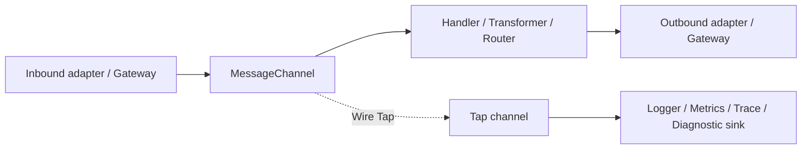
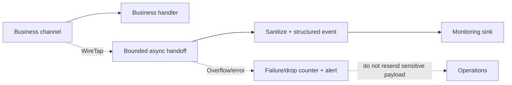

# Wire Tap for Observing Messages in Spring Integration

## 1. The Problem: Observing Messages Without Changing Business Flows

In an integration system, a message may travel from an **inbound adapter** receiving files, SFTP, HTTP, JMS, AMQP, or Kafka, through one or more **MessageChannel**s, to a transformer, router, service activator, or **outbound adapter/gateway**. When the system runs into issues, the operations team typically wants to know:

- Did the message enter the flow, through which channel, and when?
- Was a message blocked before processing or delayed in a queue?
- Are the **correlation ID**, payload type, and flow name kept consistent?
- How long does it take from receiving a file or record to sending it to an external system?
- How can diagnostic samples be captured **without logging tokens, passwords, or sensitive contents**?
- If the logging/monitoring system slows down, is business processing impacted?

**Wire Tap** is an Enterprise Integration Pattern (*EIP*) that addresses the need to **observe messages passing through a location** without injecting observation logic into every handler. In **Spring Integration**, you can use **WireTap** as a **ChannelInterceptor** or declare it in **Java DSL** with `.wireTap(...)`.

This lesson belongs to the **Observability** chapter of the `SPRING_INTEGRATION_ADAPTERS` module: connecting external systems via **inbound/outbound adapters, gateways, pollers, and MessageChannels**; operating **file, SFTP, HTTP, JMS, AMQP, Kafka, and database** flows; and managing message contracts, errors, and connection lifecycles.

**Expected outcomes:** know how to choose wire tap attachment points, build a dedicated observation branch, understand synchronous/asynchronous behavior, emit safe metadata to logs/metrics/tracing, and test that observation does not alter main flow behavior.

## 2. What Is a Wire Tap?

A Wire Tap is a secondary branch that receives messages passing through a channel or a position in a flow. **The main branch continues its normal work**; the tap branch is used for logging, metrics, emitting observation events, or diagnostics.



In Spring Integration, WireTap is typically installed as a **MessageChannel interceptor**. When a message traverses the channel, the interceptor sends the message to the observation channel while the main channel's send path proceeds under its normal semantics.

**Key characteristics:**

1. **Point-specific observation:** only sees messages that actually pass through the tapped position; does not automatically see every message in the application.
2. **Does not replace the main consumer:** the tap adds a secondary receiving path; it is not a router diverting messages away from the main path.
3. **Not asynchronous by default:** sending to the tap branch may happen on the main flow's processing thread. To isolate heavy observation work, design an appropriate channel/executor/queue and overload policy.
4. **Not a deep copy:** do not assume the payload object is deep-copied. If the payload is mutable, the observation branch may see the same object or state mutated over time.
5. **Does not guarantee durable audit:** WireTap itself is not a transaction log, not a broker, and does not provide exactly-once guarantees for audit data.

### 2.1. How Wire Tap Differs from Similar Components

| Component | Role | When to Use |
|---|---|---|
| **Wire Tap** | Tees a message to an observation path at a channel/flow point | Logging/telemetry without modifying business routing logic |
| **PublishSubscribeChannel** | Broadcasts messages to multiple processing subscribers | Multiple true consumers participate in the flow architecture |
| **Recipient List Router** | Routes messages to multiple recipients based on rules | Sending to a selected list of business targets |
| **Content-based Router** | Chooses a processing branch based on content/headers | Steering the business flow |
| **Service Activator** | Invokes logic to process a message | State transition, calling a service, business persistence |
| **LoggingChannelAdapter** | Receives messages to log them | Simple consumer sink for an observation branch |
| **Micrometer/Observation** | Collects metrics/traces for components/operations | Measuring throughput, latency, errors, and execution spans |

If two consumers must both execute **business logic with delivery guarantees**, pure Wire Tap is usually **insufficient**; consider publish-subscribe combined with a broker/transactional outbox or a distributed architecture with explicit guarantees.

## 3. Tap Placement Determines What Can Be Observed

A flow can have several notable attachment points:

```text
Inbound source
    |
    v
[rawInputChannel]       <-- tap A: message just created by adapter
    |
    v
[transform/validate]
    |
    v
[validatedChannel]      <-- tap B: normalized/validated message
    |
    v
[route/filter]
    |
    v
[outboundRequestChannel] <-- tap C: before calling external system
    |
    v
Outbound adapter
```

| Attachment Point | Observable | Does Not Prove |
|---|---|---|
| **Right after inbound adapter** | Message entered Spring Integration; source metadata created | Payload is valid, outbound succeeded |
| **After transformer** | Payload/headers in normalized form | Original raw data remained intact |
| **After filter/router** | Message routed to the selected branch | All initial messages, especially filtered-out ones |
| **Before outbound adapter** | System is about to send request to target | Target received, committed, or ACKed |
| **After intentional reply/ACK step** | Response signal or status received by flow | External system completed properly if ACK lacks semantics |

**A tap placed after a filter does not see discarded messages**, because they never reach that channel. To measure rejection rates, attach a tap before the filter and record filter outcome metrics, or use an explicit rejection branch.

**A tap before an outbound adapter does not prove successful delivery**. With Kafka/JMS/AMQP, conclusions about publish/commit/ack still depend on the adapter, broker, and transaction semantics. With HTTP or SFTP, inspect the response and task status separately.

## 4. Java DSL Example: Wire Tap Observing Metadata

Below is an illustrative **Spring Integration Java DSL** configuration. Suppose an inbound adapter or HTTP gateway sends messages into `ordersInput`. The main flow processes messages; the wire tap sends observation events to `observationTap`.

```java
import java.util.concurrent.Executor;
import org.slf4j.Logger;
import org.slf4j.LoggerFactory;
import org.springframework.context.annotation.Bean;
import org.springframework.context.annotation.Configuration;
import org.springframework.integration.annotation.IntegrationComponentScan;
import org.springframework.integration.channel.DirectChannel;
import org.springframework.integration.channel.ExecutorChannel;
import org.springframework.integration.config.EnableIntegration;
import org.springframework.integration.dsl.IntegrationFlow;
import org.springframework.messaging.MessageChannel;
import org.springframework.scheduling.concurrent.ThreadPoolTaskExecutor;

@Configuration
@EnableIntegration
public class OrdersObservationConfig {

    private static final Logger log =
            LoggerFactory.getLogger(OrdersObservationConfig.class);

    @Bean
    public MessageChannel ordersInput() {
        return new DirectChannel();
    }

    // Queue for executing observability processing;
    // bound capacity instead of creating unbounded threads.
    @Bean
    public ThreadPoolTaskExecutor observationExecutor() {
        ThreadPoolTaskExecutor executor = new ThreadPoolTaskExecutor();
        executor.setCorePoolSize(2);
        executor.setMaxPoolSize(4);
        executor.setQueueCapacity(200);
        executor.setThreadNamePrefix("tap-observe-");
        executor.initialize();
        return executor;
    }

    @Bean
    public MessageChannel observationTap(
            ThreadPoolTaskExecutor observationExecutor) {
        return new ExecutorChannel(observationExecutor);
    }

    @Bean
    public IntegrationFlow ordersBusinessFlow() {
        return IntegrationFlow.from("ordersInput")
                .wireTap("observationTap")
                .handle(message -> {
                    // Replace with the actual business handler.
                    // Do not depend on the outcome of the observation branch.
                    log.debug("Business message accepted");
                })
                .get();
    }

    @Bean
    public IntegrationFlow ordersObservationFlow() {
        return IntegrationFlow.from("observationTap")
                .handle(message -> {
                    // Only extract metadata permitted to be exposed in logs.
                    Object flowName = message.getHeaders().get("flowName");
                    log.info(
                            "wiretap flow={} messageId={} payloadType={}",
                            flowName,
                            message.getHeaders().getId(),
                            message.getPayload().getClass().getSimpleName()
                    );
                })
                .get();
    }
}
```

In this example:

- `ordersInput` is a `DirectChannel`, so the business handler is invoked under the channel's synchronous dispatch mechanism.
- `.wireTap("observationTap")` adds an observation path for messages passing that point.
- `observationTap` is an `ExecutorChannel`: the **observation handler** runs via a dedicated executor, reducing the risk of a slow logger blocking business threads for too long.
- The executor has a **bounded pool/queue**. Handing off tasks to an executor still has overhead, and when the queue fills up, task rejections or backpressure can occur. Therefore, never claim this configuration “never affects the main flow.”
- The logging branch logs only `flowName`, message ID, and payload type, without calling `toString()` on the entire payload.

**Version note:** DSL signatures, endpoint registration styles, and built-in instrumentation mechanisms may change across Spring Integration/Spring Boot versions. When integrating into a real project, check your dependency versions and available APIs. The example is a structural sample and does not replace compiling and testing in the target application.

### 4.1. Why Not Log the Entire `Message<?>`?

The following **should not be used by default in production**:

```java
// Avoid: may expose payload, Authorization, cookie, token, PII...
log.info("received={}", message);
```

`MessageHeaders` can contain transport details such as tokens, HTTP headers, user IDs, file paths, or broker acknowledgment objects. `payload.toString()` can expose business contents, personal data, or secrets. Observation should construct **selective, data-minimized records** based on a **field allowlist**.

If inspecting contents is strictly required for debugging, use **time-bounded sampling, access control, redaction**, TTL, and auditing of enable/disable actions. Never write credentials, access tokens, private keys, or raw sensitive data to an observation sink.

## 5. WireTap as a ChannelInterceptor

Java DSL enables concise declarations within a flow; under the hood, WireTap can act as a **channel interceptor**. This is useful when a `MessageChannel` is already shared by multiple endpoints and you want to observe any message passing through it.

Code illustrating the concept:

```java
import org.springframework.integration.channel.DirectChannel;
import org.springframework.integration.channel.interceptor.WireTap;

// tapTarget is a configured MessageChannel with a consumer.
DirectChannel sourceChannel = new DirectChannel();
sourceChannel.addInterceptor(new WireTap(tapTarget));
```

When configuring interceptors directly, manage channel and bean lifecycles properly; in a Spring project, prefer registering beans/flows via the container. Attaching to a channel lets you observe **multiple producers** sending to the same channel, unlike attaching within a single flow.

**Do not confuse an interceptor with adding a second competing consumer on the same `DirectChannel` or `QueueChannel`.** Two competing consumers on a point-to-point channel split messages between them, stealing messages from the business flow. Wire Tap is a **secondary tap** mechanism, not a competing business consumer.

### 5.1. What Happens with Mutable Payloads?

A Spring Integration message represents an envelope of payload and headers. Wire-tapping a message **does not deep-copy the payload by default**.

Suppose the payload is a `Map` or mutable object. The business handler mutates its contents right after the tap point while the observation handler executes on another thread. The observation branch may read data **after it has been mutated**, producing logs that do not accurately reflect the tap moment or causing thread-safety issues.

Solutions:

1. Prefer **immutable payloads** or data models that are not mutated in place.
2. When an investigative snapshot is needed, **convert it into a sanitized immutable summary** right at the observation point.
3. Do not place payloads holding live references into long-lived observation queues if reproducibility is needed.
4. When passing data across threads, weigh serialization, payload size, and copy cost; avoid deep-copying everything by default if unnecessary.

**WireTap separates processing logic; it does not automatically guarantee data immutability.**

## 6. Synchronous, Asynchronous, Backpressure, and Main Flow Impact

A common misconception is that “Wire Tap is always fire-and-forget.” In reality, it depends on the **tap's target channel** and send mechanism.

| Tap Branch | Typical Behavior | Risks |
|---|---|---|
| `DirectChannel` | Tap consumer runs synchronously during send | Slow logger/sink increases latency; tap failures can affect the send call |
| `ExecutorChannel` | Dispatches consumer via executor | Full queue causes rejected tasks; thread pool and lifecycle must be monitored |
| `QueueChannel` | Message placed in queue for polling consumer | Bounded queue can fill up; in-memory queue is not a durable log |
| System-backed durable broker/channel | Receiver processes via intermediate infrastructure | Must manage publish confirms, retries, retention, dead-letter, and permissions |

**Choose an error policy before deployment:**

- **Best-effort telemetry:** prioritize the business flow; when the observation sink fails, dropping some records **classified as non-mandatory telemetry** may be acceptable, provided drop/failure counters, memory bounds, and diagnostics exist. Test in practice to confirm tap branch errors do not propagate to the main flow.
- **Mandatory audit:** if regulatory/control requirements forbid **losing events**, a best-effort wire tap is insufficient. Design a **transactional outbox, durable queue/broker, or acknowledged audit mechanism**, with an authorized fail-closed/fail-stop policy when auditing fails.
- **Very large payloads:** never push multi-MB file payloads onto an in-memory queue just for logging; use allowed IDs, checksums, or metadata linked to controlled source storage.
- **Prolonged slow sink:** enforce queue limits, alerts, retry/backoff, and shedding strategies to avoid unbounded memory growth.

An asynchronous branch also alters **observation ordering**: logs from the tap may appear **after** main handler logs or out of arrival order. Do not conclude the flow processed out of order solely from log timestamps; compare source timestamps, correlation IDs, and semantically equivalent events.

### 6.1. A Target Architecture Protecting the Main Branch



This is a **target architecture**, not a guarantee that simply declaring an `ExecutorChannel` provides all protections out of the box. You must implement error handling, saturation handling, and payload-size limits in the application.

## 7. Message Contract, Headers, and Correlation ID

A Spring Integration message has a **payload** and **headers**. Crossing HTTP gateways, file adapters, JMS, AMQP, or Kafka adapters changes transport headers; some headers are created by the framework, others by adapters or the application.

For observation, distinguish:

| Field | Purpose | Policy |
|---|---|---|
| `messageId` | Identifies a message at a point; helps correlate logs | Do not assume stability across every transformer/rebuild |
| `correlationId` | Links messages within a business operation/flow | Define generation/propagation rules; avoid sensitive PII |
| `traceId`, `spanId` | Connects distributed tracing if instrumentation is configured | Propagation must be tested across async/brokers |
| `flowName`, `channelName` | Indicates flow or location | Use low-cardinality labels |
| `adapterType` | File, SFTP, HTTP, JMS, AMQP, Kafka, JDBC… | Use stable enums/labels |
| `payloadType` | Data type instead of contents | Avoid class names whose `toString()` leaks secrets |
| `payloadSize` | Helps spot oversized payloads and bottlenecks | Measure bytes accurately; do not equate string length with bytes |
| `sourceRef` | File path, topic, queue, table name | Record only normalized/allowed info |
| `outcome`, `errorType` | Success, validation failure, retry, timeout | Never attach stack traces or sensitive data as metric tags |
| `observedAt` | Observation timestamp | Distinguish from source message creation time |

**Message ID is not always the business ID.** A transformer or handler can construct a new message, changing the message ID. To track an entire request lifecycle, attach a **stable business correlation ID** with clear generation rules and verified propagation.

**Do not assume traces automatically survive `ExecutorChannel` or brokers.** Depending on Micrometer Observation/OpenTelemetry setup and version, context may require explicit propagation/restoration. Verify with real traces before claiming end-to-end distributed tracing.

### 7.1. A Safe Observation Event

Illustrative JSON format, not a default framework schema:

```json
{
  "event": "integration.message.observed",
  "flow": "order-ingest",
  "stage": "after-validation",
  "adapterType": "sftp",
  "messageId": "c245aab3-0e38-445e-9a86-401ba88b8a52",
  "correlationId": "flow-7d2f",
  "payloadType": "OrderEnvelope",
  "outcome": "RECEIVED",
  "observedAt": "2026-11-23T15:30:00+07:00"
}
```

A structured logger should extract fields from an **allowlist** and perform redaction **before** handing off to a queue/sink if the secondary branch has broader access. Do not serialize all headers into JSON via `new HashMap<>(message.getHeaders())` and filter at the receiver, because secrets have already traversed the observation path.

## 8. Combining Wire Tap with Metrics, Tracing, and Logs

**Observability** commonly comprises three signal types:

- **Logs:** context-rich events, handy for investigating a specific message.
- **Metrics:** aggregated counts, error rates, latency, and backlogs; handy for alerting.
- **Traces:** path and timing of operations across components/applications.

Wire Tap can help **emit supplementary logs/events**, but it does not replace standard instrumentation for handlers, adapters, channels, and brokers.

### 8.1. Metrics to Collect

| Suggested Metric | Unit | Recommended Labels |
|---|---|---|
| `integration_messages_observed_total` | Counter | `flow`, `stage`, `adapter` |
| `integration_observation_failures_total` | Counter | `flow`, `failure_type` |
| `integration_observation_dropped_total` | Counter | `flow`, `reason` |
| `integration_message_processing_duration_seconds` | Timer/histogram | `flow`, `outcome` |
| `integration_adapter_requests_total` | Counter | `adapter`, `target`, `outcome` |
| `integration_retries_total` | Counter | `adapter`, `error_category` |
| `integration_backlog_size` | Gauge | `flow`, `queue` |
| `integration_age_oldest_message_seconds` | Gauge | `flow` or `queue` |

**These are illustrative application-defined metric names**, not a claim that Spring Integration or Actuator exports all of them automatically. Micrometer can meter some integration components when supported by your version's configuration; inspect the actual metrics endpoint and avoid creating duplicate counters with the same meaning.

Never use `messageId`, `correlationId`, user ID, file path, or customer name as a **metric tag**: cardinality grows with every message, inflating cost and overloading the metrics backend. Such IDs belong in **controlled logs or traces**, not high-cardinality metric labels.

### 8.2. Latency at Tap Points Is Not Automatically End-to-End Latency

If tap A is at inbound at `t_A`, tap B after transform at `t_B`, and tap C before outbound at `t_C`:

\[
T_{\mathrm{transform\_segment}} = t_B - t_A
\]

\[
T_{\mathrm{pre\_outbound}} = t_C - t_A
\]

However, if timestamps are recorded **asynchronously at the sink** instead of captured as the message passes through, queue/logging delays will skew those differences. To measure true latency, use a **timer/span around the main processing segment** or capture the timestamp at the observation point before handoff, then forward an immutable record to telemetry.

When a flow spans brokers or polling, distinguish:

- **Queue wait:** time spent waiting in a queue for a worker.
- **Processing time:** time spent executing handlers.
- **External call latency:** sending a request externally and waiting for a response.
- **End-to-end time:** from source event to business outcome, potentially including waits/acks and retries.

A tap before an adapter cannot by itself know when broker commit, HTTP response, or SFTP upload completes.

### 8.3. Tracing and MDC

When implementing distributed tracing, propagate trace context using mechanisms supported by the framework/broker, and create spans/observations at meaningful steps. You can surface trace IDs in logs via **MDC** or trace-aware logging systems.

**Note:** traditional MDC is thread-bound; across `ExecutorChannel`, pollers, or async callbacks, context may not propagate automatically. Use supported context propagation and clear context properly when threads are reused; avoid leaking the previous message's trace ID onto the next message.

## 9. Wire Tap Across Adapter Groups

### 9.1. File Inbound/Outbound

With a **file inbound adapter** and poller, messages typically carry a file/resource payload or processed data with path/filename metadata. A tap on the channel after inbound can record:

- Event type `FILE_SEEN`, file size, and normalized flow name.
- Correlation ID linking the input file and post-transform message.
- Poll timestamp, pending file count, and failed file count.

**Do not** log full internal paths or file contents if sensitive data is present. Detecting a file **does not mean** the file was completely read or an outbound file was durably written. To mark completion, emit an event after a verified read/process/write step.

### 9.2. SFTP

SFTP inbound/outbound adapters depend on connections, remote file listings, file filters, and upload/download sessions.

A tap shows a message entered the pipeline along with allowed metadata, but you must separately monitor:

- Is the poller running and picking up new files?
- Is the remote endpoint returning authentication/timeout errors?
- Are files being re-downloaded due to filter errors or failures recording processed state?
- Did uploads/downloads complete and get verified per business contract?

Never log usernames/passwords/private keys, URIs containing credentials, or file contents. When correlation is needed, use a safe business ID or redacted filename.

### 9.3. HTTP Inbound Gateway and Outbound Gateway

An HTTP **inbound gateway** receives a request and returns a reply; an **outbound gateway** typically waits for a response. Attach taps at:

- The channel after HTTP inbound: confirms the request became a message.
- The channel before outbound: observes the request before calling the service.
- The reply channel or post-response point: observes the returned status.

**A request tap does not prove the gateway returned 2xx**, and inbound logs could capture `Authorization`, cookies, query parameters, or personal payloads. Log only HTTP method, normalized route, status code, or duration when legitimately available.

### 9.4. JMS and AMQP

When adapters use **JMS** or **AMQP**, messages carry delivery metadata, routing keys, redelivery flags, acks, or transactions. A tap helps inspect messages entering processing channels, but:

- Observing a message does not mean the broker ACKed or the transaction committed.
- Retries/redeliveries can send the same logical message past the tap multiple times.
- Logs need an appropriate delivery attempt/business message ID to distinguish *duplicate delivery* from *duplicate business operation*.
- The tap branch must not inadvertently alter the main flow's acknowledgment/transaction behavior.

For lossless auditing, use durable and transactional mechanisms rather than treating wiretap logs as the single source of truth.

### 9.5. Kafka

A Kafka inbound adapter involves offsets, partitions, topics, and configurable commit/ack behavior. A tap on a `MessageChannel` shows **the record was converted into a Spring Message at that point**, not **that the offset was committed**.

Also track **consumer lag, retries, DLT/dead-letter, processing duration, and commit status** with dedicated instrumentation. Never log sensitive keys/payloads or raw broker header objects. Records with identical payloads can still represent distinct events; correlation by business key requires an explicit contract.

### 9.6. JDBC/Database

An inbound JDBC poller reads rows on a schedule; an outbound JDBC adapter performs writes. WireTap observes messages before/after transformation steps, but does not prove:

- The DB transaction committed;
- Rows were atomically marked as processed;
- Data will not be re-read after a rollback;
- A batch update was fully applied to the DB.

For diagnostics, combine taps with **transaction metrics, query timings, commit outcomes, and idempotency keys**. Avoid logging full rows from tables holding personal or financial data.

### 9.7. Pollers and Connection Lifecycle

Pollers have intervals, max messages per poll, task executors, and transaction/error handling mechanisms. A flow with **zero messages** can be normal (no new files) or an incident (poller stopped).

WireTap **only observes when a message passes the tap point**. It **does not replace** poller heartbeats, connector health, remote connection metrics, queue depth, retry schedules, or stalled-endpoint alerts. Knowing whether an adapter actually ran requires signals from the adapter/poller independent of message flow.

## 10. Errors in the Main Branch vs. Observation Branch

Spring Integration provides **error channels**, poller error handling, and endpoint/async-channel exception handling. Distinguish:

1. **Business errors:** validation failure, handler throwing an exception, outbound request timeout.
2. **Transport errors:** broker disconnect, SFTP timeout, HTTP target unavailable.
3. **Observation branch errors:** full executor, slow logger, telemetry sink down, serialization failure.
4. **Data contract errors:** missing correlation ID, schema drift, unparseable payload.

Never let an observation branch failure get recorded as “business processing failed” if business processing actually succeeded. Conversely, never silently swallow mandatory observation failures without signals/alerts just to shave latency.

### 10.1. Error Scenarios and Handling

| Scenario | Desired Behavior | Verification |
|---|---|---|
| Log sink temporarily unavailable | Approved best-effort policy, counter/alert | Business flow still succeeds; drops/failures are metered |
| Tap channel out of capacity | Enforce bounds and explicit saturation policy | No OOM, no unbounded blocking past SLA |
| Large or mutable payload | Build safe metadata snapshot only | No sensitive data retained, original payload untouched |
| Business handler throws | Error flow records exact exception type | Tap does not create illusion that outbound succeeded |
| Message redelivered | Correlate by logical event + attempt | Never mistake one retried event for multiple business events |
| Missing `flowName` metadata | Controlled `unknown` label, data-quality alert | Never generate millions of free-form tag values |
| Wiretap consumer stops | Health/metrics detect dead observation branch | Never infer “0 messages = zero traffic” |

**Error policy is a product/operational decision**, not an automatic feature of `.wireTap()`. Write real tests against the exact channel and executor types in use.

## 11. Testing Wire Tap Behavior

When writing tests, verify three independent properties:

- **The main flow still processes** the right content the right number of times per contract.
- **The tap branch receives the observed message** at the chosen attachment point.
- **Observation does not mutate the original message**, leak data, or introduce deadlocks/unacceptable latency.

### 11.1. Simple Test Using QueueChannel

Using a `QueueChannel` in a **test configuration** lets you capture messages from the tap for assertions without needing a live telemetry sink. This example is isolated from the production configuration in section 4:

```java
import org.springframework.context.annotation.Bean;
import org.springframework.context.annotation.Configuration;
import org.springframework.integration.channel.DirectChannel;
import org.springframework.integration.channel.QueueChannel;
import org.springframework.integration.config.EnableIntegration;
import org.springframework.integration.dsl.IntegrationFlow;
import org.springframework.messaging.MessageChannel;

@Configuration
@EnableIntegration
class WireTapTestConfig {

    @Bean
    MessageChannel testInput() {
        return new DirectChannel();
    }

    @Bean
    QueueChannel tapQueue() {
        return new QueueChannel(10);
    }

    @Bean
    IntegrationFlow testFlow() {
        return IntegrationFlow.from("testInput")
                .wireTap("tapQueue")
                .handle(message -> {
                    // Simulate business processing; do not mutate payload.
                })
                .get();
    }
}
```

JUnit 5 test example with the configuration above:

```java
import static org.junit.jupiter.api.Assertions.*;

import org.junit.jupiter.api.Test;
import org.springframework.beans.factory.annotation.Autowired;
import org.springframework.beans.factory.annotation.Qualifier;
import org.springframework.integration.channel.QueueChannel;
import org.springframework.messaging.Message;
import org.springframework.messaging.MessageChannel;
import org.springframework.messaging.support.MessageBuilder;
import org.springframework.test.context.junit.jupiter.SpringJUnitConfig;

@SpringJUnitConfig(WireTapTestConfig.class)
class WireTapTest {

    @Autowired
    @Qualifier("testInput")
    MessageChannel input;

    @Autowired
    @Qualifier("tapQueue")
    QueueChannel tapQueue;

    @Test
    void tapSeesMessageWithoutChangingPayload() {
        Message<String> original = MessageBuilder
                .withPayload("order-42")
                .setHeader("flowName", "orders")
                .build();

        assertTrue(input.send(original));

        Message<?> observed = tapQueue.receive(1000);
        assertNotNull(observed);
        assertEquals("order-42", observed.getPayload());
        assertEquals("orders", observed.getHeaders().get("flowName"));
    }
}
```

This test shows that the tap receives the message; to **verify the business branch executes properly**, replace the no-op handler with a spy or counter and assert execution count/output. Also test varying payload types, timeouts, full queues, and ID preservation across transformers when required by contract.

**Never use a test `QueueChannel` as a durable audit store in production.** An in-memory queue loses data on process crash; bounded capacity and slow consumers can also back up the tap branch.

### 11.2. More Critical Test Cases

| Test Case | What Must Be Proven |
|---|---|
| Tap after transform | Sees the message in **post**-transform form, not pre-transform |
| Filter discards message | Tap before filter sees the message; tap after filter does not |
| Kafka/JMS retry/redelivery | Observed count may exceed logical business events; no double-counting |
| Executor saturation | Main flow obeys policy when tap stops accepting tasks |
| Sink disconnect | Error/drop signals are observable; mandatory audits are never silently lost |
| Payload contains tokens/PII | Logs contain only allowlisted metadata, no sensitive payloads/headers |
| Mutable payload | Log snapshot reflects intended state without race conditions |
| Correlation context across async | Trace/logs match business flow; stale context never leaks across reused threads |
| Large SFTP/file payload | Whole file is never forced into logs or held in memory queues |
| App shutdown/restart | Clarifies whether queued telemetry is lost or flushed |
| Poller with zero messages | Heartbeat confirms poller is alive without relying on WireTap |
| Dead-letter/error flow | Accurately observes technical error and business outcome without mistaking it for success |

## 12. Production Implementation Checklist

1. **Define the goal:** debugging a flow, measuring throughput, tracking errors, or building an audit trail? Each requires different reliability and data.
2. **Choose tap points:** inbound, post-transform, pre-outbound, or reply; name channels and stages clearly.
3. **Define the event contract:** message ID, correlation ID, flow, stage, adapter, outcome, timestamp, payload type, and version.
4. **Classify data:** log only permitted fields; redact before handing off to the sink, never send tokens to telemetry.
5. **Choose channel/executor:** decide sync vs. async, bounded pool/queue, timeouts, error policy, and backpressure.
6. **Ensure stability:** prevent tap loops back into the observed channel, uncontrolled retries, or overly verbose logging.
7. **Separate transport semantics:** WireTap seeing a message on a channel does not replace ACK/commit/reply/readback.
8. **Combine metrics/traces:** use Micrometer/Observation/OpenTelemetry where appropriate; avoid high-cardinality metric tags.
9. **Add health checks:** poller/adapter, broker lag, connector status, sink availability, and executor saturation.
10. **Test failure modes:** slow/disconnected sink, full queue, large payloads, redeliveries, async context, and shutdown.
11. **Control costs:** sampling, retention, storage encryption, access controls, and telemetry purge schedules.
12. **Document evidence:** configuration, flow diagrams, load test results, alert thresholds, and incident runbooks.

## 13. Anti-Patterns and Fixes

| Anti-Pattern | Consequence | Fix |
|---|---|---|
| Logging `message.toString()` on every channel | Exposes sensitive payloads/headers, log explosion | Structured logging with an allowlist |
| Assuming Wire Tap is async by default | Logger can inflate main flow latency | Choose channel/executor intentionally and load test |
| Using an unbounded queue “so it never blocks” | OOM when sink slows down | Bounded queue, saturation policy, drop counter |
| Tapping before outbound and reporting “sent successfully” | Confuses send attempt with target outcome | Track reply/ACK/commit appropriately |
| Using Wire Tap as mandatory audit | Can lose logs, lacks delivery guarantees | Durable audit/outbox with required acknowledgments |
| Using message ID as sole business identity | ID can change after transform/rebuild | Stable correlation ID defined by contract |
| Putting `messageId` into metric labels | Cardinality explodes per message | Keep IDs in logs/traces; keep metric labels low-cardinality |
| Tapping mutable payloads and processing async | Reads mutated data / race condition | Immutability or sanitized snapshot at tap time |
| Only having WireTap without poller monitoring | Blind to dead pollers when no messages arrive | Heartbeats, scheduler, and connector metrics |
| Tapping every message with full payload in prod | Wastes CPU/bandwidth, PII exposure risk | Controlled sampling and bounded retention |
| Configuring tap back into the source channel | Infinite loop and message amplification | Diagram topology, prevent cycles, test integration graph |
| Ignoring observation branch errors/drops | Silent dashboard mistaken for zero traffic | Telemetry quality alerts and independent health sources |

## 14. Exercises and Self-Check Questions

**Question 1.** A flow `HTTP inbound → transform → outbound JMS` has a tap on the channel after HTTP inbound. The tap sees a message, but the JMS send fails. Can the tap record be treated as proof that the message was published to JMS?

**Answer:** **No.** The tap only confirms the message passed that point. You need publish/ACK/transaction results under outbound JMS semantics to know it was sent successfully.

**Question 2.** Why can using a `DirectChannel` for a slow logging sink increase business flow latency?

**Answer:** Handlers receive messages synchronously when sending to a `DirectChannel`. When WireTap sends to that branch, the tap consumer's runtime sits on the send path and affects completion time. You can isolate it via async/queue, provided saturation and errors are handled.

**Question 3.** A transformer mutates a `Map` payload in place after the wiretap. The tap handler reads the Map on another thread. Is the log guaranteed to reflect the pre-transformer payload?

**Answer:** **No.** Wire Tap does not guarantee deep copies. Use immutable payloads or capture a selective metadata/content snapshot right at observation time.

**Question 4.** Why shouldn't `correlationId` be used as a Prometheus tag for every message?

**Answer:** A distinct ID per business operation causes **high cardinality**, driving up memory/storage costs and degrading operability. Use `flow`, `stage`, `adapter`, and `outcome` for metrics; keep correlation IDs in controlled logs/traces.

**Question 5.** A Kafka record is retried three times and passes the same tap three times. Does that represent three distinct business orders?

**Answer:** Not automatically. Distinguish **delivery attempts** from logical business events, apply keys/idempotency per message contract, and account for consumer offset/ack semantics.

**Question 6.** Wire tap records no new messages for 20 minutes. Can you conclude SFTP inbound has no new files?

**Answer:** **Not yet.** The poller might have stopped, the connector lost connection, a filter excluded the files before the channel, or the telemetry sink failed. Check heartbeats, remote status, poller metrics, queues, and observation errors.

**Question 7.** A compliance team requires **zero lost audit events**, while the system logs via WireTap → `ExecutorChannel` → logger. Is that sufficient?

**Answer:** **Not sufficient.** `ExecutorChannel` and a logger do not guarantee durable delivery, transactional consistency, or exactly-once behavior. You need an acknowledged audit design with durable storage, retries, and proper failure/recovery handling.

**Question 8.** In a file inbound flow, a tap logs the entire customer PDF content for debugging. What are the risks and alternative?

**Answer:** Risks include leaking personal data, overloading memory/logs, and violating retention rules. Log only **permitted metadata**, size, file type, correlation ID, and checksum per policy; use controlled debugging only when truly necessary.

**Question 9.** An HTTP gateway returns status 200, yet the inbound channel tap already logged outcome `SUCCESS` upon receiving the request. What is wrong?

**Answer:** The inbound tap only knows the request entered the flow, not the outcome. Log `RECEIVED` at inbound; HTTP outcomes should be recorded after a response exists with clear semantics.

**Question 10.** After adding a tap in production, p95 latency spikes and `ThreadPoolTaskExecutor` reports a chronically full queue. What should you inspect?

**Answer:** Sink latency, payload sizes and message rate, task rejection policy, whether the tap dispatches on business threads, consumer speed, sampling, and drop/error counters. Adjust the observation architecture to protect business SLAs rather than blindly growing the queue indefinitely.

## Key Takeaways

**Wire Tap in Spring Integration is a way to observe messages passing through a `MessageChannel` or point in an `IntegrationFlow` via a secondary path**, enabling logging/measurement without embedding observation logic into every handler. However, it is **not asynchronous by default, does not deep-copy payloads, does not guarantee durable auditing, does not confirm external ACK/commits, and does not replace poller/adapter health checks**. Choose meaningful tap points, log safe metadata, maintain correlation/tracing, bound queues and cardinality, test failure modes in the observation branch, and pair it with appropriate metrics and traces. The goal is to **see the true journey of messages across file, SFTP, HTTP, JMS, AMQP, Kafka, and databases without compromising message contracts, business logic, or connection lifecycles**.
