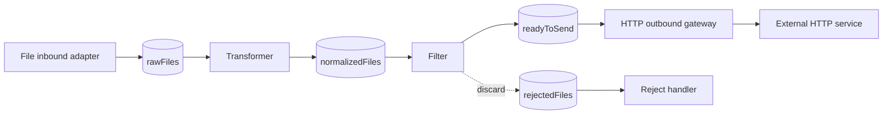
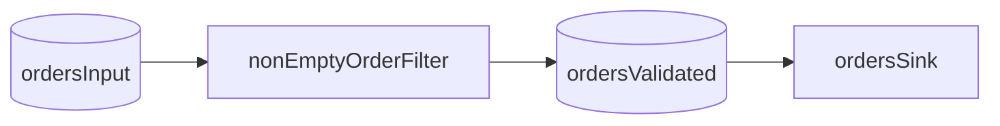
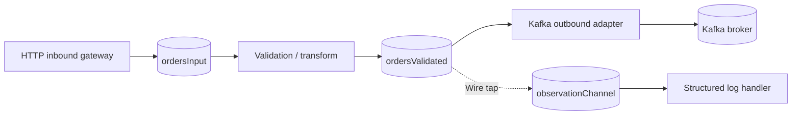
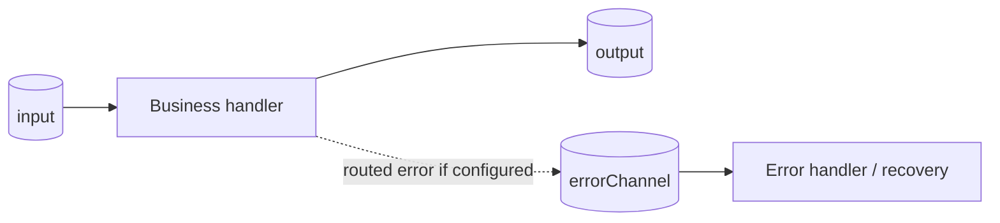
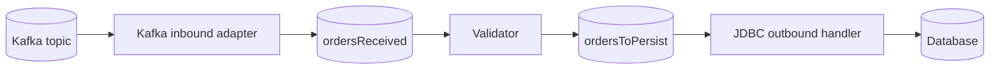

# Integration Graph of Flows in Spring Integration

## 1. Why Observe the Integration Graph?

A **Spring Integration** application rarely processes data in a single function. Messages travel across multiple components: an **inbound adapter** receiving files or events from SFTP/JMS/Kafka, **MessageChannel**s transferring messages, filters/routers/transformers steering and converting them, and an **outbound adapter/gateway** calling HTTP, writing to a database, or sending messages to a broker.

As flows grow, answering questions like these becomes difficult:

- Which channels and handlers can a message from adapter A pass through before reaching system B?
- Which channel is a **gateway** sending requests into, and where are replies collected from?
- Why is a poller still running while no messages appear on the target channel?
- Is an `errorChannel` actually wired to an error-handling flow?
- When adding an adapter or registering a dynamic flow, how does the **running topology** differ from the expected configuration?
- Can a stopped endpoint, a failed broker, or a slow downstream system be identified solely from the wiring diagram?

An **Integration graph** is a representation of the **components and relationships in a running Spring Integration model** as a graph. It helps inspect flow architecture, locate points for metrics/traces, verify wiring, and assist incident investigation. The graph is **not** a per-message log, does not represent business state by itself, and does not guarantee success of an outbound call to an external system.

This lesson belongs to the **Observability** chapter of the `SPRING_INTEGRATION_ADAPTERS` module: connecting external systems through **inbound/outbound adapters, gateways, pollers, and MessageChannels**, across file, SFTP, HTTP, JMS, AMQP, Kafka, and database flows; emphasizing **message contracts, error handling, connection state, and observability**.

After this lesson, you can:

1. Distinguish **topology graph**, **actual message path**, and **telemetry data**.
2. Read nodes/channels/endpoints and the links between them.
3. Design observable Java DSL flows using clear channel/endpoint names.
4. Understand the role of **IntegrationGraphServer** and how to query the graph via management/Actuator tools when supported by the environment.
5. Combine the graph with logs, metrics, tracing, error channels, and adapter-level checks.
6. Recognize graph limitations, security risks, and required tests before production operation.

## 2. What Is an Integration Graph?

In this context, a **graph** is a relational model consisting of:

- **Nodes (vertices):** Spring Integration components, such as a message channel, endpoint, message handler, or message source.
- **Links/edges:** configured relationships between components, e.g., which channel an endpoint consumes from, which channel it sends to, or how it attaches to another component.
- **Metadata:** bean names, component types, IDs, or configuration metadata exposed by the system when retrieving the graph.

Logical example:



In the diagram, rounded cylinders represent **MessageChannel**s, while rectangles represent endpoints/handlers or external systems. This is an **illustrative diagram drawn for explanation**; it does not assert that JSON graph output always uses these exact node types, names, or edges.

What the graph answers: **“Which components are wired together in the runtime topology?”**

What it **does not** answer by itself: **“Which nodes did specific message X pass through at 14:03, was it ACKed, and how many milliseconds did it take?”**

To answer the second question, you need **correlation IDs, structured logs, metrics, and distributed traces** at appropriate points.

### 2.1. Comparing Three Perspectives

| Perspective | Primary Subject | Question Answered | Limitation |
|---|---|---|---|
| **Integration graph** | Components, channels, endpoints, links | How is the flow currently wired? | Does not prove a message actually traversed an edge |
| **Message trace/log** | A request/message or correlated event group | Where did a message actually go and what failed? | May miss instrumentation points; async logs can reorder |
| **Metrics/health** | Throughput, latency, errors, backlog, adapter status | Is the flow healthy or where is it bottlenecked? | Does not describe full topology or payloads |

For example, the graph shows an edge from `ordersValidated` to `ordersKafkaOutbound`. That **does not mean** the Kafka broker is up, the topic exists, the record was published, or the consumer committed its offset. It only indicates the connection is modeled at the Spring Integration level.

## 3. Reading Nodes and Edges: Essential Concepts

### 3.1. MessageChannel — Where Messages Are Handed Off

Different channel types have different operational implications:

| Channel | Core Semantics | What to Remember When Reading the Graph |
|---|---|---|
| `DirectChannel` | Invokes handlers synchronously via point-to-point dispatch | An edge does not show handler duration or blocked threads |
| `ExecutorChannel` | Dispatches through an executor | The graph does not show full executor queues or rejected tasks |
| `QueueChannel` | Buffers messages for a consumer/poller to fetch | Need queue depth, message age, capacity; graph is not a backlog report |
| `PublishSubscribeChannel` | Broadcasts to multiple subscribers as configured | Multiple branches can receive together; understand error/order policies |
| Broker/persistent-store-backed channel | May rely on external storage/transport mechanisms | Durability and ACK/commit depend on config, not graph shape |

Important point: multiple subscribers on a **point-to-point channel** do not automatically duplicate messages. Do not infer “there are three graph branches so every message is processed three times” without understanding the actual channel and dispatcher.

### 3.2. Message Endpoints and Handlers

A **consumer endpoint** connects a `MessageChannel` to a handler. A handler can be:

- **Transformer:** transforms payload or headers; may produce a new message.
- **Filter:** forwards or discards a message; may have a discard channel.
- **Router:** selects a destination based on content/headers/policy.
- **Service activator:** invokes business logic.
- **Splitter/Aggregator:** splits one message into many or combines many messages into one result.
- **Outbound adapter/gateway:** sends to an external system; gateways typically handle request–reply.

An **inbound endpoint** may wrap a message source, such as SFTP/file/JDBC polling, or an adapter receiving push/broker events.

Display names of handlers and endpoints may be framework-generated if no explicit ID is set. For observability, **assigning meaningful IDs enables tracing across the graph, metrics, and logs**.

### 3.3. A Graph Is Topology, Not an Exact Copy of All Runtime Rules

A router may select channels dynamically from headers, configuration, or a runtime registry. The graph can show static relationships known to the framework, but **does not necessarily list every destination resolved at runtime**.

Similarly:

- Filters evaluate payload conditions; the graph does not show which messages were rejected.
- Pollers fire on a schedule; an edge existing does not mean a poll ran.
- Advice, retries, transaction interceptors, permissions, or external API dependencies may not be fully represented.
- A handler might invoke an SDK or send an external message directly **without forming a Spring Integration endpoint visible to the graph**.
- An `errorChannel` path can depend on endpoint, thread, and how exceptions are converted into error messages; never assume every exception flows through a node named `errorChannel`.

Therefore, use the graph as a **map of known components**, and cross-check it with configuration, health checks, and runtime observations.

## 4. Lifecycle of the Integration Graph in Spring Integration

Spring Integration provides a **runtime integration graph** mechanism to describe integration components in the `ApplicationContext`. The component commonly involved is **`IntegrationGraphServer`**, responsible for building/providing the graph model from managed components.

Depending on the **Spring Integration / Spring Boot** version, the framework and management ecosystem expose the graph differently; in **Spring Boot Actuator** applications, an endpoint named **`integrationgraph`** is typically a convenient way to inspect the runtime graph when auto-configuration conditions and access permissions allow.

**Distinctions to keep clear:**

- **Java DSL/XML/annotation code** is the design description of the flow.
- **Beans/endpoints registered in `ApplicationContext`** are components eligible to appear in the runtime graph.
- **The retrieved graph** is a point-in-time snapshot of the model, which may require refresh/rebuild when topology changes depending on version and management API.
- **A drawn endpoint** does not guarantee it is **running**, that network connections are alive, or that a broker can accept data.

### 4.1. Spring Boot Actuator Configuration Example

If your application uses a Spring Boot/Spring Integration version supporting the endpoint, an **illustrative** configuration looks like:

```yaml
management:
  endpoint:
    integrationgraph:
      enabled: true
  endpoints:
    web:
      exposure:
        include: "health,info,integrationgraph"
```

After starting the application in an **authorized test environment**, try:

```bash
curl --fail --silent http://localhost:8080/actuator/integrationgraph
```

**This is not a recipe guaranteed to work identically across all versions.** The endpoint appears only when actuator, relevant integration components, and configuration conditions are met; the actual URL also depends on `management.server.port`, context/base path, and reverse proxies. In production, protect the endpoint with authentication, authorization, network access controls, and TLS; **never expose the integration graph to the public Internet**.

If it returns `404`, first verify **whether the endpoint exists and is exposed in your version**, rather than assuming the flow does not exist. If `401/403`, check **management permissions**; never disable security just to fetch the graph.

**Note:** details of the `IntegrationGraphServer` API, management properties, and JSON field names can change across versions; verify against your project's version documentation before building tooling tightly coupled to the schema.

### 4.2. What Might Graph Output Look Like?

A **conceptual schema example** (not actual JSON guaranteed by `integrationgraph`):

```json
{
  "nodes": [
    {"id": "ordersInput", "type": "channel"},
    {"id": "validateOrder", "type": "endpoint"},
    {"id": "ordersValidated", "type": "channel"},
    {"id": "ordersSink", "type": "endpoint"}
  ],
  "links": [
    {"from": "ordersInput", "to": "validateOrder"},
    {"from": "validateOrder", "to": "ordersValidated"},
    {"from": "ordersValidated", "to": "ordersSink"}
  ]
}
```

This example aims to illustrate **nodes and links**, not to promise that the REST API always returns `type`, `from`, and `to` exactly like this. Visualizers need a **version-compatible adapter/parser** and schema tests before use.

### 4.3. Bean Names and Graph Stability

A Java DSL flow generates several internal endpoints; without explicit IDs, auto-generated names are often hard to read and shift when DSL order changes. You should:

1. Give **channels/beans** business-meaningful names, such as `ordersInput`, `ordersValidated`, `ordersToKafka`.
2. Assign **endpoint IDs** at key stages, such as `ordersValidator`, `ordersKafkaPublisher`.
3. Follow a stable naming convention by module/flow/stage, avoiding user data or order IDs in identifiers.
4. Avoid renaming endpoints purely for visual graph formatting if dashboards/alerts reference those IDs without a migration plan.
5. For dynamically created flows, record **instance ID, registration timestamp, and configuration version** when comparing graphs.

## 5. Building Java DSL Flows with Clear Topology

The following example defines two channels and a flow containing a filter and handler. It uses **Java DSL** with clear names so the graph is easy to read. An external adapter can send messages to `ordersInput`; the code focuses on the **internal IntegrationFlow**.

```java
import org.springframework.context.annotation.Bean;
import org.springframework.context.annotation.Configuration;
import org.springframework.integration.channel.DirectChannel;
import org.springframework.integration.config.EnableIntegration;
import org.springframework.integration.dsl.IntegrationFlow;
import org.springframework.messaging.MessageChannel;
import org.slf4j.Logger;
import org.slf4j.LoggerFactory;

@Configuration
@EnableIntegration
public class OrderGraphConfiguration {

    private static final Logger log =
            LoggerFactory.getLogger(OrderGraphConfiguration.class);

    @Bean
    public MessageChannel ordersInput() {
        return new DirectChannel();
    }

    @Bean
    public MessageChannel ordersValidated() {
        return new DirectChannel();
    }

    @Bean
    public IntegrationFlow ordersFlow() {
        return IntegrationFlow.from("ordersInput")
                .filter(
                        String.class,
                        text -> !text.isBlank(),
                        endpoint -> endpoint.id("nonEmptyOrderFilter")
                )
                .channel("ordersValidated")
                .handle(
                        message -> log.info(
                                "Processed payloadType={}",
                                message.getPayload().getClass().getSimpleName()
                        ),
                        endpoint -> endpoint.id("ordersSink")
                )
                .get();
    }
}
```

**Assumptions:** the payload in this flow is `String`, the application runs on a Java version supporting `String.isBlank()`, and your Spring Integration DSL version provides the matching overloads. In real applications, choose **type converters, validation, error flows, payload contracts, and logging** suited to your version.

Logically:



When an inbound HTTP gateway, JMS adapter, or Kafka inbound endpoint sends into `ordersInput`, this internal flow is one segment of the overall topology. If an empty payload is discarded by the filter, it **never reaches** `ordersValidated`; the graph still shows the configured connection, not the count of discarded messages.

### 5.1. Testing Real Message Execution vs. Reading the Graph

A simple test for the flow above might send a message:

```java
import org.springframework.messaging.MessageChannel;
import org.springframework.messaging.support.MessageBuilder;

// Example using a Spring-injected MessageChannel bean.
boolean sent = ordersInput.send(
        MessageBuilder.withPayload("order-42").build()
);

// sent reflects send result per channel semantics;
// does not mean all downstream systems committed successfully.
```

To be sure a message reached the handler, **assert a controlled side effect** or use a mock/spy handler in tests; checking that `send()` returned `true` is not enough to prove an outbound HTTP/Kafka/DB operation completed.

### 5.2. Attaching Gateways and Adapters to the Flow

A complete system might have this topology:



This is an **illustrative target design**, not a diagram generated from the code above. If in practice you want to send both to Kafka and to an observability branch, use a **Wire Tap** or a compatible publish–subscribe architecture; do not merely attach two consumers to a point-to-point channel and assume both always receive every message.

## 6. Reading the Graph for Inbound Adapters, Outbound Adapters, and Gateways

### 6.1. Inbound Adapters

An inbound adapter is the **external → Spring Integration** connection point. For example:

- File inbound adapter reads files from a directory.
- SFTP inbound adapter fetches files from a server.
- Kafka/JMS/AMQP inbound adapter receives records/messages from a broker.
- JDBC inbound adapter polls database rows.
- HTTP inbound gateway receives synchronous requests and usually returns a reply.

In the graph, you can see the endpoint and the receiving channel. However, the graph **does not prove the adapter polled successfully** or currently holds a live connection to a remote broker/host.

For example, a file inbound endpoint connects to `incomingFiles`. If no messages arrive at `incomingFiles`, possible causes include: no files exist, files were filtered out, the poller is stopped, directory permissions are missing, or message creation failed. The graph does not tell you which cause applies; inspect metrics, event logs, and adapter health.

### 6.2. Outbound Adapters

An outbound adapter is the **Spring Integration → external system** point. The graph can show the source channel and sending handler, such as `outgoingKafka` → `kafkaPublisher`.

However:

- Sending a message to the channel does not mean **the broker ACKed**.
- Invoking an HTTP gateway does not mean a valid response was received.
- Invoking a file/SFTP outbound adapter does not mean file contents were completely written and verified per contract.
- Invoking a JDBC outbound adapter does not mean the transaction committed.
- Errors may go to `errorChannel`, be handled by advice, or propagate to the caller depending on endpoint type.

**The graph describes wiring, not transaction outcomes.**

### 6.3. Request–Reply Gateways

Gateways differ semantically from one-way adapters: the caller sends a request and may wait for a response via a reply channel or equivalent mechanism. When using HTTP inbound and outbound gateways, monitor:

- Request channels and message transformation points.
- Handlers generating replies, timeouts, or exceptions.
- **Reply/error channel** relationships declared or resolved at runtime.
- Correlation ID propagation linking requests and responses.

A graph **does not prove which path an individual request's reply took** if routing depends on runtime headers or state. For gateways, combine the graph with traces having **parent/child spans** and logs carrying correlation IDs to analyze request timeouts.

## 7. Pollers, Channels, and Errors: Components Easily Misunderstood

### 7.1. A Poller with Zero Messages Is Not Necessarily an Error

A poller controls **when and how often** a source is checked, usually via `fixedDelay`, `fixedRate`, or cron, with configurable `maxMessagesPerPoll`, transactions, and task executors.

In the graph, a polling endpoint can appear even when:

- There are no new SFTP files or database rows.
- The connector timed out and failed to read data.
- The poller was stopped and no longer triggers.
- A duplicate file/row filter skipped every source item.
- The thread pool is saturated or the scheduler is not running.

Therefore, separately measure **poller heartbeats, poll counts, last successful poll, emitted message counts, connection errors, and wait times**. The graph tells you *which poller to inspect*, not all of those states itself.

### 7.2. Intermediate Channels Highlight Potential Bottlenecks

For example:

```text
SFTP inbound --> rawFiles --> transformer --> validatedFiles
                                       |
                                  QueueChannel
                                       |
                                  outbound HTTP
```

If the queue keeps growing, the cause may be slow downstream HTTP, a throttled consumer, or retries building up a backlog. The graph only shows a queue component exists; to diagnose it, observe:

- `queue_depth`, `oldest_message_age`.
- Inbound/outbound throughput.
- Handler latency, timeouts, and error rates.
- Drop/retry/requeue behavior and memory limits.

**The presence of a `QueueChannel` does not prove persistence across restarts.** Durability depends on how message stores and transport are configured.

### 7.3. Error Flows

Spring Integration provides `errorChannel`, `ErrorMessage`, endpoint/poller exception handling, and configured error flows. However, failures across different channel/thread types may **propagate directly**, be routed to an error channel, or be handled by dedicated callbacks.

A logical diagram:



The dashed line indicates **possible error routing if configured and compatible with the mechanism**, not a guarantee that every exception creates an `ErrorMessage` on `errorChannel`.

When investigating via the graph:

1. Verify which endpoints have an `errorChannel` configured.
2. Check the error semantics of the handler/adapter and transaction/poller.
3. Inspect logs for `ErrorMessage` or propagated exceptions.
4. Write controlled failure tests proving which branch actually receives errors.
5. Evaluate retry/DLQ/DLT handling so “error routed” is not mistaken for “processed successfully.”

## 8. How Each Adapter Type Appears in Graph Analysis

| Adapter/Transport | Related Nodes or Stages | Data Needed Beyond the Graph |
|---|---|---|
| **File** | Polling file source, input channel, transformer, file outbound handler | Files discovered/processed, filters, transactions, file sizes, filesystem health |
| **SFTP** | SFTP inbound/outbound endpoints, channels, poller | SSH/auth, remote paths, session pool, download/upload outcomes |
| **HTTP** | Inbound gateway, request channel, reply, outbound gateway | HTTP status, timeouts, TLS, endpoint latency, response body policy |
| **JMS** | Inbound listener/polling adapter, channel, outbound handler | Broker connectivity, redelivery, transactions, acks, DLQ |
| **AMQP** | Message-driven/polling endpoint, routing channel, outbound adapter | Exchange/queue bindings, publisher confirms, consumer acks, DLX |
| **Kafka** | Inbound adapter, processing channels, Kafka outbound handler | Topic, partition, lag, offsets, retry/DLT, publish results |
| **Database/JDBC** | Polling source, rows-as-messages, transformer, JDBC outbound | Query plans, cursors/pagination, transaction commits, row locking |

The graph is very useful for linking an endpoint to its **owning flow, input channel, and instrumentation attachment points**. However, brokers, remote SFTP servers, database engines, or HTTP services are **external dependencies outside the Spring Integration graph**; they are only completely documented when operations combines architecture diagrams or external dependency metadata.

### Example: Kafka → JDBC Incident

Expected diagram:



When a record exists in Kafka yet no new row appears in the DB:

- The graph shows the **logical wiring** from Kafka inbound to JDBC handler.
- Kafka consumer lag/offsets show whether the consumer actually received the record.
- Logs/traces with correlation IDs show whether the record passed the validator.
- Channel/handler metrics show whether the flow is backed up or failing.
- Transaction logs and DB state confirm whether the write committed.

Never conclude “the JDBC handler wrote successfully” just because the node and edge appear.

## 9. Combining the Graph with Wire Tap, Logs, Metrics, and Tracing

**The graph answers “where can it go?”; observability answers “what is happening?”.** An effective practice is using the graph to pinpoint high-value measurement spots:

1. **Right after inbound:** count messages entering `MessageChannel` from external sources.
2. **After filter/validation:** measure pass vs. reject rates.
3. **Before outbound:** count request attempts.
4. **After reply or target confirmation:** measure success/failure according to adapter semantics.
5. **At the error flow:** classify exceptions, retries, and dead-letters.
6. **At queues/pollers:** observe backlog, message age, and heartbeats.

**Wire Tap** can forward messages to a logging branch without embedding observation logic in every handler. However, Wire Tap is **not asynchronous by default**, does not deep-copy payloads, and is not a durable audit; when attaching it to a flow, manage threads/queues, data sanitization, and error policies.

### 9.1. Structured Logs Based on Stable IDs

Example of an **application-defined** observation event:

```json
{
  "event": "integration.stage.completed",
  "flow": "orders-import",
  "component": "nonEmptyOrderFilter",
  "stage": "validated",
  "adapter": "http",
  "correlationId": "flow-b4d2",
  "outcome": "ACCEPTED",
  "observedAt": "2026-11-23T15:30:00+07:00"
}
```

Never log `Authorization`, cookies, API keys, personal data, or raw payloads. Use **field allowlists** and redact before sending to a telemetry sink.

Node/endpoint names from the graph provide stable `component` or `stage` fields for logs, but **never** put `messageId` or `correlationId` into metric labels as that causes **high cardinality**.

### 9.2. Metrics Tied to Topology

| Illustrative Metric | What It Measures | Node Association |
|---|---|---|
| `integration_messages_received_total` | Messages entering the flow | Inbound/channel |
| `integration_messages_rejected_total` | Messages rejected by filters | Filter/validation |
| `integration_handler_duration_seconds` | Handler processing duration | Handler |
| `integration_adapter_failures_total` | Failures by adapter and category | Adapter |
| `integration_queue_depth` | Messages waiting in queue | QueueChannel/broker |
| `integration_oldest_message_age_seconds` | Age of oldest waiting message | Queue/poller |
| `integration_retries_total` | Retry count by error category | Endpoint/retry |
| `integration_graph_collection_failures_total` | Failed graph collection attempts | Management collector |

**The metric names above are application-defined suggestions, not Spring Integration's default endpoint metric list.** Micrometer/Observation and Spring Integration Management may expose built-in metrics depending on version/configuration; avoid emitting duplicate metrics with the same meaning.

Labels should have bounded values, such as `flow`, `component`, `adapter`, and `outcome`. Never use unique filenames, customer IDs, or unbounded dynamically generated topics as tags without cardinality rules.

### 9.3. Traces for Actual Messages

Distributed tracing with OpenTelemetry/Micrometer Observation helps track a request across components, provided proper **context propagation** is configured:

- `DirectChannel` usually follows synchronous execution.
- `ExecutorChannel` switches threads; context/MDC does not automatically propagate without configuration.
- Kafka/JMS/AMQP across brokers require propagating and restoring context via protocol headers.
- A transformer can create a new message; Spring `MessageHeaders.ID` is not necessarily a business correlation ID.
- A poller can start a new trace, so you must define how source events link to processing attempts.

**The graph describes topology; a trace shows a specific execution.** If a trace stops at the first handler even though the graph has downstream nodes, check instrumentation/propagation before concluding the message stopped at the first node.

## 10. Comparing Graphs Across Deployments

A newly deployed application can unexpectedly alter topology:

- Adding a transformer while accidentally dropping a validation step.
- Switching `DirectChannel` to `ExecutorChannel`, changing thread/transaction boundaries.
- Adding an outbound adapter or changing a topic/queue.
- Registering a new dynamic flow without stopping the old one.
- Removing an error handler or disabling an inbound endpoint.
- Renaming an endpoint ID so dashboards/alerts stop recognizing the component.

Comparing graphs between the **previous release** and **new release** is an architectural check that complements integration tests.

### 10.1. Safe Snapshot/Diff Process

1. Capture graphs under **matching runtime conditions** (profile, feature flags, tenants, plugins, and dynamic flows).
2. Attach metadata: `application`, `instanceId`, `buildVersion`, `capturedAt`, `environment`.
3. Normalize auto-generated names or define explicit comparison rules to avoid false positives.
4. Diff **node and link sets** along with properties you intentionally govern.
5. Annotate expected changes against design docs or release tickets.
6. Run test messages through critical paths—do not rely on topology diff alone.
7. Store diff reports and test evidence with appropriate access controls.

**Never treat one instance's graph as representative of the entire cluster** when replicas differ in configuration or dynamic flow registrations. Under autoscaling, sample across instances or compare instances sharing the same build and configuration snapshot.

### 10.2. Diff Presentation Format

Example of an **analysis output generated by an internal tool**:

```text
Graph diff: release 2.4 -> 2.5
ADDED:
  endpoint: ordersAuditHandler
  channel: ordersAuditChannel
REMOVED:
  endpoint: legacyOrdersHandler
CHANGED:
  edge: ordersValidated -> ordersKafkaPublisher
  edge: ordersValidated -> ordersRetryFlow
CHECK REQUIRED:
  - Is the retry path included in error policy?
  - Does audit handler change transaction boundaries?
  - Do all required messages still reach the intended outbound adapter?
```

This is not a Spring Integration API format. It illustrates turning graph data into a review-friendly report.

## 11. Dynamic IntegrationFlows and Runtime Topology Changes

Spring Integration supports programmatic flow registration, such as via **`IntegrationFlowContext`** in applications that create dynamic connections or routes. When a flow is registered/destroyed while the application runs:

- The list of endpoints/channels changes over time.
- Bean/ID names may be auto-generated, making diffs harder without conventions.
- The graph may need to be **refreshed/rebuilt** before reflecting the new topology, depending on API and version.
- An endpoint existing in the graph is not guaranteed to be started; inspect each endpoint's lifecycle.
- Stopping a flow may leave queued messages, active retries, or external connections not immediately released.

**Never use a stale graph as proof that a dynamic flow is currently active.** In environments with many dynamic flows, record **capture timestamp**, graph caching behavior, and config version, and verify bean/lifecycle state and run authorized test messages.

### 11.1. Bean State vs. External Connection State

| Information | More Reliable Verification Source |
|---|---|
| Is the component declared/registered? | ApplicationContext / Integration graph |
| Is the endpoint started? | Lifecycle state, endpoint management |
| Is the poller actually running? | Scheduler/heartbeat/last poll |
| Can SFTP connect and list files? | SFTP adapter health, connection/error logs |
| Is the Kafka consumer reading records? | Consumer metrics, lag, partition assignment, logs |
| Is the HTTP target returning valid responses? | Gateway trace, status/latency, appropriate health check |
| Did JDBC commit the transaction? | Transaction outcome, DB state/logs |
| Did a specific message pass a node? | Correlation logs, spans, handler evidence |

A clean graph is an **investigation starting point**, not a health verdict.

## 12. Graph-Driven Incident Troubleshooting Procedure

Suppose an alert fires: **“SFTP has new files, but no records are being sent to Kafka.”** Suggested runbook:

**Step 1 — Scope the incident.** Identify flow ID, instance, environment, start time, sample file, and security constraints. Never put filenames containing personal data into metric labels.

**Step 2 — Fetch the runtime graph.** Check whether SFTP inbound, raw channel, transformer/filter, and outbound Kafka endpoints appear with the expected topology. Check recent deployments or dynamic flow changes.

**Step 3 — Inspect the source.** SFTP session, poller heartbeat, last successful poll, remote directory permissions, filename filter, and file metadata.

**Step 4 — Check metrics per node.** If `rawFiles` has throughput while `validatedFiles` does not, inspect the transformer/filter/error flow. If `validatedFiles` is active while outbound Kafka fails, check retries, broker connectivity, and publish outcomes.

**Step 5 — Trace a specific message.** Use correlation IDs, sanitized file/source references, logs, and traces; never equate a graph edge with the path a message actually took.

**Step 6 — Verify the target system.** Check send outcomes, ACK/commit, and downstream consumers per contract; if retrying/replaying, verify idempotency to avoid duplicate records.

**Step 7 — Recover and re-verify.** Fix the poller/connector/route, monitor backlog drain, run an end-to-end sample check, and save outcome evidence.

**Step 8 — Update baseline graph/runbook.** Label critical nodes, fill telemetry gaps, and add alerts for unmonitored points.

Do not blame Kafka just because the graph shows an outbound Kafka arrow; if no messages ever reach that channel, the root cause may lie entirely in SFTP/poller/filter.

## 13. Testing So the Graph Delivers Practical Value

For an IntegrationFlow with graph management, testing should include **two layers**:

### Layer A: Structural Checks

- Confirm `ApplicationContext` creates required channel and flow beans.
- Query the graph in an **authorized test environment with management enabled**.
- Validate critical nodes/edges with a **version-appropriate** parser.
- Confirm decommissioned flows or unauthorized endpoints are absent from the topology.
- Verify config changes or dynamic registrations change the graph as expected against a baseline.
- Avoid asserting every auto-generated bean name if those IDs are not part of a maintained contract.

### Layer B: Behavioral Checks

- Send valid messages and verify outbound side effects per contract.
- Send invalid messages and prove filter/rejection works properly.
- Trigger handler errors and verify error flows under real error semantics.
- Verify outcomes with HTTP/JMS/AMQP/Kafka/JDBC or test doubles.
- Verify that when pollers stop or remote connections fail, health/metrics still emit signals.
- Verify trace/correlation propagation across threads/brokers and ensure sensitive payloads are never logged.
- Verify lifecycle restarts/redeploys do not create duplicate flows or leak connections.

### 13.1. A Smoke Test Should Verify Two Distinct Conclusions

Example result format:

```text
STRUCTURE:
  ordersInput -> nonEmptyOrderFilter -> ordersValidated -> ordersSink
  status = PASS (graph/config matched expected topology)

BEHAVIOR:
  non-empty payload -> ordersSink received once
  blank payload -> rejected by filter
  status = PASS (verified by controlled test)

RUNTIME HEALTH:
  relevant adapter connected and processing within SLA
  status = SEPARATE CHECK
```

Separating these prevents a common mistake: reporting **“the flow is healthy”** merely because nodes and links exist in the graph.

## 14. Limitations and Security Risks of the Integration Graph

The graph is **internal system architecture information**. Depending on version and rendering, it can expose bean names, adapter types, channel names, paths to sensitive systems, connection metadata, or error/retry structures.

**Never expose the graph endpoint to unauthorized users.** You should:

1. Enforce **network isolation, authentication, authorization, and TLS** on management endpoints.
2. Restrict production graph queries by role; never let external parties download topology.
3. Never embed passwords, tokens, credential-bearing connection strings, or PII in bean/channel IDs.
4. Never push full graph metadata onto public dashboards or unsuitable telemetry sinks.
5. Store graph snapshots under retention policies with version tags and access controls.
6. Limit collection and rebuild frequency to avoid unnecessary load.
7. Test parsers when upgrading Spring Integration/Boot versions; never assume JSON schemas are immutable.
8. Separate **graph metadata** from **message payloads**; the graph is no reason to record sensitive event contents.

**When sharing diagrams with other teams**, prefer sanitized architecture diagrams showing logical names and primary relationships rather than exporting raw runtime REST responses that may include unnecessary internal details.

## 15. Common Mistakes and Anti-Patterns

| Mistake | Why It Is Dangerous | Better Approach |
|---|---|---|
| **Graph has a link, so the message traversed it** | Links are structure, not traces | Use correlation logs/tracing |
| **Graph has Kafka outbound, so publish succeeded** | Broker ACK/transaction is outside topology | Measure publish outcomes/commits |
| **Zero messages means the poller has no data** | Poller or connector may be failed/stopped | Source heartbeats and metrics |
| **Sampling one replica's graph for the whole cluster** | Runtime topology can vary by profile/dynamic registration | Sample per instance or enforce uniform config |
| **Auto-generated ID changes treated as business changes** | Auto-generated IDs are unstable | Name key stages explicitly and normalize diffs |
| **Using the graph as an audit log** | Does not store per-message order/behavior | Use durable audit, event logs, and traces |
| **Testing graph shape only** | Components can exist yet mishandle messages | Add integration/contract tests |
| **Assuming `errorChannel` catches every error** | Sync/async/adapter error semantics differ | Test errors per endpoint |
| **Exposing the graph endpoint publicly** | Leaks topology, endpoints, and internal relationships | Secure the management plane |
| **Using message ID as a metric label** | High cardinality overloads backends | Use fixed stage/flow/adapter labels |
| **Drawing brokers or DBs as internal graph nodes without distinction** | Confuses external dependencies with framework-managed beans | Distinguish Spring nodes from external systems |
| **Claiming the graph updates automatically after every dynamic flow** | May require refresh/rebuild or caching per version | Record timestamps and check runtime API behavior |
| **Monitoring errors only when messages appear** | A dead connector produces 0 events | Monitor health independently of traffic |
| **Equating bean existence with connection health** | Beans can exist while TCP/SSH/broker is down | Check lifecycle and dependency health |
| **Using Wire Tap as a second consumer on a point-to-point channel** | Can cause competing message consumption | Configure Wire Tap/Publish-Subscribe properly |

## 16. Self-Check Exercises

**Question 1.** The integration graph shows `kafkaInbound → ordersChannel → jdbcOutbound`, yet the database table has no new rows. Can you conclude `jdbcOutbound` wrote the data and the bug is in the DB?

**Answer:** **No.** The graph only shows topology. Check Kafka consumer lag, message logs, filters/transformers, handler invocation, and JDBC transaction/commit outcomes.

**Question 2.** A flow uses a `QueueChannel` between inbound SFTP and outbound HTTP. Both endpoints appear in the graph, yet the queue grows steadily. What extra data is needed?

**Answer:** Queue depth, oldest message age, inbound/outbound throughput, HTTP latency/errors, poller state, and retries. The graph does not measure congestion.

**Question 3.** A gateway returns a timeout, yet the graph links the request to a service activator. Why can't you conclude the handler executed?

**Answer:** A graph edge is configured wiring. Timeouts can happen during dispatch, queuing, handler execution, downstream calls, reply channel handling, or propagation. Inspect traces/logs by correlation ID and test request–reply behavior.

**Question 4.** A Kafka inbound endpoint is only created when tenant A registers at runtime. You fetch the graph before registration and do not see the endpoint. Did the application lose its Kafka code?

**Answer:** **Not necessarily.** It may be a dynamic flow not yet registered at capture time. Inspect the registry/lifecycle and refresh the graph according to your version's API.

**Question 5.** A system exposes `/actuator/integrationgraph` to the public Internet so support staff can view it easily. What is wrong?

**Answer:** The graph can expose internal topology and metadata. Restrict management endpoints via network controls, authentication, authorization, and TLS, or share sanitized diagrams.

**Question 6.** Why shouldn't `correlationId` be used as a Prometheus tag for every node in the graph?

**Answer:** Nearly unique per-message values cause high cardinality. Metrics should use bounded labels like `flow`, `stage`, and `adapter`; correlation IDs belong in controlled logs/traces.

**Question 7.** A file inbound adapter appears as a node in the graph, yet the poller is stopped. Why is “the node is in the graph” consistent with the flow receiving no files?

**Answer:** A node represents a registered component, not that it is running or healthy. Check lifecycle state, scheduler, and last poll metrics.

**Question 8.** A `Filter` discards messages before outbound. The graph still draws a link from the Filter to the outbound channel. Are discarded messages still being sent?

**Answer:** **No.** The graph shows a possible wiring path; filtering decisions happen at runtime. Test invalid messages and measure the discard/reject branch to verify.

**Question 9.** After a deploy, the graph diff reports `errorHandler` missing. What should the team do before concluding an incident is underway?

**Answer:** Confirm schema/version and endpoint naming, compare configuration, verify whether the error flow is registered, and run a controlled failure test. A missing node is a signal to investigate, not proof that messages are failing.

**Question 10.** A trace has only an inbound span even though the graph includes transform and outbound nodes. Does that prove the message stopped at inbound?

**Answer:** **No.** Instrumentation or context propagation across async/brokers may be missing. Check logs, metrics, handler outcomes, and tracing configuration.

## 17. Implementation Checklist

- [ ] Mapped the **business journey** to observe before reading the graph.
- [ ] Identified critical **bean/channel/endpoint IDs** with stable naming conventions.
- [ ] Distinguished **structural graph** from **actual message flow** and **health**.
- [ ] Restricted graph/management endpoints to authorized roles only.
- [ ] Verified the API and JSON schema for the **exact Spring Integration/Spring Boot version** in use.
- [ ] Captured a baseline graph tagged with build, instance, timestamp, and feature flags.
- [ ] Added metrics for inbound/outbound/errors/queues/pollers and connector health.
- [ ] Implemented correlation ID/tracing across async/broker boundaries where required.
- [ ] Added error-flow tests, retry/DLT/DLQ tests, and destination outcome verification.
- [ ] For dynamic flows, verified topology refresh/updates and lifecycle checks.
- [ ] Sanitized logs so payloads/secrets never reach public endpoints or dashboards.
- [ ] Cross-checked post-deploy graph diffs against integration tests and intended changes.
- [ ] Documented incident runbooks linking graph nodes to logs/metrics/traces and target verification.

## Key Takeaways

**The integration graph of flows** in Spring Integration is a **runtime map of integration components and wiring** — from inbound adapters, gateways, pollers, and MessageChannels through transformers/filters/routers to outbound adapters and error flows. It helps clarify architecture, spot unexpected wiring, and choose observation points, but **does not prove which path a message took, does not measure latency or ACK/commit, and does not confirm connector health**. Use **IntegrationGraphServer/Actuator per your version**, assign stable node names, secure management endpoints, and cross-check the graph with **logs, metrics, traces, and real behavioral tests**. Done right, the graph becomes a valuable diagnostic aid across **File, SFTP, HTTP, JMS, AMQP, Kafka, and database** flows without breaking message contracts or connection lifecycles.
