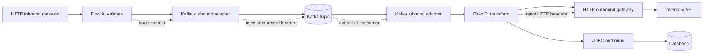
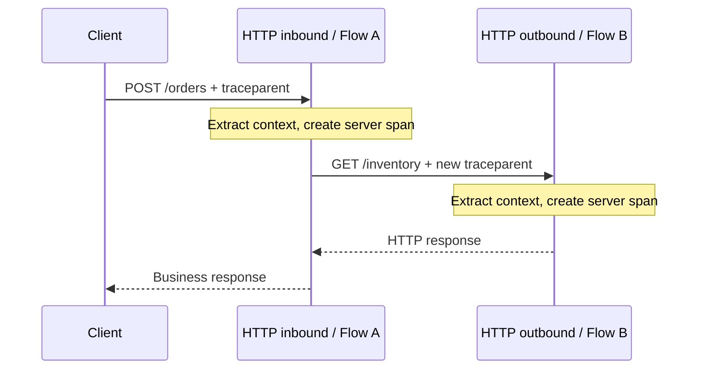
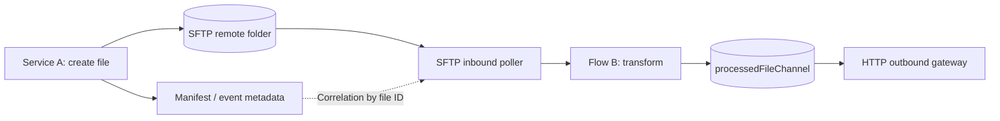
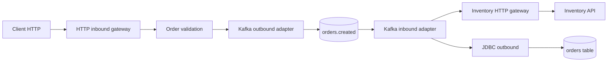

# Tracing Messages Across Transport Boundaries in Spring Integration

## 1. The Problem: One Message Crossing Multiple Systems and Threads

An integration application rarely handles all its work inside a single Java method. For example:

1. An **HTTP inbound gateway** receives an order creation request.
2. A **MessageChannel** passes the message to a transformer and validator.
3. A **Kafka outbound adapter** publishes an event to a broker.
4. Another service receives the record via a **Kafka inbound adapter**.
5. That service calls an **HTTP outbound gateway** to verify inventory and writes status via **JDBC**.

When customers report slowness, the operations team wants to know whether the request slowed down at HTTP, an internal channel, waiting in Kafka, during downstream processing, or on a database call. If each component only emits unlinked logs, it is hard to reconstruct **a single business journey across multiple processes**.

**Distributed tracing** links related processing steps into a **trace** made of multiple **spans** and propagates **trace context** across handoff points, especially **transport boundaries** (boundaries between processes, brokers, protocols, or intermediate storage).

This lesson belongs to the **Observability** chapter of the `SPRING_INTEGRATION_ADAPTERS` module. Its scope covers **inbound/outbound adapters, gateways, pollers, and MessageChannels**; **file, SFTP, HTTP, JMS, AMQP, Kafka, and database** flows; message contracts, error handling, retries, and connection lifecycles. The focus is preserving **causal relationships between steps** rather than merely copying an ID string into logs.

After this lesson, you should know how to:

- Identify process, thread, broker, file, and transaction boundaries.
- Distinguish trace ID, span ID, correlation ID, message ID, and delivery ID.
- Inject and extract trace context across adapters/gateways when supported by the transport.
- Design behavior when a transport has no built-in metadata slot (files, SFTP, some DB tables).
- Avoid confusing a message being **observed** with a message being **committed/ACKed**.
- Troubleshoot broken traces across `ExecutorChannel`, pollers, retries, or redeliveries.
- Protect sensitive data, manage sampling, and control cardinality.

## 2. Tracing, Correlation, and Observability: Making the Right Distinctions

### 2.1. Traces and Spans

A **trace** describes a set of related operations across a single execution or distributed journey. Each **span** represents an operation with start time, end time, context, and attributes.

Logical example:

```text
Trace: create order request
|
+-- HTTP SERVER: POST /orders
|   +-- Spring Integration: validate order
|   +-- Kafka PRODUCER: orders.created
|
+-- Kafka CONSUMER: process orders.created
    +-- Spring Integration: transform event
    +-- HTTP CLIENT: GET /inventory
    +-- JDBC CLIENT: update orders
```

In real systems, the relationship between producer and consumer may be **parent–child** or **span links** depending on tracing mechanisms, batching, retries, and queue wait times. Never assume every trace backend renders all spans in this exact tree shape.

Each span typically contains:

| Component | Role | Usage |
|---|---|---|
| **Trace ID** | Identifies a distributed trace | Used to search the whole journey |
| **Span ID** | Identifies an operation within a trace | Used to pinpoint a specific step |
| **Parent span or span links** | Relationship between operations | Analyzes origin and fan-out/batching |
| **Span name** | Meaningful, stable operation name | E.g., `orders.validate`, never include order ID |
| **Span kind** | SERVER, CLIENT, PRODUCER, CONSUMER, INTERNAL | Distinguishes sender/receiver sides and internal steps |
| **Attributes** | Protocol, flow name, outcome, error type, permitted info | Avoid PII/secrets and overly high-cardinality values |
| **Events / status** | Notable milestones or errors | Do not treat `ERROR` as automatic proof the broker rolled back |
| **Start/end timestamp** | Observed duration of an operation | Does not replace end-to-end business SLA |

A span may be absent from the trace backend due to **sampling, exporter failures, missing instrumentation, lost context, or backend overload**. Not seeing a span **is insufficient proof that an operation did not occur**.

### 2.2. ID Types Are Not Interchangeable

| ID | Created/Managed Where? | Semantics |
|---|---|---|
| `traceId` | Tracing SDK/instrumentation | Finds a related chain of distributed operations |
| `spanId` | Tracing SDK/instrumentation | Distinguishes individual operations |
| `correlationId` | Business/integration contract | Links messages or steps belonging to the same business case |
| Spring `MessageHeaders.ID` | Spring Messaging on message creation | Identifies a message envelope; may change when building a new message |
| Kafka topic/partition/offset | Kafka broker | Locates a record within a partition |
| JMS `JMSMessageID` | JMS provider | JMS message identifier; distinct from business ID |
| AMQP delivery tag | Broker/channel consumer | Session/connection-scoped acknowledgment; not a trace ID |
| File ID/manifest ID | Application convention | Reconciles files, batches, and import/export runs |

**Trace ID is not an idempotency key.** An order can be retried multiple times and generate multiple traces; conversely, one trace can contain multiple messages from a splitter, aggregator, or batch. Ensuring a business operation is not processed twice requires separate **business keys, deduplication, and transaction semantics**.

**Message ID is not a durable correlation ID.** Transformers, gateways, splitters, or flows constructing new messages can mint new envelope/header IDs. Organizations should define correlation IDs via business contracts and test propagation rather than deriving them automatically from trace IDs.

## 3. What Is a Transport Boundary?

A **boundary** is where a message or execution leaves one execution scope and appears in another. Not all boundaries are equivalent:

| Boundary | Example | Risk of Losing Context |
|---|---|---|
| **Thread boundary** | `DirectChannel` handing off to `ExecutorChannel` | Thread-local trace context/MDC is not transferred |
| **Process boundary** | HTTP gateway calling another service | HTTP headers stripped or middleware fails to extract |
| **Broker boundary** | Kafka, JMS, AMQP | Record/message properties unmapped or consumer fails to extract |
| **Polling boundary** | File/SFTP/JDBC poller | Triggers in a fresh execution with no source request context |
| **Persistence boundary** | Writing outbox/DB then worker reads later | Trace context not persisted or dropped by schema |
| **Retry/redelivery boundary** | DLQ/DLT, scheduled retry, requeue | Message rebuilt without headers; wrong parent/link wiring |
| **Security/trust boundary** | Calling partner API, receiving external messages | External context is untrusted as authentication evidence |

**Within a single process**, the tracing SDK sometimes preserves context automatically when handlers run synchronously. **Across processes/brokers**, you generally need to **inject** context into a transport carrier on the sender side and **extract** it on the receiver side. Across thread boundaries, propagate execution context using framework-supported mechanisms.

Conceptually:



Dashed edges show **context propagation intent**. Achieving this requires configuring instrumentation and header mapping appropriate for your version/adapter. The diagram does not guarantee Spring Integration automatically creates every span or propagates context across all transports.

## 4. W3C Trace Context, Baggage, and Propagation Rules

A widely used standard for propagating trace context over HTTP and key/value-capable carriers is **W3C Trace Context**:

- **`traceparent`**: carries version, trace ID, parent span ID, and trace flags.
- **`tracestate`**: vendor-specific supplementary tracing metadata per the standard.
- **`baggage`**: a separate standard mechanism for forwarding key-value metadata across hops, **not required** for basic trace linking.

Example `traceparent` format:

```text
traceparent: 00-4bf92f3577b34da6a3ce929d0e0e4736-00f067aa0ba902b7-01
```

This is a **format example**, not real trace data. W3C propagation enforces length, hex encoding, and validation rules; use standard tracing libraries instead of concatenating/parsing strings manually.

### 4.1. Inject and Extract

- **Inject:** write the **current** trace context into a carrier before making an HTTP call, publishing to Kafka/JMS/AMQP, or storing an event for deferred processing.
- **Extract:** read trace context from the carrier on the receiving side to create a consumer/server span linked to upstream work.
- **Activate scope:** set context appropriately during handler execution, then **close the scope** so it does not leak onto the next message.
- **Propagate onward:** when making downstream outbound calls from the receiving handler, the newly active context becomes the source for the next injection.

**Do not just copy `traceId` as a business header and call it tracing.** Linking spans requires proper parent/context semantics, trace flags, and instrumentation.

### 4.2. Strictly Restrict Baggage

Never put the following into baggage, span attributes, or raw logs:

- Access tokens, refresh tokens, cookies, passwords, API keys, private keys.
- Emails, usernames, phone numbers, addresses, or unnecessary customer data.
- SFTP file contents, transaction payloads, account numbers, or sensitive documents.
- Internal table names/paths/identifiers outside what is approved to share externally.

Baggage is typically forwarded to downstream services that can inspect headers; treating it as a secret channel is wrong. For business routing, define a **dedicated business header** with explicit authorization/input validation. Propagate only minimal, allowlisted metadata across trust boundaries.

### 4.3. Context Received Externally Is Not Trusted Evidence

An HTTP client or Kafka producer can send an arbitrary `traceparent` intentionally. Trace context exists solely to correlate observability data and **does not prove identity, role, tenant, or authorization**. Authentication and authorization must still rely on real security controls.

At public endpoints, bound header size, validate format, avoid trusting sensitive baggage, and follow policy on accepting external traces vs. starting a new trace. When calling partners, enforce cross-tenant policies and avoid leaking topology, metadata, or business data in trace attributes.

## 5. Tracing in Spring Integration: Who Creates Spans and Who Propagates Context?

Modern versions of Spring Integration and Spring Boot integrate with **Micrometer Observation/Tracing**, and applications can also use **OpenTelemetry** to manage trace context and export data to observability backends.

However, saying “we added the tracing dependency” **does not prove** every channel, endpoint, and adapter is instrumented, or that trace context crosses brokers. In practice, it depends on:

1. Spring Boot/Spring Integration version, starters, and observation configuration.
2. Instrumented components: `MessageChannel`, endpoints, gateways, HTTP clients/servers, Kafka/JMS/AMQP.
3. Propagation mechanisms across header mappers and transport carriers.
4. Execution model: `DirectChannel`, `ExecutorChannel`, pollers, async callbacks.
5. Tracing bridge/exporter and sampling settings.
6. Which boundaries the framework instruments automatically, avoiding duplicate manual spans.

**Micrometer Observation** is an application-level observability API unifying metrics and tracing via registries/handlers. **OpenTelemetry** provides tracing APIs/SDKs, propagators, and exporters; they work together via appropriate bridges, yet **do not automatically share context if you configure two independent tracing stacks**.

### 5.1. Instrumentation Decision Table

| Location | What to Measure | What to Propagate |
|---|---|---|
| HTTP inbound gateway | Server span / request outcome | Extract `traceparent` from HTTP request |
| Internal handler/transformer | Processing duration, errors, flow/stage | Current request/message context |
| `ExecutorChannel` | Queue wait and handler duration | Context across task/executor boundary |
| Kafka/JMS/AMQP outbound | Producer span, publish attempt/result | Inject into record headers/properties |
| Kafka/JMS/AMQP inbound | Consumer span, processing outcome | Extract from broker message headers/properties |
| SFTP/File poller | Poll attempt, discovered file, processing span | Start new trace or link from trusted metadata/manifest |
| Outbox/JDBC poller | Event persisted/read/dispatched | Store carrier metadata separately if linking traces |
| HTTP outbound gateway | Client span and response | Inject HTTP trace headers |
| Error/retry flow | Error classification, retries, DLQ/DLT | Preserve sensible origin; avoid mis-reusing stale context |

**Do not create a span for every tiny step** if the overhead outweighs the observational value. Pick business-meaningful milestones and failure boundaries, and rely on built-in instrumentation before adding manual spans.

## 6. HTTP Gateways: The Most Familiar Context Path

An **HTTP inbound gateway** can receive `traceparent` from a client; an **HTTP outbound gateway** can inject the active context into request headers sent to the next service.



**The outbound `traceparent` normally carries the appropriate sender-side span ID**, rather than copying an unchanged header across every hop. Updating parent span IDs and creating client/server spans should be left to the SDK/instrumentation.

### 6.1. What to Verify

- Does the HTTP server extract trace context and create spans correctly?
- Is the HTTP client used by the outbound gateway instrumented?
- Does any header mapper/gateway strip `traceparent` or `tracestate`?
- If requests pass through a reverse proxy/API gateway, are headers forwarded per policy?
- On 4xx/5xx/timeouts, does the trace capture appropriate events/status?
- Are headers logged raw in access logs alongside sensitive data?
- Do callbacks or async threads preserve context properly?

For HTTP, when a trace breaks at outbound, check **both HTTP client instrumentation and header propagation**, not just the Java DSL wiring the message channel.

## 7. Kafka: Record Headers, Producer/Consumer, and Commit

In Kafka, the producer constructs a record and can inject trace context into **record headers**. The broker stores the record; the consumer must **extract** context from headers before processing. Tracing libraries typically use Kafka-header carriers with specific encoding; applications should not assume they are plain `Map<String,String>` entries.

Example:

```text
Flow A
  ordersValidated
      |
  Kafka outbound adapter
      | inject tracing headers
      v
  topic orders.created
      | partition 3, offset 8123
      v
  Kafka inbound adapter
      | extract tracing headers
  Flow B
      |
  validate -> JDBC -> reply
```

**Operational notes:**

1. A **Producer span** alone does not prove the record is durable: check callbacks/acks/transactions and broker policy.
2. A **Consumer span** represents one instrumented receive/process execution; it does not automatically mean the offset was committed.
3. **Retries/redeliveries** can create multiple processing spans for the same record or logical event.
4. **Batch consumers** read multiple records with multiple parent contexts. Avoid forcing all records under one arbitrary parent; use **span links** or per-record spans when needed and affordable.
5. **DLT/dead-letter** messages must preserve enough context to investigate without leaking sensitive headers or assigning the wrong trace parent.
6. Kafka key, topic, partition, offset, and business event ID serve different purposes; **offset does not replace trace ID**.
7. When migrating to a new topic, re-verify **producer serializer/header propagation**, not just the payload.

When investigating “producer has a span but consumer does not,” verify the record was actually published, check consumer group assignment/lag, header mapping, sampling, and receiver instrumentation before blaming Kafka for data loss.

## 8. JMS and AMQP: Using Message Properties/Headers Semantically

### 8.1. JMS

JMS messages carry **properties** as name–value pairs. Integration/framework support can map trace context into appropriate properties. Verify:

- Mapping between Spring `MessageHeaders` and JMS properties in both directions.
- Provider naming rules, data types, and property size limits.
- Whether the broker accepted the message; transaction/ack and redelivery behavior.
- Whether exceptions propagate or route to an error channel.
- JMS `JMSCorrelationID` is for message/request–reply correlation and **does not automatically equal trace ID**.

For example, JMS request–reply needs **both** business correlation and tracing context. If a request times out and retries, multiple attempts occur; never keep a single trace span artificially open across long business wait times.

### 8.2. AMQP (e.g., RabbitMQ)

AMQP messages carry **headers** and broker/consumer-managed delivery metadata. Producers can inject context into headers, and consumers extract it upon receipt.

Distinguish:

- Broker **publish confirms** vs. successful business handler execution.
- **Consumer ack/nack** vs. transactional processing outcomes.
- **Dead-letter exchange (DLX)** vs. Spring Integration's error channel.
- Channel/consumer **delivery tag** vs. trace ID.
- Headers altered during republishing, retries, or bridges.

A message arriving in a dead-letter queue may retain the trace context of an earlier send; when reprocessed much later, creating a **new processing span linked** to the original event is often cleaner, depending on tracing policy. Never treat an old span ID as an active span throughout the wait period.

### 8.3. Choosing Parent–Child vs. Span Links

When a message is consumed minutes later, or a batch combines multiple independent messages:

- **Parent–child** fits direct, explicitly propagated causal execution.
- **Span links** fit linking multiple sources or deferred executions that do not form a simple tree.
- **Correlation ID** remains necessary for business tracking independent of tracing choices.

No single span tree shape suits every broker, batch, and retry pattern. Follow conventions supported by your tracing system, test how your backend renders them, and keep outputs consistent across versions.

## 9. File and SFTP: No Native Headers to Carry Context

File and SFTP differ from HTTP/Kafka/JMS/AMQP: a file on a filesystem or SFTP server **does not natively store Spring MessageHeaders or W3C trace context**. When one process writes a file and another polls it later, the writer's in-memory trace context is gone unless the application explicitly persists metadata.

### 9.1. Suitable Strategies

| Strategy | When Appropriate | Limitation |
|---|---|---|
| **Start a new trace when polling the file** | External input has no tracing metadata | Does not automatically link to writer's trace |
| **File/manifest correlation ID** | Need durable business linkage over time | ID alone does not create parent–child spans |
| **Sidecar manifest with trace context** | Both systems are under your control and share a contract | Must sync file/manifest, verify source, protect data |
| **Metadata inside an allowed content format** | File format defines explicit tracing fields | Do not embed trace context in sensitive payload data outside policy |
| **Companion event/outbox with file** | Need accurate audit/reconciliation | Extra infrastructure and event–file consistency required |

**Do not** embed `traceparent` into filenames or SFTP paths by default. That exposes metadata, lengthens filenames, and breaks easily during renames, moves, and archiving.

### 9.2. SFTP Flow Example



When the poller detects a file:

1. Record a **poll/download** span per instrumented behavior.
2. Generate or read a **correlation ID** from valid metadata.
3. If a manifest carries trusted trace context permitted by contract, extract it per rules; otherwise start a fresh processing trace while keeping business correlation for lookup.
4. Track **file discovered**, **processing started**, **processing finished**, and **destination confirmed** as distinct milestones.
5. Account for files being re-polled after errors; multiple traces do not imply multiple distinct business files.

**A trace does not prove a file was uploaded/downloaded intact.** Verify adapter status, size/checksum per policy, file locks/temp names/renames, and completion confirmations.

## 10. JDBC, Databases, and Transactional Outbox

A **JDBC outbound** operation can emit a DB client span via driver/framework instrumentation. That span describes the database call; it does not turn trace context into **durable data** for another worker to read later.

When an application writes an order to the DB and another poller emits events, there is a **persistence boundary**:

```text
HTTP request -> business transaction
    |
    +-- INSERT orders
    +-- INSERT outbox (event_id, payload, metadata)
    |
  COMMIT
    |
    v
Outbox poller (different time / thread / instance)
    |
    v
Kafka publisher
```

To bridge traces across an outbox, you can store **permitted trace metadata** in dedicated outbox columns within the same transaction. The worker reads the outbox, validates metadata, and opens a new publish span with the appropriate parent/link.

**However, trace context does not replace transactions and idempotency:**

- Order and outbox writes require atomic commit guarantees if required by architecture.
- Pollers may publish the same event multiple times after crashes/retries.
- Consumers must deduplicate by `event_id` or business key.
- Never use trace ID as the outbox primary key.
- Never log full SQL parameters or personal data in span attributes.
- “JDBC span ended” is not enough to prove the business transaction committed properly or downstream processed it.

### 10.1. Illustrative Outbox Table Model

```sql
CREATE TABLE integration_outbox (
    event_id         UUID PRIMARY KEY,
    event_type       VARCHAR(100) NOT NULL,
    payload_json     JSONB NOT NULL,
    correlation_id   VARCHAR(100) NOT NULL,
    traceparent      VARCHAR(200),
    tracestate       TEXT,
    created_at       TIMESTAMPTZ NOT NULL,
    published_at     TIMESTAMPTZ
);
```

This is an **illustrative educational schema**, not a default Spring Integration schema. Production systems must address claim/lease state, retries, indexing, retention, data security, and concurrent pollers. Trace metadata columns must not hold baggage/credentials; storing `tracestate` requires size, trust, and retention policies.

If data comes from a partner system whose **trace context cannot be trusted**, do not treat a stored `traceparent` in the DB as verified evidence. Start a new trace, attach a link, or retain only the correlation ID.

## 11. Illustrative Code: Inject/Extract via the OpenTelemetry API

This example clarifies the **propagation principle** an adapter needs to perform. It uses the **OpenTelemetry API** with a simple `Map<String,String>` carrier. This is **not the specific header-mapping API of every Spring Integration adapter**; HTTP, Kafka, JMS, and AMQP each have their own converters.

**Assumption:** the application already has a configured OpenTelemetry SDK/propagators; using the default no-op `GlobalOpenTelemetry` without an actual SDK/propagator will not yield useful traces. In Micrometer Tracing applications, choose one consistent bridge/instrumentation instead of spinning up a separate standalone OpenTelemetry stack outside the pipeline.

```java
import io.opentelemetry.api.GlobalOpenTelemetry;
import io.opentelemetry.context.Context;
import io.opentelemetry.context.propagation.TextMapGetter;
import io.opentelemetry.context.propagation.TextMapSetter;

import java.util.HashMap;
import java.util.Map;

public final class TraceCarrier {

    private TraceCarrier() {
    }

    private static final TextMapSetter<Map<String, String>> SETTER =
            (carrier, key, value) -> carrier.put(key, value);

    private static final TextMapGetter<Map<String, String>> GETTER =
            new TextMapGetter<>() {
                @Override
                public Iterable<String> keys(Map<String, String> carrier) {
                    return carrier.keySet();
                }

                @Override
                public String get(Map<String, String> carrier, String key) {
                    return carrier.get(key);
                }
            };

    // Call while the sender span is in Context.current().
    public static Map<String, String> inject() {
        Map<String, String> headers = new HashMap<>();
        GlobalOpenTelemetry.getPropagators()
                .getTextMapPropagator()
                .inject(Context.current(), headers, SETTER);
        return headers;
    }

    // Call before opening the processing span on the receiver side.
    public static Context extract(Map<String, String> headers) {
        return GlobalOpenTelemetry.getPropagators()
                .getTextMapPropagator()
                .extract(Context.root(), headers, GETTER);
    }
}
```

**Steps required in a real adapter:**

1. On the **sender** side, with an active span, call `TraceCarrier.inject()`.
2. Map the returned key/value pairs onto the **real carrier**: HTTP headers, Kafka record headers, JMS properties, or AMQP headers via the transport's API.
3. On the **receiver** side, pull allowed trace-related carrier fields from the transport; adapt to a `Map` for `extract()`, or implement `TextMapGetter` directly against the transport API.
4. Start a processing span using the **extracted context** and close the scope when the handler finishes.
5. When the handler makes a subsequent outbound call, the processing span's context becomes the source for the next injection.

A consumer-side scope pattern using OpenTelemetry:

```java
import io.opentelemetry.api.GlobalOpenTelemetry;
import io.opentelemetry.api.trace.Span;
import io.opentelemetry.api.trace.SpanKind;
import io.opentelemetry.api.trace.StatusCode;
import io.opentelemetry.api.trace.Tracer;
import io.opentelemetry.context.Context;
import io.opentelemetry.context.Scope;

import java.util.Map;

public class ObservedMessageHandler {

    private final Tracer tracer =
            GlobalOpenTelemetry.getTracer("integration-orders");

    public void onMessage(Map<String, String> transportHeaders,
                          String payload) {
        Context incoming = TraceCarrier.extract(transportHeaders);

        try (Scope parentScope = incoming.makeCurrent()) {
            Span span = tracer.spanBuilder("orders.consume")
                    .setSpanKind(SpanKind.CONSUMER)
                    .startSpan();
            try (Scope spanScope = span.makeCurrent()) {
                // In practice: validate/transform and call business service.
                processOrder(payload);
            } catch (RuntimeException exception) {
                span.recordException(exception);
                span.setStatus(StatusCode.ERROR);
                throw exception;
            } finally {
                span.end();
            }
        }
    }

    private void processOrder(String payload) {
        // Illustrative logic, not a broker transaction example.
    }
}
```

**Limitation:** this illustrates one message and one synchronous handler. It **does not** cover batching, retry scheduling, redelivery, acknowledgments, transactions, thread-pool propagation, or transport errors. If the framework already creates a consumer span automatically, **do not duplicate it verbatim**; reserve manual spans for internal operations that truly need measurement.

### 11.1. Spring MessageHeaders Differ from Transport Headers

An `org.springframework.messaging.Message<?>` has its own **MessageHeaders**. They are **not automatically equivalent** to HTTP headers, Kafka `Headers`, JMS properties, or AMQP `MessageProperties`.

To transfer carrier metadata between a Spring Message and a transport:

- Identify the adapter/gateway's **header mapper**.
- Specify which tracing headers are allowed through; verify transport naming and value types.
- Avoid stripping required technical broker or framework headers.
- Do not mutate `MessageHeaders` as a mutable map; when building a new message, use `MessageBuilder.fromMessage(original)` and set allowed headers.
- Ensure inbound context is extracted **before** starting processing spans or downstream outbound calls.

Illustrative snippet creating a new message with allowlisted metadata:

```java
import org.springframework.messaging.Message;
import org.springframework.messaging.support.MessageBuilder;

public Message<?> attachApprovedHeaders(
        Message<?> original,
        Map<String, String> carrier) {

    MessageBuilder<?> builder = MessageBuilder.fromMessage(original);

    for (String key : new String[] {"traceparent", "tracestate"}) {
        String value = carrier.get(key);
        if (value != null) {
            builder.setHeader(key, value);
        }
    }
    return builder.build();
}
```

This snippet only creates a **Spring Message with selected headers**; it does not prove the outbound adapter will send them over the wire. Test the specific adapter, and never dump an entire external map/baggage blindly into the message.

## 12. Micrometer Observation for an Internal Processing Step

With Spring Boot/Micrometer, an application can instrument an internal step using `ObservationRegistry`. Example:

```java
import io.micrometer.observation.Observation;
import io.micrometer.observation.ObservationRegistry;

public final class OrderValidation {

    private final ObservationRegistry registry;

    public OrderValidation(ObservationRegistry registry) {
        this.registry = registry;
    }

    public void validate(String orderPayload) {
        Observation.createNotStarted("orders.validate", registry)
                .lowCardinalityKeyValue("flow", "orders")
                .lowCardinalityKeyValue("stage", "validation")
                .observe(() -> {
                    if (orderPayload == null || orderPayload.isBlank()) {
                        throw new IllegalArgumentException("Empty order");
                    }
                    // Actual validation logic...
                });
    }
}
```

Key points:

- `Observation` can feed **both metrics and tracing** via configured handlers/bridges; not every registry exports traces automatically.
- The name `orders.validate` and tags `flow=orders`, `stage=validation` are low-cardinality.
- Never put `orderId`, email, filename, or raw payload into **low-cardinality tags**.
- The observation is created inside the handler; placing it in the right trace requires an **active context** propagated across prior threads/transports.
- If Spring Integration/framework already instruments this step with the same semantics, avoid creating a redundant observation.

**The snippets in section 11 and section 12 illustrate two different APIs**, not a directive to run two separate tracing pipelines simultaneously. In a real project, standardize on one instrumentation model and test traces from inbound to outbound.

## 13. Thread Boundaries: DirectChannel, ExecutorChannel, and Pollers

### 13.1. DirectChannel

With `DirectChannel`, normal processing steps run **synchronously on the thread calling `send`**. Thread-local trace context may remain active when handlers run; however, this alone does not prove every endpoint emits a span or routes errors to `errorChannel`.

### 13.2. ExecutorChannel

`ExecutorChannel` hands execution to a task executor, creating a **thread boundary**. Thread-local context (including MDC and many tracing scopes) is lost unless tasks are properly wrapped/propagated.

Depending on version and configuration, use the **context propagation/task decoration** supported by Spring/Micrometer. When designing:

1. Verify the inbound handler extracted context.
2. Verify the executor has proper context capture/restore mechanics.
3. Open scope when the task runs and close it in `finally` or try-with-resources.
4. Verify reused worker threads **never carry trace context from a previous message**.
5. Never stash a source thread's `Scope` object into a message for use on another thread.
6. Measure queue wait separately if needed; executor wait time is not automatically included in handler spans.

### 13.3. Pollers and Schedulers

File, SFTP, JDBC, or polling sources run on a scheduler and **do not inherit the trace of a previous request**. Each poll can open a fresh observation/span, followed by per-message processing spans. If source data carries valid correlation metadata or persisted trace context, link per policy; otherwise starting a new trace is appropriate.

**Never keep a single span open for hours waiting for a new file or record.** Tracing should represent bounded operations; end-to-end business latency should combine source timestamps, message age, and correlation/event stores.

## 14. Retries, Redeliveries, Batches, Splitters, and Aggregators

Integration patterns make tracing significantly more complex than a synchronous HTTP request.

| Situation | Appropriate Analysis |
|---|---|
| **Retry inside the same handler** | Can use span events or child spans for attempts; avoid duplicating operations needlessly |
| **Retry after rescheduling** | Starts a new attempt; preserve correlation to original event and handle idempotency separately |
| **Kafka/JMS/AMQP redelivery** | One logical event may have multiple consumer processing spans |
| **Dead-letter/replay** | Preserve origin; use links per convention rather than an artificial long parent chain |
| **Splitter** | One message yields many child messages; use correlation/business IDs and appropriate spans/links |
| **Aggregator** | One result may depend on many input contexts; a single parent may be insufficient |
| **Batch consumer** | Multiple input contexts; consider span links, per-record spans, or batch spans based on cost |
| **Fan-out across outbound adapters** | Each send branch has its own spans; distinguish failures per destination |
| **Compensation/saga** | Link business steps under one correlation ID using trace/event links rather than multi-day spans |

**Tracing does not determine whether a message is reprocessed.** Exactly-once, at-least-once, ACKs, offset commits, transactions, and deduplication belong to the integration delivery contract. A clean trace does not prove there were no duplicate business operations.

### 14.1. Example: Business Event vs. Trace Attempts

Suppose a Kafka consumer receives `order-created-42`:

- Attempt 1: Inventory HTTP times out; message is retried.
- Attempt 2: HTTP returns a transient error; system reschedules.
- Attempt 3: succeeds; JDBC commits.
- Kafka offset commits per policy upon completion.

There may be three consumer processing spans across one or more traces. You need `event_id=order-created-42` or an idempotency key to know they belong to the **same business event**, plus retry/processing metrics to measure total attempts. **Never stretch one span across all retries when attempts run at different times/processes**.

## 15. Standardizing Span Attributes, Sampling, and Cost

### 15.1. Purposeful Naming and Attributes

A span can carry well-defined application attributes:

| Illustrative Attribute | Example | What to Control |
|---|---|---|
| `integration.flow` | `orders-import` | Bounded number of flows |
| `integration.stage` | `validated` | Never use payload contents |
| `integration.adapter` | `kafka`, `sftp`, `http` | Standard enum |
| `integration.outcome` | `success`, `retry`, `failed` | Distinguish attempt from commit |
| `messaging.destination` | `orders.created` | Only if destination names are allowed to share |
| `error.type` | `timeout`, `validation` | Never attach sensitive raw exception messages |
| `processing.attempt` | `1`, `2` | Bounded by contract; never turn into unbounded metric tag |
| `deployment.environment` | `staging`, `production` | Sourced from trusted config |

These are **illustrative attribute names**; OpenTelemetry Semantic Conventions evolve across versions. Prefer the conventions of your active instrumentation and avoid emitting the same concept under inconsistent keys.

Avoid attaching raw payloads, `Authorization` headers, customer IDs, filenames with personal data, or SQL statements with sensitive parameters to traces. Tracing backends are usually **centralized**; an attribute recorded by service A may be readable by many teams.

### 15.2. Sampling

Tracing typically uses sampling to bound volume:

- **Head-based sampling:** decides early whether to sample based on trace ID or policy.
- **Tail-based sampling:** decides after seeing spans/events, prioritizing slow/errored traces at higher collector/buffer cost.
- **Rule-based sampling:** prioritizes risky flows, errors, or high-latency paths.

Sampling can leave traces **incomplete**, especially if services use independent configs or inconsistent propagation flags. Never derive **exact business message counts** from collected spans unless sampling is 100%.

For **mandatory audits**, always rely on durable logs/events. **Tracing is an observational channel subject to sampling or loss** and does not satisfy legal audit completeness by itself.

### 15.3. Logs, Metrics, and Tracing Complement One Another

| Signal | Good For | Not Meant For |
|---|---|---|
| **Traces** | Finding bottlenecks, linking calls across services/transports, inspecting samples | Exact total message counts under sampling |
| **Metrics** | Throughput, latency histograms, error rates, queue depth, consumer lag | Storing business IDs as labels on every record |
| **Structured logs** | Looking up specific errors, correlation IDs, permitted operational audits | Dumping full payloads/secrets or acting as default durable audit |
| **Durable events/audit** | Proving processing state, critical actions, and crash recovery | Replacing latency metrics or distributed tracing |

**Metric labels must stay low-cardinality.** Never put `traceId`, `spanId`, `messageId`, or `orderId` into per-message Prometheus tags; those belong in controlled log/trace lookups.

## 16. Practice Exercise: HTTP → Kafka → HTTP and JDBC

Design and observe the pipeline:



### 16.1. Sample Contract

- `event_id`: unique event identifier for idempotency.
- `correlation_id`: links events to the business order or request.
- `trace context`: managed by tracing, carried across HTTP/Kafka headers per adapter.
- `schema_version`: payload contract version.
- `occurred_at`: timestamp when the business event occurred.
- `attempt`: retry metadata within monitored bounds; not a logical ID.

### 16.2. Observation Points

1. HTTP server span: receives and completes request.
2. Validation observation/span: data validation duration.
3. Kafka producer span: publish attempt and broker outcome per actual instrumentation.
4. Kafka consumer span: record receipt and processing.
5. HTTP client span: inventory call latency.
6. JDBC span: query/transaction duration per config.
7. Business event: confirms the order was actually processed, backed by audit/outbox when needed.

### 16.3. Test Scenarios

| Scenario | Expected Tracing and Complementary Evidence |
|---|---|
| HTTP succeeds, Kafka publish succeeds | Trace context injected/extracted; record ID matches correlation |
| Kafka publish timeout | Error/timeout recorded, ACK status per contract; never report delivered just because a span exists |
| Kafka redelivery | Attempts visible; idempotency prevents duplicate side effects |
| Consumer runs via executor | Context linked properly; no MDC leakage across messages |
| Inventory HTTP returns 503 | Child client span records error, bounded retry, accurate business outcome |
| JDBC rollback | Operation trace may exist, yet business success is not marked |
| Trace backend down | Business flow continues per policy; independent metrics/audits remain intact |
| Baggage contains sensitive data | Stripped/restricted before forwarding per allowlist |
| 10% sampling | Never infer throughput from trace counts; compare with metric counters |
| SFTP/file instead of Kafka | New trace or link via manifest; never assume headers persist automatically |

## 17. Troubleshooting: Where Did the Trace Break?

When the trace viewer shows a producer span in service A without a consumer span in service B, follow these steps.

**Step 1 — Verify the message was actually delivered.** For HTTP check response/status; for Kafka check publish results, offsets, consumer lag; for JMS/AMQP check ACKs and queues; for SFTP/file check file write/read; for JDBC check transactions. Never blame trace loss before proving the message arrived.

**Step 2 — Check sampling and exporters.** Do both processes share the tracing backend, sampler/propagator, and healthy exporters? Are there collector queue/drop signs? A broken trace may be a telemetry fault rather than a business flow failure.

**Step 3 — Inspect sender-side headers.** Was `traceparent` injected while the producer/client span was active? Never log tokens or full headers. Is `tracestate` required?

**Step 4 — Inspect the intermediate carrier.** Did the HTTP gateway, Kafka record headers, JMS properties, AMQP headers, or manifest retain metadata, or did a mapper filter it out? Across proxies/bridges, inspect each hop per policy.

**Step 5 — Inspect receiver-side extraction.** Did the handler extract before creating the consumer span? Was externally received context valid and safely handled?

**Step 6 — Check thread boundaries.** Are `ExecutorChannel`, schedulers, async callbacks, listener threads, or Reactor contexts involved? Did tasks capture/restore context properly? Was MDC cleared/reset wrongly?

**Step 7 — Check duplicate spans or accidental root traces.** Are framework auto-instrumentation and application code both creating root spans? Was `Context.root()` used accidentally when a valid downstream context existed?

**Step 8 — Check retries/batches.** A message processed in a retry worker or batch job may emit a separate linked trace. Search by correlation ID and event ID, not just a single trace ID.

**Step 9 — Check timestamps.** Are instance clocks synchronized? Long queue waits can make span ordering confusing. Never treat telemetry ingest time as event occurrence time.

**Step 10 — Re-verify.** Send a non-sensitive test message; inspect producer and consumer telemetry together, cross-check logs/metrics/ACKs/DB, and document findings in the runbook.

### Common Symptoms

| Symptom | Likely Cause | Where to Check |
|---|---|---|
| HTTP traced, Kafka consumer starts new trace | Missing header inject/extract or mismatched instrumentation | Kafka header mapper, producer/consumer tracing |
| Trace changes after `ExecutorChannel` | Lost thread-local context | Context propagation / task executor |
| Logs have correlation ID, trace unlinked | Business ID is not trace context | W3C propagator and parent/link |
| One event yields multiple consumer spans | Redelivery/retries, multiple attempts | Broker ack/commit, retries, idempotency |
| One trace holds many business events | Splitter/aggregator/batching | Event IDs, span links, message grouping |
| SFTP inbound missing under root HTTP trace | Files do not carry tracing headers | Manifest or business correlation |
| Trace latency differs from business SLA | Span covers only one step, excluding queue/poll/retry | Event timestamps, backlog, business outcomes |
| HTTP client span exists with no valid response | Transport/target failure | Status/timeouts, error handling |
| Trace shows no error despite business rollback | Instrumentation did not capture transaction outcome | Transaction logs and result events |
| Trace backend silent | Sampling/exporter failure or missing instrumentation | Collector health, metric counters, config |

## 18. Testing Propagation by Transport

Test **both context propagation and business behavior**:

### 18.1. Unit Tests for Carriers

- With a `Map<String,String>` carrier, configure a W3C propagator in the test environment.
- Create an active span, inject headers, extract in a separate context, and assert matching trace ID/parent relationship.
- Verify missing/malformed headers do not crash handlers or bypass security.
- Verify baggage is filtered per policy and never carries secrets.

### 18.2. Integration Tests with Real Adapters or Test Containers

| Adapter | What to Verify |
|---|---|
| HTTP | Outbound sends `traceparent`; inbound extracts and links trace properly |
| Kafka | Record headers preserve context across broker, including retries and DLT per contract |
| JMS | Property mapping preserves valid data; redelivery keeps correlation |
| AMQP | Headers traverse exchange/queue, retries/republishes per design |
| SFTP/File | Manifest/event correlation works; do not assume native tracing headers |
| JDBC/Outbox | Events and trace metadata commit/read logically; never use trace ID for dedupe |
| `ExecutorChannel` | Context restores cleanly on workers and never leaks between tasks |
| Poller | Separate traces for polling and processing; no dangling scopes |
| Error flow | Errors/attempts appear accurately in traces alongside accurate business outcomes |

### 18.3. Minimum Verification Assertions

An end-to-end test should verify:

1. **Same trace ID** across linked spans when parent–child semantics are chosen.
2. Or **correct span links** if batch/async flows use a link model.
3. `correlationId` matches the logical event/batch per business contract.
4. Tracing headers do not alter payloads, schemas, or business logic.
5. No secrets/PII are logged; no high-cardinality metric tags are emitted.
6. Collector failures or sampling never break delivery contracts.
7. Real ACK/commit/DB outcomes are verified independently rather than inferred from traces.

## 19. Common Anti-Patterns

1. **Copying `traceId` into a header and calling it distributed tracing:** lacks parent/span/flags.
2. **Using trace ID as an idempotency key:** retries can mint new traces and cause duplicate operations.
3. **Assuming every adapter propagates automatically:** Spring headers and transport carriers use distinct mappers.
4. **Instrumenting only HTTP:** Kafka/JMS/AMQP or schedulers break the trace.
5. **Using MDC as the sole propagation mechanism:** context can be lost or leaked across threads/processes.
6. **Forwarding all baggage to partner systems:** leaks unauthorized data.
7. **Recording payloads/`Authorization` in span attributes:** data gets exported to centralized backends.
8. **Using trace counts as throughput:** sampling makes counts inaccurate.
9. **Keeping one span alive for hours waiting for a broker/file:** hard to manage lifecycle and semantics.
10. **Forcing a batch of messages under one arbitrary parent:** loses distinct source origins.
11. **Marking success when a producer span ends:** does not prove broker ack or DB commit.
12. **Treating every redelivery as a new message:** conflates attempts with logical business events.
13. **Adding manual spans duplicating auto-instrumentation:** noisy traces and distorted metrics.
14. **Using Spring's message ID as a durable business ID:** ID can change when creating new messages.
15. **Embedding `traceparent` in public filenames/URLs:** leaks metadata and complicates operations.
16. **Skipping context propagation checks across executors:** thread switches split traces.
17. **Assuming `errorChannel` catches every failure:** sync/async/transport semantics differ.
18. **Checking only graphs and traces while ignoring poller health:** silent sources produce silent tracing.
19. **Trusting external trace context as authentication:** traces never grant permissions.
20. **Letting an overloaded exporter block business processing:** define clear telemetry failure policies, except for mandatory audits with dedicated architectures.

## 20. Self-Check Questions

**Question 1.** An HTTP request enters service A with a trace ID, A publishes a Kafka event, and service B consumes the record but starts a new trace ID. What are the first checkpoints?

**Answer:** Did the Kafka producer inject headers under the active context; did record headers reach the broker; did the consumer extract before starting its span; are instrumentation/bridges and sampling consistent? Also confirm the record was actually delivered before blaming propagation.

**Question 2.** A message passes through an `ExecutorChannel` and downstream handler logs lose the trace ID. Is manually copying MDC enough?

**Answer:** Not enough. MDC serves logging and is typically thread-bound; you need framework-supported **tracing context** capture/restore, proper scope closing, and tests ensuring threads never leak stale context between messages.

**Question 3.** A Kafka record is retried three times. The trace backend shows three consumer spans. Are those three different orders?

**Answer:** **No.** They can be three **processing attempts** of a single event. Use `event_id`/business keys to identify logical events and idempotency to avoid duplicate side effects.

**Question 4.** Service A writes a file via SFTP, and service B polls it 15 minutes later. Why doesn't trace context follow the file automatically?

**Answer:** Files/SFTP do not carry Spring MessageHeaders by default. Linking requires an explicit metadata/manifest contract or companion event; otherwise start a fresh processing trace and use business correlation IDs for lookup.

**Question 5.** An HTTP client span finishes `OK`, yet the downstream database has no record. Can you conclude the database committed successfully?

**Answer:** No. The client span is only one step in the flow; verify response semantics, downstream handlers, transactions/commits, and DB state.

**Question 6.** Why shouldn't `traceId` be used as a metric tag per request?

**Answer:** Because its vast number of unique values creates **high cardinality**, overloading backends and inflating storage costs. Keep trace IDs in controlled traces/logs; use bounded metric labels like `flow`, `adapter`, and `outcome`.

**Question 7.** A team wants every IAM action and transaction recorded for legal compliance. Can they rely solely on distributed tracing?

**Answer:** No. Tracing is often sampled, exporters can drop data, and spans do not guarantee transactional durability. You need a **durable audit/event log** with required retention, access control, and verification.

**Question 8.** A Kafka batch contains records from three incoming traces. Must the first record serve as the batch span's parent?

**Answer:** Not automatically. You can use **span links** to multiple input contexts or instrument per-record appropriately; follow your tracing conventions and check overhead.

**Question 9.** During HTTP ingest, a client sends baggage `customer_email`. Should it be forwarded to Kafka for easier trace filtering?

**Answer:** Not by default. Email is personal data, and baggage can spread across many services/brokers. Enforce allowlists, strip unnecessary data, uphold privacy rules, and use non-sensitive IDs where appropriate.

**Question 10.** An SFTP flow shows no new traces for an hour. Is it certain there are no new files?

**Answer:** **No.** The poller/connection may be failing, or the tracing exporter may be down. Check poller heartbeats, remote status, file filters, adapter metrics, and the source directory.

## 21. Practical Implementation Checklist

- [ ] Identified **process/thread/broker/poll/file/persistence** boundaries in the flow.
- [ ] Distinguished **trace ID, span ID, message ID, business correlation ID, and idempotency key**.
- [ ] Selected one instrumentation/tracing pipeline consistent with your Spring Boot/Spring Integration version.
- [ ] Tested `traceparent`/`tracestate` injection/extraction over **HTTP**.
- [ ] Tested header mapping and processing spans on **Kafka/JMS/AMQP**.
- [ ] For **File/SFTP/JDBC**, decided between starting a new trace, manifest/metadata, or outbox/event links.
- [ ] Implemented context propagation across `ExecutorChannel`, async callbacks, and pollers where needed.
- [ ] Tested retries, redeliveries, DLT/DLQ, splitters, aggregators, and batches under parent/link semantics.
- [ ] Measured latency, backlog, and outcomes using complementary metrics/event logs rather than sampled spans.
- [ ] Blocked unauthorized headers/payloads/secrets/PII from crossing telemetry and trust boundaries.
- [ ] Bounded cardinality, attribute sizes, and sampling/exporter costs.
- [ ] Tested behavior when the tracing backend disconnects so business delivery follows policy.
- [ ] Distinguished trace presence from **ACK/commit/transaction success**.
- [ ] Verified correlation IDs stay intact across transformers/gateways and newly built messages.
- [ ] Documented runbooks for broken traces, missing context propagation, and silent adapters.

## Key Takeaways

**Tracing messages across transport boundaries** keeps observational links intact as messages leave one thread, process, broker, or storage medium and resume elsewhere. In **Spring Integration Adapters**, combine **Micrometer/OpenTelemetry, context propagation, MessageChannels, inbound/outbound adapters, gateways, and pollers** according to the real semantics of **HTTP, JMS, AMQP, Kafka, File, SFTP, and JDBC**. Use `traceparent`/propagators on transports with suitable carriers; for files, SFTP, or outboxes, establish an **explicit metadata/correlation contract** rather than assuming context travels automatically with the payload. Tracing pinpoints where delays and errors occur, yet **does not replace business IDs, idempotency, broker ACKs, database commits, logs/metrics, or durable audits**. Good observability connects traces across transports **while protecting data, preserving message contracts, and operating reliably even when telemetry fails**.
