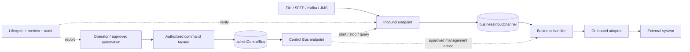
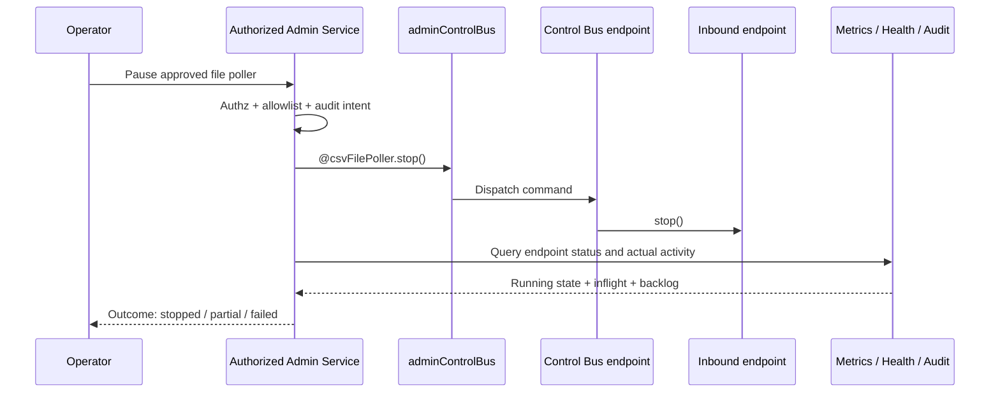
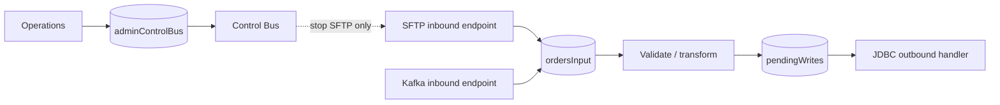
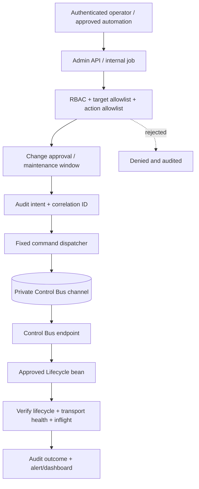
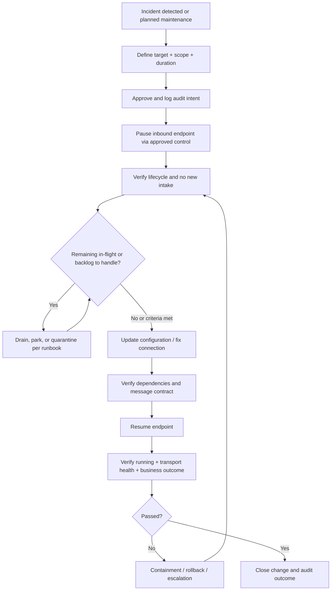

# Control Bus for Controlling Adapters in Spring Integration

## 1. Why Do We Need a Dedicated Control Channel?

In a **Spring Integration Adapters** system, messages may enter from a **File/SFTP inbound adapter**, HTTP gateway, **JMS/AMQP/Kafka consumer**, or JDBC poller into a `MessageChannel`, get validated and transformed, and proceed to a destination system. Alongside business processing, operations teams need the ability to **pause intake, resume after remediation, inspect endpoint status, or perform controlled maintenance**.

For example:

- A partner's SFTP system is sending malformed files. You need to **stop the inbound poller** so no new files are ingested while allowing pending messages to drain per policy.
- A Kafka consumer writing to a database lost connectivity. Operations wants to **temporarily pause intake** to limit in-memory backlog, then verify clean resumption from the right offset.
- A JMS endpoint risks processing duplicate messages due to a downstream error. You need to contain the blast radius without shutting down the entire integration application.
- An approved configuration change requires **stopping an adapter, confirming in-flight tasks finish, deploying, restarting, and checking health**.
- Dashboards show an endpoint is configured yet receiving zero messages; you need to check **whether it is running** before investigating the broker or poller.

**Control Bus** is an Enterprise Integration Pattern (*EIP*) that provides a **message flow dedicated to system control and monitoring**, separate from business data channels. In Spring Integration, a **Control Bus endpoint** typically evaluates **Spring Expression Language (SpEL)** expressions sent to the control channel, invoking approved management methods on Spring-managed beans.

This lesson belongs to the **Observability** chapter of the `SPRING_INTEGRATION_ADAPTERS` module: connecting external systems via **inbound/outbound adapters, gateways, pollers, and MessageChannels**; exchanging data over **file, SFTP, HTTP, JMS, AMQP, Kafka, and databases**; and managing message contracts, errors, and connection lifecycles.

**Goal:** understand what Control Bus is used for, build safe control flows, distinguish *command accepted* from *endpoint actually operating*, observe control effects per transport, and write tests that prevent message loss or duplication.

## 2. What Is—and Is Not—a Control Bus?

Control Bus is an **operational control channel**. A control message requests the system to perform a management action, such as:

- **`start()`** or **`stop()`** an endpoint that supports lifecycle management.
- **`isRunning()`** to query lifecycle state.
- Querying a property or invoking a management operation **explicitly designed and permitted** on an eligible bean.
- Integrating operations with health checks, alerts, and audit logs.

Common SpEL expression examples:

```text
@csvFilePoller.stop()
@csvFilePoller.start()
@csvFilePoller.isRunning()
```

The `@` prefix in SpEL references a **Spring bean** by name. These expressions work only if a bean named `csvFilePoller` exists and supports the invoked method. **Not every bean or outbound handler supports `start()`/`stop()`.**

### 2.1. Visualizing Control Flow vs. Business Flow



Dashed lines represent **management commands or status verification**, not business messages. In practice, controlling a handler is appropriate only when the target handler/endpoint supports lifecycle methods and the action is safe under contract.

### 2.2. Distinguishing Control Bus from Other Mechanisms

| Mechanism | Primary Function | How It Differs from Control Bus |
|---|---|---|
| **Control Bus** | Executes management requests inside the integration system | Controls beans/endpoints via admin messages; requires strict access restrictions |
| **Business MessageChannel** | Transports data for processing | Never used to pass control SpEL from untrusted sources |
| **Integration graph** | Describes flow nodes and links | Shows topology; does not issue pause/resume commands itself |
| **Spring Lifecycle/SmartLifecycle** | Component `start()`, `stop()`, `isRunning()` contract | The lifecycle interface that Control Bus can invoke |
| **Actuator/health/metrics** | Observes health, throughput, queues, errors | Measures and reports state; not the same as issuing control commands |
| **Deployment/orchestrator** | Starts/stops processes, scales replicas, updates config | Application/infrastructure level rather than a single endpoint |
| **Broker pause/consumer control** | Throttles message intake on a specific transport | Has transport-specific ack/offset/session semantics unlike generic endpoint lifecycle |
| **Circuit breaker/backpressure** | Automatically sheds load or handles downstream failures | Reacts to runtime signals; does not necessarily use Control Bus |

**Control Bus is not a security boundary meant to accept arbitrary code or user commands.** It is a sensitive internal management capability requiring its own authentication, authorization, allowlists, and auditing layer.

## 3. How Does Control Bus Work in Spring Integration?

It can be broken down into four steps:

1. A **trusted source** builds a message containing an approved command.
2. The message enters a **dedicated management channel**, e.g., `adminControlBus`.
3. The **Control Bus endpoint** evaluates the payload via supported expression mechanics—typically **SpEL** with access to Spring beans.
4. The action runs on the target bean per its method/lifecycle semantics; if request–reply is configured, query results return to the caller.



This is a **logical** diagram; verification and result reporting **are not performed automatically by Control Bus itself**. You must implement the management facade, status checks, deadlines, and evidence recording.

### 3.1. Target Endpoint and Method Must Match

SpEL `@beanName.stop()` essentially invokes a method on the **referenced bean**. If the bean lacks that method, is not managed by the application context, or was renamed, the command fails.

Control the **adapter's endpoint** rather than guessing internal source, poller, or handler names. For example, when defining a polling inbound adapter in Java DSL, assign a meaningful **endpoint ID** so you have a clear lifecycle bean to address.

**Do not conflate the following:**

- `MessageSource` reading files or records.
- **Polling consumer endpoint** triggered by a scheduler to fetch messages.
- **Outbound MessageHandler** performing send operations.
- **MessageChannel** transporting messages.
- **Broker consumer/listener container** with its own lifecycle model.

Stopping the **polling endpoint** is typically the meaningful operation for inbound polling. Stopping a `MessageChannel` or calling `stop()` on an arbitrary outbound handler **is not a universal way to pause an entire flow**.

### 3.2. Control Command vs. Command Result

A successful `send()` to the control channel only proves **the channel accepted the control message per its semantics**. With `DirectChannel`, execution may be synchronous; even so, never equate that with:

- Pollers having aborted all running tasks;
- Kafka having committed the latest offset;
- JMS/AMQP having ACKed all messages;
- SFTP sessions having closed completely;
- Messages inside `QueueChannel` having drained;
- External systems being ready on resume.

A response of **`isRunning() == true`** usually only states the component **is in the lifecycle running state**, not that the network, broker, credentials, filesystem, or downstream services are healthy.

## 4. Java DSL Example: Startable/Stoppable Inbound File Adapter

Illustrative **Spring Integration Java DSL** example: a file inbound adapter polls `./incoming` periodically. We assign ID `csvFilePoller` to the polling endpoint and create a **separate Control Bus**.

```java
import java.io.File;
import java.time.Duration;

import org.slf4j.Logger;
import org.slf4j.LoggerFactory;
import org.springframework.context.annotation.Bean;
import org.springframework.context.annotation.Configuration;
import org.springframework.integration.channel.DirectChannel;
import org.springframework.integration.config.EnableIntegration;
import org.springframework.integration.dsl.IntegrationFlow;
import org.springframework.integration.dsl.Pollers;
import org.springframework.integration.file.dsl.Files;
import org.springframework.messaging.MessageChannel;

@Configuration
@EnableIntegration
public class FileAdapterControlConfiguration {

    private static final Logger log =
            LoggerFactory.getLogger(FileAdapterControlConfiguration.class);

    @Bean
    public MessageChannel adminControlBus() {
        return new DirectChannel();
    }

    @Bean
    public IntegrationFlow controlBusFlow() {
        return IntegrationFlow.from("adminControlBus")
                .controlBus()
                .get();
    }

    @Bean
    public IntegrationFlow csvFileIngestFlow() {
        return IntegrationFlow.from(
                Files.inboundAdapter(new File("./incoming"))
                        .patternFilter("*.csv"),
                endpoint -> endpoint
                        .id("csvFilePoller")
                        .poller(Pollers.fixedDelay(Duration.ofSeconds(5)))
        )
        .handle(message -> {
            // Simulated processing to focus on Control Bus.
            // Production requires validation, idempotency, and error flow.
            log.info("Received file message, type={}",
                    message.getPayload().getClass().getSimpleName());
        })
        .get();
    }
}
```

**Role of each component:**

- `adminControlBus`: management channel separated from business data messages. Here `DirectChannel` makes dispatch synchronous.
- `controlBusFlow()`: registers the Control Bus endpoint evaluating commands sent to that channel.
- `csvFileIngestFlow()`: an inbound file adapter with a **5-second poller** in this illustrative setup.
- `.id("csvFilePoller")`: assigns an ID to the **polling endpoint**, giving a lifecycle bean addressable by control commands.
- `.handle(...)`: business receiver; the sample logs only payload class without attempting to open/read the file.

**Check your version:** package names and DSL overloads vary across Spring Integration/Spring Boot versions. This is an educational configuration; builds, dependencies, directories, and actual bean lifecycles must be verified in your application project. Confirm that `csvFilePoller` really is an endpoint bean supporting `Lifecycle`/intended methods before operating it.

### 4.1. Sending Predefined Commands

The internal service below sends only **two fixed expressions**. It **never accepts arbitrary SpEL strings from HTTP requests, UIs, or external messages**.

```java
import org.springframework.beans.factory.annotation.Qualifier;
import org.springframework.context.Lifecycle;
import org.springframework.context.ApplicationContext;
import org.springframework.messaging.MessageChannel;
import org.springframework.messaging.support.MessageBuilder;
import org.springframework.stereotype.Service;

@Service
public class FilePollingOperations {

    private final MessageChannel controlBus;
    private final ApplicationContext applicationContext;

    public FilePollingOperations(
            @Qualifier("adminControlBus") MessageChannel controlBus,
            ApplicationContext applicationContext) {
        this.controlBus = controlBus;
        this.applicationContext = applicationContext;
    }

    public void pauseFilePolling() {
        sendFixedCommand("@csvFilePoller.stop()");
    }

    public void resumeFilePolling() {
        sendFixedCommand("@csvFilePoller.start()");
    }

    public boolean endpointRunning() {
        Lifecycle endpoint = applicationContext.getBean(
                "csvFilePoller", Lifecycle.class);
        return endpoint.isRunning();
    }

    private void sendFixedCommand(String command) {
        boolean accepted = controlBus.send(
                MessageBuilder.withPayload(command).build()
        );
        if (!accepted) {
            throw new IllegalStateException(
                    "Control Bus did not accept the command");
        }
    }
}
```

**Security point:** making `sendFixedCommand()` private only constrains code inside this class; it **does not replace authorization** where public methods are exposed. A real management API must authenticate operators, authorize per target, enforce change controls, and record audits.

**Operational point:** after calling `pauseFilePolling()`, inspect `endpointRunning()` plus **poll counts, in-flight work, and queue depth**. Verify all three before declaring “intake has completely stopped.” If semantics require waiting until current jobs finish, implement an explicit **drain** step.

**Note on `send()`:** if SpEL evaluation fails on a `DirectChannel`, an exception may be thrown instead of returning `false`. A real management layer must catch/handle this, attach correlation/audit records, and never report success when an exception occurs.

### 4.2. Querying Status via Control Bus

Beyond start/stop, in environments supporting request–reply, the following expression payload can read lifecycle state:

```text
@csvFilePoller.isRunning()
```

To receive the result, **the caller must configure a reply channel or use an appropriate request–reply gateway/messaging template**. Sending the expression fire-and-forget to a channel and expecting a Boolean from `send()` is wrong: `send()` returns message send status, not the result of `isRunning()`.

In many cases, reading the `Lifecycle` bean directly from an **internal management service** as shown above is simpler and easier to control. Either way, always cross-check with **actual connector health**.

## 5. When Start/Stop Works—and When It Doesn't

The deciding factor is **which component owns the real lifecycle**.

| Target | Typical Effect of Stop | What Does Not Automatically Happen |
|---|---|---|
| **File inbound polling endpoint** | Stops new polls by that endpoint | Does not delete files, clear queues, or abort already-running tasks |
| **SFTP inbound polling endpoint** | Stops polling the SFTP source per endpoint | Does not guarantee an in-progress file transfer stops immediately |
| **JDBC inbound polling endpoint** | Stops triggering new queries/polls | Does not roll back committed transactions or reset markers automatically |
| **JMS message-driven inbound endpoint/listener** | Stops the listener/consumer per specific support | Does not prove in-flight messages finished ACK or rollback |
| **AMQP inbound listener** | Stops the consumer/listener per its lifecycle | Does not prove requeues, ack/nack, or prefetch settled cleanly |
| **Kafka message-driven inbound endpoint** | Stops receiving new records via listener container per adapter mechanism | Does not prove offsets committed; does not prevent issues on bad replay |
| **HTTP inbound gateway** | Depends on implementation: endpoint, HTTP server, routes/controllers, config | Does not automatically close URLs or block incoming network requests on `stop()` |
| **Outbound handler/gateway** | Only if that bean/endpoint supports lifecycle with defined behavior | Does not universally support `stop()` or safely halt in-flight calls |

**Never assume one generic command works identically across all adapters.** Adapters follow distinct lifecycle models: polling sources, listener containers, request–reply gateways, and outbound senders behave differently. Before automating, verify the actual bean, lifecycle interface, version documentation, and behavior with in-flight messages.

### 5.1. Stopping an Inbound Endpoint Is Not Stopping the Application

When an inbound endpoint stops:

- **Other flows** in the same Spring Boot application keep running.
- **Messages already in QueueChannels/brokers** may continue to be processed by other consumers.
- **In-flight tasks** may run to completion or terminate per policy/implementation.
- **Other producers** can still send into shared channels.
- `/actuator/health` may still report healthy unless a dedicated health indicator tracks the paused endpoint.

Therefore, **“pause intake”**, **“drain in-flight”**, **“quiesce flow”**, and **“stop process”** are four distinct goals.

### 5.2. Start Does Not Guarantee Successful Connection

When `start()` is invoked:

1. The bean may transition to `running`.
2. The poller/listener may begin attempting connections.
3. Remote SFTP, brokers, or databases may still fail.
4. The adapter may retry per policy.
5. Only after verifying **connectivity, poll heartbeats, message throughput, and target outcomes** can you confirm the flow operates normally.

**Lifecycle state ≠ transport health ≠ business success.** Surface all three layers independently on operational dashboards.

## 6. Control Per Transport Type

### 6.1. File Inbound/Outbound

File inbound usually runs via a **poller**. When detecting a batch of malformed files, operations can stop the polling endpoint to isolate intake and investigate:

- Were files already listed/emitted as messages?
- Was any file actively being read when stopped?
- Did the file/accept-once filter already mark files as seen?
- On restart, should files be **reprocessed** or deduplicated?
- Do outbound files written to another directory use temporary/completed staging states?

**Never use Control Bus to delete files just to “clear backlog.”** Deletions, directory moves, processed markers, and retries require dedicated runbooks and clear evidence.

### 6.2. SFTP

SFTP adapters involve session factories, caches, remote filters, and connection limits. Stopping the polling endpoint prevents new polls, yet cannot guarantee an ongoing download/upload aborts immediately.

When resuming, verify:

- SSH authentication and host-key verification.
- Remote paths and permissions.
- Partial downloads, temp files, and rename/atomic move state per design.
- Local/remote file filters, metadata stores, and re-download risks.
- Session pools, timeouts, and reconnect policies.
- End-to-end outcome: did files reach the destination and process cleanly?

An **SFTP outbound adapter** may not offer start/stop behavior like a polling inbound adapter. To halt file exports, you may need to pause upstream intake, buffer in a controlled queue, or gate the flow—depending on architecture, not by calling arbitrary methods on handler beans.

### 6.3. JMS

JMS message-driven inbound adapters typically use a listener/container. When pausing:

- Identify the lifecycle bean of the actual **listener endpoint/container**.
- Check messages received yet un-ACKed or inside active transactions.
- Monitor queue depth, redeliveries, DLQ, and consumer counts.
- Verify what `stop` does to in-flight messages under your provider/config.
- When resuming, verify consumers reattach, processing recovers, and idempotency holds.

**Control Bus does not replace JMS acknowledgment/transaction policies.** Messages can reappear after restarts; business logic must enforce idempotency or contract guarantees.

### 6.4. AMQP

AMQP inbound relies on RabbitMQ listener containers, prefetch, manual/auto acks, retries, and dead-letter exchanges.

Before sending `stop` to an endpoint:

- Check impact on remaining consumers and queued backlogs.
- Know the state of un-ACKed deliveries.
- Never assume `stop` routes all deliveries to the DLQ.
- Monitor exchange/queue bindings, publish confirms, and processing outcomes.
- Check container lifecycle semantics for your Spring AMQP/Spring Integration version.

If the goal is **circuit breaking during downstream outages**, you may need rate limiters/backpressure or consumer concurrency management beyond Control Bus.

### 6.5. Kafka

For Kafka inbound adapters, pause/resume requires special care around:

- Listener containers and consumer groups.
- Partition assignments/rebalances.
- Offset commits, transactions, and in-flight processing.
- Retry topics/DLT.
- Backlog catch-up rate after resume and downstream pressure.

**Stopping a Kafka listener is not the same as “pausing partitions”** at the Kafka Consumer API level. Stopping/starting a listener container may leave and rejoin the consumer group; exact behavior depends on implementation. If you need to pause consumption while keeping group membership, evaluate **dedicated listener/container pause/resume APIs** and application policy rather than assuming Control Bus `stop()` achieves the same thing.

An event reprocessed after resume is not automatically a broker bug; distinguish **processing attempts**, **committed offsets**, and **business event IDs**.

### 6.6. HTTP Inbound/Outbound Gateway

HTTP gateways do not behave like polling file/SFTP sources. Stopping a request-handling bean may not stop the web server or exposed servlet routes; effects depend on the specific component.

When performing maintenance on HTTP endpoints:

- Use an **API gateway/load balancer/routing policy** or ingress control to block new requests.
- Return controlled maintenance status codes without bypassing authentication.
- Wait for in-flight requests to finish within a deadline.
- Monitor connection timeouts, client retries, and idempotency.
- Ensure outbound HTTP gateways are not still called by other flows, or gate them separately if needed.

**Never expose a public HTTP endpoint that passes client-supplied SpEL strings directly into Control Bus.** That creates a dangerous control vulnerability allowing unapproved method invocations on Spring beans.

### 6.7. JDBC / Database

For JDBC inbound polling, stopping the poller curbs new queries during DB maintenance. Still, distinguish:

- Running queries and uncommitted transactions.
- Row locks, claim markers, or `processed` flags.
- Scheduler state and poll counts.
- Idempotency when retrying rows already read.
- DB connection pool health after resume.
- Permissions and sensitive data leaked in SQL errors.

For a **JDBC outbound adapter**, stopping an endpoint can cause upstream sends to fail or pile up backlogs; it does not roll back already-committed transactions. Maintenance plans must specify how arriving messages are buffered, rejected, or circuit-broken while paused.

## 7. Control Bus and Flow Topology: What Is Actually Being Controlled?

In large systems, multiple adapters may feed a shared `MessageChannel`. To stop the right source, inspect the topology:



Stopping the **SFTP inbound endpoint** does not stop Kafka inbound. If `pendingWrites` already holds 1,000 messages waiting for JDBC, they still need to drain or be managed separately. Never report “the flow is completely stopped” just because one endpoint reports `isRunning=false`.

**Integration graphs** help locate related nodes, channel names, and endpoints. However, the graph is a **topology model**; it does not verify beans are running, pollers are ticking, brokers are healthy, or messages committed.

### 7.1. Naming Endpoints to Prevent Wrongful Control

Suggested convention:

```text
orders.file.inboundPoller
orders.sftp.inboundPoller
orders.kafka.inboundListener
orders.jdbc.outboundHandler
operations.adminControlBus
```

These names are **illustrative conventions**, not framework defaults. If bean names contain dots, SpEL references may need compatible syntax, or prefer short safe characters to avoid parser ambiguity. More importantly, maintain **stable names and an approved target inventory**.

A control inventory table can track:

| Field | Meaning |
|---|---|
| `logical_flow` | Business journey name |
| `endpoint_bean_name` | Bean name owning actual lifecycle |
| `transport` | File, SFTP, JMS, AMQP, Kafka, HTTP, JDBC |
| `instance_id` | Affected replica/process |
| `supported_actions` | Tested actions only: pause/resume/query… |
| `owner_team` | Responsible team |
| `risk_tier` | Blast radius on data/business |
| `recovery_check` | How to verify after start |
| `safe_shutdown_check` | How to verify in-flight/ACK/queues before stop |

**Never build command strings directly from caller-supplied `endpoint_bean_name`.** The registry should map vetted selections to fixed commands or controlled management APIs.

## 8. Safe Governance Layer: Permit Only Approved Actions

Because Control Bus evaluates expressions able to reach Spring beans, **a channel accepting arbitrary SpEL is a dangerous attack surface**. Never feed it payloads from HTTP gateways, partner Kafka topics, or database tables editable by business users.

### 8.1. Recommended Architecture



The governance layer should:

1. **Authenticate actors** or automation systems with distinct identities.
2. **Authorize per target and action**, e.g., only integration engineers can pause SFTP; support staff can only read status.
3. **Allowlist** endpoints/commands; never forward raw SpEL strings from requests.
4. **Isolate the control channel** from all business flows and untrusted inputs.
5. **Scope actions** by instance, environment, and resource.
6. **Require approval/dual control** for high-impact production changes.
7. **Write immutable or trusted audit logs** of actor, reason, timestamp, target, and outcome.
8. **Rate-limit** commands to prevent rapid start/stop flapping.
9. **Never log secrets, tokens, or raw user SpEL** onto public dashboards.
10. **Provide an approved break-glass procedure** with post-use review if primary admin IAM is unavailable.

**Example permitted API request:**

```json
{
  "action": "PAUSE_FILE_INGEST",
  "target": "csvFilePoller",
  "reason": "Upstream file schema mismatch",
  "changeId": "CHG-2026-1142"
}
```

This JSON is an **application-designed management contract**, not a default Spring Integration schema. The API layer maps `PAUSE_FILE_INGEST` to a pre-approved operation; **never** interpolate `action` or `target` into arbitrary SpEL.

### 8.2. What Should Be Recorded in Audits?

| Field | Purpose |
|---|---|
| `command_id` | Prevents duplicate dispatch in management layer and aids tracing |
| `actor_id`, `actor_role` | Who requested it and under what authority |
| `reason`, `change_id` | Why the change occurred and which approval applies |
| `environment`, `instance_id` | Which environment/replica was affected |
| `target_endpoint`, `requested_action` | Which component and action were requested |
| `requested_at`, `dispatched_at` | Command processing latency |
| `lifecycle_before`, `lifecycle_after` | Bean state before and after |
| `inflight_count`, `backlog_size` | Remaining uncompleted work |
| `verification_at`, `verification_method` | When verification ran and what evidence was checked |
| `outcome`, `error_category` | Success/partial/failure and cause |
| `correlation_id`, `evidence_ref` | Links logs, tickets, dashboards, and traces |

**Note:** `command_id` supports management idempotency **only if the orchestration layer persists and deduplicates IDs**. Pure Control Bus does not guarantee exactly-once command execution by itself.

## 9. Observability for Control Bus: State, Outcomes, and Impact

Since this lesson is in **Observability**, treat Control Bus as a **closed-loop control system**. Monitor four signal groups:

1. **Control intent:** who requested stop/start, why, and when.
2. **Dispatch outcome:** whether the command was accepted or threw SpEL/bean/method errors.
3. **Lifecycle state:** whether the endpoint reports running/stopped afterward.
4. **Real system health:** poll heartbeats, broker connectivity, in-flight counts, queue depth, retries, and outbound results.

| Illustrative Metric | Type | Purpose |
|---|---|---|
| `integration_control_commands_total` | Counter | Command count by `action`, `outcome`, `target_type` |
| `integration_control_command_duration_seconds` | Timer | Time from request to dispatch/verification (define explicitly) |
| `integration_endpoint_running` | Gauge 0/1 | Lifecycle state per allowed endpoint |
| `integration_endpoints_intentionally_paused` | Gauge | Distinguishes intentional pauses from outages |
| `integration_poller_last_success_age_seconds` | Gauge | Elapsed time since last successful poll |
| `integration_adapter_connection_failures_total` | Counter | Connection failure classification |
| `integration_inflight_messages` | Gauge | Active tasks needing to drain |
| `integration_queue_backlog` | Gauge | Waiting messages |
| `integration_control_verification_failures_total` | Counter | Commands sent whose target state/health failed checks |

**These metric names are application-defined illustrations, not guaranteed built-in Spring Integration metrics.** With Micrometer/Actuator, inspect actual meters and avoid double counting. Keep tags **low-cardinality**: `action`, `outcome`, `transport`, and bounded endpoint names. Never use `command_id`, operator IDs, or message IDs as per-command tags.

### 9.1. A Stop Command Does Not End All Risk

Suppose SFTP inbound stops at 10:02, yet there remain:

- 1 file mid-download;
- 120 messages in `QueueChannel`;
- 3 pending HTTP outbound retries;
- an open SFTP session;
- a JDBC operation awaiting commit.

Dashboards must clearly show **intake paused** while **processing/in-flight is not yet zero**. If the goal was only stopping new polls, partial success may be fine. If the goal is zero side effects for maintenance, execute **quiesce/drain/verify**.

### 9.2. Tracing Control Commands

You can emit spans or structured logs for the control path:

```text
admin request -> authorization -> audit intent -> Control Bus
    -> lifecycle transition -> health/queue verification -> audit outcome
```

Separate **management command traces** from **business message traces**. Stopping intake indirectly delays queued business messages; link the two via sensible event correlation rather than making the stop command the parent span of every queued message.

**Do not turn Control Bus into a substitute telemetry system**: querying `isRunning()` helps, yet does not prove throughput, latency, broker ACKs, or external state.

## 10. Governance in Multi-Instance Environments

With multiple Spring Boot replicas, each process owns its **own ApplicationContext, Control Bus, and endpoint lifecycles**.

Suppose a service has three instances:

```text
integration-app-1: csvFilePoller RUNNING
integration-app-2: csvFilePoller RUNNING
integration-app-3: csvFilePoller RUNNING
```

Sending `@csvFilePoller.stop()` to **instance 1** leaves instances 2 and 3 **running**. An internal Control Bus does not broadcast cluster-wide.

Safe cluster-scale control requires:

- An inventory of running instances and endpoints.
- An orchestrator or control plane able to target specific replicas or groups.
- Per-instance command IDs, authorization, and auditing.
- Outcome verification across **all targeted instances**.
- Handling timeouts, offline instances, or duplicate commands.
- Distinguishing shutdown/redeploying replicas from intentionally paused ones.
- Accounting for leadership, partition ownership, or consumer-group rebalances per transport.
- Re-applying state when autoscaling spins up new instances.

**Lifecycle changes are typically runtime state**, not persistent maintenance config across restarts. To keep an endpoint paused until approved resume across redeploys or scale-outs, use a **desired-state registry or persistent operational config** applied at instance startup.

### 10.1. Store Desired State and Observed State Separately

| Property | Meaning |
|---|---|
| `desired_state = PAUSED` | Control plane intends the endpoint not to ingest |
| `observed_state = RUNNING` | Replica still reports running |
| `command_status = DISPATCHED` | Command sent, awaiting verification |
| `verification_status = FAILED` | Mismatch between desired and observed state |
| `observed_at` | Timestamp of status read to avoid acting on stale data |

A reconciliation loop can replay **permitted idempotent actions** on state drift, bounded by retry limits and alerts—never triggering continuous start/stop flapping.

## 11. Safe Maintenance Procedure: Pause → Drain → Change → Resume

A runbook applicable to inbound pollers, broker listeners, or queue-backed flows after verifying adapter semantics:



**Detailed steps:**

1. **Lock scope:** which endpoints/instances stop; will upstream keep sending; where do buffers sit; which business flows are affected?
2. **Verify authorization:** does the caller hold permissions for that environment and endpoint, and is dual approval needed?
3. **Send stop:** use fixed actions; record command ID and any errors.
4. **Read status:** inspect lifecycle, poll heartbeats, listener containers, and source connections per protocol semantics.
5. **Wait or drain in-flight:** monitor queues, transactions, ACKs/offsets, and retries; never wipe backlogs just to turn dashboards green.
6. **Perform maintenance:** preserve config/rollback snapshots and resolve external issues.
7. **Pre-resume checks:** verify target health, valid credentials, schema compatibility, idempotency, and retry policies.
8. **Start/resume:** apply per endpoint type; in clusters, roll out gradually across replicas.
9. **Verify end-to-end:** messages enter, process cleanly, and confirm at the target per contract—never stop at `isRunning()`.
10. **Post-change monitoring:** backlog drains steadily, error rate stays normal, and no unexpected duplicates appear.
11. **Close audit:** record outcome, timestamp, owner, evidence, and residual risks.

### 11.1. Stopping Intake vs. Stopping Processing Are Different Modes

| Mode | Action | Verification Signal |
|---|---|---|
| **Pause intake** | Stop the appropriate inbound endpoint | No new polls/listener intakes per expectations |
| **Drain** | Allow consumers to finish received work | In-flight drops; queues/transactions meet criteria |
| **Quiesce** | Halt intake and wait for mandatory steps to finish | Zero uncontrolled side effects remaining |
| **Emergency containment** | Immediately block dangerous impact per playbook | Risky path blocked, incident escalated |
| **Resume** | Start endpoint and verify dependencies | Running + health + business success |

Do not treat a single `stop()` expression as covering all of these modes.

## 12. Control Bus Failure Modes and Handling

A command can fail because:

- The bean name does not exist or the endpoint was removed in a deploy.
- The method lacks lifecycle support or does not match the target.
- SpEL evaluation failed.
- The control channel has no consumer or is stopped.
- The bean's lifecycle method threw an exception.
- The external backend lost connectivity even though the bean switched to running.
- The target replica shut down mid-command.
- The command was accepted, yet post-command verification timed out.
- Two operators simultaneously sent start and stop, leaving unstable state.

**Separate states:** `REJECTED` (unauthorized), `DISPATCH_FAILED`, `APPLIED`, `VERIFICATION_FAILED`, `PARTIAL`, `VERIFIED`. `APPLIED` does not mean transport or business flows are healthy.

### 12.1. Synchronous vs. Asynchronous Errors

With `DirectChannel`, the control handler normally runs on the sender's thread; execution errors may **propagate** directly. In async command architectures, errors may route via error channels, callbacks, or queues depending on endpoint mechanics.

Never assume every error lands on a default `errorChannel`. Design explicit error paths and never swallow exceptions when dispatching commands.

**Illustrative admin API response:**

```json
{
  "commandId": "ctl-6142",
  "target": "csvFilePoller",
  "requestedAction": "PAUSE",
  "dispatchStatus": "APPLIED",
  "verificationStatus": "VERIFIED",
  "observedLifecycle": "STOPPED",
  "transportHealth": "NOT_APPLICABLE_WHILE_PAUSED",
  "verifiedAt": "2026-11-23T16:20:00+07:00"
}
```

This is **not** a required Spring Integration message payload or default format; it illustrates a custom management layer aligned with audit and access policies.

### 12.2. Preventing Command Flapping

If automation sees downstream failures and calls `stop()`, and a health check sees zero throughput and immediately calls `start()`, the system oscillates continuously.

Solutions:

- **Hysteresis:** use different thresholds/conditions for pausing vs. resuming.
- **Cooldown:** rate-limit state transitions.
- **Manual override:** when an operator explicitly pauses for maintenance, automation must not auto-resume.
- **Desired-state version:** compare versions before applying stale vs. new decisions.
- **Owner & escalation:** alert human owners when state cannot be verified.
- **Backoff:** bound retries rather than spamming commands while endpoints or brokers fail.

## 13. Testing Control Bus and Endpoint State

Tests must verify both **lifecycle effects** and **business behavior**.

### 13.1. Integration Test for Start/Stop

A test against the Java DSL configuration in section 4 might look like:

```java
import static org.junit.jupiter.api.Assertions.*;

import org.junit.jupiter.api.Test;
import org.springframework.beans.factory.annotation.Autowired;
import org.springframework.beans.factory.annotation.Qualifier;
import org.springframework.context.ApplicationContext;
import org.springframework.context.Lifecycle;
import org.springframework.messaging.MessageChannel;
import org.springframework.messaging.support.MessageBuilder;
import org.springframework.test.context.junit.jupiter.SpringJUnitConfig;

@SpringJUnitConfig(FileAdapterControlConfiguration.class)
class FileAdapterControlTest {

    @Autowired
    ApplicationContext context;

    @Autowired
    @Qualifier("adminControlBus")
    MessageChannel controlBus;

    @Test
    void controlBusCanStopAndStartPoller() {
        Lifecycle poller =
                context.getBean("csvFilePoller", Lifecycle.class);

        try {
            assertTrue(controlBus.send(
                    MessageBuilder
                            .withPayload("@csvFilePoller.stop()")
                            .build()));
            assertFalse(poller.isRunning());

            assertTrue(controlBus.send(
                    MessageBuilder
                            .withPayload("@csvFilePoller.start()")
                            .build()));
            assertTrue(poller.isRunning());
        } finally {
            // Ensure the test does not leave the endpoint stopped if assertions fail.
            controlBus.send(
                    MessageBuilder
                            .withPayload("@csvFilePoller.start()")
                            .build());
        }
    }
}
```

**Test limitation:** this checks lifecycle only; it does not prove the poller stopped ingesting files over a time window, nor does it test mid-read files, retries, queues, or side effects. `isRunning()` can shift depending on internal design; with async schedulers, use **bounded polling assertions and test fixtures** rather than assuming remote transitions are instantaneous.

This is an illustrative test; running it requires JUnit/Spring Test, compatible Spring Integration dependencies, an isolated test directory, and ensuring no production files accidentally sit in `./incoming`.

### 13.2. Time-Based Behavioral Test

Example for file inbound:

1. Create an empty temporary test directory and start the flow.
2. Create file A; verify exactly **one** message is processed.
3. Send pause via the tested management layer and verify the endpoint stopped.
4. Create file B while paused; wait longer than one poll interval and confirm **no new poll brings B into the flow**, accounting for controlled in-flight tasks.
5. Send resume and verify file B is ingested per policy.
6. Verify file A is not reprocessed if contract requires once-only handling.
7. Simulate a parser failure and observe error flow/backlog; confirm control commands are never mistaken for business messages.
8. Clean up resources and restore expected state afterward.

For Kafka/JMS/AMQP, use appropriate test brokers/containers and assert **consumer behavior, offsets/ACKs, and redeliveries**, not just lifecycle state.

### 13.3. Mandatory Security Tests

| Case | Expected Outcome |
|---|---|
| User lacks pause permission | Command blocked before Control Bus and audited |
| Read-only operator | Cannot invoke start/stop |
| Client-supplied SpEL payload | Never forwarded directly to control channel |
| Target not in allowlist | Rejected with logged reason |
| Production requires approval | Blocked until approved |
| Duplicate command ID | Handled per control plane deduplication policy |
| One instance unreachable | Reports partial outcome, never claims full cluster stopped |
| Control command throws exception | Never reports `VERIFIED`; preserves error/evidence |
| Audit sink fails | Follows approved fail/queue/alert policy |
| Operator tries invoking sensitive bean | Blocked by API allowlist |

Without these tests, exposing a SpEL-evaluating channel over a network poses greater risk than operational benefit.

## 14. When to Use Alternatives to Control Bus

Control Bus excels at **operational actions on lifecycle-aware beans/endpoints**, yet is not optimal for every requirement.

| Requirement | Better Fit or Complementary Approach |
|---|---|
| Pause a polling endpoint inside a process | Control Bus with vetted targets and a secure management layer |
| Pause Kafka partitions while keeping group membership | Dedicated listener/container management and pause APIs where appropriate |
| Block HTTP requests at the edge | API gateway/load balancer, ingress, or route policies |
| Automatically isolate failing downstreams | Circuit breakers, rate limiting, bounded queues, retry/backoff |
| Persist pause state across deploys/scaling | Desired-state registry + orchestration/reconciliation |
| Drain queues without losing messages | Queue/broker/transaction mechanisms and dedicated quiesce procedures |
| Rotate schemas, credentials, or remote endpoints | Configuration/secret management and change management |
| Guarantee lossless auditing | Durable audit/outbox with clear delivery guarantees |
| Monitor throughput, p95, queues, or connections | Metrics, tracing, health indicators |
| Understand which flows connect to which endpoints | Integration graph / configuration topology |
| Expose end-user actions targeting Spring beans | **Never pass raw SpEL**; build an authenticated business API with an action allowlist |

These tools **complement** one another: the graph identifies control points, Control Bus applies commands, metrics/health verify effects, and broker-specific APIs manage offsets/sessions when needed.

## 15. Anti-Patterns and Fixes

1. **Passing user HTTP/Kafka payloads into Control Bus as SpEL** → risk of arbitrary method execution. Dispatch only fixed commands built by an authorized management layer.
2. **Sharing one channel for business messages and control commands** → breaks trust boundaries; use a dedicated admin channel.
3. **Allowing every operator to invoke every bean** → violates least privilege; authorize by target/action/environment.
4. **Assuming `send() == true` means the adapter is safely stopped/started** → add lifecycle and health verification.
5. **Assuming `isRunning()` means broker/DB is healthy** → verify real connectivity and side effects.
6. **Stopping a Kafka listener and assuming partition assignments remain unchanged** → stop/start can trigger rebalances; verify container semantics.
7. **Stopping inbound and claiming zero backlog remains** → queues and in-flight work may still be active.
8. **Calling `stop()` on arbitrary outbound handlers** → may not support lifecycle; check the specific bean.
9. **Stopping one replica and reporting the whole cluster paused** → lacks per-instance orchestration.
10. **Failing to persist desired state across restarts** → new replicas auto-start and break maintenance intent.
11. **Skipping actor/reason/target audits** → impossible to explain why pipelines stopped.
12. **Logging raw SpEL or secrets to public dashboards** → leaks management/access details; log permitted metadata only.
13. **Unbounded automated start/stop** → causes command flapping and duplicate processing.
14. **Issuing commands without verification deadlines/timeouts** → hangs maintenance workflows.
15. **Using Control Bus to “wipe backlogs”** → loses data; use broker/queue-specific runbooks.
16. **Conflating command accepted/applied/verified** → creates false-positive operational dashboards.
17. **Using Control Bus as a substitute for error handling** → failures still need `errorChannel`/DLQ and retry policies.
18. **Testing lifecycle assertions only** → misses file/offset/ACK/transaction bugs after resume.
19. **Relying on Control Bus to manage credentials** → use secret management, rotation, and revocation.
20. **Ignoring poller health when zero messages appear** → silent failures get mistaken for empty sources.

## 16. Exercises and Self-Check Questions

**Question 1.** You have a file inbound poller named `csvFilePoller`. What is an illustrative expression to stop the endpoint, assuming the bean exists and supports lifecycle?

**Answer:** `@csvFilePoller.stop()`. The expression must originate from a trusted management layer—never from user input or arbitrary broker payloads.

**Question 2.** After sending stop, `isRunning()` returns `false`, yet 50 messages remain in `QueueChannel`. Can you declare the whole flow ready for maintenance?

**Answer:** **No.** You only have lifecycle evidence that the endpoint stopped. Inspect in-flight work, queues, retries, and target outcomes, and quiesce/drain per maintenance goals.

**Question 3.** Stopping and starting a Kafka listener triggers a consumer group rebalance. Is that a Control Bus bug?

**Answer:** Not automatically. Stopping/starting a listener can alter consumer membership per container semantics. If the goal is pausing intake while keeping membership, evaluate dedicated pause/resume mechanisms and check offsets and partition assignments.

**Question 4.** `controlBus.send(...)` returns `true`. Is that the Boolean result of `@csvFilePoller.isRunning()`?

**Answer:** **No.** `send()` reflects channel dispatch status. To retrieve an expression result, use request–reply properly or read bean state directly in a management service.

**Question 5.** A service has three replicas. Stop is sent only to replica A; B and C still consume JMS. Has cluster-wide maintenance started?

**Answer:** **Not yet**, if the goal is halting the entire cluster. Control Bus is local to an application context; orchestrate and verify every instance or use a proper control plane.

**Question 6.** An SFTP poller reports `running=true` after resume yet picks up no files. What signals should you check?

**Answer:** Session/auth/host-key, remote file listing, permissions, poller heartbeats, filters, metadata stores, connector errors, file states, and downstream throughput. Running does not prove a healthy connection.

**Question 7.** An HTTP API allows callers to send `{"expression":"@bean.anyMethod()"}` into Control Bus. What is wrong and how do you fix it?

**Answer:** It exposes a dangerous SpEL bean-invocation surface. Never expose raw SpEL; design an allowlisted action API with authentication, authorization, approvals, and auditing.

**Question 8.** In a test, after stopping you assert `isRunning=false` without testing files created while paused. Is the test sufficient?

**Answer:** **No.** Test actual polling/processing behavior, in-flight tasks, file filters, and post-resume deduplication.

**Question 9.** A JDBC adapter is mid-transaction when an operator stops the polling endpoint. Will Control Bus automatically roll back that transaction?

**Answer:** **Never assume that.** Stopping a poller primarily halts new poll triggers; active transactions follow the endpoint's transaction/lifecycle mechanics. Verify DB state and commit/rollback behavior.

**Question 10.** Automation sends `start()` every 5 seconds whenever zero messages arrive, while an operator paused the endpoint under a change ticket. What is the risk and fix?

**Answer:** Automation can break maintenance windows and cause flapping. Store desired state with owner/expiry, honor manual overrides and cooldowns, and resume only when approved.

**Question 11.** A JMS message is reprocessed after listener resume. Traces show two attempts. Can you conclude two distinct business events occurred?

**Answer:** **No.** Use business event IDs/idempotency and ack/transaction outcomes to distinguish redeliveries from new business events.

**Question 12.** You want guaranteed audit trails when stopping/starting adapters. Is logging one `INFO` line right after sending to Control Bus enough?

**Answer:** **No.** Record intent, actor, and verification outcome in a reliable audit mechanism with proper retention and access controls; standard logs or traces can be dropped or sampled.

## 17. Practical Implementation Checklist

- [ ] Identified the **exact target endpoint bean** and matching lifecycle methods.
- [ ] Distinguished polling sources, listener containers, outbound handlers, gateways, and channels.
- [ ] Created a **dedicated Control Bus channel**, isolated from untrusted payloads.
- [ ] Secured the admin API with authentication, **action + target + environment** authorization, and allowlists.
- [ ] Attached owner, reason, change ID, audit intent, and audit outcome to every command.
- [ ] Enforced deadlines, lifecycle status verification, and error/partial handling.
- [ ] Added independent metrics: poll heartbeats, connections, in-flight counts, backlogs, error rates.
- [ ] For Kafka/JMS/AMQP, verified ACK/offset/rebalance/redelivery behavior on real containers.
- [ ] For File/SFTP/JDBC, checked retries, filters, transactions, and active resources.
- [ ] For HTTP, verified ingress/gateway behavior without assuming stopping a bean closes URLs.
- [ ] Verified all affected replicas and persisted pause state across restarts if required.
- [ ] Established a **pause → drain → change → resume → verify** runbook.
- [ ] Never used Control Bus to delete backlogs or replace durable auditing.
- [ ] Tested invalid commands, unauthorized callers, SpEL injection attempts, wrong targets, and audits.
- [ ] Tested real business execution after resume and verified no unintended duplicate processing.
- [ ] Added anti-flapping guards, desired-vs-observed drift tracking, and escalation.
- [ ] Verified adapter behavior on your exact Spring Integration/Spring Boot version.

## Key Takeaways

**Control Bus** in Spring Integration is a **channel for controlling endpoints/beans via management messages**, typically using **SpEL** to invoke `start()`, `stop()`, and `isRunning()` on lifecycle-capable components. It is valuable when pausing or restoring adapters without restarting the whole application, yet **it does not drain queues, manage ACKs/offsets/transactions, guarantee healthy external connections, or orchestrate a cluster by itself**. Assign clear endpoint IDs, dispatch **fixed commands from an authenticated and authorized management layer**, isolate commands from business channels, audit every action, verify both lifecycle **and** transport health, and test pause/drain/resume across File, SFTP, HTTP, JMS, AMQP, Kafka, and JDBC. The goal is **responsible, verifiable flow control that preserves message contracts and connection lifecycles**.
