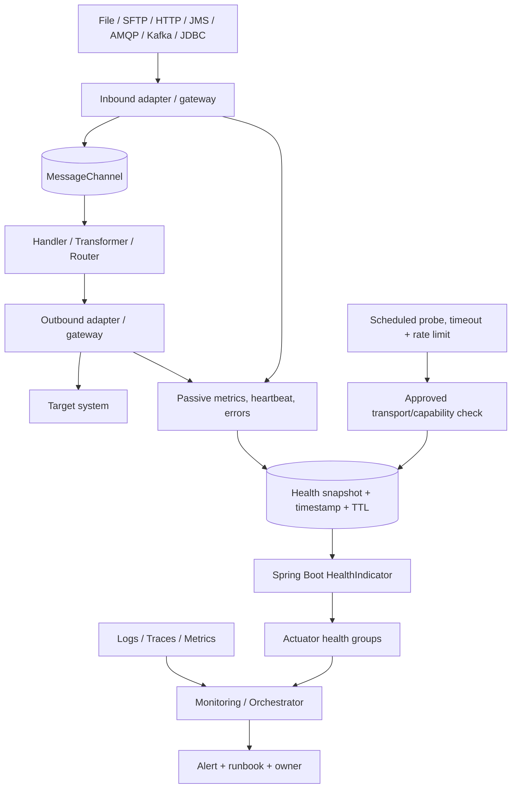
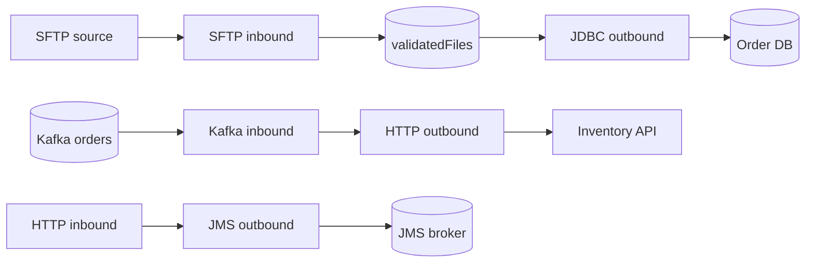

# Health Indicators for External Connections in Spring Integration Adapters

## 1. The Problem: The App Is Running, Yet Adapters Cannot Connect

A **Spring Integration** application can start cleanly, register its `MessageChannel`s, and answer management endpoints while one or more **external system connections** are broken:

- An **SFTP inbound adapter** fails authentication against the partner server; the poller ticks yet downloads no files.
- An **HTTP outbound gateway** times out calling an API or gets `401` due to expired credentials.
- A **Kafka inbound adapter** has a listener bean, yet the consumer cannot fetch metadata or hits authorization errors.
- A **JMS/AMQP listener** is started while the broker is disconnected and queue backlogs grow.
- A **JDBC inbound poller** opens a connection yet lacks permissions to query the business table.
- A **File inbound adapter** loses read permissions on a mounted directory; zero new messages arrive even though files sit in the source folder.
- Internal flows appear intact on the **integration graph**, yet target systems fail to ACK or commit.

In the **Observability** chapter of the `SPRING_INTEGRATION_ADAPTERS` module, a **health indicator for external connections** is a well-defined signal evaluating **the readiness of a specific dependency** and supplying troubleshooting context.

This lesson ties **inbound/outbound adapters, gateways, pollers, and MessageChannels** to **File, SFTP, HTTP, JMS, AMQP, Kafka, and database** flows, focusing on **message contracts, errors, and connection lifecycles**.

After this lesson, you should know how to:

1. Distinguish **liveness**, **readiness**, connectivity status, and business outcomes.
2. Define which check is sufficient to call a dependency **UP**.
3. Build a custom **Spring Boot Actuator `HealthIndicator`** with timeouts and safe details.
4. Choose among **active probes**, **passive signals**, and TTL-backed health snapshots.
5. Assign health signals to the right health groups without causing **restart loops**.
6. Tailor checks for File/SFTP/HTTP/JMS/AMQP/Kafka/JDBC and polling adapters.
7. Combine health with metrics, logs, tracing, integration graphs, and lifecycles.
8. Test failure modes, recovery, and bounding side effects of health checks.

**Core principle:** an `UP` probe proves only that **the tested condition succeeded**—not that every message in the flow reached its destination successfully.

## 2. What Is a HealthIndicator?

In **Spring Boot Actuator**, `HealthIndicator` is the interface through which a component contributes a result to the **health endpoint**. One indicator typically maps to one dependency or independently observable health condition.

For instance, `partnerSftp` can report:

- Can an SFTP session open with valid authentication and host key?
- Can an authorized metadata check run against a canary directory?
- When was the probe result last updated, and is it stale?
- On failure, was it a **timeout**, **authentication**, **DNS**, or **permission** error?
- Is this dependency mandatory for instance readiness?

Common Actuator statuses:

| Status | Interpretation for Checked Condition | Example |
|---|---|---|
| **UP** | Defined probe condition succeeded | HTTP health route returned 2xx within deadline |
| **DOWN** | Required condition failed | Failed to open SFTP session or DB connection |
| **OUT_OF_SERVICE** | Intentionally unavailable per policy | Adapter in planned maintenance if health contract models it this way |
| **UNKNOWN** | Insufficient data to confirm | No snapshot yet or collector result untrusted |

**`UP` does not mean “everything is fine.”** If an indicator only checks HTTP TCP/TLS, it does not prove the business API can write transactions. If a probe only opens a database connection, it does not prove real transactions can commit.

`UNKNOWN` must not be interpreted as `UP` either. Status aggregation rules, HTTP status mappings, and detail visibility depend on Spring Boot/Actuator configuration: verify on your exact application version.

### 2.1. Three Status Layers to Keep Separate

| Layer | Question | Information Source |
|---|---|---|
| **Adapter lifecycle** | Has the endpoint `start()`ed, is `isRunning()` true? | Spring `Lifecycle`, endpoint management |
| **Dependency health** | Does the external dependency satisfy its published check? | `HealthIndicator`, heartbeats, network/protocol probes |
| **Business/flow health** | Are messages processed, ACKed/committed, and completed within SLA? | Metrics, traces, transaction outcomes, broker ACKs, synthetic tests |

A Kafka listener can have `running=true` while the broker is failing. A JMS broker can be reachable while consumers fail to ACK. A file adapter can receive zero files because **no files arrived**, not because the endpoint is broken.

## 3. Liveness and Readiness Are Not Interchangeable

### 3.1. Liveness: Can the Process Still Operate?

**Liveness** indicates whether the process itself is in a broken state requiring a restart to recover. It should not mechanically depend on **external** HTTP/SFTP/broker/database systems.

For example, adding a partner SFTP check to liveness means every partner maintenance window causes the orchestrator to restart all Spring Boot pods. Restarting cannot fix the partner's server and can even trigger a connection storm when the partner comes back.

**Recommendation:** exclude external dependencies from liveness whenever a dependency outage is not an unrecoverable process state.

### 3.2. Readiness: Should This Instance Accept New Work?

**Readiness** indicates whether the instance can fulfill its assigned responsibilities right now.

However, in an integration app running multiple independent flows:

- An SFTP inbound failure might **not affect** HTTP inbound → JMS outbound.
- An HTTP outbound gateway required synchronously by a payment API may be a readiness requirement for that API.
- A Kafka worker may still need to stay alive to drain backlog even when lag climbs; flipping readiness to `DOWN` does not fix lag.
- An endpoint **paused for a maintenance window** must be distinguished from an unplanned outage.

**Readiness is a service-scoped traffic or work-routing decision**, not an arbitrary AND/OR over every dependency in the app.

### 3.3. Readiness Does Not Replace Flow Control

A health endpoint does not automatically:

- Pause Kafka consumers by partition.
- Stop JMS/AMQP brokers from delivering messages to listeners.
- Drain in-flight HTTP requests.
- Drain a `QueueChannel`.
- Commit/roll back JDBC transactions.
- Abort an active SFTP file transfer.
- Trigger retries, circuit breakers, or error channels.

Those actions require **adapter lifecycles, listener/container APIs, timeouts, backpressure, retries, circuit breakers, and runbooks** aligned with transport semantics.

## 4. Health Hierarchy: From Connectivity to Business Outcomes

Never say “healthy” without stating what check was performed.

| Level | Check | Valid Conclusion | What Remains Unproven |
|---|---|---|---|
| **L0 — Configuration** | Beans, endpoints, and properties are valid | Required configuration exists | External connectivity |
| **L1 — Transport** | DNS/TCP/TLS/SSH handshake | Transport-layer communication works | Permissions for required operations |
| **L2 — Protocol** | HTTP route, broker metadata, SFTP list, lightweight DB query | One protocol request succeeded | End-to-end business behavior |
| **L3 — Capability** | Read/write canary resource with least privilege | One specific capability works | All real production requests/transactions |
| **L4 — Business flow** | Synthetic flow verified at target system | Test journey works end-to-end | 100% of real traffic succeeds |

A `partnerHttp=UP` based on `HEAD /health` at **L2** must never be labeled **“payment processing healthy”** without testing payment capability.

Do not run L4 directly inside `HealthIndicator.health()`. Synthetic workflows can mutate data, take seconds, and burn quotas. Typically, **run them separately on a schedule**, store results with a **timestamp/TTL**, and let Actuator read the snapshot.

### 4.1. A Health Contract Should Be Published

```text
dependency_id
owner_team
target_system
adapter_type
probe_level
probe_operation
timeout
interval
max_result_age
expected_result
status_mapping
required_for
probe_permissions
verification_evidence
```

A result lacking **check scope** and **check timestamp** can seriously mislead operations.

## 5. Active Probes, Passive Observation, and Hybrid Designs

### 5.1. Active Probes

An **active probe** sends a fresh request to test a dependency:

- HTTP GET/HEAD to a partner-published probe route.
- Open/close an SFTP session and inspect metadata on a small canary directory.
- Query Kafka metadata via `AdminClient` with a bounded timeout.
- Verify JMS or AMQP broker connection/channel health.
- Open a DB connection and execute a lightweight, least-privilege read-only query.

**Pros:** produces signals even with zero business traffic. **Cons:** adds load, uses credentials, and risks rate limits or side effects.

### 5.2. Passive Observation

**Passive signals** derive from live flow traffic:

- When an SFTP poll actually finishes checking the source.
- When outbound HTTP receives responses.
- When Kafka producers receive publish confirmations.
- When JMS/AMQP listeners hit connection errors.
- When DB connection pools report errors/timeouts.
- Unprocessed message age and retry backlogs.

**Pros:** zero extra requests per dashboard scrape. **Limitation:** zero new files/records **does not mean failure**. Pair with scheduler/connection heartbeats rather than relying solely on `lastMessageAt`.

### 5.3. Hybrid

A practical design typically combines:

1. Lightweight **scheduled probes with bounded concurrency**.
2. A health snapshot storing `status`, `checkedAt`, `reasonCode`, and `TTL`.
3. Passive metrics to catch failures between active probe runs.
4. Infrequent, separately governed synthetic business flows.
5. Alerts when probes produce **no fresh data** or collectors stop running.

Do not keep `UP` indefinitely when the probe scheduler died; conversely, do not treat one transient network blip as cause to restart the whole app.

## 6. Dependency Health Observation Architecture



This is a **recommended architecture diagram**, not something Spring Integration wires automatically. Building a lightweight, TTL-backed probe with passive signals requires deliberate design:

- **Separate health from business request paths:** hitting `/actuator/health` must never ACK messages or create real orders.
- **Enforce deadlines:** never let a hung SFTP session stall the entire HTTP health endpoint.
- **Use bounded execution:** pools, queues, and connections must be capped and monitored.
- **Reuse connections when safe:** avoid opening fresh sessions constantly.
- **Define stale policies:** when snapshots expire, report `UNKNOWN` or `DOWN` per contract.
- **Monitor the health monitor itself:** a silent probe collector is not proof of health.
- **Expose only safe details:** never leak credentials, sensitive hostnames, or raw exceptions.

## 7. Example HealthIndicator for an HTTP Outbound Dependency

Suppose a flow uses an **HTTP outbound gateway** to call a catalog API. We want a **side-effect-free** health route check with short timeouts and no leaked exceptions.

**Java 17+**, Spring Boot Actuator, and JDK `HttpClient` example:

```java
import java.io.IOException;
import java.net.URI;
import java.net.http.HttpClient;
import java.net.http.HttpRequest;
import java.net.http.HttpResponse;
import java.time.Duration;

import org.springframework.beans.factory.annotation.Value;
import org.springframework.boot.actuate.health.Health;
import org.springframework.boot.actuate.health.HealthIndicator;
import org.springframework.context.annotation.Bean;
import org.springframework.context.annotation.Configuration;

@Configuration
public class CatalogHealthConfig {

    @Bean("catalogHttpHealthIndicator")
    HealthIndicator catalogHttpHealthIndicator(
            @Value("${partners.catalog.health-uri}") URI healthUri) {

        HttpClient client = HttpClient.newBuilder()
                .connectTimeout(Duration.ofSeconds(1))
                .followRedirects(HttpClient.Redirect.NEVER)
                .build();

        return () -> {
            HttpRequest request = HttpRequest.newBuilder(healthUri)
                    .timeout(Duration.ofSeconds(2))
                    .method(
                            "HEAD",
                            HttpRequest.BodyPublishers.noBody()
                    )
                    .build();

            try {
                HttpResponse<Void> response = client.send(
                        request,
                        HttpResponse.BodyHandlers.discarding()
                );

                int code = response.statusCode();
                if (code >= 200 && code < 300) {
                    return Health.up()
                            .withDetail("dependency", "catalog-api")
                            .withDetail("probe", "http-head")
                            .build();
                }

                return Health.down()
                        .withDetail("dependency", "catalog-api")
                        .withDetail("reason", "unexpected_http_status")
                        .withDetail("statusClass", (code / 100) + "xx")
                        .build();

            } catch (InterruptedException ex) {
                Thread.currentThread().interrupt();
                return Health.down()
                        .withDetail("dependency", "catalog-api")
                        .withDetail("reason", "probe_interrupted")
                        .build();

            } catch (IOException | RuntimeException ex) {
                // Do not expose sensitive URLs or raw exceptions.
                return Health.down()
                        .withDetail("dependency", "catalog-api")
                        .withDetail("reason", "transport_or_probe_error")
                        .build();
            }
        };
    }
}
```

Configuration:

```yaml
partners:
  catalog:
    health-uri: "https://catalog.example.invalid/health"
```

**Meaning of this example:**

- A bean named `catalogHttpHealthIndicator` is typically registered by Actuator as contributor `catalogHttp`; verify the actual contributor name on your health endpoint.
- Uses a reused `HttpClient` with connect timeout and per-request timeout.
- Treats **2xx** as the explicit pass condition without following redirects.
- If the partner rejects `HEAD` with `405`, switch to a **safe `GET` route provided by the partner**.
- This **blocking `HealthIndicator`** sends an HTTP request on every evaluation. With many pods and frequent scrapes, prefer caching/snapshots or scheduled probes.
- Never take the probed URI from user input. A health endpoint calling arbitrary URLs becomes an SSRF vector into internal networks.
- Never claim `HEAD /health=200` proves `POST /orders` succeeds.

`HealthIndicator` is invoked synchronously for blocking flows. If a reactive app needs non-blocking probes, use `ReactiveHealthIndicator` with reactive clients; **never** run blocking SFTP/JMS clients on an event loop without dedicated schedulers and load bounds.

## 8. Health Snapshots: Avoid Probing on Every Actuator Scrape

For SFTP or strictly rate-limited APIs, opening a connection per HTTP health scrape can cause a **connection storm**. An alternative is a **timeout-bounded scheduler** updating state while `HealthIndicator` reads the latest snapshot.

The simple pattern below tracks **freshness of the last successful transport check**. This core illustration omits the scheduler and latest failure state:

```java
import java.time.Clock;
import java.time.Duration;
import java.time.Instant;
import java.util.concurrent.atomic.AtomicReference;

import org.springframework.boot.actuate.health.Health;
import org.springframework.boot.actuate.health.HealthIndicator;

public final class SftpTransportSnapshotHealth
        implements HealthIndicator {

    private final Clock clock;
    private final Duration maxAge;
    private final AtomicReference<Instant> lastSuccess =
            new AtomicReference<>();

    public SftpTransportSnapshotHealth(
            Clock clock,
            Duration maxAge) {
        this.clock = clock;
        this.maxAge = maxAge;
    }

    // Call only after the probe actually checked the remote endpoint
    // successfully, even if there are no new files.
    public void recordSuccessfulCheck() {
        lastSuccess.set(clock.instant());
    }

    @Override
    public Health health() {
        Instant at = lastSuccess.get();

        if (at == null) {
            return Health.unknown()
                    .withDetail("reason", "no_probe_result_yet")
                    .build();
        }

        Duration age = Duration.between(at, clock.instant());
        if (age.isNegative() || age.compareTo(maxAge) > 0) {
            return Health.down()
                    .withDetail("reason", "probe_stale")
                    .build();
        }

        return Health.up()
                .withDetail("probe", "sftp-transport")
                .build();
    }
}
```

**Warning:** this example is intentionally simplified. If the last check at 10:00 succeeded and the 10:10 check **failed**, this code would still report `UP` until TTL expires. Production implementations should also store **`lastCheckedAt`, `lastOutcome`, and `lastFailureReason`** and flip to `DOWN` immediately when a failure is confirmed per policy rather than waiting solely for TTL expiry.

For SFTP, a probe can open a timeout-bounded session, check a small canary folder, and close the session in `finally`/try-with-resources per library API. Never put passwords, private keys, or sensitive paths into health details.

### 8.1. Calculating Probe Load

Suppose **20 replicas** are each scraped every **10 seconds**; opening a fresh SFTP session on every scrape creates **120 sessions/minute** just for health checks—even more with monitor retries and load balancers.

Reduce load via **TTLs, jitter, sensible probe intervals, connection reuse, and concurrency limits**. On servers with tight session quotas, aggressive probes can cause real outages.

## 9. Health Groups: Dedicated Groups for Dependencies

Illustrative Spring Boot Actuator configuration:

```yaml
management:
  endpoint:
    health:
      probes:
        enabled: true
      group:
        readiness:
          include: "readinessState,catalogHttp"
        integrationDependencies:
          include: "catalogHttp,partnerSftp"
          show-details: when_authorized
  endpoints:
    web:
      exposure:
        include: "health,info,metrics"
```

**Assumptions:** `partnerSftp` is a real registered contributor; otherwise remove it or implement the indicator first. Verify the exact contributor name for `catalogHttp` (from bean `catalogHttpHealthIndicator`) in your running version.

Common paths depending on base path/port:

```text
/actuator/health
/actuator/health/liveness
/actuator/health/readiness
/actuator/health/integrationDependencies
```

Notes:

- Including `catalogHttp` in readiness is a **business decision**, not a universal rule.
- The `integrationDependencies` group lets you inspect multiple dependencies **without marking the entire pod not-ready**.
- Never put external SFTP/Kafka/DB into **liveness**.
- `show-details: when_authorized` must be paired with **Actuator security**; never assume that property alone replaces authentication/authorization and network controls.
- Verify your exact Spring Boot/Actuator version, as endpoint exposure, health groups, and security defaults vary by version and profile.
- When readiness reports `DOWN`, HTTP responses may return **503**; tests should assert **both JSON status and HTTP code**, not only 200.

When multiple independent flows share a process, group by **business capability** or split deployments. An SFTP outage should not take an independent HTTP→JMS flow out of readiness unnecessarily.

## 10. Health Indicators for File Inbound/Outbound Adapters

With a **File adapter**, there is no network connection, yet there are **filesystem dependencies**: mounts, read/write permissions, filters, metadata stores, and schedulers.

| Check | Meaning | What It Fails to Prove |
|---|---|---|
| `Files.isDirectory(path)` | Directory exists | Read/write permissions work |
| Permission & metadata check | Directory is accessible at some level | Business files processed cleanly |
| Poller lifecycle | Endpoint is started | Scheduler polled successfully |
| Last successful poll | Poller actually checked the source | No transformer/downstream errors |
| Outbound write result | File write step produced output | All downstream tasks completed |

**Zero new files** for hours can be completely normal. If a partner sends files only at midnight, alerting on `lastMessageAge > 5 minutes` creates false alarms.

Separate **poller health** from **business arrival SLAs** (e.g., file must arrive before 06:00). Never drop synthetic business files into the live folder watched by an inbound poller just for health checks, as canaries could be processed as real orders.

## 11. Health Indicators for SFTP

SFTP spans DNS, TCP, SSH host-key verification, authentication, remote path permissions, and session lifecycles.

Check levels:

1. **TCP to host:port:** proves network reachability only.
2. **SFTP session:** verifies auth and session creation per policy.
3. **Remote metadata:** lists an authorized canary directory.
4. **Read canary:** verifies bounded read access on a test resource.
5. **Write canary:** verifies write access, requiring cleanup and side-effect handling.

**Never disable host-key verification just to turn a probe green.** When a partner server is down, restarting pods repeatedly rarely helps. Record health, apply jittered retry/backoff, watch session quotas, and verify file filters/metadata stores neither drop nor duplicate files outside contract.

When recovering after an outage, verify **complete file transfers**, adapter temp-file/rename mechanics, pending files, and end-to-end status. `session=UP` alone does not prove files were fully received.

## 12. Health Indicators for HTTP Outbound Gateways

HTTP dependencies can be checked at multiple layers: DNS/TCP/TLS, HTTP status, API permissions, and a representative read-only operation.

| Condition | Interpretation | Investigation Direction |
|---|---|---|
| DNS/TLS error | Cannot establish trusted transport | DNS, proxy, certificates, system clock |
| Timeout | No response within deadline | Latency, network, circuit breaker, downstream |
| 2xx on health route | Specific route handled request | Does not prove business APIs |
| 401/403 | Wrong probe credentials or permissions | Secrets/roles/scopes; never disable auth |
| 429 | Rate limiting/quota exceeded | Lower probe frequency, backoff |
| 5xx | Target returning errors | Service health, retry budget, alerting |

A `200` might actually be an **HTML login page** after a redirect rather than a healthy API response. Use a dedicated route and **verify minimal content/schema** when required by contract. Never let probes invoke order creation, payment, or real email APIs.

## 13. Health Indicators for JMS

JMS inbound/outbound adapters depend on **connection factories, brokers/providers, sessions, listener containers, queues/topics, and acknowledgments**.

| Check Type | Can Prove | Does Not Prove |
|---|---|---|
| Open broker connection | Can connect and authenticate | Listeners are consuming messages |
| Create session/channel | Protocol works for probe account | Permissions exist on all queues/topics |
| Resource metadata | Required queue/topic exists if provider allows | Business processing succeeds |
| Listener `isRunning()` | Container is in running state | Real broker connectivity |
| ACK/transaction metrics | Receive/process outcome in narrow scope | Every message reached downstream |
| DLQ/backlog | Signs of failure and backlog | Single root cause |

A **JMS connection `UP`** while consumers stall can stem from transaction, ack, prefetch, downstream, or filter issues. Never conclude the flow is healthy from a connection check alone.

**Never publish business messages to production queues solely for health checks**. If L3/L4 is needed, use a contracted canary queue/topic with owner, TTL/cleanup, and zero real side effects. Broker `ACK` does not mean rows were written to a database.

When the broker is down, rely on bounded retry/reconnect, queue depth metrics, alerts, and runbooks—not restarting every pod via liveness.

## 14. Health Indicators for AMQP/RabbitMQ

AMQP involves connections, channels, exchanges, queues, routing/bindings, publisher confirms, consumer ACKs/NACKs, and dead-lettering. Each layer offers different guarantees.

| Signal | Interpretation |
|---|---|
| Broker connection succeeded | AMQP endpoint is ready at connection layer |
| Channel created | Protocol session/channel usable |
| Exchange/queue exists | Resource metadata visible with matching permissions |
| Publish confirm | Broker confirmed publish per policy |
| Consumer ACK | Delivery confirmed by consumer per config |
| Queue depth/oldest age | Backlog or slow processing |
| Dead-letter growth | Messages rejected or errored into DLX |

**A reachable broker with a wrong routing key is still an integration failure.** Connection health does not replace exchange/binding contract tests, verifying consumer receipt, or handling destination errors.

When Spring Boot auto-configures a RabbitMQ/connection-factory indicator, check what it actually tests before adding a duplicate indicator. Add custom capability probes only when default health **misses specific requirements**.

## 15. Health Indicators for Kafka

Kafka spans multiple layers: cluster metadata, topics/partitions, producer ACKs, consumer groups, partition assignments, offsets, lag, and DLT/retries.

### 15.1. Choosing Semantically Right Probes

| Layer | Observation Method | Limitation |
|---|---|---|
| Cluster metadata | `AdminClient` with deadline | Does not prove publish/consume works |
| Topic/partition metadata | Verify required topic and permissions | Does not prove payload contract matches |
| Producer callback/ACK | Record real publish outcomes | Past success does not guarantee future sends |
| Consumer assignment | Track listener/container and partition assignment | Does not prove records processed/committed |
| Lag and oldest message age | Track progress and backlog | Not merely broker disconnect |
| Synthetic canary | End-to-end test validation | Needs isolated topic/consumer and no side effects |

**Never create a `KafkaConsumer` that joins the production consumer group on every health scrape**. Such probes trigger rebalances and disrupt partition assignments of real consumers.

A timeout- and quota-bounded **AdminClient** metadata request is far less disruptive, yet still does not reflect business producer/consumer health. When building custom indicators, document clearly that they check metadata only.

### 15.2. Should High Lag Flip Readiness to DOWN?

Not always. A Kafka worker with a growing backlog needs to keep processing to catch up. If readiness `DOWN` only removes the pod from an **HTTP load balancer** while the Kafka listener keeps running, it does nothing to reduce lag.

Distinguish **broker connectivity**, **consumer processing health**, and **business freshness**. For lag, inspect throughput, downstream latency, retries, DLT, partition counts, and concurrency. Use designed listener/pause/backpressure controls instead of expecting readiness to solve lag.

## 16. Health Indicators for JDBC and Databases

Many Spring Boot setups already include a **`DataSource` health contributor**. Before writing a custom indicator, inspect what the default contributor actually checks.

For JDBC inbound/outbound:

- Can the DB connect and run a lightweight query?
- Is the connection pool exhausted or experiencing long pending waits?
- Does the adapter account hold read/write permissions on the target tables?
- Are transactions timing out, deadlocking, or rolling back frequently?
- Is the poller claiming/marking processed rows accurately?
- Does outbound JDBC verify commits to the intended target?

A successful `SELECT 1` proves only that a connection can run a trivial query; it **does not prove** business write transactions succeed.

**Avoid health checks using full table scans or inserting real rows.** If write permissions must be probed, run an infrequent, approved canary inside a cleaned-up transaction. Never let concurrent probes exhaust the connection pool and starve business flows.

### 16.1. When DB Outages Cause Backlogs

A `Kafka inbound → JDBC outbound` flow may fail writes due to pool errors. Marking readiness `DOWN` and restarting pods continuously only causes Kafka redeliveries and more retries without helping the database recover.

Runbooks should combine:

1. DataSource/DB health and transaction errors.
2. Connection pool metrics.
3. Kafka lag, offset commits, and retries/DLT.
4. Bounded intake throttling/buffering plans.
5. Idempotency verification when DB recovers.
6. Reconciliation of actual DB writes.

## 17. Health Matrix for Multi-Transport Applications

Suppose an app hosts three independent flows:



A design matrix:

| Dependency | Primary Probe | Supplementary Signals | Affected Flow |
|---|---|---|---|
| SFTP partner | Session/metadata canary | Last poll, SSH errors, file SLA | File ingest |
| Order database | DataSource/lightweight query | Pool saturation, commits/rollbacks | Order persistence |
| Kafka cluster | Metadata/topic check | Assignment, consumer lag, retries | Event ingest |
| Inventory HTTP API | Read-only HTTP route | Client p95, 429/5xx, outcomes | Inventory sync |
| JMS broker | Connection check | Queue depth, ACK/DLQ | HTTP request → publish |

When SFTP disconnects, it should not automatically mark unrelated HTTP/JMS endpoints in the same app as unready if they operate independently.

Conversely, if a synchronous API **cannot complete** while JMS is down, the broker can be included in readiness for **that API**, per SLO/architecture.

## 18. Combining Health with Lifecycle and Control Bus

**Control Bus** can control a `Lifecycle`-aware inbound endpoint via authorized admin commands:

```text
@sftpOrdersPoller.stop()
```

If an operator **paused** it for maintenance, `isRunning=false` is expected. Health dashboards must not page for an unexpected outage while ignoring operator intent.

| Data | Meaning |
|---|---|
| **Desired state** | Whether the endpoint should be RUNNING or PAUSED |
| **Observed lifecycle** | Whether the bean/listener is currently running or stopped |
| **Dependency health** | Whether SFTP/Kafka/JMS/DB probe is UP/DOWN/UNKNOWN |
| **Processing health** | Backlog, in-flight, retries, and business outcomes |
| **Change/audit record** | Who paused/resumed, why, and when |

For example, `desired=PAUSED` with `observed=STOPPED` represents **valid maintenance**; `desired=RUNNING` with `observed=STOPPED` is drift requiring action.

**Lifecycle `RUNNING` does not mean dependency `UP`.** Likewise, health `UP` does not auto-start a poller that was intentionally stopped.

Across multiple replicas, each process has its own `ApplicationContext`, indicators, and lifecycles. Health on **replica A** does not represent B or C. Dashboards should track instance ID, desired state, and shared dependency status. Scaling out multiplies active probes; apply jitter and per-dependency probe caps.

## 19. Timeouts, TTL, Flapping, and Probe Budgets

A reliable health check needs three bounds:

1. **Timeout:** maximum duration one check may wait.
2. **Interval:** spacing between checks.
3. **Max result age / TTL:** how long a previous result remains valid before turning stale.

For instance, a probe runs every **30 seconds** with a **90-second** TTL. If the scheduler dies after its last success, the snapshot must not stay `UP` until tomorrow. Past TTL, flip to `UNKNOWN` or `DOWN` per contract and alert.

**TTL is not a mechanism for hiding fresh failures.** If a probe explicitly fails at 10:02, do not wait until 10:03:30 to flip `DOWN` just because an older `UP` snapshot hasn't expired.

### 19.1. Bounding Load and Total Response Time

If a health endpoint sequentially checks 6 dependencies with 3-second timeouts each, responses can take nearly 18 seconds plus overhead—breaking fast orchestrator probes.

Mitigations:

- Scheduled probes writing to snapshots.
- Async execution with a **bounded executor** and overall deadline.
- Connection reuse where safe.
- Jitter across instances.
- Avoid probes that write to business systems.
- Throttle probe rate on 429/rate limits.
- Alert on stale snapshots or rising probe failure counters.

### 19.2. Preventing Readiness Flapping

Hysteresis—such as requiring several consecutive failures before `DOWN` and consecutive successes before recovery—can dampen noise. However, for strict synchronous dependencies, delaying too long lets the instance accept work doomed to fail.

Thresholds are **SLO/risk decisions**. There is no universal “3 strikes” rule for every adapter.

| Condition | Handling |
|---|---|
| Single transient timeout | Increment counter; optionally hold status pending verification per policy |
| Consecutive failures | Mark `DOWN` and alert |
| Stale snapshot | Mark `UNKNOWN`/`DOWN`, alert on collector |
| Approved maintenance | `OUT_OF_SERVICE` or dedicated maintenance state |
| Dependency recovers | Success threshold + target/business verification before resume |
| Probe rate-limited | Lower frequency, back off, review quotas and probe scope |

## 20. Metrics, Tracing, Logs, and Graphs Complement Health

Health status is a **summary verdict**, not a replacement for deeper operational signals.

| Signal | Question Answered |
|---|---|
| **`HealthIndicator`** | Does the dependency satisfy probe policy? |
| **Lifecycle** | Is the endpoint/adapter started and running? |
| **Integration graph** | How are adapters, channels, and handlers wired? |
| **Metrics** | What are error rates, throughput, lag, queue age, and p95 latency? |
| **Structured logs** | What failed on a probe/call, when, and with what correlation? |
| **Distributed tracing** | Which operation slowed down across HTTP, brokers, or DB? |
| **Business/audit events** | Did messages ACK/commit and complete business logic accurately? |

**Suggested** application metrics (not default Actuator names):

| Metric | Type | Suggested Labels |
|---|---|---|
| `integration_external_probe_success` | Gauge | `dependency`, `probe_level` |
| `integration_external_probe_duration_seconds` | Timer/histogram | `dependency`, `outcome` |
| `integration_external_probe_failures_total` | Counter | `dependency`, `reason_code` |
| `integration_external_probe_age_seconds` | Gauge | `dependency` |
| `integration_adapter_running` | Gauge | `flow`, `adapter` |
| `integration_poller_last_success_age_seconds` | Gauge | `flow` |
| `integration_queue_oldest_message_age_seconds` | Gauge | `flow`, `queue` |
| `integration_external_call_errors_total` | Counter | `dependency`, `error_category` |

Never put **message IDs, trace IDs, order IDs, unique filenames, or token-bearing URLs** into metric labels: cardinality explodes and leaks data. Specific IDs belong in role-restricted logs/traces.

Health probes can emit spans, though tracing **every scrape** is unnecessary; sampling and aggregate metrics are more efficient. An `OK` probe trace never proves business messages reached the target.

## 21. Testing HealthIndicators with JUnit 5

Separate **status-mapping logic** from connection SDKs for easy unit testing.

### 21.1. Probe Contract

```java
import org.springframework.boot.actuate.health.Health;
import org.springframework.boot.actuate.health.HealthIndicator;

@FunctionalInterface
interface ExternalProbe {
    boolean canUseDependency() throws Exception;
}

final class ExternalDependencyHealthIndicator
        implements HealthIndicator {

    private final ExternalProbe probe;

    ExternalDependencyHealthIndicator(ExternalProbe probe) {
        this.probe = probe;
    }

    @Override
    public Health health() {
        try {
            if (probe.canUseDependency()) {
                return Health.up()
                        .withDetail("probe", "approved-operation")
                        .build();
            }

            return Health.down()
                    .withDetail("reason", "operation_unavailable")
                    .build();

        } catch (Exception ex) {
            return Health.down()
                    .withDetail("reason", "probe_failed")
                    .build();
        }
    }
}
```

This is purely a **mapping layer**: real `ExternalProbe` implementations for HTTP/SFTP/Kafka/JMS/AMQP/JDBC must enforce **timeouts, resource cleanup, and least privilege**. This simple `HealthIndicator` does not time-box a blocking SDK call by itself.

### 21.2. Status Mapping Unit Tests

```java
import static org.junit.jupiter.api.Assertions.assertEquals;

import org.junit.jupiter.api.Test;
import org.springframework.boot.actuate.health.Status;

class ExternalDependencyHealthIndicatorTest {

    @Test
    void healthyProbeReportsUp() {
        var indicator = new ExternalDependencyHealthIndicator(
                () -> true
        );

        assertEquals(Status.UP, indicator.health().getStatus());
    }

    @Test
    void unavailableProbeReportsDown() {
        var indicator = new ExternalDependencyHealthIndicator(
                () -> false
        );

        assertEquals(Status.DOWN, indicator.health().getStatus());
    }

    @Test
    void exceptionReportsDownWithoutLeakingDetails() {
        var indicator = new ExternalDependencyHealthIndicator(
                () -> {
                    throw new IllegalStateException("synthetic failure");
                }
        );

        assertEquals(Status.DOWN, indicator.health().getStatus());
    }
}
```

Unit tests verify `UP/DOWN` mapping only. Integration tests using real test servers/brokers/containers must verify **timeouts, auth, reconnects, transactions, staleness, and absence of side effects**.

### 21.3. Failure Scenario Test Matrix

| Scenario | Expected Outcome |
|---|---|
| HTTP 2xx per contract | `UP` at exact probe level |
| HTTP 401/403/429/5xx | `DOWN`/degraded per policy, safe reason |
| DNS/TLS/timeout | Returns within deadline, never hangs |
| SFTP host-key mismatch | Never disables host-key check to turn `UP` |
| SFTP zero new files | Never falsely reports `DOWN` if poll/transport healthy |
| Kafka metadata error | `DOWN`, never joins group causing rebalance |
| JMS/AMQP broker down | Probe reflects connection failure; ACK/queue tracked separately |
| JDBC pool exhausted | Health check does not worsen prolonged pool starvation |
| Stale snapshot | `UNKNOWN`/`DOWN`, never stays `UP` |
| No probe result since startup | `UNKNOWN` or startup state per policy |
| Endpoint intentionally paused | Distinguishes planned maintenance from outage |
| Concurrent scrapes | Never opens unbounded sessions/connections |
| Business flow fails while probe is UP | Dashboard separates health from business outcomes |
| Multi-replica | Each instance accurately reflects its own state |
| External dependency down | Never causes pod restart loops via liveness |
| Unauthorized health access | Never leaks details/credentials |
| Dependency recovers | Reports flow recovered only after end-to-end verification |

### 21.4. Verifying via Actuator

In an **authorized test environment**:

```bash
curl --silent http://localhost:8080/actuator/health
curl --silent http://localhost:8080/actuator/health/readiness
curl --silent http://localhost:8080/actuator/health/integrationDependencies
```

When health is `DOWN`, Actuator typically returns **HTTP 503** by default/config; `curl --fail` can fail the command even while the JSON body accurately describes the status. Tests should assert **both HTTP status and JSON health/group content**.

Never embed bearer tokens or secrets in publicly shared commands. Production management endpoints require network controls, TLS, authentication, and authorization.

## 22. Runbook for Investigating a Stalled Flow

Suppose **SFTP inbound → transformer → JDBC outbound** produces no new DB rows.

**Step 1 — Scope the incident:** instance, flow, start time, affected file count, SLA, and maintenance status.

**Step 2 — Check health:** are SFTP and DataSource `UP`/`DOWN`/`UNKNOWN`? Are snapshots stale? Did the probe test L1, L2, or L3?

**Step 3 — Check lifecycle:** is the inbound poller running, or paused via Control Bus? If paused for approved maintenance, do not auto-start it.

**Step 4 — Inspect the source:** SFTP session, host key, directory, permissions, file filters, metadata store, and last successful poll.

**Step 5 — Trace MessageChannels:** are messages entering the post-inbound channel? Are validators/transformers rejecting them? Are error channels, retries, and queues backing up?

**Step 6 — Inspect the target:** DataSource pool, JDBC transactions, locks, rollbacks, schema, and permissions; connection `UP` does not prove commits.

**Step 7 — Contain:** if SFTP is failing, back off/pause per runbook; if DB is failing, hold/buffer/retry with bounded queues and idempotency—never wipe backlogs.

**Step 8 — Recover:** once probes turn `UP` and lifecycle matches, run an authorized test file and **verify the row actually lands in the DB**.

**Step 9 — Measure drain:** backlog and file age drop, error rates stay normal, and no unexpected duplicates appear.

**Step 10 — Save evidence:** probe outage/recovery timeline, operational decisions, root cause, and monitoring improvements to prevent recurrence.

## 23. Common Anti-Patterns

1. **Putting every dependency into liveness:** third-party outages trigger endless pod restarts.
2. **Treating `isRunning()` as network health:** beans can run while external connections fail.
3. **Treating TCP open as business success:** misses auth, resource permissions, and commits.
4. **Probes with side effects:** creating real orders, writing real files, or ACKing live messages.
5. **Opening SFTP sessions on every scrape:** causes connection storms/rate limits.
6. **Omitting timeouts:** health endpoints hang when partners drop packets.
7. **Unbounded concurrency:** health checks exhaust threads/pools.
8. **Keeping `UP` forever:** collector dies while dashboards stay green.
9. **Using last message time as poller health:** quiet periods look like failures.
10. **Failing to separate critical vs. optional dependencies:** one broken flow drags down unrelated flows.
11. **Using readiness to pause Kafka listeners:** readiness does not replace broker APIs.
12. **Letting Kafka health consumers join real groups:** triggers rebalances.
13. **Heavy DB health queries:** slow down real business transactions.
14. **Disabling TLS/host-key checks for green probes:** sacrifices security.
15. **Exposing Actuator details publicly:** leaks internal URLs, brokers, exceptions, credentials.
16. **Returning raw secrets in responses/logs:** security leak.
17. **Missing error categories:** on-call cannot tell auth, network, and schema errors apart.
18. **Equating health UP with Kafka ACK/JDBC commit:** skips transaction verification.
19. **Restarting pods instead of handling downstream outages:** increases duplicates and recovery time.
20. **Ignoring desired `PAUSED` state:** planned maintenance looks like a crash.
21. **Skipping failure/recovery tests:** only verified in sunny-day labs.
22. **Judging the whole cluster by one replica:** misses per-node state and assignments.
23. **Putting message IDs in metric labels:** high cardinality.
24. **Omitting probe scope/level:** readers mistake L1 for L4.
25. **No owner/runbook:** health goes `DOWN` and nobody acts.

## 24. Self-Check Questions

**Question 1.** An SFTP partner undergoes 2-hour maintenance. Because the SFTP indicator is in liveness, Kubernetes keeps restarting pods. What is wrong?

**Answer:** Liveness is coupled to an external dependency that restarting the process cannot fix. Move SFTP to a dependency/readiness group where appropriate and use retries/backoff/alerts instead of restart loops.

**Question 2.** A Kafka `HealthIndicator` queries metadata successfully while the consumer has not committed an offset for an hour. Is the `UP` indicator wrong?

**Answer:** Not necessarily. Metadata checks only cluster/protocol reachability at one level, not consumer processing. Inspect assignments, lag, retries/DLT, broker ACKs, and downstream.

**Question 3.** An SFTP adapter receives no files from 08:00 to 18:00 while the partner sends files at 00:00. Should `lastMessageAt` mark it `DOWN`?

**Answer:** No. Quiet hours may match schedule. Monitor poll heartbeats/transport probes separately from file-arrival deadlines.

**Question 4.** An HTTP health route returns 200 while the payment API repeatedly returns 403. Can you conclude payments are healthy?

**Answer:** No. A 200 health route proves only that specific probe. Verify credentials/capabilities or business outcomes via approved checks.

**Question 5.** Thirty pods each open an SFTP session every 5 seconds for health checks. What is the risk?

**Answer:** Connection storms, hitting session quotas, load spikes, and self-inflicted outages. Use scheduled probes, TTLs, jitter, pooling/reuse, and concurrency caps.

**Question 6.** One pod runs three independent flows: SFTP, Kafka, and HTTP→JMS. When SFTP goes down, must the entire pod's readiness go `DOWN`?

**Answer:** Not necessarily. Decide based on how traffic is routed and service scope; separate health groups or deployments when flows are independent.

**Question 7.** DataSource health is `UP`, yet JDBC outbound rolls back due to database locks. Is health broken?

**Answer:** Not necessarily. Lightweight connections/queries do not test real transaction commits. Check transaction logs, pool metrics, and business outcomes.

**Question 8.** A snapshot turned `UP` at 10:00, the scheduler died at 10:01, and at 12:00 it still reports `UP`. What is missing?

**Answer:** A TTL/max result age and an alert on collector freshness.

**Question 9.** Kafka consumer lag is rising. Marking the pod not-ready on the HTTP load balancer will fix the lag?

**Answer:** Unlikely; the Kafka listener may still keep running. Find the bottleneck and adjust consumer/backpressure/downstream via proper APIs.

**Question 10.** You want to verify a JMS broker accepts messages without creating real orders. What should you do?

**Answer:** Run a connection check or use a dedicated canary queue/topic with a contract, measuring publish/ACK and cleanup—never test on live business queues.

**Question 11.** An endpoint was paused via Control Bus and `isRunning=false`. Is a dashboard flagging an outage accurate?

**Answer:** Check desired state. If `PAUSED` is approved and observed is `STOPPED`, it is intentional maintenance; keep monitoring in-flight work and backlogs.

**Question 12.** Does an L2 `UP` probe prove all messages were ACKed/committed?

**Answer:** No. Obtain adapter, broker, database, and business verification evidence separately.

## 25. Implementation Checklist

- [ ] Each dependency has a clear **owner, criticality, scope, and probe level**.
- [ ] Separated **liveness, readiness, dependency health, and business health**.
- [ ] Excluded external dependencies from liveness when restarts cannot fix them.
- [ ] Defined status mappings for `UP`/`DOWN`/`OUT_OF_SERVICE`/`UNKNOWN`.
- [ ] Configured **timeouts, intervals, TTLs, concurrency limits, and failure policies**.
- [ ] Documented which indicators are active, passive, or hybrid.
- [ ] Verified probes never cause business side effects or ACK/commit real messages.
- [ ] File/SFTP probes do not treat zero new files as a default error.
- [ ] HTTP probes hit approved routes only and never accept user-supplied URLs.
- [ ] JMS/AMQP health never drops messages or alters ack semantics.
- [ ] Kafka probes never join production consumer groups unintentionally.
- [ ] JDBC health never runs full scans or starves connection pools.
- [ ] Health groups reflect required flows/dependencies without dragging down unrelated flows.
- [ ] Management endpoints are secured; secrets, tokens, and PII are never logged.
- [ ] Metrics cover probe latency, failures, freshness, queue/lag, and business outcomes.
- [ ] Runbooks exist for `DOWN`, `UNKNOWN`, stale snapshots, and dependency recovery.
- [ ] Tested timeouts, invalid credentials, broker disconnects, maintenance, and multi-instance behavior.
- [ ] Verified proper **end-to-end confirmation** once health flips back to `UP`.
- [ ] Verified APIs, auto-configured indicators, and properties against the **exact Spring Boot/Spring Integration version** in the project.

## Key Takeaways

**Health indicators for external connections** in Spring Integration Adapters should report **the exact capability verified**, not merely bean state or an arbitrary TCP handshake. Use **Spring Boot Actuator `HealthIndicator`**, separate **liveness from readiness**, apply **active/passive/hybrid** probes with **bounded timeouts, TTLs, and load**, and pick checks suited to **File, SFTP, HTTP, JMS, AMQP, Kafka, and JDBC**. Health never replaces **poller heartbeats, MessageChannels, adapter lifecycles, ACK/offset commits, transactions, error flows, metrics, tracing, or target business verification**. Good observability **accurately detects connection failures, never triggers self-inflicted outages from health checks, and supports evidence-based recovery**.
