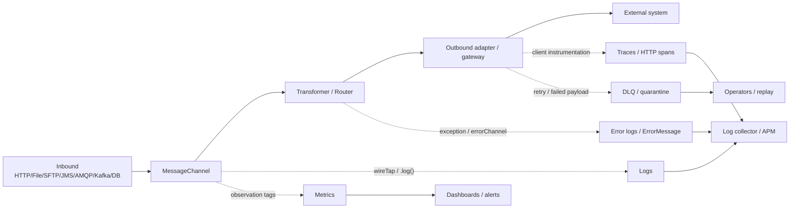
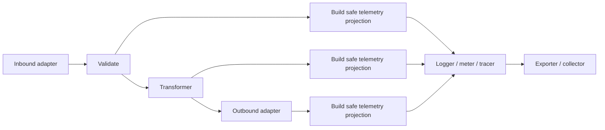
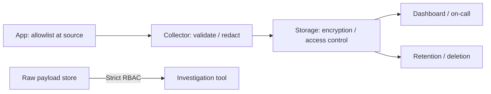
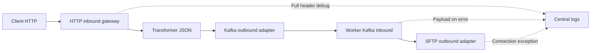

# Masking Credentials and Sensitive Data

## 1. Why Can Observability Become a Data Leak Path?

A Spring Integration system receives customer data through an HTTP inbound gateway, transforms payloads, sends files via SFTP, publishes events to Kafka, and persists status to a database. When an error occurs, an engineer turns on DEBUG logging and adds a `wireTap` to inspect every `Message<?>`.

The resulting records are very helpful: request URLs, headers, payloads, response bodies, exceptions, and routing info. Yet they may also contain:

- `Authorization: Bearer ...`, `Cookie`, `Set-Cookie`, API keys, and client secrets.
- SFTP connector passwords or connection URIs containing usernames/passwords.
- Invoice contents, full names, addresses, emails, phone numbers, or payment details.
- Kafka record bodies or JMS/AMQP properties holding sensitive data.
- File paths embedding customer IDs, usernames, or contract identifiers.
- SQL bind parameters containing personal data.
- Exception messages/stack traces accidentally printing raw payloads or full URLs with tokens.

Logs, traces, metrics, DLQs, and dashboards are typically **retained longer, replicated, searched, and shared more broadly than source systems**. A change meant for “temporary debugging” can turn secrets into widely accessible data inside centralized systems.

**Masking credentials and sensitive data in observability** is a design that **captures sufficient evidence about integration flow state** while **never exposing unnecessary values** across logs, traces, metrics, alerts, error channels, dead-letter queues, or operational tools.

This lesson belongs to the **Observability** chapter of the `SPRING_INTEGRATION_ADAPTERS` module. Its scope covers **inbound/outbound adapters, gateways, pollers, and MessageChannels** connecting File, SFTP, HTTP, JMS, AMQP, Kafka, and databases, focusing on message contracts, errors, and connection lifecycles.

> **Priority rule:** Never collecting secrets in the first place is far better than collecting everything and regex-masking afterward. **Observability data allowlists**, source-side redaction, and proper access controls are complementary layers of defense.

## 2. Goals of a Safe Observability System

Observability does not need raw business payloads to answer critical questions:

1. Which adapter and channel did a message traverse, and when?
2. At which step was it received, transformed, sent, confirmed, or failed?
3. Was the error a contract, authorization, network, timeout, serializer, or target failure?
4. Were there retries, redeliveries, backlogs, or dead-lettering?
5. Did the message match the expected schema version and content type?
6. How much time was spent in transformers, queues, pollers, and outbound I/O?
7. How many messages were processed twice or arrived late?
8. Who is authorized to view detailed diagnostic data during an incident?

### Comparing Unsafe vs. Useful Logs

**Unsafe:**

```text
ERROR Sending request to https://partner.example/api?api_key=sk-live-EXAMPLE
headers={Authorization=Bearer eyJ..., Cookie=session=...}
payload={customerEmail="a@example.com", phone="+84...", paymentToken="..."}
java.lang.RuntimeException: Failed with request body {...}
```

**Better approach:**

```text
level=WARN event=integration.outbound.failed
flow=orders-export adapter=http-partner
messageRef=evt_7e91 correlationId=corr_81b2
payloadType=OrderExportV2 payloadBytes=842 schemaVersion=2
failureClass=TIMEOUT retryable=true attempt=2
elapsedMs=3000
```

This example uses synthetic IDs with zero real credentials. Even `messageRef` or `correlationId` must still be **safely generated/validated**—never take sensitive data and merely rename it as an “ID.”

## 3. Distinguishing Credentials, Secrets, Sensitive Data, and Metadata

| Category | Examples | Risk If Exposed | Default Recording Policy |
| --- | --- | --- | --- |
| **Authentication credentials** | Passwords, API keys, private keys, client secrets | Account takeover or client impersonation | Never log values |
| **Bearer artifacts** | OAuth access/refresh tokens, session cookies, PATs | Anyone holding the token can act within its active scope | Never log; revoke if exposed |
| **Personal data** | Full names, emails, phone numbers, addresses | Privacy breach, identity linkage | Do not log payloads; retain minimal justified fields only |
| **Financial data** | Account numbers, cards, invoices, transaction amounts | Fraud, business secret disclosure | Do not log directly; follow industry/business policy |
| **Sensitive internal info** | Internal topology, private hostnames, authorization policies | Reveals architecture and attack surface | Log only with clear purpose and access limits |
| **Binary payloads** | PDFs, images, ZIPs, CSV/JSON holding customer data | Copies raw data into telemetry | Log size, kind, and verified ID; never dump bytes |
| **Operational metadata** | Adapter, stage, error code, retry count, duration | Generally less sensitive yet still linkable | Allowlist, control cardinality and retention |
| **Observability identifiers** | Opaque event ID, trace ID, correlation ID | Can be used to correlate or link records | Ensure zero PII; never use secrets as IDs |

A **credential** is something used to prove authority; a **secret** is information that must stay confidential, which may or may not be a credential. **PII/personal data** is information relatable to an individual; even a customer ID can become personal data when linkable to an identity.

No single keyword list catches all sensitive data. **Classify by data context and processing purpose**, rather than just searching for the word “password.”

## 4. Leak Surfaces in Spring Integration



Copies of sensitive data can surface in:

- Spring Integration `.log()`, `LoggingHandler`, `wireTap`, and logging channels;
- SLF4J/Logback/Log4j frameworks invoking object `toString()`;
- `ErrorMessage`, `MessagingException.getFailedMessage()`, and stack traces;
- HTTP client/server interceptors, request/response logging, and HTTP wire logging;
- JMS message converters, AMQP listener errors, and Kafka deserializers/recoverers;
- SFTP/file exceptions containing paths, filenames, or URLs;
- JDBC/ORM SQL logging and bind parameters;
- Micrometer observations, OpenTelemetry spans, baggage, and exporters;
- Error queues, dead-letter topics, quarantines, object storage, and snapshots;
- Support tickets, incident chats, alert payloads, and dashboard screenshots.

**A clean application flow with a log collector storing raw payloads is still unsafe.** Enforce controls across the entire telemetry pipeline.

## 5. Defense Strategy in Order of Priority

| Technique | Meaning | Priority |
| --- | --- | --- |
| **Do not collect** | Never put secrets/PII into logs/traces/metrics | Highest |
| **Allowlist** | Pick only permitted operational fields | Very high |
| **Data minimization** | Keep only details needed for the purpose | Very high |
| **Redaction** | Strip entire value, replace with a constant | High |
| **Masking** | Show only permitted portion, e.g., `****` | Only when specifically needed |
| **Pseudonymization/tokenization** | Use governed surrogate tokens | Depends on linkability and risk |
| **Hash/HMAC** | Generate fingerprint when reconciliation is needed | Assess re-identification risk and key management |
| **Telemetry RBAC** | Restrict who reads logs/traces/queues | Mandatory, never replaces redaction |
| **Encryption/retention** | Protect storage and auto-purge after expiry | Mandatory per data classification |
| **Collector-side redaction** | Catch leaks escaping from sources | Secondary defense, never the sole layer |

### Redaction Differs from Masking

- **Redaction:** `Authorization=[REDACTED]`; reveals neither length nor any part of the value.
- **Masking:** `account=****4321`; still reveals partial characters; use only if policy and purpose permit.
- **Tokenization:** `customerRef=c_91f...`; ensure tokens do not reveal identity directly.
- **Hash:** `sha256(email)` can be reversed against common email dictionaries. If stable identification without raw data is truly needed, consider **key-managed HMAC** with linkability risk analysis—though dedicated opaque IDs remain preferable.

**Never use Base64 or keyless encoding as a hiding measure.** Base64 decodes trivially.

## 6. Separate the Observability Contract from the Message Contract

A `Message<Order>` can hold the entire business payload. The observability contract should be a **small, independent record**.

| Observation Field | Should Use? | Reason |
| --- | --- | --- |
| `flowName`, `adapterName` | Yes, from governed catalog | Pinpoints failure location |
| `stage` | Yes | Identifies receive/transform/send step |
| `eventId` opaque | Yes, if free of sensitive data | Tracing and dedup |
| `correlationId` opaque | Yes | Links multiple steps |
| `schemaVersion` | Yes, from supported schemas | Spots mismatches |
| `payloadType` | Yes, allowlisted types | Spots wrong converters |
| `payloadBytes` | Yes, size only | Tracks limits |
| `durationMs`, `attempt`, `status` | Yes | Measures reliability |
| `errorCode` normalized | Yes | Classifies failures |
| `Authorization`, `Cookie` | No | Credentials |
| `customerEmail`, `phone` | No by default | Personal data |
| `requestBody`, `responseBody` | No by default | May contain secrets/PII |
| `fullUrl` with query | No by default | Queries may hold tokens/PII |
| `exception.getMessage()` | No by default | Often echoes bodies, URLs, or SQL |
| `headers.toString()`, `message.toString()` | No | Can print full contents |

### What a Safe Log Event Should Answer

```json
{
  "event": "integration.message.failed",
  "flow": "invoice-sftp-export",
  "adapter": "sftp",
  "stage": "upload",
  "messageRef": "evt_7e91",
  "payloadType": "InvoiceExport",
  "payloadBytes": 2048,
  "failureCode": "REMOTE_TIMEOUT",
  "retryable": true,
  "attempt": 3,
  "elapsedMs": 5000
}
```

Values are illustrative. A logging pipeline can use JSON structured logs, yet **must never serialize the entire Spring Message to JSON** and call it safe.

## 7. Data Sources and Header Trust Boundaries

Spring Messaging separates a message into `payload` and `MessageHeaders`; many headers are framework-generated, while others originate from clients or adapters.

```text
Message<OrderCreated>
├── payload: {customerEmail, billingAddress, paymentToken, ...}
└── headers:
    ├── id
    ├── timestamp
    ├── correlationId
    ├── contentType
    ├── Authorization          <-- unsafe
    ├── X-Api-Key              <-- unsafe
    ├── remoteFileName         <-- may contain PII
    └── replyChannel           <-- internal reference
```

**Risk is not confined to payloads.** Sensitive data can appear in many places:

- HTTP headers: `Authorization`, `Proxy-Authorization`, `Cookie`, `Set-Cookie`, `X-API-Key`, custom signatures;
- Query parameters: `token`, `code`, `signature`, `password`, `access_key`, email;
- Kafka headers, AMQP properties, JMS properties holding business metadata or secrets;
- Filenames, remote paths, object keys named after customer names/contracts;
- Correlation IDs set by producers to emails or account numbers;
- `replyChannel`, `errorChannel`, connection/session contexts—internal objects never meant for telemetry.

### Header Allowlist Over Blacklist

A **blacklist** tries to guess every secret header name and misses `PartnerAuth`, `x-session`, `SAS-token`, or new keys.

An **allowlist** accepts only approved fields: `flow`, `stage`, `schemaVersion`, validated `eventId`, and `attempt`. Other headers **must not enter logs** without explicit review.

Even allowlisted headers must be checked for **type, length, and content**, preventing clients from stuffing newlines, private data, or giant strings into a field named `correlationId`.

## 8. Spring Integration `.log()`, `wireTap`, and `LoggingHandler`

Spring Integration offers convenient message-inspection tools:

- DSL `.log(...)` inserts a logging handler into a flow.
- `wireTap` tees message copies to an observation channel.
- `LoggingHandler` formats and logs message info.
- `MessageHistory` records traversed components when enabled.

They are handy for debugging, yet **should never log full messages by default** when payloads or headers may contain sensitive data.

### Anti-Pattern

```java
// Example of WHAT NOT TO DO for sources with sensitive data:
log.info("Received message: {}", message);
log.debug("Payload: {}", message.getPayload());
log.debug("Headers: {}", message.getHeaders());
```

For DTOs whose `toString()` prints emails/tokens, the object leaks directly into logs. For `Message<?>`, logging the object can print both payload and headers depending on implementation.

### Be Careful with wireTap

```text
main flow -> wireTap(rawMessage) -> loggingChannel
                              -> logger(message.toString())
```

This pattern **creates another path handling raw data**. Logging channels, queues, or handlers could buffer messages holding secrets. If `wireTap` is needed, design the observation channel to receive only **sanitized projections** instead of raw messages, or use an interceptor/handler that never creates durable copies holding raw payloads.

**MessageHistory** tracks component paths, yet component/channel names or attached attributes can still be sensitive. Never treat it as license to log all headers freely.

## 9. Java Pattern: Log Only Permitted Operational Fields

To avoid depending on what `Message.toString()` prints, write a helper reading only permitted fields and **never converting the payload to String**.

```java
import java.nio.charset.StandardCharsets;
import java.util.Set;
import java.util.regex.Pattern;
import org.slf4j.Logger;
import org.slf4j.LoggerFactory;
import org.springframework.messaging.Message;

public final class SafeIntegrationTelemetry {
    private static final Logger log =
        LoggerFactory.getLogger(SafeIntegrationTelemetry.class);

    private static final Pattern OPAQUE_ID =
        Pattern.compile("[A-Za-z0-9_-]{1,64}");

    private static final Set<String> SAFE_STAGES =
        Set.of("received", "validated", "transformed",
               "sent", "failed", "quarantined");

    private SafeIntegrationTelemetry() {}

    public static void record(
            Message<?> message, String trustedFlow, String stage,
            String failureCode, long elapsedMs) {

        // trustedFlow must come from config/constant, never from client input.
        if (!SAFE_STAGES.contains(stage)) {
            throw new IllegalArgumentException("Unsupported stage");
        }

        Object eventId = message.getHeaders().get("eventId");
        String messageRef = safeOpaqueId(eventId);

        Object payload = message.getPayload();
        String kind = payload instanceof byte[] ? "binary"
            : payload instanceof String ? "text"
            : "dto";

        long bytes = payload instanceof byte[] b ? b.length
            : payload instanceof String s
                ? s.getBytes(StandardCharsets.UTF_8).length
                : -1L;

        log.info(
            "integration.flow={} stage={} messageRef={} payloadKind={} " +
            "payloadBytes={} failureCode={} elapsedMs={}",
            trustedFlow,
            stage,
            messageRef,
            kind,
            bytes,
            safeFailureCode(failureCode),
            Math.max(0, elapsedMs)
        );
    }

    static String safeOpaqueId(Object raw) {
        if (!(raw instanceof String value)
                || !OPAQUE_ID.matcher(value).matches()) {
            return "unavailable";
        }
        return value;
    }

    static String safeFailureCode(String code) {
        return switch (code == null ? "NONE" : code) {
            case "NONE", "TIMEOUT", "CONTRACT_INVALID",
                 "REMOTE_DENIED", "BROKER_UNAVAILABLE" ->
                     code == null ? "NONE" : code;
            default -> "OTHER";
        };
    }
}
```

### Assumptions Requiring Extra Protection

- `trustedFlow` is a **trusted constant**, never taken from a request header. For untrusted sources, map onto an allowed flow list.
- `eventId` is used only if it is an **opaque ID** per contract. Syntactic regex compliance **does not prove** zero PII; enforce constraints where IDs are minted.
- `payloadBytes=-1` means **size could not be measured from the current type**, not 0 bytes.
- `failureCode` is restricted to known codes, preventing arbitrary error strings from carrying secrets.
- For huge payloads, `String.getBytes()` purely to measure length copies memory unnecessarily; prefer sizes already measured at codecs/adapters rather than re-encoding just to log.
- The snippet uses modern Java syntax (`instanceof` pattern matching, switch expressions); adjust if your project runs an older JDK.
- Do not attach this helper blindly to every channel: pick exact observation points to avoid duplicate logs.

**Key takeaway:** the code above **never logs intact `message`, `payload`, or `headers`**.

## 10. Attaching Observability to Flows Without Exposing Raw Messages

One approach is recording a safe event right before or after a transformer/handler as appropriate, without creating a logging consumer that receives the raw message.

Example service method that observes while returning the object for the next step:

```java
public final class ObservedOrderTransformer {
    private final OrderExportMapper mapper;

    public ObservedOrderTransformer(OrderExportMapper mapper) {
        this.mapper = mapper;
    }

    public OrderExportDto convert(
            org.springframework.messaging.Message<Order> message) {
        OrderExportDto result = mapper.toExternalDto(message.getPayload());
        SafeIntegrationTelemetry.record(
            message, "orders-export", "transformed", "NONE", 0);
        return result;
    }
}
```

`Order`, `OrderExportDto`, and `OrderExportMapper` are application classes in this example, not Spring Integration APIs. In real implementations:

1. Emit the observation at the exact right moment (before transform use `received`/`transforming`; use `transformed` only after completion as shown).
2. Never pass DTOs/payloads to a logger just to “observe.”
3. To measure real latency, wrap the operation in a timer instead of hardcoding `0`.
4. If using `wireTap`, consider forwarding only a **sanitized event DTO**, never the raw business message.
5. Ensure logging never alters business outcomes or triggers retries due to non-critical telemetry failures.

### Logical Flow Pattern



Arrows pointing to telemetry represent **field-selected projections**, not automatic message copies.

## 11. What Can `errorChannel`, `ErrorMessage`, and Exceptions Expose?

In Spring Integration, when an async/polling endpoint fails, an `ErrorMessage` can wrap a `Throwable`. A `MessagingException` can reference the **failed message** with its full payload and headers.

Risk:

```java
// Unsuitable for production when messages contain sensitive data:
log.error("Integration failure: {}", errorMessage);
log.error("Failure", errorMessage.getPayload());
```

The second call prints a **stack trace**. A stack trace itself doesn't always hold secrets, yet exception messages or nested causes may echo token-bearing URLs, JSON bodies, SQL values, or headers.

### Safe Handling Rules

- Log only **error category/code, stage, adapter, messageRef**, retry attempt, and timestamp.
- Never write raw `Throwable.getMessage()` to centralized telemetry without sanitization.
- Never log intact `MessagingException.getFailedMessage()`.
- `exception.getClass().getSimpleName()` can aid classification, yet keep tags bounded and avoid leaking internal classes on public channels.
- Deep diagnostic details belong in a **restricted store** with redaction/retention policies, never general logs by default.
- When no ID exists because failure occurred before message creation, use an operational ID from the adapter/container or generate an independent correlation ID.

### Sample Safe Error Record

```text
WARN event=integration.message.failed
flow=invoice-upload adapter=sftp
messageRef=evt_a182 stage=remote-write
failureCode=REMOTE_PERMISSION_DENIED
attempt=1 retryable=false
```

For `403` or `permission denied` errors, you do not need to log passwords or full connection strings to find the root cause.

## 12. Java Pattern: Handling ErrorMessage with Controlled Error Codes

```java
import org.slf4j.Logger;
import org.slf4j.LoggerFactory;
import org.springframework.integration.annotation.ServiceActivator;
import org.springframework.messaging.MessagingException;
import org.springframework.messaging.Message;
import org.springframework.messaging.support.ErrorMessage;
import org.springframework.stereotype.Component;

@Component
public class SafeIntegrationErrorObserver {
    private static final Logger log =
        LoggerFactory.getLogger(SafeIntegrationErrorObserver.class);

    @ServiceActivator(inputChannel = "integrationErrorChannel")
    public void observe(ErrorMessage error) {
        Throwable failure = error.getPayload();
        Message<?> failed = failure instanceof MessagingException e
                ? e.getFailedMessage()
                : null;

        String messageRef = failed == null
                ? "unavailable"
                : SafeIntegrationTelemetry.safeOpaqueId(
                      failed.getHeaders().get("eventId"));

        String category = classify(failure);

        // DO NOT log 'failure' as Throwable, message, or headers.
        log.warn(
            "integration.failure flow={} category={} messageRef={}",
            "orders-export",
            category,
            messageRef
        );
    }

    private String classify(Throwable failure) {
        if (failure instanceof IllegalArgumentException) {
            return "CONTRACT_INVALID";
        }
        // Real error policies should classify based on trusted classes/causes.
        return "UNCLASSIFIED";
    }
}
```

**Mandatory note:** this bean receives errors only if endpoints/recoverers are configured to route `ErrorMessage` to `integrationErrorChannel`. In synchronous `DirectChannel` flows, exceptions may propagate back to callers; never assume one error-channel listener observes everything automatically.

This sample is purely an **error observer**—it does not provide retries, dead-letter durability, or acknowledgments. If an error handler persists to a DLQ, isolate durable persistence and verify commit before treating the failure as “parked.”

## 13. HTTP Adapters and Gateways: Highest-Sensitivity Points

HTTP exchanges URLs, methods, headers, request/response bodies, and statuses. When using inbound/outbound gateways, watch:

| Data | Dangerous Example | Safe Logging Approach |
| --- | --- | --- |
| `Authorization` | `Bearer token...` / Basic secret | Never log; log auth mode or status only |
| `Cookie` / `Set-Cookie` | Session IDs | Never log |
| Custom API key headers | `X-Api-Key: ...` | Never log |
| Query strings | `?token=...&email=...` | Log route template, never query |
| Full request URLs | Signed URLs / SAS queries | Log configured host alias or route ID |
| Request bodies | JSON with personal records | Log schema, size, and safe ID only |
| Response bodies | API returns access tokens or data | Log status, media type, size only |
| Redirect Locations | URLs carrying OAuth codes/queries | Never log raw value |
| Exception messages | May echo full URLs/bodies | Classify and redact before logging |

### Never Log Basic Auth Even Though It's “Only Base64”

HTTP Basic credentials are Base64-encoded, not encrypted. Printing a Basic header prints trivially decodable credentials.

### Route Templates Are Better Than Full URLs

Example:

```text
Unsuitable:
requestUrl=https://api.example/customers/087.../orders?access_token=...

Suitable:
remoteSystem=customer-api
route=POST /customers/{customerId}/orders
status=429
durationMs=512
```

Even `customerId` in a path can be PII; use route templates or safe reference IDs instead of raw paths.

### HTTP Client Wire Logging

Some HTTP clients offer wire/debug modes logging all headers and bodies. **Never enable broadly in production** just to track latency. When temporary diagnostics are necessary, enforce TTLs, narrow scope, approvals, source redaction, and pre-enablement tests.

## 14. File and SFTP Adapters: Filenames and Paths Can Be Sensitive Too

Example of a file named after personal data:

```text
/sftp/out/customer-nguyen-van-a-2026-11-23-invoice.pdf
```

Even without logging file contents, the path reveals a person's name and invoice details.

### File Inbound/Outbound

Do not log:

- File contents or arbitrary hex dumps.
- Absolute paths containing user folders, tenant data, or contract identifiers.
- Filenames if filenames themselves hold PII.
- Exceptions carrying full paths or payloads.

Do log:

```text
adapter=file-inbound stage=read
fileRef=file_98a5 extension=csv sizeBytes=182920
result=validated
```

`fileRef` must be a safely generated/mapped identifier, not merely the original filename.

### SFTP Inbound/Outbound

- Never log passwords, private keys, passphrases, or full SFTP URIs with credentials.
- Never log host keys/private keys as debug output.
- Log `remoteAlias=supplier-a` instead of full hosts/paths.
- Track session connect/disconnect, timeouts, reconnect counts, and upload outcomes.
- Never put client-supplied raw remote paths into logs or metric tags.
- Never use raw filenames as trace span names; that leaks PII and explodes cardinality.
- Control SSH/SFTP client logging when raising DEBUG levels.

### File Completion Contracts

When uploads write to a temp filename and then rename, log `uploadStage=temp-written` and `uploadStage=rename-confirmed`. Never log file contents; clearly separate “temp written” from “completed.”

## 15. JMS: Message Bodies and Properties Are Leak Surfaces

JMS messages have bodies and properties/headers; depending on converters and listeners, logs may print `TextMessage` or `BytesMessage` contents.

| JMS Component | Avoid | Observe Instead |
| --- | --- | --- |
| Text/binary body | Printing full order/customer payloads | Payload type, size, schema ID |
| JMS properties | Dumping all properties | Select allowlisted properties |
| Message ID | Safe if free of PII | Log ID under safe conditions |
| Correlation ID | If client-set to email/phone | Validate or map to opaque ID |
| Destination | Sensitive dynamic destinations | Logical queue alias |
| Redelivery count | Not a secret by default | Measure retries and poison messages |
| Exceptions | Stack traces carrying bodies | Safe category/stage |

**JMS broker DLQs must also be protected.** When rejected messages land in a DLQ, bodies still hold sensitive data. Never treat DLQs as exempt from access control and retention.

### Never Log Full Converted Objects

A DTO deserialized from a `TextMessage` can have an auto-generated `toString()` (record/data class) printing every field. Assuming “already parsed into a Java object” means safe to log is wrong.

## 16. AMQP/RabbitMQ: Bodies, Properties, Headers, and Dead-Letters

AMQP has body bytes plus properties like content type, correlation, and routing. Observability typically needs:

- Exchange/queue aliases and routing outcomes.
- Publish latency, confirm/return status.
- Redelivery/requeue rates, DLX traffic, and oldest message age.
- Message schema version and size.
- Serialization/converter error codes.

Never needed:

- Unconditional dumps of JSON/byte bodies or `x-death` metadata.
- RabbitMQ connection credentials.
- Dynamic routing keys containing customer IDs or business data.
- Converter throwable messages carrying raw payloads.

### DLX Does Not Automatically Sanitize Contents

When RabbitMQ routes messages to a dead-letter exchange by policy, it **does not strip PII from the body**. If many operators can read dead queues, restrict access to match the sensitivity of original messages.

To retain sanitized failure records, design a separate **quarantine envelope** rather than expecting broker DLX to mask data.

## 17. Kafka: Protecting Record Keys, Values, Headers, and DLT

Kafka records hold key, value, headers, topic, partition, and offset. Many fields help operations, yet not all are safe.

### What to Log

```text
adapter=kafka-inbound
topicAlias=orders-events
partition=3 offset=81104
payloadBytes=928 schemaVersion=2
consumerGroupAlias=orders-handler
result=deserialization-failed
```

### What Never to Log

- Record JSON values, decoded Avro objects, or raw bytes.
- Keys when they are emails, card numbers, account IDs, or secrets.
- Auth headers, tenant credentials, tokens, or raw schema payloads.
- Deserialization exceptions containing raw data.
- Topic names created by untrusted sources or embedding personal info.

**Partitions and offsets** are helpful operational metadata within a specific Kafka cluster/topic. Check organizational policy before logging if revealing infrastructure layout is sensitive.

### Kafka DLT and Deserialization Errors

When a converter/deserializer fails **before** constructing a Spring message, errors appear in the container/error handler. Putting loggers only inside `IntegrationFlow` is insufficient. Configure observation at the container/adapter while avoiding raw key/value dumps on errors.

DLT records often keep original payloads for replay. Treat the DLT as a **sensitive data store** requiring strict permissions, retention, encryption where appropriate, and access/replay audits.

### Tracing and Kafka Headers

Never put emails, JWTs, or API keys into Kafka trace baggage just to pass context to consumers. Propagate standard trace context and approved fields; when user correlation is needed, use an opaque reference with bounded scope and retention.

## 18. JDBC and Databases: Query Logs, Bind Parameters, and SQL Exceptions

Database observability typically collects SQL text, execution duration, connection errors, and row counts. Distinguish:

| Component | Risk | Solution |
| --- | --- | --- |
| Query parameters | Customer data or secrets in `WHERE`, `INSERT` | Never log bind values |
| Dynamic full SQL | May embed sensitive literals | Prepared statements and query templates |
| Result rows | Personal/financial records | Never dump rows |
| Database URL | May contain username/password or token | Use datasource aliases |
| Connection errors | May echo connection strings | Classify error codes; strip raw messages |
| Schema/table names | May be sensitive in multi-tenant setups | Logical operation names |
| Slow query logs | May capture literals/bind values per driver | Audit DB/driver/APM configuration |

### SQL Templates Instead of Real Values

```text
Unsuitable:
INSERT INTO payments (account, amount) VALUES ('1234...', 5000)

Suitable:
dbOperation=payments.insert
statementTemplate="INSERT INTO payments(account, amount) VALUES (?, ?)"
durationMs=81
rowsAffected=1
```

Do not assume SQL templates are completely harmless: table names, column names, or schema layouts may be sensitive per policy, and SQL comments can carry data. In shared logs, **operation aliases** are easier to govern.

### When JDBC Acts as a Dead-Letter Store

An `integration_dead_letter` table may store raw payloads or payload references. Never enable parameter logging for `INSERT`s into this table: **that accidentally exposes the very data you are trying to quarantine**.

## 19. Credentials in Connector Configuration and Connection Lifecycles

Some credentials live outside payloads yet appear during connector startup or failure:

- HTTP Basic/Bearer tokens, OAuth client secrets, or certificate private keys.
- SFTP usernames/passwords, private keys, passphrases, host fingerprints.
- JMS/AMQP broker usernames/passwords and connection URIs.
- Kafka SASL usernames/passwords, JAAS configs, TLS keystore passwords.
- JDBC URLs, DB passwords, cloud IAM tokens.
- Secret store URIs or signed URLs carrying query tokens.

### Control Measures

1. Read secrets from managed secret managers/environment/credential providers; never hardcode or commit them to repositories.
2. Never call `toString()` on connection settings if implementations may print secrets.
3. Never enable client library DEBUG logging without knowing what it prints.
4. Log only **connection state**: connected, timeout, auth-failed, reconnect-count.
5. Rotate/revoke credentials per incident procedure whenever exposure is suspected—do not merely mask future logs.
6. Scrub secrets from crash reports, heap/thread dumps, and alert attachments.
7. Apply least privilege and separate credentials per application and environment.
8. Assign owners and expiry/rotation policies to service accounts and workloads.

### Secrets Do Not Always Live Under Obvious Header Names

`Authorization` is obvious, while `partner-ticket`, `signed-url`, `sessionData`, or a business field holding a token can evade blacklists. That is why **not collecting contents** and enforcing allowlists come first.

## 20. JSON Transformers and DTOs: Prevent Field Leaks via Serialization

Jackson `ObjectMapper` is commonly used in Spring Integration to serialize DTOs before HTTP/Kafka/JMS/AMQP.

A DTO may hold more fields than the export contract permits:

```java
public record Customer(
    String customerId,
    String email,
    String phone,
    String internalNote,
    String accessToken
) {}
```

Logging `customer` invokes Java record `toString()`, printing every field. Serializing the whole object to JSON can also leak sensitive fields to **external target systems**, not just observability.

### Separate Outbound DTOs from Telemetry DTOs

```java
public record CustomerExport(
    String customerRef,
    String tier
) {}

public record IntegrationObservation(
    String eventType,
    String flow,
    String stage,
    String messageRef,
    String resultCode
) {}
```

These two DTOs serve distinct purposes:

- **Outbound DTOs** adhere to the consumer's data contract.
- **Observation DTOs** adhere to the telemetry data contract.

`@JsonIgnore` or `@JsonProperty(access=...)` can help in Jackson, yet **never replace** dedicated DTO design and tests verifying actual serialized JSON. Alternative serialization paths or `toString()` can still leak data.

## 21. Logging Frameworks, MDC, and Structured Logs

SLF4J/Logback/Log4j print whatever fields the application passes. No logging API automatically recognizes “this is an API key” across arbitrary Java objects.

### Interpolation Risks

```java
// Unsafe if the object prints sensitive data itself:
log.info("message={}", message);
log.warn("failed request={}", request);
log.error("handler failed", exception);
```

Logging throwables is needed in some investigations, yet when exception messages might hold secrets, send detailed logs to a controlled channel with **upstream redaction** instead of shipping raw throwables to shared collectors automatically.

### MDC — Mapped Diagnostic Context

MDC attaches correlation context to logs on the current thread:

```java
import org.slf4j.MDC;

public void processWithCorrelation(String safeCorrelationId, Runnable action) {
    try {
        MDC.put("correlationId", safeCorrelationId);
        action.run();
    } finally {
        MDC.remove("correlationId");
    }
}
```

**Condition:** `safeCorrelationId` must be verified opaque, free of emails/tokens/newlines, and length-bounded.

**Caution with async flows:** `QueueChannel`, executor channels, pollers, and listeners may switch threads. MDC does not automatically preserve context across thread boundaries; use controlled propagation and always clear MDC when worker threads return to pools so previous correlations never bleed across tasks.

### Standardized Log Formats

Instead of free-form messages, prefer structured fields:

```text
event, flow, adapter, stage, correlationId,
payloadKind, payloadBytes, failureCode, attempt, durationMs
```

Schema-governed fields improve queryability and discourage engineers from arbitrarily appending payloads to debug.

## 22. Metrics with Micrometer: Avoid Data Leaks via Labels

Metrics are often assumed to be “just numbers,” yet **labels/tags** can carry PII or secrets while causing cardinality explosions.

### Avoid as Metric Tags

- Per-message `email`, `customerId`, `userId`, or `orderId`.
- Full URLs with query strings or path IDs.
- Tokens, full filenames, remote paths.
- Verbatim exception messages.
- SQL statements with parameters.
- Kafka record keys or arbitrary client headers.

### Tags Should Have Bounded Value Sets

| Metric | Appropriate Tags | Avoid |
| --- | --- | --- |
| `integration.messages.total` | `flow`, `adapter`, `outcome` | `eventId` |
| `integration.handler.duration` | `flow`, `stage` | `customerId` |
| `integration.retries.total` | `adapter`, `errorCode` | Full exception message |
| `integration.deadletter.total` | `sourceType`, `reasonCode` | Raw topic key |
| `integration.sftp.connections` | `remoteAlias`, `result` | Full URI/password |
| `integration.kafka.lag` | `consumerGroupAlias`, `topicAlias` | Per-message key |
| `integration.http.requests` | `routeTemplate`, `statusClass` | URL/query string |

### Why Is Cardinality Also a Risk?

If every order ID creates a time series, series counts scale with traffic, inflating memory/costs and overloading monitoring backends. Simultaneously, those IDs surface in dashboards and exporters. The **more static and controlled** your tags are, the safer and more operable the system becomes.

## 23. Tracing with Micrometer Observation and OpenTelemetry

Distributed tracing stitches steps from HTTP inbound, `MessageChannel`, transformers, and Kafka producers to consumers. However, span names, attributes, events, baggage, and exception recordings can also leak sensitive data.

### Classifying Trace Components

| Component | Should Contain | Should Exclude |
| --- | --- | --- |
| Trace/span ID | Random/opaque ID generated by tracing system | Tokens or personal data |
| Span name | `http.client POST /orders/{id}`, `kafka.produce` | Full URLs with queries |
| Span attributes | Adapter, route template, status, error code | Request bodies, credentials |
| Span events | Retries, timeouts, DLQ parked | Full exception messages or raw payloads |
| Baggage | Strictly minimal context if genuinely needed | Emails, JWTs, access tokens, secrets |
| Exception recording | Controlled error categories | Unsanitized stacks/bodies exported by default |

**Never copy all Spring headers into trace baggage.** Baggage can propagate across processes and third-party systems, widening data exposure.

### Sampling Does Not Replace Data Protection

Sampling 1% of traces **can still capture credentials** from a sensitive request. Apply redaction/minimization **before sampling** or at attribute creation time rather than relying on low sample rates.

### Tracing and Correlation

A trace can break across batch/poller/asynchronous boundaries; business-contract event IDs/correlation IDs help reconcile steps. Those IDs must still be safe and free of personal data. Never arbitrarily hash emails to serve as trace IDs.

## 24. Observability During Retries, Redeliveries, and Circuit Breakers

When an outbound adapter fails, monitor retries without re-printing payloads repeatedly.

### Values Worth Observing

- `messageRef` kept stable across retries.
- `attempt` and `maxAttempts` per policy.
- Normalized `errorCode`.
- `backoffMs`, `retryable`, and `circuitState`.
- `targetAlias` and `durationMs`.
- `finalOutcome`: sent, parked, failed-permanent, unknown.
- Alerts when retry storms or queue backlogs exceed thresholds.

### Why Logging Every Retry Can Be Dangerous

If every retry logs the body, a token or PII can appear **hundreds of times**, spreading into multiple indexes and backups. Focus logs on processing state and emit concise useful events without duplicating raw payloads.

### Timeouts Do Not Mean the Target Failed to Process

HTTP POST, Kafka publish, or DB transactions may succeed at the target while the caller misses the ACK. Logs should report `outcome=unknown` until verified—never conclude “failed business operation” solely from a timeout.

## 25. Dead-Letter and Quarantine: High-Risk Failure Storage

DLQs/DLTs/quarantines can hold **original payloads**, headers, and errors. Dead-lettered records are usually **not automatically redacted** by brokers.

- **JMS:** provider DLQs may retain intact message bodies/properties.
- **RabbitMQ:** DLXs may route full message bodies into dead queues.
- **Kafka:** DLT publishers/recoverers may send original keys/values and error headers.
- **File/SFTP:** quarantine directories may hold full file copies.
- **HTTP/JDBC:** tables or object storage holding failed requests/binary data.

### Two Implementation Approaches to Distinguish

1. **Protected full payload:** retains raw bytes for exact replay. Storage requires strict access control, encryption/retention, and access auditing.
2. **Sanitized dead-letter envelope:** keeps only scrubbed metadata plus a `payloadRef` pointing to a protected raw-data store.

Do not confuse “hide from logs” with “delete data needed for replay.” If business recovery requires preserving payloads, **store originals in an appropriately classified vault** rather than general logs or shared dashboards.

### Safe DLQ Record for Dashboards

```json
{
  "deadLetterId": "dlq_9182",
  "sourceAlias": "orders-kafka",
  "failureCode": "SCHEMA_UNSUPPORTED",
  "messageRef": "evt_7e91",
  "payloadBytes": 1093,
  "payloadRef": "restricted-store-record-id",
  "status": "QUARANTINED"
}
```

Never make `payloadRef` a public link containing an access token in the query string. Separate **inspect payload** permissions from **replay** permissions when governance requires it.

## 26. Redaction at Collectors and APM: Second Line of Defense

Collectors can strip sensitive fields from structured logs or traces. This helps catch leaks escaping third-party libraries.

### Operational Pipeline Example



Control points:

- Collectors cannot mask unknown values with a handful of regexes.
- Collector misconfigurations or agent outages can divert raw data elsewhere.
- Escaped JSON or nested strings can slip past regex rules.
- Pre-redaction buffers or disk spools also hold raw data and need protection.
- Over-aggressive redaction can erase useful fields; design from schemas and test realistically.
- Review backups, indexes, and retention whenever past leaks are discovered.

**Never treat collector-side redaction as permission to log credentials to application stdout.**

## 27. Storage, Access Control, and Telemetry Across Environments

A safe observability policy distinguishes:

| Environment / Channel | Principle |
| --- | --- |
| Local development | Use synthetic data; never copy production secrets into tests |
| CI/test | Never print pipeline secrets; masked variables do not replace source hygiene |
| Staging | Synthetic/anonymized data per policy; never log integration credentials |
| Production application logs | Structured allowlists; restrict raw DEBUG |
| Central log platform | RBAC, encryption, retention, access auditing |
| APM/tracing | Safe span attributes, baggage policies, exporter allowlists |
| DLQ/quarantine | Classify at source data sensitivity; separate read and replay permissions |
| Incident tickets/chat | Attach only sanitized IDs and descriptions |
| Exports/backups | Govern replicated data and retention limits |

### No Single Retention Window Fits Everything

Retention should reflect purpose, classification, and compliance obligations. Performance logs can be short-lived; mandatory audits have separate rules; DLQs holding personal payloads must not persist forever just because “nobody cleaned them up.”

### Least-Privilege Access

Aggregate dashboard viewers do not automatically need access to raw files or quarantines. Engineers with log access do not automatically get customer payload access or transaction replay privileges.

## 28. When Credentials Leak Into Logs: Incident Response

When an API key, token, or password appears in logs or traces, **patching the code to stop logging is not enough**.

### Response Sequence

1. **Contain:** stop the leaking emitter, disable raw debug modes, or block unsafe exporters.
2. **Assess secret scope:** is the token still valid, what scopes/environments does it cover, and who had access?
3. **Revoke/rotate:** revoke tokens, rotate API keys/passwords/credentials, and invalidate sessions as supported by the platform.
4. **Trace all copies:** stdout, collector buffers, log indexes, APMs, alerts, incident chats, backups, data exports.
5. **Restrict access:** lock down index permissions, audit telemetry access logs, notify security teams.
6. **Purge/minimize copies:** follow retention, deletion, and legal procedures; never destroy evidence needed for authorized investigations outside policy.
7. **Verify old credentials fail** and systems operate normally on replacement credentials.
8. **Harden controls:** add anti-leak tests, allowlists, logger policies, and change reviews.

Never paste leaked tokens into tickets or chats asking “for help.” Use references and controlled incident channels.

### What If Personal Data Leaked?

Coordinate with security/privacy/compliance teams to assess data types, affected individuals, scope, remediation duties, and notification obligations under applicable regulations. Never assume every incident follows identical reporting timelines.

## 29. Testing to Guarantee No Data Leaks

Tests must verify **actual logging/tracing output**, not merely read helper source code.

### 29.1. Unit Testing ID Validation

```java
import static org.junit.jupiter.api.Assertions.assertEquals;
import org.junit.jupiter.api.Test;

class SafeIntegrationTelemetryTest {

    @Test
    void acceptsOpaqueId() {
        assertEquals("evt_2401",
            SafeIntegrationTelemetry.safeOpaqueId("evt_2401"));
    }

    @Test
    void rejectsNewlineAndUnexpectedValue() {
        assertEquals("unavailable",
            SafeIntegrationTelemetry.safeOpaqueId("abc\nAuthorization:Bearer"));
        assertEquals("unavailable",
            SafeIntegrationTelemetry.safeOpaqueId(null));
    }
}
```

Regex/format tests alone do not prove `eventId` is free of PII. Independently verify ID generation sources and contracts.

### 29.2. Canary Tests with Searchable Synthetic Markers

In tests, plant markers that are **never real secrets**:

```text
TEST_ONLY_DO_NOT_LOG_TOKEN_6f92
TEST_ONLY_DO_NOT_LOG_EMAIL_6f92@example.invalid
```

Embed markers across payloads, headers, URL queries, exception messages, and DLQ inputs. Run flows and assert:

- Markers never appear in stdout/application logs.
- Markers never appear in trace attributes, span events, or baggage.
- Markers never appear in metric labels.
- Markers never appear in error alerts/tickets.
- If raw messages are archived for replay, markers appear **only in the restricted store**, never general telemetry.

### 29.3. Integration Tests by Adapter

| Adapter | Cases to Verify |
| --- | --- |
| **HTTP** | Bearer tokens, Basic Auth, Cookies, signed URL queries, and bodies |
| **SFTP** | Connection credentials, PII-bearing remote paths, host key errors |
| **File** | Filenames with personal names, PDF/CSV contents, file errors |
| **JMS** | `TextMessage`/`BytesMessage` containing secrets, unexpected properties |
| **AMQP** | Bodies, routing keys, converter errors, DLQ |
| **Kafka** | Keys/values/headers holding PII, deserializer errors, DLT |
| **JDBC** | SQL bind values, DB URL passwords, data-bearing exceptions |
| **Channel/Flow** | `.log()`, `wireTap`, `MessageHistory`, and MDC propagation |
| **Collector/APM** | Attribute redaction, sampling, retention, and access controls |

### 29.4. Mandatory Negative Tests

- Is logging `Message<?>` objects or DTO `toString()` blocked/reviewed?
- Does `errorChannel` print `Throwable`s carrying raw input?
- Can an unfamiliar token header bypass blacklists/whitelists?
- Are event IDs containing emails, newlines, or huge lengths rejected?
- When DEBUG is turned on, do HTTP/JMS/Kafka/SFTP clients dump bodies?
- When the DLQ sink fails, does the logger dump raw messages to “save data”?
- Across `QueueChannel`/executors, does MDC bleed context between messages?
- Could a metric label built from a full URL inflate cardinality and leak queries?

### 29.5. End-to-End Pipeline Testing

Mock logger tests can assert markers stay out of logs. Complement them with integration tests covering exporters/collectors, because **safe application logger code does not guarantee auto-instrumented libraries are equally safe**.

## 30. Sample Code: Filtering Data Before Sending to an Observability Channel

If your architecture uses a separate observation channel, **never send the intact Message holding business payloads** into it.

### Observation Event DTO

```java
public record SafeObservation(
    String flow,
    String stage,
    String messageRef,
    String payloadKind,
    long payloadBytes,
    String statusCode
) {}
```

### Creating the Projection

```java
public final class ObservationProjector {

    private ObservationProjector() {}

    public static SafeObservation project(
            org.springframework.messaging.Message<?> source,
            String trustedFlow,
            String stage) {

        Object payload = source.getPayload();
        long size = payload instanceof byte[] b ? b.length : -1L;
        String kind = payload instanceof byte[] ? "binary" : "other";

        return new SafeObservation(
            trustedFlow,
            stage,
            SafeIntegrationTelemetry.safeOpaqueId(
                source.getHeaders().get("eventId")),
            kind,
            size,
            "OK"
        );
    }
}
```

Call `project` **before the message enters the observation channel**. That way `Message<SafeObservation>` carries neither raw payloads nor original request headers.

With publish–subscribe channels or `wireTap`, avoid wiring patterns that still push the **original message** into logging channels. Build projections via dedicated transformers/routers and test actual telemetry channel payloads.

### Never Put Untrusted Values Into Observation DTOs

`trustedFlow`, `stage`, and `statusCode` must also be **governed constants or enums**. This snippet focuses on projection and does not replace provenance checks on those arguments.

## 31. Useful Operational Metrics Without Exposing Payloads

A Spring Integration Adapters dashboard can display:

| Metric | Safe Breakdown Dimensions |
| --- | --- |
| Inbound/outbound message counts | Adapter alias, flow, outcome |
| Handler latency | Stage, adapter, success/failure |
| Queue depth and poll lag | Channel/source alias |
| HTTP response rate | Route template, status class |
| SFTP connection failures | Remote alias, failure code |
| JMS/AMQP redeliveries | Queue alias, reason code |
| Kafka consumer lag | Consumer group/topic alias |
| JDBC error rate | Operation alias, error category |
| Retry/dead-letter counts | Flow, retryable, reason |
| Payload size distribution | Message type/schema version |
| Correlation coverage | Flow, safe ID present/absent |
| Credential rotation health | Connector alias, rotation status (never log secret) |

### Alert Example

```text
ALERT: sftp-upload-failure-rate-high
service=orders-export
adapter=sftp-partner-a
last5mFailureRate=0.18
topFailureCode=REMOTE_TIMEOUT
runbook=integration-sftp-failures
```

The alert gives operations enough context to act without attaching private keys, passwords, PII filenames, or document contents.

## 32. Case Study: Token Leak While Debugging HTTP → Kafka → SFTP

Suppose an enterprise runs this flow:



### The Incident

A developer enabled:

```java
log.debug("incoming={}", message);
```

For a request, `MessageHeaders` held a bearer token and the payload held a customer email. When SFTP timed out, the exception printed the remote path containing the customer's name. A failing Kafka record landed in the DLT with its raw payload intact, where the DLT had broader read permissions than the source topic.

### Chain of Consequences

1. Tokens and customer details appeared in application logs.
2. The log collector shipped records to a long-retention index.
3. On-call pasted a log excerpt into incident chat.
4. DLT copies and traces held additional sensitive details.
5. Removing `log.debug(...)` only stops new logs—**it does nothing about existing copies and live tokens**.

### Remediation Plan

- Replace full message logging with **structured safe events** carrying adapter, stage, error code, and opaque IDs.
- Ensure HTTP auth headers never enter observability projections.
- Replace remote path logs with partner aliases and `fileRef`; store sensitive mappings in an access-controlled store.
- Treat the DLT/quarantine as a raw data store, tightening permissions and retention.
- Revoke/rotate potentially exposed tokens; audit sessions and log access.
- Scrub/contain log collectors, traces, dashboards, incident chats, and backups per procedure.
- Add canary tests with synthetic markers and test after enabling adapter DEBUG logging.
- Use trace/correlation IDs to investigate without raw payloads.

### Expected Outcome

Engineers can still pinpoint SFTP timeouts, retry timings, Kafka offsets, and order states via **opaque references + appropriately authorized data sources**, while general dashboard users cannot read tokens or customer data.

## 33. Common Anti-Patterns

| Anti-Pattern | Risk | Replace With |
| --- | --- | --- |
| `log.info("{}", message)` | Prints payload and headers | Log safe projection only |
| `log.debug("{}", payload)` | DTO `toString()` exposes PII | Log type/size/schema |
| `log.error("...", throwable)` without vetting source | Exception message holds secrets | Error codes, restricted details |
| `wireTap` raw to logging channel | Duplicates sensitive data | Send sanitized projections only |
| Enabling HTTP wire logs in production | Leaks Authorization, Cookies, bodies | Metrics, route templates, safe tracing |
| Dumping Kafka keys/values on deserialization failure | Leaks data between broker and logs | Source position, schema, safe cause |
| Logging all JMS/AMQP properties | Custom tokens evade blacklists | Property allowlist |
| Using full SFTP paths as tags | PII and high cardinality | Partner/file alias |
| Logging SQL bind parameters | Exposes PII or credentials | Query/operation templates |
| Hashing raw emails to “hide” them | Predictable or linkable to identity | Opaque IDs, HMAC when justified |
| Copying all headers into trace baggage | Propagates secrets across services | Context allowlist |
| Using trace sampling instead of redaction | Still captures secrets in sampled traces | Redact before collection |
| Relying solely on collector regex | Misses unfamiliar structures/fields | Source minimization + defense in depth |
| Treating DLQs as safe logs | Raw payloads stored long, read broadly | Protected quarantine |
| Using Base64 to “secure” tokens | Trivially decoded | Never log; secure secrets at source |
| Leaving DEBUG on indefinitely | Widens exposure surface and cost | Time-bounded diagnostics with approval |
| Using customer ID as a metric tag | Leaks PII, explodes cardinality | Bounded tags |
| Failing to clear MDC on thread reuse | Attaches wrong context | `try/finally` and controlled propagation |
| Finding leaked tokens and only patching code | Live tokens remain usable; copies linger | Revoke/rotate, investigate, handle retention |
| Testing loggers without testing APM/exporters | Auto-instrumentation still leaks | End-to-end observability tests |

## 34. Scenario Exercises and Self-Check Questions

### Scenario A: A `Message<?>` Is Logged on Converter Failure

A flow receives a JSON body holding `client_secret`; a transformer throws. The error handler logs `ErrorMessage.toString()`.

**What should be done?** Never dump the full `ErrorMessage` or failed message. Log flow/stage/error code/opaque ID; store recoverable failed payloads in a dedicated restricted quarantine with tight retention. Test with synthetic secret canaries.

### Scenario B: SFTP Failures Happen Only at Night

An engineer wants to turn on full SSH client DEBUG logging for an entire week.

**Resolution:** prioritize timeout/connect/reconnect metrics and error codes. If verbose diagnostics are truly required, tightly bound time and scope, vet logger outputs and access controls, and never log credentials or remote paths by default.

### Scenario C: `http.requests` Metric Uses Full `url` Tag

Some URLs carry `?access_token=...` queries and paths containing customer IDs.

**Resolution:** replace with route templates and governed remote aliases, dropping queries and full paths. Address previously exported time series per retention policy.

### Scenario D: Kafka DLT Retains Raw Records

Ops proposes giving every developer read access to the DLT because “it's just error data.”

**Resolution:** classify DLT data at the same sensitivity as the source topic, separate sanitized metadata dashboards from raw DLT inspection rights, and audit reads and replays.

### Scenario E: Using SHA-256(email) in Logs

A team believes emails are completely hidden because only hashes are logged.

**Resolution:** hashes of predictable input domains can be matched via dictionary lookups. Prefer opaque IDs decoupled from identity; if linking is mandatory, evaluate key-managed HMAC, retention, and access controls.

### Scenario F: Exceptions Printed via `logger.error("failed", ex)`

An HTTP client exception embeds a signed URL in its message.

**Resolution:** control messages/stacks in shared telemetry channels, logging safe error categories and correlations; keep deep details in restricted, redacted channels. Audit downstream exporters and alerts.

### Scenario G: MDC Holds a User Email

An async worker processes the next message while retaining MDC from a prior request.

**Resolution:** never put emails into MDC; use opaque correlation IDs, enforce thread-boundary propagation, and always clean up.

### Scenario H: An API Key Was Logged for Three Days

An engineer updated the logger to mask the key and wants to close the incident.

**Resolution:** insufficient. Revoke/rotate the key, audit access and copies across logs/traces/alerts, handle exposed data, and add regression tests to prevent recurrence.

## 35. Checklist Before Enabling Adapter Observability

1. Does every flow have an **allowlist of observable fields** instead of logging full objects?
2. Are credentials, bearer tokens, PII, financial data, and sensitive org data classified?
3. Are `Message<?>.toString()` and `headers.toString()` blocked at sensitive boundaries?
4. Have `.log()`, `LoggingHandler`, `wireTap`, and `MessageHistory` been audited for data exposure?
5. Do logs use governed **flow/adapter/stage/error codes** rather than free-form raw values?
6. Are `eventId`/`correlationId` opaque IDs with verified provenance, character sets, and lengths?
7. Are HTTP request/response headers/bodies, queries, signed URLs, and cookies protected?
8. Are File/SFTP filenames/paths checked for PII and replaced with safe aliases/references?
9. Are JMS/AMQP/Kafka bodies, keys, properties, and error messages kept out of raw dumps?
10. Do JDBC/SQL logs exclude bind values, URL passwords, and row data?
11. Are exception logs and `ErrorMessage.getFailedMessage()` checked for payloads or headers?
12. Do error handlers log **error codes** instead of raw throwable messages on sensitive sources?
13. Do DLQs/DLTs/quarantines enforce the same permissions and retention as source data?
14. Are dashboard metadata read permissions separated from raw payload/replay permissions?
15. Are Micrometer metric labels **low-cardinality** and free of user/customer/event IDs?
16. Do OpenTelemetry span names, attributes, events, and baggage avoid secrets/PII?
17. Is everyone clear that sampling **does not replace redaction**?
18. Is MDC cleaned up and propagated properly across pollers/`QueueChannel`/executors?
19. Do collectors/APMs provide defense-in-depth redaction and protect buffers/spools?
20. Are log indexes, dashboards, exporters, backups, and alert attachments secured?
21. Have synthetic secret markers been tested across app logs, traces, metrics, collectors, and DLQs?
22. Have DEBUG/TRACE loggers for HTTP, SFTP, JMS, AMQP, Kafka, and DB clients been reviewed before enabling?
23. Is there a runbook for leaked tokens: revoke/rotate, trace copies, and verify invalidation?
24. Are retention/deletion rules for personal data and log access audits in place?
25. When deep debugging is needed, is it approved, time-bounded, and revoked post-investigation?

### Key Takeaways

**Good observability never needs passwords, bearer tokens, or full business payloads.** In Spring Integration, observational components such as logging handlers, `wireTap`, `errorChannel`, Micrometer, and tracing can accidentally copy `Message`s, headers, and exceptions into broad storage systems. The core remedy is **never collecting secrets**, emitting only **allowlisted metadata**, controlling formatters/converters at File/SFTP/HTTP/JMS/AMQP/Kafka/JDBC boundaries, securing DLQs and telemetry stores, and testing leak paths before production.

The goal is not “empty logs,” but **enough information to detect, locate, and resolve incidents without creating unintended access paths to sensitive data**.
