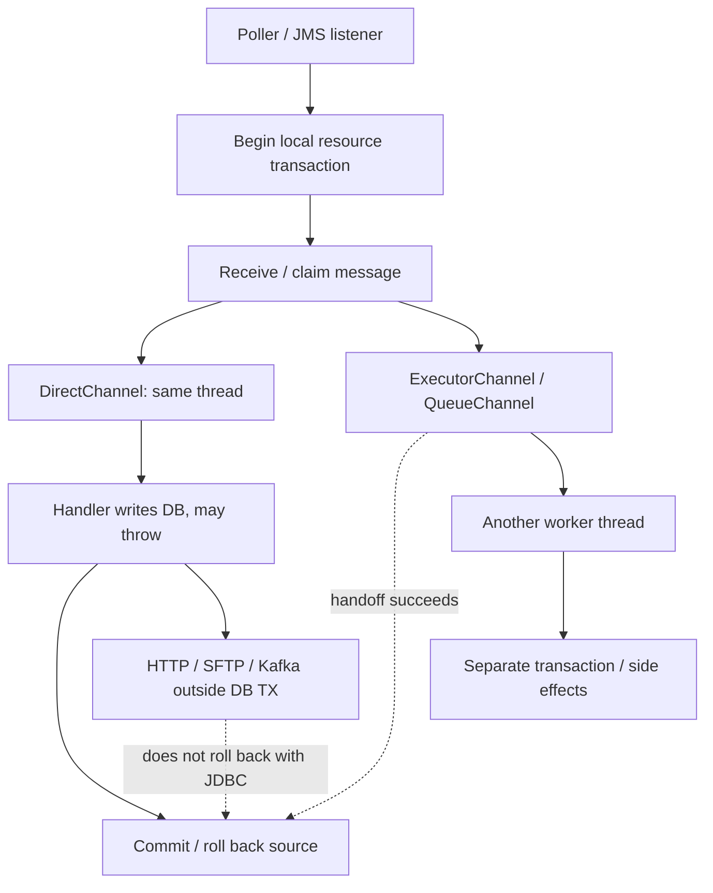
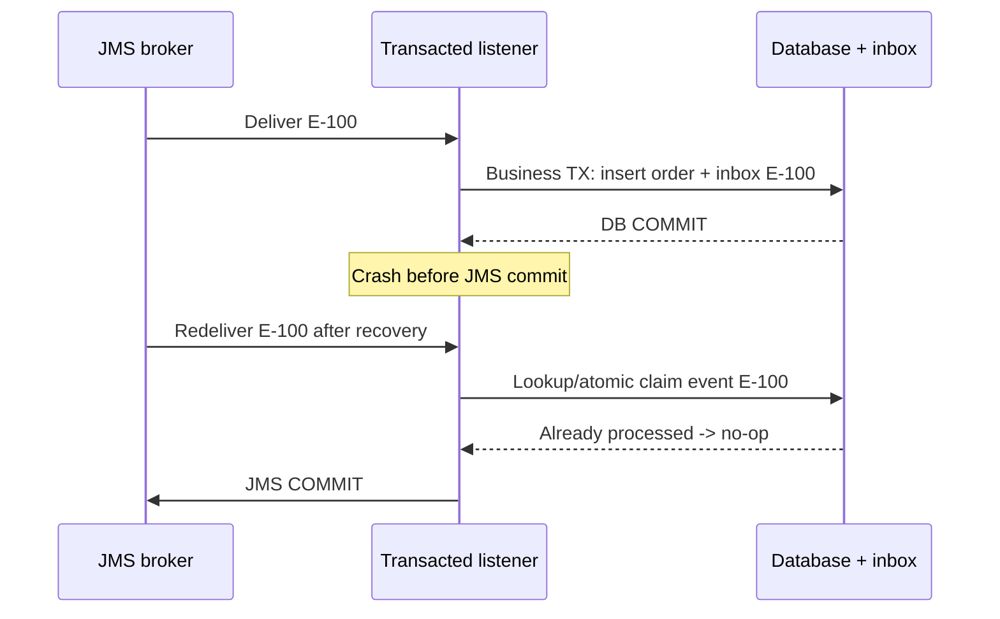
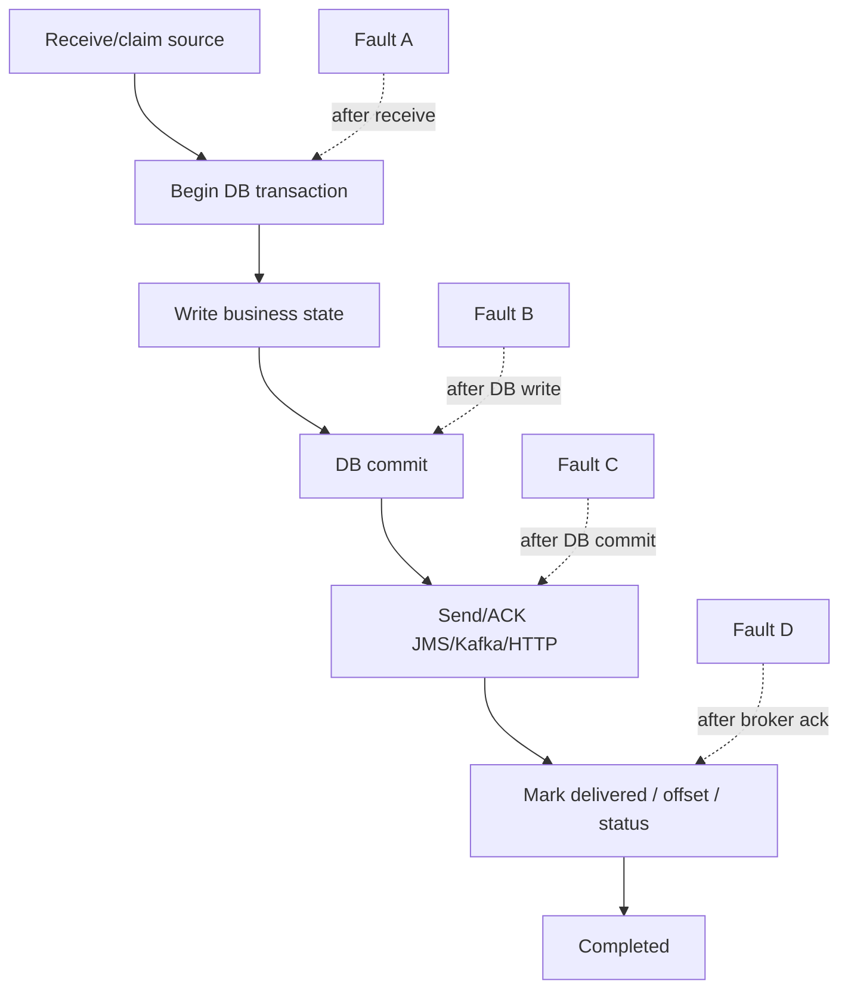

# Testing Transaction Rollbacks in Spring Integration Adapters

## 1. Why Test Rollbacks with Real Data?

An integration flow typically passes through several components:

1. An inbound adapter or gateway receives a message from JDBC, JMS, AMQP, Kafka, HTTP, File, or SFTP.
2. Transformers, filters, routers, and service activators process the payload.
3. The message travels across one or more `MessageChannel`s.
4. A handler updates a database, sends a broker message, calls an API, or writes a file.

When a handler throws an error, what we want to know is not merely **whether JUnit caught an exception**, but rather:

- Did the row marked claimed by the inbound adapter actually roll back?
- Did the business table retain partial changes after the error?
- Did the broker acknowledge the message or can it redeliver?
- Does a message sent to an API/JMS/Kafka remain at the target even though the database rolled back?
- If the consumer receives the message again, is the business operation executed twice?
- Did the error occur **inside the transaction boundary** or on an asynchronous worker after the original transaction already committed?

**Testing transaction rollbacks** means injecting a deterministic failure at a processing point, observing before-and-after state, checking against each adapter's transaction/acknowledgment contract, and proving the system recovers accurately. This lesson belongs to the **Testing** chapter in the **SPRING_INTEGRATION_ADAPTERS** module, where inbound/outbound adapters, gateways, pollers, and `MessageChannel`s connect File, SFTP, HTTP, JMS, AMQP, Kafka, and databases.

### Opening Example

A JDBC inbound adapter scans `incoming_order`, updates `status='CLAIMED'`, and pushes the message through a `DirectChannel` to a handler. The handler inserts a row into `order_ledger` and then throws `IllegalStateException`.

If the **poller has transaction advice**, the handler runs **synchronously on the same thread**, and uses the **same DataSource/transaction**, the expectations after failure are:

- The source row reverts to `NEW`.
- No `order_ledger` row is committed.
- The next poll can pick up the row again.
- Exception/rollback telemetry is recorded, and no out-of-transaction side effect is falsely reported as rolled back.

Merely running `assertThrows` without reading back the database does not prove any of this. If the handler also sent a successful HTTP POST before throwing, **the database may roll back while the HTTP side effect does not vanish**.

### Learning Objectives

After this lesson, you will be able to:

1. Define a **rollback contract** per resource and endpoint.
2. Test transaction advice on JDBC pollers and synchronous handlers.
3. Distinguish real rollbacks from redelivery/retries in JMS, AMQP, and Kafka.
4. Detect when `ExecutorChannel`/`QueueChannel` or asynchronous callbacks break transaction boundaries.
5. Design fault injection before/after commit and before/after acknowledgment.
6. Use test fixtures, transaction readbacks, event IDs, idempotency ledgers, and outboxes to prove no lost or duplicated business effects.
7. Build integration tests, metrics, and runbooks for transaction failure recovery.

## 2. Which Resource Is "Rolling Back"?

One flow can contain multiple independent transactions. Before writing tests, name the exact transaction and state to verify.

| Boundary | Example | What Rollback Protects | What It Does Not Automatically Protect |
|---|---|---|---|
| JDBC local transaction | `DataSourceTransactionManager` / `JdbcTransactionManager` | SQL writes sharing the enlisted connection/resource | HTTP POST, SFTP rename, Kafka publish |
| JPA transaction | `JpaTransactionManager` | Entity/SQL changes in matching persistence context and DB transaction | Unenlisted broker messages |
| JMS transacted session | `DefaultMessageListenerContainer` with `sessionTransacted=true` | Session receives/sends; broker redelivery on rollback per provider | JDBC committed in a separate transaction |
| AMQP consumer ack/transaction | Spring AMQP listener and broker channel | Ack/nack/requeue or scoped broker transaction | External DB or HTTP calls |
| Kafka producer/consumer transaction | Kafka transactions/offsets per container config | Protocol-supported Kafka operations inside transaction | Unenlisted databases or SaaS APIs |
| Transaction synchronization | `afterCommit`, `afterRollback` | Fires callbacks reflecting transaction outcome | Does not make files/SFTP/HTTP ACID resources |
| Pseudo transaction | `PseudoTransactionManager` | Success/failure lifecycle callbacks | Does not roll back filesystems or remote APIs |
| Outbox transaction | Business row + outbox row in same DB | Atomically preserves send intent alongside business state | Does not prevent brokers from receiving duplicate messages |

**Local rollback** undoes/aborts changes for one transaction manager/resource. **Redelivery** means the broker re-sends a message for another attempt; it can happen after a JMS rollback or a failed commit/ack. **Compensation** is another business action attempting to undo an external side effect, not a database rollback.

### 2.1 Do Not Infer Rollback from Annotation Names Alone

`@Transactional` by default uses a configured Spring transaction manager. If an app has two `DataSource`s or both JMS and JDBC, verify **which manager is active**. A service annotated `@Transactional` does not prove that the JMS session receiving the message shares the database transaction.

Furthermore, standard Spring transactions are **thread-bound**. Dispatching to an `ExecutorChannel`, `@Async`, `CompletableFuture`, or a worker queue means errors occurring after the handoff will not automatically roll back the original thread's transaction.

## 3. Defining the Rollback Contract Before Testing

A sound test does not start by throwing random exceptions. It starts with a list of **invariants that must hold** when errors happen.

### 3.1 Positive and Negative Assertions

| Flow | On Success | On Error Before Commit | On Error After Commit |
|---|---|---|---|
| JDBC poller + sync DB handler | Source row `CLAIMED`/`DONE` as designed; business write commits | Both source claim and business write roll back | Committed DB cannot roll back merely because another handler fails later |
| JMS transacted listener | Broker receive commits/acks | JMS rolls back; redelivery per provider | May redeliver if commit outcome is unclear; needs idempotency |
| HTTP outbound from DB TX | HTTP result matches contract | HTTP side effect may have occurred even if DB rolled back | Requires reconciliation/idempotency keys |
| File inbound + DB processing | File processed; source state updated | DB rolls back; file does not revert automatically | File move may fail after DB commit |
| Kafka message-driven consumer | DB effect and offset/ack per architecture | Offset and DB can diverge | Redelivery or lost work if committed out of order |

### 3.2 Three Levels of "Completed"

In test reports, distinguish:

1. **Functional result:** handler returned or sent a response.
2. **Resource settlement:** transaction commit/rollback, broker ack/offset, file move.
3. **Business outcome:** final business state across all targets is accurate.

For example, a handler sending to a `QueueChannel` succeeds as a **functional handoff**, not proof that an async consumer committed business outcomes. Never assert `queue.size()==0` as proof that the entire workflow finished.

### 3.3 Scope of "Zero Data Loss"

A rollback check only proves the named resource did not commit on error. To claim **zero message loss**, also verify:

- Can the source still redeliver/re-poll/reprocess?
- Are retry limits and DLQ/quarantine in place for permanently failing messages?
- On replay, are duplicate business effects prevented?
- Is there target-state readback for unknown outcomes?

## 4. Mapping Transaction Boundaries on an Integration Flow



This diagram is a general model. Real flows may combine a `TransactionInterceptor` on the poller, `@Transactional` on the handler, JMS listener container transactions, broker acks, and multiple outbound operations. **Draw every transaction boundary onto the real flow** and mark where exceptions must propagate.

### 4.1 Exception Propagation Is a Prerequisite

Standard Spring transactions roll back on `RuntimeException` and `Error` by default; checked exceptions require explicit rollback rules. If a handler catches an exception and returns normally, the transaction interceptor may commit.

```java
void unsafeHandler(OrderMessage message) {
    try {
        businessRepository.save(message);
        remoteGateway.send(message);
    } catch (Exception ex) {
        log.warn("Failed to process", ex);
        // Returns normally: transaction may COMMIT.
    }
}
```

For unprocessable messages, define a clear policy:

- **Transient error:** throw to the right boundary so rollback/retry runs per policy.
- **Permanent error:** persist `FAILED/QUARANTINED` status or DLQ **durably**, then commit/ack per contract to stop infinite loops.
- **Unknown remote outcome:** use idempotency keys and reconciliation; never claim rollback undid HTTP calls.

### 4.2 Rollback-Only Transactions and Advice Order

Retry advice placed **inside** a transaction already marked `rollback-only` cannot commit on subsequent attempts; retry advice **outside** the transaction opens a new transaction per attempt. Either way, side effects already sent to brokers/APIs can repeat.

During tests, record:

- Advice ordering at poller and handler.
- Transaction begin/commit/rollback per attempt.
- Whether exceptions are wrapped, swallowed, or turned into `ErrorMessage`s.
- Where idempotency keys are generated and actual outbound send counts.

## 5. Foundational Example: JDBC Inbound Polling + DirectChannel

This is the clearest case showing how transaction advice on the **poller** differs from annotations on the **handler**.

### 5.1 Preparing Test Data

```sql
CREATE TABLE incoming_order (
    id BIGINT PRIMARY KEY,
    business_key VARCHAR(100) NOT NULL UNIQUE,
    payload VARCHAR(2000) NOT NULL,
    status VARCHAR(24) NOT NULL
);

CREATE TABLE order_ledger (
    id BIGINT GENERATED BY DEFAULT AS IDENTITY PRIMARY KEY,
    order_id BIGINT NOT NULL,
    event_id VARCHAR(100) NOT NULL UNIQUE,
    state VARCHAR(24) NOT NULL
);

INSERT INTO incoming_order(id, business_key, payload, status)
VALUES (101, 'order-101', '{"amount":150}', 'NEW');
```

DDL uses illustrative SQL types; identity syntax may need adapting to your database. Neither brokers nor HTTP appear in this first example: the goal is proving **a single local JDBC transaction**.

### 5.2 XML Configuration for a Transaction-Advised Poller

```xml
<bean id="ordersTxManager"
      class="org.springframework.jdbc.datasource.DataSourceTransactionManager">
    <constructor-arg ref="dataSource"/>
</bean>

<int:channel id="ordersInput"/>

<int-jdbc:inbound-channel-adapter
        id="ordersPoller"
        data-source="dataSource"
        channel="ordersInput"
        query="SELECT id, business_key, payload
               FROM incoming_order WHERE status = 'NEW'"
        update="UPDATE incoming_order
                SET status = 'CLAIMED'
                WHERE id IN (:id)">
    <int:poller fixed-delay="250"
                max-messages-per-poll="1">
        <int:transactional transaction-manager="ordersTxManager"
                           propagation="REQUIRED"/>
    </int:poller>
</int-jdbc:inbound-channel-adapter>

<int:service-activator
        input-channel="ordersInput"
        ref="orderProcessingHandler"
        method="handle"/>
```

This is a namespace fragment for illustration; real apps must declare XML namespaces, schemas, `dataSource`, and handler beans. A JDBC inbound adapter typically emits **one message containing a list of rows** per `receive()`; the handler must accept that payload type rather than assuming one row equals one message. `SELECT` and `UPDATE` share the poller transaction when using the matching `DataSource` and transaction config.

**Conditions this test must verify:** `ordersInput` defaults to a `DirectChannel` (no queue/executor), the handler runs synchronously, and ledger writes use the **same DataSource** managed by `ordersTxManager`.

### 5.3 Fault Injection in the Service Activator

```java
// Example test handler accepting JDBC List<Map<String,Object>> input.
final class FailingOrderHandler {
    private final JdbcTemplate jdbc;
    private final AtomicBoolean failAfterWrite = new AtomicBoolean(true);

    FailingOrderHandler(JdbcTemplate jdbc) {
        this.jdbc = jdbc;
    }

    public void handle(List<Map<String, Object>> rows) {
        for (Map<String, Object> row : rows) {
            long id = ((Number) row.get("id")).longValue();
            String key = String.valueOf(row.get("business_key"));
            jdbc.update(
                "INSERT INTO order_ledger(order_id, event_id, state) " +
                "VALUES (?, ?, 'ACCEPTED')",
                id, key
            );
        }
        if (failAfterWrite.get()) {
            throw new IllegalStateException("TEST_INJECT_AFTER_DB_WRITE");
        }
    }

    void disableFault() {
        failAfterWrite.set(false);
    }

    void enableFault() {
        failAfterWrite.set(true);
    }
}
```

This Java fragment requires imports, bean wiring, and test lifecycle setup. The error is thrown **after the JDBC INSERT executes yet before the poller transaction finishes**. That tests rollback deeper than a validation exception thrown at the start of the handler.

### 5.4 Mandatory Assertions After Rollback

```sql
-- Before poll:
SELECT status FROM incoming_order WHERE id = 101;
-- NEW

-- After failed poll and rollback:
SELECT status FROM incoming_order WHERE id = 101;
-- Expected: NEW

SELECT COUNT(*) FROM order_ledger WHERE order_id = 101;
-- Expected: 0
```

After disabling the fault and polling again:

```sql
SELECT status FROM incoming_order WHERE id = 101;
-- Expected after commit per illustrative flow: CLAIMED

SELECT COUNT(*) FROM order_ledger WHERE order_id = 101;
-- Expected: 1
```

A passing test must prove **both the source claim and the ledger write** rolled back on failure. If source reverts to `NEW` while ledger retains 1 row, the handler may be using a different transaction manager/`DataSource` or `REQUIRES_NEW`. If source stays `CLAIMED` while ledger is 0, the transaction may not wrap receive/claim, the error was swallowed, or the handler ran asynchronously.

## 6. Ensuring the Test Triggers the **Real Poller**

### 6.1 Do Not Merely Call the Service Method

```java
assertThrows(
    IllegalStateException.class,
    () -> failingOrderHandler.handle(testRows)
);
```

This tests only the handler; it **never executes** `SourcePollingChannelAdapter`, `JdbcMessageSource.receive()`, `PollerMetadata`, or transaction advice. You cannot conclude JDBC source status rolled back from this alone.

### 6.2 Never Let Test Transactions Mask Bugs

Spring Test can run a test method inside `@Transactional` and roll it back afterward. Used carelessly:

- Uncommitted fixtures may be invisible to pollers on another scheduler thread.
- Rows appear "rolled back" because the **test method** rolled back, not because the poller transaction worked.
- Tests can pass even when poller configuration is broken.

Seed fixtures in a **committed transaction**, run the real poller, and inspect final state using an **independent read connection/transaction**.

### 6.3 Two Ways to Control the Poller

**Option A — Let the scheduler run with a deadline:** use an appropriate poller interval in tests, start the endpoint, await a bounded condition, and stop the endpoint once observed.

**Option B — Control the endpoint/trigger via a test seam:** configure a test-specific trigger or harness to execute one controlled poll. It must still execute the **real advice chain, source, and handler**—never call the handler directly.

Depending on your Spring Integration version, `spring-integration-test` utilities like `@SpringIntegrationTest`, `MockIntegrationContext`, or endpoint lifecycle controls can swap sources/handlers and manage flows. However, mocking out the entire poller destroys the exact transaction boundary under test.

### 6.4 Wait on Conditions Instead of Fixed Sleeps

Polling runs asynchronously relative to the test thread. `Thread.sleep(1000)` flakes in CI or under high load. Use deadlines and stop conditions:

```java
// Pseudocode: awaitCondition implemented by the project via bounded polling,
// e.g., a helper or await-condition library.
awaitCondition(
    Duration.ofSeconds(10),
    () -> metrics.rollbackCountFor("ordersPoller") >= 1
);

assertEquals("NEW", jdbc.queryForObject(
    "SELECT status FROM incoming_order WHERE id = 101", String.class));
assertEquals(0, jdbc.queryForObject(
    "SELECT COUNT(*) FROM order_ledger WHERE order_id = 101", Integer.class));
```

`metrics.rollbackCountFor` is a **project-defined test/observability abstraction**, not a built-in Spring Integration API. Observe DB state after the transaction finishes; if the poller keeps retrying immediately, pause the endpoint or use a fault gate to avoid races between readback and the next poll.

## 7. Control Experiments: Removing Advice or Switching Channels

A strong rollback test includes both **positive controls** and **negative controls**, proving the test fails when transaction guarantees break.

| Deliberate Change in Test Environment | Outcome to Analyze | Takeaway |
|---|---|---|
| Keep poller advice + `DirectChannel` + same DB | Both source and ledger roll back when handler throws | Accurate transaction scope |
| Remove transaction advice from poller | Source claim may commit before handler fails | Handler annotations do not wrap source `receive()` |
| Switch to `ExecutorChannel` | Poller commits after handoff; worker fails later | Thread boundary breaks JDBC TX |
| Handler uses `REQUIRES_NEW` on same DB | Inner transaction can commit independently | Scope is no longer atomic as expected |
| Handler writes to a different DB | Poller rollback does not protect the other DB | Mismatched transaction manager/resource |
| Handler swallows exceptions | Poller may commit | Exception propagation drives rollback |
| Handler calls HTTP before throwing | HTTP may have applied side effects | Local DB rollback never undoes remote calls |
| Throws checked exception | Outcome depends on rollback rules | Never assume all exceptions roll back |

**Never alter production config to run negative controls.** Use dedicated test configs with isolated fixtures and fault gates.

## 8. Testing JMS Transaction Rollbacks and Redelivery

JMS has local `Session` transactions and listener containers managed by Spring JMS. Spring Integration's **message-driven JMS inbound adapter** typically uses a listener container, not a JDBC `SourcePollingChannelAdapter` running a poller.

### 8.1 Two Layers to Verify

1. **JMS session settlement:** was the message committed/acked or rolled back and eligible for redelivery?
2. **Database business outcome:** did SQL writes commit, roll back, or execute twice?

These two layers **do not share a single transaction by default**. `DefaultMessageListenerContainer` with `sessionTransacted=true` covers JMS session receive/send; `@Transactional` on a handler with `DataSourceTransactionManager` covers the DB separately.

When using Spring JMS transactions, `JmsTransactionManager` manages local JMS transactions via a matching `ConnectionFactory`. That is **separate** from `DataSourceTransactionManager` managing JDBC; placing both beans in the Spring context does not create an atomic JMS + DB transaction. To test true XA/JTA setups, verify the transaction coordinator, JMS XA connection factory, XA DataSource, resource enlistment, and crash recovery—never guess from annotations.

### 8.2 Illustrative Container Configuration

```java
@Bean
DefaultMessageListenerContainer ordersListenerContainer(
        ConnectionFactory connectionFactory) {
    DefaultMessageListenerContainer container =
        new DefaultMessageListenerContainer();
    container.setConnectionFactory(connectionFactory);
    container.setDestinationName("orders.in");
    container.setSessionTransacted(true);
    container.setConcurrentConsumers(1); // Simplifies test ordering.
    return container;
}
```

This snippet isn't wired to a specific message listener or Spring Integration endpoint yet; flows must link the adapter/gateway to the container via version-compatible Java DSL or XML. In tests, verify the container bean **actually used** by the endpoint, not merely one sitting in the context.

### 8.3 Rollback Before DB Commit Scenario

1. Send message M carrying `eventId=E-100` to the test queue.
2. Handler opens a DB transaction, writes tentatively, then throws `IllegalStateException` **before DB commit**.
3. The error propagates over `DirectChannel` back to the transacted listener container.
4. DB transaction rolls back; JMS session also rolls back within its scope.
5. Broker redelivers M per policy; log `JMSRedelivered` or delivery count where supported by the provider.
6. Disable the fault, consume M again, and commit: verify one business row, no more.

**Expectation:** JMS transaction rollback and DB rollback are **two distinct verified outcomes**, even when both occur in the same test.

### 8.4 DB Committed, JMS Not Yet Committed Scenario

This is the more critical test:

1. Consumer receives M.
2. Handler writes business row and **DB commits**.
3. Inject a crash or error so the **JMS session fails to commit/ack**.
4. Broker may redeliver M after recovery.
5. Second receipt uses business event ID to detect prior processing.
6. Consumer skips duplicate writes, then completes JMS commit per policy.



A test demanding **exactly one physical message delivery** can be fundamentally wrong. The right criterion is usually **exactly one business effect**, regardless of valid recovery redeliveries.

### 8.5 Comparing Acknowledgment Modes

| JMS Mode | What to Test | What Not to Assume |
|---|---|---|
| `AUTO_ACKNOWLEDGE` | When does DMLC/container actually ack; do handler errors redeliver? | `@Transactional` handler errors always trigger redelivery |
| `CLIENT_ACKNOWLEDGE` | Does acking one message affect other messages in the same session? | Acking one message is per-message independent |
| `DUPS_OK_ACKNOWLEDGE` | Delayed acks and duplicate behavior | Zero duplicates due to provider optimizations |
| `SESSION_TRANSACTED` | Listener throws -> rollback/redelivery; success -> commit | JDBC transaction commits atomically with JMS |

With `DefaultMessageListenerContainer`, `AUTO_ACKNOWLEDGE` can acknowledge before or around listener execution, so do not rely on it for critical redelivery guarantees. Test **your exact container and provider** instead of relying on generic JMS API assumptions.

### 8.6 Useful Assertions

- Message redelivers after rollback within the test deadline.
- Database holds zero business effects before a valid execution commits.
- DLQ count does not rise for transient failures that recovered (per policy).
- On permanent errors exhausting retries, message lands in DLQ/quarantine per config.
- `JMSMessageID`, `JMSCorrelationID`, `JMSRedelivered`, and `businessEventId` log accurately without exposing payloads/credentials.

## 9. Testing AMQP/RabbitMQ Rollbacks, Nacks, and Requeues

Spring Integration AMQP inbound adapters typically pair with Spring AMQP listener containers. Ack/nack/requeue and broker delivery semantics **differ from JMS**, so never use `Session.CLIENT_ACKNOWLEDGE` to describe RabbitMQ consumers.

### 9.1 Points to Verify

- Which acknowledge mode is configured on the listener container?
- Does an exception make the container auto-nack/requeue, reject/DLQ, or roll back a local transaction?
- Are there listener retries, broker-level retries, or delayed DLQs?
- If the DB commits and the broker redelivers, is the consumer idempotent?
- Are publisher confirms/returns on outbound AMQP handled properly?

### 9.2 AMQP Test Matrix

| Fault Injection | Expectation per Configured Policy | Evidence |
|---|---|---|
| Handler throws before business commit | DB rolls back; broker nacks/requeues or DLQs per config | DB readback, queue state |
| Handler returns normally | Message acked; business effect completed per contract | Broker unacked count, DB |
| DB commits then consumer crashes before broker ACK | May redeliver | Inbox ledger blocks duplicates |
| Permanent poison message | Bounded retries then DLQ/quarantine | Headers/attempts, DLQ message |
| Outbound AMQP publish fails to route to queue | Never mark event `SENT` if contract requires routed delivery | Publisher returns/confirms |
| Broker connection drops | Container reconnects; pending messages have recovery path | Broker/consumer logs |

Ack modes and retry behaviors depend on `SimpleRabbitListenerContainer` vs. `DirectMessageListenerContainer`, Spring AMQP version, broker config, and error handlers. Record the exact setup in test reports.

### 9.3 A Transaction Manager Does Not Imply Atomic DB + AMQP

A listener DB transaction can roll back SQL on exception, yet broker acknowledgments remain a separate resource. Some Spring AMQP configs offer best-effort coordination, still leaving a failure window between broker and DB commits. When operations cannot be lost or duplicated, use **idempotency, inbox/outbox, or coordination** proven by crash tests right at commit points.

## 10. Testing Kafka Consumer Offsets, Producer Transactions, and DB Rollbacks

Kafka usually runs via a **message-driven listener container**, not a JMS session. Tests must separate:

- Kafka consumer polled a record.
- Handler wrote to the database.
- Consumer offset committed per ack mode/container.
- Kafka producer published events inside a Kafka transaction (if used).
- Whether HTTP/JDBC side effects sit inside that scope.

### 10.1 Three Critical Commit Windows

| Sequence | When Failure Occurs | Risk |
|---|---|---|
| Offset commits before DB commit | DB fails after offset | Record may not be reprocessed cleanly, losing business work |
| DB commits before offset commit | Crash between both commits | Record may be re-read; duplicate business effects if not idempotent |
| Kafka transaction spans consume/produce | Kafka TX rolls back within supported scope | External databases/HTTP calls never roll back automatically |

Never look at Spring's `@Transactional` for JDBC and conclude Kafka offset commits are atomically protected. Inspect Spring Kafka's listener container transaction manager, ack mode, error handler, producer transaction config, and retry topics/DLT.

### 10.2 Essential Scenario

1. Produce record `E-200` to the test topic.
2. Consumer writes `processed_inbox` and business row in the same DB transaction.
3. Inject a crash after DB commit yet before offset commit.
4. On restart/rebalance, the record may redeliver depending on the committed offset.
5. Consumer receives `E-200`, sees it in the inbox, and skips duplicate business writes.
6. Offset commits upon completion per container policy.

**PASS criterion:** accurate business state, zero duplicate effects, recoverable offset progress, and zero lost events. Listener callback invocations may exceed one.

### 10.3 Cautions with Retries and Dead-Letter Topics

Spring Kafka supports multiple error-handling strategies, seek/retry, retry topics, or dead-letter publishing by version/config. For permanently failing records:

- Retry a bounded number of times, then route to DLT.
- Never commit offsets as processed before the failed record is durably persisted to DLT/quarantine per contract.
- Never run tight infinite retries that spike consumer lag and trigger frequent rebalances.
- When reprocessing from DLT, preserve business event IDs and idempotency.

In tests, besides checking the DLT holds the message, verify **zero wrong/duplicate business effects** and clear audit reasons.

## 11. Testing File/SFTP: Transaction Synchronization Is Not ACID Rollback

Files and SFTP do not share local DB transactions with handlers. Spring Integration supports transaction synchronization or `PseudoTransactionManager` to fire callbacks based on processing outcomes, yet callbacks **do not automatically undo filesystem/remote-server operations**.

### 11.1 File Inbound Problem

Flow:

```text
File /data/incoming/order-101.csv
    -> File inbound polling adapter
    -> DirectChannel
    -> DB handler
    -> afterCommit move file to /data/done
    -> afterRollback move file to /data/failed (if policy chooses)
```

If the DB handler throws, the DB transaction can roll back; however, the file may already be read, metadata filters updated, or the move itself may fail. Assert outcomes on **both the DB and the filesystem**.

### 11.2 Test Scenarios

| Fault | DB Outcome | File Outcome to Check | Expectation |
|---|---|---|---|
| Handler fails before commit | DB rolls back | File remains in incoming or moves to failed per policy | Reprocessing path exists |
| Handler commits, `afterCommit` move fails | DB committed | File still in incoming/temporary | No double processing on re-poll |
| Partial file polled mid-write | Must not commit incomplete data | Partial input file | Filters/temp-names/atomic renames protect |
| App crashes after DB commit, before remote delete | DB committed | Remote file still exists | Idempotency prevents duplicates |
| SFTP times out after upload | DB does not decide remote outcome | Remote file may already exist | Check remote state/checksum before retry |

### 11.3 What Does `PseudoTransactionManager` Actually Test?

It establishes a transaction synchronization context for firing callbacks; **no real database/filesystem ACID rollback is performed by the pseudo manager**. When using a pseudo manager to move files after rollback:

- Test whether the callback fires on the expected branch.
- Test whether the move/rename actually succeeds.
- Test whether reconciliation/retries exist when the callback fails.
- Test whether file filters/persistent metadata prevent skipped files or infinite reprocessing.

### 11.4 SFTP Remote Renames Do Not Undo Automatically

For instance, SFTP inbound downloads a file, DB writes an invoice, then remote rename fails due to a dropped connection. On the next poll, the file may download again. Designs need manifests/content hashes or **unique business ID constraints** plus retries; never cite `@Transactional` as proof of SFTP rollback.

## 12. Testing HTTP Outbound and Unknown Outcomes

HTTP is a prime example of **non-transactional external side effects**. A timeout never proves the remote server didn't process the request.

### 12.1 Scenario: POST Succeeds Then Local Rollback

1. JDBC poller claims a `NEW` row and the handler sends an HTTP POST to a test server.
2. The test server persists a call/side effect and returns 200/201.
3. The handler then throws an exception rolling back the local DB transaction.
4. The row reverts to `NEW`, so the poller may issue the POST a second time.

**Result:** the database rollback worked, yet the test reveals **two HTTP side effects**. That is a contract design bug whenever only one side effect is permitted.

### 12.2 Using Idempotency Keys and Stateful Mock Servers

For APIs supporting `Idempotency-Key`, the test server stores outcomes by key:

- Two POSTs with identical keys and payloads must return the same result per API contract **without duplicating business work**.
- Keys must stay stable across retries, rollbacks, and restarts.
- Test timeouts after server commit followed by resending.
- Inspect server-side state, not just client status codes.

Use MockWebServer, WireMock, or a stateful test HTTP service matching your project version. HTTP mocks verify **outcomes at the test server**, complementing external sandbox integration tests where needed.

### 12.3 How Does Outbox Change Things?

Instead of calling HTTP inside the JDBC poller transaction:

1. Commit business updates and outbox intent in the same DB transaction.
2. A separate worker sends HTTP with the idempotency key.
3. Mark `SENT` after the defined confirmation level.
4. If the worker crashes after HTTP succeeds yet before marking `SENT`, retrying with the same key avoids double side effects.

**Outbox tests** must deliberately crash inside the window between send and marking `SENT`, because that is where legitimate duplicate deliveries happen.

## 13. Sample Test Suite: Rollback Contract for JDBC Transactions

The following example shows how to **separate fixture transactions from the transaction under test**. It uses Spring Test, JDBC, and a test probe controlling the real poller. Abstractions marked as project-provided must be implemented in your codebase; do not treat the snippet as runnable out of the box.

### 13.1 Organizing Test Fixtures

A clean fixture setup includes:

- Unique `eventId` and `orderId` per test case.
- Database rows committed **before** the poller starts.
- A test handler with a toggleable fault gate.
- Controlled endpoint pause/start mechanisms.
- Metrics or latches confirming **transaction rollback finished**.
- Database reads via an **independent transaction**.
- Queue/file/DB cleanup after each test to prevent stale-state flakiness.

### 13.2 JUnit 5 Skeleton

```java
@SpringBootTest
class JdbcPollerRollbackIT {

    @Autowired JdbcTemplate jdbc;
    @Autowired TestPollerHarness poller;     // Project-defined test bean
    @Autowired FailingOrderHandler handler; // Test handler from section 5

    @BeforeEach
    void prepare() {
        poller.stopAndAwait(); // Do not poll while seeding fixture
        jdbc.update("DELETE FROM order_ledger");
        jdbc.update("DELETE FROM incoming_order");
        jdbc.update(
            "INSERT INTO incoming_order " +
            "(id, business_key, payload, status) " +
            "VALUES (101, 'order-101', '{}', 'NEW')"
        );
        handler.enableFault();
    }

    @Test
    void rollsBackClaimAndLedgerWhenSynchronousHandlerThrows() {
        poller.startAndAwaitRollback(Duration.ofSeconds(10));
        poller.stopAndAwait();

        assertEquals("NEW", jdbc.queryForObject(
            "SELECT status FROM incoming_order WHERE id=101",
            String.class
        ));
        assertEquals(0, jdbc.queryForObject(
            "SELECT COUNT(*) FROM order_ledger WHERE order_id=101",
            Integer.class
        ));
    }

    @Test
    void commitsAfterFaultIsRemoved() {
        handler.disableFault();
        poller.startAndAwaitSuccessfulPoll(Duration.ofSeconds(10));
        poller.stopAndAwait();

        assertEquals("CLAIMED", jdbc.queryForObject(
            "SELECT status FROM incoming_order WHERE id=101",
            String.class
        ));
        assertEquals(1, jdbc.queryForObject(
            "SELECT COUNT(*) FROM order_ledger WHERE order_id=101",
            Integer.class
        ));
    }
}
```

`TestPollerHarness`, `startAndAwaitRollback`, `stopAndAwait`, and `enableFault` are **illustrative helpers**, not built-in `spring-integration-test` APIs. Their purpose is spelling out what tests must control and observe. Implement them using endpoint lifecycles, transaction events/tracing, or synchronization primitives.

**Note:** never put `@Transactional` on the test method when inspecting independent commit/rollback outcomes. In parallel CI runs, use unique event/row IDs per test rather than global `DELETE FROM` statements that wipe other tests' rows.

### 13.3 Separating Re-Poll Recovery from the Initial Rollback

If the poller keeps looping after a rollback, it may pick up the **same row repeatedly** and make tests unstable. Instead:

1. Stop polling once one rollback is recorded.
2. Read back the DB.
3. Clear the fault gate.
4. Trigger one clean poll cycle.
5. Assert final business row counts and source status.

That forms a dedicated **recovery test**, rather than guessing from exception log counts.

### 13.4 Using the Same DataSource May Not Be Enough

A handler might call a repository using `REQUIRES_NEW`, invoke a stored procedure on another connection, or use an async DB client—any of which can commit independently. Verify:

- All DB calls share the same DataSource/connection association inside the transaction.
- Propagation settings on every `@Transactional` method.
- No self-invocation inside the same bean bypassing proxy advice.
- Whether `UnexpectedRollbackException` occurs if an inner method sets rollback-only while the outer tries to commit.
- Control tests proving missing transaction config actually fails assertions.

## 14. Testing Crash Recovery and How Rollback Differs from Replay

A Java exception **before commit** differs from a process crash or network drop right at commit boundaries. When a process dies, clients may not know whether resources committed. Systems may need to replay messages even after external side effects already ran.

### 14.1 Fault Injection Points



This diagram is a general timeline; real flows may receive from JMS before opening a DB transaction, or send to a broker inside a handler before DB commit. When writing tests, map the **actual execution sequence** so fault gates hit the exact spots.

### 14.2 Crash/Restart Matrix

| Crash Point | Possible State | Recovery to Prove |
|---|---|---|
| Before source receive | Message still at source | Subsequent poll/receive picks it up |
| After claim, before commit | Transaction rolls back or lease expires | Row reclaimed; zero lost work |
| After DB write, before DB commit | DB transaction typically rolls back on dropped connection | No partial business rows |
| After DB commit, before broker send | Business state exists; event never reached target | Outbox or durable pending state re-emits |
| Broker received, client missed ACK | Uncertain delivery outcome | Idempotent retry, target confirmation, or safe replay |
| After broker ACK, before mark `SENT` | Event may re-send | Inbox/deduplication prevents duplicate business effects |
| After mark `SENT`, before downstream apply | Publisher handed off; consumer unfinished | Separate broker/consumer retries and monitoring |
| After consumer DB commit, before broker ACK | Broker may redeliver | Consumer inbox and unique constraints |

**Rollback tests** prove open-transaction behavior. **Crash recovery tests** prove behavior once transactions committed or commit status is unknown. Both are essential for retry/redelivery adapters.

### 14.3 Fault Injection Must Target the Exact Point

To test "DB committed yet JMS did not commit," throwing **before DB commit** proves nothing. You need a test seam signaled **after DB commit completes** that blocks JMS acknowledgment, or a controlled integration drill crashing inside that window.

Techniques include:

- Test handlers with latches/fault gates.
- Test-scoped wrappers/proxies around transport send/commit.
- Network fault injection against test brokers/databases.
- Killing/restarting test consumer processes or containers.
- Transaction synchronization hooks observing commits—**never mistaking post-commit callbacks for rollback capability**.

For hard-to-reproduce crashes, record timelines across JDBC, broker, and test controller. Never throw an arbitrary exception and claim you tested a specific commit-window crash.

## 15. Idempotency/Inbox as the Post-Rollback Safety Net

### 15.1 Why Require a Unique Business Key?

A consumer can legitimately process an event twice due to broker redelivery. Blind `INSERT`s without unique constraints create duplicates. Storing an idempotency ledger **in the same DB transaction** as business updates turns the second execution into a safe no-op.

```sql
CREATE TABLE processed_inbox (
    consumer_name VARCHAR(80) NOT NULL,
    event_id VARCHAR(100) NOT NULL,
    processed_at TIMESTAMP NOT NULL,
    PRIMARY KEY (consumer_name, event_id)
);
```

### 15.2 Idempotent Consumer Pseudocode

```java
@Transactional(transactionManager = "businessTxManager")
public void handle(OrderCreated event) {
    // Atomic insert-if-absent backed by unique constraint.
    boolean first = inbox.tryInsertIfAbsent(
        "orders-consumer", event.eventId()
    );
    if (!first) {
        return;
    }

    orders.applyOrder(event);
    // Inbox insert and business update must commit/roll back together.
}
```

`tryInsertIfAbsent` is a project abstraction, not a built-in Spring Data method. Implement it using database-specific atomic insert/upsert handling races cleanly. Unlocked `SELECT` followed by `INSERT` is unsafe when two consumers race concurrently.

### 15.3 Three Idempotency Tests

1. **Sequential duplicate:** send the same `eventId` twice; only one business effect occurs.
2. **Concurrent duplicate:** two consumers receive the same `eventId` simultaneously; unique constraint protects integrity.
3. **Rollback then retry:** first attempt fails before DB commit so both ledger and business write roll back; retry succeeds without falsely skipping due to a phantom ledger row.

Never insert the inbox row in an independent transaction and roll back the business update, or replays will think it was "already processed" when business state never committed.

## 16. Transactional Outbox in Rollback Tests

Suppose a consumer receives JMS, updates a database, and needs to publish `OrderAccepted` to Kafka. Publishing directly to Kafka before DB rollback leaks an event for a rolled-back state. **Transactional outbox** solves this by saving the send intent inside the same DB transaction.

### 16.1 Testing Atomic Business + Outbox

```sql
CREATE TABLE integration_outbox (
    event_id VARCHAR(100) PRIMARY KEY,
    event_type VARCHAR(100) NOT NULL,
    payload VARCHAR(4000) NOT NULL,
    status VARCHAR(24) NOT NULL
);
```

Within a single DB transaction:

- Update order to `ACCEPTED`.
- INSERT outbox `OrderAccepted` with `status='PENDING'`.
- Deliberately throw before commit.

**Expectation:** **both business state and outbox row roll back**. If the outbox row remains after business updates rolled back, check for mismatched transaction managers, `DataSource`s, or propagation settings.

### 16.2 Testing Publishing After Business Commit

1. Commit business + outbox.
2. Dispatcher polls `PENDING` outbox rows.
3. Broker receives the event.
4. Inject fault before marking `SENT`.
5. Dispatcher restarts, re-reads event, and may send a duplicate.
6. Consumer inbox checks event ID and applies only one business effect.

This is a **PASS for at-least-once + idempotency** when zero events are lost and zero duplicate effects occur. Never enforce "broker holds strictly one copy" when the architecture intentionally relies on retries.

### 16.3 Testing `DirectChannel` and Output Acknowledgments

A flow like:

```text
outbox JDBC poller
    -> DirectChannel
    -> Kafka outbound adapter (async producer)
    -> mark SENT
```

can mark `SENT` too early if it trusts `MessageChannel.send() == true`. If the producer callback fails later, the database already thinks the event finished.

**Test:** fail the producer send future after handoff, then assert the outbox is **not** marked `SENT`, retries occur, and the event ID remains intact. Entering a channel is not broker publish confirmation.

## 17. Choosing Testing Tools and Verification Levels

| Test Level | Applicable Tools | What It Proves | What It Does Not Prove |
|---|---|---|---|
| Unit | JUnit 5, Mockito | Rollback policy logic, exception classification | Real poller/container transactions |
| Spring context integration | `@SpringBootTest`, `@SpringIntegrationTest` | Endpoint wiring, advice, channel paths | Real broker behavior when mocked |
| Database integration | Testcontainers DB or matching test DB | SQL commits/rollbacks, locks, constraints | JMS/Kafka acks |
| Broker integration | Test JMS/AMQP/Kafka broker | Redelivery, ACKs, offsets, DLQs | External HTTP/SFTP side effects |
| HTTP integration | MockWebServer/WireMock/test server | Timeouts, duplicate POSTs, idempotency keys | Live external SaaS behavior |
| SFTP/File integration | Sandbox SFTP, temp directories | Remote/local file outcomes, metadata filters | ACID transactions with DB without coordination |
| Crash/failover | Process/container restarts, network fault injection | Recovery after commit/unknown outcomes | Unauthorized production testing |

### 17.1 Why Use Real Brokers and Databases in Integration Tests?

A Mockito mock of `JmsTemplate.send()` returning normally has no JMS session, broker acknowledgment, or redelivery. A mocked repository has no DB locks or transaction commits. Mocks help unit tests, yet **never prove rollback properties of an integrated system**.

With Testcontainers, run real databases and brokers in CI. Substitute only when real providers cannot run, and explicitly label the reduced assurance level. AMQP/JMS/Kafka details vary by broker version and config.

### 17.2 Where Does `spring-integration-test` Help?

Spring Integration test support offers `@SpringIntegrationTest`, `MockIntegrationContext`, test handlers, and endpoint lifecycle utilities to swap handlers and observe flows. However, if your goal is testing **poller transaction advice**, never mock away the entire poller/source and lose the exact boundary under test.

A clean test seam replaces **the handler after `DirectChannel`** with a throwing handler while keeping real sources, pollers, transaction managers, and channels.

### 17.3 Defining Clear Test Harnesses

If you build a `TestPollerHarness`, document clearly:

- **Which exact endpoint bean name** does it start/stop?
- Which event does it wait on for rollback/commit, and with what timeout?
- Does it stop the poller from re-reading messages before DB readback?
- Does it share transactions with test fixtures?
- Does it clean up connections, schedulers, broker subscriptions, and threads?
- When waits time out, does the test genuinely fail rather than merely logging a warning?

Never hide these assumptions inside an unreviewed helper.

## 18. Testing Transaction Rollbacks in Multi-Instance Systems

### 18.1 Two JDBC Pollers Claiming the Same Row

Even when every instance has transaction advice, two pollers can pick up the same row if `SELECT`/`UPDATE` and isolation fail to guarantee atomic claiming. Tests must:

1. Run two poller instances sharing one DB with distinct endpoint names.
2. Seed committed test rows.
3. Use latches or load to provoke contention during claiming.
4. Count business effects by unique ID.
5. Verify zero duplicate effects, zero stale leases, and valid final row states.

Solutions include row locking, conditional updates, `SKIP LOCKED` where supported, optimistic locking, or claim leases. **Transaction advice does not automatically provide distributed work claiming.**

### 18.2 Broker Concurrency

When scaling up JMS/AMQP/Kafka consumers:

- Two events for the same aggregate may arrive back-to-back or execute out of order.
- A rollback/redelivery can make an older event arrive after a newer one.
- Ordering by partition, queue, message group, or aggregate version carries distinct limits.
- Inbox unique constraints and optimistic versioning prevent stale overwrites.

Beyond testing "each event processed once," assert business invariants like "state version 3 never overwrites committed version 4" per domain contract.

### 18.3 Isolation and Locking

Changing `READ_COMMITTED`, `REPEATABLE_READ`, or `SERIALIZABLE` cannot be assumed to fix every race. Every database vendor differs in MVCC/locking/phantom semantics and deadlocks. Test real queries/locks on your specific DB vendor, including timeouts, deadlocks, and retries.

## 19. Negative Tests on Exceptions and Transaction Propagation

A rollback test throwing only `RuntimeException` misses several failure paths. Test these variants explicitly:

### 19.1 Runtime Exceptions

In standard Spring transaction defaults, `RuntimeException` triggers rollback when escaping the scope. Verify this when error handlers or other advices are present.

```java
void failWithRuntimeException() {
    jdbc.update("UPDATE incoming_order SET status='CLAIMED' WHERE id=101");
    throw new IllegalStateException("TEST_RUNTIME_FAILURE");
}
```

### 19.2 Checked Exceptions

Checked exceptions **do not roll back Spring transactions by default** unless explicit rollback rules are configured. Example:

```java
@Transactional(
    transactionManager = "ordersTxManager",
    rollbackFor = IOException.class
)
public void processWithCheckedException() throws IOException {
    jdbc.update("UPDATE incoming_order SET status='CLAIMED' WHERE id=101");
    throw new IOException("TEST_CHECKED_FAILURE");
}
```

**Note:** annotations on a Java method apply when invoked through a matching proxy/interceptor. To test transaction advice on a **poller**, configure rollback rules on the poller's advice and trigger the real polling endpoint. Testing handler annotations alone does not cover that.

### 19.3 Catch and Return Normally

Scenario:

1. Source claims row.
2. Handler writes data.
3. Outbound HTTP fails.
4. Handler catches, logs, and returns.
5. Poller sees no error and may commit.

Negative assertion: the test must catch that rows get marked complete despite the target never receiving data. Fix doesn't always require rethrowing—you can persist durable `PENDING_OUTBOUND`/outbox state for subsequent retry.

### 19.4 `REQUIRES_NEW` and Nested Propagation

A handler calling a `REQUIRES_NEW` service opens an independent transaction. The inner commit before the outer poller rolls back breaks atomicity between source and ledger. Test:

- Write a marker inside the inner transaction.
- Throw in the outer handler.
- Check whether the marker survived.
- Compare against contract; if it shouldn't survive, fix propagation or state design.

Never use `REQUIRES_NEW` to "ensure audits persist" and forget those audits remain even when the business operation rolled back. That makes sense only when audits intentionally track **attempts/failures** separately from business completion.

### 19.5 Rollback-Only Is Not a Resolved Exception

An inner method may mark a transaction rollback-only, while the outer catches the exception and returns normally. At commit time, Spring throws `UnexpectedRollbackException` because the outer expected commit on a doomed transaction. Tests must verify the **final resource outcome**, never equating a normal handler return with a successful commit.

## 20. Error Channels, Retry Advice, and DLQs from a Testing View

### 20.1 Synchronous Errors

When a handler runs on a `DirectChannel` and throws, the caller's transaction interceptor sees the error and rolls back. Yet if an error flow or recoverer converts the failure into a normal return, the transaction can commit.

Tests should explicitly include production `errorChannel` or retry advice and verify:

- Where exceptions route.
- Did the error handler ack/commit the source?
- Does an `ErrorMessage` carry the failed message/correlation ID?
- Is there durable error state, DLQ, or quarantine before settling the source?
- If the error handler itself fails, what happens to the transaction/broker?

### 20.2 Asynchronous Errors

`ExecutorChannel` or off-thread producer callbacks can push exceptions onto an error path after the source transaction already ended. Tests must determine:

- When was the message handed off to the queue/executor?
- Is there a **separate** retry/transaction boundary for workers?
- Did the source already ack/commit before the worker threw?
- Is idempotency enforced when workers retry?

Never use synchronous tests to infer rollback behavior in asynchronous flows.

### 20.3 Retry Advice Ordering

```text
Option 1:
retry advice
    -> transaction advice
        -> poll + synchronous processing

Option 2:
transaction advice
    -> retry advice
        -> poll + synchronous processing
```

This illustrates the two orderings; how Spring Integration applies advice chains and transaction attributes depends on endpoint config. Tests must verify **whether each attempt opens a fresh transaction**. Inside a rollback-only transaction, further retries cannot commit; when retries open fresh transactions, protect external systems against duplicate side effects.

### 20.4 Poison Messages

Schema-invalid records cannot be fixed by endless rollbacks/retries. Re-ingesting them wastes throughput and inflates backlogs. Test:

1. Send an invalid message.
2. Count attempts up to configured cap.
3. Verify quarantine/DLQ holds the message, error reason, and event ID.
4. Verify broker/source stops infinite retries.
5. Verify valid messages behind it continue processing.
6. Reprocess after fixing with a stable ID and zero duplicate business effects.

**Stopping retries** is safe only with **durable persistence** of error state per contract. If DLQ writing fails, never ack and discard vital data.

## 21. Designing a Unified Test Matrix Across Adapters

To keep devs and SREs aligned, maintain a matrix listing **transaction owner**, **fault stage**, and **expected resource outcomes**:

| ID | Endpoint | Transaction Owner | Fault | Expected Source | Expected Business / Target |
|---|---|---|---|---|---|
| RB-01 | JDBC inbound + `DirectChannel` | DataSource TX at poller | Handler throws runtime | Claim rolls back | Ledger rolls back |
| RB-02 | JDBC inbound + `DirectChannel` | DataSource TX at poller | Handler succeeds | Claim commits | Ledger commits once |
| RB-03 | JDBC inbound + `ExecutorChannel` | Separate poller TX | Worker throws later | Claim may commit | Worker retries; do not expect source rollback |
| RB-04 | JDBC inbound | Poller TX | Handler swallows error | Source may commit | Catches contract bug; must fail |
| RB-05 | JMS message-driven inbound | JMS session TX | Handler throws before DB commit | Redelivery per broker | DB rolls back |
| RB-06 | JMS + local DB TX | Two local TXs | Crash after DB commit, before JMS commit | May redeliver | Inbox prevents double effect |
| RB-07 | AMQP inbound | Broker ack/nack policy | Handler throws | Requeue/DLQ per policy | No partial DB writes |
| RB-08 | Kafka inbound | Offset/producer TX | Crash after DB commit, before offset | May reprocess | Inbox blocks duplicates |
| RB-09 | File inbound + DB | DB TX + sync callbacks | Handler throws | File stays reprocessable | DB rolls back |
| RB-10 | SFTP inbound + DB | Separate DB TX | Remote rename times out | Remote outcome uncertain | Reconcile/idempotent |
| RB-11 | JDBC → HTTP outbound | DB TX | HTTP succeeds then handler throws | DB rolls back | HTTP side effect does not auto-rollback |
| RB-12 | Outbox publisher | DB TX + separate outbound send | Broker ACK before mark `SENT` | Outbox retries | Consumer idempotent |
| RB-13 | Multi-instance poller | Worker DB TX each | Concurrent claim | Atomic claim/lease/lock | One business effect |
| RB-14 | Dead-letter handling | Broker + error state | Poison message | No infinite retries | Full quarantine audit |

These are **reference scenarios**, not claims that all technologies share identical defaults. Adjust expectations for actual adapters, framework versions, and configs. When a resource lacks ACID rollback, the right outcome is **pending/retry/compensation**, not "everything reverts."

### 21.1 Multi-Dimensional PASS/FAIL Criteria

Tests should use explicit statuses:

- `PASS`: all in-scope invariants hold with evidence.
- `FAIL`: any mandatory invariant violated.
- `BLOCKED`: could not execute due to unready environment/fixtures; no conclusion.
- `INCONCLUSIVE`: executed yet lacked resource-outcome verification data.

For instance, an unverified broker ACK with no consumer readback is `INCONCLUSIVE`—never PASS merely because the handler threw no exception.

### 21.2 Minimum Evidence

At minimum, capture:

- Test ID, event ID, aggregate ID, and correlation ID.
- Versions of framework, transaction manager, adapter, broker, and DB.
- Channel sync/async configuration.
- Fault point name and injection timestamp.
- Trace of transaction begin/rollback/commit.
- Before/after DB queries on an independent connection/transaction.
- Broker delivery/ack/offset or file/HTTP target state.
- Retry attempts, DLQ/quarantine, and idempotency results.
- Final `PASS`/`FAIL`/`BLOCKED`/`INCONCLUSIVE` with justification.

Never store passwords, bearer tokens, JMS credentials, SFTP private keys, or raw sensitive payloads in test reports.

## 22. Sample YAML Test Plan

This is a **documentation example** of a test plan, not a default Spring Integration or Testcontainers configuration:

```yaml
rollbackTest:
  id: "SI-ROLLBACK-011"
  environment: "integration-test"
  target:
    endpoint: "ordersJdbcInbound"
    channel: "ordersInput"
    adapter: "JDBC inbound polling adapter"
  resources:
    transactionManager: "ordersTxManager"
    dataSource: "ordersDataSource"
  fixture:
    eventId: "rollback-evt-101"
    sourceRowId: 101
    initialStatus: "NEW"
  fault:
    point: "AFTER_LEDGER_INSERT_BEFORE_POLLER_COMMIT"
    exception: "IllegalStateException"
    attemptsToObserve: 1
  expected:
    sourceStatusAfterFailure: "NEW"
    ledgerRowsAfterFailure: 0
    redeliveryOrRePollPossible: true
    sourceStatusAfterRecovery: "CLAIMED"
    ledgerRowsAfterRecovery: 1
  controls:
    fixtureMustBeCommitted: true
    testMethodTransactional: false
    faultGateMustBeReset: true
    timeoutSeconds: 10
  evidence:
    - "transaction-timeline"
    - "database-readback"
    - "poller-invocations"
    - "error-events"
  cleanup:
    stopEndpoint: true
    deleteFixture: true
    clearMockState: true
```

Real test automation should verify that `dataSource` matches the transaction manager, endpoint names match, fault gates reset, and rollback/readback evidence exists. Booleans in YAML never substitute for real evidence.

## 23. Monitoring Rollbacks in Production

### 23.1 Metrics and Logs

| Signal | Meaning | When to Alert |
|---|---|---|
| `tx.commit.count` / `tx.rollback.count` | Real transaction outcomes | Rollback rate spikes post-deploy |
| `poll.receive.duration` | Source latency | Poller stalled; slow DB locks |
| `poll.empty.count` | Polls finding zero messages | Separate empty sources from errors |
| `db.deadlocks` / `lock.wait` | Contention during claiming | Too many pollers or wrong isolation |
| `jms.redelivery.rate` | Broker redeliveries | Poison messages or crashing listeners |
| `amqp.nack.requeue.count` | Nacks/requeues/rollbacks | Retry storms |
| `kafka.consumer.lag` | Consumers falling behind | Rebalances, retries, downstream outages |
| `dlq.depth` / `quarantine.age` | Durable failed backlog | Unowned failed events |
| `outbox.pending.age` | Committed yet unpublished events | Publisher/broker failure |
| `inbox.duplicate.suppressed` | Duplicates blocked | Redeliveries or producer retries |
| `file.failed.move.count` | Incomplete file callbacks | Needs reconciliation |
| `http.unknown.outcome.count` | Timeouts where server state is unclear | Idempotency/reconciliation needed |
| `active.transaction.duration.p99` | Long-running transactions | Lock contention and pool pressure |

Metric names are **suggestions**, not built-in metrics across every Spring Integration release. Instrument per project conventions, cap label cardinality, and separate business vs. transport errors.

### 23.2 An Auditable Timeline

```text
testId=SI-ROLLBACK-011
eventId=rollback-evt-101
endpoint=ordersJdbcInbound
thread=poller-1
txManager=ordersTxManager
stage=source-update
status=CLAIMED_UNCOMMITTED

testId=SI-ROLLBACK-011
eventId=rollback-evt-101
stage=handler-ledger-insert
fault=TEST_INJECT_AFTER_DB_WRITE
txOutcome=ROLLED_BACK

testId=SI-ROLLBACK-011
eventId=rollback-evt-101
stage=database-readback
sourceStatus=NEW
ledgerRows=0
```

Omit connection passwords and unnecessary payloads from logs. Never log "rollback success" merely because an exception fired; record resource transaction outcomes and readbacks.

## 24. Runbook for Abnormal Transaction Rollbacks

### Phase A — Containment

1. Pinpoint whether the error came from a poller, listener, adapter, handler, transformer, or outbound endpoint.
2. Check channel paths: `DirectChannel` vs. executor/queue handoff.
3. Identify which transaction managers are actually active at source and handler.
4. Distinguish `RuntimeException`, checked exceptions, timeouts, broker disconnects, and poison messages.
5. Identify affected time windows, resources, event IDs, and unknown states.

### Phase B — Data Protection

1. Pause endpoints via runbook/lifecycle controls if needed; never delete queues or data sources.
2. Curb retry storms and lower concurrency on DB deadlocks or broker overload.
3. Preserve logs/traces and error events; avoid blind ACKs/commits just to shrink queue depth.
4. For unknown HTTP/SFTP/file outcomes, reconcile remote state before replaying.
5. Verify durable records exist in outbox, inbox, DLQ, and quarantine.

### Phase C — Diagnosis

1. Reproduce in a test environment with identical versions and configs.
2. Inject the exception at the exact stage; check DB readbacks and broker ack/redelivery.
3. Compare outcomes against the rollback contract and negative controls.
4. Determine whether the cause is missing advice, wrong manager, propagation, swallowed exceptions, async handoffs, or timeouts.
5. Check for duplicate business effects or permanently stuck claimed source rows.

### Phase D — Fix and Recovery

1. Fix config/advice and add an integration regression test.
2. Add idempotency/outbox where two resources commit independently.
3. Reprocess recoverable events by stable event ID with rate limits and auditing.
4. Reconcile sources, databases, brokers, files, and HTTP targets.
5. Monitor rollback rates, backlogs, DLQs, and duplicate suppression post-recovery.

### Phase E — Incident Closure

Document before/after outcomes, root cause, data-loss/duplicate exposure windows, affected sources, compensation status, and preventive actions. Never claim "all messages rolled back" when non-transactional side effects occurred.

## 25. Anti-Patterns in Rollback Testing

**"JUnit `assertThrows` passed, so the transaction rolled back."** The exception may have fired after a source update or DB write committed. Always read back resource state.

**"Testing the handler covers JDBC inbound adapter transactions."** Handler tests skip `MessageSource.receive()` and poller transaction advice.

**"Putting `@Transactional` on the test method guarantees writes roll back properly."** Spring Test's test transaction can mask bugs or hide uncommitted fixtures from other poller threads.

**"`@Transactional` protects JMS, JDBC, Kafka, and HTTP together."** Local transaction managers protect only enlisted resources.

**"Putting `@Transactional` on the handler wraps the adapter's claim."** Transactions must start before `receive()` for source claims to roll back with processing.

**"Testing one happy path is enough."** Inject failures before/after writes, before/after commits, async faults, and unclear ACKs to prove recovery.

**"When a service activator throws, the listener always rolls back."** Error advices, error channels, retry handlers, or async handoffs can intercept errors before they reach the container.

**"Catching and logging exceptions still rolls back the transaction."** If the interceptor sees a normal return, it may commit per policy.

**"Checked exceptions always roll back like `RuntimeException`."** Spring's default transaction rules differ; verify rollback rules and proxy execution.

**"Switching to `ExecutorChannel` doesn't affect transactions."** Switching threads alters boundaries and when sources commit/ack.

**"JMS rollback definitely rolls back the DB too."** JMS sessions and DataSources normally run independent local transactions unless explicitly coordinated.

**"Broker redelivery is a broker bug."** It is standard recovery behavior; business logic must be idempotent.

**"An empty queue means all messages finished processing."** Messages may have acked early or merely been handed off while downstream business state failed.

**"`PseudoTransactionManager` rolls back File/SFTP."** It drives callbacks, not ACID filesystem/remote rollbacks.

**"HTTP 500/timeout proves the remote didn't process it."** The remote may have committed before dropping the response; use idempotency/readback.

**"More retries are always safer."** Poison messages cause infinite loops, backlog spikes, and duplicate side effects; enforce retry budgets and DLQs.

**"Outbox guarantees the broker receives strictly one message."** Outboxes are typically at-least-once; consumers must deduplicate.

**"One passing integration test applies to every broker/database."** Provider versions, isolation levels, transaction/ack modes, and listener containers differ.

**"An active transaction proves resources rolled back."** `TransactionSynchronizationManager.isActualTransactionActive()` reflects context state, not whether JDBC/JMS resources enlisted.

**"No concurrency tests needed because one worker ran fine."** Multi-instance pollers race on claims, consumers redeliver, and parallel workers pick up duplicates.

## 26. Pre-Acceptance Checklist for Rollback Tests

### Preparation

- [ ] Identified responsible resources and transaction managers?
- [ ] Mapped channel paths, distinguishing `DirectChannel` / `ExecutorChannel` / `QueueChannel`?
- [ ] Declared expected states **before and after** errors at source, DB, and target?
- [ ] Fixtures carry stable business event IDs and are committed before polling?
- [ ] Fault injection triggers **after write, before commit**?
- [ ] Timeouts, stop conditions, and cleanup configured for pollers, brokers, files, and DB?
- [ ] Distinguished local rollbacks from retries/redelivery/compensation?

### Execution

- [ ] Triggered real endpoints/pollers/listeners instead of just calling handlers?
- [ ] Proven exceptions propagate to the right transaction boundary?
- [ ] Tested `RuntimeException`, checked exceptions, and swallowed errors separately where relevant?
- [ ] Verified resource rollbacks via readback in an independent transaction?
- [ ] Verified broker ACK/redelivery/offsets or file states post-error?
- [ ] Tested both synchronous handlers and async handoff controls?
- [ ] Tested unknown broker/HTTP outcomes and crashes after business commit?
- [ ] Tested retries/deduplication using stable business event IDs?
- [ ] Tested concurrency/claim races matching production topology?

### Acceptance

- [ ] No partial state violating contracts inside real transactions?
- [ ] Messages remain eligible for redelivery or sit in durable recovery storage?
- [ ] Zero duplicate business effects outside allowed bounds?
- [ ] Outbox/DLQ/quarantine has clear ownership on permanent errors?
- [ ] Test does not rely on test-method `@Transactional` rollbacks for false positives?
- [ ] Evidence captures transaction outcomes, DB readbacks, and broker/source states?
- [ ] Outcomes classified `PASS`/`FAIL`/`BLOCKED`/`INCONCLUSIVE` per defined criteria?
- [ ] Discovered defects have fixes and regression tests?

## 27. Scenario Exercises

### Scenario A — `assertThrows` Passes Yet Row Stays CLAIMED

A JDBC inbound adapter reads `status=NEW` and marks `CLAIMED`. The handler has `@Transactional`, writes to the ledger, and throws. JUnit catches the expected exception. Afterward, the source row remains `CLAIMED` while the ledger rolled back.

**Tasks:**

1. Explain why the handler's rollback did not wrap `MessageSource.receive()`.
2. Show where to place the poller's `TransactionInterceptor`.
3. Write two SQL readbacks verifying rollback on both source and business tables.
4. Design a negative control test with the advice removed.

*Hint:* Poller transaction starts before receive, shared DataSource/`DirectChannel`, committed test fixtures.

### Scenario B — Switching to `ExecutorChannel`

Previously `JDBC source → DirectChannel → handler` rolled back cleanly. To boost throughput, the team switched to `JDBC source → ExecutorChannel → handler`. The handler fails, yet source rows never revert to `NEW`.

**Tasks:**

1. Draw the new thread/transaction boundaries.
2. Explain why late handler exceptions cannot roll back the poller's transaction.
3. Propose durable queues/leases, retries, and idempotency.
4. Design a test proving zero lost work after a worker crash.

*Hint:* Handoff acknowledgment differs from business completion; workers need their own transactions.

### Scenario C — DB Committed Then JMS Message Redelivered

A JMS listener receives `E501` in a transacted session. The handler writes the order in a separate DB transaction and commits. The app crashes before JMS session commit. After restart, the broker redelivers `E501`.

**Tasks:**

1. Explain why JMS rollback does not undo the DB commit.
2. Design an inbox ledger and unique constraint.
3. Identify fault points and assertions proving a single business effect.
4. Evaluate whether the test should PASS or FAIL if the listener runs twice while the DB holds one order.

*Hint:* At-least-once delivery and idempotent consumers.

### Scenario D — Poison Message Stalls JMS Queue

A JSON payload missing a required field makes the handler throw `IllegalArgumentException`. The broker rolls back and redelivers immediately; thousands of attempts fire while valid messages behind it stall.

**Tasks:**

1. Distinguish permanent vs. transient errors.
2. Propose retry budgets, delays, DLQ/quarantine, and ownership.
3. When is it safe to commit/ack the source message?
4. Write a test proving the DLQ captures sufficient metadata without retry loops.

*Hint:* Durable failure handling before acknowledgment.

### Scenario E — HTTP Succeeded Yet DB Rolled Back

A poller inside a DB transaction calls an HTTP API to create an invoice. The server returns 201, then the handler throws due to a validation step. The DB rolls back; the next poll calls HTTP again and creates a second invoice.

**Tasks:**

1. Why does local DB rollback fail to cancel the invoice on the remote service?
2. Choose an idempotency key and remote readback mechanism.
3. Propose outbox or saga/compensation where needed.
4. Write a test using a stateful mock HTTP server.

*Hint:* Unknown outcomes and side effects outside the `DataSource` TX.

### Scenario F — File Moved in `afterCommit` Yet Fails Differently

A file is read by a File inbound adapter and the handler writes to DB. An `afterCommit` callback moves the file to `done`. The move fails due to permissions after the DB already committed.

**Tasks:**

1. Can a post-commit callback roll back the DB?
2. Design reconciliation to detect unmoved files.
3. Propose business IDs or checksums to prevent duplicate reprocessing.
4. Verify via integration tests with a temp directory and fault injection.

*Hint:* Transaction synchronization does not make filesystems ACID.

### Scenario G — Kafka Offset Commits Ahead of DB Commit

A Kafka consumer commits offsets before the DB write transaction finishes. Moments later, a DB deadlock rolls back the write. After restart, the record is not reprocessed as expected.

**Tasks:**

1. Identify the commit-ordering bug.
2. Inspect ack modes, error handlers, offset states, and DB transaction managers.
3. Design a test failing the DB after offset commit.
4. Choose a commit/retry strategy that never drops business work.

*Hint:* Offsets are not database transactions; idempotency solves duplicates, not premature offset commits.

### Scenario H — Outbox Publisher Sends Twice

An outbox worker publishes `E601` to AMQP successfully yet disconnects before marking `SENT`. After lease expiry, a new worker publishes `E601` again.

**Tasks:**

1. Is this a bug in the outbox pattern?
2. Explain at-least-once delivery.
3. Design fencing tokens for outbox workers and consumer inbox ledgers.
4. Write assertions for broker message counts vs. business effect counts.

*Hint:* Two broker deliveries can be valid when only one business effect occurs.

### Scenario I — Entire Test Method Wrapped in `@Transactional`

A JUnit test inserts a `NEW` row while the test method itself carries `@Transactional`. The poller scheduler runs on another thread and sees zero rows. Increasing `Thread.sleep` still leaves the test erratic.

**Tasks:**

1. Why are uncommitted fixtures invisible to the poller?
2. Propose independent setup transactions, explicit commits, and await conditions.
3. Distinguish test transactions from real poller transactions.
4. Design cleanup safe for parallel tests.

*Hint:* Visibility, thread-bound transactions, and test isolation.

### Scenario J — Misunderstanding `CLIENT_ACKNOWLEDGE`

A JMS consumer session receives messages A and B. The handler wants to ack only B and calls `B.acknowledge()`. Then the app crashes before A finishes. Depending on session semantics, A may already be acknowledged.

**Tasks:**

1. State the client acknowledgment contract and session scope.
2. Design a test checking how many messages can actually redeliver.
3. Propose appropriate session transactions or container policies.

*Hint:* Cumulative acknowledgment; never assume per-message independent acks.

## 28. End-to-End Practice Workflow

A realistic mini-project can combine **a test database, a test JMS broker, and a stub HTTP service**:

### Stage 1 — JDBC Rollback

1. Create `incoming_order`, `order_ledger`, and committed fixtures.
2. Configure a JDBC inbound adapter with poller transaction advice.
3. Route via `DirectChannel` to a ledger-writing handler.
4. Inject `IllegalStateException` after `INSERT`.
5. Stop the endpoint, read back both tables, and prove rollback.
6. Disable the fault, re-poll, and prove single commit.

### Stage 2 — JMS Redelivery

1. Build a JMS transacted listener container wired to a Spring Integration flow.
2. Send a business event carrying `eventId`.
3. Fail the handler before DB commit; verify rollback and redelivery.
4. Create a scenario where DB commits yet JMS does not commit.
5. Add an inbox ledger and verify replay creates no double effects.

### Stage 3 — Non-Rollbackable Side Effects

1. Add an HTTP outbound gateway or stateful test endpoint.
2. Inject an exception **after HTTP succeeds** yet before DB commit.
3. Observe DB rolling back while the HTTP side effect persists.
4. Add idempotency keys or a transactional outbox.
5. Re-run the test and verify zero duplicate business outcomes.

### Stage 4 — Changing Channels and Checking Recovery

1. Swap `DirectChannel` for `ExecutorChannel` in test configuration.
2. Inject worker errors and confirm the poller transaction does not auto-rollback.
3. Design durable handoff/worker retries and test crash/restart.
4. Record timelines and document architectural trade-offs per business requirements.

### Stage 5 — Reporting

Maintain a summary table per test:

| Test | Source State | DB State | Broker / Remote State | Business Effect | Outcome |
|---|---|---|---|---|---|
| JDBC `DirectChannel` throws | `NEW` | Ledger = 0 | No outbound | Not executed | PASS rollback |
| JDBC `DirectChannel` succeeds | `CLAIMED` | Ledger = 1 | No outbound | Once | PASS commit |
| JMS DB commit then redelivery | JMS re-receives | Order = 1, inbox E | Two deliveries possible | Once | PASS idempotency |
| HTTP succeeds then DB rollback | `NEW` | DB rolled back | Remote side effect persists | Duplicate risk | FAIL if atomic required |
| Executor handoff then worker throws | May be `CLAIMED` | Worker uncommitted | Async error | Incomplete | Needs retry/handoff contract |

**Never force distinct outcomes into "everything rolled back."** Honest results show which resources roll back and which require retries, idempotency, or compensation.

## 29. Key Takeaways

**Testing transaction rollbacks** in Spring Integration Adapters must begin by asking **"which resource's rollback, on which thread, and before or after which commit/ack point?"** For **JDBC polling adapters**, transaction advice on the poller can wrap `receive()/claim` and synchronous handlers over `DirectChannel` when sharing the same transactional resource; `@Transactional` on the handler alone is not necessarily enough. For **JMS/AMQP/Kafka**, test session acknowledgments, redeliveries, offsets, and local broker transactions **separately** from databases. For **File/SFTP/HTTP**, external side effects do not roll back alongside JDBC. Therefore, trustworthy tests combine **precise fault injection, resource readbacks, positive/negative controls, crash/restart drills, idempotency/inbox/outbox, retries/DLQs, and final business evidence**—never just one exception or rollback log line.

## Guiding References

- Spring Integration Reference — Transaction Support, Pollers, JDBC inbound channel adapter, Message Channels, and Error Handling.
- Spring Integration Reference — JMS, AMQP, Kafka, HTTP, File/SFTP adapters and gateways.
- Spring Integration Reference — Testing Support, `@SpringIntegrationTest`, `MockIntegrationContext`, and endpoint lifecycle testing.
- Spring Framework — Transaction Management, `PlatformTransactionManager`, transaction propagation, and rollback rules.
- Spring Framework/Spring JMS — `DefaultMessageListenerContainer` and JMS session transactions.
- Spring Kafka and Spring AMQP — Listener container acknowledgments, error handlers, retries, and broker integration.
- JUnit 5 / Testcontainers / Spring Boot Test — Integration testing, test fixtures, and test environments.

All XML/Java/test harnesses in this lesson are illustrative. Verify against **your exact Spring Integration, Spring Framework, JMS/AMQP/Kafka provider, JDBC driver, and transaction manager versions**; this lesson does not claim these snippets were compiled or executed against a specific repository.
