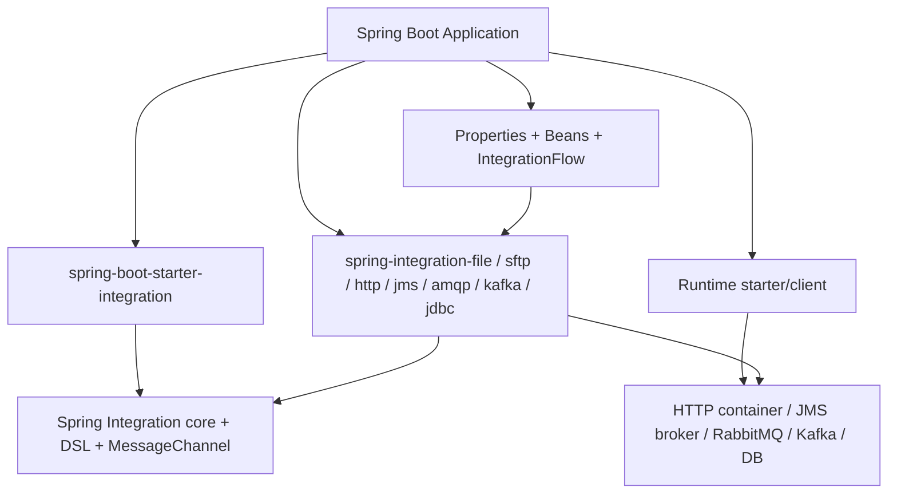
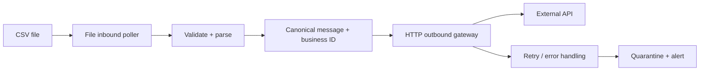

# Starter Dependencies for Each Adapter in Spring Boot and Spring Integration

> **Chapter:** Spring Boot  
> **Topic:** Starter dependency for each adapter  
> **Module:** `SPRING_INTEGRATION_ADAPTERS`  
> **Scope:** Connecting external systems to Spring Integration via inbound/outbound adapters, gateways, pollers, and `MessageChannel`; hands-on with File, SFTP, HTTP, JMS, AMQP/RabbitMQ, Kafka, and JDBC along with message contracts, error handling, and connection lifecycle.  
> **Audience:** Java/Spring Boot developers who already know Maven or Gradle and concepts such as beans, configuration, and dependency injection.

## 1. The Problem: Why Does Choosing the Right Dependency Matter?

In Spring Boot, a simple integration flow might look like this:

```text
File Directory --poll--> Spring Integration --transform--> MessageChannel
                                                        |
                                                        +--> business processing
                                                        |
                                                        +--> write JDBC / send Kafka / call HTTP
```

However, an application using a File adapter has different dependencies from an application reading SFTP or consuming Kafka. Adding the wrong starter easily leads to one of the following situations:

- Cannot find class `FileReadingMessageSource` or `Sftp` DSL.
- Missing `ConnectionFactory`, `KafkaTemplate`, `DataSource`, or HTTP server bean because the runtime client is missing.
- Spring Boot triggers unwanted auto-configuration because an extra broker/database starter was added without connection configuration.
- Spring Integration and Spring Framework libraries are incompatible due to manual version declarations.
- Tests only verify in-memory messages so they pass, yet the actual adapter fails to start because the driver/broker is missing.

The goal of this lesson is to **read integration requirements, identify the exact modules to declare**, distinguish Spring Integration adapter modules from Spring Boot starters for connection infrastructure, and verify the classpath and configuration before running.

### After This Lesson, You Should Be Able To

1. Explain the difference between `spring-boot-starter-integration`, `spring-integration-<adapter>`, and infrastructure starters/clients such as `spring-boot-starter-amqp`.
2. Choose minimal dependencies for File, SFTP, HTTP inbound/outbound, JMS, RabbitMQ/AMQP, Kafka, and JDBC.
3. Write Maven, Gradle Groovy DSL, and Gradle Kotlin DSL configurations following the same dependency matrix.
4. Build a Spring Boot app using a File inbound adapter, poller, and `IntegrationFlow` to verify the starter and basic auto-configuration.
5. Know when a broker, database, HTTP server, or external driver is needed; do not confuse having a dependency with having a running service.
6. Detect classpath conflicts, missing `ConnectionFactory`/`DataSource`, inbound/outbound mix-ups, profile issues, and transitive dependency impacts.
7. Design message contract handling, idempotency, retry, security, observability, and shutdown when adding adapters.

## 2. Distinguishing the Three Dependency Layers

There is no rule that "every adapter always has its own `spring-boot-starter-*`". With Spring Integration, an adapter is typically packaged as a **Spring Integration module** (for example `spring-integration-sftp`), while a Spring Boot starter can provide **auto-configuration** for the related runtime (for example RabbitMQ or JDBC).



### 2.1. Layer 1 — Spring Integration Core

**`org.springframework.boot:spring-boot-starter-integration`** is the standard starting point for Spring Boot using Spring Integration. It brings in the foundational components and related auto-configuration; you still have to add the specific adapter module when using File/SFTP/JMS/Kafka, etc.

Core concepts:

| Component | Role | Usually requires a separate transport module? |
|---|---|---|
| `Message<T>` and `MessageHeaders` | Payload + metadata contract | No |
| `MessageChannel` | Communication boundary between endpoints | No |
| `DirectChannel`, `QueueChannel`, `PublishSubscribeChannel` | Message distribution strategies | No |
| `IntegrationFlow` and Java DSL | Processing pipeline description | No |
| `@MessagingGateway` / `@Gateway` | Invoke a flow via a business interface | No, except for transport endpoints |
| `ServiceActivator`, `Transformer`, `Filter`, `Router` | Process and route messages | No |
| `Poller` / `Pollers` | Trigger polling for sources that need polling | No |
| File/SFTP/JMS/Kafka endpoint | Execute protocol and message mapping | **Yes** |

With modern Spring Integration versions used in Spring Boot 3.x and later, Java DSL is built into the core ecosystem; do not blindly add the old `spring-integration-java-dsl` artifact just because an online example mentions it.

### 2.2. Layer 2 — Adapter Module

Example:

```xml
<dependency>
    <groupId>org.springframework.integration</groupId>
    <artifactId>spring-integration-sftp</artifactId>
</dependency>
```

This library provides endpoints/handlers suitable for the SFTP protocol; it does **not** mean Spring Boot automatically knows the host address, account, private key, remote directory, or host-key verification policy.

### 2.3. Layer 3 — Connection Starter or Client

For example, using RabbitMQ typically includes:

```xml
<dependency>
    <groupId>org.springframework.integration</groupId>
    <artifactId>spring-integration-amqp</artifactId>
</dependency>
<dependency>
    <groupId>org.springframework.boot</groupId>
    <artifactId>spring-boot-starter-amqp</artifactId>
</dependency>
```

`spring-integration-amqp` provides Integration adapters/gateways; the AMQP starter brings in Spring AMQP components and auto-configuration for RabbitMQ. A `RabbitTemplate` or `ConnectionFactory` does not turn into an `IntegrationFlow` on its own; they serve the connection layer used by the endpoints.

**Practical rule:** Treat the adapter and runtime layers as **functional requirements**. If a module already brings in the runtime transitively, you do not necessarily have to redeclare the exact same artifact; however, the starter is often useful for auto-configuration/property alignment, and the actual dependency graph is the source of truth.

## 3. Dependency Selection Matrix for Each Adapter

The table below focuses on Spring Boot applications managing versions via Boot's BOM, without hard-coding individual module versions.

| Need | Spring Integration module to note | Boot starter/runtime typically paired | Deployment prerequisites |
|---|---|---|---|
| **File inbound/outbound** | `spring-integration-file` | Usually only core + file | Directory exists/writable, filesystem volume, filtering already-processed files |
| **SFTP inbound/outbound** | `spring-integration-sftp` | SSH/SFTP client comes from compatible module dependency | Host, port, credentials, host-key trust, session factory, network |
| **HTTP inbound (Servlet)** | `spring-integration-http` | `spring-boot-starter-web` (when serving HTTP via Servlet) | Web server, route mapping, authentication, request/reply |
| **HTTP outbound** | `spring-integration-http` | Appropriate Spring HTTP client; `spring-boot-starter-web` only when a Servlet web stack is truly needed | URL, TLS, timeout, auth, response mapping |
| **JMS inbound/outbound** | `spring-integration-jms` | `spring-boot-starter-artemis` or appropriate JMS provider starter/client | JMS `ConnectionFactory`, queue/topic, broker, destination |
| **AMQP/RabbitMQ** | `spring-integration-amqp` | `spring-boot-starter-amqp` | RabbitMQ, `CachingConnectionFactory`, exchange/queue/routing key |
| **Kafka** | `spring-integration-kafka` | `spring-kafka` (usually included with the module) + Spring Boot Kafka auto-configuration | Broker, topic, group ID, serializers/deserializers |
| **JDBC/database** | `spring-integration-jdbc` | `spring-boot-starter-jdbc` + DB driver | `DataSource`, tables/schema, transactions, and queries |
| **In-memory messages/gateway only** | Core/`spring-boot-starter-integration` | No broker/database needed | Channel beans, error channel, message contract |

**How to read the table:** Choose the **adapter module by protocol**, then choose the **runtime starter/client only when actually using that connection**. Most Spring Integration transport modules do not have a Boot starter named after the corresponding adapter. Do not add every dependency in the table to every project.

### 3.1. Inbound, Outbound, Gateway, and Poller Are Flow Design, Not Starter Names

Take the same File module as an example:

- **Inbound adapter:** polls a directory and sends `File` into a channel.
- **Outbound adapter:** receives a message and writes a file.
- **Inbound gateway/outbound gateway:** provides a request/reply model depending on what the adapter supports.
- **Poller:** required for sources that do not emit events on their own and configured via core endpoint/poller configuration.

`DirectChannel`, `ExecutorChannel`, or `QueueChannel` does not create a separate "channel starter". Dependency changes usually come from **the input/output protocol and specific runtime**, not from whether the direction is inbound or outbound.

## 4. Maven: Version Management Strategy

Spring Boot provides dependency management (via a parent POM or BOM). Avoid specifying individual Spring Integration versions unless you have a special compatibility requirement; the same application should not arbitrarily mix Spring Boot, Spring Framework, Spring Messaging, and Spring Integration from different branches.

### 4.1. Boot Project Using Parent/BOM

In a Maven project generated by Spring Initializr or importing the Boot BOM, declare core and modules as follows:

```xml
<dependencies>
    <!-- Spring Integration core / Boot integration support -->
    <dependency>
        <groupId>org.springframework.boot</groupId>
        <artifactId>spring-boot-starter-integration</artifactId>
    </dependency>

    <!-- Only add when actually reading/writing files -->
    <dependency>
        <groupId>org.springframework.integration</groupId>
        <artifactId>spring-integration-file</artifactId>
    </dependency>

    <!-- Test framework + Spring Integration test utilities -->
    <dependency>
        <groupId>org.springframework.boot</groupId>
        <artifactId>spring-boot-starter-test</artifactId>
        <scope>test</scope>
    </dependency>
    <dependency>
        <groupId>org.springframework.integration</groupId>
        <artifactId>spring-integration-test</artifactId>
        <scope>test</scope>
    </dependency>
</dependencies>
```

This XML snippet is the `<dependencies>` section to insert into **an existing valid Boot POM**; it is not a complete standalone buildable `pom.xml`. Versions are managed by the project's BOM/parent. If your project does not use Boot dependency management, you must manually select a **compatible version set** and inspect the dependency tree rather than simply omitting `<version>`.

### 4.2. Two Adapters in the Same Application

If a flow reads SFTP and outputs to Kafka:

```xml
<dependencies>
    <dependency>
        <groupId>org.springframework.boot</groupId>
        <artifactId>spring-boot-starter-integration</artifactId>
    </dependency>
    <dependency>
        <groupId>org.springframework.integration</groupId>
        <artifactId>spring-integration-sftp</artifactId>
    </dependency>
    <dependency>
        <groupId>org.springframework.integration</groupId>
        <artifactId>spring-integration-kafka</artifactId>
    </dependency>
</dependencies>
```

You must also add Kafka producer/consumer configuration, an SFTP session factory, and credentials/host trust. If your code directly uses `KafkaTemplate` or APIs from `spring-kafka`, you can declare `spring-kafka` directly to make library usage explicit — even though the adapter may already pull it in transitively.

### 4.3. Do Not Replace the BOM with Copy-Pasted Versions

Common anti-pattern:

```xml
<!-- Example NOT to imitate: forcing a version from an old article -->
<dependency>
    <groupId>org.springframework.integration</groupId>
    <artifactId>spring-integration-http</artifactId>
    <version>OLD-UNRELATED-VERSION</version>
</dependency>
```

`OLD-UNRELATED-VERSION` is just a placeholder illustrating the mistake, not a valid version. Omitting explicit versions so the BOM manages them is usually better; when an override is strictly required, you must verify release compatibility, dependency convergence, and integration system tests.


## 5. Sample Dependency Sets for Each Protocol

All snippets in this section **assume you already have** `spring-boot-starter-integration` from section 4. Pick only the group you need; do not add everything at once just to try them out. Most sample configurations are designed for **Spring Boot 3.x / Spring Integration 6.x**; other Boot projects should cross-check API/module/BOM details for their target version.

### 5.1. File Adapter

```xml
<dependency>
    <groupId>org.springframework.integration</groupId>
    <artifactId>spring-integration-file</artifactId>
</dependency>
```

Common classes and DSL: `FileReadingMessageSource`, `FileWritingMessageHandler`, `Files.inboundAdapter(...)`, `Files.outboundAdapter(...)`. You do not need `spring-boot-starter-web` or a Kafka client when only processing local files.

**Inbound:** polls a directory, filters by name/metadata, and sends `File` into a `MessageChannel`. **Outbound:** takes `String`/`byte[]`/`File` from a message and writes to a target directory according to a naming policy. When source files are being written by another process, use an **atomic rename/ready-file** convention to avoid reading partial files. An in-memory once-only file filter does not provide exactly-once across restarts; you need persistent metadata or a business-key idempotency mechanism.

**Common errors:** missing volume read/write permissions, relative paths shifting with the working directory, pattern filter mismatches, files being re-read after restart, writing incomplete files that downstream sees too early.

### 5.2. SFTP Adapter

```xml
<dependency>
    <groupId>org.springframework.integration</groupId>
    <artifactId>spring-integration-sftp</artifactId>
</dependency>
```

Common components: `DefaultSftpSessionFactory`, inbound file synchronizer or streaming inbound adapter, SFTP outbound handler/gateway. The SFTP module brings compatible SSH/SFTP client components into the dependency graph, but it **does not automatically connect to a server** without a session factory and flow.

**Required information to design the connection:** hostname/port, service credentials or private key from a secret manager, host-key fingerprint/trust store, remote directory, polling schedule, and rename/archive/checkpoint rules. Do not arbitrarily enable "accept unknown host key" in production; verify host keys to prevent man-in-the-middle attacks.

**Inbound sync vs. streaming:** syncing locally before entering the flow makes file reprocessing reliable but requires staging storage. Streaming reads directly over the session, requiring special attention to connection lifecycle and failure recovery when a stream fails.

**Common errors:** missing `known_hosts`, unauthorized key, timeouts, server closing sessions, wrong remote path, partially uploaded files, overlapping polls, connection leaks when consumers do not close streams.

### 5.3. HTTP Inbound and Outbound

To use Spring Integration's HTTP adapter:

```xml
<dependency>
    <groupId>org.springframework.integration</groupId>
    <artifactId>spring-integration-http</artifactId>
</dependency>
```

If the Spring Boot application itself **receives HTTP requests via the Servlet stack**:

```xml
<dependency>
    <groupId>org.springframework.boot</groupId>
    <artifactId>spring-boot-starter-web</artifactId>
</dependency>
```

**Do not automatically assume** outbound HTTP needs an embedded web server: if you only call external APIs, adding `spring-boot-starter-web` can unnecessarily spin up a Servlet application. Check the client API and actual transport dependencies of the version you use. For WebFlux/reactive, choose the compatible stack/module; do not arbitrarily mix `spring-integration-http` Servlet endpoints with reactive endpoints.

- **Inbound gateway:** an HTTP request enters an `IntegrationFlow` and returns an HTTP response; requires request–reply semantics, timeouts, and exception mapping.
- **Outbound gateway:** the flow calls an HTTP API and waits for a response; configure URI, method, headers, error mapping, timeout, and retry.
- **Outbound adapter** (fire-and-forget) depends on endpoint characteristics; do not assume every HTTP call needs no response.

**Common errors:** missing Servlet context for inbound handlers, route collisions with MVC controllers, failing to filter inbound headers, forwarding `Authorization` headers to the wrong destination, missing timeouts, retrying `POST` without an idempotency key, treating `4xx` as transient errors.

### 5.4. JMS Adapter

```xml
<dependency>
    <groupId>org.springframework.integration</groupId>
    <artifactId>spring-integration-jms</artifactId>
</dependency>
```

Example choosing Apache ActiveMQ Artemis via Spring Boot:

```xml
<dependency>
    <groupId>org.springframework.boot</groupId>
    <artifactId>spring-boot-starter-artemis</artifactId>
</dependency>
```

The JMS adapter sends/receives messages via `jakarta.jms` in the corresponding modern Boot stacks. You need a JMS provider with a `ConnectionFactory`; Artemis is only **one option**, not mandatory if your enterprise uses another provider. When switching providers, use a client/starter compatible with the **JMS API namespace** of your Spring Integration version. Do not pair an old `javax.jms` client with an application requiring `jakarta.jms` and expect classes to be compatible.

**Configuration details needed:** broker URL, credentials, queue/topic, message converter, acknowledgement, transaction, concurrency, redelivery/DLQ, and durable subscription if using a topic.

**Common errors:** `No qualifying bean of type ConnectionFactory`, no JMS broker running, uncreated destination, listener receiving duplicates due to rollback, message format mismatch with converter, error handling before ACK and infinite poison-message loops.

### 5.5. AMQP/RabbitMQ Adapter

```xml
<dependency>
    <groupId>org.springframework.integration</groupId>
    <artifactId>spring-integration-amqp</artifactId>
</dependency>
<dependency>
    <groupId>org.springframework.boot</groupId>
    <artifactId>spring-boot-starter-amqp</artifactId>
</dependency>
```

The Integration module builds inbound/outbound endpoints and gateways on top of Spring AMQP; the Boot starter provides `RabbitTemplate`, `CachingConnectionFactory`, and related configuration beans for RabbitMQ. You need a RabbitMQ broker, vhost, exchange/queue/binding, routing key, and security setup.

**AMQP is not synonymous with JMS:** they are two different modules even though both transfer messages. Do not add `spring-integration-jms` when the system only uses RabbitMQ over AMQP.

**Common errors:** RabbitMQ not running, wrong vhost or permissions, missing queue/exchange, misconfigured manual ACK, consumer retry without a DLQ, ignored confirm/return handling.

### 5.6. Kafka Adapter

```xml
<dependency>
    <groupId>org.springframework.integration</groupId>
    <artifactId>spring-integration-kafka</artifactId>
</dependency>
```

The Kafka module uses Spring Kafka components; the dependency tree usually includes `spring-kafka` and Kafka clients transitively. When your application directly uses `KafkaTemplate` or listener APIs outside Spring Integration, declare the direct dependency as well to express the boundary clearly:

```xml
<dependency>
    <groupId>org.springframework.kafka</groupId>
    <artifactId>spring-kafka</artifactId>
</dependency>
```

In Spring Boot 3.x projects, Spring Kafka is auto-configured by Boot via the classpath and `spring.kafka.*` properties; do not invent an artifact named `spring-boot-starter-kafka` based on general naming conventions. Check the starter list **for your exact Boot version** rather than guessing names.

**Configuration details needed:** bootstrap servers, security protocol/SASL/TLS, topic, consumer group, serializer/deserializer, key strategy, error handling, offset commit, retry topic/DLT, and idempotency. Kafka guarantees ordering within **a single partition**, not across the entire topic. Do not claim end-to-end business exactly-once just because Kafka producer idempotence is enabled.

**Common errors:** unreachable broker advertised listener, wrong consumer group, deserialization failure causing a consumer loop, missing topic ACLs, committing offsets before downstream persistence, infinite retries on a poison record.

### 5.7. JDBC Adapter

```xml
<dependency>
    <groupId>org.springframework.integration</groupId>
    <artifactId>spring-integration-jdbc</artifactId>
</dependency>
<dependency>
    <groupId>org.springframework.boot</groupId>
    <artifactId>spring-boot-starter-jdbc</artifactId>
</dependency>
```

Add the database driver matching your DBMS; for example, PostgreSQL:

```xml
<dependency>
    <groupId>org.postgresql</groupId>
    <artifactId>postgresql</artifactId>
    <scope>runtime</scope>
</dependency>
```

The Integration JDBC module supports table polling, update/outbound handling, and message coordination. The Boot JDBC starter configures `DataSource`, `JdbcTemplate`, and transaction infrastructure when valid properties are present. `spring-integration-jdbc` **does not create tables automatically** just because the dependency is present. Use a migration tool or managed schema for business tables and metadata stores.

**Design decisions needed:** polling by key/progress, transaction boundaries, atomic mark-as-processed, locking across multiple instances, pagination/batching, transaction duration, and retry. If reading rows and sending to Kafka, there is no single atomic transaction spanning PostgreSQL and Kafka; consider transactional outbox/CDC and idempotent consumers.

**Common errors:** missing JDBC driver, `DataSource` not created due to invalid URL, missing tables, poll SQL re-selecting old rows, multiple instances claiming the same row, long-running transactions causing locks, connection pool leaks.

### 5.8. Protocol-Independent Gateways and Channels

An internal gateway interface and `DirectChannel` do not require adding starters for Kafka, JMS, or HTTP:

```java
import org.springframework.integration.annotation.Gateway;
import org.springframework.integration.annotation.MessagingGateway;

@MessagingGateway
public interface OrderGateway {
    @Gateway(requestChannel = "orderInput")
    void submit(String orderId);
}
```

This is an **entry point into a `MessageChannel`**, which does not by itself publish orders to a broker; calls can be synchronous or asynchronous depending on the channel type and flow. The gateway interface also needs to be registered/scanned by Spring (for example `@IntegrationComponentScan` or a bean registration mechanism matching your application setup). Only when a downstream endpoint actually uses Kafka/JMS/AMQP/HTTP do you need the corresponding transport module.

If your application has multiple adapters, manage boundaries with clear channels, payload types, header contracts, and flow endpoints; do not let a new adapter automatically reuse an old payload format without checking serialization.


## 6. Gradle: Declaring the Same Dependency Set

If you use a Gradle project configured with the Spring Boot plugin and dependency management/BOM, you do not need to specify separate versions for each `spring-integration-*`. Below is only the `dependencies` block, not a replacement for the entire `build.gradle` or `build.gradle.kts`.

### 6.1. Gradle Groovy DSL

Example application that receives files, calls an HTTP API, and saves to JDBC:

```groovy
dependencies {
    implementation 'org.springframework.boot:spring-boot-starter-integration'

    implementation 'org.springframework.integration:spring-integration-file'
    implementation 'org.springframework.integration:spring-integration-http'
    implementation 'org.springframework.integration:spring-integration-jdbc'

    implementation 'org.springframework.boot:spring-boot-starter-jdbc'
    runtimeOnly 'org.postgresql:postgresql'

    testImplementation 'org.springframework.boot:spring-boot-starter-test'
    testImplementation 'org.springframework.integration:spring-integration-test'
}
```

Do not add `spring-boot-starter-web` if the application **is only a batch/poller calling outbound HTTP and does not need an embedded Servlet server**, unless the specific API you use requires the corresponding web starter. Inspect the dependency graph of the specific HTTP client rather than relying on module names.

### 6.2. Gradle Kotlin DSL

Example using SFTP and Kafka:

```kotlin
dependencies {
    implementation("org.springframework.boot:spring-boot-starter-integration")
    implementation("org.springframework.integration:spring-integration-sftp")
    implementation("org.springframework.integration:spring-integration-kafka")

    // Declare directly if source code uses Spring Kafka APIs.
    implementation("org.springframework.kafka:spring-kafka")

    testImplementation("org.springframework.boot:spring-boot-starter-test")
    testImplementation("org.springframework.integration:spring-integration-test")
}
```

**Note:** If the Gradle project does not apply Boot dependency management or does not import the BOM properly, versionless modules will fail to resolve. In that case, check the plugin/BOM setup first rather than adding random versions to individual adapters.

### 6.3. Maven/Gradle Quick Comparison

| Need | Maven scope | Gradle configuration |
|---|---|---|
| Adapter used at runtime | `compile` (default) | `implementation` |
| Driver used only at runtime | `runtime` | `runtimeOnly` |
| Spring Integration test utilities | `test` | `testImplementation` |
| Library needed only at compile time (rare in labs) | `provided` (in appropriate Maven context) | `compileOnly` |

Keep **unnecessary** dependencies off the runtime classpath: fewer libraries reduce vulnerability surface, accidental auto-configuration risks, and application startup time.

## 7. Minimal Lab: File Inbound Adapter Running with Spring Boot

### 7.1. Structure and Scope

Create a Spring Boot Maven/Gradle project using your usual tool, choose a Boot version **compatible with your JDK**, and add:

- `spring-boot-starter-integration`.
- `spring-integration-file`.
- `spring-boot-starter-test` and `spring-integration-test` in test scope if you want automated testing.

Sample directory layout:

```text
file-adapter-lab/
├── pom.xml or build.gradle[.kts]
└── src/
    └── main/
        ├── java/com/example/integration/
        │   ├── AdapterLabApplication.java
        │   └── FileAdapterConfig.java
        └── resources/
            └── application.yml
```

You can create `data/in` next to the build file; the flow will attempt to create this directory if it does not exist. **Do not let external programs write directly into the polled directory before a file is complete**; use atomic rename or staging.

### 7.2. Spring Boot Application Class

```java
package com.example.integration;

import org.springframework.boot.SpringApplication;
import org.springframework.boot.autoconfigure.SpringBootApplication;

@SpringBootApplication
public class AdapterLabApplication {
    public static void main(String[] args) {
        SpringApplication.run(AdapterLabApplication.class, args);
    }
}
```

`@SpringBootApplication` enables component scanning for its package. `@Configuration` in the next file is discovered because it is in or beneath the application package.

### 7.3. File Inbound Flow with Poller

```java
package com.example.integration;

import java.io.File;
import java.io.IOException;
import java.io.UncheckedIOException;
import java.nio.charset.StandardCharsets;
import java.time.Duration;

import org.slf4j.Logger;
import org.slf4j.LoggerFactory;
import org.springframework.context.annotation.Bean;
import org.springframework.context.annotation.Configuration;
import org.springframework.integration.dsl.IntegrationFlow;
import org.springframework.integration.dsl.Pollers;
import org.springframework.integration.file.dsl.Files;

@Configuration
public class FileAdapterConfig {
    private static final Logger log =
            LoggerFactory.getLogger(FileAdapterConfig.class);

    @Bean
    IntegrationFlow fileInboundFlow() {
        return IntegrationFlow
            .from(
                Files.inboundAdapter(new File("data/in"))
                     .autoCreateDirectory(true)
                     .patternFilter("*.txt"),
                endpoint -> endpoint.poller(
                    Pollers.fixedDelay(Duration.ofSeconds(2))
                           .maxMessagesPerPoll(10)
                )
            )
            .handle(message -> {
                File file = (File) message.getPayload();
                try {
                    String text = java.nio.file.Files.readString(
                        file.toPath(), StandardCharsets.UTF_8
                    );
                    log.info("File={} bytes={} text={}",
                             file.getName(), file.length(), text.trim());
                } catch (IOException ex) {
                    throw new UncheckedIOException(ex);
                }
            })
            .get();
    }
}
```

Here:

- `Files.inboundAdapter(...)` belongs to the `spring-integration-file` module and ingests file sources.
- `.poller(...)` uses the Spring Integration Java DSL to wake the endpoint every two seconds, up to ten messages per poll.
- The default payload is a `java.io.File` object; the handler decides when to read its content. Do not mistake the default payload for a `String`.
- `.handle(...)` is the terminal processing endpoint of the flow, logging the file name and content. It does not automatically send to Kafka, HTTP, or a DB.
- I/O exceptions are wrapped in `UncheckedIOException` so flow error handling can observe them; in production you need a dedicated recovery flow.

This example uses the relative working directory `data/in` for learning. Production should load paths from configuration and explicit volume mounts.

### 7.4. Application Configuration

```yaml
spring:
  application:
    name: file-adapter-lab
  main:
    web-application-type: none

logging:
  level:
    com.example.integration: INFO
    org.springframework.integration: INFO
```

`web-application-type: none` demonstrates that this app **does not need to run an HTTP server**, while still using the full Spring Boot context. If your project adds a web starter for another need, remove this setting when you actually need to receive HTTP requests.

### 7.5. Running and Observing

In the project directory, run one of the two commands depending on your build tool:

```bash
# Maven project
./mvnw spring-boot:run

# Gradle project
./gradlew bootRun
```

On Windows, the wrappers are typically `mvnw.cmd` and `gradlew.bat`. Create `data/in/sample.txt` with dummy content:

```text
ORDER-1001,tenant-a,created
```

After one poll cycle, the application log should contain output similar to:

```text
File=sample.txt bytes=27 text=ORDER-1001,tenant-a,created
```

The `bytes` value depends on the actual content and line endings so it **does not have to be 27**; the success criterion is that the handler receives the file, reads UTF-8, and logs the correct content.

Create an additional `another.txt`, and it will be picked up by the poller. Try creating `ignore.csv`: because of `patternFilter("*.txt")`, the CSV file is not fed into the flow.

**Limitation to recognize:** The File inbound adapter can filter files already emitted during the current lifecycle, but it **does not automatically provide exactly-once across restarts**. It does not delete files after processing by default; if archiving, moving, or deleting after ACK is required, design a dedicated step with idempotency and failure handling.

## 8. Infrastructure Configuration for Other Adapters

Having a dependency does not mean having a valid connection bean. For external adapters, Spring Boot can only auto-configure when the classpath and configuration conditions match. The property examples below illustrate **structure only**; they do not contain real credentials.

### 8.1. RabbitMQ/AMQP

```yaml
spring:
  rabbitmq:
    host: rabbitmq.internal.example
    port: 5672
    virtual-host: /
    # username/password retrieved from environment or secret manager
```

If you declare the Integration AMQP module and starter while the broker is unreachable, the Maven build can still succeed while the runtime listener errors or retries continuously. You must verify queue/exchange bindings, TTL, retry, DLQ, and ownership. Do not use `guest/guest` in production environments.

### 8.2. Kafka

```yaml
spring:
  kafka:
    bootstrap-servers: kafka-1.internal.example:9092
    consumer:
      group-id: integration-worker
      auto-offset-reset: earliest
```

`auto-offset-reset` only takes effect when the group has no valid offset; it is not a "re-read every message" button. With Kafka integration, you must distinguish producer vs. consumer settings, serializers, security, offset/ack, and retry management. Kafka ACLs can reject publish/consume even when beans start successfully.

### 8.3. Artemis/JMS

```yaml
spring:
  artemis:
    mode: native
    broker-url: tcp://artemis.internal.example:61616
    # username/password: secret manager
```

This example only applies when the project uses Artemis and its corresponding starter. For other JMS providers, use the configuration/`ConnectionFactory` supported by that provider; do not assume an Artemis URL will work with every JMS broker.

### 8.4. JDBC

```yaml
spring:
  datasource:
    url: jdbc:postgresql://db.internal.example:5432/integration
    username: integration_app
    # password retrieved from secret manager
    hikari:
      maximum-pool-size: 10
```

The application also needs the PostgreSQL driver, schema/migrations, and least-privilege DB permissions. When polling via JDBC, deciding whether to use transactions and locking is a flow design concern, not automatically solved by `spring-boot-starter-jdbc`.

### 8.5. SFTP

SFTP does not have a standard `spring.sftp.*` property group shared across all Spring Integration adapters. You typically declare **application-specific properties** for host, port, user, and remote path and point the session factory to that configuration. Example:

```yaml
app:
  sftp:
    host: sftp.internal.example
    port: 22
    remote-dir: /inbound
    # username, private key, and host-key trust
    # provided by secret manager and deployment policy.
```

These `app.sftp.*` properties **do not automatically create** a `DefaultSftpSessionFactory`. You must create a bean configuring it or use an internal organization module/starter that does so; do not treat the property name as built-in Spring Boot auto-configuration.


## 9. Inspecting the Dependency Graph and Startup

### 9.1. Maven: Viewing Actual Dependencies

In the Maven project directory:

```bash
./mvnw dependency:tree
./mvnw help:effective-pom
```

To narrow down to Spring Integration, the Maven Dependency Plugin supports:

```bash
./mvnw dependency:tree -Dincludes=org.springframework.integration
```

On Windows PowerShell, argument quoting depends on the shell; use the `mvnw.cmd` wrapper accordingly and ensure `-Dincludes` is passed cleanly to Maven. The dependency tree should show the modules you expect and their transitive dependencies. It does not prove that the broker/DB or SFTP host is reachable.

### 9.2. Gradle: Runtime Classpath and dependencyInsight

```bash
./gradlew dependencies --configuration runtimeClasspath
./gradlew dependencyInsight --configuration runtimeClasspath --dependency spring-integration-core
```

From the output, verify:

- Multiple Spring Integration versions are not being forced in conflict with the BOM.
- `spring-integration-file` is present when calling File DSL; `spring-integration-sftp` is present when using SFTP; and similarly for Kafka/JMS/JDBC.
- Compatible clients/runtimes and JDBC drivers are present when needed.
- No unused broker/web starters are present, which could trigger unwanted auto-configuration or dependency vulnerabilities.
- Test-scoped dependencies have not leaked into runtime.

### 9.3. What Does a Transitive Dependency Mean?

Suppose `spring-integration-kafka` pulls `spring-kafka` into runtime. Application code can build even without declaring `spring-kafka` directly. Still, when `KafkaTemplate` is a direct API dependency in your application source code, declaring a direct dependency clarifies intent and reduces the risk of an upgrade changing transitives.

Conversely, adding only `spring-kafka` does not provide Integration Kafka endpoint DSLs. **Client libraries and Integration adapters are not interchangeable.**

### 9.4. Diagnosing Common Errors

| Symptom | Priority root cause to check | Action |
|---|---|---|
| `ClassNotFoundException` for `FileReadingMessageSource` | Missing `spring-integration-file` or wrong scope | Check compile/runtime classpath |
| Cannot resolve `IntegrationFlow` / `Pollers` | Missing/incompatible Spring Integration core | Check starter, BOM, package imports |
| Missing `ConnectionFactory` bean | Missing JMS/AMQP provider or misconfiguration | Distinguish JMS vs. AMQP, check Boot condition report |
| Missing `DataSource` bean | Missing JDBC starter/driver/config or auto-config excluded | Check URL, driver, profile, conditions |
| Files not polled | Wrong path, pattern filter, filesystem permissions, poller not running | Enable flow logging, check working directory |
| HTTP inbound 404 | Missing server/endpoint mapping, different route, or wrong Servlet stack | Check web starter, handler mapping, and context |
| HTTP outbound timeout | DNS/TLS/network, proxy, endpoint, or timeout policy | Check connection and error channel |
| SFTP failed handshake | Trust/host key, credentials, cipher, network | Fix host-key trust and secrets; do not disable verification |
| JMS listener not receiving messages | Queue/topic, broker, ACK, selector, consumer | Check destination and broker metrics |
| RabbitMQ consumer loop | Missing DLQ/retry, wrong converter, uncontrolled nack/requeue | Design poison-message handling |
| Kafka consumer not receiving records | Group offset, topic ACL, bootstrap listener, partitions | Check cluster, group lag, and partition assignment |
| JDBC polling duplicate rows | Query/predicate, transaction, multi-instance race | Locking/checkpoint or outbox/CDC |
| `NoSuchMethodError` or `NoClassDefFoundError` | Incompatible module versions | Align on the same BOM, check dependency convergence |

**Good investigation practice:** read the **root cause** in the stack trace and auto-configuration report rather than fixing by blindly adding random starters.

## 10. Message Contracts, Retries, and Connection Lifecycle

Having the right dependencies is necessary for a flow to run, **not sufficient** for the flow to be safe under failures.

### 10.1. Shared Message Contract

For a file → transform → Kafka/JMS/HTTP flow, define the contract for each channel:

```json
{
  "eventId": "evt-1001",
  "schemaVersion": 1,
  "tenantId": "tenant-a",
  "occurredAt": "2026-11-23T08:00:00Z",
  "type": "OrderCreated",
  "payload": {
    "orderId": "ORDER-1001",
    "status": "CREATED"
  }
}
```

This is an **illustrative** business JSON schema, not a payload required by Spring Integration. Separate:

- **Business key/event ID:** used for idempotency across restarts and retries.
- **Spring Integration message headers:** correlation ID, reply channel, error channel, sequence, content type, or transport headers; do not automatically expose all framework headers onto public brokers.
- **Transport metadata:** file path, SFTP remote path, HTTP status, JMS message ID, AMQP routing key, or Kafka topic/partition/offset — depending on what the adapter provides.
- **Security context:** verified tenant, identity, authentication/authorization; do not trust a header self-asserted by an external caller.

### 10.2. Error Handling and Retry by Source Type

| Adapter | Failure mode | Recovery idea |
|---|---|---|
| File | Partially written file, I/O error, re-read on restart | Staging + atomic rename, persistent filter, archive, and idempotent business handler |
| SFTP | Lost session, timeout, incomplete remote file | Reconnect, backoff, remote rename/marker, idempotent download |
| HTTP | 429/5xx/timeout, POST may already have been processed | Bounded retry, `Retry-After`, idempotency key, circuit breaker |
| JMS | Consumer rollback, redelivery | Transaction/ACK policy, retry/DLQ, deduplication |
| AMQP | Nack/requeue, publisher confirm failure | Confirm/return handling, DLQ, poison-message policy |
| Kafka | Offset commit before/after business work, deserialization failure | Error handler/DLT, idempotency, commit strategy, reprocessing |
| JDBC | Deadlock, timeout, poll receiving duplicate rows | Transaction/lock/checkpoint, backoff, outbox |

A `MessageChannel` can be synchronous or asynchronous; the boundary affects exception propagation. When processing over a `DirectChannel`, downstream errors usually propagate back up the synchronous call stack. With a poller endpoint or asynchronous channel, errors may be routed to `errorChannel`/error handlers depending on configuration; you must verify how your actual flow emits `ErrorMessage`.

**Do not confuse retry with exactly-once.** Even if adapters and brokers support retries, the business layer still needs idempotent consumers, proper transactions, or an outbox so duplicate invoices/accounts/transactions are never created.

### 10.3. Connection Management and Shutdown

- **SFTP:** session factory with timeouts, connection limits, and stream/session release; monitor server disconnects.
- **HTTP:** client pool, TLS, connect/read timeouts, DNS/proxy, graceful cancellation.
- **JMS/AMQP:** connection factory caching/pooling, listener concurrency, redelivery, shutdown without dropping in-flight messages.
- **Kafka:** consumer group rebalance, offset commit, producer flush, in-flight records, shutdown timeout.
- **JDBC:** connection pool size, maximum lifetime, transaction duration, and clean pool closure.
- **File:** avoid excessive concurrent polling, separate staging/processing/archive directories, and define post-error policies.

Bean **liveness** does not guarantee endpoint readiness: a Boot app may start up while the broker is still disconnected. When needed, add `spring-boot-starter-actuator`, appropriate readiness/health indicators, metrics, and per-adapter alerts.

## 11. Testing Dependencies and Adapters

To verify modules are added correctly, have three layers of checks:

1. **Build/classpath:** the resolver finds all classes with no API conflicts.
2. **ApplicationContext:** adapter beans, `IntegrationFlow`, pollers, and connection factories initialize cleanly.
3. **Integration contract:** real messages flow over the transport with a test broker/SFTP/DB instance, verifying payload, ACK, retry, security, and shutdown.

### 11.1. Test Suite for the File Lab

| Test | Setup | Expected result |
|---|---|---|
| Context boot | Core + file module, no web server needed | Boot application starts, flow bean exists |
| Valid file | Place `sample.txt` in `data/in` | Log shows file name and content received |
| Invalid file | Place `ignore.csv` | File is not processed due to pattern |
| Missing directory | Clean test directory, app has create permission | Adapter creates the directory |
| I/O denied | Directory lacks read permission in test environment | Investigable error occurs, not silently swallowed |
| Restart | Keep file and restart | Observe potential reprocessing; add persistent filter when needed |
| Multiple files | Place more than 10 files in the directory | Poller picks up batches according to `maxMessagesPerPoll` |
| Message contract | File containing valid dummy payload | Handler/transformer receives proper charset with no data loss |

**Note:** do not expect every file to be processed strictly once across all restarts. For business logic with side effects, write dedicated tests for duplicate inputs and idempotent handling.

### 11.2. Testing by Transport

| Protocol | Test infrastructure | What to observe |
|---|---|---|
| SFTP | Isolated SFTP server/test container | Host trust, authentication, file completeness, download retry |
| HTTP | Mock web server or test endpoint app | Request headers, response, timeout, 4xx/5xx, and idempotency |
| JMS | Provider-compatible test broker | Receive/ACK/rollback/DLQ |
| AMQP | RabbitMQ test instance | Exchange binding, confirm, requeue, poison message |
| Kafka | Kafka test instance or appropriate test framework | Producer/consumer, offset, reprocessing, DLT |
| JDBC | Test database matching production engine if needed | Poll/query, transaction/lock, driver/schema |

You can use Testcontainers or embedded brokers to verify real behavior, but only add test dependencies **for the transports you actually test**. Unit tests that only mock `MessageChannel` do not prove SFTP handshakes or Kafka consumer groups work properly.


### 11.3. Testing Dependency Changes

When adding a starter to a running application:

- Compare the dependency tree before and after.
- Inspect Spring Boot condition evaluation and newly auto-configured beans.
- Test production/staging/test profiles; do not run only the default profile.
- Check for unexpected open ports, new listeners, health checks, and connection attempts.
- Review vulnerabilities and licenses of newly added libraries.
- Verify that removing a dependency does not drop classes previously supplied transitively.

## 12. End-to-End Scenarios: From Requirements to Minimal Dependencies

### 12.1. Scenario A — Read CSV Files and Call an HTTP API

**Requirement:** Every minute, pick up CSV files from `/data/in`, normalize records, and POST to an order management system over HTTPS. No need to serve HTTP requests.

**Minimal Integration-level dependencies:**

```xml
<dependency>
    <groupId>org.springframework.boot</groupId>
    <artifactId>spring-boot-starter-integration</artifactId>
</dependency>
<dependency>
    <groupId>org.springframework.integration</groupId>
    <artifactId>spring-integration-file</artifactId>
</dependency>
<dependency>
    <groupId>org.springframework.integration</groupId>
    <artifactId>spring-integration-http</artifactId>
</dependency>
```

Specific Spring HTTP client dependencies are needed according to how the adapter is configured. Do not add `spring-boot-starter-web` merely because HTTP appears in the requirement if the app does not serve inbound HTTP. Flow design:



**Key risks:** reading a partially written file, single-line parser failure, HTTP timeout after the API already accepted the POST, retries creating duplicate orders. Needs file readiness, record-level idempotency keys, bounded retries, status mapping, and quarantine.

### 12.2. Scenario B — SFTP to Kafka

**Requirement:** Receive documents from a partner's SFTP server, verify content, and publish a `DocumentReceived` event to Kafka.

```xml
<dependency>
    <groupId>org.springframework.boot</groupId>
    <artifactId>spring-boot-starter-integration</artifactId>
</dependency>
<dependency>
    <groupId>org.springframework.integration</groupId>
    <artifactId>spring-integration-sftp</artifactId>
</dependency>
<dependency>
    <groupId>org.springframework.integration</groupId>
    <artifactId>spring-integration-kafka</artifactId>
</dependency>
```

If the flow needs to **sync files to local staging** and uses additional file adapters/filters directly, check the actual APIs and declare `spring-integration-file` directly when code depends on that module. If the app uses Kafka listener/producer APIs directly as well, declare `spring-kafka` as an intentional direct dependency.

**Operational rules:** SFTP host key verified, credentials kept out of Git, partial downloads never marked successful, Kafka keys stable by business ID; checkpoint/ACK state must be recoverable if Kafka publish succeeded while the SFTP session dropped.

### 12.3. Scenario C — Consume JMS and Update Database

**Requirement:** Read a queue from Artemis, write status to PostgreSQL, and ACK the message after the DB transaction commits.

```xml
<dependency>
    <groupId>org.springframework.boot</groupId>
    <artifactId>spring-boot-starter-integration</artifactId>
</dependency>
<dependency>
    <groupId>org.springframework.integration</groupId>
    <artifactId>spring-integration-jms</artifactId>
</dependency>
<dependency>
    <groupId>org.springframework.boot</groupId>
    <artifactId>spring-boot-starter-artemis</artifactId>
</dependency>
<dependency>
    <groupId>org.springframework.integration</groupId>
    <artifactId>spring-integration-jdbc</artifactId>
</dependency>
<dependency>
    <groupId>org.springframework.boot</groupId>
    <artifactId>spring-boot-starter-jdbc</artifactId>
</dependency>
<dependency>
    <groupId>org.postgresql</groupId>
    <artifactId>postgresql</artifactId>
    <scope>runtime</scope>
</dependency>
```

**Analysis point:** Having both a JMS transaction and a JDBC transaction does not automatically create a global distributed transaction across the broker and database. When handling distributed commit/ACK, the design must guard against duplicate messages, allow safe retries, use business locks, and decide whether a transaction coordinator/outbox is needed. Do not claim "exactly-once guaranteed" just because both starters are present.

### 12.4. Scenario D — Receive HTTP and Publish to RabbitMQ

**Requirement:** An HTTP inbound request creates an integration message, then sends it to a RabbitMQ exchange; return an HTTP response reflecting the outcome.

- Integration core: `spring-boot-starter-integration`.
- HTTP endpoint: `spring-integration-http` along with the Servlet web starter if using Servlet HTTP inbound.
- AMQP handler: `spring-integration-amqp` along with `spring-boot-starter-amqp`.
- Additional config: route authorization, request validation, HTTP timeouts, RabbitMQ confirms/returns, and strategy for mapping errors to appropriate HTTP statuses.

If the API must return success **only after the broker confirms the publish**, design explicit ACK/confirm logic; do not return `200 OK` immediately upon placing the message onto an internal channel before downstream persistence is confirmed.

## 13. Pre-Merge Dependency Decision Checklist

### 13.1. 8-Step Workflow

1. **Identify boundaries:** Where do messages come from and go? File, SFTP, HTTP, JMS, AMQP, Kafka, or database?
2. **Choose the Spring Integration module** for each endpoint; do not start by looking for a starter named after the protocol and assuming it is enough.
3. **Choose the runtime/client or Boot starter** matching the broker, driver, or web stack actually used.
4. **Keep the BOM consistent** with the Boot baseline; only override versions after checking compatibility.
5. **Check inbound/outbound/gateway/poller** and payload/header contracts; decide synchronous vs. asynchronous processing.
6. **Configure secrets, TLS, and connection lifecycle** for target environments; never commit credentials.
7. **Test build, context, and transport**; include failure, retry, duplicate, timeout, and shutdown scenarios.
8. **Review operations:** metrics, audit, alerts, resource limits, ownership, and dependency/vulnerability changes.

### 13.2. Self-Assessment Rubric

| Competency | Points |
|---|---:|
| Select the right dependencies for seven adapters and distinguish core/module/starter | 25 |
| Manage Maven/Gradle versions via BOM and appropriate scopes | 15 |
| File inbound lab with poller and `MessageChannel` concepts | 20 |
| Configure broker/DB/web/SFTP and protect secrets/connections | 15 |
| Understand message contracts, retry, idempotency, error channels, and ACK | 15 |
| Diagnose dependency trees, auto-configuration, and transport tests | 10 |
| **Total** | **100** |

**Passing criteria:** Learners do not accidentally add unused starters, can explain why a Spring Integration module alone may not suffice to connect to a broker/DB, can write minimal dependency snippets for each scenario, and can verify a File inbound flow with a poller on Spring Boot.

### 13.3. Review Questions

1. Why is adding `spring-boot-starter-integration` not enough to use `FileReadingMessageSource`?
2. Does an application that only makes outbound HTTP calls need an embedded Servlet server? When is `spring-boot-starter-web` needed?
3. Why does `spring-integration-jms` not replace the JMS provider's `ConnectionFactory`?
4. What is the difference between `spring-integration-amqp` and `spring-integration-jms` when both have queues?
5. When should you declare `spring-kafka` directly even though `spring-integration-kafka` already pulls it transitively?
6. What risks does the Spring Boot BOM mitigate when an application uses multiple Spring Integration modules?
7. Why can restarting a File inbound flow or retrying a Kafka/JMS consumer create business duplicates?
8. If Maven builds cleanly but the SFTP host is untrusted, is that a dependency issue or a connection/security configuration issue?
9. What is the difference between compile-time classpath, runtime classpath, and test classpath when adding an adapter?
10. If adding the AMQP starter causes the app to open an unexpected listener, which beans, profiles, and auto-config conditions should you inspect?

## Conclusion

**Starter dependencies for each adapter** are a problem of **layered responsibilities**: Spring Boot provides the runtime platform and auto-configuration; Spring Integration core provides Messages, Channels, Gateways, Pollers, and `IntegrationFlow`; `spring-integration-*` modules provide adapters; and infrastructure starters/clients provide the corresponding transports and connection resources.

Choosing the right dependencies ensures **the flow can compile and initialize**, while taking it to production also requires governing message contracts, errors, retry/idempotency, credentials, broker/DB readiness, observability, and connection lifecycles. Start with minimal modules, stick to a unified BOM, and only expand when each endpoint genuinely requires an additional protocol.
