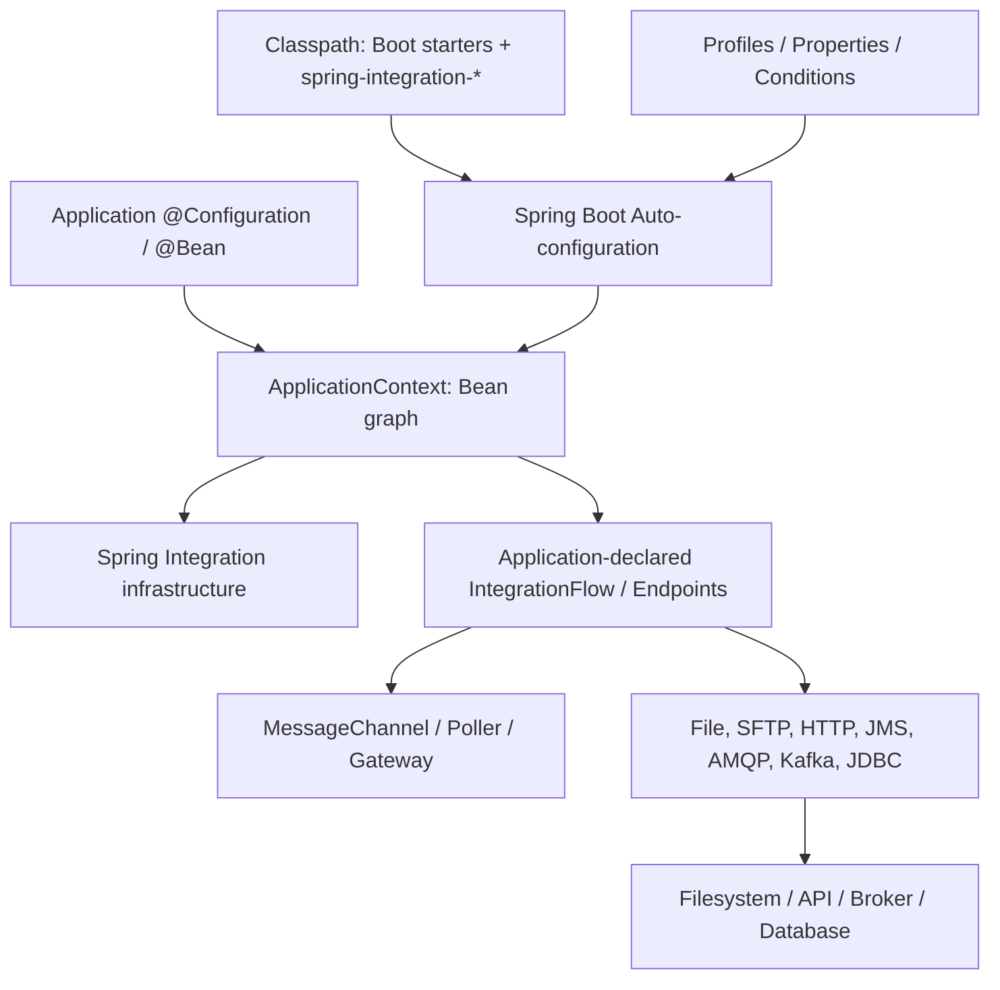
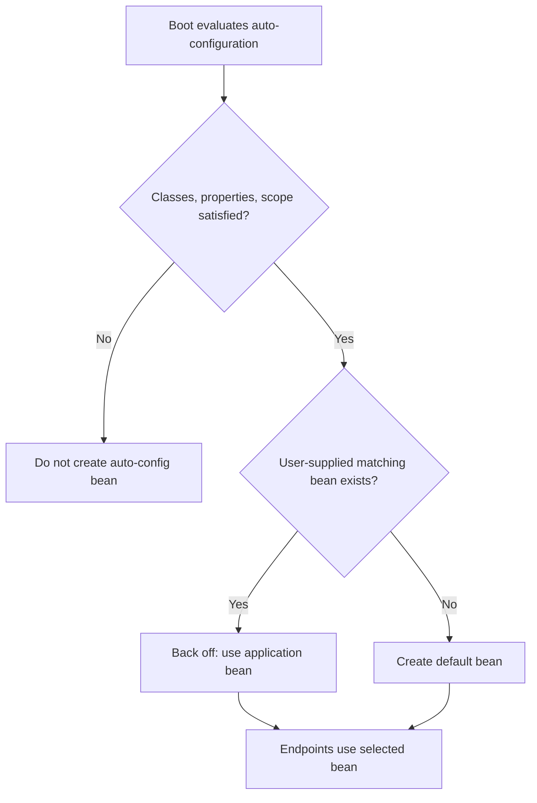

# Auto-configuration and Bean Override in Spring Boot with Spring Integration Adapters

> **Chapter:** Spring Boot  
> **Topic:** Auto-configuration and bean override  
> **Module:** `SPRING_INTEGRATION_ADAPTERS` — connecting external systems with inbound/outbound adapters, gateways, pollers, and `MessageChannel`; handling File, SFTP, HTTP, JMS, AMQP, Kafka, JDBC, message contracts, errors, and connection lifecycles.  
> **Audience:** Java/Spring Boot developers familiar with dependency injection, `@Bean`, `@Configuration`, and Maven/Gradle.  
> **Recommended lab environment:** Java 17+, Spring Boot 3.x, and Spring Integration 6.x under a compatible BOM. Some APIs, auto-configurations, and starters may differ across newer versions; check your **project version's** dependency graph and condition report before applying.

## 1. The Problem: Adding Adapters Without Knowing Where Beans Come From

An order-processing service currently reads files into Spring Integration, sends messages through a `MessageChannel`, and persists state to a database. The operations team wants to add SFTP inbound, publish events to Kafka, and use a non-default RabbitMQ `ConnectionFactory`. After adding the dependencies, the application hits three failures:

1. Two `MessageChannel` beans of the same type make injection by type ambiguous.
2. A developer defines a manual `DataSource` bean and is surprised to see `spring.datasource.*` settings stop taking effect as before.
3. An SFTP flow starts up in the test environment due to unclear profiles and configuration conditions, connecting out to a partner system.

This is not merely a "missing dependency" error. You must understand **under what conditions Spring Boot auto-configuration creates beans**, how it differs from **application-declared beans**, and how **overrides** affect the adapter runtime.

**Lesson goal:** intentionally control the bean graph, avoid silently altering message routing, never use bean-name overriding to mask configuration bugs, and verify startup via condition reports and tests.

### Learning Outcomes

After this lesson, you will be able to:

- Distinguish **Spring Boot auto-configuration**, **Spring Integration infrastructure**, **application configuration beans**, and **adapter endpoints**.
- Explain `@ConditionalOnClass`, `@ConditionalOnBean`, `@ConditionalOnMissingBean`, `@ConditionalOnProperty`, `@ConditionalOnSingleCandidate`, and their relationship to classpath, profiles, properties, and bean registration order.
- Understand **back-off** when an application supplies a compatible bean; distinguish **back-off**, **replacement**, **`@Primary`**, **`@Qualifier`**, and **bean-definition overriding**.
- Practice declaring an `IntegrationFlow` that reads File inbound, polls according to configuration, and sends to an application-named `DirectChannel`.
- Design an auto-configuration pattern for an **internal starter** with a default channel and safe application customization.
- Analyze the impact of customizing `ConnectionFactory`, `DataSource`, or Kafka infrastructure on JMS, AMQP, Kafka, JDBC, and SFTP.
- Use `--debug`, Actuator conditions, the dependency tree, and `ApplicationContextRunner` to verify which beans appear or do not appear.
- Write a checklist for retries, error channels, connection lifecycles, configuration security, metrics, and shutdown.

## 2. Auto-configuration Does Not Mean Adapters Start Automatically

### 2.1. Four Layers of Responsibility



| Layer | Examples | What gets configured? |
|---|---|---|
| **Classpath** | `spring-boot-starter-integration`, `spring-integration-file`, `spring-boot-starter-jdbc` | Classes exist for Boot and the application to use; does not prove connections succeed |
| **Boot auto-configuration** | Integration support, HTTP runtime, `DataSource`, Kafka/Rabbit infrastructure when conditions match | Creates default beans when types, properties, and conditions align |
| **Spring Integration infrastructure** | `MessageChannel`, `IntegrationFlow`, endpoint lifecycle, error handling | Transports and processes messages within the context |
| **Application / adapter endpoints** | `Files.inboundAdapter(...)`, `Amqp.outboundAdapter(...)`, JMS gateway, SFTP session factory | Actual sources/targets, pollers, channel names, connections, mappings, and error policies |

**Rule:** Adding `spring-integration-sftp` to the classpath does not automatically create an inbound flow to reach an SFTP server. Adding `spring-integration-kafka` does not automatically emit business events. You still need endpoint beans, topics, the appropriate session/producer/consumer factories, and security policies.

### 2.2. How Does Spring Boot Evaluate Conditions?

An auto-configuration class can activate when classes and dependencies exist, then create beans **only when a matching bean is absent**. Illustrative syntax:

```java
@AutoConfiguration
@ConditionalOnClass(SomeTransportClient.class)
class ExampleTransportAutoConfiguration {

    @Bean
    @ConditionalOnMissingBean(SomeConnectionFactory.class)
    SomeConnectionFactory exampleFactory() {
        return new SomeConnectionFactory();
    }
}
```

`SomeTransportClient`, `SomeConnectionFactory`, and `ExampleTransportAutoConfiguration` are **placeholder names to explain the conditional logic**, not Spring APIs. The key takeaway is: a class being present **does not guarantee** the bean will be created; and a `@Bean` provided by the application can cause the default bean to **back off**.

Conditions commonly used by Spring Boot:

| Condition | What does it check? | Common mistake |
|---|---|---|
| `@ConditionalOnClass` | Class exists on the classpath | Forgot to add adapter/provider dependency |
| `@ConditionalOnMissingClass` | Class does not exist | A transitive starter activates an unwanted branch |
| `@ConditionalOnBean` | Matching bean exists in the context at evaluation time | Configuration ordering issues or bean not yet declared |
| `@ConditionalOnMissingBean` | No matching bean by type/name/annotation is configured yet | Application bean causes the default to back off |
| `@ConditionalOnSingleCandidate` | Exactly one selectable candidate (even with an appropriate primary) | Multiple beans of the same type, no single candidate resolved |
| `@ConditionalOnProperty` | Property matches the expected value | Wrong prefix, profile, key name, or boolean value |
| `@ConditionalOnResource` | Resource exists | Wrong classpath/file path |
| `@Profile` | Spring profile is active | A flow accidentally enabled in test or prod |

**Subtlety:** `@ConditionalOnMissingBean` is not a negation meaning "nowhere in the entire future application will there be a bean". When writing auto-configuration, conditions are evaluated against bean definitions already processed. Therefore, put **library/starter** defaults in Boot's auto-configuration mechanism so application configurations are evaluated first, instead of creating multiple plain `@Configuration` classes whose order is hard to control.

### 2.3. Two Phases to Distinguish

- **BeanDefinition registration:** Spring reads configurations, evaluates conditions, and decides whether to register a bean definition.
- **Instantiation/lifecycle:** After selecting beans, Spring creates objects, injects dependencies, registers endpoints, and may connect or start consumers at application startup.

A bean may be **registered** yet fail during instantiation due to missing properties; a Kafka listener or SFTP poller may **initialize** yet fail to connect to the broker/server. The condition report only explains auto-configuration choices; it **does not replace readiness/health checks** for external systems.

## 3. Three Easily Confused Concepts: Back-off, Override, Bean Selection

### 3.1. Back-off: Boot Yields to Application Configuration



This is normally the **idiomatic way to replace a default bean**: the application provides a bean of the right type/name; auto-configuration uses `@ConditionalOnMissingBean` so it does not create a duplicate. It neither requires nor should enable global bean-definition overriding.

For example, when Spring Boot configures JDBC based on classpath and properties, declaring a custom `DataSource` in the application can prevent DataSource auto-configuration from creating the default. As a consequence, **properties Boot normally binds onto the default bean do not automatically apply to your hand-written `DataSource`**, unless you explicitly bind them.

### 3.2. `@Primary` Only Sets Priority for By-Type Injection

```java
@Configuration(proxyBeanMethods = false)
class ChannelSelectionConfig {

    @Bean("ordersChannel")
    @Primary
    MessageChannel ordersChannel() {
        return new DirectChannel();
    }

    @Bean("auditChannel")
    MessageChannel auditChannel() {
        return new PublishSubscribeChannel();
    }
}
```

You need to import `org.springframework.context.annotation.*`, `org.springframework.messaging.MessageChannel`, and the Spring Integration channel classes.

There are two distinct beans. `@Primary` tells Spring to prefer `ordersChannel` when injecting a `MessageChannel` **by type** without a qualifier. It **does not remove** `auditChannel`, **does not replace** auto-configuration, and **does not redirect a flow sending to `"auditChannel"` by name over to `ordersChannel`**.

### 3.3. `@Qualifier` Explicitly Names the Exact Candidate

```java
@Component
class OrderPublisher {
    private final MessageChannel ordersChannel;

    OrderPublisher(@Qualifier("ordersChannel") MessageChannel ordersChannel) {
        this.ordersChannel = ordersChannel;
    }

    void send(Message<?> message) {
        if (!ordersChannel.send(message)) {
            throw new IllegalStateException("Message was not accepted");
        }
    }
}
```

This example requires importing `@Component`, `@Qualifier`, `Message`, and `MessageChannel`. Prefer **explicit bean names/qualifiers** when an application has multiple channels or `ConnectionFactory` beans of the same type. Never rely on source-code declaration order as a bean-selection contract.

### 3.4. Bean-Definition Overriding Is Not Back-off

When two configurations attempt to register the **same bean name** without proper conditions, modern Spring Boot versions **reject bean definition overriding** by default, typically failing with a duplicate bean definition error. You may see the property:

```yaml
spring:
  main:
    allow-bean-definition-overriding: false
```

**Do not flip this to `true` just to make the application start.** Silent name-based overriding can mask dependency mistakes, alter message delivery, or accidentally disable security. The safe fix is deliberate back-off, distinct names, `@Qualifier`, `@Primary`, profiles, or removing redundant configuration.

### 3.5. When to Use Which Approach?

| Situation | Recommended | Avoid |
|---|---|---|
| Replacing a Boot default bean where auto-config supports back-off | One application bean of the right type/name; verify via condition report | Enabling global bean definition overriding |
| Multiple `MessageChannel`s needing distinct routing | Explicit names and `@Qualifier` / `.channel("name")` | Relying on bean declaration order |
| Multiple beans of the same type, one default injection candidate | `@Primary` with clear rationale | Assuming `@Primary` removes the other beans |
| Internal starter providing a default channel for apps | `@AutoConfiguration` + `@ConditionalOnMissingBean(name = "...")` | Plain library `@Configuration` racing with user config |
| Enabling a connector only in specific environments | `@ConditionalOnProperty`, `@Profile`, and startup/readiness tests | Relying on an "unreachable broker" to disable it |
| Changing a poll interval | Per-endpoint config, `@ConfigurationProperties` | Replacing the entire integration infrastructure |

## 4. Relationship Between Spring Boot and Each Adapter

### 4.1. Dependency Matrix and Commonly Needed Beans

| Adapter | Integration dependency | Auto-config / foundation resources typically needed | Endpoint beans you must decide |
|---|---|---|---|
| **File** | `spring-integration-file` | Integration core; filesystem/volume | File inbound/outbound source, filters, poller, path |
| **SFTP** | `spring-integration-sftp` | Module SSH client, host/credential trust | `SessionFactory`, remote path, sync/stream adapter |
| **HTTP inbound** | `spring-integration-http` | Servlet web stack if using Servlet inbound | HTTP mapping, gateway, request/reply, auth policy |
| **HTTP outbound** | `spring-integration-http` | Appropriate HTTP client; embedded server not necessarily needed | URI, timeout, TLS, headers, reply/error mapping |
| **JMS** | `spring-integration-jms` | JMS provider `ConnectionFactory`, optionally Artemis starter | Inbound/outbound/gateway, destination, ack/transaction |
| **AMQP/RabbitMQ** | `spring-integration-amqp` | `spring-boot-starter-amqp`, RabbitMQ `ConnectionFactory` / `RabbitTemplate` | Queue/exchange/routing key, listener/handler |
| **Kafka** | `spring-integration-kafka` | Spring Kafka producer/consumer factories, Boot config via `spring.kafka.*` | Topic, group, deserializers, offsets, retry |
| **JDBC** | `spring-integration-jdbc` | `spring-boot-starter-jdbc` + driver, `DataSource` / `JdbcTemplate` | Polling query, update, transaction, concurrency |

**Distinction:** Not every adapter has an identically named Boot starter. Boot auto-configuration can create a `DataSource` or `RabbitTemplate`, but it **cannot infer your business workflow**. Designing `IntegrationFlow`, `MessageChannel`, pollers, and endpoints remains the responsibility of your application or an intentional integration library.

### 4.2. Back-off Examples with Practical Consequences

- **JDBC:** Defining a manual `DataSource` can prevent Boot's default bean from being created. Before doing so, review pool sizing, driver, transaction manager, health/metrics, and profiles.
- **AMQP:** Defining a custom `ConnectionFactory` can replace the default factory bean. Dependent beans such as templates or listener factories may still be created by Boot **using your custom factory**, or be affected by additional conditions; read the condition report to be certain.
- **Kafka:** Having multiple `ProducerFactory`, `ConsumerFactory`, or `KafkaTemplate` beans requires clear names/qualifiers. A custom bean can suppress some default beans; code may still start up yet point at the wrong cluster.
- **SFTP:** `DefaultSftpSessionFactory` and known-host trust are usually declared by the application rather than auto-created by Boot merely because the SFTP module is present. Lifecycle and secrets must be managed explicitly.
- **HTTP:** Having `spring-boot-starter-web` can cause Boot to start a web server; outbound-only HTTP does not necessarily need an open server port.
- **File:** No transport factory is needed; issues usually involve paths, filters, pollers, channel beans, and files being reprocessed after restarts.

### 4.3. Avoid "Overriding" Infrastructure Beans Just Because Their Names Look Familiar

Spring Integration infrastructure beans follow naming conventions such as `errorChannel` as well as mechanisms for default pollers and endpoint lifecycles. Declaring a bean with the same name without understanding what registers it can break unrelated flows. Safer practices:

1. Give business channels **dedicated names**, such as `orders.inbound`, `orders.errors`.
2. Configure pollers **directly on the endpoint** that needs polling.
3. Attach error handlers to each respective flow and define explicit retry policies.
4. Customize global infrastructure only when you understand its impact across all adapters and have integration tests.


## 5. Spring Boot Lab: Toggling a File Inbound Flow by Property

This lab uses **a real adapter** without requiring a broker, DB, or SFTP server. The goal is to observe the difference between application-declared beans, framework-managed infrastructure beans, and endpoints that only appear when a condition is enabled.

### 5.1. Minimal Dependencies

Use a Java 17+ compatible Spring Boot project with Boot's parent or dependency management BOM. Add the following to `pom.xml`; **this is a `<dependencies>` block**, not a full POM:

```xml
<dependencies>
    <dependency>
        <groupId>org.springframework.boot</groupId>
        <artifactId>spring-boot-starter-integration</artifactId>
    </dependency>
    <dependency>
        <groupId>org.springframework.integration</groupId>
        <artifactId>spring-integration-file</artifactId>
    </dependency>
    <dependency>
        <groupId>org.springframework.boot</groupId>
        <artifactId>spring-boot-starter-test</artifactId>
        <scope>test</scope>
    </dependency>
    <dependency>
        <groupId>org.springframework.integration</groupId>
        <artifactId>spring-integration-test</artifactId>
        <scope>test</scope>
    </dependency>
</dependencies>
```

Equivalent in Gradle Groovy DSL **with BOM or Boot plugin and dependency management configured**:

```groovy
dependencies {
    implementation 'org.springframework.boot:spring-boot-starter-integration'
    implementation 'org.springframework.integration:spring-integration-file'

    testImplementation 'org.springframework.boot:spring-boot-starter-test'
    testImplementation 'org.springframework.integration:spring-integration-test'
}
```

Do not manually specify a `spring-integration-file` version that diverges from the Spring Boot BOM. Without Boot dependency management, omitting versions will fail to resolve; configure the BOM or a compatible version set first.

### 5.2. Structure

```text
file-auto-config-lab/
├── pom.xml
└── src/
    ├── main/
    │   ├── java/com/example/adapter/
    │   │   ├── AdapterApplication.java
    │   │   ├── FileProperties.java
    │   │   └── FileFlowConfiguration.java
    │   └── resources/application.yml
    └── test/java/com/example/adapter/
        └── FileFlowContextTest.java
```

When running, file data lives in `data/in` relative to the **working directory**. Do not configure production endpoints with uncontrolled relative paths; use absolute paths, mounted volumes, and service accounts with explicit permissions.

### 5.3. Spring Boot Entry Point

File `AdapterApplication.java`:

```java
package com.example.adapter;

import org.springframework.boot.SpringApplication;
import org.springframework.boot.autoconfigure.SpringBootApplication;

@SpringBootApplication
public class AdapterApplication {
    public static void main(String[] args) {
        SpringApplication.run(AdapterApplication.class, args);
    }
}
```

`@SpringBootApplication` includes auto-configuration and component scanning; it does not scan physical files or create File flows on its own. Those endpoints live in `FileFlowConfiguration`.

### 5.4. Binding Configuration with a Record

File `FileProperties.java`:

```java
package com.example.adapter;

import java.nio.file.Path;
import java.time.Duration;

import org.springframework.boot.context.properties.ConfigurationProperties;

@ConfigurationProperties(prefix = "app.file")
public record FileProperties(
        Path inbox,
        Duration pollInterval
) {}
```

Boot's binder maps `poll-interval` to `pollInterval` and parses `2s` into a `Duration`. In production apps, add validation so `inbox` is non-null and `pollInterval` is positive, preventing beans from initializing with invalid paths or intervals.

### 5.5. Defining an Explicitly Named Channel and Conditional Flow

File `FileFlowConfiguration.java`:

```java
package com.example.adapter;

import java.io.File;

import org.slf4j.Logger;
import org.slf4j.LoggerFactory;
import org.springframework.boot.autoconfigure.condition.ConditionalOnProperty;
import org.springframework.boot.context.properties.EnableConfigurationProperties;
import org.springframework.context.annotation.Bean;
import org.springframework.context.annotation.Configuration;
import org.springframework.integration.channel.DirectChannel;
import org.springframework.integration.dsl.IntegrationFlow;
import org.springframework.integration.dsl.Pollers;
import org.springframework.integration.file.dsl.Files;
import org.springframework.messaging.MessageChannel;

@Configuration(proxyBeanMethods = false)
@EnableConfigurationProperties(FileProperties.class)
public class FileFlowConfiguration {

    private static final Logger log =
            LoggerFactory.getLogger(FileFlowConfiguration.class);

    @Bean("fileEvents")
    MessageChannel fileEvents() {
        return new DirectChannel();
    }

    @Bean
    @ConditionalOnProperty(
        prefix = "app.file",
        name = "enabled",
        havingValue = "true"
    )
    IntegrationFlow fileInboundFlow(FileProperties props) {
        return IntegrationFlow
            .from(
                Files.inboundAdapter(props.inbox().toFile())
                     .autoCreateDirectory(true)
                     .patternFilter("*.txt"),
                endpoint -> endpoint.poller(
                    Pollers.fixedDelay(props.pollInterval())
                           .maxMessagesPerPoll(5)
                )
            )
            .channel("fileEvents")
            .get();
    }

    @Bean
    IntegrationFlow fileLoggingFlow() {
        return IntegrationFlow
            .from("fileEvents")
            .handle(message -> {
                if (!(message.getPayload() instanceof File file)) {
                    throw new IllegalArgumentException(
                        "Expected java.io.File payload"
                    );
                }
                log.info("Received file name={} bytes={}",
                         file.getName(), file.length());
            })
            .get();
    }
}
```

Key details to understand:

- `fileEvents` is an **application bean** with an explicit name; Boot does not need to auto-create this business channel.
- `fileInboundFlow` only has a **bean definition when `app.file.enabled=true`**. If false or absent (since `matchIfMissing` defaults to false), the inbound flow is not registered.
- `fileLoggingFlow` still exists when inbound is disabled because it only listens on the channel and does not generate new files itself.
- `Files.inboundAdapter` emits payloads of type `java.io.File`; it does not automatically read contents into a `String`.
- `.channel("fileEvents")` resolves the bean **by name**. Putting `@Primary` on another channel will not silently reroute it.
- The poller belongs to **this endpoint** and does not alter other inbound adapters across the system.
- The File inbound filter reduces duplicates in certain cases, but **does not promise exactly-once across restarts**. For business side effects, you need idempotency, a persistent accept-once filter/checkpoint, and an archiving step.

### 5.6. Application Properties

File `src/main/resources/application.yml`:

```yaml
spring:
  application:
    name: file-auto-config-lab
  main:
    web-application-type: none

app:
  file:
    enabled: true
    inbox: ./data/in
    poll-interval: 2s

logging:
  level:
    com.example.adapter: INFO
    org.springframework.integration: INFO
```

`web-application-type: none` avoids starting an HTTP server in an app that only polls files. To accept HTTP inbound, you need an appropriate web runtime; in that case, **do not** reuse this non-web setting.

### 5.7. Running and Toggling the Condition

In a Maven project with wrapper:

```bash
./mvnw spring-boot:run
```

For a Gradle project:

```bash
./gradlew bootRun
```

On Windows use `mvnw.cmd` or `gradlew.bat`. Create `data/in/order-001.txt` with dummy content:

```text
orderId=ORDER-001
tenantId=tenant-a
```

When the inbound flow is enabled, the handler logs the file name and size. `ignore.csv` is ignored because of the `*.txt` pattern.

Switch `app.file.enabled` to `false`, **restart the `ApplicationContext`**, and create another file `order-002.txt`. The application must not create an inbound consumer to poll the file. `fileEvents` and `fileLoggingFlow` remain valid beans. This illustrates **conditional bean registration**, not breaking file connectivity to disable an endpoint.

**Important:** Editing the YAML file while the context is already running does not cause `@ConditionalOnProperty` to re-evaluate automatically. Controlling endpoints dynamically at runtime requires an explicit lifecycle design, such as starting/stopping endpoints via supported mechanisms, rather than relying on auto-configuration auto-refresh.

## 6. Safe Bean Override in an Internal Starter

In section 5, the application declared `fileEvents` itself. Now suppose the organization publishes an **internal starter** that provides that channel as a default while still letting individual applications supply their own bean.

### 6.1. Creating Auto-configuration with Name-Based Back-off

In a **separate** Spring Boot library (for example, package `com.example.autoconfig`), declare:

```java
package com.example.autoconfig;

import org.springframework.boot.autoconfigure.AutoConfiguration;
import org.springframework.boot.autoconfigure.condition.ConditionalOnMissingBean;
import org.springframework.context.annotation.Bean;
import org.springframework.integration.channel.DirectChannel;
import org.springframework.messaging.MessageChannel;

@AutoConfiguration
public class AcmeFileChannelsAutoConfiguration {

    @Bean("fileEvents")
    @ConditionalOnMissingBean(name = "fileEvents")
    MessageChannel defaultFileEvents() {
        return new DirectChannel();
    }
}
```

In the **library JAR**, register the auto-configuration in:

```text
META-INF/spring/org.springframework.boot.autoconfigure.AutoConfiguration.imports
```

With one line:

```text
com.example.autoconfig.AcmeFileChannelsAutoConfiguration
```

When that library is added to a Boot app:

- If the app **does not** define a `fileEvents` bean, auto-configuration provides the default `DirectChannel`.
- If the app **defines** `@Bean("fileEvents")`, auto-configuration **backs off** and does not create a colliding bean.
- If the app creates a `MessageChannel` with a **different name**, the name-based condition will still create `fileEvents`. This is why you must understand condition scope.

`@ConditionalOnMissingBean(name = "fileEvents")` suits this example better than checking for missing **any** `MessageChannel`, because a Spring Integration application can have many distinct channels. For transport-level auto-configuration, matching by type may be more appropriate when the contract is "only one ConnectionFactory"; choose type vs. name based on **bean semantics**.

**Limitation:** This auto-configuration example belongs in a **separate** starter/library, not placed inside the application package expecting identical ordering behavior to real auto-config. Spring Boot discovers JAR auto-configurations via `AutoConfiguration.imports` so they are evaluated at the proper lifecycle stage.

### 6.2. Application Bean Customization and Flow Impact

When an organization wants to publish an event to multiple subscribers, the application can intentionally supply a different channel:

```java
@Configuration(proxyBeanMethods = false)
class CustomFileChannelConfig {

    @Bean("fileEvents")
    MessageChannel customFileEvents() {
        return new PublishSubscribeChannel();
    }
}
```

With the starter imported, this bean shares the name `fileEvents` and causes the internal auto-configuration from section 6.1 to back off. **However, this changes semantics**, not just a syntactic "override":

| `DirectChannel` | `PublishSubscribeChannel` |
|---|---|
| Unicast to one subscriber chosen by the dispatcher | Broadcasts messages to all subscribers |
| Usually synchronous on the sender thread | Can be synchronous or use a configured executor |
| Suits a single primary processing pipeline | Suits fan-out when every subscriber must receive the event |
| Does not create a durable queue | Does not create a durable queue |

If the File flow previously had a single handler, fan-out can trigger multiple side effects when new subscribers are added. Test delivery, error handling, sync/async behavior, and idempotency requirements **before switching channel types**.

### 6.3. Why Not Use `@Primary` to "Override" a Channel by Name?

`@Primary` only sets priority for by-type injection. If the DSL calls:

```java
.channel("fileEvents")
```

then the name `"fileEvents"` already identifies the target. Another bean marked `@Primary` will not automatically replace it. To change routes, update the flow configuration or use an explicit routing mechanism.

### 6.4. Intentional Profile and Property Selection

You can organize environment-specific configuration:

```java
@Configuration(proxyBeanMethods = false)
@Profile("partner-sftp")
class PartnerSftpFlowConfig {
    // Only register SFTP endpoints allowed for this profile.
}
```

Alongside `@ConditionalOnProperty` on flows, profiles should be strictly controlled during deployment. Never use "SFTP dependency present" as a signal to automatically open connections; SFTP may be needed in test code while only the production profile connects to partners.

**Do not slap `@ConditionalOnProperty` onto a bean that other flows unconditionally inject.** If the condition suppresses the bean while downstream beans still require constructor injection, startup will fail. Toggle an entire group of flows/endpoints together or use explicit optional dependencies.


## 7. Infrastructure Bean Back-off: DataSource, JMS, AMQP, and Kafka

An application bean **can alter an entire auto-configuration chain**, not just one isolated object. When customizing transports, separate:

1. **Factory/driver/client:** establishes connections to external resources.
2. **Template or listener infrastructure:** sends/receives using the configured factory.
3. **Spring Integration endpoint:** bridges the transport to a `MessageChannel`, applying converters, retries, ACK, and error handling.
4. **Business flow:** transforms, routes, persists, and correlates messages.

### 7.1. JDBC: A Manual DataSource Causes Boot to Back Off

When `spring-boot-starter-jdbc` and a matching driver are present, Spring Boot can auto-configure a `DataSource` from `spring.datasource.*`. When the application intentionally declares its own `DataSource`, the default bean is normally not created.

Example **only for when the application genuinely requires customization** and HikariCP is on the classpath:

```java
package com.example.adapter;

import com.zaxxer.hikari.HikariDataSource;
import org.springframework.boot.context.properties.ConfigurationProperties;
import org.springframework.context.annotation.Bean;
import org.springframework.context.annotation.Configuration;
import org.springframework.context.annotation.Profile;

@Configuration(proxyBeanMethods = false)
@Profile("custom-jdbc")
public class CustomJdbcConfiguration {

    @Bean("dataSource")
    @ConfigurationProperties(prefix = "app.jdbc.pool")
    HikariDataSource dataSource() {
        return new HikariDataSource();
    }
}
```

Custom configuration:

```yaml
app:
  jdbc:
    pool:
      jdbc-url: jdbc:postgresql://db.internal.example:5432/orders
      username: orders_app
      # Password retrieved from secret manager, never hard-coded in Git.
      maximum-pool-size: 8
```

When running the `custom-jdbc` profile:

- `dataSource` is an **application-declared bean**.
- If Boot's DataSource auto-configuration checks for a missing `DataSource`, the default branch backs off.
- Beans such as `JdbcTemplate`, transaction managers, or health indicators **may** still be auto-configured if their own conditions are satisfied by the custom `DataSource`. Check the condition report rather than assuming all disappear or all remain.
- `spring.datasource.*` **does not automatically bind** to this custom bean; the example above explicitly binds `app.jdbc.pool.*`.
- `spring-integration-jdbc` is still needed for JDBC inbound/outbound Integration endpoints. Creating a `DataSource` does not create a JDBC poller.

**Note:** Having two different `DataSource`s does not mean Boot configures one default and you add "a second one". A single user-declared bean may already cause the default branch to back off. If you need **multi-DataSource**, explicitly define both, specify `@Primary`/`@Qualifier`, separate transaction managers, repositories, and tests; avoid ambiguous by-type database selection.

### 7.2. JMS and AMQP Have Two Different `ConnectionFactory` Types

In Java code:

- JMS: `jakarta.jms.ConnectionFactory`, provider-specific (e.g., Artemis).
- RabbitMQ via Spring AMQP: `org.springframework.amqp.rabbit.connection.ConnectionFactory`.

These two interfaces are **not interchangeable**, despite sharing the simple name `ConnectionFactory`. Importing the wrong one breaks bean conditions, constructor injection, or adapter DSLs.

When configuring AMQP:

```text
Spring Boot AMQP infrastructure
  └── Rabbit ConnectionFactory
       ├── RabbitTemplate
       ├── listener containers
       └── Spring Integration AMQP adapter / gateway
```

If the application replaces the Rabbit `ConnectionFactory`, dependent beans may adopt the new factory or change bean-creation conditions. Never equate "context started" with queues ready, publisher confirms enabled, or broker reachable. Write tests for vhost, TLS, permissions, exchange/queue, retry/requeue, and shutdown.

An alternative is **not overriding Boot's factory** and instead customizing via properties or customizers supported by your Boot version. Only define manual factory beans when managing non-default connections (e.g., multiple clusters/vhosts) and you fully understand the replacement configuration.

### 7.3. Kafka: Default `ProducerFactory`/`ConsumerFactory` Are Not Integration Endpoints

`spring-integration-kafka` uses Spring Kafka infrastructure. Spring Boot may provide default beans for `ProducerFactory`, `ConsumerFactory`, `KafkaTemplate`, or listener container factories depending on classpath/conditions/version. However:

- Having `KafkaTemplate` **does not automatically publish** messages from a channel.
- Having `ConsumerFactory` **does not automatically subscribe** to a business topic.
- A custom `@Bean ProducerFactory<?, ?>` may cause the default bean branch to back off, but exact effects must be verified in your project's condition report.
- With multiple Kafka clusters, assign explicit names/`@Qualifier` to factories/templates/adapters and configure separate transactions, serializers, and SASL/TLS settings.

Partition ordering, offset commits, and idempotency are runtime design responsibilities, not side effects of a bean override. Swapping a producer factory can also change payload serialization or target clusters without touching `IntegrationFlow`.

### 7.4. SFTP: Proactively Declare `SessionFactory` Instead of Expecting Boot to Create It

An SFTP inbound adapter typically needs:

- `SessionFactory` with host, port, user, host-key verification, and credentials.
- A file synchronizer or streaming message source.
- Local/remote directories, filters, and remote file completion policies.
- Poller, timeouts, reconnect, retry, and incomplete-file handling.

Do not assume Spring Boot creates an SFTP `SessionFactory` just because `spring-integration-sftp` is present. When multiple partners use different SFTP servers, declare distinct bean names like `partnerASessionFactory` and `partnerBSessionFactory` and inject with qualifiers. Do not put `@Primary` on one factory hoping every endpoint picks the right partner.

### 7.5. HTTP: Web Server Auto-configuration vs. HTTP Outbound Client

Having a Servlet web starter can activate an embedded server and Web MVC infrastructure; however, an HTTP outbound gateway only needs an appropriate HTTP client and does not necessarily need HTTP inbound. If the app is an integration worker that serves no inbound requests, accidentally adding a web starter can open an unnecessary HTTP port.

When customizing HTTP client beans or request factories, check TLS trust, timeouts, connection pooling, proxies, retry idempotency, header filtering, and host allowlists. Never forward `Authorization` or cookies from inbound requests to arbitrary outbound calls.

## 8. Diagnosing Auto-configuration: Inspect Reasons, Don't Guess

### 8.1. Condition Evaluation Report

Spring Boot can output an auto-configuration match/negative-match report when debug is enabled. With Maven wrapper in a valid Boot project:

```bash
./mvnw spring-boot:run -Dspring-boot.run.arguments=--debug
```

With Gradle:

```bash
./gradlew bootRun --args='--debug'
```

These commands are illustrative for shells supporting this syntax; on Windows use `mvnw.cmd`/`gradlew.bat` with appropriate quoting. You can also temporarily set `debug: true` in configuration in an isolated environment.

When reading the report, look for:

- **Positive matches:** which class/property/bean conditions matched?
- **Negative matches:** missing class, unsatisfied property, or an existing bean of the same type/name?
- **Exclusions:** was any required auto-configuration accidentally excluded?
- **Active bean graph:** names, types, qualifiers, primary flags, scopes, and profiles of created beans.

The report **does not** prove RabbitMQ/Kafka/DB connections are ready; verify health/readiness or test the transport independently.

### 8.2. Actuator Conditions Endpoint

If the app includes Actuator and exposes `conditions` over HTTP via configuration, the endpoint lets you inspect matched conditions. Do not expose this endpoint publicly in production because it can leak internal configuration details.

Example configuration for **a test environment with an HTTP server and access control**:

```yaml
management:
  endpoints:
    web:
      exposure:
        include: health,info,conditions
```

The lab app in section 5 uses `web-application-type: none`, so it **has no Actuator HTTP endpoint** unless you explicitly switch to a web application and add Actuator/web runtime dependencies. For learning the mechanics, the debug report or test runner is sufficient.

### 8.3. Dependency Tree and Runtime Classpath

Maven:

```bash
./mvnw dependency:tree -Dincludes=org.springframework.integration
./mvnw dependency:tree -Dincludes=org.springframework.boot
```

Gradle:

```bash
./gradlew dependencies --configuration runtimeClasspath
./gradlew dependencyInsight --configuration runtimeClasspath --dependency spring-integration-core
```

Cross-check against the module matrix:

| Capability | Must appear on classpath | Do not assume automatically |
|---|---|---|
| File inbound | Integration core + `spring-integration-file` | That a poller or file source is declared |
| SFTP | `spring-integration-sftp` | That a session factory/known-host trust exists |
| HTTP inbound | `spring-integration-http` + appropriate web runtime | That valid HTTP routes and authentication exist |
| JMS | `spring-integration-jms` + provider | That broker `ConnectionFactory` is always valid |
| AMQP | `spring-integration-amqp` + Spring AMQP | That queues/bindings and ACK policies exist |
| Kafka | `spring-integration-kafka` + Spring Kafka/clients | That matching topics/consumer groups exist |
| JDBC | `spring-integration-jdbc` + JDBC infrastructure/driver | That schemas and transaction boundaries exist |

### 8.4. Procedure for Investigating a "Missing" Bean

1. Identify the **exact bean name + full type** required by the endpoint, not just its simple class name.
2. Check active Spring profiles, `@ConditionalOnProperty`, and effective properties in the failing environment.
3. Check the classpath (runtime, not only compile).
4. Inspect the condition report: was the configuration skipped, or did a user bean cause back-off?
5. Check whether `@Primary` or qualifiers are steering injection toward a different bean.
6. Check whether the bean was registered/created but failed initialization due to missing secrets/broker/driver.
7. Check auto-configuration exclusions and duplicate bean-name errors.
8. Write a minimal context test reproducing the issue before modifying production flows.

## 9. Testing Bean Back-off and Feature Toggles

Plain unit tests are not enough to verify auto-configuration conditions. Spring Boot provides `ApplicationContextRunner` for lightweight context tests, while `@SpringBootTest` fits when verifying the full app.

### 9.1. `ApplicationContextRunner` Testing an Internal Starter

In the **tests of the internal starter library** from section 6, use:

```java
package com.example.autoconfig;

import org.junit.jupiter.api.Test;
import org.springframework.boot.autoconfigure.AutoConfigurations;
import org.springframework.boot.test.context.runner.ApplicationContextRunner;
import org.springframework.context.annotation.Bean;
import org.springframework.context.annotation.Configuration;
import org.springframework.integration.channel.DirectChannel;
import org.springframework.integration.channel.PublishSubscribeChannel;
import org.springframework.messaging.MessageChannel;

import static org.assertj.core.api.Assertions.assertThat;

class AcmeFileChannelsAutoConfigurationTest {

    private final ApplicationContextRunner runner =
        new ApplicationContextRunner().withConfiguration(
            AutoConfigurations.of(AcmeFileChannelsAutoConfiguration.class)
        );

    @Test
    void createsDefaultWhenApplicationHasNoChannel() {
        runner.run(context -> {
            assertThat(context).hasBean("fileEvents");
            assertThat(context.getBean("fileEvents"))
                .isInstanceOf(DirectChannel.class);
        });
    }

    @Test
    void backsOffWhenApplicationProvidesBeanByName() {
        runner.withUserConfiguration(UserChannels.class)
            .run(context -> {
                assertThat(context).hasBean("fileEvents");
                assertThat(context.getBean("fileEvents"))
                    .isInstanceOf(PublishSubscribeChannel.class);
            });
    }

    @Configuration(proxyBeanMethods = false)
    static class UserChannels {
        @Bean("fileEvents")
        MessageChannel customFileEvents() {
            return new PublishSubscribeChannel();
        }
    }
}
```

These two tests prove:

- When no user bean exists, the library creates the default channel.
- When a user bean of the **same name** is registered, the library does not create a competing bean and the context does not need global overriding enabled.

The tests do not send messages, so they **do not prove** fan-out or back-pressure behavior. If you replace `DirectChannel` with `PublishSubscribeChannel`, write integration tests with multiple subscribers and real error-handling semantics.

### 9.2. `@SpringBootTest` Verifying a Disabled Flow

In the File lab project from section 5, create `FileFlowContextTest.java`:

```java
package com.example.adapter;

import org.junit.jupiter.api.Test;
import org.springframework.beans.factory.annotation.Autowired;
import org.springframework.boot.test.context.SpringBootTest;
import org.springframework.context.ApplicationContext;
import org.springframework.integration.channel.DirectChannel;

import static org.assertj.core.api.Assertions.assertThat;

@SpringBootTest(properties = {
    "app.file.enabled=false",
    "app.file.inbox=./build/test-in",
    "app.file.poll-interval=2s",
    "spring.main.web-application-type=none"
})
class FileFlowContextTest {

    @Autowired
    ApplicationContext context;

    @Test
    void disablingFileAdapterDoesNotRemoveItsChannel() {
        assertThat(context.containsBean("fileInboundFlow")).isFalse();
        assertThat(context.containsBean("fileLoggingFlow")).isTrue();
        assertThat(context.getBean("fileEvents"))
            .isInstanceOf(DirectChannel.class);
    }
}
```

This verifies the **bean graph** when the property is disabled. Tests with the flow enabled should use a temporary directory and await asynchronous polling with a bounded deadline; avoid fixed `Thread.sleep` calls that flake when CI runs slowly.

### 9.3. What to Verify When Replacing Default Transport Beans?

| Change | Minimum test coverage |
|---|---|
| Custom `DataSource` | Condition report confirms default back-off; `JdbcTemplate`/transaction manager point to the right DB |
| New Rabbit `ConnectionFactory` | `RabbitTemplate` and listeners use the right broker/vhost, TLS, queues, ACK, and shutdown |
| New Kafka template/factory | Right topic/cluster, serializers, and security; consumer groups do not drift |
| Multi-partner SFTP session factories | Right bean qualifiers, host-key validation, retry/reconnect, streams/sessions closed |
| Custom HTTP client | Timeouts, TLS, headers, redirects, 4xx/5xx errors, and idempotent retries |
| Channel type changed | Expected subscribers, delivery/ordering, fan-out, error propagation, and thread model |
| Poller override | Frequency, concurrency, batch size, back-pressure, no overlapping polls |

Every test should verify both **which configuration was selected** and **runtime failure behavior**. Context startup alone is not sufficient evidence that an adapter works correctly.


## 10. Common Errors and Root-Cause Fixes

| Symptom | First diagnosis | How to verify and fix |
|---|---|---|
| `BeanDefinitionOverrideException` | Two configurations define the **same bean name** | Trace bean sources, keep only one definition or let auto-config back off; do not enable global overriding |
| `NoUniqueBeanDefinitionException` | Multiple beans of the same type, injection lacks disambiguation | Add `@Qualifier`; use `@Primary` only when one genuine default exists |
| `NoSuchBeanDefinitionException` | Bean was never registered | Check profiles, properties, classpath, bean conditions, and name/type |
| Custom bean is ignored | Injection targets a different name/qualifier, or auto-config was picked instead | Inspect actual bean references and condition report |
| Created `DataSource` and app hits the wrong DB | Default backed off, custom properties unbound, or multiple `DataSource`s | Check effective config, JDBC URL, bean names/qualifiers, and transaction manager |
| Kafka flow publishes to another cluster | Default `ProducerFactory`/template replaced or ambiguous | Trace `IntegrationFlow` → outbound handler → `KafkaTemplate`/`ProducerFactory` → bootstrap servers |
| Rabbit listener receives no messages | Wrong broker/vhost/queue binding, listener/container bean, or profile | Check context, broker topology, network/ACLs, and health |
| JMS has no factory | Missing provider or wrong `ConnectionFactory` import | Verify `jakarta.jms.ConnectionFactory` and actual bean |
| SFTP connects automatically during tests | Flow enabled due to misconfigured profile/properties | Add conditions on endpoints and keep disabled-by-default in tests |
| File inbound does not poll | Property false, wrong path/filter, missing poller, or flow not initialized | Check flow bean, directory, filesystem permissions, and logs |
| Adding `spring-boot-starter-web` starts a server | Web auto-config activates from classpath | Check HTTP inbound need, configure web application type and Actuator |
| Bean exists but connection fails | Auto-config picked the right bean, but server/broker is unavailable | Check readiness, TLS/host key, secrets, connection timeout |
| A flow unexpectedly fans out | `DirectChannel` replaced by `PublishSubscribeChannel` | Inspect subscribers and delivery contract |
| Poller reprocesses messages | Non-persistent filter/checkpoint, restart, or retry | Use persistent metadata, business idempotency, and archiving |
| `ClassNotFoundException` / `NoSuchMethodError` | Missing module or version conflict | Align with Boot BOM, inspect dependency tree/compatibility |
| Tests pass, production fails | Tests only boot context without running real transports | Build profile-based integration tests with test broker/DB/SFTP instances |

### 10.1. Avoid "Fixes" That Destroy Observability

The following "workarounds" mask the original issue:

- Adding all starters to silence `ClassNotFoundException`: easily triggers unexpected auto-configuration.
- Setting `spring.main.allow-bean-definition-overriding=true`: hides name collisions and depends on bean registration order.
- Putting `@Primary` on every factory: meaningless with multiple primaries and does not alter name-based routing.
- Excluding all Boot Integration auto-configuration to silence one bean error: can strip essential infrastructure from other flows.
- Disabling SFTP host-key verification, turning off TLS, or hard-coding secrets so endpoints "connect".
- Using `@Lazy` to dodge permanent connection errors: only defers failure time; you need proper readiness and retries.
- Increasing queue/poller concurrency before understanding ACK and idempotency: can amplify duplicates or overload downstream.

## 11. Message Contracts and Error Flows When Replacing Beans

A bean override can change **message flow semantics** even when Java signatures remain identical.

### 11.1. Comparing Channel Types

| Channel | Characteristics | Risk when replacing an existing channel |
|---|---|---|
| `DirectChannel` | Synchronous, unicast, usually runs handler on sender thread | Exceptions can propagate to caller; throughput bounded by handler latency |
| `ExecutorChannel` | Dispatches via executor, asynchronous per config | Changes ACK timing, queue/thread bounds, and exception propagation |
| `QueueChannel` | Buffers messages until polled by a consumer | Without a poller/consumer, messages pile up or stall |
| `PublishSubscribeChannel` | Fan-out to subscribers | Side effects may execute multiple times across downstream handlers |

For example, swapping `DirectChannel` for `QueueChannel` just to "buffer" without adding a polling consumer can cause the flow to **stop processing messages altogether**. Switching to `ExecutorChannel` without managing executor/rejection policies can make sender-thread success occur before downstream processing finishes.

### 11.2. Error Handling by Processing Boundary

- **Request/reply gateway:** define reply channel, timeouts, and exception mapping; never let HTTP callers hang indefinitely.
- **Poller inbound:** errors typically occur on the poller thread; configure an appropriate error handler/channel.
- **Async channel:** errors on executor/listener threads may not unwind to the sender thread; require `errorChannel`/`ErrorMessage` or transport DLQ/retry mechanisms.
- **JMS/AMQP/Kafka:** ACK/commit, requeue, transaction, and dead-letter policies must reflect final processing outcome, not merely channel dispatch.
- **File/SFTP:** checkpoints, staging, filenames, and file-readiness; do not delete source files before downstream succeeds if business guarantees require it.
- **JDBC:** transactions, locks, and retries must be designed for the real database; selecting a new `DataSource` does not grant transaction semantics automatically.

You can dedicate a channel to business errors (e.g., `orders.errors`) with an explicit handler. Never log passwords, tokens, private keys, full PII payloads, or security headers in error logs.

### 11.3. Sample Message Contract

```json
{
  "messageId": "evt-order-001",
  "schemaVersion": 1,
  "tenantId": "tenant-a",
  "eventType": "OrderImported",
  "occurredAt": "2026-11-23T08:00:00Z",
  "payload": {
    "orderId": "ORDER-001",
    "source": "sftp-partner-a"
  }
}
```

This is a **sample business payload**, not a format mandated by Spring Integration. Preserve business IDs for deduplication and tracing. When bridging File → HTTP → Kafka adapters, establish clear partner contracts for content types, which headers are forwarded, which fields the backend validates, and response/error mappings. Do not dump all Spring Integration `MessageHeaders` into outbound JSON.

### 11.4. Graceful Shutdown

When replacing factories, executors, pollers, or listeners:

1. Identify which beans are lifecycle-managed by Spring vs. instantiated manually with `new`.
2. Set reasonable connect/read/poll timeouts and pool sizes.
3. Stop accepting new messages, then drain or durably persist in-flight messages on shutdown.
4. Ensure ACK/commit happens strictly according to business policy.
5. Close SFTP sessions, HTTP connection pools, JMS/RabbitMQ connections, Kafka producers/consumers, and JDBC pools cleanly along lifecycle hooks.
6. Test restarts to confirm zero connection leaks, zero lost messages, and safe duplicate handling.

Beans can exist in `ApplicationContext` while an adapter is **not ready** because a broker is still unreachable. Production readiness should verify critical path dependencies, not merely "Spring Boot started".

## 12. Applied Scenarios for Decision Practice

### 12.1. Case A — Multiple Channels in the Same Application

An app has `orders.inbound` and `audit.events`. A team lead wants to add `@Primary` to `audit.events` so every message gets logged.

**Assessment:** `@Primary` is not a broadcast mechanism. Flows using `.channel("orders.inbound")` still resolve that channel by name and will not automatically copy messages to audit. To audit messages, declare an explicit branch, `wireTap`, or targeted pub-sub with controlled error handling; do not abuse global injection to simulate routing.

### 12.2. Case B — Two PostgreSQL `DataSource`s

An app writes orders to database A and polls integration metadata from database B. A developer simply adds `@Bean("metadataDataSource")` to an app relying on Boot's `spring.datasource.*`.

**Assessment:** Adding a custom `DataSource` bean can cause Boot's default `DataSource` auto-configuration to **back off**, leaving database A unconfigured as before. Explicitly define both beans, assign `@Primary` to the valid default path, `@Qualifier` to the metadata path, and configure separate transaction managers. Write tests comparing JDBC URLs and transaction boundaries; do not assume Boot still auto-generates `DataSource` A.

### 12.3. Case C — Adding a Failover Kafka Cluster

An existing flow publishes to Kafka cluster A, and the app adds a `ProducerFactory` for cluster B. Bean names and `@Primary` are applied inconsistently.

**Assessment:** Trace the exact chain `IntegrationFlow → outbound handler → KafkaTemplate/ProducerFactory → bootstrap servers`. Each cluster should have its own named beans and qualifiers, with separate topics, serializers, auth, metrics, and error handling. Never let a default `KafkaTemplate` silently shift production traffic to cluster B.

### 12.4. Case D — SFTP Enabled Only in Production

A library includes the SFTP adapter; CI tests have no network path to the server. The team considers disabling host-key validation so tests "can run".

**Assessment:** Split profiles/properties to toggle the connector; in CI, **do not register SFTP endpoints** or use an isolated SFTP test server. Never weaken production SSH policy to work around lifecycle issues. Test the production profile in staging with real secrets and trusted host keys.

### 12.5. Case E — RabbitMQ `ConnectionFactory` Replaced, Causing Duplicate Consumers

Boot's default setup already creates a listener container. A developer creates an extra container to customize retries, causing messages to be processed by multiple consumers unexpectedly.

**Assessment:** Identify exactly which listener/container beans are created, their factories, and consumer group/queue semantics. Avoid creating two endpoints for the same purpose unless the flow intentionally uses competing consumers. Test ACK/redelivery and idempotency so bean configuration never turns into business corruption.

## 13. Acceptance Checklist and Exercises

### 13.1. Pre-Merge Mandatory Steps

- [ ] Identify adapters, endpoints, channels, gateways, pollers, and runtime dependencies needed.
- [ ] Verify BOM/versions and classpath have no conflicts.
- [ ] List infrastructure beans **created by Boot** and beans **created by the application**, with clear names/types/qualifiers.
- [ ] Verify back-off via condition report/tests; do not enable global bean-definition overriding.
- [ ] Configure feature toggles/profiles for external connectors, disabled where external connections are prohibited.
- [ ] Test false condition: endpoint does not exist while shared beans and other flows still operate.
- [ ] Test true condition: endpoint is created and real data flows through the expected channel.
- [ ] If replacing a factory or channel, verify all consumers/producers and any changes to semantics/ACK.
- [ ] Ensure timeouts, retries, DLQ/error channels, idempotency, concurrency controls, and readiness are in place.
- [ ] No hard-coded secrets; never disable TLS/SSH host validation just to start up.
- [ ] Test startup/shutdown, restarts, duplicate messages, and auto-configuration reports across profiles.
- [ ] Ensure observability for latency, error counts, queue depth, consumer lag, connection state, and alert ownership.

### 13.2. Hands-On Exercises

1. Run the File inbound lab with `app.file.enabled=true`: prove `*.txt` is picked up, `*.csv` is ignored, and messages flow through `fileEvents`.
2. Set `app.file.enabled=false`, restart, and run `FileFlowContextTest`: verify the inbound bean does not exist while the channel and sink flow still do.
3. Create the internal auto-configuration from section 6 with a default `DirectChannel`, write two `ApplicationContextRunner` tests, and prove a user bean causes the default to back off.
4. Change the user channel to `PublishSubscribeChannel`, design a secondary subscriber, and describe the changes to delivery and error handling.
5. Diagram the bean graph for a scenario with **two JDBC `DataSource`s** or **two Kafka clusters**; indicate where `@Primary`/`@Qualifier` belong and what must be tested.
6. Choose one adapter among SFTP/HTTP/JMS/AMQP/Kafka/JDBC: explain the difference between **bean present**, **connection ready**, and **message processed successfully**.
7. Capture the condition report for a skipped auto-configuration bean and document the cause (without printing real environment secrets).
8. Propose a rollback runbook for when replacing a `ConnectionFactory`/`ProducerFactory` sends traffic to the wrong cluster or prevents endpoints from starting.

### 13.3. Grading Rubric

| Criterion | Points |
|---|---:|
| Accurately explains classpath, conditions, and auto-configuration/back-off | 20 |
| Distinguishes back-off, bean override, `@Primary`, and `@Qualifier` | 20 |
| File inbound lab with conditional flow, named channel, and poller | 20 |
| Internal auto-config and `ApplicationContextRunner` tests | 15 |
| Impact analysis on JDBC, AMQP/JMS, Kafka, SFTP/HTTP | 15 |
| Error handling, readiness, lifecycle, security, and presentation | 10 |
| **Total** | **100** |

**Passing criteria:** Learners prove a user-supplied bean causes default auto-config to **intentionally back off**; do not rely on `allow-bean-definition-overriding=true`; distinguish bean selection by type vs. name; verify `app.file.enabled=false` omits the File inbound flow; and recognize risks when swapping channels/factories for other adapters.

### 13.4. Advanced Review Questions

1. Why should `@ConditionalOnMissingBean` be used deliberately inside library auto-configuration rather than an application `@Configuration` imported in arbitrary order?
2. Given two `MessageChannel`s of the same type and one `@Primary` bean, will a flow selecting a channel by name change its route?
3. Why can declaring a new `DataSource` stop Boot from creating the `DataSource` configured via `spring.datasource.*`?
4. Is adding `spring-integration-sftp` enough for a poller to connect to a partner automatically? Which beans must the application still provide?
5. When both AMQP and JMS have an interface named `ConnectionFactory`, how do you avoid importing the wrong one?
6. How do you detect when a context has all beans yet the Kafka broker connection is not ready?
7. Why can replacing `DirectChannel` with `QueueChannel` stop a flow from processing messages even though startup succeeds?
8. Why can enabling global bean-definition overriding cause severe operational bugs when deploying with different profiles?
9. Do you need to restart `ApplicationContext` when changing a `@ConditionalOnProperty` value in a standard config file?
10. What conditions and evidence prove an adapter has reclaimed connections, drained in-flight work, and avoided duplicates across shutdown/restart?

## Conclusion

**Auto-configuration and bean override** in Spring Boot control the **bean graph** based on classpath, properties, and conditions; in Spring Integration, their effects ripple from `MessageChannel`, pollers, and gateways out to File, SFTP, HTTP, JMS, AMQP, Kafka, and JDBC adapters.

Sustainable design **lets Boot create defaults where appropriate, allows applications to customize via explicit back-off, uses clear names/qualifiers, tests real flows and transports**, and never uses silent bean-definition overriding to hide configuration flaws. After every change, verify that **the context is wired properly**, **connections are ready**, and **message/error/lifecycle contracts hold**.
