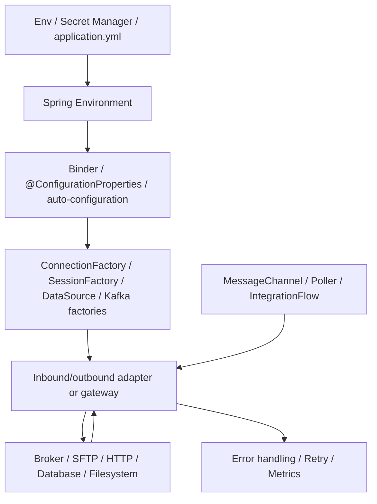
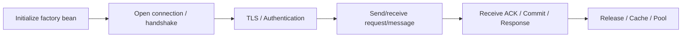
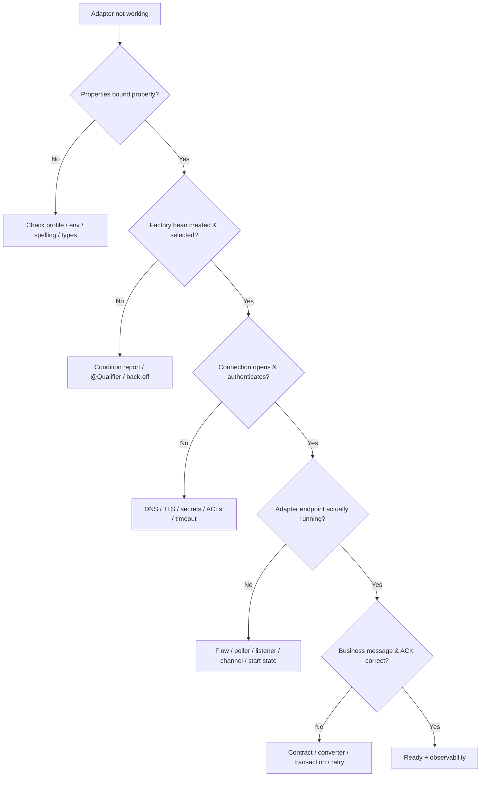
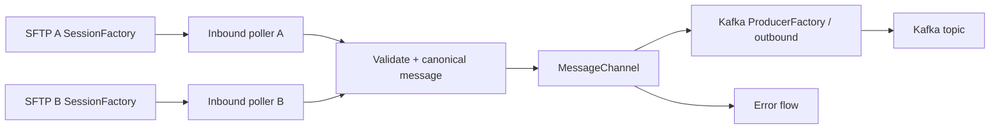

# Connection Factory Properties in Spring Boot and Spring Integration Adapters

> **Chapter:** Spring Boot  
> **Lesson:** Properties for connection factories  
> **Module:** `SPRING_INTEGRATION_ADAPTERS` — connecting external systems to Spring Integration via inbound/outbound adapters, gateways, pollers, and `MessageChannel`; hands-on with File, SFTP, HTTP, JMS, AMQP/RabbitMQ, Kafka, and JDBC along with message contracts, errors, and connection lifecycles.  
> **Level:** Intermediate to advanced. **Prerequisites:** Spring Boot `@Configuration`/`@Bean`, `application.yml`, Spring Integration `IntegrationFlow`, transport concepts, and deployment environments.

## 1. The Problem: Having Adapters Yet Connecting to the Wrong Target

A team is building an order synchronization application: receiving files from a partner SFTP server, calling an HTTP API, publishing events to Kafka, sending notifications via RabbitMQ, and updating state in PostgreSQL. All adapters have the proper dependencies and the application compiles cleanly, yet failures appear on staging:

- SFTP points to the production host instead of the test server.
- RabbitMQ `ConnectionFactory` has the right host but the wrong virtual host, causing permission errors.
- Kafka producer connects to the broker, but producer and consumer use two inconsistent sets of TLS/SASL settings.
- The JDBC poller queries the wrong database because a custom `DataSource` bean does not bind `spring.datasource.*` as expected.
- The HTTP outbound gateway retries repeatedly after timeouts, causing the partner to receive the same business request multiple times.

These issues share the same root cause: **properties are configuration data; a connection factory is the bean that executes the configuration; an adapter/gateway is the endpoint using that bean**. They are not the same concept and cannot substitute for one another.

This lesson focuses on answering: *which properties belong to Spring Boot, which must the application define, which beans do they bind to, and how do you prove an adapter is using the right connection?*

### 1.1. Learning Objectives

After this lesson, you will be able to:

1. Distinguish `Configuration Properties`, `ConnectionFactory`, `SessionFactory`, `DataSource`, `ProducerFactory`, `ConsumerFactory`, HTTP clients, and `MessageChannel`.
2. Choose the right Spring Boot configuration namespace for AMQP/RabbitMQ, JMS/Artemis, Kafka, and JDBC; understand how File, SFTP, and HTTP adapters differ.
3. Use `application.yml`, environment variables, profiles, and `@ConfigurationProperties` to bind typed configuration with clear trust boundaries.
4. Create an SFTP `SessionFactory` bean from application-owned `app.sftp.*` properties, verify host keys, and manage secrets.
5. Distinguish connection timeout, read/request timeout, pool/cache, retry, transactions, pollers, and ACK; never set one property thinking it controls everything.
6. Prove factory beans and adapters target the right endpoint/cluster/tenant via context checks, configuration binding checks, and integration tests.
7. Handle startup failures, misconfigured profiles, exposed secrets, dead connections, pool exhaustion, and graceful shutdown.

### 1.2. Layered Architecture Diagram



**Operational rule:** A log stating "bean created" does not mean "connection established" or "target authorized". For many clients, connections open **lazily** on the first call; for listeners, connections may open right at startup. Therefore, separate three checks: **properties bind properly → factory selected properly → endpoint actually works**.

## 2. Concepts You Must Distinguish

### 2.1. Properties Are Configuration, Not Connections

Example:

```yaml
spring:
  rabbitmq:
    host: rabbitmq.internal.example
    port: 5672
    virtual-host: /orders
```

This is **data** Spring Boot can use to configure RabbitMQ infrastructure when starter/classpath and auto-configuration conditions permit. The YAML file **does not** automatically create an `IntegrationFlow` to send orders. If you supply a manual `ConnectionFactory`, that bean must be configured explicitly; do not assume every `spring.rabbitmq.*` field applies to every custom bean.

### 2.2. "Factory" Means Different Things by Protocol

| Adapter/system | Primary infrastructure concept | Factory/provider output | Key properties |
|---|---|---|---|
| **AMQP/RabbitMQ** | Spring AMQP `ConnectionFactory`, usually `CachingConnectionFactory` | Connections/channels to RabbitMQ | Host/addresses, port, vhost, credentials, TLS, heartbeat, cache |
| **JMS** | Provider's `jakarta.jms.ConnectionFactory` | JMS connections/sessions | Broker URL, credentials, TLS, pool/provider options |
| **SFTP** | Spring Integration `SessionFactory` for SFTP | SSH/SFTP sessions | Host, port, user, key/password, `known_hosts`, timeout |
| **Kafka** | `ProducerFactory`, `ConsumerFactory` | Kafka producers/consumers | Bootstrap servers, security, serializers, group, client ID |
| **JDBC** | `javax.sql.DataSource` | JDBC connections | JDBC URL, driver, account, TLS, pool, validation |
| **HTTP outbound** | HTTP client/request factory or pooled client | HTTP requests/connections | Base URI, TLS, connect/read timeouts, proxy, pool |
| **Local File** | No network connection factory | `File`/filesystem access | Path, filter, poll interval, volume permissions |

**Important:** Kafka does not use Spring AMQP `ConnectionFactory`; JDBC likewise has no generic protocol-agnostic `ConnectionFactory` shared across adapters. Similarly named classes have different semantics, retry mechanisms, and lifecycles. Do not invent a single YAML prefix for all protocols and expect Spring Boot to infer it.

### 2.3. Distinguish Three Categories of Configuration

- **Connection properties:** select the endpoint and how to connect (host, URL, TLS, credentials, pool).
- **Adapter properties:** select queue/topic/path, destination, converter, transaction/ACK, and message mapping.
- **Flow properties:** `MessageChannel`, poller, retry/error handling, idempotency, concurrency, routing, business timeouts.

For example, `spring.kafka.bootstrap-servers` does not decide which topic an `IntegrationFlow` publishes to. `spring.rabbitmq.host` does not declare queues/bindings. `app.sftp.host` does not run a poller. Those decisions require explicit endpoint configuration.

## 3. Configuration Properties in Spring Boot

### 3.1. Property Sources and Precedence

Spring Boot aggregates configuration into `Environment` from multiple sources: packaged config inside the JAR, external config files, profile-specific documents, environment variables, system properties, command-line arguments, and import mechanisms such as `configtree:`. **Higher-precedence sources override lower-precedence ones**. The exact precedence depends on your Boot version, how config data is loaded, and how the app is launched; do not guess merely from line order inside a single YAML file.

In this lab, follow these conventions:

- `application.yml`: baseline configuration without secrets.
- `application-local.yml` and `application-staging.yml`: environment differences without real credentials.
- Environment variables or secret mounts: username/password/private key/TLS secrets.
- Command-line overrides: for controlled testing; never put passwords in shell history.
- `@ConfigurationProperties`: group and bind into typed objects instead of scattering `@Value`.

Example:

```yaml
# application.yml — DO NOT put real passwords here
app:
  sftp:
    enabled: false
    port: 22
    remote-dir: /inbound
```

```yaml
# application-staging.yml — only used when the staging profile is active
app:
  sftp:
    enabled: true
    host: sftp.staging.example
    username: integration-staging
    known-hosts: file:/run/config/sftp_known_hosts
```

Do not put `spring.profiles.active: staging` directly into shared packaged configuration if there is any risk of accidentally enabling staging/production connections. Profiles must be controlled by deployment and verified in CI/CD.

### 3.2. Relaxed Binding and Data Types

Spring Boot supports relaxed naming forms; for example, `poll-interval` in YAML can bind to a Java `pollInterval` field. For typed properties:

- `Duration` accepts unit-qualified values such as `5s`, `250ms`.
- `DataSize` accepts sizes such as `10MB` (when the field uses the appropriate type).
- `boolean` accepts `true`/`false`, though you should avoid ambiguous defaults for external-connector feature flags.
- `Path` or `Resource` can represent files/configs, though existence and permissions checks must be handled separately.
- For integer ports, validate the range 1–65535 and do not let `0` accidentally act as a "default port".

**Do not mix timeout units arbitrarily.** `Duration` in an application record can use `3s`, whereas a driver or HikariCP property may require **numeric milliseconds**. Read the property contract of the exact component and version rather than applying one interpretation everywhere.

### 3.3. `@ConfigurationProperties` vs. `@Value`

`@Value("${app.sftp.host}")` is convenient for a single value but becomes unwieldy when a connection has 10–20 fields. `@ConfigurationProperties(prefix = "app.sftp")` forms a **configuration contract** grouping host, port, credentials, trust, and paths, making testing and validation straightforward.

Use an immutable `record` for fixed property sets; use a class with getters/setters when complex binding or custom mutation is needed. In production, name connections explicitly: `app.partner-a.sftp`, `app.partner-b.sftp` for two distinct connections, or declare a keyed list of partners. Never mutate a single `app.sftp.host` dynamically per tenant during message processing.

### 3.4. Secrets vs. Non-Secret Metadata

| Category | Allowed in normal config? | Recommendation |
|---|---|---|
| Host, port, queue/topic names | Usually yes, per internal classification | Manage via reviewed config |
| Username/service identity | Can be sensitive depending on environment | Restrict visibility; do not assume public |
| Password, API token, TLS private key, SFTP private key/passphrase | **No** | Secret manager/secret mount, least-privilege IAM policy |
| Trust store / `known_hosts` | Can be a separate config file | Protect integrity, audit changes |
| Connection timeout/pool size | Yes | Tune to load and SLAs |
| JDBC URL embedding password | **Should not** | Separate URL and credentials; avoid logging secret URIs |

Never log an entire `@ConfigurationProperties` object via `toString()` when it contains secrets (a Java `record`'s generated `toString` will print the password). Never expose full `Environment` or Actuator `/env` and `/configprops` to public networks; those endpoints can leak sensitive metadata even when some values are masked.

## 4. General Rules for Connection Factories

### 4.1. Connection Timeout, Operation Timeout, and Health



| Timeout/limit | Scope | Must distinguish from |
|---|---|---|
| **Connect timeout** | Establishing the TCP connection to the target | Read/response timeout |
| **TLS/handshake timeout** | Security/authentication negotiation | Broker ACK timeout |
| **Read/response timeout** | Waiting for data or response | Overall workflow timeout |
| **Request/reply timeout** | Waiting for gateway reply in `IntegrationFlow` | Client's own network timeout |
| **Connection acquisition timeout** | Waiting to borrow a connection from a pool | Connecting to a new server |
| **Poll interval** | Delay between source checks | Timeout of a single poll |
| **Retry backoff** | Wait before next retry attempt | Heartbeat or keep-alive |
| **Idle/max lifetime** | Connection lifetime inside a pool | Message or token TTL |

If HTTP times out after the external system already processed the request, a retry can produce **duplicate side effects**. If a JMS consumer ACKs before the DB transaction commits, messages can be lost. Connection properties only govern transport mechanics; end-to-end safety requires proper contracts, idempotency, and transactions.

### 4.2. Cache/Pool Does Not Equal Concurrency

- **Connection pool:** number of connections retained and handed out to threads.
- **Channel/session cache:** reuses channels or sessions; cache size is not always a concurrency ceiling.
- **Listener concurrency:** number of parallel consumers, which may open extra connections/sessions depending on the library.
- **Poller executor:** number of poll tasks that may overlap.
- **Back-pressure:** policy when downstream slows down or pools are exhausted.

Enlarging a pool without accounting for broker, DB, and rate limits can increase failures rather than throughput. Instrument queue depth, connection acquisition wait time, active/idle connections, reconnects, and throughput before tuning.

### 4.3. Fail Fast or Lazy Connect?

Both patterns have valid uses:

- **Fail fast:** validate critical dependencies at startup; if unable to serve business traffic, mark the app unready or fail startup.
- **Lazy/reconnect:** factory is created upfront, actual connections open on first poll/send/receive; fits environments where external services experience transient outages, but requires readiness checks, alerts, and bounded retries.

A bean present in `ApplicationContext` **does not prove** the external service is ready. Never use `@Lazy` to hide long-term errors; if lazy behavior is needed, pair it with observability and outage-handling policies.


## 5. AMQP/RabbitMQ: `spring.rabbitmq.*` and `ConnectionFactory`

### 5.1. Choosing the Right Library Layers

A Spring Integration application sending messages to RabbitMQ typically needs:

```xml
<dependency>
    <groupId>org.springframework.boot</groupId>
    <artifactId>spring-boot-starter-integration</artifactId>
</dependency>
<dependency>
    <groupId>org.springframework.integration</groupId>
    <artifactId>spring-integration-amqp</artifactId>
</dependency>
<dependency>
    <groupId>org.springframework.boot</groupId>
    <artifactId>spring-boot-starter-amqp</artifactId>
</dependency>
```

Boot can configure `org.springframework.amqp.rabbit.connection.ConnectionFactory` and `RabbitTemplate` when classpath and bean conditions match. Spring Integration AMQP uses those components to implement outbound/inbound adapters or gateways; you still must define **queues, exchanges, routing keys, listeners, and message converters**.

### 5.2. Sample Properties for a Test Environment

```yaml
spring:
  rabbitmq:
    host: rabbitmq.test.example
    port: 5671
    virtual-host: /orders
    username: ${RABBITMQ_USERNAME}
    password: ${RABBITMQ_PASSWORD}
    connection-timeout: 5s
    requested-heartbeat: 30s
    ssl:
      enabled: true
    cache:
      channel:
        size: 25
```

`RABBITMQ_USERNAME` and `RABBITMQ_PASSWORD` must be supplied from the environment/secret manager. This is an **illustrative configuration**, not a live endpoint. `ssl.enabled=true` is only part of TLS setup: you must also configure CA/trust, hostname verification, and certificate policies per your stack. Never skip certificate verification just to get a connection working.

| Property | Meaning | Common misconception |
|---|---|---|
| `spring.rabbitmq.host` and `port` | RabbitMQ endpoint when configured by host/port | Not the target queue |
| `spring.rabbitmq.addresses` | List of broker addresses for multi-node setup per client capabilities | When set, can supersede host/port; do not mix conflicting settings |
| `virtual-host` | Broker namespace/vhost | Not an automatic business-tenant security boundary |
| `username/password` | Client identity to the broker | Must never appear in logs, Git, or shell history |
| `connection-timeout` | Time to open a connection | Not the wait time for publisher confirms |
| `requested-heartbeat` | Heartbeat negotiated with the broker | Does not replace network/read timeouts |
| `ssl.enabled` | Enables TLS transport | Insufficient if trust/hostname validation is broken |
| `cache.channel.size` | Channel cache size per Spring AMQP settings | Does not implicitly cap consumers or throughput |

**Remember:** `spring.rabbitmq.*` properties apply to Boot's conditionally configured beans; if your app defines its own `ConnectionFactory`, check the condition report and verify which bean is actually used. A custom bean may cause the default factory to back off while templates/listeners are still wired to your application factory.

### 5.3. Two Clusters, Two Factories

When sending certain events to RabbitMQ cluster A and audit logs to cluster B, **do not** mutate `spring.rabbitmq.host` per message. Each cluster needs its own factory/template or explicit routing configuration with clear names and owners. With multiple beans implementing the same interface:

- `@Qualifier("ordersRabbitConnectionFactory")` for the Orders flow.
- `@Qualifier("auditRabbitConnectionFactory")` for the Audit flow.
- Tests proving each outbound handler actually uses the intended factory.
- Independent verification of TLS, vhost, ACLs, publisher confirms, returns, and shutdown for **each** cluster.

`@Primary` only selects a candidate when by-type injection is unspecified; it does not override a route selected by name.

## 6. JMS: `spring.artemis.*` vs. `spring.jms.*`

Spring Integration JMS uses the `jakarta.jms` API on modern Spring stacks and requires a compatible provider. If choosing Artemis with Spring Boot's starter:

```xml
<dependency>
    <groupId>org.springframework.integration</groupId>
    <artifactId>spring-integration-jms</artifactId>
</dependency>
<dependency>
    <groupId>org.springframework.boot</groupId>
    <artifactId>spring-boot-starter-artemis</artifactId>
</dependency>
```

Basic configuration:

```yaml
spring:
  artemis:
    mode: native
    broker-url: tcp://artemis.test.example:61616
    user: ${ARTEMIS_USER}
    password: ${ARTEMIS_PASSWORD}
```

In this setup:

- `spring.artemis.*` holds Artemis provider settings: broker URL, login credentials, and certain provider/pooling options depending on stack/version.
- `spring.jms.*` covers Spring JMS layer settings such as listeners/templates where supported by Boot; it does not replace a provider's broker URL.
- `jakarta.jms.ConnectionFactory` is a **JMS factory**, distinct from RabbitMQ's `org.springframework.amqp.rabbit.connection.ConnectionFactory`.
- `Destination`, queue/topic, selector, concurrency, redelivery, and DLQ are not inferred from the broker URL alone.

**TLS and providers:** `tcp://` in the example above **does not indicate TLS**. In real environments, configure TLS transport and certificates according to your provider/broker documentation; do not invent an arbitrary URL scheme assuming it is secure. Some environments use a Jakarta Messaging provider other than Artemis: `spring.artemis.*` settings do not apply to other clients/providers.

**Distinguish ACK and transactions:** Connection factory properties do not determine whether a message has been committed to another database. JMS session transactions, listener containers, downstream JDBC transactions, dead-letter/retry, and `MessageChannel` each have their own boundaries. Before raising concurrency, clarify at-least-once delivery, redelivery, and idempotent business processing.

## 7. Kafka: Producer/Consumer Factories Are Not RabbitMQ Connection Factories

Kafka clients use `bootstrap.servers` to fetch cluster metadata and then connect to brokers via their advertised listeners. In Spring Boot, `spring.kafka.*` can configure clients/factories when classpath and conditions match; Spring Integration Kafka uses those factories/templates for inbound/outbound adapters.

### 7.1. Producer and Consumer Example

```yaml
spring:
  kafka:
    bootstrap-servers:
      - kafka-a.test.example:9093
      - kafka-b.test.example:9093
    client-id: adapter-worker
    properties:
      security.protocol: SSL
    producer:
      acks: all
      key-serializer: org.apache.kafka.common.serialization.StringSerializer
      value-serializer: org.apache.kafka.common.serialization.StringSerializer
    consumer:
      group-id: order-importer
      enable-auto-commit: false
      key-deserializer: org.apache.kafka.common.serialization.StringDeserializer
      value-deserializer: org.apache.kafka.common.serialization.StringDeserializer
```

**Note:** `security.protocol=SSL` requires properly configured trust/certificates for the Kafka client. The example omits those details because trust store paths and key provisioning depend on your platform, SSL bundles, Kafka client, and Boot version. Never run production configurations with certificate validation disabled.

| Property group | Applies mainly to | Does not solve automatically |
|---|---|---|
| `spring.kafka.bootstrap-servers` | Client metadata bootstrap | Topic routing, ACLs, network advertised listeners |
| `spring.kafka.client-id` | Client identification in metrics/logs | Business event ID / idempotency key |
| `spring.kafka.properties.*` | Shared Kafka client settings where applicable | Distinguishing custom producers/consumers outside Boot |
| `spring.kafka.producer.*` | Producer serializers, ACK, and send settings | Consumer groups / offset commits |
| `spring.kafka.consumer.*` | Consumer group, deserializers, offsets, and polling | Publisher durability or downstream DB writes |
| `spring.kafka.listener.*` | Boot-supported listener settings | Automatically creating an `IntegrationFlow` |
| `spring.kafka.ssl.*` or equivalent TLS config | Client TLS per version | Topic authorization and secret rotation |

A service that only **publishes outbound** may not run any consumers. Do not treat `consumer.group-id` as mandatory for a producer. For a consumer reading Kafka and writing to JDBC, `enable-auto-commit=false` **does not automatically guarantee** offsets commit only after DB commit; you must also configure how the listener/container and `IntegrationFlow` coordinate ACKs, transactions, and error handling.

### 7.2. Multiple Kafka Clusters

If an app consumes from an internal cluster and publishes to a partner cluster, a single shared `spring.kafka.bootstrap-servers` group is not enough. Configure separate `ProducerFactory`/`ConsumerFactory` beans, client IDs, trust/credentials, topics, and templates/adapters.

Consequences of bean overrides to verify:

1. Are default beans still created, or did they back off when custom factories were added?
2. Which beans are `KafkaTemplate` and listener adapters injecting?
3. Are serializers/deserializers and `security.protocol` right for **each** cluster?
4. Do topic ACLs and partitions match?
5. Do retries, offsets, and transactions behave safely when one cluster loses connectivity?

Never toggle `@Primary` on a factory to "temporarily shift" traffic without evaluating every dependent endpoint.

## 8. JDBC: `spring.datasource.*` and HikariCP

For the JDBC adapter, **`DataSource` is the connection provider**, not a generic Spring Messaging `ConnectionFactory`. An application typically uses:

```xml
<dependency>
    <groupId>org.springframework.integration</groupId>
    <artifactId>spring-integration-jdbc</artifactId>
</dependency>
<dependency>
    <groupId>org.springframework.boot</groupId>
    <artifactId>spring-boot-starter-jdbc</artifactId>
</dependency>
<dependency>
    <groupId>org.postgresql</groupId>
    <artifactId>postgresql</artifactId>
    <scope>runtime</scope>
</dependency>
```

Sample configuration with PostgreSQL and HikariCP:

```yaml
spring:
  datasource:
    url: jdbc:postgresql://db.test.example:5432/integration
    username: ${DB_USERNAME}
    password: ${DB_PASSWORD}
    hikari:
      pool-name: integration-db
      maximum-pool-size: 10
      minimum-idle: 2
      connection-timeout: 30000
      max-lifetime: 1800000
```

**Units:** HikariCP normally interprets `connection-timeout` and `max-lifetime` above in **milliseconds**. Thus `30000` equals 30 seconds and `1800000` equals 30 minutes. These govern **pool connection acquisition wait time** and maximum connection lifetime, not SQL statement query timeouts or HTTP request timeouts.

### 8.1. Common Failure Sources

- Forgetting the JDBC driver, causing `DataSource` configuration to fail.
- URL has the right host but wrong database/schema or insufficient SQL privileges.
- Pool capped at 10 connections while pollers run 50 long transactions → pool exhaustion.
- Database load balancer closes idle connections earlier than `max-lifetime` → stale connection errors.
- Declaring a manual `@Bean DataSource` causes `spring.datasource.*` auto-configuration to back off, yet the custom bean fails to bind those properties.
- Multiple `DataSource` beans of the same type; Integration JDBC adapter/transaction manager injects the wrong DB.

**Important note:** `spring-integration-jdbc` does not create business tables, polling queries, or idempotency metadata stores automatically. Polling new rows requires SQL, transaction/poll intervals, locking, and a mark-as-processed strategy. In a JDBC → Kafka flow, committing both the database and broker does not automatically form an atomic transaction; consider outbox/CDC and idempotency.

### 8.2. Protecting JDBC Connections

TLS to the database must rely on proper JDBC driver configuration (such as SSL mode and trust bundles), not merely on the database residing on a private network. Follow least privilege on DB accounts: an outbox/reader worker should have narrow scope, never superuser. Never copy JDBC URLs containing passwords into error logs, metric labels, or message headers.

### 8.3. Multiple `DataSource`s

When separating an operational DB and an integration metadata DB:

- Use clear bean names: `businessDataSource`, `integrationMetadataDataSource`.
- Configure dedicated transaction managers for each DB.
- Use `@Qualifier` on gateways/handlers/pollers; only use `@Primary` when a true unambiguous default exists.
- Review the condition report because one custom `DataSource` bean can suppress Boot's default bean.
- Write integration tests proving SQL runs against the intended DB and commits/rolls back within the right boundaries.

## 9. SFTP: Custom `@ConfigurationProperties` for `SessionFactory`

Unlike RabbitMQ or JDBC, do not assume a universal Spring Boot `spring.sftp.*` namespace exists that auto-creates an SFTP `SessionFactory` for every app. With Spring Integration SFTP, the application usually **owns the property group**, session factory bean, and endpoints.

### 9.1. Per-Partner Configuration, Disabled by Default

Example `application.yml`:

```yaml
app:
  partner:
    sftp:
      enabled: false
      host: sftp.test.example
      port: 22
      username: adapter-user
      password: ${PARTNER_SFTP_PASSWORD}
      known-hosts: file:/run/config/partner_known_hosts
      remote-directory: /incoming
      poll-interval: 15s
```

**Only set `enabled: true`** in profiles/deployments authorized to connect and provisioned with credentials/trust. In some setups, property placeholders like `${PARTNER_SFTP_PASSWORD}` are resolved during binding even when the endpoint is disabled; if the environment variable is unset, startup may fail. To run tests without real secrets, place sensitive properties **only in profiles that enable the connector**, or use separate configs that avoid unresolved placeholders when disabled.

Example overrides in `application-partner-test.yml`:

```yaml
app:
  partner:
    sftp:
      enabled: true
      host: sftp.partner-test.example
      port: 22
      username: adapter-test
      password: ${PARTNER_SFTP_PASSWORD}
      known-hosts: file:/run/config/partner_known_hosts
      remote-directory: /incoming
```

This is illustrative data; the host is not a real server to connect to. In production, consider **SSH key authentication**, protected key passphrases, credential rotation, and known-host pinning. Never set `allowUnknownKeys=true` to "fix connection errors".

### 9.2. Binding into a Typed Record

Assuming a Spring Boot 3.x project with compatible Spring Integration SFTP 6.x, create `PartnerSftpProperties.java`:

```java
package com.example.adapter;

import java.time.Duration;
import org.springframework.boot.context.properties.ConfigurationProperties;
import org.springframework.core.io.Resource;

@ConfigurationProperties(prefix = "app.partner.sftp")
public record PartnerSftpProperties(
        boolean enabled,
        String host,
        Integer port,
        String username,
        String password,
        Resource knownHosts,
        String remoteDirectory,
        Duration pollInterval
) {
    public PartnerSftpProperties {
        if (enabled) {
            if (host == null || host.isBlank()) {
                throw new IllegalArgumentException("SFTP host is required");
            }
            if (port == null || port < 1 || port > 65535) {
                throw new IllegalArgumentException("Invalid SFTP port");
            }
            if (username == null || username.isBlank()) {
                throw new IllegalArgumentException("SFTP user is required");
            }
            if (knownHosts == null) {
                throw new IllegalArgumentException("Known hosts is required");
            }
            if (pollInterval == null || pollInterval.isNegative()
                    || pollInterval.isZero()) {
                throw new IllegalArgumentException("Invalid poll interval");
            }
        }
    }
}
```

The record binds `port`, `known-hosts`, and `poll-interval` with Java types. Its compact constructor validates fields **required when the connector is enabled**, without forcing environments that only use the File adapter to supply full SFTP config. Here `password` is not strictly required because production setups may switch to key authentication; the factory below uses password auth for the lab, so ensure the secret is present when enabling it with that method.

**Example limitation:** Record constructors can produce error messages containing values if a developer adds custom logging. Never print `password` or the whole record to the console; a record's default `toString()` includes every field.

### 9.3. Creating `SessionFactory` When the Connector Is Enabled

Create `PartnerSftpConfiguration.java`:

```java
package com.example.adapter;

import org.apache.sshd.sftp.client.SftpClient;
import org.springframework.boot.autoconfigure.condition.ConditionalOnProperty;
import org.springframework.boot.context.properties.EnableConfigurationProperties;
import org.springframework.context.annotation.Bean;
import org.springframework.context.annotation.Configuration;
import org.springframework.integration.file.remote.session.CachingSessionFactory;
import org.springframework.integration.file.remote.session.SessionFactory;
import org.springframework.integration.sftp.session.DefaultSftpSessionFactory;

@Configuration(proxyBeanMethods = false)
@EnableConfigurationProperties(PartnerSftpProperties.class)
public class PartnerSftpConfiguration {

    @Bean("partnerSftpSessionFactory")
    @ConditionalOnProperty(
        prefix = "app.partner.sftp",
        name = "enabled",
        havingValue = "true"
    )
    SessionFactory<SftpClient.DirEntry> partnerSftpSessionFactory(
            PartnerSftpProperties props) {

        DefaultSftpSessionFactory delegate =
                new DefaultSftpSessionFactory();

        delegate.setHost(props.host());
        delegate.setPort(props.port());
        delegate.setUser(props.username());
        delegate.setPassword(props.password());
        delegate.setKnownHostsResource(props.knownHosts());
        delegate.setAllowUnknownKeys(false);

        // Caching sessions enables reuse;
        // pool/cache size must be tested under load against a real server.
        return new CachingSessionFactory<>(delegate, 4);
    }
}
```

This code illustrates SFTP APIs from the Spring Integration 6.x family, so verify your exact dependency versions if applying to another project. **The factory bean does not automatically create an inbound adapter or poll the remote directory.** An `IntegrationFlow` must reference `partnerSftpSessionFactory` by name/qualifier and explicitly configure streaming or synchronized inbound, directories/filters, poller, and error handling.

Note that `setPassword` only demonstrates password authentication for the lab. For key-based authentication, configure `setPrivateKey(...)` and `setPrivateKeyPassphrase(...)` per the API and your secret store; avoid maintaining both password and private key unnecessarily. A trusted `known_hosts` file must be provisioned externally and protected from tampering.

### 9.4. SFTP Factory Errors That Are Not Dependency Errors

| Symptom | Possible cause | What to check |
|---|---|---|
| `NoSuchBeanDefinitionException` for factory | `enabled=false`, wrong profile/bean name | Effective properties, condition report, qualifier |
| `UnknownHostException` | DNS/host does not exist | Host, DNS, environment |
| Host-key verification failed | Missing/wrong `known_hosts`, server rotated key | Verify out-of-band, update with approval |
| Permission denied | Insufficient user/key/remote ACL | Partner identity, remote path permissions |
| Session timeout | Firewall, port, SSH handshake | Network, connect timeout, proxy/jump host |
| Stream closed unexpectedly | Session expired or broken stream lifecycle | Caching strategy, stream closing, retry |
| File downloaded twice | Non-persistent filter/checkpoint | Idempotency, persistent metadata, remote rename |
| Connected to wrong partner | Shared config prefix or wrong factory injected | Bean name, tenant/partner routing, per-profile tests |

Never log SFTP credentials or point unit tests at real partners. Use an isolated SFTP test server for integration tests.

## 10. HTTP and File: Exceptions You Need to Know

### 10.1. HTTP Outbound Uses Client/Request Factories

Spring Integration's HTTP outbound adapter/gateway works through the corresponding HTTP client infrastructure; there is no single `spring.http.connection-factory` unified across every Boot version, Servlet/Reactive stack, and HTTP client implementation.

An **application-defined** namespace might be `app.partner.http.*`; this is not a standard Boot auto-configured connection factory namespace:

```yaml
app:
  partner:
    http:
      base-url: https://api.partner.test.example
      connect-timeout: 3s
      read-timeout: 8s
```

With `RestTemplate` and the basic JDK request factory, you can bind properties in a record:

```java
package com.example.adapter;

import java.net.URI;
import java.time.Duration;
import org.springframework.boot.context.properties.ConfigurationProperties;

@ConfigurationProperties(prefix = "app.partner.http")
public record PartnerHttpProperties(
        URI baseUrl,
        Duration connectTimeout,
        Duration readTimeout
) {}
```

And create the bean:

```java
package com.example.adapter;

import org.springframework.boot.context.properties.EnableConfigurationProperties;
import org.springframework.context.annotation.Bean;
import org.springframework.context.annotation.Configuration;
import org.springframework.http.client.SimpleClientHttpRequestFactory;
import org.springframework.web.client.RestTemplate;

@Configuration(proxyBeanMethods = false)
@EnableConfigurationProperties(PartnerHttpProperties.class)
class PartnerHttpClientConfiguration {

    @Bean("partnerRestTemplate")
    RestTemplate partnerRestTemplate(PartnerHttpProperties props) {
        SimpleClientHttpRequestFactory requestFactory =
                new SimpleClientHttpRequestFactory();
        requestFactory.setConnectTimeout(
                Math.toIntExact(props.connectTimeout().toMillis()));
        requestFactory.setReadTimeout(
                Math.toIntExact(props.readTimeout().toMillis()));
        return new RestTemplate(requestFactory);
    }
}
```

This demonstrates **binding timeouts onto an HTTP client bean**, not a complete `IntegrationFlow`. `baseUrl` is used when configuring the outbound gateway URI; it does not automatically become a default base URL on that `RestTemplate`. `SimpleClientHttpRequestFactory` lacks robust connection pooling; production requires an HTTP client with proper pooling/TLS/observability and version-verified timeouts. If using reactive `WebClient` or another API, factory classes and property mappings will differ.

Distinguish:

- **Inbound HTTP:** requires web server/routes/authentication, request/reply mapping, and payload size limits.
- **Outbound HTTP:** requires base URL, machine-to-machine auth, TLS, timeouts, 4xx/5xx mapping, redirect policies, and idempotency keys.
- **Gateway timeout:** Spring Integration's reply wait timeout is not identical to HTTP connect/read timeouts.
- **Retrying `POST`:** after a network timeout, the partner may have already executed the action; only retry with idempotency or explicit safety rules.

### 10.2. File Adapter Has No Network Connection Factory

File inbound normally needs **paths and a poller**, not a broker connection pool.

```yaml
app:
  file:
    enabled: true
    inbound-dir: /data/in
    archive-dir: /data/archive
    pattern: "*.csv"
    poll-interval: 5s
    max-messages-per-poll: 20
```

This is a custom `app.file.*` namespace. Writing YAML alone **does not create** `FileReadingMessageSource`, `IntegrationFlow`, or a poller; the app must bind `@ConfigurationProperties` and apply those values to endpoint configuration. Key risks:

- Directory missing or not mounted inside the container.
- Filesystem permissions, symbolic links, and path traversal when deriving filenames from untrusted messages.
- Reading a file while another process is still writing it; requires staging/atomic rename/ready markers.
- Files re-read after restart if the filter does not persist state.
- Polling too fast, oversized batches, or lack of back-pressure overwhelming downstream.

Thus **the File case is an important lesson**: not every adapter needs a `ConnectionFactory`. Properties must match the actual capabilities of the endpoint.


## 11. Lab: Verifying Binding and Conditional Creation of an SFTP Connection Factory

This hands-on lab requires no live SFTP connection, making it ideal for understanding **properties → binder → bean** before introducing networking. We reuse `PartnerSftpProperties` and `PartnerSftpConfiguration` from section 9.

### 11.1. Dependencies and Structure

In a Spring Boot project with Boot parent/BOM, declare:

```xml
<dependencies>
    <dependency>
        <groupId>org.springframework.boot</groupId>
        <artifactId>spring-boot-starter-integration</artifactId>
    </dependency>
    <dependency>
        <groupId>org.springframework.integration</groupId>
        <artifactId>spring-integration-sftp</artifactId>
    </dependency>
    <dependency>
        <groupId>org.springframework.boot</groupId>
        <artifactId>spring-boot-starter-test</artifactId>
        <scope>test</scope>
    </dependency>
</dependencies>
```

Dependencies omit `<version>` because the project manages versions via the Boot BOM. Without dependency management, add the BOM or an explicit compatible version set; **do not stitch together Spring Framework/Integration versions from mismatched branches**.

Sample file layout:

```text
connection-properties-lab/
├── pom.xml
└── src/
    ├── main/
    │   ├── java/com/example/adapter/
    │   │   ├── ConnectionPropertiesLabApplication.java
    │   │   ├── PartnerSftpProperties.java
    │   │   └── PartnerSftpConfiguration.java
    │   └── resources/application.yml
    └── test/java/com/example/adapter/
        └── PartnerSftpPropertiesContextTest.java
```

`ConnectionPropertiesLabApplication.java`:

```java
package com.example.adapter;

import org.springframework.boot.SpringApplication;
import org.springframework.boot.autoconfigure.SpringBootApplication;

@SpringBootApplication
public class ConnectionPropertiesLabApplication {
    public static void main(String[] args) {
        SpringApplication.run(
            ConnectionPropertiesLabApplication.class, args
        );
    }
}
```

`application.yml` for **this binding-only lab** keeps the connector disabled, so no password is needed:

```yaml
spring:
  application:
    name: connection-properties-lab
  main:
    web-application-type: none

app:
  partner:
    sftp:
      enabled: false
      host: sftp.test.example
      port: 22
      username: adapter-test
      remote-directory: /incoming
      poll-interval: 15s
```

Do not fabricate a fake `known_hosts` file to bypass verification. When the connector is disabled, the factory is not created; the lab proves typed binding only. When testing real connectivity, use an SFTP test server and that server's actual host key.

### 11.2. `ApplicationContextRunner` Testing Fields and Bean Conditions

File `PartnerSftpPropertiesContextTest.java`:

```java
package com.example.adapter;

import java.time.Duration;

import org.junit.jupiter.api.Test;
import org.springframework.boot.test.context.runner.ApplicationContextRunner;

import static org.assertj.core.api.Assertions.assertThat;

class PartnerSftpPropertiesContextTest {

    private final ApplicationContextRunner runner =
        new ApplicationContextRunner()
            .withUserConfiguration(PartnerSftpConfiguration.class);

    @Test
    void disabledConnectorBindsPropertiesButCreatesNoFactory() {
        runner
            .withPropertyValues(
                "app.partner.sftp.enabled=false",
                "app.partner.sftp.host=sftp.test.example",
                "app.partner.sftp.port=22",
                "app.partner.sftp.poll-interval=15s"
            )
            .run(context -> {
                assertThat(context).hasSingleBean(
                    PartnerSftpProperties.class
                );
                assertThat(context.getBean(
                    PartnerSftpProperties.class
                ).pollInterval()).isEqualTo(Duration.ofSeconds(15));

                assertThat(context).doesNotHaveBean(
                    "partnerSftpSessionFactory"
                );
            });
    }

    @Test
    void enabledConnectorRejectsMissingTrustConfiguration() {
        runner
            .withPropertyValues(
                "app.partner.sftp.enabled=true",
                "app.partner.sftp.host=sftp.test.example",
                "app.partner.sftp.port=22",
                "app.partner.sftp.username=adapter-test",
                "app.partner.sftp.poll-interval=15s"
            )
            .run(context -> {
                assertThat(context.getStartupFailure())
                    .isNotNull();
            });
    }
}
```

**Explanation:**

- The first test proves `15s` binds to `Duration.ofSeconds(15)`, and `@ConditionalOnProperty` keeps the factory bean **absent** when `enabled=false`.
- The second test intentionally enables the connector while omitting `known-hosts`; record validation rejects the insecure configuration. It **does not** test whether the SFTP host exists.
- To test the factory **when `enabled=true`**, provide a complete configuration with a valid `known_hosts` file for your test server. Bean-graph tests then confirm the factory bean is created, and integration tests verify the SSH handshake and file transfer.
- Seeing `SessionFactory` in the context does not mean a connection succeeded; a factory may open sessions lazily on the first adapter poll.

### 11.3. Property Precedence: How to Avoid Targeting the Wrong Environment?

Suppose `application.yml` declares `app.partner.sftp.host=sftp.test.example`, while the staging deployment sets environment variable `APP_PARTNER_SFTP_HOST=sftp.staging.example`. Spring Boot relaxed binding applies this variable via `Environment` property-name mapping rules. To verify the final value:

1. Check **effective properties** for the actually active profile via tests/binder rather than trusting filenames.
2. Read `PartnerSftpProperties.host()` in tests as a **safe-to-display address**, without dumping the entire record since it contains a password.
3. Verify the host against the environment's allowlist in deployment config.
4. Check whether the orchestration system injected environment variables from the wrong namespace.
5. Check Secret Manager versions and verify credentials are scoped properly.

Clear environment variable mapping examples:

| YAML property | Common environment variable |
|---|---|
| `spring.rabbitmq.host` | `SPRING_RABBITMQ_HOST` |
| `spring.datasource.url` | `SPRING_DATASOURCE_URL` |
| `spring.kafka.bootstrap-servers` | `SPRING_KAFKA_BOOTSTRAPSERVERS` |
| `app.partner.sftp.host` | `APP_PARTNER_SFTP_HOST` |

For properties containing hyphens in a **key segment** (such as `bootstrap-servers`), Spring Boot's canonical environment-variable mapping rule normally **strips hyphens**, making `SPRING_KAFKA_BOOTSTRAPSERVERS` the expected name. Verify binding in tests against your actual Boot version rather than arbitrarily turning hyphens into underscores.

### 11.4. Preventing Tests from Opening Real Connections

Do not place production SFTP/Gateway/Kafka listeners inside the default test profile. Consider `@ConditionalOnProperty` on endpoints, boundary mocks for factories, or Testcontainers. Configuration-binding unit tests only need the bean graph; actual integration tests start a broker/test server, connect, and verify retries/shutdown.

When tests require sensitive data, use dedicated test-only credentials provisioned by the CI secret store that can be revoked; never copy production keys into `src/test/resources`.

## 12. Diagnosing: Detecting Properties Not Being Applied

### 12.1. Inspect Condition Evaluation Instead of Guessing

Example commands using wrappers in the Spring Boot project directory:

```bash
# Maven wrapper
./mvnw spring-boot:run -Dspring-boot.run.arguments=--debug

# Gradle wrapper
./gradlew bootRun --args='--debug'
```

Use `mvnw.cmd`/`gradlew.bat` on Windows and adjust quoting for your shell. The condition report reveals which auto-configurations matched or did not match and why. Seeing that an application-defined `DataSource` or RabbitMQ `ConnectionFactory` caused the default branch to back off is far more informative than staring at a YAML key.

For web apps with `spring-boot-starter-actuator`, `/actuator/conditions` helps inspect auto-configuration under governance policies; **never expose this endpoint publicly**. Non-web labs are well served by `--debug` logs and `ApplicationContextRunner`.

### 12.2. Layered Diagnosis



### 12.3. Error Table from Configuration to Runtime

| Symptom | Failure layer | How to check |
|---|---|---|
| `Could not resolve placeholder ${...}` | Secret value missing in `Environment` | Check secret injection/profile; never print secrets |
| `Failed to bind properties` | Wrong data type, `Duration`, port, or property name | Cross-check canonical keys and validation |
| `NoSuchBeanDefinitionException` | Bean not registered per classpath/conditions | Condition report, dependency tree |
| `NoUniqueBeanDefinitionException` | Multiple factories/beans of the same type | `@Qualifier`, bean names, tenant mapping |
| Bean config looks right but hits wrong server | Higher-precedence source overrode host or wrong factory selected | Compare effective host, routing flow, bean identity |
| SFTP `host key mismatch` | SSH trust | Verify real host key and `known_hosts`; never disable verification |
| RabbitMQ `ACCESS_REFUSED` | Credentials or virtual host/ACLs | Check vhost, user, permissions, secret version |
| JMS missing `ConnectionFactory` | Missing provider or wrong API import | `jakarta.jms` vs. Spring AMQP, provider starter |
| Kafka send timeout | Advertised listeners, DNS, TLS, topic ACLs, broker | Check metadata path, producer errors, broker |
| Kafka consumer receives nothing | Group, offset, topic, ACLs, deserializer | Consumer group lag, assignment, error handler |
| JDBC `connection acquisition timeout` | Pool exhausted or connection leak | Active/idle pool metrics, query latency, transactions |
| HTTP connect timeout | TCP/DNS/routing/firewall | Reachability and connect timeout |
| HTTP read timeout | Slow target or response never returns | Read timeout, upstream SLA, retries |
| File poll not running | No network factory; wrong path/filter/poller/config | File source, volume mounts, permissions |
| Duplicate messages sent after retry | Timeout/ACK boundary lacks business idempotency | Event ID, retry policy, outbox |
| App startup PASS yet readiness FAIL | Lazy factory and broker is unreachable | Connection test, health, retry, alert |

**Never fix these by** enabling global `spring.main.allow-bean-definition-overriding=true`, disabling TLS/SSH validation, setting infinite timeouts, or adding all starters. Those shortcuts hide root causes and introduce long-term risks.

### 12.4. Observability and Auditing Configuration Changes

During incidents, record in operational audit logs (never recording secrets):

- Adapter name, bean name, and property namespace.
- Environment/profile, deployment version, and configuration revision.
- **Disclosable** target endpoint, role/tenant/partner scope, and change ticket ID.
- Error category (DNS, handshake, auth, timeout, ACK, message conversion).
- Retry count, backoff, active/idle connections, consumer lag, queue depth.
- Remediation outcome: pointed back to correct endpoint, reconnected cleanly, and messages processed safely.

Never log full `ConnectionFactory` properties or `Environment`; passwords, tokens, or connection strings containing credentials could leak. If credential exposure is suspected, rotate and revoke credentials per policy rather than merely deleting log lines.


## 13. Comprehensive Scenarios: Choosing the Right Properties and Boundaries

### 13.1. Case A — SFTP Ingest to Kafka Publish

**Requirement:** Fetch files from partner A every 30 seconds, validate schemas, and publish an `OrderImported` event to Kafka; partner B runs on a different SFTP server.

**Recommended design:**



Separate property groups:

- `app.partner-a.sftp.*`, `app.partner-b.sftp.*`: host, port, SSH identity, `known_hosts`, remote directory, poll interval.
- `spring.kafka.*` or `app.kafka.partner-cluster.*` when multiple clusters exist: bootstrap servers, TLS, producer serializers/ACK.
- `app.integration.*`: schema version, idempotency key, retry policy, dead-letter/quarantine.
- `spring.integration.*` only for framework options actually supported by your version — **do not** assume it holds every adapter's properties.

**Do not do this:** Inject a default `@Primary SessionFactory` and share it across both partners; that can silently hit the wrong server even when both factories are valid. Each `IntegrationFlow` should reference its factory **by exact name/qualifier** with tests verifying the target.

If a Kafka publish times out after the broker already accepted the message, re-downloading via SFTP can emit duplicates. Compute idempotency from `partnerId + remoteFileId/version` or a business key; do not rely on connection factory names to guarantee exactly-once.

### 13.2. Case B — Two RabbitMQ Virtual Hosts

The application has business queues in `/orders` and audit queues in `/audit`. With only one `spring.rabbitmq.virtual-host`, a single factory bean cannot connect to both vhosts by default. You need separate factories/templates or an explicit routing model.

**Risk:** The wrong `ConnectionFactory` can send audit payloads to business queues or get rejected by ACLs and spin in retry loops. Verify broker vhost, exchange, routing key, credentials, and bean names; `@Primary` will not fix an endpoint wired to another bean.

### 13.3. Case C — JDBC Pool Saturation When Raising Poller Concurrency

An app scales pollers from 1 worker to 20 workers while HikariCP stays capped at 10 connections. Result: `connection acquisition timeout`, high latency, and heavy retries.

**Analysis:** Do not blindly raise `maximum-pool-size`. Examine transaction duration, DB connection limits, poll queries, lock contention, effective concurrency, and back-pressure. If transactions wait on slow HTTP calls, decouple processing contracts and use an outbox instead of holding DB connections across network I/O.

### 13.4. Case D — HTTP Endpoint Changed, Retries Create Duplicate Requests

A partner migrates an API from `api-old.example` to `api-new.example`. The app updates `base-url`, yet a custom `RestTemplate` flow still hard-codes the old URL in the outbound gateway config.

**Analysis:** Proper property binding alone is not enough; verify which base URL the endpoint handler actually uses. For order-creation calls, require idempotency keys and timeout/5xx retry rules; never blindly retry all 4xx responses or unguarded `POST` requests.

### 13.5. Case E — Both JMS and AMQP Enabled in One App

A single project has `spring-integration-jms`, `spring-integration-amqp`, Artemis, and RabbitMQ. A developer injects `ConnectionFactory` without checking its fully qualified package.

**Analysis:** JMS uses `jakarta.jms.ConnectionFactory`; RabbitMQ uses `org.springframework.amqp.rabbit.connection.ConnectionFactory`. Choose imports and qualifiers matching the exact bean and configure the corresponding namespaces. Never guess backends from short class names.

### 13.6. Case F — Local File Adapter Without a Broker

A team wants to add `spring.rabbitmq.*` for File inbound because they saw connection factory concepts in another project.

**Analysis:** The File adapter accesses the filesystem; configure paths, filters, pollers, and filesystem permissions — no RabbitMQ `ConnectionFactory` is needed. Only add RabbitMQ when **downstream actually sends messages to a broker**. Avoid unnecessary infrastructure that increases attack surface and deployment complexity.

## 14. Deployment Checklist and Self-Assessment

### 14.1. Pre-Merge Configuration Checklist

- [ ] Identify protocol, inbound/outbound/gateway, `MessageChannel`, poller, and specific adapters.
- [ ] Distinguish connection factories/providers from endpoints and handlers.
- [ ] Use standard Boot namespaces where available; do not invent `spring.sftp.*` expecting auto-configuration.
- [ ] For custom properties, use `@ConfigurationProperties`, proper `Duration`/`Resource` types, and validation.
- [ ] Ensure profiles/tests never open production partner connections accidentally; external connectors disabled by default where appropriate.
- [ ] Load credentials from secure sources; never print passwords, keys, or bearer tokens in logs or test output.
- [ ] Verify TLS/SSH host trust; never allow untrusted certificates/host keys.
- [ ] Use explicit factory bean names/qualifiers in multi-cluster, multi-tenant, or multi-partner systems.
- [ ] Inspect auto-configuration/back-off whenever the app defines custom factories.
- [ ] Verify **units and boundaries** of connect, operation, gateway, and retry timeouts.
- [ ] Match cache/pool/concurrency limits to broker, server, and database capacity.
- [ ] Equip adapters with error channels/handlers, bounded retries, DLQ/quarantine, and idempotency.
- [ ] Test three layers: config binding, bean graph, and live connections/operations.
- [ ] Instrument metrics for readiness, pools, reconnects, consumer lag/queue depth, and alerts.
- [ ] Implement graceful shutdown, in-flight draining, ACK/commit alignment, and restart deduplication.
- [ ] Ensure endpoint or secret changes have change approval, rollback plans, and post-deploy verification.

### 14.2. Mandatory Exercises

1. **Draw a mapping table:** File, SFTP, HTTP, JMS, AMQP, Kafka, JDBC → property prefix → factory/provider → adapter/gateway → external dependency.
2. **Run the SFTP binding lab:** add the three Java files from sections 9/11, run `PartnerSftpPropertiesContextTest`; explain why the factory is absent when disabled and why startup fails when trust is missing.
3. **Design RabbitMQ profiles:** one local config using `/test`, one production config using `/orders`; specify secrets, TLS, and how to prove the connector never targets the wrong environment.
4. **Analyze Kafka:** for an outbound producer and inbound consumer, separate serializer/deserializer, group, and ACK properties; explain why identical bootstrap servers alone are insufficient.
5. **Analyze JDBC pools:** predict what happens when poller count rises without raising Hikari pool size and transactions slow down; propose metrics to prove it.
6. **Build HTTP outbound config:** bind base URL/timeouts, separate network timeouts from gateway reply timeouts, and add an idempotency key for `POST` retries.
7. **Propose a runbook:** SFTP host-key change, RabbitMQ credential rotation, or Kafka cluster migration; include rollback and verification steps.
8. **Pick a multi-tenant case:** explain how using the wrong factory can leak data and how qualifiers, routing, and authorization prevent it.

### 14.3. Acceptance Rubric

| Criterion | Points |
|---|---:|
| Accurately distinguishes properties, binders, factories, adapters, and flows | 20 |
| Correctly selects AMQP/JMS/Kafka/JDBC namespaces and custom SFTP/HTTP/File configs | 20 |
| Controls credentials, SSH/TLS trust, profiles, and property precedence | 20 |
| Lab `@ConfigurationProperties`, conditions, validation, and context tests | 15 |
| Understands timeouts, pools/caches, ACK, retry, idempotency, and lifecycle | 15 |
| Diagnostics, operations, rollback, and documentation | 10 |
| **Total** | **100** |

**Passing criteria:** Learners do not mix property namespaces across protocols, know when Boot auto-configures factories vs. when the app must declare them, verify typed property binding, keep credentials out of source control, and establish plans to test real connectivity beyond mere context startup.

### 14.4. Review Questions

1. If `spring.rabbitmq.host` is present in YAML, does the app already have a `MessageChannel` sending messages to RabbitMQ? Why or why not?
2. What is the difference between `jakarta.jms.ConnectionFactory` and `org.springframework.amqp.rabbit.connection.ConnectionFactory`?
3. Which factories does Kafka use, and does `spring.kafka.consumer.group-id` directly affect producers?
4. What can a custom `DataSource` bean do to Boot's default branch; how do you check whether `spring.datasource.*` still applies?
5. Why is `@ConfigurationProperties` for SFTP better than scattering ten `@Value` annotations across classes?
6. If SFTP `enabled=false` yet a password placeholder has no value, why can context binding still fail at startup?
7. How do connection timeout, read timeout, gateway reply timeout, and retry backoff differ?
8. Why does increasing `spring.rabbitmq.cache.channel.size` not equal raising maximum consumer concurrency?
9. When a factory setup serves multiple clusters or tenants, why are `@Qualifier` and target endpoint checks more important than a shared `@Primary`?
10. When a connector bean initializes but the broker is unreachable, what should you inspect to diagnose it?
11. Why does File inbound need no connection factory yet still require filesystem permission controls and idempotency?
12. When an outbound HTTP request times out and gets retried, under what conditions can the business operation create duplicate data?

## Conclusion

**Connection factory properties** bridge environment configuration and the live connections used by Spring Integration adapters. You must clearly trace **namespace → property binding → factory/provider bean → adapter/gateway → transport**: RabbitMQ and JMS have distinct `ConnectionFactory` types, Kafka uses `ProducerFactory`/`ConsumerFactory`, JDBC uses `DataSource`, SFTP uses `SessionFactory`, HTTP depends on clients, and File has no network factory.

Good configuration is **environment-accurate, bean-accurate, secret-safe, TLS/SSH-verified, bounded by sane timeouts/pools, tested, and observable**. Success is not merely that the application starts: data must reach the intended system, preserve message contracts, handle errors safely, and release connections cleanly across their lifecycle.
