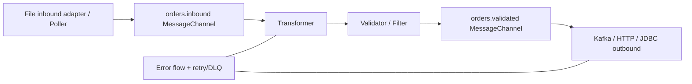
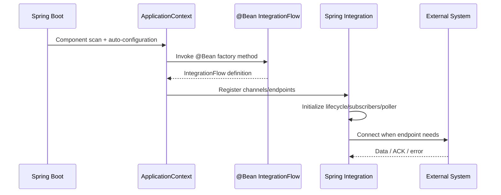
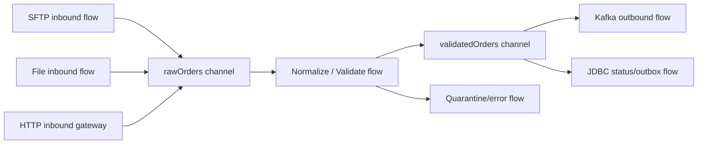
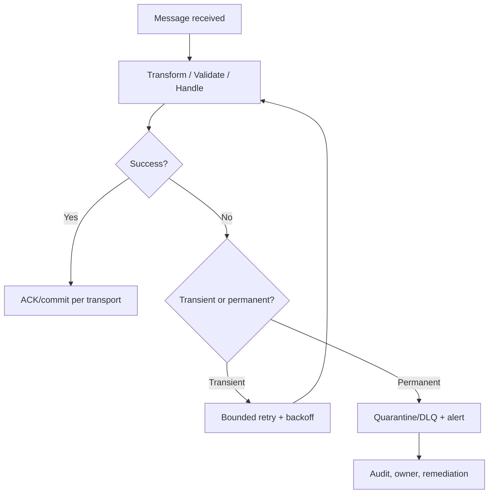
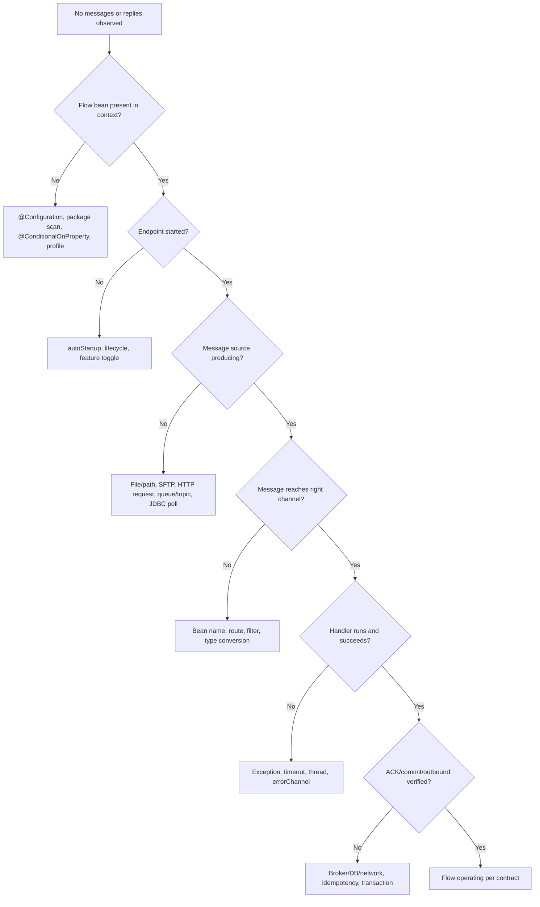

# `IntegrationFlow` Beans in Spring Boot: Designing, Registering, and Operating Adapters

> **Chapter:** Spring Boot  
> **Lesson:** `IntegrationFlow` beans in Boot  
> **Module:** `SPRING_INTEGRATION_ADAPTERS` — connecting external systems via inbound/outbound adapters, gateways, pollers, and `MessageChannel`; implementing File, SFTP, HTTP, JMS, AMQP/RabbitMQ, Kafka, and JDBC flows along with message contracts, error handling, and connection lifecycles.  
> **Level:** Intermediate. **Prerequisites:** Spring beans and dependency injection, Spring Boot configuration, Maven/Gradle, basic EIP patterns.  
> **Illustrative stack:** Java 17+, Spring Boot 3.x, Spring Integration 6.x under compatible versions managed by the Boot BOM. Some APIs may change across upgrades; verify against your project version before production use.

## 1. What Problem Does an `IntegrationFlow` Bean Solve?

Suppose a system receives order files from a partner, normalizes their contents, sends the result to an internal channel, and then calls an HTTP API or publishes to Kafka. Writing everything inside a manual Java loop forces developers to handle polling schedules, data routing, request–reply exchanges, connections, thread management, and errors by hand. **Spring Integration** provides Enterprise Integration Patterns (EIP), while **Spring Boot** registers and runs them as beans inside `ApplicationContext`.

Using the Java DSL, an `IntegrationFlow` describes **the path of a message through endpoints**:



Instead of wiring handler and poller objects manually, you declare a `@Bean` of type `IntegrationFlow` using `IntegrationFlow.from(...)` and DSL operators such as `.channel(...)`, `.filter(...)`, `.transform(...)`, `.route(...)`, and `.handle(...)`. Spring builds the endpoint beans, registers subscriptions, and hooks their lifecycle into the context.

**Key point:** `IntegrationFlow` is **the topology and endpoint definition** — it is not a message, not the `MessageChannel` itself, and does not mean "every external connection is ready". A flow can register cleanly while an SFTP source or Kafka broker remains unreachable at runtime.

### 1.1. Learning Outcomes

After completing this lesson, you will be able to:

1. Describe the differences between `IntegrationFlow`, `IntegrationFlowBuilder`, `MessageChannel`, message endpoints, and transport adapters.
2. Declare `@Bean IntegrationFlow` in Boot and understand the effects of component scanning, auto-configuration, Java DSL, and bean names.
3. Build a **request–reply flow** using `@MessagingGateway`, `DirectChannel`, and transformers without a broker.
4. Build a **File inbound flow with a poller**, separating channels and consumer flows; enable the flow conditionally via properties/profiles.
5. Know how to attach outbound endpoints for HTTP, SFTP, JMS, AMQP, Kafka, or JDBC without mixing business logic with transport code.
6. Explain differences between synchronous/asynchronous execution, request–reply/one-way, error channels, retries, and transactions.
7. Test the bean graph, message contracts, and live flows, and diagnose why an endpoint fails to receive messages.
8. Ensure lifecycle integrity across startup, shutdown, restart, configuration changes, and external system connections.

### 1.2. When Should You Use an `IntegrationFlow` Bean?

- **Yes:** when building EIP message pipelines involving sources, channels, transformations, validation, routing, and Spring-managed endpoints configured via Boot profiles/conditions.
- **Yes:** when wiring adapters across File/SFTP/HTTP/JMS/AMQP/Kafka/JDBC with clear responsibility boundaries.
- **Not strictly required:** for simple synchronous business functions without integration needs, an ordinary Spring `@Service` may suffice.
- **Does not replace:** DB transactions, broker retries, business idempotency, authentication/authorization, or external system monitoring.

## 2. Core Objects in an `IntegrationFlow`

### 2.1. `Message` and `MessageChannel`

A `Message<?>` consists of a **payload** and **headers**. The payload can be a `File`, `String`, `byte[]`, a business record, or a serialized object. Headers may carry a correlation ID, content type, file metadata, or transport metadata. Avoid forwarding all framework headers externally without an allowlist.

`MessageChannel` defines the delivery contract; the channel type governs threading and send/receive behavior:

| Channel type | Delivery semantics | Impact on flow |
|---|---|---|
| `DirectChannel` | Point-to-point, synchronous dispatch to one subscriber | Downstream errors can propagate back to the sender thread; fits synchronous gateways |
| `PublishSubscribeChannel` | Fan-out to subscribers | Not durable by default and does not guarantee delivery for every subscriber |
| `QueueChannel` | Buffer polled by consumers | Requires a consumer/poller; in-memory queues do not provide persistence |
| `ExecutorChannel` | Dispatches via a task executor | Changes thread and execution timing; requires rejection/back-pressure configuration |
| `PriorityChannel` | Buffers and orders by priority policy | Can affect fairness and cause starvation |

A channel **is not a broker**. An in-JVM `QueueChannel` does not replace Kafka, RabbitMQ, or JMS for durable cross-process queuing.

### 2.2. Flow Endpoints

| DSL / endpoint | Function | Example |
|---|---|---|
| `.from(...)` | Starts from a channel or inbound message source | `Files.inboundAdapter(...)`, `"ordersInput"` |
| `.channel(...)` | Sends the message to the specified channel | `.channel("ordersValid")` |
| `.transform(...)` | Modifies payload or message structure | `File → String`, JSON → event DTO |
| `.filter(...)` | Passes/drops messages by condition | Reject invalid records |
| `.route(...)` | Selects destination by header/payload | Route by tenant or event type |
| `.handle(...)` | Invokes handler, service activator, outbound adapter/gateway | Save to DB, publish event, write file |
| `.enrichHeaders(...)` | Adds controlled metadata | correlation ID, source system |
| `.split(...)` / `.aggregate(...)` | Splits/aggregates messages with correlation | Multi-record file |
| `.bridge(...)` | Connects two message boundaries | Connects channels per policy |
| `.log(...)` | Logs permitted info | Message ID, type, latency; **never** log secrets |

An `IntegrationFlow` can have just a few steps or many. When topology grows complex, split it into **multiple flows with explicit channel contracts** instead of one giant DSL chain that is hard to observe.

### 2.3. Inbound Adapter, Outbound Adapter, and Gateway

- **Inbound channel adapter**: brings data into Spring Integration, usually **one-way**. File polling, SFTP polling, and broker listeners are examples.
- **Outbound channel adapter**: receives a message and sends it to an external system, usually **expecting no reply**.
- **Inbound gateway**: receives a request from a transport, feeds the flow, waits for a reply, and sends the response back over the transport (e.g., HTTP request → HTTP response).
- **Outbound gateway**: receives a request from a flow, calls an external system, and passes the response onward in the flow (e.g., HTTP API, JMS request–reply).
- **Messaging gateway interface**: application code calls a Java method like `normalize(String input)`, the framework wraps it into a message, sends it into the flow, and awaits the reply; it is not a network adapter unless downstream flows include a transport endpoint.

Distinguishing **one-way** from **request–reply** prevents waiting forever for a non-existent reply or silently dropping messages when a flow lacks subscribers.

### 2.4. Poller Is Endpoint Configuration

File, many SFTP, and JDBC polling sources require a poller to decide **when to fetch messages**. Example:

```java
endpoint -> endpoint.poller(
    Pollers.fixedDelay(Duration.ofSeconds(2))
           .maxMessagesPerPoll(10)
)
```

Notes:

- `fixedDelay` schedules delays between polls; it is not a TCP timeout.
- `maxMessagesPerPoll` caps messages fetched per poll cycle on that endpoint, not total downstream throughput.
- Pollers do not inherently provide exactly-once delivery. If a file or DB row still matches after a restart, it may be picked up again.
- When using task executors or multiple instances, concurrency, locking, and checkpoints must be designed explicitly.

## 3. How Does Spring Boot Register an `IntegrationFlow` Bean?

### 3.1. From `@Bean` to Active Endpoint



Typical Boot configuration class:

```java
@Configuration(proxyBeanMethods = false)
class OrderFlows {

    @Bean
    IntegrationFlow ordersFlow() {
        return IntegrationFlow.from("ordersInput")
            .transform(String.class, String::trim)
            .get();
    }
}
```

Import `@Configuration`, `@Bean`, and `IntegrationFlow`. `ordersFlow` is the **flow bean name** unless overridden. `"ordersInput"` is the **input channel name**; they are not the same bean. Spring Integration can auto-create/resolve channels in certain DSL cases, but for channels serving as public contracts across multiple flows, **declare explicitly named channel beans** to avoid surprises.

Once the context initializes, Spring Integration translates the DSL definition into the corresponding endpoint beans. **Calling `ordersFlow()` manually in Java is not how you send a message**; send via the channel or invoke a registered gateway.

### 3.2. Boot Auto-configuration and Java DSL

Typically a Boot project declares:

```xml
<dependency>
    <groupId>org.springframework.boot</groupId>
    <artifactId>spring-boot-starter-integration</artifactId>
</dependency>
```

The starter brings in version-aligned Integration infrastructure and auto-configuration. In modern Boot/Spring Integration, Java DSL is built in; do not copy an outdated example and add an incompatible `spring-integration-java-dsl` dependency.

**Having core does not mean having adapters**: add `spring-integration-file` for `Files.inboundAdapter`, `spring-integration-sftp` for SFTP, `spring-integration-kafka` for Kafka. Boot can auto-configure a `DataSource` or Rabbit `ConnectionFactory`, but it cannot infer your business flows.

### 3.3. Component Scanning and Gateway Interfaces

`@SpringBootApplication` enables component scanning across application packages. For `@MessagingGateway` interfaces, register them explicitly with `@IntegrationComponentScan` or framework-supported gateway registration rather than assuming every interface becomes a Spring bean automatically.

```java
@SpringBootApplication
@IntegrationComponentScan
public class AdapterApplication {
    public static void main(String[] args) {
        SpringApplication.run(AdapterApplication.class, args);
    }
}
```

Imports: `org.springframework.boot.autoconfigure.SpringBootApplication`, `org.springframework.integration.annotation.IntegrationComponentScan`, and `org.springframework.boot.SpringApplication`.

### 3.4. `@Bean` Name, Endpoint ID, and Channel Name Are Different

| Name | Role | Example |
|---|---|---|
| `@Bean("fileInboundFlow")` | Identifies the flow bean in the context | Used when checking conditions or lifecycle |
| `.from("fileInput")` | Input channel of the flow | Connects flows together |
| `.channel("fileReady")` | Output channel of the current step | Inter-flow contract |
| `endpoint.id("filePollerEndpoint")` | Identifies the DSL-created endpoint when management is needed | Endpoint monitoring, start/stop, metrics |
| `@MessagingGateway` | Proxy interface converting method calls into messages | Called from controllers/services |

Never reuse the same bean name across different adapters just because they both process files. Never enable `spring.main.allow-bean-definition-overriding=true` to work around name collisions; use distinct names/qualifiers and proper registration conditions instead.


## 4. Preparing the Spring Boot Project for the Lab

This lab has two parts you can run locally:

- **Flow A – Request–reply gateway:** a Java service invokes `NormalizeGateway`, the message passes through a `DirectChannel` and transformers, and returns a reply; no network required.
- **Flow B – File inbound:** polls a local directory, sends `File` onto a channel, transforms content, and logs it; no real broker needed.

### 4.1. Maven Dependencies

Use a Spring Boot parent POM or import the Spring Boot BOM at a version **compatible with your JDK and Spring Integration**. This is only the `<dependencies>` section, not a complete POM:

```xml
<dependencies>
    <dependency>
        <groupId>org.springframework.boot</groupId>
        <artifactId>spring-boot-starter-integration</artifactId>
    </dependency>
    <dependency>
        <groupId>org.springframework.integration</groupId>
        <artifactId>spring-integration-file</artifactId>
    </dependency>
    <dependency>
        <groupId>org.springframework.boot</groupId>
        <artifactId>spring-boot-starter-test</artifactId>
        <scope>test</scope>
    </dependency>
    <dependency>
        <groupId>org.springframework.integration</groupId>
        <artifactId>spring-integration-test</artifactId>
        <scope>test</scope>
    </dependency>
</dependencies>
```

For Gradle Groovy DSL with versions managed by the Boot BOM:

```groovy
dependencies {
    implementation 'org.springframework.boot:spring-boot-starter-integration'
    implementation 'org.springframework.integration:spring-integration-file'

    testImplementation 'org.springframework.boot:spring-boot-starter-test'
    testImplementation 'org.springframework.integration:spring-integration-test'
}
```

Do not add SFTP, JMS, Kafka, and JDBC modules merely because this topic sits under adapters: the first two labs **only** use Integration core and the File adapter. When extending to real protocols, add only the matching modules and runtimes; inspect the dependency tree rather than guessing transitives.

### 4.2. Project Structure

```text
integration-flow-boot-lab/
├── pom.xml
└── src/
    ├── main/
    │   ├── java/com/example/flows/
    │   │   ├── FlowBootApplication.java
    │   │   ├── NormalizeGateway.java
    │   │   ├── NormalizeFlowConfig.java
    │   │   ├── FileImportProperties.java
    │   │   └── FileImportFlowConfig.java
    │   └── resources/
    │       └── application.yml
    └── test/java/com/example/flows/
        ├── NormalizeFlowTest.java
        └── FileImportDisabledTest.java
```

All classes must reside in `com.example.flows` or a subpackage of the entry point so component scanning detects them. Run Maven/Gradle from the project root directory. On Windows, use `mvnw.cmd`/`gradlew.bat` if provided.

### 4.3. Entry Point

File `FlowBootApplication.java`:

```java
package com.example.flows;

import org.springframework.boot.SpringApplication;
import org.springframework.boot.autoconfigure.SpringBootApplication;
import org.springframework.integration.annotation.IntegrationComponentScan;

@SpringBootApplication
@IntegrationComponentScan
public class FlowBootApplication {
    public static void main(String[] args) {
        SpringApplication.run(FlowBootApplication.class, args);
    }
}
```

`@IntegrationComponentScan` registers `@MessagingGateway` interfaces in application packages. For flows configured via `@Bean`, standard Spring component scanning discovers `@Configuration` classes, whereas gateway interfaces need dedicated registration.

## 5. Flow A: `@MessagingGateway` and Request–Reply in Boot

This minimal example illustrates how an `IntegrationFlow` becomes a callable Java pipeline without JMS, Kafka, HTTP, or the filesystem.

### 5.1. Defining the Gateway Interface

File `NormalizeGateway.java`:

```java
package com.example.flows;

import org.springframework.integration.annotation.Gateway;
import org.springframework.integration.annotation.MessagingGateway;

@MessagingGateway
public interface NormalizeGateway {

    @Gateway(requestChannel = "normalizeInput")
    String normalize(String rawOrderId);
}
```

At startup, Spring Integration registers a **gateway proxy bean**. Business code simply calls `normalize(" order-001 ")`. The proxy builds a message, sends it to `normalizeInput`, and awaits a reply under the request–reply contract.

A gateway interface opens no external connections. If downstream flows later add an HTTP outbound gateway, JMS, or Kafka, that belongs to the downstream endpoint and its transport dependencies.

### 5.2. Registering the Channel and `IntegrationFlow`

File `NormalizeFlowConfig.java`:

```java
package com.example.flows;

import java.util.Locale;

import org.springframework.context.annotation.Bean;
import org.springframework.context.annotation.Configuration;
import org.springframework.integration.channel.DirectChannel;
import org.springframework.integration.dsl.IntegrationFlow;
import org.springframework.messaging.MessageChannel;

@Configuration(proxyBeanMethods = false)
public class NormalizeFlowConfig {

    @Bean("normalizeInput")
    MessageChannel normalizeInput() {
        return new DirectChannel();
    }

    @Bean("normalizeFlow")
    IntegrationFlow normalizeFlow() {
        return IntegrationFlow
            .from("normalizeInput")
            .<String, String>transform(String::trim)
            .<String, String>transform(
                text -> text.toUpperCase(Locale.ROOT)
            )
            .get();
    }
}
```

**Mechanics:**

1. `@Bean("normalizeInput")` creates an explicit `DirectChannel`.
2. `IntegrationFlow.from("normalizeInput")` registers an endpoint consuming from that named channel.
3. Two `transform` steps trim leading/trailing whitespace and convert text to uppercase.
4. Transformers produce replies; in this request–reply flow, the result is routed back to the `replyChannel` attached by the gateway.
5. No external adapters exist: this is an **in-memory request–reply `IntegrationFlow`**.

**Why not end this gateway flow with `.handle(message -> log.info(...))`?** A one-way handler that only logs produces no reply, causing a gateway method returning `String` to time out or fail for lack of a reply. If the caller expects a result, terminate with a reply-producing handler/transformer, or use a `void` gateway signature for one-way calls.

### 5.3. Calling the Gateway from Another Service

Any bean in the same context can inject the gateway:

```java
package com.example.flows;

import org.springframework.boot.ApplicationRunner;
import org.springframework.context.annotation.Bean;
import org.springframework.context.annotation.Configuration;

@Configuration(proxyBeanMethods = false)
class DemoRunnerConfig {

    @Bean
    ApplicationRunner demoNormalize(NormalizeGateway gateway) {
        return args -> {
            String result = gateway.normalize("  order-001  ");
            System.out.println("NORMALIZED=" + result);
        };
    }
}
```

Running the app produces:

```text
NORMALIZED=ORDER-001
```

This is a dummy string containing no personal data or secrets. In production, use structured logging instead of printing business data arbitrarily to stdout.

### 5.4. Testing the Gateway Without a Broker

File `NormalizeFlowTest.java`:

```java
package com.example.flows;

import org.junit.jupiter.api.Test;
import org.springframework.beans.factory.annotation.Autowired;
import org.springframework.boot.test.context.SpringBootTest;

import static org.assertj.core.api.Assertions.assertThat;

@SpringBootTest(properties = {
    "app.file.enabled=false",
    "spring.main.web-application-type=none"
})
class NormalizeFlowTest {

    @Autowired
    NormalizeGateway gateway;

    @Test
    void gatewayReturnsTransformedReply() {
        assertThat(gateway.normalize("  order-001  "))
            .isEqualTo("ORDER-001");
    }
}
```

This test proves the gateway proxy, channel, transformers, and reply collaborate inside the context. It **does not** prove Kafka, JMS, SFTP, or database connectivity; transport tests must be added separately when external adapters are introduced.

### 5.5. Common Gateway Errors

| Symptom | Possible cause | Verification |
|---|---|---|
| `NoSuchBeanDefinitionException: NormalizeGateway` | `@MessagingGateway` not scanned/registered | Check `@IntegrationComponentScan` and packages |
| `Dispatcher has no subscribers` | Channel has no consumer flow | Check `normalizeFlow` bean, profiles, conditions |
| `Reply timed out` | One-way handler, slow async downstream, or error | Check reply path, timeouts, error channel |
| `ClassCastException` in transformer | Payload is not `String` | Verify message contract and converters |
| Output altered by another flow | Multiple endpoints subscribed to one `DirectChannel` | Inspect topology and channel subscriptions |
| Duplicate flow bean name | Colliding `@Bean` names | Use unique names; never enable global bean overriding |

## 6. Flow B: File Inbound Adapter with `@Bean IntegrationFlow` and Poller

The second flow runs independently of the request–reply gateway. Its goal is to understand **message sources**, **polling endpoints**, **separated channels**, and **consumer flows**.

### 6.1. Application Properties

File `FileImportProperties.java`:

```java
package com.example.flows;

import java.nio.file.Path;
import java.time.Duration;

import org.springframework.boot.context.properties.ConfigurationProperties;

@ConfigurationProperties(prefix = "app.file")
public record FileImportProperties(
    boolean enabled,
    Path inbox,
    Duration pollDelay
) {
    public FileImportProperties {
        if (enabled && (inbox == null
                || pollDelay == null
                || pollDelay.isNegative()
                || pollDelay.isZero())) {
            throw new IllegalArgumentException(
                "File import requires inbox and positive poll-delay"
            );
        }
    }
}
```

`app.file.*` is **application-defined**, not a built-in namespace that makes Spring Boot auto-create a File adapter. You need `@EnableConfigurationProperties` or scanning so the binder instantiates the object.

File `application.yml`:

```yaml
spring:
  application:
    name: integration-flow-boot-lab
  main:
    web-application-type: none

app:
  file:
    enabled: true
    inbox: ./data/in
    poll-delay: 2s

logging:
  level:
    com.example.flows: INFO
    org.springframework.integration: INFO
```

**Important for testing:** `@SpringBootTest(properties="app.file.enabled=false")` overrides the config file and prevents registering the inbound endpoint. Never let unit/gateway tests accidentally poll a production directory. Spring Boot relaxed binding maps `poll-delay` to `pollDelay` as a `Duration`.

### 6.2. Three Beans Serving a Flow with Clear Boundaries

File `FileImportFlowConfig.java`:

```java
package com.example.flows;

import java.io.File;
import java.io.IOException;
import java.io.UncheckedIOException;
import java.nio.charset.StandardCharsets;

import org.slf4j.Logger;
import org.slf4j.LoggerFactory;
import org.springframework.boot.autoconfigure.condition.ConditionalOnProperty;
import org.springframework.boot.context.properties.EnableConfigurationProperties;
import org.springframework.context.annotation.Bean;
import org.springframework.context.annotation.Configuration;
import org.springframework.integration.channel.DirectChannel;
import org.springframework.integration.dsl.IntegrationFlow;
import org.springframework.integration.dsl.Pollers;
import org.springframework.integration.file.dsl.Files;
import org.springframework.messaging.MessageChannel;

@Configuration(proxyBeanMethods = false)
@EnableConfigurationProperties(FileImportProperties.class)
public class FileImportFlowConfig {
    private static final Logger log =
        LoggerFactory.getLogger(FileImportFlowConfig.class);

    @Bean("fileReceived")
    MessageChannel fileReceived() {
        return new DirectChannel();
    }

    @Bean("fileInboundFlow")
    @ConditionalOnProperty(
        prefix = "app.file",
        name = "enabled",
        havingValue = "true"
    )
    IntegrationFlow fileInboundFlow(FileImportProperties props) {
        return IntegrationFlow
            .from(
                Files.inboundAdapter(props.inbox().toFile())
                    .autoCreateDirectory(true)
                    .patternFilter("*.txt"),
                endpoint -> endpoint.poller(
                    Pollers.fixedDelay(props.pollDelay())
                        .maxMessagesPerPoll(5)
                )
            )
            .channel("fileReceived")
            .get();
    }

    @Bean("fileProcessingFlow")
    IntegrationFlow fileProcessingFlow() {
        return IntegrationFlow
            .from("fileReceived")
            .transform(File.class, file -> {
                try {
                    return java.nio.file.Files.readString(
                        file.toPath(), StandardCharsets.UTF_8
                    );
                } catch (IOException ex) {
                    throw new UncheckedIOException(ex);
                }
            })
            .<String, String>transform(String::trim)
            .handle(message -> {
                String value = (String) message.getPayload();
                // Do not log full contents if they contain sensitive data.
                log.info("File message received, chars={}", value.length());
            })
            .get();
    }
}
```

In this configuration:

- `fileReceived` is an application-created channel shared between two `IntegrationFlow`s.
- `fileInboundFlow` is only registered when `app.file.enabled=true`.
- The File source endpoint uses a fixed-delay poller fetching up to five files per poll.
- `fileProcessingFlow` is registered **even when inbound is disabled**, yet it emits no messages; without a source it simply waits on the channel.
- The initial payload is `java.io.File`; the transformer reads UTF-8 into a `String`, and the handler logs character length rather than dumping full contents.
- Because `DirectChannel` is used, the consumer runs on the poller's sending thread — keep this in mind if downstream is slow.

**Operational note:** This lab neither deletes/moves files nor uses a persistent accept-once filter, transactions, or business idempotency. If the app restarts, files may be re-selected depending on active filters/metadata. Do not treat this flow as an exactly-once pipeline.

### 6.3. Running the Lab

Use the project wrapper:

```bash
./mvnw spring-boot:run
# Or in a Gradle project:
./gradlew bootRun
```

Place `data/in/order-001.txt` with content:

```text
orderId=ORDER-001
tenantId=tenant-a
```

After polling, handler output looks similar to:

```text
File message received, chars=35
```

`chars` depends on the actual content and line endings, so it does not have to equal 35. Drop `ignore.csv` into the same directory: the File inbound filter only accepts `*.txt`.

Set `app.file.enabled=false` and **restart the context**. Now `fileInboundFlow` is absent, while `fileReceived` and `fileProcessingFlow` still exist. Editing YAML while the app is running does not automatically re-evaluate `@ConditionalOnProperty`.


## 7. Testing the Bean Graph, Channels, and File Flow

### 7.1. Verifying Flow Absence When Property Is Disabled

File `FileImportDisabledTest.java`:

```java
package com.example.flows;

import org.junit.jupiter.api.Test;
import org.springframework.beans.factory.annotation.Autowired;
import org.springframework.boot.test.context.SpringBootTest;
import org.springframework.context.ApplicationContext;

import static org.assertj.core.api.Assertions.assertThat;

@SpringBootTest(properties = {
    "app.file.enabled=false",
    "app.file.inbox=./build/test-in",
    "app.file.poll-delay=1s",
    "spring.main.web-application-type=none"
})
class FileImportDisabledTest {

    @Autowired
    ApplicationContext context;

    @Test
    void inboundFlowIsAbsentWhenFeatureDisabled() {
        assertThat(context.containsBean("fileInboundFlow")).isFalse();
        assertThat(context.containsBean("fileReceived")).isTrue();
        assertThat(context.containsBean("fileProcessingFlow")).isTrue();
    }
}
```

This is a **context test** requiring no files or external connections. It proves the condition governed the inbound endpoint's **bean definition**; it does not prove filesystem ingestion when enabled.

### 7.2. Testing File End-to-End When Enabled

An integration test can:

1. Use a dedicated temporary test directory, never a business volume.
2. Set `app.file.enabled=true` and `app.file.inbox` to the temp path **before `ApplicationContext` starts**.
3. Create `valid-001.txt` by writing a temp file and performing an **atomic rename** into the inbox so the poller never reads a partial file.
4. Use a test handler or wire tap capturing results with a **bounded timeout** instead of guessing with `Thread.sleep`.
5. Assert UTF-8 payload integrity, that `ignore.csv` is skipped, zero exceptions occur, and the flow/endpoint beans started.
6. Stop and restart the context to observe potential re-ingestion, informing persistent metadata/idempotency design.

Never use mutable test singletons shared across multiple `ApplicationContext` instances or parallel tests. For the File adapter, temporary paths and poller lifecycle are critical for reproducibility.

### 7.3. Sending Directly to a Channel to Test the Processor

When filesystem testing isn't needed, send a `File` message straight to `fileReceived` and verify the consumer flow.

Test idea:

```java
MessageChannel channel =
    context.getBean("fileReceived", MessageChannel.class);

File input = new File("path/to/test-fixture.txt");
boolean accepted = channel.send(
    MessageBuilder.withPayload(input).build()
);
assertThat(accepted).isTrue();
```

Required imports: `java.io.File`, `org.springframework.messaging.MessageChannel`, `org.springframework.messaging.support.MessageBuilder`, and `assertThat`. Use an existing fixture with valid UTF-8 content. `send(...)` returning `true` indicates the channel accepted delivery per its contract; **it does not prove downstream business persistence committed** if switched to an asynchronous channel later.

With `DirectChannel` and synchronous handlers as in this lab, I/O errors propagate directly out of `send(...)`. If switched to `ExecutorChannel`, error observation must move to an error channel/test sink and deadline-based synchronization.

### 7.4. Gateway and File Tests Do Not Replace Transport Integration Tests

| Test type | What it proves | What it does not prove |
|---|---|---|
| `NormalizeFlowTest` | Gateway proxy, channel, transformers, and reply | No real transport |
| `FileImportDisabledTest` | Conditional bean registration | No files polled when enabled |
| File context/inbox test | Poller, pattern filter, payload, basic handler | Exactly-once across crash/restart |
| SFTP test server | SSH authentication, host trust, file transfer | Production partner availability |
| HTTP mock server | Status, headers, timeout, payload mapping | Real Internet latency/identity provider |
| JMS/AMQP test broker | Listeners, ACK, redelivery, bindings | Production broker HA/chaos |
| Kafka test cluster | Topics, serialization, consumer offset/lag | End-to-end exactly-once with DB |
| Database test | JDBC schema, locks, transactions | Atomic transaction with an external broker |

### 7.5. Checking Endpoint Counts and Subscribers

If `fileInboundFlow` is created while `fileProcessingFlow` is mis-conditioned or outside package scan, `fileReceived` may have zero subscribers. On a `DirectChannel`, sending messages with no handler fails. Verify:

- `ApplicationContext.containsBean("fileInboundFlow")` and related bean names.
- Channels have the expected types and subscriptions.
- `spring.integration` log level in tests to observe endpoints and polling.
- File paths, filters, filesystem permissions, working directory, and environment variables.
- Whether flows have `autoStartup(false)` or were stopped by a lifecycle controller.

**Avoid forcing `autoStartup=true` on every endpoint just to hide symptoms.** External connectors may be intentionally disabled by profile or security policy.

## 8. From `IntegrationFlow` Beans to External Adapters

An `IntegrationFlow` describes topology; when sources/destinations are external systems, adapter modules and connection infrastructure must be configured explicitly. **There is no rule that every adapter has its own Boot starter named after the protocol.**

### 8.1. Source, Destination, and Dependency Matrix

| Connection | Spring Integration module | Beans/infrastructure typically required | Flow pattern |
|---|---|---|---|
| **File** | `spring-integration-file` | `FileReadingMessageSource`, file handler, folders/filters | Polling inbound or file outbound |
| **SFTP** | `spring-integration-sftp` | SSH/SFTP `SessionFactory`, `known_hosts`, remote filters | Polling/sync/streaming inbound, outbound |
| **HTTP inbound** | `spring-integration-http` | Servlet web runtime if using Servlet, request mapping/auth | Request–reply inbound gateway |
| **HTTP outbound** | `spring-integration-http` | HTTP client, URL, TLS, timeouts | Outbound gateway/adapter |
| **JMS** | `spring-integration-jms` | Provider `jakarta.jms.ConnectionFactory`, destinations | Message-driven inbound, outbound/gateway |
| **AMQP/RabbitMQ** | `spring-integration-amqp` | Spring AMQP `ConnectionFactory`, `RabbitTemplate` | Queue listener, outbound adapter/gateway |
| **Kafka** | `spring-integration-kafka` | Producer/Consumer factories, templates, broker config | Producer outbound, message-driven inbound |
| **JDBC** | `spring-integration-jdbc` | `DataSource`, SQL/schema, transaction manager | Row polling, outbound update |
| **Internal channels/gateways only** | Integration core/starter | Direct/Queue/Executor channel | In-memory flow |

Do not invent generic YAML keys like `spring.integration.kafka.host` or `spring.integration.sftp.user` as if they were universal adapter properties. Boot defines `spring.kafka.*`, `spring.rabbitmq.*`, `spring.datasource.*`, and other runtime namespaces; SFTP often requires application-bound `app.partner.sftp.*`.

### 8.2. Separating Inbound, Business, and Outbound Flows

When a system spans multiple transports, a clean observable topology looks like:



**Fan-out warning:** If `validatedOrders` is a `DirectChannel` and you attach **two subscribers**, the default behavior is **competing consumers** (one subscriber is chosen per message), not "every event goes to both Kafka and DB". For true fan-out, use a `PublishSubscribeChannel` or an explicit routing/wire-tap/outbox design with clear failure semantics.

This is a major source of bugs when splitting flows: **sharing a channel name does not imply broadcast**. Channel types and subscriber counts must follow the business contract.

### 8.3. HTTP Outbound Gateway: Different from File Inbound Handlers

Extension example when the project already includes `spring-integration-http` and an appropriate HTTP client:

```java
@Bean("ordersHttpFlow")
IntegrationFlow ordersHttpFlow() {
    return IntegrationFlow
        .from("ordersToHttp")
        .handle(
            Http.outboundGateway("https://api.partner.example.test/orders")
                .httpMethod(HttpMethod.POST)
                .expectedResponseType(String.class)
        )
        .channel("ordersHttpResponses")
        .get();
}
```

Key imports: `org.springframework.integration.dsl.IntegrationFlow`, `org.springframework.integration.http.dsl.Http`, `org.springframework.http.HttpMethod`, and `org.springframework.context.annotation.Bean`. This is a **structural example** without authentication, trust config, request converters, timeouts, idempotency, or a real endpoint — never send real data to the example URL.

Before production deployment, load endpoints/credentials from secrets and allowlists, verify content types, allowed outbound headers, response/status mapping, TLS, error-specific retries, and request idempotency. Gateways produce **replies**, unlike one-way outbound adapters; if downstream requires no response, pick the matching endpoint and flow.

### 8.4. JMS and AMQP: Use the Right `ConnectionFactory`

Both libraries have an interface named `ConnectionFactory`, yet they are **not equivalent**:

- JMS: provider's `jakarta.jms.ConnectionFactory` (e.g., Artemis).
- RabbitMQ/AMQP: `org.springframework.amqp.rabbit.connection.ConnectionFactory`.

In an `IntegrationFlow`, JMS/AMQP outbound adapters and inbound listeners rely on their respective runtime factories/containers; Spring Boot can auto-configure several beans when starters/providers and properties are present. Never create a single bean named `connectionFactory` expecting both protocols to resolve it accurately.

Design destinations/queues, concurrency, message converters, transactions/ACKs, and redelivery/DLQs. Switching a flow from JMS to AMQP is never just swapping Java DSL imports; broker semantics, confirms, routing, transactions, and message formats must all be re-evaluated.

### 8.5. Kafka: Producer/Consumer and Offset Commits

An `IntegrationFlow` consuming from Kafka can use a message-driven adapter; a flow publishing to Kafka needs an outbound handler/template configured with a producer factory. Separate:

- **Producer:** serializers, partitions/keys, ACKs, retries, idempotence, topic ACLs.
- **Consumer:** group, deserializers, polling, offset commits, rebalances, error handler/DLT.
- **Business flow:** schema version, idempotency keys, transactions/outbox, correlation, and routing.

If a listener hands messages off to an async channel, consumer ACK/commit can occur **before downstream business persistence completes**, depending on design. Never treat "IntegrationFlow is running" as proof of exactly-once. Test failures right at the DB/Kafka boundary and across restarts/rebalances.

### 8.6. SFTP and JDBC: Polling & Checkpoints

SFTP inbound needs a session factory, remote directory, sync vs. streaming choice, known-host verification, file readiness, remote/local filters, and retry/reconnect logic. JDBC inbound needs a data source, SQL selecting eligible rows, locking/transactions, a mark-as-processed mechanism, and a poller.

In both cases, **the poller only decides when to fetch data** — it does not turn the source into a durable one-time queue. With multiple instances running, you need a shared metadata store/lock, remote file renaming, or DB claim semantics depending on the source. For JDBC → Kafka, consider transactional outbox/CDC to avoid losing events across the two systems.

### 8.7. File Outbound: Don't Forget Naming and Commits

To write files after a transformer, structural DSL example:

```java
@Bean("exportFileFlow")
IntegrationFlow exportFileFlow() {
    return IntegrationFlow
        .from("exportFiles")
        .handle(
            Files.outboundAdapter(new File("./data/out"))
                .autoCreateDirectory(true)
        )
        .get();
}
```

Requires importing `java.io.File`, `org.springframework.integration.file.dsl.Files`, `org.springframework.integration.dsl.IntegrationFlow`, and `@Bean`. To work reliably in business flows, specify supported writer payloads, filename generators, encoding, file-exists modes, atomic writes/temp suffixes, `fsync` if required, paths/permissions, and error handling.

This flow is an **independent extension snippet**, not yet wired to the lab's `fileReceived`. To route data to `exportFiles`, add a processor/gateway emitting valid payloads with controlled filenames.


## 9. Designing Message Contracts When Splitting `IntegrationFlow` Beans

Every channel linking flows is a **contract boundary**: incoming data must share the payload types, headers, and error rules understood by both producer and consumer. Pointing two flows at the same channel name without a contract causes mismatched converters, lost correlation, or leaked data when swapping outbound adapters.

### 9.1. Sample Contract for `OrderImported`

```json
{
  "eventId": "evt-order-0001",
  "schemaVersion": 1,
  "eventType": "OrderImported",
  "tenantId": "tenant-a",
  "occurredAt": "2026-11-23T08:00:00Z",
  "payload": {
    "orderId": "ORDER-0001",
    "status": "VALIDATED"
  }
}
```

This is an **illustrative business schema**, not a message type automatically generated by Spring Integration. Applications must implement parsers, schema validation, and DTO mapping, emitting events only when valid. Never let clients supply `tenantId` to bypass server-verified tenant authorization.

### 9.2. Distinguishing Business ID, Message ID, and Transport Offset

| Identifier | Purpose | Should not replace |
|---|---|---|
| `eventId`/business key | Business deduplication across retries/restarts | Per-message IDs generated inside the framework |
| Spring Integration message ID | Internal in-JVM correlation | System-wide business idempotency |
| `correlationId` and sequence headers | Reassembling split/aggregated messages | Authenticated subject or verified tenant |
| File path/name | File location or label only | Record deduplication if filenames can repeat |
| Kafka topic/partition/offset | Record position in a Kafka log | Business keys across topics/partitions |
| JMS/AMQP message ID | Broker-assigned message identifier | User identity or transaction ID |
| HTTP request ID | API request tracing | Proof an HTTP `POST` wasn't applied twice |
| DB primary key | Row identity in a DB | Full event contract if rows are recreated/versioned |

In a File → Kafka topology, derive event IDs from a durable order key plus business version. **Never** generate a fresh `UUID.randomUUID()` on every retry and call it an idempotency key: each retry gets a new ID and creates duplicates.

### 9.3. Splitting Flows by Responsibility

An architecture can separate beans cleanly:

```text
fileInboundFlow
    ↓
rawFileChannel                payload: File
    ↓
fileParseFlow                 payload: ValidatedOrder
    ↓
ordersValidatedChannel        payload: ValidatedOrder
    ├── publishKafkaFlow      payload: serialized event
    └── auditPersistenceFlow  payload: outbox/event record
```

In this diagram, the branches express **business intent**. Using a `DirectChannel` with two subscribers does not broadcast to both by default. To achieve **fan-out**, use `PublishSubscribeChannel`, an appropriate bridge/wire tap, or an outbox, and test what happens when one branch succeeds and the other fails.

### 9.4. Never Forward Headers Blindly

Spring Integration attaches headers for internal framework wiring, such as reply/error channels or File/JMS/AMQP/Kafka metadata. Before crossing onto another transport, enforce an **allowlist** of permitted headers such as event ID, `schemaVersion`, verified tenant, and correlation ID.

Specifically, never blindly forward:

- Authorization bearer tokens or session cookies received from HTTP.
- `replyChannel` holding in-JVM object references.
- Exception stack traces that may contain internal credentials/URIs.
- Full filesystem paths, local usernames, or secret metadata.
- Client-supplied `tenantId`/`role` headers unverified by the backend.

For events published to Kafka/JMS, maintain backward/forward compatibility policies on `schemaVersion`; never rely on a Java object's runtime class name as a public contract.

## 10. Errors, Retries, and Transaction Boundaries

### 10.1. Errors in `DirectChannel` vs. Errors in Pollers

In the lab:

- The gateway sending to `normalizeInput` is synchronous. If a transformer throws an exception, the caller normally receives it through the gateway call path.
- The File poller runs on a scheduler; if reading a file fails, no Java caller is waiting for a return value. Errors must be logged/routed via a poller-compatible error handler.
- With `ExecutorChannel`, errors happen on another thread; `try/catch` in the sender thread cannot track downstream failures.

Therefore, error-flow design must match the **thread model and endpoint contract**.



### 10.2. `errorChannel` and `ErrorMessage`

Spring Integration provides `ErrorMessage` and `errorChannel`; pollers, asynchronous endpoints, and gateways handle errors differently depending on endpoint type and configuration. Never assume **every exception** in a synchronous flow automatically lands on `errorChannel` if it already propagated back to the caller.

When designing error handling:

1. Identify whether failures originate in the **source**, transformer, service activator, or outbound transport.
2. Identify which thread catches the exception and who owns ACK/commit.
3. Attach error handlers/channels onto pollers/endpoints where needed.
4. Include business correlation IDs and event IDs in error logs; strip secrets and unnecessary PII.
5. Separate retryable errors (network timeouts, transient broker outages) from non-retryable ones (invalid schema, permission denied, validation).
6. Never retry infinitely or send to a DLQ with no owner.

### 10.3. Retries Must Preserve Idempotency

| Transport | Failure mode | Mitigation |
|---|---|---|
| **File** | Restart re-reads processed files | Persistent accept-once filter, archiving, and business idempotency |
| **SFTP** | Mid-transfer session drop, incomplete remote file | Remote staging/rename, bounded retry, checkpoints |
| **HTTP** | Timeout after server already accepted `POST` | Idempotency keys, status-aware retries, restrict `4xx` |
| **JMS** | Rollback triggers redelivery | Proper ACK/transactions, DLQ, duplicate detection |
| **AMQP** | Infinite nack/requeue loops | Retry/backoff, DLQ, publisher confirms |
| **Kafka** | Consumer rebalance/offset commit out of sync with downstream | DLT, offset strategy, transactional outbox, idempotent consumer |
| **JDBC** | Poller re-selects rows, multiple instances claim same row | Locking/claim, transactions, persistent checkpoints |

A passing retry test does not prove **business exactly-once**. Simulate a timeout right after downstream succeeds while the source hasn't ACKed yet; after retry, verify zero duplicate orders or records were created.

### 10.4. Request–Reply Requires Clear Timeouts and Outcomes

If `@MessagingGateway` returns `String` while the flow only writes to `log` and stops, the caller will never receive the expected reply. If downstream HTTP returns `500`, explicitly decide whether to propagate the exception, return a business error, or retry — never silently return "OK".

For flows taking HTTP inbound → DB write → HTTP response, align gateway timeouts with HTTP server timeouts, JDBC timeouts, and business SLAs. Never set an infinite gateway timeout just to "wait until processing finishes".

### 10.5. Transactions Do Not Automatically Span Endpoints

A synchronous `DirectChannel` can keep thread-bound context on one thread, yet that **does not create** a distributed transaction across DB, Kafka, HTTP, and SFTP. Moving to `ExecutorChannel` also severs thread-bound transaction context.

For instance, if JDBC commits and Kafka publish fails, you need an outbox, durable retries, and idempotent consumers to avoid losing events. A broker ACK only guarantees transport acceptance, not end-to-end business completion.

## 11. Lifecycle: Initialization, Enablement Conditions, and Graceful Shutdown

### 11.1. Difference Between Bean Registration and Endpoint Runtime

| State | What it means | What it does NOT mean |
|---|---|---|
| `IntegrationFlow` bean created | Topology/configuration is registered | SFTP/Kafka/DB are ready |
| Endpoint `autoStartup=true` | Endpoint is allowed to start with context lifecycle | Target server authenticated cleanly |
| Poller running | Scheduler invokes the source | New files/rows exist or business logic succeeds |
| Gateway bean exists | Callers have a proxy to send messages | Flow has valid subscribers/replies |
| Broker connection established | Transport connection succeeded | Permissions exist for target topics/queues |
| Boot application `Started` | Context initialized | All adapters achieved readiness |

### 11.2. Feature Toggles via `@ConditionalOnProperty`

`@ConditionalOnProperty` is evaluated when **`ApplicationContext` is created**. For `fileInboundFlow` in the lab:

- `app.file.enabled=true`: registers the inbound flow and poller.
- `app.file.enabled=false`: omits the inbound bean.
- Editing YAML while the app is running does not re-evaluate the condition automatically.

For **runtime control**, build explicit mechanisms — such as endpoint lifecycle management (`SmartLifecycle`/`IntegrationFlowContext`) or authenticated, audited actuator/control APIs. Never confuse "disable bean on restart" with "immediately halt all in-flight messages". Start/stop controls need authorization, state tracking, and rollback.

### 11.3. Dynamic `IntegrationFlow` Registration

Spring Integration supports dynamic flow registration via `IntegrationFlowContext` when use cases require per-tenant or per-partner pipelines created at runtime. However, this **should not be the default** for ordinary connectors:

- Assign unique, stable IDs and track registrations so unused flows can be stopped/destroyed.
- Cap flow counts, pollers, thread pools, connection factories, and metric cardinality.
- Validate tenant/partner bindings before registration; never let external input create arbitrary URL endpoints.
- Ensure unregistering stops accepting new messages, drains in-flight work, and releases session/broker resources.
- Application restarts must rebuild topologies from approved configuration sources rather than relying on in-memory-only state.

For a handful of statically configured adapters, `@Bean IntegrationFlow` + `@ConditionalOnProperty` is simpler and easier to audit.

### 11.4. Graceful Shutdown by Source/Destination

| Source/destination | Shutdown considerations |
|---|---|
| File/SFTP polling | Stop new polls, finish/mark in-progress files, close streams/sessions |
| HTTP inbound | Stop accepting new requests, return appropriate status, drain in-flight requests |
| JMS/AMQP listeners | Stop consumers in order, apply ACK/nack/redelivery per policy |
| Kafka consumers | Finish processing/commit offsets properly, handle rebalance, close consumer/producer |
| JDBC pollers | Commit or roll back transactions, release connection pool |
| Async channels | Drain or durably persist queues; avoid dropping messages on abrupt executor shutdown |

Configure **bounded timeouts** and shutdown metrics; test restarts while messages are in flight. Where durability is required, in-memory channels/queues are insufficient — use a broker, outbox, or persistent store by design.

### 11.5. Readiness, Metrics, and Audit

Every `IntegrationFlow` should have an owner and endpoint-level observability:

- Poll intervals, received message counts, per-step latency, error counts, and queue/backlog depth.
- Whether SFTP/JMS/AMQP/Kafka/JDBC connections are ready or retrying.
- Consumer lag, DLQ depth, broker disconnects, file age, and unprocessed row counts.
- Correlation/event IDs, source systems, operation outcomes; never log secrets or sensitive headers.
- Alerts when flows expected to be active emit zero events or endpoints are stopped without approval.

Spring Boot Actuator/Micrometer can expose health and metrics depending on modules, configuration, and version; add `spring-boot-starter-actuator` where needed, while **never exposing** sensitive endpoints publicly. Verify actual metric coverage per adapter and add custom indicators if necessary.


## 12. Troubleshooting: Why Is an `IntegrationFlow` Bean Not Working?

### 12.1. Layered Investigation Workflow



### 12.2. Typical Failures

| Symptom | Priority cause | How to inspect and fix |
|---|---|---|
| `No bean of type IntegrationFlow` | Configuration not scanned or condition false | Check packages, `@Bean`, active profiles, properties |
| Gateway interface cannot be injected | `@MessagingGateway` not registered | Add `@IntegrationComponentScan`/matching config |
| Gateway throws `Reply timed out` | Handler returns no reply, slow async flow | Check reply path and gateway timeout |
| `Dispatcher has no subscribers` | `DirectChannel` lacks consumer endpoint | Check downstream flow, bean definitions, lifecycle |
| File adapter emits no messages | Wrong path, filter drops files, poller disabled | Check working directory, pattern, permissions, poller |
| SFTP picks up no files | Session factory/trust, remote directory, remote filter | Check host key, credentials, network, streams |
| HTTP inbound 404 | Misconfigured web runtime/endpoint mapping | Check Servlet stack, routes, security |
| HTTP outbound timeout | Slow client or target, DNS/TLS/proxy | Separate connect vs. read timeouts, retry policy |
| JMS connection not created | Missing provider or `jakarta.jms.ConnectionFactory` | Check starter/provider and actual bean |
| RabbitMQ send/receive errors | Exchange, queue binding, ACL/vhost, nack | Check broker topology, confirms, DLQ |
| Kafka consumer receives nothing | Topic/group/offset, ACLs, deserializer | Check consumer assignment, lag, error handler |
| JDBC polls endlessly on same rows | Missing claim/checkpoint, broken transaction | Check query, locks, idempotency |
| Duplicate bean names | Two flows share `@Bean("...")` | Assign unique names, back-off conditions; never enable overriding |
| Wrong message type | Mismatched transformer/converter | Verify payload types at each channel |
| Two subscribers yet one branch receives nothing | `DirectChannel` unicasts, mistaken for pub-sub | Choose intentional fan-out topology |
| Switched to `QueueChannel` and flow stalled | Missing consumer poller | Inspect pollable channel and endpoint |
| Boot app started yet adapter disconnected | Lazy factory, broker/server down | Check readiness, reconnect, transport tests |
| Failures only during shutdown | Unfinished in-flight messages, ACK/commit | Implement graceful stop, timeouts, drain/persistence |

### 12.3. Dependency and Condition Reports

Maven:

```bash
./mvnw dependency:tree -Dincludes=org.springframework.integration
./mvnw spring-boot:run -Dspring-boot.run.arguments=--debug
```

Gradle:

```bash
./gradlew dependencies --configuration runtimeClasspath
./gradlew bootRun --args='--debug'
```

These commands are examples for projects with Maven/Gradle wrappers; on Windows use `mvnw.cmd`/`gradlew.bat` with appropriate quoting. **Per the scope of this authoring step, builds/tests are not executed during documentation authoring**; learners or QA steps will execute them in an appropriate environment.

When reading the condition report:

- **Positive match:** classpath/property/bean conditions were satisfied.
- **Negative match:** missing dependency, false profile/property, or existing bean caused auto-configuration to back off.
- **Exclusion:** an auto-configuration was excluded intentionally or accidentally.
- **Runtime bean graph:** flows/channels/endpoints exist yet may not be ready.

A user-authored `@Bean IntegrationFlow` does not vanish just because Spring Boot creates a default `MessageChannel`; check **bean names and types**, registration order, qualifiers, conditions, subscriber counts, and lifecycle state.

### 12.4. Distinguishing Three Tiers of Success

1. **Configuration PASS:** dependencies align, classes load, flow beans exist.
2. **Transport PASS:** endpoints connect, authenticate cleanly, exchange data, and receive responses/ACKs.
3. **Business PASS:** payloads match schemas, authorization holds, idempotency/transactions protect consistency, and downstream state updates cleanly once per contract.

Merely logging "application started successfully" is insufficient to sign off on a JMS/Kafka/SFTP adapter or a File → database pipeline.

## 13. Extended Exercises and Acceptance Test Suite

### 13.1. Hands-On Tasks

1. **Basic gateway:** create `NormalizeGateway` and `normalizeFlow`. Invoke with a padded string, verify the reply, and explain `replyChannel`'s role.
2. **File inbound:** create `FileImportFlowConfig`, enable `app.file.enabled`, drop `*.txt` into the directory; verify the handler receives `File`, reads it as `String`, and logs the exact length.
3. **Property condition:** disable File inbound and restart the context; prove only `fileInboundFlow` disappears while the channel and processor flow remain.
4. **Wrong message type:** send a non-`File` payload to `fileReceived`. Observe the failure, add a validator/error flow, and keep the poller from crashing uncontrollably.
5. **Filter condition:** create `ignore.csv` and explain why it is skipped; propose how to surface invalid files instead of leaving them unowned forever.
6. **Fan-out:** design `validatedOrders` to both publish to Kafka and persist to DB. Explain why a `DirectChannel` with two subscribers does not broadcast, and propose pub-sub or outbox.
7. **SFTP/Kafka:** diagram SFTP inbound → validated message → Kafka outbound; list `SessionFactory`, producer factory, poller, error channel beans, and security settings.
8. **HTTP gateway:** accept a business request into a flow, call a mock HTTP API, receive the response; specify timeouts, idempotency keys, and handling for `429`, `500`, and timeouts.
9. **JMS/AMQP:** explain differences between their factories, ACK/rollback, and DLQs; simulate a poison message to prevent infinite redelivery.
10. **JDBC:** design a poller fetching at most $N$ rows per batch; specify transaction boundaries, checkpoints, multi-instance locks, and outbox if downstream is Kafka.
11. **Lifecycle:** describe how to stop an endpoint with in-flight messages, recover on restart, and verify zero lost or duplicated side effects.
12. **Observability:** list metrics/dashboards/alerts needed to confirm the flow is enabled, adapters are ready, backlog/lag is rising, and retries exceed thresholds.

### 13.2. Minimum Test Matrix

| Test | Condition | Expected outcome |
|---|---|---|
| Gateway reply | `gateway.normalize(" a-001 ")` | Returns `"A-001"`, no timeout |
| Gateway missing subscriber | Consumer flow disabled in isolated test context | Clear delivery/reply error, never silent success |
| File enabled | `app.file.enabled=true`, folder contains `x.txt` | One event reaches consumer, file read |
| File disabled | `app.file.enabled=false` | No inbound flow; processor/channel still exist |
| Filename filter | `x.csv` present | Excluded from `*.txt` flow |
| Unicode content | UTF-8 file with accented characters | Transformer preserves charset cleanly |
| File I/O error | Unreadable file | Identifiable error raised without silent loss |
| Duplicate replay | Restart with previously processed file | Duplicate risk identified, idempotency plan verified |
| Wrong payload | Invalid type sent to channel | Not misprocessed, classified via error handling |
| Channel fan-out | Two subscribers on `DirectChannel` vs. PubSub | Differences observed and explained |
| Remote unavailable | SFTP/broker test server down | Bounded retries + readiness alert |
| Shutdown | App stopped with in-flight messages | No premature ACK violating contract; clean recovery |

### 13.3. Suggested Grading Rubric

| Criterion | Points |
|---|---:|
| Understands bean lifecycle, `ApplicationContext`, and Java DSL | 15 |
| Request–reply `@MessagingGateway`, `DirectChannel`, and transformers | 20 |
| File inbound `IntegrationFlow`, poller, feature toggle, and processor flow | 20 |
| Proper channel, message contract, and fan-out design | 15 |
| Appropriate extension to SFTP/HTTP/JMS/AMQP/Kafka/JDBC adapters | 10 |
| Error handling, retries, idempotency, transactions, and shutdown | 10 |
| Testing, troubleshooting, observability, and reporting | 10 |
| **Total** | **100** |

**Passing criteria:** Learners create at least two Boot-registered `IntegrationFlow`s, verify the gateway returns accurate replies, and verify File inbound polls through a channel to a consumer. Learners must explain why bean presence does not prove transport readiness, why `DirectChannel` cannot serve as a default fan-out, and how to protect message contracts when integrating external adapters.

## 14. Pre-Production Checklist

### 14.1. Design

- [ ] Every flow's source and destination have clear owners and use cases.
- [ ] Inbound vs. outbound, adapter vs. gateway, one-way vs. request–reply are chosen appropriately.
- [ ] Channel types, names, payload schemas, headers, and tenant trust rules are documented.
- [ ] No accidental dual subscribers on a `DirectChannel`; fan-out is explicitly designed and tested.
- [ ] Pollers, queue bounds, concurrency, back-pressure, and startup/shutdown match real requirements.
- [ ] `IntegrationFlow` bean names and endpoint IDs never collide; `@ConditionalOnProperty`/`@Profile` never activate the wrong environment.
- [ ] Adapter dependencies and Boot BOM align; unused starters are excluded.

### 14.2. Security and Reliability

- [ ] SFTP verifies host keys; brokers/HTTP/DB enforce appropriate TLS.
- [ ] Credentials come from secret managers with least privilege and rotation.
- [ ] HTTP inbound enforces authentication, authorization checks, and request size limits.
- [ ] Untrusted inputs are parsed/validated before entering business logic or tenant routing.
- [ ] Business idempotency keys, retry policies, quarantine/DLQ, and poison-message procedures are in place.
- [ ] Submitting to a `MessageChannel` is never confused with downstream commit/ACK.
- [ ] Transaction boundaries and timeouts are explicit; outbox used if DB–broker consistency is required.
- [ ] Logs never dump payloads containing PII/secrets or full framework message headers.

### 14.3. Observability and Lifecycle

- [ ] Tests cover bean graphs, contracts, and transport integration in isolated environments.
- [ ] Dashboards track flow status, message counts, error rates, latency, and backlog/consumer lag.
- [ ] Alerts fire when pollers stall, endpoints disable unexpectedly, brokers are unreachable, or retries spike.
- [ ] Endpoints close/release connections during graceful shutdown; restart and replay tests exist.
- [ ] Rollout/rollback plans exist, and topics, queues, remote paths, and DB targets are verified post-deploy.
- [ ] Business outcome evidence is verified, not merely "Spring Boot started".

### 14.4. Review Questions

1. What is the difference between an `IntegrationFlow` bean, a `MessageChannel` bean, and DSL-created endpoints?
2. Why is `IntegrationFlow.from("ordersInput")` insufficient to receive messages if nothing sends to `ordersInput`?
3. Why can a gateway returning `String` time out if the flow ends with a one-way handler?
4. When splitting File inbound and processor into two flows, how do you define the channel connecting them?
5. Does a flow with two subscribers on a `DirectChannel` guarantee both are invoked?
6. When switching `DirectChannel` to `ExecutorChannel`, what changes in exception propagation and ACK timing?
7. Why does `@ConditionalOnProperty` not stop a running poller when YAML changes at runtime?
8. Do SFTP `SessionFactory` and JDBC `DataSource` automatically create `IntegrationFlow`s when their dependencies are added?
9. If a Kafka consumer has ACKed yet downstream JDBC fails, how do you preserve end-to-end reliability?
10. Why are preserving source files and using an in-memory filter insufficient for exactly-once across restarts?
11. When a gateway returns an HTTP response while an outbound Kafka publish is retrying, how should you define the consistency contract and timeouts?
12. What signals prove an endpoint is genuinely working rather than merely having a bean in the context?

## Conclusion

**`IntegrationFlow` beans in Spring Boot** provide a clear way to declare and register message-processing pipelines managed by Spring for dependency injection, configuration, endpoint lifecycle, and observability. By separating **channels**, **transformers/handlers**, **pollers**, **gateways**, and **adapters**, an application can combine File, SFTP, HTTP, JMS, AMQP, Kafka, and JDBC while preserving testable business contracts.

Successful delivery does not stop at creating a `@Bean IntegrationFlow`: you must verify that **messages travel through the intended channels and endpoints**, replies/ACKs honor their semantics, errors are safely handled, connections are secured, and lifecycles remain controlled across retries, shutdowns, and restarts.
