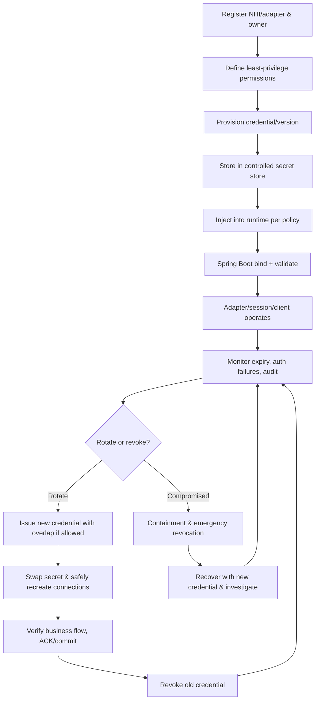

# Managing Credentials via Configuration in Spring Boot and Spring Integration Adapters

## 1. Why Must Credentials Be Managed as Part of Integration Architecture?

A Spring Integration application may operate multiple connections simultaneously:

- **SFTP inbound adapter** downloads files using an SSH account or private key.
- **HTTP outbound gateway** calls external APIs using an API key, OAuth 2.0 access token, or mTLS client certificate.
- **JMS/AMQP adapters** connect to message brokers using username/password or appropriate TLS/SASL mechanisms.
- **Kafka producer/consumer** uses SASL, TLS, or workload identity to access a cluster.
- **JDBC inbound/outbound adapter** uses a database account, possibly requiring a password, short-lived token, or certificate.
- **File adapter** relies on the process's filesystem permissions and platform-supplied mounts.

All of these adapters require **configuration**: endpoints, ports, paths, timeouts, queue/topic names, and authentication details. If credentials are hard-coded in Java, committed straight into Git, or printed in logs, a minor environment change or a single secret leak can impact many systems.

In the **Spring Boot** chapter of the `SPRING_INTEGRATION_ADAPTERS` module, the goal of **"Managing Credentials via Configuration"** is to separate **connection configuration** from **authentication secrets**, use Spring Boot's externalized configuration system, validate values at startup, and establish processes for **provisioning, rotation, revocation, and auditing** without breaking connection lifecycles or message contracts.

This lesson focuses on Spring Boot and Spring Integration: **inbound/outbound adapters, gateways, pollers, `MessageChannel`, File/SFTP/HTTP/JMS/AMQP/Kafka/JDBC flows, and error handling when credentials change**.

### Learning Outcomes

After this lesson, you will be able to:

1. Distinguish ordinary configuration parameters from secrets and machine identities.
2. Select appropriate credential sources: environment variables, mounted secret files, config trees, or secret managers.
3. Use `application.yml`, `@ConfigurationProperties`, validation, and bean wiring to configure adapters.
4. Prevent passwords, API keys, or private keys from appearing in source code, message payloads, headers, or telemetry.
5. Understand the limits of updating secrets while the application and session/connection pools are running.
6. Design rotation/rollback for SFTP, Kafka, JMS, AMQP, HTTP, and JDBC.
7. Test missing credentials, invalid credentials, expiration, revocation, and secret-provider outages.

> **Core principle:** configuration should describe **how to locate and use credentials**; real credentials must travel through protected channels with access controls, lifecycle management, auditing, and rotation workflows. Putting a password in `application.yml` and pushing it to Git **does not become safe** just because Spring Boot can read that file.

## 2. How Do Credentials, Identities, and Configuration Differ?

| Component | Example | Is it a secret? | Governance approach |
|---|---|---|---|
| Endpoint host/port | `sftp.partner.example:22` | Usually no, though still internal metadata | Environment-specific configuration |
| Topic/queue name | `orders.created`, `billing.requests` | Usually no | Versioned configuration |
| Username/service principal ID | `svc-order-export` | Not a password; can be sensitive depending on system | Assign owner and usage scope |
| Password/secret key | SFTP password, DB password | **Yes** | Secret store, rotation, least privilege |
| Private key | SSH key, TLS client private key | **Yes** | Protected file/vault, restricted access, rotation |
| Public certificate/`known_hosts` | Public certificate, SFTP host fingerprint | Not a secret, but **integrity must be protected** | Controlled trust configuration |
| API key | `X-API-Key` header or bearer key | **Yes** | Secret manager or credential provider |
| OAuth access token | Short-lived token for API calls | **Yes** | Token provider, bounded TTL/scope, never in Git |
| OAuth client secret | Confidential client secret | **Yes** | Secret store / identity provider |
| Database URL | `jdbc:postgresql://db:5432/orders` | Can expose metadata; especially dangerous if it embeds a password | Configure credentials separately from URL |
| File path | `/data/incoming` | Not a credential, though can be sensitive | Configuration, filesystem ACLs |

**Identity** is the principal recognized by the external system; **credential** is the proof of that identity; **authorization** is the permission to act at the target. Rotating a credential does not automatically change permissions. Changing permissions also may not immediately revoke existing sessions/tokens.

For **non-human identities (NHI)** such as service accounts, workload identities, and bots, maintain:

- Clear business owner and technical owner.
- Intended purpose and authorized adapters/flows.
- Least-privilege permissions scoped to specific APIs, queues, topics, buckets, directories, or database schemas.
- Expiration dates, rotation policies, recovery plans, and revocation procedures.
- Auditing of provisioning, secret reads (per provider capability), modifications, and anomalous usage.

Never share **one administrative account** across all inbound/outbound adapters for configuration convenience.

## 3. What Does Spring Boot Externalized Configuration Solve?

Spring Boot reads properties from multiple sources depending on version and environment, for example:

- `application.yml` or `application.properties` in the artifact or config location.
- External config files outside the artifact and profile-specific configurations.
- **Environment variables** supplied by the runtime.
- **System properties** or command-line arguments.
- `spring.config.import` sources, including **config trees** from mounted secret files.
- Dedicated integration with a **secret manager** or configuration server via appropriate libraries.

The main benefit is that **adapter code does not need to know where credentials are stored**; it simply receives a bound, validated configuration object.

```mermaid
flowchart LR
    A[Secret manager / deployment] --> B[Env or mounted secret files]
    B --> C[Spring Boot Environment / ConfigData]
    D[application.yml: host, port, timeout] --> C
    C --> E[@ConfigurationProperties + validation]
    E --> F[SessionFactory / Client / ConnectionFactory]
    F --> G[Spring Integration inbound / outbound adapter]
    G --> H[(External system)]
    I[Audit / Health / Metrics] -. redacted observability .-> F
```

This diagram shows an architectural model, not built-in Spring Boot integration with every secret manager. When using Vault, cloud secret managers, or workload identity, include the appropriate starter/SDK/agent/configuration and verify refresh capabilities.

### 3.1. How Should Ordinary Configuration and Secrets Be Separated?

A version-controlled `application.yml` can declare **which property names must be supplied** without holding real values:

```yaml
integration:
  sftp:
    host: "sftp.partner.example"
    port: 22
    remote-directory: "/exports/orders"
    username: ${PARTNER_SFTP_USERNAME}
    password: ${PARTNER_SFTP_PASSWORD}
    known-hosts-file: "/etc/integration/ssh_known_hosts"
```

In this example, `${PARTNER_SFTP_USERNAME}` and `${PARTNER_SFTP_PASSWORD}` are **Spring Boot placeholders**. Source control can store the variable names, while real credential values are supplied only by the runtime environment or a controlled secret manager.

**Do not set fallback defaults like `password: ${PARTNER_SFTP_PASSWORD:changeme}` in production.** If a secret is missing, **fail startup or fail readiness per policy** rather than silently falling back to a weak default password.

Example environment variables provided at deployment time:

```text
PARTNER_SFTP_USERNAME  -> integration.sftp.username
PARTNER_SFTP_PASSWORD  -> integration.sftp.password
```

This illustrates mapping when used as placeholders in YAML. To bind environment variables directly to canonical property names, follow Spring Boot's relaxed binding rules, such as:

```text
INTEGRATION_SFTP_HOST
INTEGRATION_SFTP_USERNAME
INTEGRATION_SFTP_PASSWORD
```

**Do not rely on an oversimplified property-source precedence assumption** when `spring.config.import`, profiles, and environment variables coexist; verify effective configuration for your version and profile without printing secret values.

### 3.2. Why Are Environment Variables Not a Vault?

Environment variables are convenient to deploy and broadly supported by Spring Boot, yet they are **not inherently a secure secret store**:

- Process/container administrators or diagnostic tools can inspect them.
- Some crash-report or support-bundle tools collect environment variables.
- If passed via shell commands, values can end up in shell history or CI pipeline logs.
- On rotation, **a running process's environment does not usually update automatically**.
- Passing secrets via command-line arguments risks exposure in process lists or deployment metadata.

Where supported by your platform, **mounted secrets** or identity-based secret fetching reduces several risks, though access control, TTL, and rotation lifecycles are still required.

## 4. Binding Configuration with `@ConfigurationProperties`

Instead of scattering `@Value` across adapters, **`@ConfigurationProperties`** groups related properties into a typed, validated configuration contract.

The example below uses **Java 17+, Spring Boot 3.x / Jakarta Bean Validation**, and **SFTP password authentication** for instructional clarity. When real applications use private keys or tokens, adapt the properties model accordingly. This example does not implement a full adapter flow.

```java
import jakarta.validation.constraints.Max;
import jakarta.validation.constraints.Min;
import jakarta.validation.constraints.NotBlank;

import org.springframework.boot.context.properties.ConfigurationProperties;
import org.springframework.validation.annotation.Validated;

@Validated
@ConfigurationProperties(prefix = "integration.sftp")
public record PartnerSftpProperties(
        @NotBlank String host,
        @Min(1) @Max(65535) int port,
        @NotBlank String remoteDirectory,
        @NotBlank String username,
        @NotBlank String password,
        @NotBlank String knownHostsFile) {
}
```

To register the properties class, use `@EnableConfigurationProperties` on a configuration class:

```java
import org.springframework.boot.context.properties.EnableConfigurationProperties;
import org.springframework.context.annotation.Configuration;

@Configuration
@EnableConfigurationProperties(PartnerSftpProperties.class)
public class SftpPropertiesConfiguration {
}
```

When `password` is missing or blank and validation is enabled with the corresponding dependency, Spring Boot can **refuse to start** rather than creating an adapter without valid credentials.

**Key takeaways:**

- `@NotBlank` only checks presence and non-whitespace; it **does not prove** the password is valid on the SFTP server.
- Use `@Min`/`@Max` for ports; avoid port `0` from primitive defaults.
- Never write `toString()`, `log.info("props={}", props)`, or error messages that might print a **record containing passwords**.
- When using key authentication, do not require both password and private key in every environment; tailor validation to the selected auth mode.
- You can use `Resource`, `Path`, `Duration`, or `URI` for appropriate properties, while verifying conversion, read permissions, and validation.
- `@ConfigurationProperties` binds/validates at bean creation time; it **does not promise automatic refresh of objects, pools, or sessions** when external secrets change.

### 4.1. Creating an SFTP Session Factory from Configuration

With **Spring Integration 6.x** using Apache MINA SSHD, an illustrative configuration looks like:

```java
import org.springframework.context.annotation.Bean;
import org.springframework.context.annotation.Configuration;
import org.springframework.core.io.FileSystemResource;
import org.springframework.integration.sftp.session.DefaultSftpSessionFactory;

@Configuration
public class PartnerSftpSessionConfiguration {

    @Bean
    DefaultSftpSessionFactory partnerSftpSessionFactory(
            PartnerSftpProperties props) {

        DefaultSftpSessionFactory factory =
                new DefaultSftpSessionFactory();

        factory.setHost(props.host());
        factory.setPort(props.port());
        factory.setUser(props.username());
        factory.setPassword(props.password());

        // Accept only host keys trusted via the known_hosts file.
        factory.setKnownHostsResource(
                new FileSystemResource(props.knownHostsFile()));
        factory.setAllowUnknownKeys(false);

        return factory;
    }
}
```

In a real flow, this session factory bean is passed into an **SFTP inbound/outbound adapter**; the adapter uses connections/sessions according to your configured lifecycle, retry, and caching settings.

**Limitation of this example:** `DefaultSftpSessionFactory` APIs, SSH backends, packages, and TLS/SSH capabilities can vary across Spring Integration versions. Verify APIs and compile in your target project before deploying. **Never** set `setAllowUnknownKeys(true)` to "fix" host-key errors in production; update trust material verified from an authoritative source.

### 4.2. Never Pass Credentials via Payloads or Headers

**Inappropriate** example:

```java
// Avoid: credentials become business message data.
MessageBuilder.withPayload(file)
        .setHeader("sftpPassword", password)
        .build();
```

Messages can be logged by wire taps, routed to `errorChannel`, retry queues, dead-letter queues, or trace attributes. Credentials belong in **client/session factory configuration**, never in business payloads or distributed headers.

When credentials must vary per tenant/partner, design a **controlled credential selector/provider** keyed off a validated identifier rather than accepting raw secrets from client messages to build arbitrary connections.

## 5. Mounted Secrets and Spring Boot Config Trees

Containers/Kubernetes can mount secrets as files. Spring Boot supports **config trees** in its ConfigData system via `spring.config.import`.

Production example:

```yaml
spring:
  config:
    import: "configtree:/run/secrets/"
```

Suppose the mounted directory contains **files readable only by the process with strict permissions**:

```text
/run/secrets/
    integration.sftp.username
    integration.sftp.password
```

Each filename serves as a property key and its file content serves as the property value under config-tree rules. Host, port, and remote directory can stay in regular `application.yml`, while secrets come from mounted files.

To allow local development environments **without that mount**, you can use:

```yaml
spring:
  config:
    import: "optional:configtree:/run/secrets/"
```

The `optional:` prefix only prevents **a missing location from failing import immediately**; it **does not mean a production application is allowed to run without required credentials**. Startup validation and policies must still enforce secret presence.

### 5.1. Rules for Protecting Secret Files

- Restrict file owner/group and permissions strictly to the process account that needs read access.
- Mount read-only where supported by the platform.
- Never bake private keys or secret files into JARs or container images.
- Never commit secret files, backup files, or `.env` files holding real values into Git.
- Never run debug file dumps or `cat /run/secrets/*` into CI logs or support tickets.
- Scope pod/service accounts so they mount only the exact secrets needed.
- Test behavior when mounts aren't ready yet, secrets are missing, encodings fail, or unexpected trailing newlines exist.
- Updating a file on a volume **does not guarantee** already-running beans/connection factories automatically reload the secret.

**Config tree is just how Spring Boot reads values from files**, not a secret manager with built-in rotation, auditing, access policies, and revocation. Those obligations still belong to the secret issuer, runtime platform, and consuming application.

## 6. Choosing Credential Sources by Environment

| Source | Pros | Trade-offs or risks | When appropriate |
|---|---|---|---|
| Environment variables | Easy to deploy and bind | Can leak via diagnostics; hard to refresh in-process | Dev/test or runtimes with secure env management |
| Mounted secret files | Tight read permissions; decoupled from image | Requires filesystem protection and rotation/reload handling | Kubernetes, VMs, containers |
| Config tree | Consistent binding into Spring `Environment` | Does not provision, rotate, or audit secrets itself | Mounting secrets as property files |
| Vault/secret manager | ACLs, versioning, audit, TTL, provider-backed rotation | Adds dependency, latency, bootstrap auth | Production requiring formal secret governance |
| Workload identity/federation | Minimizes long-lived credentials; runtime-issued tokens | Requires trust setup, token renewal, adapter support | Cloud/clusters supporting federation |
| Keystore/truststore | Manages keys/certs, mTLS, and trust | Complex file/password/cert lifecycle and reloads | SFTP SSH keys, TLS/mTLS, Kafka/brokers/JDBC |
| Local dev profile | Reproducible local development | Risk of accidentally using real secrets or publishing files | Dev with fake, narrowly scoped credentials |

### 6.1. Bootstrapping a Secret Manager Without Creating a Secret Loop

If an application calls a secret manager to fetch an SFTP password, it must **authenticate to the secret manager**. Never solve that by hard-coding a new "master password" in source code.

Appropriate options include **workload identity**, platform-bound service accounts, short-lived tokens, or controlled machine-identity mechanisms. Secret read permissions must be scoped to the application's path/namespace.

**Secret manager unavailability** is also a scenario to design for:

- At startup when required secrets are missing: normally **fail fast** or refuse work.
- While running when a cached credential is still valid: consider using it within approved TTL/scope.
- Once a credential expires or is revoked: never "fail open" with stale out-of-policy secrets.
- Use retry/backoff/jitter and monitoring so all replicas don't stampede the secret manager simultaneously.
- Never print response bodies or exceptions containing secrets to aid debugging.

## 7. Credential Matrix by Adapter and Transport

| Transport | Typical credentials | Consuming component | Common pitfall |
|---|---|---|---|
| **File** | OS identity, filesystem/mount permissions | File inbound/outbound adapter | Running as root, overly broad mounts |
| **SFTP** | Username + password or SSH private key/passphrase | `DefaultSftpSessionFactory`, session cache | Disabling host-key checks, private keys in Git |
| **HTTP** | API key, OAuth bearer, mTLS client certificate | HTTP outbound gateway/client | Expired tokens, headers/logs leaking secrets |
| **JMS** | Broker identity + password, cert/mTLS, or provider auth | JMS `ConnectionFactory` | Shared admin account, session/ACK breakage on rotation |
| **AMQP** | Broker username/password, TLS cert | Rabbit/AMQP connection factory | Overbroad permissions, wrong vhost, DLQ/config gaps |
| **Kafka** | SASL SCRAM/OAUTHBEARER, TLS/mTLS | Producer/consumer/admin clients | JAAS config leaked in logs, stale clients after rotation |
| **JDBC** | DB username/password, token, TLS cert | `DataSource` and connection pool | Rotated password while pool holds stale connections |
| **Shared outbound proxy** | Proxy credentials, certificate | HTTP/SFTP/Kafka client depending on network | Credentials embedded in URLs or debug env |

There is no universal `integration.password` property across all adapters. Each connector should have its own **identity, secret path, permission policy, and rotation plan**.

## 8. HTTP Outbound: API Keys, Bearer Tokens, and mTLS

An HTTP outbound gateway may require an **API key**, an **OAuth2 client credentials token**, or **mTLS**. Each has a distinct lifecycle:

- **Static API key:** stored in a secret store, version-rotated; never hard-coded in source or URI query strings.
- **OAuth2 access token:** short-lived; fetch on demand via a token manager/provider, cache safely within expiration, and handle `401` per policy.
- **Client secret:** belongs to confidential clients, protected like a password; used solely to request tokens from the identity provider.
- **mTLS private key:** uses securely provisioned keystores/key material, with controlled certificate and trust-chain updates.

### 8.1. Do Not Build a `RestClient` with an Immutable Access Token

Unsustainable long-term pattern:

```java
// Avoid: token fetched once and frozen until process restart.
String token = tokenProvider.currentAccessToken();
RestClient client = RestClient.builder()
        .defaultHeader("Authorization", "Bearer " + token)
        .build();
```

If the token expires after 15 minutes, all subsequent requests may fail with `401`.

### 8.2. Fetching Tokens at Request Time via a Provider

Compatible **Spring Framework 6.1+ / Spring Boot** example, showing only credential consumption mechanics:

```java
import org.springframework.context.annotation.Bean;
import org.springframework.context.annotation.Configuration;
import org.springframework.web.client.RestClient;

interface PartnerTokenProvider {
    String currentAccessToken();
}

@Configuration
public class PartnerHttpClientConfiguration {

    @Bean
    RestClient partnerRestClient(
            RestClient.Builder builder,
            PartnerTokenProvider tokenProvider) {

        return builder
                .baseUrl("https://partner-api.example")
                .requestInterceptor((request, body, execution) -> {
                    // Provider must guarantee a valid token with matching audience/scope.
                    request.getHeaders().setBearerAuth(
                            tokenProvider.currentAccessToken());
                    return execution.execute(request, body);
                })
                .build();
    }
}
```

**Example limitation:** `PartnerTokenProvider` is an application-implemented interface, not a built-in class that automatically supplies tokens. Production implementations need synchronized/single-flight refresh, timeouts, secret storage, `401` policies, bounded retries, and audience/scope validation. When using **Spring Security OAuth2 Client**, prefer its authorized-client/token management over rolling everything by hand.

**Never reuse User A's token to call on behalf of User B** just because a token happens to be cached in a singleton. If forwarding per-request tokens, enforce strict tenant/user boundaries and valid authorization.

## 9. Kafka: Configuring SASL/TLS Without Putting Passwords in the Repository

Spring Boot supports Kafka client configuration via `spring.kafka.*`. Example using **SASL_SSL** with **SCRAM-SHA-512**:

```yaml
spring:
  kafka:
    bootstrap-servers: "kafka-1.example:9093,kafka-2.example:9093"
    properties:
      security.protocol: SASL_SSL
      sasl.mechanism: SCRAM-SHA-512
      sasl.jaas.config: ${KAFKA_JAAS_CONFIG}
```

`KAFKA_JAAS_CONFIG` is **the entire JAAS configuration string** supplied at runtime, not a password to commit in Git. JAAS strings follow login-module-specific syntax with username and password and require proper **escaping/quoting** for the Kafka client to parse cleanly. Keep that string out of logs, startup diagnostics, Actuator, and exception messages.

### 9.1. Producer, Consumer, and Admin Clients May Require Different Permissions

- Producers need write permission on designated topics.
- Consumers need read permission on topics and their consumer groups.
- Admin/metadata clients need metadata read access; they do not necessarily need topic create/delete rights.
- Retry/DLT publishers may need permissions on separate topics; never grant cluster-wide admin just to fix a DLT error.

If one process acts as both producer and consumer, policy may still require separate credentials. Sharing `spring.kafka.properties.*` is convenient but can **exceed least privilege**; consider producer/consumer-specific properties and distinct client factories when needed.

### 9.2. When Rotating Kafka Credentials

Clients may hold authenticated connections, credential providers may cache values, or new producer/consumer instances may be needed. Do not assume updating a secret file automatically refreshes active `ProducerFactory`, `ConsumerFactory`, listener containers, and live connections.

Verify:

1. New credentials are valid and have the right ACLs.
2. Producers publish cleanly per ACK/transaction policies.
3. Consumers rejoin and handle partition assignment/offsets properly.
4. No duplicates occur outside at-least-once/idempotency contracts.
5. Retry/DLT and admin metadata retain necessary permissions.
6. Old credentials are revoked **only after** safe cutover is verified, unless an active compromise requires emergency revocation.


## 10. JMS, AMQP, and JDBC: Standard Properties and Permission Scope

### 10.1. JMS: Configuration Depends on the Provider

JMS is an **API** and does not mandate a single property schema across all brokers. Spring Boot provides auto-configuration depending on the installed driver/provider and starter.

Illustrative configuration for **ActiveMQ Classic** on a Spring Boot version supporting these properties:

```yaml
spring:
  activemq:
    broker-url: "tcp://broker.internal.example:61616"
    user: ${JMS_BROKER_USERNAME}
    password: ${JMS_BROKER_PASSWORD}
```

When using **Artemis**, properties usually sit under `spring.artemis.*` with different connection and embedded/native options. For other JMS providers, you may need to declare a `ConnectionFactory` manually and map credentials from custom `@ConfigurationProperties`.

**Do not copy `spring.activemq.*` verbatim to Artemis or another provider assuming it works.** Verify property names and auto-configuration support for your exact Spring Boot version.

Operational rules:

- Use a dedicated identity with only the **send/receive** rights needed; never use a broker admin account.
- Scope permissions by queue/topic, selector, or client ID where supported.
- Plan for **TLS** and broker certificate trust per platform policy.
- On password rotation, check how connections, sessions, and listener containers recover or recreate.
- Test ACK/transactions, redelivery, and DLQs during rolling restarts.
- Never log `ConnectionFactory`, connection URIs, or exceptions containing passwords while debugging.

### 10.2. AMQP: RabbitMQ Username/Password and TLS

Spring Boot typically provides `spring.rabbitmq.*` when using its AMQP auto-configuration:

```yaml
spring:
  rabbitmq:
    host: "rabbitmq.internal.example"
    port: 5671
    virtual-host: "orders"
    username: ${RABBITMQ_USERNAME}
    password: ${RABBITMQ_PASSWORD}
    ssl:
      enabled: true
```

This configuration is a **conceptual sample**. In production, ensure **TLS hostname verification and trust material** match your version and client; `ssl.enabled=true` alone does not define the entire certificate policy.

Separate permissions:

| Component | Typical permissions needed |
|---|---|
| Inbound listener | Read/consume from designated queues per policy |
| Outbound publisher | Publish to designated exchanges/routing keys |
| Retry/DLX publisher | Publish to error-handling exchanges/queues if architecture requires |
| Health/admin checks | Minimal metadata read access; no default alter/delete rights |

During rotation, **already-open connections may keep using the old authenticated session**, while new connections use credentials bound when the client/factory is created. Plan safe connection recreation and monitor publisher confirms, consumer ACKs, DLQs, prefetch, and backlogs.

### 10.3. JDBC: `DataSource` and Connection Pools

Spring Boot `DataSource` example:

```yaml
spring:
  datasource:
    url: "jdbc:postgresql://db.internal.example:5432/orders"
    username: ${ORDER_DB_USERNAME}
    password: ${ORDER_DB_PASSWORD}
    hikari:
      maximum-pool-size: 10
```

For `DataSource` and connection pools:

- Passwords are checked when **opening a new connection**, not re-checked on every SQL statement over an already-open connection.
- When a password changes, existing connections may keep working per DB behavior while new connections using old credentials fail.
- Low-downtime rotation requires **overlapping credentials/roles**, secret updates, pool recreation/rotation, or controlled rolling restarts per policy.
- HikariCP or other pools have their own lifecycles and management; do not assume changing an environment variable updates an active pool.
- DB accounts need only **SELECT/INSERT/UPDATE** on designated schemas/tables; migrations and admin work should use a separate identity.
- A successful `SELECT 1` health check does not prove the account has write permissions on business tables.

### 10.4. File Adapter: No Password, Yet Still Has an Identity

The **File inbound/outbound adapter** runs under an **OS/process identity**. It reads and writes via ACLs, user/group ownership, volume mounts, or service-account filesystem permissions.

Just because there is no `password` in `application.yml` does not mean the File adapter **has no credential or permission risks**. Key controls:

- Never run containers/processes as `root` unless strictly justified and tightly confined.
- Grant inbound/outbound directories only the minimum read/write permissions required.
- Distinguish read-only mounts from writable mounts.
- Keep secret files **in a completely separate directory from payload files**.
- Never let an inbound poller pick up mounted private keys or credentials and push them into business messages.
- Monitor quotas, file ownership, and cleanup when changing runtime identities.

## 11. SSH Private Keys and Trust Material for SFTP

SFTP can use **public-key authentication** instead of passwords. Each artifact serves a distinct purpose:

| Artifact | Purpose | Protection |
|---|---|---|
| Client private key | Proves the service account's identity | Secret, strict file permissions |
| Private-key passphrase | Protects the private key when encrypted | Separate secret, never hard-coded |
| Server host key / `known_hosts` | Verifies connection to the genuine SFTP server | Integrity protection, fingerprint management |
| Username | Selects the SFTP login identity | Per-tenant/partner configuration |
| Remote path | Scopes file processing directory | Configuration, validation, least privilege |

Conceptual Java configuration — do not configure a password simultaneously if your chosen auth method uses only an SSH key:

```java
DefaultSftpSessionFactory factory =
        new DefaultSftpSessionFactory();

factory.setHost(props.host());
factory.setPort(props.port());
factory.setUser(props.username());

factory.setPrivateKey(
        new FileSystemResource("/run/secrets/sftp/client_key"));
factory.setKnownHostsResource(
        new FileSystemResource(props.knownHostsFile()));
factory.setAllowUnknownKeys(false);

// If the private key has a passphrase:
// factory.setPrivateKeyPassphrase(passphraseFromSecretProvider);
```

When a partner rotates its host key, verify the fingerprint out-of-band through a trusted channel, update trust material under change control, and re-test connectivity. **Never fix mismatches by accepting all host keys.**

If a private key is compromised, **revoke the old public key on the SFTP server**, not merely by deleting the key file from one pod. During transition, track every host/pod still holding cached sessions or old credentials.

## 12. Credential Lifecycle: From Provisioning to Revocation

Credentials have **their own lifecycle**, not merely a property read once at startup.



**The lifecycle covers at least:**

1. **Request and approval:** which app/flow needs which credential, for how long, and with what permitted actions?
2. **Provision:** create machine identity and credential per policy.
3. **Distribute:** grant read access only to the intended workloads/instances, limiting human exposure to plaintext.
4. **Use:** client/session factory authenticates with the target.
5. **Observe:** audit secret access, connection/auth failures, expiry, and anomalous usage.
6. **Rotate:** issue a new version, transition clients, verify behavior, and revoke the old version.
7. **Revoke:** revoke permissions at the target when the flow retires or NHI is deleted; never just remove the secret from config.
8. **Retire:** remove grants and unneeded backups/metadata per retention policy.

### 12.1. Configuration Reload vs. Connection Reload

A common mistake is assuming **changing a secret file** means **running adapters immediately use the new password**.

| Layer | When credential changes in secret store | What to verify |
|---|---|---|
| Secret store | New version is ready | Workload identity has permission to read the new version |
| Mounted file/env | Does runtime see the new value? | Mount propagation; env vars normally don't update live |
| Spring `Environment` | Was the property source reloaded? | Actual ConfigData/refresh mechanism |
| `@ConfigurationProperties` bean | Did the bean rebind or keep old values? | Refresh semantics per version/solution |
| Session/connection factory | Does the factory hold the new value? | Recreate/refresh factory if required |
| Pooled connections | Were old connections replaced safely? | Pool eviction, retries, draining |
| Adapter/gateway/listener | Using new connections and operating properly? | Probes, publish/consume, readbacks, transactions |

**Spring Boot `@ConfigurationProperties` does not hot-reload by default when a volume file changes.** Some setups offer refresh scopes, SDKs, or custom providers, but lifecycle and concurrency must be verified rigorously; never treat hot-reload as an automatic guarantee.

### 12.2. Non-Disruptive Rotation: Recommended Sequence

Assuming a broker allows two credentials/versions to coexist briefly:

1. **Issue the new credential** with the exact permissions needed, keeping the old credential active.
2. **Verify new permissions** via a non-destructive canary within approved scope.
3. **Update the secret source** and confirm instances received the new version.
4. **Recreate required clients/sessions**: SFTP sessions, Kafka factories, JMS/AMQP connections, or JDBC pools; rolling-restart replicas if appropriate.
5. **Monitor in-flight/ACK/offsets/DB transactions**, ensuring no messages are dropped or duplicated outside contract.
6. **Confirm adapters actually use the new credential** and the target reports success.
7. **Revoke the old credential** at the target system and verify it can no longer open new sessions.
8. **Record audit trail**: change ID, actor, version (never the secret), timestamp, outcome, and rollback status.
9. **Watch alerts** after cutover to catch any straggler instance left behind.

If the target does not support overlap, schedule a **maintenance window** or controlled cutover suited to actual capabilities. Never promise "zero downtime" if the provider or adapter version cannot support it.

### 12.3. Emergency Revocation When a Credential Is Exposed

When a key/token/password is suspected compromised:

- Prioritize **containment**: stop issuing further risky grants and lock/revoke the credential at the target per playbook.
- Do not wait for every pod to sync before revoking if exploitation risk is high.
- Issue fresh credentials from a trusted source, swap keys/certs, and verify access under the new identity.
- Audit access logs, active tokens/sessions, and downstream systems that could have received old credentials.
- Investigate the leak vector: CI logs, URL queries, bug reports, Actuator details, message headers, backups, or repositories.
- Never restore old secrets from backups and accidentally re-enable them.
- Update the incident record and rotation policies to prevent recurrence.

## 13. Secrets in Logs, Actuator, and Observability

A secret can leak **even without entering Git**: via `toString()`, debug logs, exception messages, request/response captures, wire taps, message history, or Actuator management endpoints.

### 13.1. Common Exposure Points in Spring Boot

| Observation point | Risk | Control |
|---|---|---|
| `/actuator/env` | Exposes environment and effective properties | Secure endpoint, never show sensitive values |
| `/actuator/configprops` | Exposes bound configuration beans | Sanitization, restricted access, minimal exposure |
| Startup logs | Prints properties, connection URIs, exceptions with secrets | Allowlist-based structured logging |
| HTTP request/response debug | Prints `Authorization`, cookies, API keys | Redact before logging |
| JMS/AMQP/Kafka headers | Carries uncontrolled metadata/baggage | Header allowlist; never put secrets in messages |
| Wire Tap | Logs entire `Message<?>` or payload | Log only payload type and safe correlation ID |
| Trace attributes/baggage | Tokens/PII propagate across services | Never put secrets into baggage/spans |
| CI/CD logs | Prints environment, CLI arguments, test fixtures | Masking, secret scanning, restricted logs |
| Support bundles/heap dumps | JVM memory holds credential `String`s | Access control, encryption, retention, incident response |

Actuator can be configured to **hide values** and restrict exposure depending on your Spring Boot version, yet **relying on masking alone is not enough**. Also:

- Expose only necessary management endpoints.
- Protect them with TLS, authentication/authorization, and network segmentation.
- Check `show-values` settings for `env`/`configprops` per version.
- Never log `PartnerSftpProperties` objects or the entire `Environment`.
- Inspect logging of third-party client libraries when `DEBUG`/`TRACE` is enabled.
- Apply redaction at the log-emission source, not only in the log collector.
- Govern retention and who is permitted to download heap dumps, thread dumps, or support archives.

### 13.2. Limitations of Secrets Stored as `String`

Java `String` is immutable and offers no reliable way to wipe its contents from every location in heap memory. Therefore:

- Minimize copies of credentials and limit how long they stay in memory.
- Do not convert to `char[]` just to "feel safer" if the client API immediately converts it back into a `String`.
- Use appropriate providers/SDKs for short-lived tokens, key material, and refresh handling.
- Restrict heap dumps, debugger attachment, and privileged runtime inspection.
- Never claim secrets are "wiped cleanly from RAM" unless the entire call path is proven.

### 13.3. Auditing Actions Without Logging Secret Values

A rotation audit event might look like:

```json
{
  "event": "integration.credential.rotated",
  "flow": "orders-import",
  "adapter": "sftp",
  "credentialRef": "secrets/orders/sftp",
  "version": "v18",
  "actor": "automation",
  "outcome": "VERIFIED",
  "occurredAt": "2026-11-23T16:00:00+07:00"
}
```

This JSON is an **illustrative schema**, not a default Spring output. It logs **references/versions**, never plaintext passwords, SSH private keys, bearer tokens, or credential contents.

## 14. Credentials and Message Contracts: Why Separate Them?

Spring Integration uses `Message<?>` containing a payload and headers. An inbound gateway may map HTTP headers onto a Spring `Message`; Kafka/JMS/AMQP adapters also perform header mapping. If credentials enter a message directly, they can leak into:

- Logs or `WireTap`.
- Unintended routes when routers/filters change.
- `ErrorMessage` or DLQ/DLT.
- Outbox tables, persistent `QueueChannel`s, or message stores.
- Outbound HTTP requests to unrelated partners.
- Tracing baggage or support incident dumps.

**Separate cleanly:**

- **Business message:** payload and business metadata required for transport.
- **Adapter configuration:** endpoint, timeouts, authentication scheme, secret reference.
- **Credential provider:** fetches/refreshes secrets or tokens with least privilege.
- **Security context:** permission checks, trust boundaries, and tenant policies.
- **Observability:** IDs, error types, latency, status; zero plaintext secrets.

If an HTTP inbound request includes a user bearer token, the gateway may enforce an **authorization policy**. **Forwarding** that token to an outbound API must be an explicit decision matching audience, scope, consent, and trust boundaries. Never copy all HTTP headers onto brokers or external APIs.

### 14.1. Pollers and Gateways May Use Credentials at Different Times

- **Pollers** may open sessions on schedule and reuse cached sessions.
- **Inbound listeners** may maintain long-lived broker connections.
- **HTTP outbound gateways** typically authenticate per request; token providers may refresh between calls.
- **JDBC pools** create and reuse pooled connections.
- **Kafka producers/consumers** manage their own client lifecycles with session/token/metadata refreshes.

Consequently, the same `rotate secret` operation requires **adapter-specific procedures**. A new environment variable has no effect on clients built from old properties unless a real refresh/recreation mechanism executes.

## 15. Testing Configuration and Authentication Behavior

You do not need a production environment to test **binding and validation**. The first test layer should verify startup configuration:

### 15.1. Testing Binding with `ApplicationContextRunner`

JUnit 5, Spring Boot Test, and AssertJ example using `PartnerSftpProperties` from section 4:

```java
import static org.assertj.core.api.Assertions.assertThat;

import org.junit.jupiter.api.Test;
import org.springframework.boot.test.context.runner.ApplicationContextRunner;

class SftpCredentialBindingTest {

    private final ApplicationContextRunner runner =
            new ApplicationContextRunner()
                    .withUserConfiguration(
                            SftpPropertiesConfiguration.class);

    @Test
    void validConfigurationBindsProperties() {
        runner.withPropertyValues(
                    "integration.sftp.host=sftp.example",
                    "integration.sftp.port=22",
                    "integration.sftp.remote-directory=/in",
                    "integration.sftp.username=svc-test",
                    "integration.sftp.password=test-only-placeholder",
                    "integration.sftp.known-hosts-file=/tmp/test-known-hosts")
                .run(context -> {
                    assertThat(context).hasSingleBean(
                            PartnerSftpProperties.class);
                    assertThat(context.getBean(
                            PartnerSftpProperties.class).port())
                            .isEqualTo(22);
                });
    }

    @Test
    void blankPasswordFailsValidation() {
        runner.withPropertyValues(
                    "integration.sftp.host=sftp.example",
                    "integration.sftp.port=22",
                    "integration.sftp.remote-directory=/in",
                    "integration.sftp.username=svc-test",
                    "integration.sftp.password=",
                    "integration.sftp.known-hosts-file=/tmp/test-known-hosts")
                .run(context -> assertThat(context)
                        .hasFailed());
    }
}
```

**Prerequisite:** a **Jakarta Bean Validation provider** must be on the test classpath for `@Validated`/`@NotBlank` to enforce validation in Spring Boot. If that dependency is missing, validation tests may silently skip enforcement; fix the test dependencies rather than accepting blank secrets.

This test opens no SFTP session; it proves **binding and validation** only. Never put real credentials in unit tests or commit real secret fixtures. Knowing that test reporters may print property values on failure, stick strictly to dummy placeholders.

### 15.2. Integration Tests by Transport

| Transport | Key test cases |
|---|---|
| **File** | Process identity cannot read outside target directory; permission denied handled cleanly |
| **SFTP** | Valid/invalid password or key, host-key mismatch, rotation, cached session & reconnect |
| **HTTP** | Valid/expired token, refresh, `401`/`403`, wrong mTLS cert / trust failure |
| **JMS** | Broker auth failure, listener reconnect, ACK/redelivery & DLQ across restarts |
| **AMQP** | Wrong username/vhost, publisher confirms, consumer ACK, credential rotation |
| **Kafka** | SASL/TLS errors, topic/ACLs, consumer rebalance, offsets, retry/DLT |
| **JDBC** | Wrong password, pool exhaustion, rotation, rollback, transaction commit |
| **Config tree** | Missing file, permission denied, file update, startup/refresh behavior |

Tests should also cover **secret manager unreachable**, **new credential missing permissions**, **old credential revoked**, and **partially rolled-out multi-replica states**.

### 15.3. Acceptance Criteria Cannot Be Merely "Logged In"

A `session connected` probe only proves basic connectivity; verifying a successful rotation requires adapter-level semantics:

- SFTP: can list/read/write an authorized canary resource and verifies the host key.
- Kafka: producer publishes with broker ACK; consumer processes records per contract without corrupting offsets.
- JMS/AMQP: queue/topic permissions, publish/consume/ACK work end-to-end.
- HTTP: target API accepts the token with expected scope/audience and returns valid responses.
- JDBC: transactions commit cleanly on the required schemas.
- File: process OS identity has exact read/write permissions and zero out-of-scope access.

When testing a message that may be retried multiple times, require a **business idempotency key** or deduplication mechanism. Rotating a password must never cause an order to be created twice.

## 16. Runbook: Rotating SFTP Credentials While the Adapter Is Running

Suppose SFTP inbound uses password auth, a one-minute poller, and a session cache.

| Stage | Action | Evidence to retain |
|---|---|---|
| **T-1** | Identify owner, secret version, schedule, and all replicas using the credential | Inventory, change ticket |
| **T-2** | Confirm whether the SFTP server supports two overlapping credentials | Docs / provider confirmation |
| **T-3** | Provision new credential; verify remote path & permissions | Canary login and operation |
| **T0** | Update secret source safely under audit | Version, actor, timestamp |
| **T+1** | Recreate session factory/connections or rolling-restart per policy | Instance/bean version, zero credential logs |
| **T+2** | Monitor polls, file sizes/checksums, retries, and error channel | Job outcomes, source/target state |
| **T+3** | Confirm all replicas use the new credential | Per-instance verification |
| **T+4** | Revoke old credential on the SFTP server | Auth rejection for old credential in authorized test check |
| **T+5** | Monitor backlog, duplicates, and recurrence | Metrics, alerts, incident notes |

If the SFTP server **does not support overlap**, schedule a proper maintenance window. Before stopping the poller, account for in-flight downloads, temp files, remote filters, and metadata stores. After resuming, ensure **previously processed files are not re-imported** if required by contract.

**Never use Control Bus to pass raw passwords in messages.** Control Bus can manage endpoint lifecycles, but it does not replace a secret manager or credential-refresh mechanism.

## 17. Runbook: Credential Failure After Deployment

Example symptom: the Spring Boot application starts cleanly, yet the Kafka producer hits authentication errors and HTTP outbound starts returning `401`.

**Step 1 — Scope the impact:** affected instances, build, profile, flow, adapter, start time, message count, and target resources.

**Step 2 — Never print credentials:** record only secret references/versions, reason codes, client IDs, and disclosable timestamps. Never dump `Environment`, `ConfigProps`, or JAAS strings.

**Step 3 — Check effective sources:** which properties bound from env, config tree, or secret manager; did a profile or import override them unexpectedly? Verify key presence and version only, never print values.

**Step 4 — Check target configuration:** host/port, truststore/`known_hosts`, Kafka mechanism, topic/group ACLs, OAuth scope/audience, DB schema permissions.

**Step 5 — Check secret validity:** is the secret active or revoked? Did a token/cert expire? Did the provider rotate unexpectedly? Can the workload read the new secret?

**Step 6 — Check lifecycle:** are clients/sessions/pools still holding old credentials; are listeners/pollers stopped or retrying; do replicas have mismatched configs?

**Step 7 — Containment:** bound retries/backpressure, avoid unbounded backlogs, protect unprocessed messages. If secret exposure is suspected, trigger emergency revocation.

**Step 8 — Recovery:** provision/configure valid credentials, safely recreate connections or perform controlled rolling restarts per adapter, and verify transport and business outcomes.

**Step 9 — Reconcile:** check offsets, ACKs, transactions, file metadata stores, duplicates/retries, and messages sitting in DLQ/error channels.

**Step 10 — Post-mortem:** update owners, expiry alerts, runbooks, and CI/secret-injection controls.

### 17.1. Common Symptom Table

| Symptom | Likely causes to check |
|---|---|
| Spring Boot startup fails on missing property | Env/configtree mount, placeholders, validation, active profile |
| Startup OK but SFTP auth fails | Username/password/key version, `known_hosts`, account permissions |
| SFTP works after restart but not after secret update | Session factory/cache does not hot-reload |
| Kafka SASL authentication fails | Mechanism, JAAS formatting, TLS, ACLs, client credential version |
| Kafka producer OK but consumer errors | Consumer/group/topic permissions differ from producer |
| HTTP `401` after running for a while | Access token expired, refresh broken, or clock skew |
| HTTP `403` despite valid token | Mismatched scope/role/audience |
| Old AMQP connections stay alive, new ones fail | New credentials not applied or old account revoked |
| JDBC pool intermittently fails authentication | Pool still holds old connections/credentials after rotation |
| One replica healthy, another failing | Divergent secret injection/refresh/configuration |
| Actuator returns secret values | Endpoint exposure, sanitization, and admin access misconfigured |
| System shows zero messages on credential failure | Poller/listener retries and health need independent observability |

## 18. Common Anti-Patterns

1. **Hard-coding passwords/API keys in Java:** spreads across commits, reviews, and backups. Use externalized configuration from a secret store.
2. **Putting real secrets in `application.yml` inside Git:** property binding does not make it safe; use placeholders or external sources.
3. **Embedding passwords in JDBC URLs or HTTP query strings:** leaks easily into logs, proxies, and monitoring; configure credentials separately.
4. **Sharing one admin service account across every adapter:** maximizes blast radius; isolate identities per connector with least privilege.
5. **Passing secrets inside Spring `MessageHeaders`:** can leak via wire taps, retries, DLQs, or HTTP bridges.
6. **Logging `@ConfigurationProperties` records:** a record's `toString()` can expose passwords.
7. **Assuming environment variables update automatically in-process:** no hot-reload exists by default.
8. **Updating a mounted file and assuming session pools rotated:** existing beans/clients can keep old credentials.
9. **Disabling SSH host-key checks or TLS verification to bypass errors:** turns authentication into untrusted connections.
10. **Skipping target ACL checks after rotation:** login succeeds yet topic/queue/path/schema access fails.
11. **Revoking old credentials before all clients migrate without a plan:** causes avoidable outages.
12. **Keeping old credentials valid forever to avoid risk:** defeats rotation; enforce expiry and verify revocation.
13. **Using an expiring OAuth token in a singleton client:** use a per-request token provider/refresh mechanism.
14. **Fetching a fresh secret on every single message:** overloads providers without necessarily improving security; cache with reasonable TTL.
15. **Using trace IDs as credential selectors:** trace data is for observability, never identity or authorization.
16. **Putting secrets into `baggage` or span attributes:** telemetry propagates to backends and partners.
17. **Exposing Actuator `env`/`configprops` publicly:** risks leaking effective configuration; restrict exposure and values.
18. **Retrying infinitely on broker authentication failures:** bad credentials don't heal on fast retries and can lock accounts.
19. **Ignoring token/cert expiration monitoring:** one expiry can halt multiple flows simultaneously.
20. **Equating connection UP with business completion:** verify ACKs/offsets, target writes, and DB commits.
21. **Failing to separate dev/test/prod identities:** test secrets might reach production or vice versa.
22. **Leaving service accounts without owners:** orphaned credentials linger after adapters retire.
23. **Baking secrets into image layers or accidentally uploading `.env`:** audit build artifacts and run secret scanning.
24. **Never testing rotation or failures:** only verifying configuration on initial startup.
25. **Not checking the whole cluster after secret changes:** un-reloaded replicas continue using stale keys.

## 19. Self-Check Questions

**Q1.** Why shouldn't you commit `spring.datasource.password=real-password` to `application.properties` even in a private repository?

**Answer:** Many roles, CI runners, forks, build artifacts, and Git history retain access to the value. Once exposed, you must also rotate the DB password and audit access history. Inject it via a secret store, mounted file, or protected environment.

**Q2.** Does `@ConfigurationProperties` automatically update an SFTP session factory when a secret file changes?

**Answer:** **Not by default.** You must account for property-source reload mechanics, bean rebinding, session factories, and session caches; rolling restarts or refresh-capable providers may be required.

**Q3.** Kafka uses `SASL_SSL` with a JAAS config. Why must you never log `sasl.jaas.config` for debugging?

**Answer:** JAAS strings usually contain usernames/passwords or sensitive parameters. Log only the mechanism, endpoint, reason codes, and permitted secret versions/references.

**Q4.** An HTTP outbound client is built at startup with a bearer token and starts getting `401` after 15 minutes. What went wrong?

**Answer:** The token expired while frozen inside the client. Use a token provider or authorized-client manager that handles refreshes and attaches valid tokens per request.

**Q5.** An SFTP client bypasses a host-key mismatch by setting `allowUnknownKeys=true`. Is this acceptable?

**Answer:** **Not in production.** Verify the fingerprint/`known_hosts` over a trusted channel, update trust material, and reconnect; never disable server identity verification.

**Q6.** A rotated DB password was updated in the secret manager, yet some connections keep working while others fail. Explain why.

**Answer:** Connection pools may keep old connections, open new ones with cached old credentials, or replicas may hold different versions. Check effective configuration, pool refresh/recreation, and database account state.

**Q7.** An application has File inbound, SFTP outbound, and a Kafka consumer. Should all three share one admin service account?

**Answer:** No. File uses OS identity, SFTP needs scoped directory credentials, and Kafka consumers need topic/group ACLs. Separate permissions to limit blast radius.

**Q8.** If an SFTP session opens cleanly after rotation, can you conclude the file import flow is completely healthy?

**Answer:** Not yet. Verify remote paths, read permissions, pollers/filters, file download/transformation, target writes, and business confirmation, including deduplication/metadata stores.

**Q9.** Kubernetes mounts a new secret file. If alerts stay quiet, can you conclude every replica is using the new password?

**Answer:** No. Verify the secret/version per instance, connection state, and active authentication using the new credential; silent alerts might simply mean pollers stopped.

**Q10.** When the secret manager is down, should the app fall back to a password hard-coded in source so it keeps running?

**Answer:** No. Rely on approved cached credential TTL policies, retries/backoff, or fail startup/readiness per risk appetite; never include hard-coded secret fallbacks.

**Q11.** An OAuth token only has read scope while the outbound flow attempts a write, and HTTP returns `403`. Is the secret wrong?

**Answer:** Authentication may be valid while **authorization is insufficient**. Check audience/scope/roles and business permissions instead of blindly rotating the token.

**Q12.** An old password is revoked after rotation, yet a trace shows the broker message entered a channel. Can the adapter be considered successful?

**Answer:** Not yet. Traces/channels only show an intermediate step; verify broker ACKs, consumer processing, offsets/transactions, and target side effects per contract.

## 20. Production Deployment Checklist

- [ ] Every adapter/flow has an owner, machine identity, and least-privilege scope.
- [ ] Real credentials **never** live in Git, images, test fixtures, or source code.
- [ ] Credential sources are explicitly defined: env, config tree, secret store, or workload identity.
- [ ] Spring Boot binds properties with validation and zero weak default passwords.
- [ ] Property names and auto-configuration match your exact Spring Boot / Spring Integration versions.
- [ ] SFTP verifies host keys, and private keys/passphrases are protected.
- [ ] HTTP token providers handle TTL, refresh, scope/audience, and `401`/`403`.
- [ ] JMS/AMQP/Kafka secure connections, SASL/TLS, and per-topic/queue/vhost ACLs.
- [ ] JDBC accounts have only required schema/table permissions, and pools have a refresh plan.
- [ ] File adapters and secret mounts have strict OS ACLs, and processes avoid excessive privileges.
- [ ] Passwords/tokens never enter `MessageHeaders`, payloads, logs, traces, or baggage.
- [ ] Management endpoints are restricted, and Actuator never exposes plaintext secrets.
- [ ] Secret expiry/rotation alerts, access audits, and revocation plans are in place.
- [ ] Reload/recreation procedures for session factories, clients, and connection pools are tested.
- [ ] Per-replica rollout procedures measure backlogs, retries, ACK/offset/commits, and idempotency.
- [ ] Missing/invalid/expired credentials, network outages, and secret-manager outages are tested.
- [ ] Across rotations/restarts, the system neither duplicates nor drops messages outside contract.
- [ ] New credentials are verified to hold actual **business permissions** at the target, not just session login.
- [ ] Emergency containment and rotation runbooks exist for secret exposure.
- [ ] Old secrets are never left valid indefinitely once cutover completes.
- [ ] Audit records log credential references/versions without secret values.

## Key Takeaways

**Managing credentials via configuration** in Spring Boot is the discipline of **fetching, binding, and validating configuration from external sources** so **Spring Integration adapters** use the right machine identities, secrets, and trust material. Combine `@ConfigurationProperties`, validation, **environment variables or config trees/secret managers**, least privilege, log/Actuator controls, and a **rotation–reconnect–verify–revoke** workflow. Crucially, updating a secret does not mean **SFTP sessions, Kafka/JMS/AMQP clients, HTTP token providers, or JDBC connection pools** have switched credentials; always verify real behavior across File/SFTP/HTTP/JMS/AMQP/Kafka/JDBC. The ultimate objective is **protecting secrets while upholding message contracts, retries, ACK/transactions, and connection lifecycles**.
