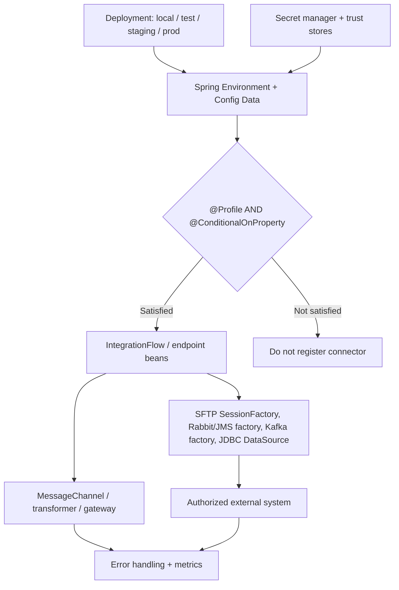
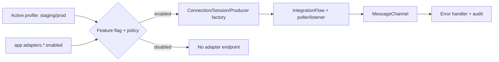
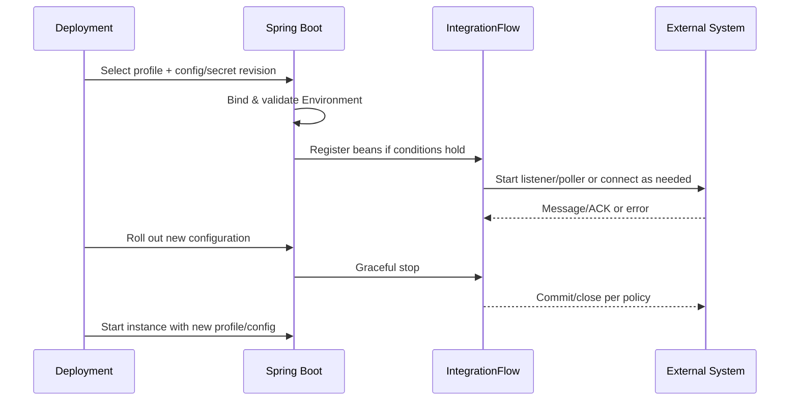
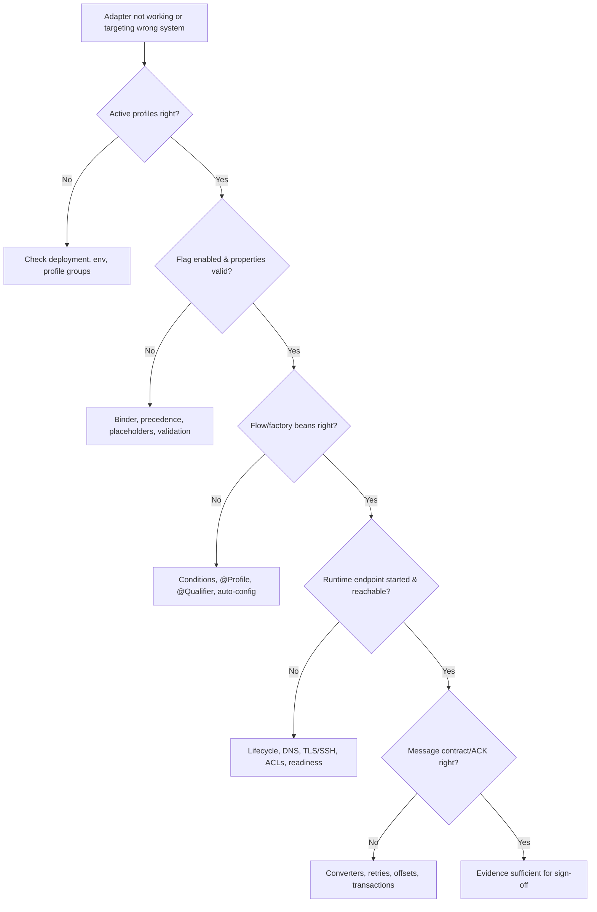

# Profiles for Adapter Environments in Spring Boot and Spring Integration

> **Chapter:** Spring Boot  
> **Direct topic:** Profiles for adapter environments  
> **Module:** `SPRING_INTEGRATION_ADAPTERS` — connecting external systems to Spring Integration via inbound/outbound adapters, gateways, pollers, and `MessageChannel`; exchanging data over File, SFTP, HTTP, JMS, AMQP/RabbitMQ, Kafka, and databases; governing message contracts, errors, and connection lifecycles.  
> **Audience:** Java/Spring Boot developers, integration engineers, and operators managing connectors across local/test/staging/production environments.  
> **Technical scope:** Examples target Java 17+, Spring Boot 3.x, and Spring Integration 6.x using compatible versions from the Boot BOM. For other Boot lines, cross-check the APIs and configuration docs of your actual version.

## 1. Why Do Adapters Need a Dedicated Profile Strategy?

An `order-integration` application has four integration paths:

1. On a developer workstation, read dummy order files from a local directory.
2. On staging, fetch files from a partner test SFTP server.
3. On production, read a RabbitMQ queue, write to a database, and publish Kafka events.
4. From any authorized environment, call an HTTP API targeting **different hosts** with different credentials.

The `IntegrationFlow` business logic may look identical, yet sources/destinations, secrets, polling schedules, transactions, error policies, consumer concurrency, observability, and access permissions **cannot be shared blindly**. If staging accidentally opens production SFTP or CI tests publish real messages to Kafka, the flaw is not Java syntax: it is an **environment governance and bean lifecycle failure**.

**Spring profiles** select groups of beans and configuration documents when an environment is activated. However, profiles are not a standalone security boundary: a profile value can be misconfigured, and in some designs a connection factory bean may still be created by auto-configuration. You must combine **profiles + feature flags + network/secret isolation + tests**.

### 1.1. Lesson Outcomes

After this lesson, you will be able to:

- Explain `spring.profiles.active`, the default profile, `@Profile`, profile expressions, `application-<profile>.yml`, and `spring.config.activate.on-profile`.
- Distinguish **environment** (`local`, `test`, `staging`, `prod`) from **connector capability** (`file.enabled`, `sftp.enabled`, `kafka.consumer.enabled`); never treat a profile name as the entire contract.
- Configure **fail-closed** defaults: external adapters do not connect by default and open only when both environment and properties allow.
- Organize `IntegrationFlow`, `SessionFactory`, `ConnectionFactory`, `DataSource`, poller, HTTP gateway, and broker consumer beans intentionally by profile.
- Build a Spring Boot lab with a File inbound `IntegrationFlow` that runs locally, is excluded from test/staging/prod, and includes tests proving **the bean is absent when disabled**.
- Understand config-source precedence, profile groups, secrets, property validation, wrong-endpoint risks, and startup/readiness conditions.
- Write a multi-profile test matrix and a deploy/rollback runbook when changing adapter endpoints.

### 1.2. A Proper Separation Model



**Distinction:** Omitting a flow bean **prevents activating that endpoint**, yet does not always stop **every starter-auto-configured infrastructure bean** from being created. To guarantee CI never calls production, you must also restrict network egress, scope secrets per environment, and audit any other beans that open connections at startup.

## 2. Spring Profile Concepts You Must Know

### 2.1. Active Profiles and Default Profile

Spring Boot receives active profiles through `Environment`. Example startup invocations:

```bash
# Run JAR locally (illustrative command).
java -jar app.jar --spring.profiles.active=local

# Or supply via the process environment.
SPRING_PROFILES_ACTIVE=staging
```

`SPRING_PROFILES_ACTIVE=staging` represents an environment variable supplied by the **runtime launcher**; on Windows, setting environment variables differs from POSIX shells. Never pass credentials on the command line where shell history or process inspection can expose them.

When no profile is specified, Spring uses the **default profile** (usually named `default`). The `default` profile does not mean `local` or `test` and should never open partner connections by default.

**Multi-profile note:** Multiple profiles can be active simultaneously, e.g., `staging,metrics`. If config files override the same key, the outcome depends on Config Data precedence, ordering/profile groups, and property sources. Never rely on "whichever profile comes last" as an untested security policy.

### 2.2. `@Profile` Selects Beans or Configurations

```java
@Configuration(proxyBeanMethods = false)
@Profile("local")
class LocalOnlyFlowConfiguration {
    // @Beans in this class are registered only when the local profile is active.
}
```

`@Profile` can annotate a `@Configuration` class or a `@Bean` method. Valid expressions include:

| Expression | Meaning | Risk if used carelessly |
|---|---|---|
| `@Profile("local")` | Only when `local` is active | Flow absent in staging even if other configs exist |
| `@Profile("staging | prod")` | Staging **or** prod | Needs an extra feature flag for sensitive connectors |
| `@Profile("staging & partner-a")` | **Both** profiles active | Easy to forget the second profile at deploy time |
| `@Profile("!prod")` | Any environment where `prod` is **not** active | CI/test/staging/default may accidentally enable the connector |
| `@Profile("!(prod | staging)")` | Neither prod nor staging active | Can still activate in an undeclared environment |

**Never use `!prod` as a default safety fence** for a connector that reaches external systems. It means "anywhere except prod", not "local only".

### 2.3. `@ConditionalOnProperty` Is a Different Switch from Profiles

```java
@Bean
@Profile("local")
@ConditionalOnProperty(
    prefix = "app.adapters.file",
    name = "enabled",
    havingValue = "true"
)
IntegrationFlow localFileInboundFlow(...) {
    // ...
}
```

This bean is registered **only when both conditions hold**: `local` is active **and** `app.adapters.file.enabled=true`. When the property is missing, default `matchIfMissing=false` evaluates to false — this enables connectors intentionally.

`@Profile` fits environment scoping. `@ConditionalOnProperty` fits toggling a connector **within that environment**. If you want profile OR/AND logic, write an explicit expression; to require both a profile and a property, apply **both annotations** rather than assuming one implies the other.

**Note:** Both annotations are evaluated when **`ApplicationContext` builds bean definitions**, not re-evaluated when an operator edits loaded YAML. Toggling at runtime requires an explicit endpoint lifecycle mechanism, not just editing a file.

### 2.4. Profile-Specific Config Files

Files are typically named:

```text
src/main/resources/
├── application.yml
├── application-local.yml
├── application-test.yml
├── application-staging.yml
└── application-prod.yml
```

When `local` is active, Boot loads `application-local.yml` alongside the base config. In most apps, profile-specific values override base config values, though **environment variables, system properties, command-line arguments, and external configs** may take higher precedence. Always verify **effective properties** at runtime.

Inside `application-local.yml`, never write `spring.profiles.active: local` to "activate itself". Profile activation belongs to deployment or **profile-independent** config documents.

### 2.5. Multi-Document YAML with `spring.config.activate.on-profile`

Another option for small applications is multi-document YAML inside `application.yml`:

```yaml
# Profile-independent document.
app:
  adapters:
    file:
      enabled: false
---
spring:
  config:
    activate:
      on-profile: local
app:
  adapters:
    file:
      enabled: true
      inbox: ./data/local-in
      poll-interval: 2s
---
spring:
  config:
    activate:
      on-profile: "staging | prod"
app:
  adapters:
    file:
      enabled: false
```

`---` separates **YAML documents**. Only documents whose `on-profile` matches contribute properties to `Environment`. This achieves the same selection goal as `application-local.yml`, though you should pick **one clear strategy** to avoid scattered duplicate keys.

**Important:** Never place `spring.profiles.active`, `spring.profiles.default`, or `spring.profiles.group.*` inside a document restricted by `spring.config.activate.on-profile` or a profile-specific file; **profile activation properties** must live in a profile-independent document or deployment config.

### 2.6. Profile Groups: Feature Grouping, Not a Security Certification

Example placed in the **profile-independent** section of `application.yml`:

```yaml
spring:
  profiles:
    group:
      staging:
        - telemetry
        - shared-infrastructure
      prod:
        - telemetry
        - hardened
```

When `staging` is active, Boot expands the `telemetry` and `shared-infrastructure` profiles. This helps reuse config/beans, **not** certify connector permissions. If `telemetry` contains network-touching config, it can still open connections; review profile groups like deployment config.

Never use profile groups to alias `staging` and `prod` onto the same secrets or brokers. Outbound connections still need per-environment endpoints, permissions, and network allowlists.

## 3. Separating Environment from Adapter Capability

### 3.1. Two Independent Axes

| Axis | Question | Examples |
|---|---|---|
| **Environment profile** | **Where** is the app running? | `local`, `test`, `staging`, `prod` |
| **Connector feature flag** | Which **endpoints** are allowed to run? | `app.adapters.file.enabled`, `app.adapters.sftp.enabled`, `app.adapters.kafka-consumer.enabled` |
| **Connection configuration** | Once allowed, **which target** does it reach? | SFTP host/`known_hosts`, Kafka bootstrap, DB JDBC URL |
| **Authorization and security** | What rights does the workload have at the target? | Secret scope, mTLS, SSH key, broker ACLs, DB role |
| **Runtime lifecycle** | When does the endpoint start/stop? | `autoStartup`, scheduler, readiness, graceful shutdown |

Never use an `app.environment=prod` property asserted by an inbound message to route to a real cluster. Environments must be set by trusted deployment, and tenant/partner routing must rely on verified sources and explicit authorization.

### 3.2. Approved Environment Matrix (Example)

| Adapter | Local | Test/CI | Staging | Prod |
|---|---|---|---|---|
| File inbound | Enabled with local dir | Enabled in isolated/temp dir or off by default | Off unless use case exists | Enabled only for approved batch jobs |
| SFTP inbound | Off or isolated server | Off in unit tests; test server in integration tests | Staging SFTP only | Approved prod SFTP only |
| HTTP inbound | Mock or local server | `MockWebServer`/test server | Staging endpoint with TLS/auth | HTTPS, auth, WAF/rate limits |
| HTTP outbound | Local mock | Mock HTTP service; no prod internet | Sandbox API | Allowlisted production API |
| JMS/Artemis | Container/dev broker | Test broker | Staging queue | Production queue |
| AMQP/RabbitMQ | Container/dev broker | Test broker | Staging vhost/credentials | Production vhost/credentials |
| Kafka | Local/test Kafka | Test cluster/Testcontainers | Staging cluster/topic | Prod cluster/topic |
| JDBC | Local/test DB | Temp DB/container | Staging DB | Production DB, least-privilege DB role |

This matrix is an **illustrative policy**, not Spring Boot defaults. Each organization assigns owners, approvals, network policies, SLAs, and retention. "Off by default" protects connectors **not required for the current flow**; if a connector is mission-critical in prod, startup/readiness must fail fast when disabled or disconnected rather than silently reporting healthy.

### 3.3. Why `@Profile` Alone Is Not Enough

- Someone can launch the production JAR with `--spring.profiles.active=local`.
- CI can accidentally inherit `staging` from a stray environment variable.
- A Spring Boot starter can create a `ConnectionFactory` or health check even without an `IntegrationFlow`.
- A `@PostConstruct` bean can call HTTP/SFTP directly even if listener endpoints were excluded by `@Profile`.
- Another flow may share the same factory bean, or an unrelated listener may auto-start outside the flow under review.

Hence **defense in depth**: zero production secrets in CI, network egress rules blocking production, per-environment roles/ACLs, endpoint allowlists, and integration tests inspecting beans and runtime behavior.

## 4. Designing Safe, Traceable, Auditable Configuration

### 4.1. Base Configuration: External Adapters Disabled by Default

Sample `src/main/resources/application.yml` for the lab or a multi-protocol integration worker:

```yaml
spring:
  application:
    name: adapters-profile-lab
  main:
    web-application-type: none

app:
  adapters:
    file:
      enabled: false
    sftp:
      enabled: false
    http-outbound:
      enabled: false
    jms-consumer:
      enabled: false
    rabbit-consumer:
      enabled: false
    kafka-consumer:
      enabled: false
    jdbc-poller:
      enabled: false

logging:
  level:
    com.example.adapters: INFO
```

`web-application-type: none` is appropriate **for workers serving no HTTP inbound**. If the app includes an HTTP inbound gateway/controller, configure the web stack and remove this line. Defaulting every flag to `false` prevents an app launched without a profile from reaching external systems.

### 4.2. Local Configuration: Enable File Inbound Only

`application-local.yml`:

```yaml
app:
  adapters:
    file:
      enabled: true
      inbox: ./data/local-in
      poll-interval: 2s
```

Never put SFTP passwords, Kafka SASL secrets, or production JDBC URLs in local files. If local development needs Kafka/Rabbit, define a separate `dev-broker` profile pointing to isolated local containers; never use `local` to reach production.

### 4.3. Test/CI Configuration: Avoid External Connections

`application-test.yml`:

```yaml
app:
  adapters:
    file:
      enabled: false
    sftp:
      enabled: false
    rabbit-consumer:
      enabled: false
    kafka-consumer:
      enabled: false
    jdbc-poller:
      enabled: false
```

Unit tests verifying transformers/gateways/bean graphs need no real broker connections. Integration tests should enable specific adapters **within test scope**, supply Testcontainers/test-server endpoints, and enforce cleanup/timeouts. Never inject staging/prod secrets into routine CI.

### 4.4. Staging and Prod Configurations Must Separate Credentials

`application-staging.yml` illustrating secret-free config:

```yaml
app:
  adapters:
    sftp:
      enabled: ${SFTP_ENABLED:false}
      host: ${PARTNER_SFTP_HOST:}
      remote-dir: /incoming-test
    kafka-consumer:
      enabled: ${KAFKA_CONSUMER_ENABLED:false}

spring:
  kafka:
    bootstrap-servers: ${STAGING_KAFKA_BOOTSTRAP:}
```

`application-prod.yml` similarly declares only **deployment-supplied** placeholders, avoiding hard-coded production values in Git:

```yaml
app:
  adapters:
    sftp:
      enabled: ${SFTP_ENABLED:false}
      host: ${PARTNER_SFTP_HOST:}
      remote-dir: ${PARTNER_REMOTE_DIR:}
    kafka-consumer:
      enabled: ${KAFKA_CONSUMER_ENABLED:false}

spring:
  kafka:
    bootstrap-servers: ${PROD_KAFKA_BOOTSTRAP:}
```

`${NAME:}` placeholders merely indicate where environment values land; they do not prove values are valid. **If `enabled=true` while host, certificate, secret, or topic is missing, fail startup/readiness instead of picking a random default host.** Never fall back silently to localhost or a production broker.

**Note:** `spring.kafka.*` can cause Spring Kafka infrastructure to auto-configure on the classpath even when the `IntegrationFlow` consumer is disabled. Where zero unintended connections are mandatory, audit auto-start listeners, health checks, and custom beans alongside network egress policies.

### 4.5. Typed Configuration with Validation

Example properties record using `@ConfigurationProperties`:

```java
package com.example.adapters;

import java.nio.file.Path;
import java.time.Duration;
import org.springframework.boot.context.properties.ConfigurationProperties;

@ConfigurationProperties(prefix = "app.adapters.file")
public record FileAdapterProperties(
        boolean enabled,
        Path inbox,
        Duration pollInterval
) {
    public FileAdapterProperties {
        if (enabled && (inbox == null || pollInterval == null
                || pollInterval.isZero() || pollInterval.isNegative())) {
            throw new IllegalArgumentException(
                "Enabled file adapter requires inbox and positive poll-interval"
            );
        }
    }
}
```

- When `enabled=false`, the properties bean can exist without requiring path/interval.
- When `enabled=true`, validate required fields early rather than letting a poller run with `null` or `0`.
- YAML `poll-interval` binds to `pollInterval` via relaxed binding, and `2s` parses into `Duration`.
- Never put secrets inside a record and log `record.toString()`; records print all fields.

Similar records for SFTP/Kafka should enforce **stricter validation** and avoid initializing when disabled if secret placeholders are unset. Property validation never replaces runtime verification of host keys, broker ACLs, or tenant isolation.


## 5. Lab: Start a File Inbound `IntegrationFlow` Only in `local`

This lab uses the local filesystem to prove profile + property coordination. It **needs no Kafka/Rabbit/JMS/SFTP/HTTP server/DB**. All paths use dummy data and never touch real system directories.

### 5.1. Dependencies and Structure

Use a Spring Boot 3.x Maven project with parent or BOM, Java 17+. Declare this `<dependencies>` block in a valid POM (not a full `pom.xml`):

```xml
<dependencies>
    <dependency>
        <groupId>org.springframework.boot</groupId>
        <artifactId>spring-boot-starter-integration</artifactId>
    </dependency>
    <dependency>
        <groupId>org.springframework.integration</groupId>
        <artifactId>spring-integration-file</artifactId>
    </dependency>
    <dependency>
        <groupId>org.springframework.boot</groupId>
        <artifactId>spring-boot-starter-test</artifactId>
        <scope>test</scope>
    </dependency>
    <dependency>
        <groupId>org.springframework.integration</groupId>
        <artifactId>spring-integration-test</artifactId>
        <scope>test</scope>
    </dependency>
</dependencies>
```

Gradle Groovy DSL equivalent with Boot BOM/dependency management configured:

```groovy
dependencies {
    implementation 'org.springframework.boot:spring-boot-starter-integration'
    implementation 'org.springframework.integration:spring-integration-file'
    testImplementation 'org.springframework.boot:spring-boot-starter-test'
    testImplementation 'org.springframework.integration:spring-integration-test'
}
```

The BOM keeps Spring Framework/Integration versions aligned with Boot. Never mix an Integration module from another branch just to pull an API from an outdated guide.

```text
adapters-profile-lab/
├── pom.xml
└── src/
    ├── main/
    │   ├── java/com/example/adapters/
    │   │   ├── AdaptersProfileApplication.java
    │   │   ├── FileAdapterProperties.java
    │   │   └── FileAdapterConfiguration.java
    │   └── resources/
    │       ├── application.yml
    │       ├── application-local.yml
    │       └── application-test.yml
    └── test/java/com/example/adapters/
        ├── LocalDisabledFlowTest.java
        ├── TestProfileCannotStartLocalFlowTest.java
        └── LocalEnabledFlowContextTest.java
```

The config files use section 4's content; to run the lab, only the File flags and properties are needed. `application.yml` sets `app.adapters.file.enabled=false`, while `application-local.yml` enables it and sets `inbox` and `poll-interval`.

### 5.2. Spring Boot Application

Create `AdaptersProfileApplication.java`:

```java
package com.example.adapters;

import org.springframework.boot.SpringApplication;
import org.springframework.boot.autoconfigure.SpringBootApplication;

@SpringBootApplication
public class AdaptersProfileApplication {
    public static void main(String[] args) {
        SpringApplication.run(AdaptersProfileApplication.class, args);
    }
}
```

`FileAdapterProperties.java` reuses the record from section 4.5. `@EnableConfigurationProperties` below registers the typed properties bean.

### 5.3. Named Channel and Two `IntegrationFlow` Beans

Create `FileAdapterConfiguration.java`:

```java
package com.example.adapters;

import java.io.File;
import java.time.Duration;

import org.slf4j.Logger;
import org.slf4j.LoggerFactory;
import org.springframework.boot.autoconfigure.condition.ConditionalOnProperty;
import org.springframework.boot.context.properties.EnableConfigurationProperties;
import org.springframework.context.annotation.Bean;
import org.springframework.context.annotation.Configuration;
import org.springframework.context.annotation.Profile;
import org.springframework.integration.channel.DirectChannel;
import org.springframework.integration.dsl.IntegrationFlow;
import org.springframework.integration.dsl.Pollers;
import org.springframework.integration.file.dsl.Files;
import org.springframework.messaging.MessageChannel;

@Configuration(proxyBeanMethods = false)
@EnableConfigurationProperties(FileAdapterProperties.class)
public class FileAdapterConfiguration {

    private static final Logger log =
            LoggerFactory.getLogger(FileAdapterConfiguration.class);

    @Bean("fileInput")
    MessageChannel fileInput() {
        return new DirectChannel();
    }

    @Bean("fileProcessingFlow")
    IntegrationFlow fileProcessingFlow() {
        return IntegrationFlow.from("fileInput")
            .handle(message -> {
                if (!(message.getPayload() instanceof File file)) {
                    throw new IllegalArgumentException(
                        "Expected java.io.File payload"
                    );
                }
                // Log only dummy metadata; avoid logging sensitive content.
                log.info("Received file={} size={}",
                         file.getName(), file.length());
            })
            .get();
    }

    @Bean("localFileInboundFlow")
    @Profile("local")
    @ConditionalOnProperty(
        prefix = "app.adapters.file",
        name = "enabled",
        havingValue = "true"
    )
    IntegrationFlow localFileInboundFlow(FileAdapterProperties props) {
        return IntegrationFlow.from(
                Files.inboundAdapter(props.inbox().toFile())
                    .autoCreateDirectory(true)
                    .patternFilter("*.txt"),
                endpoint -> endpoint.poller(
                    Pollers.fixedDelay(props.pollInterval())
                        .maxMessagesPerPoll(5)
                )
            )
            .channel("fileInput")
            .get();
    }
}
```

Three beans have distinct responsibilities:

| Bean | When does it exist? | Purpose |
|---|---|---|
| `fileInput` (`DirectChannel`) | Every profile when config class is scanned | Channel linking inbound and consumer |
| `fileProcessingFlow` | Every profile | Validates `File` payload and logs metadata |
| `localFileInboundFlow` | **`local` active AND `enabled=true`** | Polls `*.txt` files and sends to `fileInput` |

`@Profile("local")` sits on the **inbound bean**, not the entire `FileAdapterConfiguration`. Thus test/prod can still retain the processor flow/channel for isolated testing **without any source polling**. To forbid the processor outside `local` too, move the annotation to the class or apply dedicated conditions while accounting for dependent beans.

**Message contract control:** `Files.inboundAdapter` produces `File` payloads per its API. The handler here does not open/read file contents, only inspects filename and size. Real apps need file readiness, safe paths, charsets, parsing, and schema validation; never let filenames from untrusted sources control arbitrary paths.

### 5.4. Running the App Locally

With the project's Maven wrapper:

```bash
./mvnw spring-boot:run -Dspring-boot.run.arguments=--spring.profiles.active=local
```

Or after building the JAR:

```bash
java -jar target/adapters-profile-lab.jar --spring.profiles.active=local
```

The JAR name depends on your artifact ID/version; substitute your actual build output. Do not run the illustrative JAR command before building with that exact name.

Place a complete file at `data/local-in/order-001.txt`:

```text
orderId=ORDER-001
tenant=tenant-a
```

The handler log should show a line like:

```text
Received file=order-001.txt size=...
```

Because the poller runs every two seconds, wait up to a couple of cycles for the log. Byte size depends on actual content and line endings. Dropping `ignore.csv` will not trigger this flow due to the `*.txt` filter.

### 5.5. Running Without a Profile and in `test`

With no profile set:

```bash
java -jar target/adapters-profile-lab.jar
```

or selecting `test`:

```bash
java -jar target/adapters-profile-lab.jar --spring.profiles.active=test
```

In both cases, `localFileInboundFlow` **is not registered** because `@Profile("local")` is unsatisfied. Even if someone sets `app.adapters.file.enabled=true` in `test`, the profile condition blocks the bean.

**Never test this by trying to touch the production network.** Use context tests (section 6), condition reports, and network controls to prove the adapter stays inactive.

### 5.6. Exact Condition: Truth Table

| Active profile | `app.adapters.file.enabled` | `localFileInboundFlow` | Explanation |
|---|---|---|---|
| None / `default` | None | **No** | `local` inactive, flag defaults to false |
| `local` | `true` | **Yes** | Both conditions hold |
| `local` | `false` | **No** | Property disabled |
| `local` | Unset | **No** | `@ConditionalOnProperty` does not match when missing |
| `test` | `true` | **No** | `local` inactive |
| `staging` | `true` | **No** | `local` inactive |
| `prod` | `true` | **No** | `local` inactive |
| `local,prod` | `true` | **Yes** | **Dangerous:** `local` is still active; not an exclusive single-profile check |

The last row is a critical warning: `@Profile("local")` only checks that **`local` is among active profiles**, not that `prod` is excluded. Never treat a single annotation as an absolute wall. You can tighten it with the **expression** `@Profile("local & !prod & !staging")`, **while still needing** deployment validation, egress rules, and secret boundaries against misconfiguration. Where environment profiles must be mutually exclusive, add a startup guard enforcing a single environment or enforce it at deployment.

## 6. Testing Profiles and Bean Conditions

### 6.1. Testing `local` with Flag Disabled

Create `LocalDisabledFlowTest.java`:

```java
package com.example.adapters;

import org.junit.jupiter.api.Test;
import org.springframework.beans.factory.annotation.Autowired;
import org.springframework.boot.test.context.SpringBootTest;
import org.springframework.context.ApplicationContext;
import org.springframework.test.context.ActiveProfiles;

import static org.assertj.core.api.Assertions.assertThat;

@SpringBootTest(properties = {
    "app.adapters.file.enabled=false",
    "app.adapters.file.inbox=./target/disabled-test-in",
    "app.adapters.file.poll-interval=1s",
    "spring.main.web-application-type=none"
})
@ActiveProfiles("local")
class LocalDisabledFlowTest {

    @Autowired
    ApplicationContext context;

    @Test
    void localWithoutEnabledFlagHasNoInboundFlow() {
        assertThat(context.containsBean("localFileInboundFlow")).isFalse();
        assertThat(context.containsBean("fileInput")).isTrue();
        assertThat(context.containsBean("fileProcessingFlow")).isTrue();
    }
}
```

`@ActiveProfiles` sets the profile in the Spring Test context. The test sets `enabled=false` so it never reads the filesystem. It verifies the **bean graph** only, not file transfer.

### 6.2. Testing That `test` Profile Cannot Open Local Inbound

Create `TestProfileCannotStartLocalFlowTest.java`:

```java
package com.example.adapters;

import org.junit.jupiter.api.Test;
import org.springframework.beans.factory.annotation.Autowired;
import org.springframework.boot.test.context.SpringBootTest;
import org.springframework.context.ApplicationContext;
import org.springframework.test.context.ActiveProfiles;

import static org.assertj.core.api.Assertions.assertThat;

@SpringBootTest(properties = {
    "app.adapters.file.enabled=true",
    "app.adapters.file.inbox=./target/test-profile-in",
    "app.adapters.file.poll-interval=1s",
    "spring.main.web-application-type=none"
})
@ActiveProfiles("test")
class TestProfileCannotStartLocalFlowTest {

    @Autowired
    ApplicationContext context;

    @Test
    void testProfileDoesNotCreateLocalInbound() {
        assertThat(context.containsBean("localFileInboundFlow")).isFalse();
    }
}
```

This test deliberately sets `enabled=true` to prove **a flag cannot bypass the profile condition**. The properties record still binds valid values, yet no File source exists without the `local` profile.

### 6.3. Testing `local` When Flag Is Enabled

Create `LocalEnabledFlowContextTest.java`:

```java
package com.example.adapters;

import org.junit.jupiter.api.Test;
import org.springframework.beans.factory.annotation.Autowired;
import org.springframework.boot.test.context.SpringBootTest;
import org.springframework.context.ApplicationContext;
import org.springframework.test.context.ActiveProfiles;

import static org.assertj.core.api.Assertions.assertThat;

@SpringBootTest(properties = {
    "app.adapters.file.enabled=true",
    "app.adapters.file.inbox=./target/local-enabled-test-in",
    "app.adapters.file.poll-interval=1s",
    "spring.main.web-application-type=none"
})
@ActiveProfiles("local")
class LocalEnabledFlowContextTest {

    @Autowired
    ApplicationContext context;

    @Test
    void localAndEnabledCreatesInboundFlow() {
        assertThat(context.containsBean("localFileInboundFlow")).isTrue();
        assertThat(context.containsBean("fileInput")).isTrue();
        assertThat(context.containsBean("fileProcessingFlow")).isTrue();
    }
}
```

This is a **positive context test**. File inbound may create `target/local-enabled-test-in` and poll during the test without touching any network. To verify end-to-end execution, use a temporary directory, create files via atomic rename, await the handler with a bounded timeout, and inspect the message; never equate "flow bean exists" with "file was definitely processed".

### 6.4. Multi-Profile Test Matrix

Add these cases to the test plan:

| Case | Active profiles | Flag | Expected |
|---|---|---|---|
| T1 | `local` | file=true | Creates File inbound |
| T2 | `local` | file=false | Does not create File inbound |
| T3 | `test` | file=true | Does not create File inbound |
| T4 | `staging` | file=true | Does not create File inbound |
| T5 | `prod` | file=true | Does not create File inbound |
| T6 | `local,prod` | file=true | Policy violation alert; plain `@Profile("local")` **still matches** |
| T7 | default | file missing | Does not create File inbound |
| T8 | `staging` | sftp=false | Does not create SFTP endpoint; verify no other outbound connection opens |

If combining `local` and `prod` must be impossible, adding `@Profile("local & !prod")` is only one defense layer; enforce deployment policies blocking invalid profile combinations alongside secret/network restrictions. True production tests must run in isolated environments.

## 7. Applying to SFTP, HTTP, JMS, AMQP, Kafka, and JDBC

### 7.1. Every Connector Has at Least Three Decision Points

- **Environment:** which beans exist only in `staging` or `prod`?
- **Feature flag:** is that connector allowed to start in this environment?
- **Connection binding:** if created, is the bean/session/factory pointed at the **right host, broker, database, tenant**, and using which identity?



**Do not assume every factory is conditioned the exact same way:** Spring Boot may create a shared factory for other beans. Verify whether a connector is gated at the factory bean, listener endpoint, `IntegrationFlow`, network, and secret layers; "this flow is off" does not prove every consumer in the app is off.

### 7.2. SFTP: Only `staging`/`prod` Allowed to Connect to Partners

Configuration boundary pattern:

```java
@Configuration(proxyBeanMethods = false)
@Profile("staging | prod")
class PartnerSftpConfiguration {

    // Bean outline; when implementing, add the SFTP dependency
    // and create SessionFactory with host-key verification and secrets.
    //
    // @Bean("partnerSftpSessionFactory")
    // @ConditionalOnProperty(
    //     prefix = "app.adapters.sftp",
    //     name = "enabled", havingValue = "true")
    // SessionFactory<SftpClient.DirEntry> sessionFactory(...) { ... }
    //
    // A separate @Bean IntegrationFlow inbound starts only
    // when both profile and enabled=true hold.
}
```

This is an **illustrative architectural skeleton**, not a compilable SFTP class; it intentionally creates no real network beans. A real app needs `spring-integration-sftp`, `DefaultSftpSessionFactory`/`SessionFactory`, `known_hosts`, key/password auth from a secret manager, paths, remote filters, file-completion policies, pollers, and error channels.

In `staging`, use only staging host keys and credentials; in `prod`, use only production credentials. **Never enable "accept unknown host keys"** instead of configuring trust. If `enabled=true` while host or trust is missing, fail startup/readiness instead of falling back to another server.

### 7.3. HTTP: Inbound and Outbound Follow Different Profile Policies

- **HTTP inbound:** if the app exposes an HTTP gateway/controller, it needs an appropriate Servlet or reactive web stack, HTTPS, authentication, authorization, CSRF per architecture, and request limits. `spring.main.web-application-type=none` from the File lab would disable web inbound.
- **HTTP outbound:** an `Http.outboundGateway(...)` needs an HTTP client and config; it does not necessarily need an embedded web server. Use per-environment base URLs, dedicated machine-to-machine tokens, mTLS where required, connect/read timeouts, and idempotency keys for state-changing requests.
- **Testing:** mock the HTTP server rather than calling partner sandboxes during unit tests. Test 2xx/4xx/5xx responses, timeouts, header filtering, and retries separately.

Example application-owned properties:

```yaml
app:
  adapters:
    http-outbound:
      enabled: false
      base-url: https://api.sandbox.example.test
      connect-timeout: 3s
      read-timeout: 8s
```

`app.adapters.http-outbound.*` is **custom** and does not auto-bind to a Boot HTTP client. You need `@ConfigurationProperties`/config beans and an `IntegrationFlow` wired to them.

### 7.4. JMS and AMQP: Profiles Gate Listeners, Not Just Hosts

| Protocol | Connection bean | Common Boot properties | Risk if profiles are split wrongly |
|---|---|---|---|
| JMS/Artemis | `jakarta.jms.ConnectionFactory` | `spring.artemis.*` and Spring JMS options | Listener connects to a live queue from CI |
| AMQP/RabbitMQ | `org.springframework.amqp.rabbit.connection.ConnectionFactory` | `spring.rabbitmq.*` | Consumer connects to wrong vhost; DLQ/retries affect prod data |

`spring-integration-jms` and `spring-integration-amqp` provide the endpoints; starters/providers supply connection foundations. Gate listeners explicitly by profile/property, configure destinations, ACK/transactions, redelivery, and DLQs, and isolate credentials/brokers per environment.

**Note:** Both APIs share the simple name `ConnectionFactory` yet are completely distinct interfaces. Never mix them or guess by short name. A factory can be created before listeners start, and health checks can also trigger connections; tests must watch for both.

### 7.5. Kafka: Consumer Groups and Topics Must Be Environment-Isolated

`spring.kafka.bootstrap-servers` selects cluster bootstrap metadata, while consumer groups, topics, serializers, ACLs, and listeners are configured separately. Staging example:

```yaml
spring:
  kafka:
    bootstrap-servers: ${STAGING_KAFKA_BOOTSTRAP:}
    consumer:
      group-id: orders-staging
      auto-offset-reset: earliest

app:
  adapters:
    kafka-consumer:
      enabled: ${KAFKA_CONSUMER_ENABLED:false}
```

When enabling a Kafka Integration inbound flow:

- Verify which profile creates the consumer factory/container, and check that listener `autoStartup` or other configs don't bypass the feature flag.
- Never reuse the `orders-prod` consumer group or topic in test/staging.
- Configure TLS/SASL, ACLs, offset commits, error handler/DLT, and business deduplication.
- When a flow uses an async channel, ACK/offset commit can occur **before downstream completes** unless boundaries are designed carefully.

Kafka outbound producers should also have feature flags/target policies and isolated test clusters. Never assume producers need `group-id`; that is a consumer-side property.

### 7.6. JDBC: Avoid Configuring Production `DataSource` in Tests

`spring.datasource.*` can trigger Boot to create a `DataSource` whenever classpath and conditions match. Toggling a JDBC poller `IntegrationFlow` **does not automatically remove every `DataSource`**: other services/repositories may still use the DB. For a worker needing DB access only in prod, review classpath dependencies, isolate JDBC configs by profile, and enforce fail-fast/readiness policies.

Example declaring staging config strictly via deployment:

```yaml
spring:
  datasource:
    url: ${STAGING_JDBC_URL:}
    username: ${STAGING_DB_USER:}
    # password: secret manager, never committed in Git

app:
  adapters:
    jdbc-poller:
      enabled: ${JDBC_POLLER_ENABLED:false}
```

You also need the driver, SQL schema, transactions, locking/checkpoints, and pool config. If a custom `DataSource` bean exists, Boot may back off and skip applying these properties as expected. Tests shouldn't just check bean presence: verify the **JDBC URL/DB role**, and in integration tests connect to an **isolated DB**.

### 7.7. File: Profile by Directory/Volume, No Connection Factory

File inbound/outbound reads/writes the filesystem and needs no network `ConnectionFactory`. With profiles:

- `local` reads only `./data/local-in` and creates folders inside the workspace.
- `test` uses isolated temporary directories cleaned up after tests.
- `staging/prod` use only approved volumes with staging/processing/archive conventions.
- Never hard-code a production path in code relying solely on `enabled=false` for safety.
- Use a persistent accept-once filter, checkpoint, or business idempotency when files must not be reprocessed; filenames/paths are not always business IDs.


## 8. Reading Effective Configuration and Verifying Environment Differences

### 8.1. One JAR, Multiple Behaviors

The goal of profiles is not building a separate JAR per environment with secrets baked inside. A single tested binary should deploy across environments with **externalized configuration and proper access controls**. Still, profile/bean differences can be large enough that every major combination must be tested: local File-only, staging SFTP, and prod Kafka+JDBC are distinct topologies.

**Three layers of evidence to collect:**

1. **Effective `Environment`:** active profiles and resolved properties (non-sensitive fields only).
2. **Bean graph:** which `IntegrationFlow`, `MessageChannel`, listener/connection factory beans exist; which flows were excluded by profiles/conditions.
3. **Runtime behavior:** whether endpoints start, connect to the right host/vhost/topic/DB, and honor message contract/ACK/retry rules.

`ApplicationContext` startup success only partially proves layer 2; it does not prove the runtime target is right. Even "connected" does not prove payloads or business transactions succeed.

### 8.2. Condition Evaluation Report

Enable debug output when running the lab app:

```bash
./mvnw spring-boot:run -Dspring-boot.run.arguments=--debug
```

Or in a Gradle project:

```bash
./gradlew bootRun --args='--debug'
```

These are illustrative commands; use the actual wrapper and shell quoting. The report explains which auto-configurations matched or failed to match. For application beans annotated with `@Profile`/`@ConditionalOnProperty`, inspect **actual beans present in context** alongside Boot's condition logs.

If Actuator is added, `/actuator/conditions` or `/actuator/configprops` can aid troubleshooting in protected environments, but **never expose them publicly**. They can reveal connection sources, internal configuration, or sensitive metadata. Never dump `Environment`, passwords, or connection strings to logs while debugging.

### 8.3. Property Precedence and Configuration Sources

Sources such as profile-specific Config Data, environment variables, Java system properties, and command-line flags follow precedence rules; higher-precedence sources override YAML values.

Example:

```text
application.yml:         app.adapters.file.enabled=false
application-local.yml:   app.adapters.file.enabled=true
deployment env:          APP_ADAPTERS_FILE_ENABLED=false
runtime:                 enabled can resolve to false
```

If deployment sets an environment variable like above, **verify the final resolved value via binder/context tests** rather than reading only repository YAML files. Avoid conflicting definitions of the same key across Config Data, env vars, Helm charts, and CLI arguments.

Under Boot relaxed binding, `app.adapters.file.enabled` commonly maps to `APP_ADAPTERS_FILE_ENABLED`. For hyphenated keys, env-var mapping can be counterintuitive; always verify with a `@ConfigurationProperties` test instead of guessing naming conventions.

### 8.4. When a Connector Is Disabled

For a disabled connector, verify:

- The corresponding inbound/outbound `IntegrationFlow` bean **does not exist**, or the endpoint stays stopped by design.
- Other factories/listeners in the app **do not open unauthorized connections**.
- No production secrets exist in CI/local environments.
- Network egress to production is blocked outside the application.
- Zero unintended traffic reaches the target system per network or broker monitoring.
- No silent retry loops run from another bean trying to connect.

For a connector mandatory in production, being "disabled" may be a deployment error that should **fail** deployment or mark **not ready** rather than being ignored. Startup policies must distinguish **optional adapters** from **required adapters**.

## 9. Profiles, Message Contracts, and Error Behavior

### 9.1. Same Business Contract, Different Endpoints

Example normalized message:

```json
{
  "eventId": "evt-order-0001",
  "schemaVersion": 1,
  "eventType": "OrderImported",
  "tenantId": "tenant-a",
  "occurredAt": "2026-11-23T08:00:00Z",
  "payload": {
    "orderId": "ORDER-0001",
    "status": "VALIDATED"
  }
}
```

When switching across profiles, the **semantics** of `eventId`, `schemaVersion`, verified tenant, and error reporting must stay consistent. Never let local process a `String` from a file, staging emit a `Map`, and production publish JSON with different fields without contracts/versioning.

### 9.2. Adapter-Specific Contracts

| Protocol | Metadata to understand | Common failures |
|---|---|---|
| File | Path, filename, encoding, modification time, business ID | Reading incomplete file, re-reading after restart |
| SFTP | Remote path, partner ID, session, completion marker | Host-key errors, dropped streams, duplicate remote files |
| HTTP | Method, URI, header allowlist, status, correlation | Timeout after server already processed `POST` |
| JMS | Message ID, destination, ACK mode, redelivery | Queue rollback, poison messages |
| AMQP | Exchange, routing key, delivery tag, confirms | Infinite requeue, unhandled publisher confirms |
| Kafka | Topic, partition, offset, key, group | Offset committed before business commit |
| JDBC | Primary key, transaction, poll watermark, locking | Two workers claiming same row, DB pool exhaustion |

Successfully sending a message onto a `MessageChannel` does not prove a DB record committed or a broker confirmed receipt. If staging mocks Kafka with an in-memory channel, that test covers internal topology only; add dedicated integration tests for Kafka transport.

### 9.3. Error Flows Must Not Depend on an Accidental Profile

Example: production enables `kafka-consumer`, yet the error handler was only declared under `@Profile("local")`. When the consumer fails, messages never reach quarantine/DLT.

Solution:

1. Separate **shared business validation/error contracts** from transport-specific error handlers.
2. Attach retry/DLQ or DLT handlers directly to active listeners/gateways/pollers.
3. Test failures in every major profile: broker timeout, auth failure, invalid schema, downstream unavailable.
4. Distinguish transient vs. permanent failures; enforce bounded retries with backoff.
5. Never log credentials, bearer tokens, SFTP private keys, or personal data inside `ErrorMessage`.
6. Monitor received, processed, retried, and dead-lettered messages plus replay capability.

### 9.4. Idempotency Must Hold Across Every Environment

- **Local File:** filenames may be reprocessed on restart; in-memory filters don't guarantee exactly-once.
- **SFTP:** mid-transfer drops can re-download files; use checkpoints/remote renames.
- **HTTP:** timeouts can occur after the server already accepted `POST`; use idempotency keys.
- **JMS/AMQP:** redelivery/ACK and DLQ depend on the broker; consumers must handle duplicates safely.
- **Kafka:** consumer rebalances or delayed offset commits can replay records; use business keys and outbox where needed.
- **JDBC:** pollers need transactions/locking/claims/checkpoints to avoid re-reading or multi-instance races.

Profiles do not fix lost or duplicated data. They only determine **which pipelines are registered and how they are configured**; reliability must be engineered per transport.

### 9.5. Request–Reply and Polling Have Different Operational Requirements

If prod enables an HTTP inbound gateway, callers expect a response or error within a timeout. If staging only runs an SFTP poller, no HTTP caller awaits a reply. Never copy a gateway timeout as a poll interval or treat polling errors like HTTP `500`. On synchronous `DirectChannel`s, exceptions propagate to callers; on pollers/async endpoints, error handling must match the worker thread and transport.

## 10. Secrets, Egress, and Multi-Tenant Security

### 10.1. Separating Secrets by Environment

| Item | Local/test | Staging | Prod |
|---|---|---|---|
| HTTP API credentials | Mock or test token | Sandbox token | Least-privilege production token |
| SFTP SSH key | Test server key | Staging key | Production key with rotation/audit |
| Rabbit/JMS user | Dev broker ACL | Staging vhost/queue ACL | Prod vhost/queue ACL |
| Kafka SASL/TLS | Test cluster | Staging client identity | Prod client identity/topic ACL |
| JDBC user | Test database | Staging least-privilege role | Prod least-privilege role |
| Trust store | Test CA/host keys | Staging CA/host keys | Verified prod CA/host keys |

Never commit passwords, tokens, private keys, keystore passwords, or credential-bearing URIs into repositories. Use controlled secret managers or secret mounts with encryption, rotation, and auditing. When a connector is **disabled**, do not force the environment to supply that connector's secrets just to bind properties beans; place sensitive placeholders inside enabling profiles or guard beans/binders intentionally.

### 10.2. Network Egress and DNS

`@Profile("staging")` alone cannot stop a process from connecting to a misconfigured production hostname. Enforce network policies, firewalls, security groups, service-account identities, and DNS/endpoint allowlists outside the JVM. In cloud workloads, staging service accounts must hold zero production permissions.

If production APIs share IP ranges, consider mTLS or identity-aware authorization beyond DNS. Never assume a hostname string containing `staging` guarantees safety.

### 10.3. Profiles Are Not Tenants

**Environment** and **tenant** are two different dimensions. A production app can serve multiple tenants, yet you should never create `tenant-a` and `tenant-b` profiles to switch data paths based on client input. Instead:

- Derive tenant identity from trusted authentication/authorization context.
- Isolate routing policies or connection pools explicitly when per-tenant isolation is required.
- Enforce tenant scopes across Kafka topics, DB schemas, SFTP partner sessions, and HTTP endpoints.
- Never allow partner-asserted message headers to choose a different production factory.
- Control factory/flow counts, credentials, and metric cardinality as tenant counts grow.

Onboarding a new tenant shouldn't mean hacking runtime profiles; use an audited provisioning/configuration workflow with testing and rollback.

### 10.4. Guardrails Before Creating Connectors

Deployment policy may require:

- **Exactly one primary environment profile** among `local/test/staging/prod`; never `local,prod` simultaneously.
- Every connector with `enabled=true` is on that environment's allowlist.
- Every enabled connector has valid endpoints, credentials, and trust material before starting.
- CI/test receives zero production secrets and has zero network egress to production.
- Never rely on implicit `@Profile("!prod")` for safety.
- When fail-fast before any connection is required, validate configuration **earlier than endpoint lifecycle** or in deployment policy. Checking only in `ApplicationRunner` can be too late: listeners/pollers may already start before runners execute.

**Layered defenses** keep misconfigured profiles from causing real impact. If a required connector lacks config, startup must fail clearly rather than falling back to another endpoint or silently disabling itself.

## 11. Endpoint Lifecycle When Changing Profiles

### 11.1. Profiles Are Decided at Context Creation

Every time the app starts, bean conditions are evaluated. Changing `spring.profiles.active` or profile configs and redeploying alters the bean graph:



Editing config on a running instance does not automatically re-evaluate `@Profile` or `@ConditionalOnProperty`. If your project implements custom refresh mechanisms, define explicitly which beans can refresh and how in-flight work is handled — never assume arbitrary `IntegrationFlow`s hot-swap safely at runtime.

### 11.2. Graceful Stop Steps by Transport

| Adapter | Before stopping | On restart |
|---|---|---|
| File/SFTP | Stop polling, finish/mark files, close streams/sessions | Reconcile checkpoints and un-ACKed read files |
| HTTP inbound | Stop accepting new requests; finish in-flight requests within timeout | Preserve idempotency for retryable requests |
| JMS/AMQP | Stop listeners; settle ACK/nack/transactions per policy | Handle redelivery and deduplicate |
| Kafka | Stop consumers; commit offsets per transaction/handler completion | Handle rebalance and safe offset replay |
| JDBC poller | Commit or roll back transactions; release pool | Re-claim rows idempotently |
| HTTP outbound | Stop issuing new requests; await/cancel in-flight within timeout | Retry using idempotency keys |

**Important:** Switching profiles from `staging` to `prod` is not a data-migration workflow. Never repoint a running process at a production broker assuming un-ACKed messages transfer cleanly; establish cutover plans, draining, checkpoints, handoffs, and rollbacks.

### 11.3. Runtime Enable/Disable Is Not a Profile

If operators must pause a listener without restarting, use controlled lifecycle/management APIs. The system needs:

- Operator RBAC and audit logs of who stopped/started what, why, and when.
- Tracking of intended vs. actual state (noting dynamic state may reset on restart).
- Guarantees that pausing does not corrupt ACKs/commits for in-flight messages.
- Appropriate timeouts and circuit breakers without infinite retries.
- Alerts when required connectors stay stopped beyond SLA.

Never expose a public control endpoint letting arbitrary callers submit any bean name and invoke `stop()`. Use allowlists and authorized identities.

### 11.4. Metrics to Separate by Environment

- **Bean/flow readiness:** required endpoints running vs. connectors intentionally disabled.
- **Transport:** connection health, TLS/SSH handshake failures, broker disconnects, DB pool saturation.
- **Messages:** receive/send successes, retries, DLQ/DLT depth, backlogs, consumer lag, file age.
- **Correctness:** schema errors, duplicate rates, reconciliation mismatches, downstream ACK delays.
- **Deployment:** active profiles, config revision ID, adapter flag state, and endpoint owners.

Never attach secrets or payload PII to metric labels, and avoid high-cardinality labels like per-event message IDs or session IDs.

## 12. Troubleshooting Profiles and Auto-configuration

### 12.1. Root-Cause Investigation Workflow



### 12.2. Failure and Remediation Table

| Symptom | Likely cause | How to verify |
|---|---|---|
| Missing `localFileInboundFlow` | `local` inactive, flag false, outside package scan | Active profiles, conditional annotations, bean graph |
| Files polled in CI | CI activated `local` or another flow lacks guards | Effective profiles and source endpoint list |
| App opens SFTP sessions in tests | Another bean creates sessions via starter/custom config | Check session factories, listeners, health indicators, egress |
| Both `local,prod` active at once | Deployment permits multiple environment profiles | Guardrails and policy-violation tests |
| `spring.profiles.active` ignored | Placed inside profile-specific/`on-profile` document | Move to profile-independent document or deployment |
| Staging config overridden by prod | Higher-precedence env/system/CLI flags override YAML | Inspect non-secret effective properties selectively |
| Missing secret while connector disabled | Placeholder resolved too early | Isolate secrets into enabling profile or guard binder |
| Factory bean exists when flag is false | Boot auto-configured factory or used by another flow | Condition report and dependency graph |
| JMS/Rabbit `ConnectionFactory` mixed up | Wrong interface or qualifier | `jakarta.jms` vs. Spring AMQP factory |
| SFTP host-key mismatch | Trust store mismatches server | Verify fingerprint out-of-band; never disable SSH checks |
| Kafka consumer hits wrong topic | Topic/group/cluster read from wrong source | Bean names, effective settings, broker ACLs |
| JDBC hits wrong DB | Custom `DataSource`/back-off or env override | JDBC URL, bean ID, DB role, integration test |
| HTTP outbound calls prod in tests | Wrong base URL fallback or mock profile inactive | Mock server, allowlist, egress deny |
| Context started yet broker unreachable | Lazy factory or retrying listener | Health/readiness, broker/network metrics |
| Restart duplicates files/messages | Missing persistent checkpoint/idempotency | Replay tests, archiving, outbox/deduplication |

### 12.3. Diagnosing Without Exposing Data

- Print **profile names** and **bean names**; never print passwords, private keys, or full connection strings.
- Inspect the condition report and dependency tree to see which beans came from starters/classpath.
- With Spring Boot Actuator, restrict `health`/`conditions`/`configprops` to authorized operators in approved environments; many endpoints should not be public.
- Inspect application logs, request IDs, trace IDs, and per-connector metrics; never log full `Message<?>` objects if headers carry secrets or user data.
- If a misconfiguration touched production, isolate credentials/network, safely halt endpoints, audit impacted messages, and then roll back.


## 13. Real-World Scenarios and Negative Testing

### 13.1. Scenario A — `local` Accidentally Combined with `prod`

Deployment sets `SPRING_PROFILES_ACTIVE=local,prod` to "include extra local config". `@Profile("local")` in the lab matches, and if `app.adapters.file.enabled=true`, the local file poller starts even on a production host.

**Remediation:** Never allow arbitrary combinations of environment profiles. Validate deployment inputs, reject conflicting environment profiles **before listeners/pollers start**, and enforce external guardrails. If you add `@Profile("local & !prod & !staging")`, test multi-profile behavior explicitly and never assume it replaces network/secret policies.

### 13.2. Scenario B — CI Inherits a `staging` Environment Variable

A CI runner carries `SPRING_PROFILES_ACTIVE=staging` left over from another job, while tests only provide `application-test.yml` without explicitly activating `test`. Result: staging beans appear.

**Remediation:** Annotate Spring tests with `@ActiveProfiles("test")`, keep test configs fail-closed by default, scope secrets strictly to authorized jobs, and block egress. Log active profiles in test reports (without credentials), sanitize job environments, and isolate workspaces.

### 13.3. Scenario C — SFTP Properties Disabled Yet App Still Connects

`app.adapters.sftp.enabled=false`, yet another SFTP bean lives outside the guarded configuration class, or a factory opens sessions inside `@PostConstruct`.

**Remediation:** Audit every SFTP-related bean, not just one `IntegrationFlow`. Find the actual connection initiator (listeners, health checks, factories, scheduled jobs, startup hooks). Gate endpoints and factories properly, then prove via egress logs and isolated test networks. Never activate a test profile with production secrets just to see if it connects.

### 13.4. Scenario D — Same YAML, Two Kafka Clusters

`application-staging.yml` sets the staging bootstrap servers, yet deployment injects `SPRING_KAFKA_BOOTSTRAPSERVERS` pointing to prod. The consumer accidentally holds group/topic permissions in prod.

**Remediation:** Inspect effective binder settings by source, verify client identities, broker ACLs, topics, groups, and permitted outbound endpoints. Enforce network + secret isolation so staging workloads hold zero production permissions. After any incident, audit consumed/published offsets and prepare replay or compensating actions.

### 13.5. Scenario E — HTTP Mock Turns Into Production API

Locally, the HTTP outbound gateway targets a mock server. Moving to prod, a custom `RestTemplate` bean keeps a local base URL even though prod YAML is right.

**Remediation:** Verify **which exact client bean the `IntegrationFlow` uses**, whether the base URL sits on the gateway URI or client properties, plus TLS, proxies, and credentials. Run contract tests in staging and health/readiness checks in prod. Protect `POST` retries with idempotency keys so failovers/timeouts never duplicate orders.

### 13.6. Scenario F — Migrating from File to JDBC

Version 1 used only local Files; production needs a JDBC poller. The team only changes `spring.profiles.active=prod` and adds `spring.datasource.url`.

**Remediation:** You also need `spring-integration-jdbc`, `DataSource`/driver/schema, a prod-conditioned JDBC inbound `IntegrationFlow`, SQL/transactions/locks/checkpoints. Profiles never create business JDBC endpoints automatically. Test schemas, read/mark-as-processed, failovers, duplicates, and DB pools under load.

### 13.7. Reproducible Acceptance Test Suite

| Test | Input | Mandatory outcome |
|---|---|---|
| Local happy path | `local` + `file.enabled=true` + `*.txt` | Inbound bean present, polls expected path |
| Local disabled | `local` + `file.enabled=false` | No inbound bean |
| Default fail-closed | No active environment profile | No external connectors auto-start |
| Test resists flag | `test` + `file.enabled=true` | No `localFileInboundFlow` |
| Staging resists flag | `staging` + `file.enabled=true` | No `localFileInboundFlow` |
| Production resists flag | `prod` + `file.enabled=true` | No `localFileInboundFlow` |
| Conflicting profiles | `local,prod` | Deployment policy flags invalid; refuses real run |
| Missing required values | `connector.enabled=true` missing host/trust | Fails startup/readiness per design |
| Secret absent while disabled | `connector.enabled=false`, no secret | Neither connects nor requires resolving secret |
| Property precedence | YAML `local=true`, env override `false` | No inbound bean; effective value verified |
| SFTP host-key mismatch | Test server rotates key unapproved | Rejects handshake; never disables verification |
| Wrong broker topic | Staging client configured with prod topic | Tests/security policy block; zero real traffic sent |
| File duplicate | Restart with old file still in inbox | Detection/replay/idempotency mechanism verified |
| Error handling | Invalid schema payload or downstream timeout | Error classification, bounded retries, quarantine |
| Shutdown | Stop with in-flight messages | ACK/commit tracked, zero silent loss |
| Observability | Required connector stopped | Readiness/alerts reflect actual state |

**PASS rule:** For external adapters, "seeing no events locally" is insufficient — you must prove the endpoint is unregistered/unauthorized and monitoring shows zero illicit outbound traffic. When tests use Testcontainers or mocks, document what production transport behavior remains uncovered.

## 14. Checklist and Self-Assessment Exercises

### 14.1. Profile Design Checklist

- [ ] Primary environments defined (`local`, `test`, `staging`, `prod`) with owners.
- [ ] Rules prohibit conflicting environment profile combinations (e.g., `local,prod`).
- [ ] `application.yml` provides safe defaults; optional external adapters disabled by default.
- [ ] `spring.profiles.active`/groups never placed inside profile-specific files or `on-profile` documents.
- [ ] `@Profile` applied to the right beans/configs; `@ConditionalOnProperty` applied to the right endpoints.
- [ ] When a connector is disabled, no other bean opens unintended connections.
- [ ] `@ConfigurationProperties` validates host, port, URL, trust, and poll intervals.
- [ ] Hosts/brokers/topics/queues/DB paths verified per environment; zero fallback to prod.
- [ ] Each environment has dedicated secrets/identities, TLS/SSH trust, and ACLs.
- [ ] CI/test lacks production secrets and is blocked from production by network policy.
- [ ] `@Profile("!prod")` is never relied upon as a local-only guarantee.
- [ ] Positive/negative tests cover bean graphs, message contracts, and connector transports.
- [ ] Retries/DLQ or quarantine, idempotency, and transaction/ACK policies exist per adapter.
- [ ] Graceful shutdown, restarts, rollbacks, and post-deploy reconciliation are covered.
- [ ] Metrics/logs/audits record profiles/config revisions without leaking secrets.

### 14.2. Learner Assignments

1. Create a Boot project with `FileAdapterConfiguration` from section 5 and verify `localFileInboundFlow` exists only in `local` when the flag is true.
2. Run the three Spring tests in section 6. Explain why the `test` profile with `enabled=true` still does not create local inbound.
3. Change `@Profile("local")` to `@Profile("!prod")` in a lab copy and analyze risks in `default`, `test`, and `staging`; then restore the safe config.
4. Build a 4-environment × 7-adapter matrix listing owner, endpoint, credential source, required/optional, and expected bean readiness.
5. Pick SFTP or Kafka and build a config skeleton with profiles and flags. Write two tests: disabled connector has no endpoint; enabled without secret/trust must fail.
6. Create an env-overriding-YAML scenario. Prove the final bound value (displaying only non-sensitive fields) rather than inferring from profile files.
7. Design a guardrail **before endpoint startup** preventing `local` and `prod` from both being active. Do not rely solely on a post-startup `ApplicationRunner`.
8. Write a staging → prod rollout runbook: config/secret validation, connectivity tests, startup, canary, rollback, in-flight checks, and idempotency.
9. Explain why disabling an `IntegrationFlow` does not always remove Boot-created `ConnectionFactory` beans or disable health checks.
10. Write a simulated post-mortem for staging Kafka accidentally pointing to production: define scope, logs to inspect, credentials to revoke, and data to reconcile.

### 14.3. Suggested Grading Rubric

| Criterion | Points |
|---|---:|
| Understands active/default profiles, `@Profile`, and profile configs | 20 |
| Properly separates profiles, feature flags, factories, and endpoints | 20 |
| File inbound lab, named channel, and three context tests | 20 |
| Staging/prod isolation design across SFTP/HTTP/JMS/AMQP/Kafka/JDBC | 15 |
| Secret security, egress controls, profile conflicts, and fail-closed defaults | 15 |
| Troubleshooting, retry/lifecycle, reporting, and rollback | 10 |
| **Total** | **100** |

**Passing criteria:** Learners explain and prove how **active profiles + property flags** govern inbound `IntegrationFlow` creation; never mistake profiles for security boundaries; prove test/staging/prod do not start the local File connector; and design endpoint/secret isolation plus operational runbooks for external adapters.

### 14.4. Review Questions

1. How does `@Profile("local")` differ from `@ConditionalOnProperty(name="enabled")`?
2. If both `local` and `prod` are active, is a `@Profile("local")` bean created? Why?
3. Why is putting `spring.profiles.active` inside an `on-profile` YAML document wrong?
4. When should you use `application-local.yml` vs. `spring.config.activate.on-profile`?
5. What problem do profile groups solve, and do they let you bypass network/secret policies?
6. Why does turning off `kafka-consumer.enabled` alone not prove all Kafka clients stopped connecting?
7. Can an SFTP `SessionFactory` exist even when the inbound poller has not started?
8. For HTTP outbound, what is the difference between the configured URL, HTTP client, Integration gateway, and actual target endpoint?
9. Why can a Boot-auto-configured `DataSource` still exist even when the JDBC `IntegrationFlow` is disabled?
10. How do you ensure CI tests cannot touch production queues, topics, or databases even if a profile is misassigned?
11. If a File poller restarts, why might an old file be processed again?
12. When switching profiles from staging to prod, what steps prevent losing in-flight messages or hitting the wrong system?

## Conclusion

**Profiles for adapter environments** are how Spring Boot selects configurations and bean graphs per deployment context. In Spring Integration, use profiles intentionally to govern **when inbound/outbound `IntegrationFlow`s, gateways, listeners, and pollers are created**, combining `@ConditionalOnProperty` to toggle connectors, `@ConfigurationProperties` to bind/validate parameters, and dedicated per-environment secret and network controls.

To be safe and operable, do not stop at setting `spring.profiles.active`: enforce **fail-closed defaults when unapproved, guard against conflicting profiles, prevent wrong-endpoint wiring, test beans/runtimes/contracts, and engineer error handling and graceful shutdown**. A connector truly passes only when messages reach the right destination, remain protected, and produce verified results inside an approved environment.
