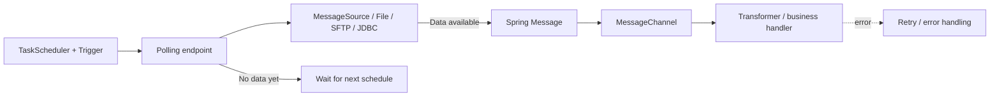
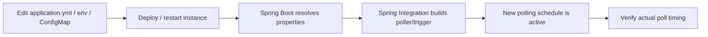
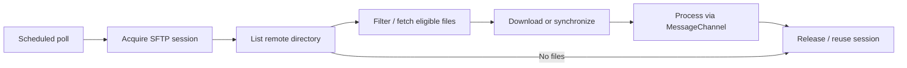

# Changing Polling Intervals via Properties in Spring Boot and Spring Integration

In integration applications, **polling** is how a component actively checks a data source on a schedule for new work. For example: checking a file directory every 5 seconds, querying an outbox table every 30 seconds, or scanning SFTP for new files every minute. If the interval is hard-coded in Java, every load or latency adjustment forces a code edit and redeployment. **Spring Boot properties** separate the polling schedule from processing logic so it can vary by environment, adapter, and operational need.

The lesson **"Changing Polling Intervals via Properties"** belongs to the **Spring Boot** chapter in the **SPRING_INTEGRATION_ADAPTERS** module. The module focuses on bringing external systems into **inbound/outbound adapters**, **gateways**, **pollers**, and **`MessageChannel`** across **file, SFTP, HTTP, JMS, AMQP, Kafka, and databases**. Consequently, changing a polling interval must be understood within the full message contract, error handling, and connection lifecycle — not merely swapping one number in `application.yml`.

> **Core distinction:** Changing a property and **restarting the application** causes a new poller to pick up the new setting. However, merely editing a config file or refreshing a running `Environment` **does not mean** an existing poller's schedule updates automatically. Changing intervals **at runtime** requires an explicitly designed updatable trigger or controlled endpoint reconfiguration.

## 1. Learning Objectives

After this lesson, learners will be able to:

1. Distinguish **polling interval**, `fixedDelay`, `fixedRate`, `cron`, `initialDelay`, and the execution duration of a single poll.
2. Explain the relationship between **Spring Boot externalized configuration**, `@Poller`, `MessageSource`, `MessageChannel`, and adapters.
3. Convert a hard-coded polling interval into a **property** in `application.yml` or `application.properties`.
4. Use placeholders such as `${app.integration.file.poll-delay-ms:5000}` in annotation-based poller configs.
5. Know when to use **milliseconds** vs. Spring Boot **`Duration`** values like `5s`, `250ms`, or `1m`.
6. Isolate schedule properties for File, SFTP, JDBC, and other endpoints to prevent unintended cross-adapter impact.
7. Distinguish property changes on **restart/redeploy** from **runtime** schedule updates.
8. Understand interactions among interval, `maxMessagesPerPoll`, processing speed, concurrency, backpressure, and latency.
9. Design error/retry/idempotency handling so changing intervals never causes duplicate or skipped data.
10. Build tests, operational metrics, runbooks, and safe rollback plans for polling configuration changes.

## 2. What Is a Poller in Spring Integration?

A **poller** asks a **message source** (or pollable endpoint) to check for new data/work on a schedule governed by a **trigger**.

Example:



Concepts to keep separate:

| Component | Role | Determines polling interval? |
| --- | --- | --- |
| `MessageSource<T>` | Pulls a message from the source when invoked. | Usually does not decide schedule itself. |
| Inbound channel adapter | Calls the source and sends messages into a channel. | Can be attached to a poller. |
| `Trigger` | Computes the next execution time. | **Yes**, a primary factor. |
| `TaskScheduler` | Schedules and runs tasks per the trigger. | Owns schedule execution and thread resources. |
| `MessageChannel` | Transfers messages between endpoints. | **Does not** regulate polling cadence. |
| `maxMessagesPerPoll` | Caps messages handled in one poll cycle. | Not the delay between poll cycles. |
| `TaskExecutor` / concurrency | Can affect execution time and parallel work. | Does not replace triggers; affects effective throughput. |

A faster poller **does not** mean the system has more work or automatically higher throughput: the source may be empty, downstream may be slow, or a connection pool may be exhausted.

## 3. Distinguishing Polling from Event-Driven Models

Not every adapter uses a Spring Integration poller.

| Integration | Typical data-arrival model | Should you tune a Spring Integration polling interval? |
| --- | --- | --- |
| **Local file inbound** | Polls directory for new files. | **Yes**, when using a polling inbound adapter. |
| **SFTP inbound** | Polls remote directory or synced file source. | **Yes**, when the flow uses a poller. |
| **JDBC/database inbound** | Periodically queries a work or outbox table. | **Yes**, when using a polling JDBC adapter. |
| **HTTP inbound gateway** | Receives client-sent HTTP requests. | Usually **no**; it is request-driven. |
| **HTTP outbound gateway** | Invoked when a message arrives to send. | No polling interval unless triggered by an upstream poller. |
| **JMS/AMQP message-driven** | Listener container receives broker-pushed messages. | Usually does not use Spring Integration pollers this way. |
| **Kafka message-driven** | Consumer client runs internal `poll()`. | Not identical to Spring Integration's `@Poller`. |
| **JMS/AMQP polling adapter** | Endpoint explicitly designed to pull one message on a schedule. | Can use a poller if configured as a polling adapter. |

**Common mistake:** changing `@Poller(fixedDelay=...)` on a File adapter and thinking you changed Kafka consumer `pollTimeout` or HTTP client timeouts. Those belong to **different mechanisms**.

## 4. Interval Does Not Have Only One Meaning

Spring Integration uses triggers to determine execution schedules. Common models:

### 4.1. Fixed Delay

**Fixed delay** measures the wait from when one poll **finishes** to when the next poll begins, per the trigger and scheduler semantics used.

```text
Poll cycle 1: [start ---- processing complete]
                                         <--- 5s delay --->
Poll cycle 2:                                             [start ...]
```

If one cycle takes 2 seconds and delay is 5 seconds, consecutive starts are roughly **7 seconds** apart before accounting for scheduler contention. Thus `fixedDelay=5000` does not mean a poll starts strictly every 5 seconds.

### 4.2. Fixed Rate

**Fixed rate** schedules cycles relative to planned start ticks:

```text
Schedule ticks: 00s       05s       10s       15s
                |         |         |         |
Poll task:      [----]    [--------] [--] ...
```

If a task runs longer than the period or the scheduler lacks threads, executions slip; whether runs overlap depends on executor/scheduler, endpoint, and concurrency configuration. **Never assume fixed rate guarantees mutual exclusion.**

### 4.3. Cron

Cron defines calendar/wall-clock schedules, such as every 15 minutes or during business hours. Account for:

- Schedule time zone.
- Start vs. completion timing.
- Holidays and Daylight Saving Time transitions where applicable.
- What happens if the previous run hasn't finished yet.
- Multiple instances running the same cron schedule.

If the goal is "check 10 seconds after the previous run finishes", `fixedDelay` is clearer than a cron expression.

### 4.4. Initial Delay

`initialDelay` sets the wait before the very first poll on triggers that support it. It is **separate** from the recurring period; changing it does not alter post-startup frequency.

## 5. Configuration in Spring Boot: `application.yml`

A readable configuration looks like:

```yaml
app:
  integration:
    file:
      inbox: ./data/inbox
      poll-delay-ms: 5000
      max-messages-per-poll: 10
    sftp:
      poll-delay-ms: 30000
      max-messages-per-poll: 20
    jdbc:
      poll-delay-ms: 10000
      max-messages-per-poll: 5
```

Here:

- `poll-delay-ms` is in **milliseconds**, useful for annotation configs expecting numeric strings.
- `max-messages-per-poll` caps **how many messages one poll cycle may pull/process** per endpoint semantics.
- Each adapter has its **own property namespace**, preventing one shared edit from amplifying load across every system.
- `inbox` is an example path; production requires explicit permissions, volume mounts, and directory existence checks.

### 5.1. `application.properties` Equivalent

```properties
app.integration.file.inbox=./data/inbox
app.integration.file.poll-delay-ms=5000
app.integration.file.max-messages-per-poll=10
app.integration.sftp.poll-delay-ms=30000
app.integration.sftp.max-messages-per-poll=20
app.integration.jdbc.poll-delay-ms=10000
app.integration.jdbc.max-messages-per-poll=5
```

Spring Boot supports many **externalized configuration** sources. Define override rules across profiles, environment variables, CLI arguments, and deployment tooling rather than treating source-controlled `application.yml` as the entire operational contract.

## 6. Simplest Example: `@Poller` Reading Placeholders

An inbound file adapter can read intervals from properties via annotations:

```java
import java.io.File;
import org.springframework.beans.factory.annotation.Value;
import org.springframework.context.annotation.Bean;
import org.springframework.context.annotation.Configuration;
import org.springframework.integration.annotation.InboundChannelAdapter;
import org.springframework.integration.annotation.Poller;
import org.springframework.integration.file.FileReadingMessageSource;
import org.springframework.integration.file.filters.AcceptOnceFileListFilter;

@Configuration
public class FilePollingConfiguration {

    @Bean
    @InboundChannelAdapter(
        channel = "rawFileChannel",
        poller = @Poller(
            fixedDelay = "${app.integration.file.poll-delay-ms:5000}",
            maxMessagesPerPoll =
                "${app.integration.file.max-messages-per-poll:10}"
        )
    )
    public FileReadingMessageSource fileMessageSource(
        @Value("${app.integration.file.inbox:./data/inbox}")
        File directory
    ) {
        FileReadingMessageSource source =
            new FileReadingMessageSource();

        source.setDirectory(directory);
        source.setFilter(new AcceptOnceFileListFilter<>());
        return source;
    }
}
```

**Code reading note:** in the Java snippet above, the actual Spring placeholder syntax is `${...}`; those sit inside Java annotation strings and are resolved by Spring from `Environment` when constructing the endpoint.

If `application.yml` sets `poll-delay-ms: 5000`, each poll uses a **5,000 ms fixed delay**. After changing it to `15000` and restarting the application, the new schedule runs roughly **15 seconds after the prior cycle completes** (under normal scheduler operation).

### 6.1. Why Write a Default Value After the Colon?

```java
fixedDelay = "${app.integration.file.poll-delay-ms:5000}"
```

`5000` is the fallback when the property is unset. Use fallbacks only when operationally approved; for costly or high-risk integrations, **failing fast when a property is missing** is often safer than silently running at an unintended cadence.

### 6.2. Prerequisites for This Example to Work

- The app includes Spring Boot, Spring Integration, and required modules.
- Configuration/component classes are discovered by Spring.
- Channel `rawFileChannel` exists as a bean or is appropriately initialized by the framework.
- The directory exists or can be prepared, with read permissions.
- The file filter fits ingestion, metadata persistence, and restart requirements.
- A consumer subscribes to `rawFileChannel`.
- No other endpoint claims the same files without coordination.

**Annotations configure polling only**; they do not automatically guarantee idempotency, file readiness, or error handling.

## 7. Declaring the Channel and Handler

Rest of the file pipeline example:

```java
import java.io.File;
import org.springframework.context.annotation.Bean;
import org.springframework.context.annotation.Configuration;
import org.springframework.integration.annotation.ServiceActivator;
import org.springframework.integration.channel.DirectChannel;
import org.springframework.messaging.Message;
import org.springframework.messaging.MessageChannel;
import org.springframework.stereotype.Component;

@Configuration
class FileChannelConfiguration {

    @Bean
    MessageChannel rawFileChannel() {
        return new DirectChannel();
    }
}

@Component
class FileMessageHandler {

    @ServiceActivator(inputChannel = "rawFileChannel")
    public void handle(Message<File> message) {
        File file = message.getPayload();

        // Illustrative example:
        // 1. Verify file readiness, size, and contract.
        // 2. Read and parse per agreed charset/schema.
        // 3. Persist outcome with matching transaction/idempotency.
        // 4. Manage archive/quarantine after outcome confirmation.
    }
}
```

In this model:

1. The poller decides **when to query the source**.
2. `FileReadingMessageSource` decides **which file to pick**.
3. `MessageChannel` delivers the message.
4. `ServiceActivator` processes it.
5. Transactions, retries, and file lifecycle must be designed explicitly.

With synchronous `DirectChannel` handling, handler execution time stretches the poll cycle itself, affecting the effective fixed-delay cadence. With an executor channel, completion timing and backpressure semantics change; measure rather than inferring from the interval.

## 8. Tuning Properties per Environment

A single binary can run different cadences:

```yaml
# application-dev.yml
app:
  integration:
    file:
      poll-delay-ms: 1000
      max-messages-per-poll: 2
```

```yaml
# application-prod.yml
app:
  integration:
    file:
      poll-delay-ms: 10000
      max-messages-per-poll: 25
```

When launched with the corresponding profile, Spring Boot merges config sources according to its precedence rules.

### 8.1. Environment Variable

Example override via environment variable:

```text
APP_INTEGRATION_FILE_POLL_DELAY_MS=3000
```

This environment variable name illustrates canonical mapping from `app.integration.file.poll-delay-ms`. Verify in your actual deployment environment that the property binds/resolves as expected.

### 8.2. Command-Line Argument

```text
java -jar integration-app.jar --app.integration.file.poll-delay-ms=7500
```

The override takes effect **when the application constructs the new poller configuration**, not instantaneously inside an already-running process.

### 8.3. Kubernetes ConfigMaps and Environment Variables

In container orchestrators, properties can come from:

- Environment variables at pod startup.
- Mounted ConfigMap files read at startup.
- Versioned, access-controlled centralized configuration systems.
- GitOps/Helm manifests.

An updated ConfigMap **does not automatically make a running Spring Integration poller switch intervals**. Environment variables do not live-update inside a running process. Mounted files require an explicitly supported **refresh/rebind/restart mechanism** for Spring Boot and endpoints to adopt new values.

## 9. Spring Boot `Duration`: Readable and Less Error-Prone on Units

In an app with multiple timing parameters, this form:

```yaml
app:
  integration:
    poll:
      file-interval: 5s
      sftp-interval: 30s
      jdbc-interval: 250ms
```

is usually clearer than:

```yaml
file-delay: 5000
sftp-delay: 30000
jdbc-delay: 250
```

Spring Boot binds duration strings such as `250ms`, `5s`, and `1m` into `java.time.Duration` in `@ConfigurationProperties`.

### 9.1. Typed Properties Example

```java
import java.time.Duration;
import org.springframework.boot.context.properties.ConfigurationProperties;

@ConfigurationProperties(prefix = "app.integration.poll")
public record PollingProperties(
    Duration fileInterval,
    Duration sftpInterval,
    Duration jdbcInterval
) {}
```

Register binding:

```java
import org.springframework.boot.context.properties.EnableConfigurationProperties;
import org.springframework.context.annotation.Configuration;

@Configuration
@EnableConfigurationProperties(PollingProperties.class)
class PollingPropertiesConfiguration {}
```

Matching configuration:

```yaml
app:
  integration:
    poll:
      file-interval: 5s
      sftp-interval: 30s
      jdbc-interval: 250ms
```

Add Bean Validation, defaults, min/max bounds, and cross-field checks as needed. Never assume any arbitrary `Duration` is valid for polling: `0s`, negative values, or tiny intervals cause unwanted behavior.

### 9.2. Where Do `@Poller` and `Duration` Differ?

In the annotation example, `@Poller(fixedDelay = "...")` takes a string expression that the poller interprets as **milliseconds** per its API. With Spring Boot `Duration`, use a **programmatic/DSL** configuration accepting `Duration` or explicitly convert to milliseconds.

**Avoid mixing the two mechanisms** without verification:

```text
@Poller(fixedDelay = "${app.poll.interval}")
app.poll.interval = 5s
```

Depending on version and placeholder resolution, this is not guaranteed to behave like `5000` milliseconds. The unambiguous rule is `-ms`-suffixed numeric properties for annotations and `Duration` for typed APIs.

## 10. Programmatic Poller Using `Duration`

With Spring Integration's **Java DSL**, define a poller directly from a `@ConfigurationProperties` `Duration`:

```java
import java.io.File;
import org.springframework.beans.factory.annotation.Value;
import org.springframework.context.annotation.Bean;
import org.springframework.context.annotation.Configuration;
import org.springframework.integration.dsl.IntegrationFlow;
import org.springframework.integration.dsl.Pollers;
import org.springframework.integration.file.dsl.Files;

@Configuration
class FilePollingFlowConfiguration {

    @Bean
    IntegrationFlow filePollingFlow(
        PollingProperties props,
        @Value("${app.integration.file.inbox:./data/inbox}")
        File directory
    ) {
        return IntegrationFlow
            .from(
                Files.inboundAdapter(directory)
                    .patternFilter("*.csv"),
                endpoint -> endpoint.poller(
                    Pollers.fixedDelay(props.fileInterval())
                        .maxMessagesPerPoll(10)
                )
            )
            .channel("rawFileChannel")
            .get();
    }
}
```

**Meaning:** the period comes from a Spring Boot-bound `Duration`, so `5s` has unambiguous units. This snippet follows Spring Integration Java DSL versions supporting `Duration` overloads; verify exact method signatures against your project version.

### 10.1. Do Not Declare Two Inbound Endpoints on the Same Source Unintentionally

The annotation example in section 6 and the DSL example in section 10 are **two alternatives**, not configurations to run side by side. Having both scan the same directory causes duplicate processing or file races.

Pick **one** pattern per adapter in production, or add explicit claiming/coordination when intentionally running multiple instances.

## 11. Which Direction Makes Sense When Changing an Interval?

Two distinct goals are often conflated:

1. **Lower detection latency:** shorten the wait between polls.
2. **Higher throughput:** process more messages per unit time.

Shortening the interval checks the source more frequently, yet **never guarantees higher throughput** if the bottleneck lies in batch size, processing logic, or downstream dependencies.

Hypothetical example assuming up to 10 messages per poll:

| Fixed delay | Max polls per minute if instantaneous | Theoretical max messages at 10/poll |
| --- | ---: | ---: |
| 1 second | ~60 | ~600 |
| 5 seconds | ~12 | ~120 |
| 10 seconds | ~6 | ~60 |
| 30 seconds | ~2 | ~20 |

These numbers are **illustrative only**, assuming zero poll duration, constant message availability, and exact scheduler timing. Under fixed delay, execution time adds onto the gap between starts; real throughput can be far lower.

### 11.1. Rough Estimation Formula

```text
poll_cycle_seconds ~= poll_execution_seconds + fixed_delay_seconds

polls_per_minute ~= 60 / poll_cycle_seconds

upper_bound_messages_per_minute
    ~= polls_per_minute * max_messages_per_poll
```

This idealized estimate omits I/O, transactions, scheduler lag, queue contention, retries, multi-instance effects, and empty-poll overhead.

## 12. `maxMessagesPerPoll` Does Not Replace the Interval

`maxMessagesPerPoll` controls how many messages are fetched/processed in **one poll cycle** on that endpoint.

Example:

```yaml
app:
  integration:
    file:
      poll-delay-ms: 5000
      max-messages-per-poll: 1
```

It may ingest **one file per cycle**, even with 1,000 files sitting in the directory. Dropping `poll-delay-ms` from `5000` to `500` while keeping `maxMessagesPerPoll=1` increases check frequency while adding I/O and scheduler overhead.

Conversely, raising `maxMessagesPerPoll` too high lets one cycle monopolize time and resources, delaying subsequent runs or overwhelming downstream.

### 12.1. Questions Before Tuning

- Can one poll actually return multiple messages, or does the source yield at most one?
- Is downstream processing synchronous or asynchronous?
- Are there API/SFTP/JDBC connection limits or broker rate limits?
- If one record fails, are remaining records in that batch blocked?
- Do large batches stretch lock durations or transaction timeouts?
- Is source ordering or aggregation required?

Special values for `maxMessagesPerPoll` (if used) must follow **your Spring Integration version and endpoint semantics**; never set `0` or negative values to "go faster" without verifying semantics.

## 13. Fixed Delay and Slow Processing

Suppose:

```text
poll-delay = 5s
each source + handler cycle = 4s

Cycle A:
  start=00s, finish=04s
Cycle B:
  start~09s, finish~13s
Cycle C:
  start~18s, finish~22s
```

With fixed delay, slow processing **stretches the gap between starts automatically**. If business requires 1-second detection, lowering delay from 5s to 1s will not help while each synchronous cycle takes 4s.

Options to evaluate:

- Optimize the source query or batch size.
- Decouple polling from downstream work via bounded channels/buffers.
- Add workers within idempotency and ordering constraints.
- Switch from polling to event-driven if the source supports it.
- Accept the latency/throughput/resource trade-off.

**Never enable concurrency blindly** when the source requires ordering or lacks safe record/file claiming.

## 14. Spring `TaskScheduler` and Thread Resources

Pollers need a scheduler. An app with many inbound pollers shares scheduling resources and can hit contention.

Signs of scheduler saturation:

- Interval configured to 1s, yet actual polls happen 5–10s apart.
- Poll tasks wait for free threads.
- Long-timeout SFTP/DB polls hog threads.
- Changing intervals has little effect because the scheduler is the bottleneck.
- Unrelated endpoints slow down simultaneously.

### 14.1. Separating Scheduler Delay from Source Latency

```text
scheduled_at  = intended trigger fire time
started_at    = actual task start time
completed_at  = task completion time

scheduler_lag = started_at - scheduled_at
poll_duration = completed_at - started_at
```

Watching a single "polling interval" metric is insufficient: slow polling can stem from **scheduler lag**, **slow sources**, or **slow handlers**.

### 14.2. Enlarging the Pool Is Not the Default Answer

Adding scheduler threads helps independent pollers fire on time, yet it can also cause:

- More concurrent DB queries.
- More concurrent SFTP sessions.
- Higher lock contention or API rate-limit hits.
- Duplicate claims across concurrent pollers/instances.

Evaluate source and downstream capacity rather than tuning the scheduler in isolation.

## 15. Changing Properties: Restart vs. Runtime Are Two Different Things

This is the most critical operational distinction.

### 15.1. Changing at Startup/Restart

Sequence:



This is the simplest, most verifiable deployment model and fits most applications.

### 15.2. Only Editing a File on Disk

Once a process read properties at startup:

```text
T0: Application starts, poll-delay-ms = 5000
T1: Engineer edits application.yml to 1000
T2: Existing process still uses trigger constructed at startup
```

Never claim the poller automatically switches to 1 second. Runtime updates require an **explicitly designed refresh/rebuild/trigger-mutation mechanism**.

### 15.3. Refreshing `Environment` Does Not Necessarily Refresh Pollers

Some systems use Spring Cloud Config, Actuator refresh, or centralized config servers. Updating beans/properties at runtime **does not automatically guarantee** a `@Poller` whose `Trigger` was built from a placeholder updates its schedule.

Verify:

- Which beans actually refresh/rebind?
- Does the active `Trigger` re-read the new value on every scheduling calculation?
- Must the endpoint stop/start to pick up a new trigger?
- Is the already-scheduled next execution recalculated immediately?
- Are file filters, offsets, sessions, and idempotency state preserved?

**Never treat a `POST` to a refresh endpoint as proof that polling schedules changed** without measuring or inspecting live trigger state.

## 16. Three Strategies for Changing Polling Intervals

| Strategy | Best suited for | Caveats |
| --- | --- | --- |
| **Restart/redeploy with new property** | Most apps using controlled rolling deployments. | Needs readiness, drain, coordination, and duplicate-prevention tests. |
| **Mutable/dynamic `Trigger`** | Adjusting cadence while the process stays running. | Requires thread-safe updates, validation, auditing, and verifying effective timing. |
| **Rebuild/restart endpoint/flow** | Changing full poller/source settings together. | Needs lifecycle control, no duplicate endpoints, preserved metadata state. |

Do not force every team to build dynamic triggers if intervals only change a few times a quarter. Every hot-update feature adds operational surface area to monitor and test.

## 17. Runtime Example: Mutable Fixed-Delay Trigger

For hot updates, write a `Trigger` that reads its delay from a thread-safe value instead of freezing one at startup.

This snippet uses `Trigger`/`TriggerContext` APIs from modern Spring Framework versions:

```java
import java.time.Duration;
import java.time.Instant;
import java.util.concurrent.atomic.AtomicReference;
import org.springframework.scheduling.Trigger;
import org.springframework.scheduling.TriggerContext;

public final class MutableFixedDelayTrigger implements Trigger {

    private static final Duration MIN = Duration.ofMillis(250);
    private static final Duration MAX = Duration.ofMinutes(15);

    private final AtomicReference<Duration> delay;

    public MutableFixedDelayTrigger(Duration initial) {
        this.delay = new AtomicReference<>(validated(initial));
    }

    public Duration currentDelay() {
        return delay.get();
    }

    public void updateDelay(Duration next) {
        delay.set(validated(next));
    }

    @Override
    public Instant nextExecution(TriggerContext context) {
        Instant lastCompletion = context.lastCompletion();

        Instant base = lastCompletion != null
            ? lastCompletion
            : context.getClock().instant();

        return base.plus(delay.get());
    }

    private static Duration validated(Duration duration) {
        if (duration == null
                || duration.compareTo(MIN) < 0
                || duration.compareTo(MAX) > 0) {
            throw new IllegalArgumentException(
                "Polling delay must be between 250ms and 15m"
            );
        }
        return duration;
    }
}
```

### 17.1. What Does This Example Demonstrate?

- `AtomicReference<Duration>` updates the delay safely without data races.
- `nextExecution(...)` schedules relative to the **last completion time**, matching fixed-delay semantics.
- Min/max bounds reject `0`, negative, or overly aggressive intervals.
- Initial values can come from `@ConfigurationProperties`.
- Updates must pass through an authorized, audited operations service — never read directly from a producer-supplied message header.

### 17.2. What It Does NOT Promise About Immediate Effect

Updating `delay` does not cancel a poll **already queued on the scheduler**. The trigger is consulted to compute the **next execution** when rescheduling. Thus, changes may take effect only after the currently pending cycle, depending on scheduler and endpoint.

If "apply immediately, interrupting the current wait" is required, implement a framework-supported **cancel/reschedule/stop-start** workflow and test it thoroughly rather than assuming an `AtomicReference` alters already-queued tasks.

## 18. Wiring a Dynamic Trigger into `IntegrationFlow`

Java DSL pattern sharing a trigger bean with a control service:

```java
import java.io.File;
import org.springframework.beans.factory.annotation.Value;
import org.springframework.context.annotation.Bean;
import org.springframework.context.annotation.Configuration;
import org.springframework.integration.dsl.IntegrationFlow;
import org.springframework.integration.dsl.Pollers;
import org.springframework.integration.file.dsl.Files;

@Configuration
class DynamicFileFlowConfiguration {

    @Bean
    MutableFixedDelayTrigger fileDelayTrigger(PollingProperties props) {
        return new MutableFixedDelayTrigger(props.fileInterval());
    }

    @Bean
    IntegrationFlow dynamicFileFlow(
        MutableFixedDelayTrigger trigger,
        @Value("${app.integration.file.inbox:./data/inbox}")
        File inbox
    ) {
        return IntegrationFlow
            .from(
                Files.inboundAdapter(inbox)
                    .patternFilter("*.csv"),
                endpoint -> endpoint.poller(
                    Pollers.trigger(trigger)
                        .maxMessagesPerPoll(10)
                )
            )
            .channel("rawFileChannel")
            .get();
    }
}
```

This is an **architectural pattern** for Spring Integration Java DSL versions supporting `Pollers.trigger(Trigger)`; check exact APIs against your version before production deployment.

### 18.1. Management Service Updating the Delay

```java
import java.time.Duration;
import org.springframework.stereotype.Service;

@Service
public class FilePollingControlService {

    private final MutableFixedDelayTrigger trigger;

    public FilePollingControlService(MutableFixedDelayTrigger trigger) {
        this.trigger = trigger;
    }

    public void changeDelay(Duration approvedDelay) {
        // Invoked after authentication/authorization,
        // configuration validation, and auditing by the control plane.
        trigger.updateDelay(approvedDelay);
    }

    public Duration currentDelay() {
        return trigger.currentDelay();
    }
}
```

Never expose this method directly as an unguarded public API. With multiple replicas, updating an `AtomicReference` **only affects that single JVM**. Cluster-wide consistency requires centralized configuration/coordination, per-instance observability, and durable desired state.

### 18.2. Authorization and Auditing

Every hot interval change should record:

```json
{
  "event": "POLLING_INTERVAL_UPDATED",
  "adapter": "file-inbound-orders",
  "instance": "integration-worker-3",
  "previous": "PT5S",
  "requested": "PT2S",
  "approvedBy": "ops-approver",
  "source": "managed-configuration",
  "result": "APPLIED_TO_TRIGGER",
  "effectiveObservation": "PENDING_NEXT_SCHEDULE"
}
```

Data is illustrative only. Never claim "applied immediately across all instances" when only one node was updated.

## 19. Runtime Changes via Stop/Start Endpoint

Changes broader than just the interval — such as changing trigger type alongside `maxMessagesPerPoll`, file source, cron expression, or queue capacity — may warrant:

1. Identify the target **endpoint ID**.
2. Inspect running tasks and where state is stored.
3. Stop or drain the endpoint per lifecycle rules.
4. Apply the new configuration via supported framework APIs or rebuild the flow.
5. Restart the endpoint.
6. Verify live poll cadence and processed message counts.
7. Roll back if backlogs, duplicates, or connection errors spike.

### 19.1. Do Not Mutate Triggers on Running Endpoints Without Knowing the Contract

Not every poller implementation supports swapping triggers post-initialization. Even where a setter exists, calling it may **fail to reschedule** active tasks or race mid-poll.

Standardize on one tested approach:

- A mutable trigger consulted by the scheduler when computing the next run.
- Managed endpoint/flow lifecycle (stop–reconfigure–start) per your framework version.

## 20. Relationship Between Interval and SFTP Connection Lifecycle

SFTP polling carries remote network cost and session constraints:



Lowering `sftp.poll-delay-ms` from `30000` to `1000` can cause:

- Far more remote directory listings.
- Session churn if session caching/pooling isn't configured properly.
- Hitting server connection caps or rate limits.
- Higher network/latency overhead on large remote directories.
- Frequent empty checks wasting resources.

### 20.1. Accompanying Settings to Verify

- Remote file readiness (upload-then-rename or marker files).
- Whether local/remote filters and metadata stores survive restarts.
- Caps on files fetched per cycle and messages dispatched downstream.
- Session caching/pooling, timeouts, and reconnect behavior.
- Partner-agreed max connections and rate limits.
- Large-file handling and business transactions.
- Archiving/quarantine to prevent infinite re-reads of broken files.

**Polling interval is not connection timeout.** An SFTP transfer can take 20 seconds even with a 1-second interval; configure timeouts separately and prevent uncontrolled overlapping polls.

## 21. Database/JDBC Poller: Interval and Database Load

A JDBC inbound adapter periodically queries a work table:

```sql
SELECT event_id, payload_json
FROM integration_outbox
WHERE status = 'NEW'
ORDER BY created_at
LIMIT 100;
```

When running multiple instances or claiming rows, this illustrative query **is not enough** to stop two pollers from fetching the same row. Use proper locking/claiming/leasing per your DBMS and transaction model.

### 21.1. Shorter Intervals Multiply Empty Queries

If a table receives one batch per minute yet polls every 200ms, the database absorbs high volumes of zero-row queries, raising:

- Connection pool utilization.
- Lock and index pressure.
- Database CPU and network I/O.
- Log, trace, and monitoring volume.
- Contention against transactional business workloads.

### 21.2. Settings to Tune Alongside Interval

| Setting | Impact |
| --- | --- |
| Query/predicate/index | Governs cost per poll. |
| Max rows or `maxMessagesPerPoll` | Rows injected into the flow per cycle. |
| Transaction boundary | Lock duration and consistency. |
| Claim/lease strategy | Prevents two instances from processing the same row. |
| Retry/DLQ | Isolates poison rows without blocking the whole poller. |
| Connection pool | Capacity when multiple pollers run concurrently. |
| Backpressure | Prevents reading faster than downstream can commit. |
| Retention/outbox cleanup | Keeps table size bounded over time. |

### 21.3. Time-of-Day Workload Variations

For predictable peak hours, use cron schedules or profile/environment settings. Continuously auto-tuning intervals from dashboard metrics without guardrails risks feedback loops: high backlog → faster polling → DB overload → worse backlog.

## 22. HTTP, JMS, AMQP, and Kafka: Don't Confuse Polling Types

### 22.1. HTTP Inbound

HTTP inbound gateways receive client-pushed requests; they have no `fixedDelay` like a file poller. To pull from an external HTTP API on a schedule, an **upstream polling source/scheduler** triggers an outbound HTTP gateway.

Example:

```text
Poller every 30s
   -> Source emits "fetch pending orders" command
   -> Outbound HTTP gateway GET /orders/pending
   -> Transform response
   -> Process events
```

Before shortening that interval, evaluate **rate limits, token lifetimes, pagination, `ETag`/`If-Modified-Since`, duplicate events, and HTTP timeouts**, not just call frequency.

### 22.2. JMS and AMQP

Message-driven listeners receive broker-delivered messages via listener containers. Do not look for a file-style `@Poller` unless explicitly using a polling JMS/AMQP adapter.

Relevant knobs include concurrency, prefetch, receive timeout, redelivery, batching, and broker backpressure. **Never reuse a single `poll-interval` name for fundamentally different mechanisms.**

### 22.3. Kafka

Kafka consumer clients manage internal `poll()` loops and parameters like `pollTimeout`, `max.poll.interval.ms`, and session/heartbeat settings. These **are not** Spring Integration source-polling `fixedDelay` settings.

In particular, `max.poll.interval.ms` is a protocol/coordinator deadline between consumer polls, **not a "check Kafka every X milliseconds" knob** to tweak arbitrarily.

### 22.4. Databases and Files Are True Pollers

File/SFTP/JDBC inbound adapters backed by `MessageSource` or polling endpoints are the direct targets for `@Poller`/`Pollers.fixedDelay(...)`.

## 23. How Does Polling Interval Affect Latency?

For sources where data arrives sporadically, detection latency depends on arrival timing relative to poll ticks.

With uniform arrivals and steady polls, average detection latency **approximates half the period**, though that is strictly an idealized model. Real latency depends on:

- Poll execution duration.
- Scheduler lag and available threads.
- Source listing/query latency.
- Time until data becomes "ready" or committed.
- `maxMessagesPerPoll` and existing backlog.
- Downstream processing time.
- Retries, connection errors, and timeouts.
- Multiple instances and coordination.

### 23.1. End-to-End Latency Is What Matters

```text
source_event_created_at
    -> source_ready_at
    -> poll_detected_at
    -> message_dispatched_at
    -> business_committed_at

detection_latency = poll_detected_at - source_ready_at
end_to_end_latency = business_committed_at - source_event_created_at
```

A system with low `detection_latency` yet a huge downstream backlog still suffers high `end_to_end_latency`. Never optimize intervals off one isolated metric.

## 24. Avoiding Duplicate Processing When Changing Intervals

Shortening polling intervals or rolling restarts increases the chance two instances see the same message/file/row without proper coordination.

### 24.1. File/SFTP

Files already processed yet not archived can reappear on the next poll or after restart. Enforce:

- Idempotent file/record processing.
- Persistent file filters or metadata stores matching your deployment.
- File claiming and readiness checks to avoid partial uploads.
- Archiving/quarantine only after confirmed commit.
- Never relying solely on filenames if partners can overwrite files.

### 24.2. JDBC/Outbox

Two pollers can select the same `NEW` row. Require unique business event IDs, transactions, claim/locks, or inbox deduplication per workload.

### 24.3. Gateway/HTTP

With shorter intervals, outbound gateways may reissue fetches or commands before prior responses return. For side-effecting calls, **a timeout never proves the previous call failed to commit**; require idempotency keys, state tracking, or reconciliation.

### 24.4. An Enduring Rule

**Polling frequency never guarantees exactly-once delivery.** Whether the interval is 500ms or 5 minutes, designs must tolerate retries, crashes, redeliveries, and duplicate source inputs.

## 25. Polling Interval and Retry Backoff Are Different Settings

Suppose:

```yaml
app:
  integration:
    sftp:
      poll-delay-ms: 30000
      retry:
        initial-backoff-ms: 1000
        max-attempts: 3
```

Meaning:

- `poll-delay-ms`: normal wait between source checks.
- `initial-backoff-ms`: wait **after a failure** before retrying per policy.
- `max-attempts`: retry cap per operation or message.

If a poll fails and both poller cadence and retry advice retry aggressively, connection attempts multiply rapidly. Assign retry ownership clearly, enforce retry budgets, and prevent retry storms.

### 25.1. Which Errors Must Not Be Retried Continuously?

- CSV/JSON/XML with invalid schema or charset.
- Contract-invalid files unchanged across poll cycles.
- HTTP `400` bad-request errors.
- Outbox rows with permanent data corruption.
- Rejected credentials due to misconfiguration.
- Missing SFTP paths due to wrong configuration.

In these cases, shortening the interval **only generates errors faster without fixing anything**. Quarantine, alert, and remediate the root cause.

## 26. Application Lifecycle When Deploying a New Interval

Property updates usually take effect when pods/processes restart. Consider this race:

1. Pod A is processing a large file.
2. Pod B starts with the new interval.
3. Both A and B see the same pending file or row.
4. Pod A stops before archiving.
5. Pod B re-reads the file.
6. If the handler isn't idempotent, side effects duplicate.

Safe rollouts require:

- Proper readiness/liveness probes.
- Graceful shutdown and draining of active tasks per framework support.
- Persistent metadata stores or distributed locks across replicas.
- Idempotent handlers and well-scoped transactions.
- Capping active pollers where sources lack safe concurrency.
- Post-deploy verification and config rollback plans.

### 26.1. Shutdown Is Not an ACK

Stopping a poller stops scheduling new cycles; it does not mean in-flight files/rows/messages committed. Track explicit business completion and source ACK/mark-processed boundaries.

## 27. Estimating Minimum and Maximum Bounds

Before letting operations tune intervals, set guardrails:

| Constraint | Illustrative example | Purpose |
| --- | --- | --- |
| Min delay | 250ms for lightweight local sources | Prevents busy-polling spin. |
| Max delay | 15 minutes | Prevents stale backlogs when contracts expect timely detection. |
| Max messages per poll | 50 | Bounds burst load. |
| SFTP concurrent sessions | Per partner agreement | Prevents connection exhaustion. |
| JDBC query timeout | Shorter than task limit per policy | Prevents hanging schedulers forever. |
| Poll task timeout | Per SLA/source contract | Detects wedged polls. |
| Source backlog alert | e.g., 500 messages or 10 minutes | Flags overly slow polling. |
| Allowed change scope | One adapter/instance/wave | Prevents blast-radius-wide surprises. |

Values above are **illustrative**, not defaults or universal limits in Spring Integration. Tune to real load, ops policy, and partner agreements.

## 28. Validating Properties to Fail Fast

Values like `poll-delay-ms: -1` or `0` violate business intent. Validate before use.

Typed config validation helper example:

```java
import java.time.Duration;

public final class PollingConfigChecks {

    private static final Duration MIN = Duration.ofMillis(250);
    private static final Duration MAX = Duration.ofMinutes(15);

    private PollingConfigChecks() {}

    public static Duration requireDelay(Duration requested) {
        if (requested == null
                || requested.compareTo(MIN) < 0
                || requested.compareTo(MAX) > 0) {
            throw new IllegalArgumentException(
                "poll interval must be between 250ms and 15m"
            );
        }
        return requested;
    }

    public static int requireBatch(int maxMessagesPerPoll) {
        if (maxMessagesPerPoll < 1 || maxMessagesPerPoll > 50) {
            throw new IllegalArgumentException(
                "maxMessagesPerPoll must be in [1,50]"
            );
        }
        return maxMessagesPerPoll;
    }
}
```

Integrate checks into `@ConfigurationProperties` validation or bean startup checks. Choose min/max bounds from **reasoned governance decisions**, never blind copy-paste.

### 28.1. Never Confuse Timeouts with Intervals

A single source can have:

```text
poll interval:       5s
connection timeout:  10s
read timeout:        20s
business timeout:    30s
```

If one poll hangs for 20 seconds, fixed-delay polling cannot fire 5 seconds after **the previous start**. Bound timeouts independently so hung I/O never monopolizes scheduler threads.

## 29. Setting Profiles by SLO Rather Than Guesswork

Derive intervals from business requirements:

- Does payment data need faster detection than overnight reporting?
- Are we obligated to check partner files every 1 minute or every 15 minutes?
- What are peak arrival rates and allowable backlog?
- What is the cost of opening an SFTP session or running a DB query?
- Can source failures starve unrelated adapters of threads?
- Can each poll batch finish comfortably before the next cycle?
- Can event-driven delivery replace polling altogether?

Set explicit targets:

```text
SLO: 99% of valid files detected in <= 60s
Constraint: <= 2 concurrent SFTP sessions
Constraint: poll errors never retry infinitely
Constraint: business processing is idempotent
```

These SLO numbers are illustrative. Use monitoring data to tune intervals and batch sizes instead of guessing `1000`/`5000`/`10000`.

## 30. Monitoring: Confirming the Poller Actually Follows the New Schedule

Updating a property in a config repo **is not proof of runtime behavior**. Measure:

| Metric/observation | Meaning |
| --- | --- |
| `poll_configured_interval_seconds` | Configured interval on the instance/endpoint. |
| `poll_effective_interval_seconds` | Observed time between actual poll executions. |
| `poll_duration_seconds` | Execution time per poll cycle. |
| `poll_scheduler_lag_seconds` | Delay past scheduled fire time, where instrumented. |
| `poll_empty_total` | Count of empty polls. |
| `poll_messages_received_total` | Messages emitted by the poller. |
| `poll_error_total{adapter,reason}` | Source, conversion, business, or timeout failures. |
| `source_backlog_messages` | Pending work at the source. |
| `oldest_unprocessed_age_seconds` | Age of oldest unprocessed record/file. |
| `downstream_processing_latency_seconds` | Post-poll processing latency. |
| `sftp_session_errors_total` | SFTP-specific session/connection errors. |
| `jdbc_poll_query_duration_seconds` | DB poll query latency. |

Metric names are **design suggestions**, not automatically emitted by the framework. Instrument via Micrometer/Actuator hooks with bounded labels to avoid high cardinality.

### 30.1. Safe Startup Configuration Logging

Safe structured log:

```json
{
  "event": "POLLING_CONFIGURATION_ACTIVE",
  "instance": "integration-node-2",
  "endpoint": "file-orders-inbound",
  "triggerType": "FIXED_DELAY",
  "configuredInterval": "PT5S",
  "maxMessagesPerPoll": 10,
  "configurationVersion": "deploy-2026-11-23.1"
}
```

Never log passwords, SFTP credentials, or full `Environment` dumps. Log config versions and non-sensitive hashes to distinguish replicas running different intervals during rolling deployments.

## 31. Actuator and Centralized Configuration

Spring Boot Actuator exposes observability endpoints depending on dependencies and exposure settings. However:

- Having Actuator **does not automatically create a schedule-changing API** for `@Poller`.
- Endpoints exposing `Environment` can leak sensitive values; lock down permissions and access.
- Even with Spring Cloud Config and refresh, verify whether the **specific bean/trigger** picks up runtime updates.
- Green metrics/liveness never prove backlog, deduplication, and throughput are healthy.
- Never expose an administrative "set interval" endpoint to arbitrary clients or let data producers dictate poll rates.

A well-governed config system enforces **approvals, change history, scope limits, auditing, rollbacks, tests, and per-instance rollout status**.

## 32. Step-by-Step Safe Change Strategy

Sample deployment runbook:

1. **Identify endpoint:** `file-orders`, `sftp-partner-a`, `jdbc-outbox`, etc.
2. **Verify current config:** observed runtime value, trigger type, `maxMessagesPerPoll`, concurrency.
3. **Baseline load:** poll duration, empty polls, backlog, source latency, connection errors.
4. **Pick new value:** derived from SLOs and source limits, within min/max guardrails.
5. **Review retry/idempotency:** confirm higher cadence cannot duplicate side effects.
6. **Choose rollout mechanism:** restart/redeploy, mutable trigger, or endpoint lifecycle.
7. **Roll out in waves/single instance:** avoid changing the whole cluster simultaneously if risky.
8. **Observe live behavior:** actual gaps between polls, files/rows ingested, backlog, errors.
9. **Check for duplicates:** did old and new pods claim the same file/row during overlap?
10. **Confirm outcome:** config version logs, metrics, approval trail.
11. **Rollback:** restore old interval and recheck sources, filters, sessions, and transactions.
12. **Handoff:** update runbooks/SLOs and owning operators.

### 32.1. Rollback Triggers

Roll back when:

- Empty poll/query rates spike and overload the source.
- Connection/session errors rise.
- Scheduler lag or downstream backlogs grow.
- Duplicate messages/files cross thresholds.
- Transaction/lock timeouts appear after the interval change.
- Operators cannot verify the endpoint adopted the intended configuration.

Rolling back the interval relieves load, yet **never undoes already-executed side effects**. Investigate and remediate duplicates or lost messages separately.

## 33. Testing Property Configurations

Do not test only that beans read values; test **actual polling cadence** and adapter behavior.

### 33.1. Testing Placeholders at Startup

Spring Boot test verifying property binding:

```java
import static org.assertj.core.api.Assertions.assertThat;

import org.junit.jupiter.api.Test;
import org.springframework.beans.factory.annotation.Value;
import org.springframework.boot.test.context.SpringBootTest;

@SpringBootTest(properties = {
    "app.integration.file.poll-delay-ms=250",
    "app.integration.file.max-messages-per-poll=2"
})
class PollingPropertyBindingTest {

    @Value("${app.integration.file.poll-delay-ms}")
    private long configuredDelayMs;

    @Value("${app.integration.file.max-messages-per-poll}")
    private int maxMessagesPerPoll;

    @Test
    void readsPollingOverrides() {
        assertThat(configuredDelayMs).isEqualTo(250L);
        assertThat(maxMessagesPerPoll).isEqualTo(2);
    }
}
```

This verifies **placeholder/value binding**, **not** that a real poller fires every 250ms. Full integration tests should prepare temp directories or stub sources, clean up afterward, and disable unrelated pollers.

### 33.2. Testing `Duration` Binding

```java
import static org.junit.jupiter.api.Assertions.assertEquals;

import java.time.Duration;
import org.junit.jupiter.api.Test;
import org.springframework.beans.factory.annotation.Autowired;
import org.springframework.boot.test.context.SpringBootTest;

@SpringBootTest(properties = {
    "app.integration.poll.file-interval=750ms",
    "app.integration.poll.sftp-interval=30s",
    "app.integration.poll.jdbc-interval=1m"
})
class PollingDurationBindingTest {

    @Autowired
    PollingProperties props;

    @Test
    void bindsHumanReadableDurations() {
        assertEquals(Duration.ofMillis(750), props.fileInterval());
        assertEquals(Duration.ofSeconds(30), props.sftpInterval());
        assertEquals(Duration.ofMinutes(1), props.jdbcInterval());
    }
}
```

Illustrative test based on `@EnableConfigurationProperties` from the earlier example.

### 33.3. Testing Real Timing

An integration test can:

1. Supply a stub `MessageSource` recording timestamps on every `receive()`.
2. Pick a short delay larger than typical CI scheduling jitter.
3. Capture multiple polls and assert intervals within a **tolerance window**.
4. Simulate one slow poll cycle to observe `fixedDelay` vs. `fixedRate`.
5. Avoid asserting "exact 250ms" on CI since schedulers are not real-time.
6. Stop the endpoint and confirm zero new polls occur per lifecycle.
7. Change the property, restart the context, and verify the new cadence.

## 34. Testing Runtime Dynamic Triggers

With a mutable trigger, add dedicated tests:

| Case | Action | Expected |
| --- | --- | --- |
| Valid initial value | Create trigger at 5s | `currentDelay()` returns 5s. |
| Too small | Update to 10ms when min is 250ms | Reject, preserve old delay. |
| Zero/negative | Update to `0s` or negative | Reject explicitly. |
| Valid update | 5s → 2s | Trigger uses 2s for next schedule calculation. |
| Update mid-wait | Call update at runtime | No crash/race; new cadence takes effect per scheduler. |
| Concurrent updates | Simultaneous valid updates | No corrupted state; clear ordering/version policy. |
| Multi-instance | Update node A | Do not assume node B updated too. |
| Node restart | Process restarts | Delay reloads from durable config source. |
| Endpoint stop/start | Stop then restart | Never spawns two schedulers on one source. |
| Source failure during update | SFTP/JDBC times out | Error handling and retry budget stay intact. |

### 34.1. Pure Java Trigger Unit Tests

Unit-test `nextExecution(...)` with a stub `TriggerContext` supplying deterministic timestamps. That verifies scheduling math **without waiting in real time**, leaving scheduler integration mechanics to Spring integration tests.

## 35. Load and Backlog Testing

Sample load scenario:

```text
Input rate:            100 records/min
Handler capacity:      80 records/min
Desired poll delay:    1 second
maxMessagesPerPoll:    10
```

Even if poll delay drops to 100ms, **an 80 records/min handler ceiling** still builds ~20 records/min of backlog while the input rate persists. Valid optimizations include:

- Raising downstream processing capacity.
- Decoupling processing from the poller with a bounded buffer.
- Scaling workers within idempotency/ordering constraints.
- Cutting transformation/DB transaction overhead.
- Tuning batch sizes appropriately.
- Negotiating input throttling or backpressure.

**Never read faster than sustainable processing capacity** and accumulate unbounded in-memory backlogs.

## 36. Security and Multi-Tenancy When Tuning Polling

Polling intervals affect multiple partners or tenants. If a client can pass `pollInterval=10ms` in a header and the app applies it directly, they can force the app to hammer SFTP/APIs/DBs.

Rules:

1. Only **authorized operators/config management** may alter polling settings.
2. Values in producer messages are **untrusted data**, never trigger-control commands.
3. Enforce adapter/tenant allowlists and strict min/max bounds.
4. Audit who changed what, config version, timestamp, instance, and before/after values.
5. Never log credentials or full `Environment` dumps.
6. Multi-tenant setups may require per-tenant quotas to prevent noisy-neighbor starvation.
7. Keep rollback mechanisms ready if abnormal load appears.
8. Protect admin endpoints and configuration stores.

## 37. Practice: Tuning Intervals Across Three Environments

### 37.1. Development Environment

Goal: spot new test files quickly.

```yaml
app:
  integration:
    file:
      poll-delay-ms: 1000
      max-messages-per-poll: 2
```

Expectation: frequent checks, while still keeping file filters/idempotency to avoid re-reading files.

### 37.2. Staging Environment

Goal: approximate production load with enough spacing for observation.

```yaml
app:
  integration:
    file:
      poll-delay-ms: 5000
      max-messages-per-poll: 10
```

Expectation: test restarts, batching, and backlogs; measure effective intervals rather than just reading config files.

### 37.3. Production Environment

Goal: avoid overloading a partner SFTP server.

```yaml
app:
  integration:
    sftp:
      poll-delay-ms: 30000
      max-messages-per-poll: 20
```

Expectation: fewer remote directory listings, verified session reuse, and file detection within agreed SLOs.

**No single interval fits every environment**; these examples illustrate separating config and verifying changes.

## 38. Practice Scenarios

### Scenario A – Edited `application.yml` Yet Poller Did Not Change

App runs with `poll-delay-ms=5000`. Ops edits the file on disk to `1000`, yet polls remain ~5 seconds apart.

**Question:** Why, and what must be verified?

**Hint:** Properties usually resolve when beans/pollers are built. Check effective configuration and deployment, restart the app, or use an explicitly designed dynamic trigger. Never assume editing a file on disk reschedules a running poller.

### Scenario B – Unit `5s` Misinterpreted

An engineer writes `@Poller(fixedDelay = "${app.poll.delay}")` and sets `app.poll.delay=5s`. The app fails to schedule as expected.

**Question:** What design is unambiguous?

**Hint:** Use `poll-delay-ms=5000` for annotations expecting milliseconds, or bind `@ConfigurationProperties Duration` with compatible Java DSL typed APIs.

### Scenario C – SFTP Overwhelmed with Connections

Poll delay drops from 30s to 100ms. The SFTP server begins rejecting connections even though files arrive only every few minutes.

**Question:** Is the bug in the converter or source polling frequency?

**Hint:** Check remote listings/session churn, caching, rate limits, and source readiness; align intervals to SLOs rather than "as fast as possible".

### Scenario D – Two-Instance JDBC Polling

During a rolling deploy, instances A and B both select a `status=NEW` row before it is marked processing.

**Question:** Can you fix this by increasing delay from 1s to 10s?

**Hint:** Raising delay lowers race probability without guaranteeing correctness. Implement atomic claiming/transactions/locking, idempotency, and duplicate-safe deployments.

### Scenario E – `maxMessagesPerPoll` Mistaken for Timeout

A team sets `maxMessagesPerPoll=1000` trying to "poll every 1 second". The poller ingests too many files at once and chokes handlers.

**Question:** How do the two settings differ?

**Hint:** Interval sets schedule cadence; `maxMessagesPerPoll` caps batch count per cycle. Measure cycle duration and downstream capacity.

### Scenario F – Runtime Refresh Leaves Schedule Unchanged

Spring Boot receives updated bean properties via a dynamic config mechanism, yet the poller still runs on its old `PeriodicTrigger`.

**Question:** What mechanism is missing?

**Hint:** A mutable `Trigger` re-read by the scheduler, or a verified endpoint lifecycle reconfigure/restart; never assume refreshing `Environment` is enough.

### Scenario G – Dynamic Trigger Changed Delay on Only One Node

A cluster has three replicas. An admin calls an internal API on node A changing 5s to 1s; nodes B and C stay at 5s.

**Question:** Is this an `AtomicReference` bug?

**Hint:** No; it only mutates one JVM's state. Cluster-wide updates need centralized config, per-instance versioning/ACKs, or orchestrator sync, verified by effective-interval metrics on every replica.

### Scenario H – Lowered Interval Yet Backlog Keeps Growing

Source emits 100 records/min while handlers process 80 records/min. Dropping poll delay from 5s to 500ms does not shrink backlog.

**Question:** Why?

**Hint:** The bottleneck is handler/DB throughput; scale processing capacity, batching, controlled concurrency, or backpressure. Polling faster only checks an already-busy pipeline more often.

### Scenario I – Poller Grabs Partially Uploaded File

A partner SFTP upload takes 10 seconds; lowering interval to 500ms causes the app to read incomplete files.

**Question:** What contract is missing?

**Hint:** Readiness markers/atomic renames, policy-based age filters, and incomplete-upload handling. Small intervals cannot replace a readiness protocol.

### Scenario J – Kafka Misconfigured with File Poller Property

Someone tunes `app.integration.file.poll-delay-ms` trying to speed up a Kafka consumer.

**Question:** Why does it have no effect?

**Hint:** Message-driven Kafka consumers run their own client/container poll loop and timeouts. Target the right adapter and bottleneck: `max.poll.interval.ms` is also not an Integration poller `fixedDelay`.

### Scenario K – Property Change Triggers a DLQ Spike

After shortening a JDBC poll delay, a schema-broken row is re-read and retried rapidly, flooding the DLQ.

**Question:** Should you shorten the interval further?

**Hint:** No. Classify permanent validation failures, quarantine/mark invalid rows, cap retries, and fix the upstream data instead of hammering broken records faster.

### Scenario L – New Config Active Yet SLA Still Missed

Logs show `configuredInterval=PT2S`, yet files take 90 seconds to process.

**Question:** What should you measure next?

**Hint:** Source readiness, actual poll timestamps, scheduler lag, SFTP listing latency, `maxMessagesPerPoll`, downstream backlog, and commit latency. Never equate configured interval with end-to-end latency.

## 39. Anti-Patterns and Better Practices

| Anti-pattern | Consequence | Better practice |
| --- | --- | --- |
| Hard-coding `fixedDelay="5000"` everywhere | Hard to vary per environment. | Externalized properties with explicit unit names. |
| Unitless `pollInterval=5` property | Confuses ms vs. s; causes poll storms. | Use `-ms` or suffixed `Duration`. |
| Editing config file and claiming runtime updated | False reports; schedule unchanged. | Restart or use verified dynamic triggers. |
| Assuming Spring Cloud refresh reschedules all pollers | Old trigger keeps running. | Verify trigger/endpoint lifecycle explicitly. |
| One global property controlling all pollers | SFTP and JDBC change unintentionally together. | Separate namespaces per adapter and endpoint. |
| Shortening interval without checking poll duration | Scheduler/connection pool overload. | Measure poll duration and source cost. |
| Raising `maxMessagesPerPoll` without limits | Huge batches, heap bloat, long locks. | Bound batch size and apply backpressure. |
| Using `fixedRate` to "guarantee no duplicates" | Concurrent overlap possible; zero idempotency. | Atomic claims, deduplication, transactions. |
| Treating Kafka `max.poll.interval.ms` as SI `fixedDelay` | Wrong transport knob tuned. | Understand each transport/container layer. |
| Tuning interval to fix permanent schema errors | Retry storms without progress. | Route permanent errors to quarantine/owners. |
| Using in-memory accept-once filters as business guarantees | Restarts replay or lose work. | Persistent metadata + business idempotency. |
| Updating delay in one JVM assuming cluster updated | Replicas drift in behavior. | Central config, rollout, per-instance verification. |
| Exposing public API to change polling intervals | Abusable for DoS or quota exhaustion. | Admin-restricted updates with min/max bounds. |
| Logging desired property without measuring actual polls | Misses scheduler lag. | Track effective interval and backlog metrics. |
| Changing interval on deploy without graceful drain | Duplicate file/row processing. | Coordination, idempotency, rollback plan. |

## 40. Pre-Deployment Checklist

- [ ] Confirm whether the endpoint uses a **Spring Integration poller** or a message-driven listener.
- [ ] Separate properties for each adapter/flow needing tuning.
- [ ] Property names and units are explicit: milliseconds or typed `Duration`.
- [ ] Defaults are approved, or startup fails fast when missing.
- [ ] Min/max intervals and `maxMessagesPerPoll` are validated.
- [ ] `fixedDelay`, `fixedRate`, or `cron` matches business semantics.
- [ ] Tests cover both property binding and real polling schedules with tolerances.
- [ ] Per-instance config versions are observable.
- [ ] Restart/redeploy vs. runtime dynamic updates are clearly distinguished.
- [ ] If runtime updates exist, triggers and effective timing are tested.
- [ ] In multi-replica deployments, cluster-wide rollout/rollback is coordinated.
- [ ] No two inbound flows scan the same source accidentally.
- [ ] SFTP enforces file readiness, session limits, filters, and retry policies.
- [ ] JDBC uses efficient indexes/queries, atomic claiming, and proper transactions.
- [ ] Message-driven Kafka/JMS/AMQP consumers are never misconfigured with file poller properties.
- [ ] Request/connection timeouts are tuned independently from polling intervals.
- [ ] Idempotency and crash/restart deduplication are in place.
- [ ] Pollers and downstream enforce load caps/backpressure.
- [ ] Permanent failures go to quarantine rather than retrying infinitely.
- [ ] Metrics track configured/effective intervals, poll duration, scheduler lag, and backlog.
- [ ] Alerts watch source overload, duplicates, connection errors, and backlog age.
- [ ] Config management enforces RBAC, auditing, approvals, and rollbacks.
- [ ] Failure/restart behavior during rolling deploys is tested.
- [ ] Runbooks are updated and assigned to operational owners.

## 41. Key Takeaways

**Changing polling intervals via properties** decouples source-checking cadence from **Spring Integration** processing code so schedules adapt cleanly via Spring Boot profiles, environment variables, and deployment configs. The simplest approach uses `@Poller(fixedDelay = "${...}")` in milliseconds; for human-readable durations, use `@ConfigurationProperties Duration` with compatible Java DSL overloads.

Crucially, **interval is not processing throughput**, nor is it timeout, retry backoff, or Kafka consumer poll config. Pollers wake up via `Trigger` and `TaskScheduler`, while `maxMessagesPerPoll`, processing time, connection resources, and backlogs govern true throughput. Updating properties at startup/restart differs from mutating triggers at runtime; refreshing configuration does not automatically reschedule running pollers.

For File/SFTP and JDBC, shortening intervals must go hand in hand with **file readiness, idempotency, atomic claiming, transactions, error handling, connection limits, and performance observability**. Message-driven HTTP/JMS/AMQP/Kafka use different mechanics, so always verify which layer you are tuning.

**Four final questions:**

1. **Which poller does this interval govern, and is it measured from start or completion of each run?**
2. **Does the new property take effect via restart, mutable trigger, or endpoint lifecycle, and what evidence confirms it?**
3. **If polling runs more frequently, can the source, scheduler, downstream, and partners handle the load?**
4. **Across restarts, retries, or multiple replicas, can files/rows/messages be duplicated or skipped?**

A reliable polling-interval change is **transparently configured, verified in effective timing, meets SLOs without overloading systems, and preserves message-processing semantics**.
