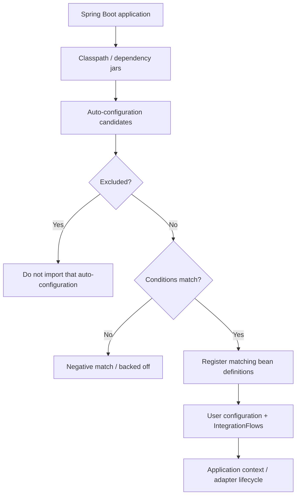
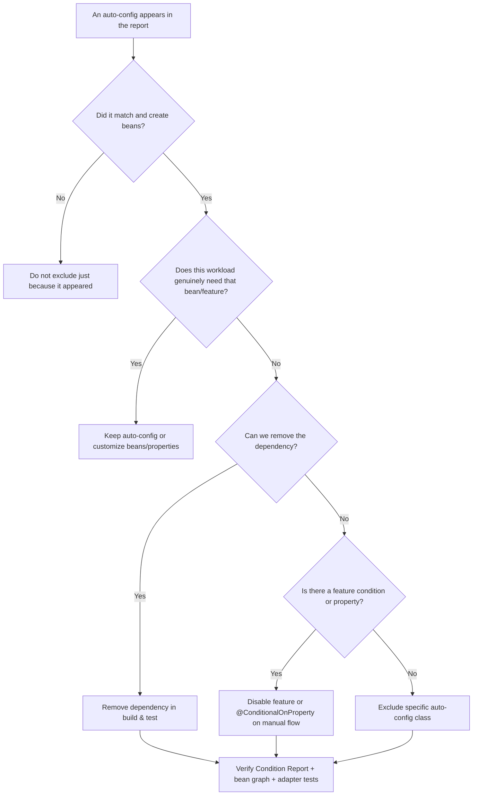
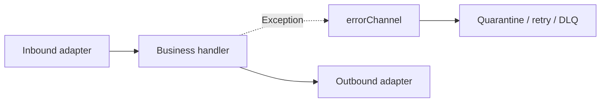

# Excluding Unnecessary Auto-configuration in Spring Boot for Spring Integration Adapters

> **Chapter:** Spring Boot  
> **Module:** `SPRING_INTEGRATION_ADAPTERS`  
> **Learning context:** Connecting external systems via **inbound/outbound adapters, gateways, pollers, `MessageChannel`** and **file, SFTP, HTTP, JMS, AMQP, Kafka, JDBC/database** flows; managing message contracts, errors, and connection lifecycles.  
> **Goal:** Identify **which auto-configurations are genuinely unneeded**, exclude them accurately with `exclude`, `excludeName`, or `spring.autoconfigure.exclude`, and prove the impact via startup conditions, Spring beans, integration flows, connectivity, health, and integration tests without accidentally breaking active adapters.

## 1. The Problem: Convenient Starters Do Not Mean Every Connection Should Start

A Spring Boot application using Spring Integration may run several distinct flows:

- `fileOrdersFlow` reads CSV files from a directory, validates them, and calls an HTTP API.
- `inventorySftpFlow` fetches files from SFTP into local staging, then writes to a database.
- `jmsPaymentsFlow` consumes JMS and sends requests to a payment system.
- `amqpNotificationsFlow` consumes RabbitMQ notifications and processes them.
- `kafkaEventsFlow` emits events after JDBC commits.
- `httpCommandFlow` handles requests from an HTTP inbound gateway.

A single artifact may pull in multiple starters due to historical growth, shared libraries, test dependencies, or an adapter used only in one environment. At startup, Spring Boot **inspects the classpath, properties, and beans** to apply auto-configuration. Sometimes a transport library's presence causes connection beans, templates, health contributors, or infrastructure to be registered even though that flow does not run in the current deployment.

This can lead to:

1. Startup failures because unconfigured datasources or credentials are missing.
2. Attempting to build unneeded message broker infrastructure in an offline profile.
3. Noisy health/readiness signals from a dependency outside the instance's workload.
4. Default and manual configurations competing over beans or qualifiers.
5. Increased startup time, management surface area, and configuration footprint.
6. Operators losing clarity on which transports are actually authorized to connect.
7. A test profile accidentally starting a production listener or poller.

However, **seeing an auto-configuration in the Condition Evaluation Report does not mean you must exclude it**. If a class was evaluated and its conditions did not match, Spring Boot already skipped it. Adding unfounded exclusions harms maintainability or breaks features on future upgrades.

### 1.1. Illustrative Scenario

A `file-only-importer` workload only reads files from the local filesystem and makes HTTP calls. Yet a transitive dependency pulls in `spring-boot-starter-jdbc`; Boot attempts to configure a datasource and fails on missing connection settings. Appropriate options include:

- **Best when you control the build:** remove the unused JDBC dependency.
- **If the classpath must still include JDBC while this app uses no DB:** exclude the exact `DataSourceAutoConfiguration` (for your Boot version) and test that file/HTTP flows still work.
- **If another adapter still needs JDBC:** do not exclude datasource globally; gate the flow conditions or configure the datasource properly.

Given the same startup exception, the right fix depends on **the artifact's purpose**, not merely the exception message.

## 2. How Does Auto-configuration Work?

`@SpringBootApplication` enables auto-configuration discovery. Spring Boot scans auto-configuration candidates in dependency JARs, evaluates conditions, and registers matching configurations.



Common conditions:

| Condition | Meaning | Impact |
|---|---|---|
| `@ConditionalOnClass` | Applies only when specified classes exist | Without client libraries, auto-config usually skips |
| `@ConditionalOnMissingBean` | Skips default bean if user already supplies a matching bean | Yields to manual configuration where designed |
| `@ConditionalOnBean` | Requires foundational beans to exist already | Some configs depend on connectors/factories |
| `@ConditionalOnProperty` | Uses a property to toggle registration | Allows config-driven toggles when supported |
| `@ConditionalOnWebApplication` | Applies only to matching web application types | Governs HTTP/web server configs |
| `@ConditionalOnResource` | Checks resource presence | Depends on environment/packaging |

**Exclusion** blocks an **auto-configuration class** before it is imported. This operates at a different level from tweaking an adapter property or defining a custom bean so part of auto-config **backs off**.

### 2.1. Decision Order

Before excluding anything, ask:

1. Did that auto-configuration **actually match**, or was it merely a candidate?
2. Can we simply **remove the unused dependency**?
3. Is there an official property to **disable the sub-feature**?
4. Can we define a **custom bean** so auto-config backs off only its default?
5. Can we keep shared auto-config and **disable one `IntegrationFlow`** via a condition?
6. Only then exclude **the specific auto-configuration class** if appropriate.

Never use `exclude` as a blunt tool to hide every startup exception.

## 3. What Does `exclude` Remove and What Does It Not Remove?

An exclusion acts strictly on **importing the specified auto-configuration class**, not as a global kill switch.

| What `exclude` can do | What `exclude` does NOT do automatically |
|---|---|
| Block a specific auto-config candidate | Remove dependency JARs from the classpath |
| Prevent beans created solely by that auto-config | Remove user-declared `@Bean` definitions |
| Prevent certain conditional defaults | Disable every `@Configuration` for that technology |
| Remove an auto-config ill-suited to the workload | Stop manually configured listeners |
| Trim context beans when genuinely unused | Guarantee fixed startup speedup or memory savings |
| Remove certain health/config contributions | Remove every related health indicator or metric |
| Simplify the context for scoped verification | Replace authentication, firewalls, or secret rotation |
| Stop the app from creating default transport beans | Guarantee zero network calls from non-Boot code |

For instance, if you manually declare:

```java
@Bean
IntegrationFlow inventorySftpFlow(...) {
    // Custom SFTP adapter and handler.
    // ...
}
```

then excluding another auto-configuration **will not stop this bean from being scanned and created**, nor stop its endpoint from starting on context refresh.

### 3.1. Distinguish Three Concepts

**Dependency exclusion** (Gradle/Maven) affects the **build/runtime classpath**.

**Auto-configuration exclusion** (`@SpringBootApplication(exclude=...)` or property) affects **Boot auto-config selection**.

**Flow enable/disable** (`@ConditionalOnProperty`, profiles, or lifecycle management) affects **application-owned `IntegrationFlow`s, endpoints, and adapters**.

These three mechanisms solve three distinct problems. A sound guide must draw this boundary before readers copy any snippet.

## 4. When Should You Exclude? Decision Tree



### 4.1. Signals That Can Justify Exclusion

- A file/SFTP app **needs no database** yet the classpath still carries JDBC.
- An app variant does not use Kafka yet a shared library brings Kafka auto-config.
- A CLI/batch importer needs no web server while Boot creates a web context.
- A transport is provisioned and configured **entirely manually**, and Boot's default auto-config causes conflicts not cleanly resolved by beans/customizers.
- A feature is being split into another deployment and has **verified zero remaining consumers**.

### 4.2. Signals to Stop and Investigate Instead

- Excluding because a "dependency is unhealthy" even though that flow is critical.
- Excluding `IntegrationAutoConfiguration` to silence an error in one Kafka consumer.
- Excluding `DataSource` even though a JDBC inbound poller uses `JdbcTemplate`.
- Excluding Rabbit auto-config while a `@RabbitListener` still needs a connection factory.
- Copying an exclusion class name from an old Boot-version blog without checking the actual class.
- Blindly excluding security or Actuator without assessing operational impact.

## 5. Preflight: Inventory Auto-configs and `IntegrationFlow`s

Before editing annotations or YAML, map out:

| Field | What to find |
|---|---|
| Boot version | Using 3.x or 4.x; exact package names |
| `artifactId` / variant | Single JAR running all transports or separate deployments |
| Starter/dependency source | Direct or transitive; why it is on the classpath |
| Auto-config class | Fully qualified class name from that version's docs/report |
| Condition result | Positive/negative match and exact reason |
| Created beans | `ConnectionFactory`, `KafkaTemplate`, `DataSource`, health contributors, listener factories |
| User-defined beans | `@Bean`, `@Configuration`, `@Import`, custom `IntegrationFlow`s |
| Inbound endpoints | Pollers, message-driven adapters, HTTP gateways |
| Outbound endpoints | HTTP, JMS/AMQP/Kafka, JDBC, SFTP |
| External connections | Host aliases, credential sources, protocols, owners |
| Lifecycle | `autoStartup`, `SmartLifecycle`, readiness, shutdown |
| Error handling | `errorChannel`, broker retry/DLQ, callback channels |
| Test coverage | Bean graph, flow startup, integration and negative cases |

### 5.1. Sample Inventory Table

| Workload | Needed | Not needed | Candidate action |
|---|---|---|---|
| `file-only-importer` | File, HTTP outbound, validation | JDBC, JMS, Kafka | Remove dependencies or exclude individually after testing |
| `jms-payment-worker` | JMS listener, DB, HTTP | Kafka, Rabbit | Keep JMS+JDBC; check if Kafka/Rabbit matched |
| `kafka-event-publisher` | JDBC outbox, Kafka producer | HTTP inbound server, JMS | Keep Kafka+JDBC; turn off web if worker-only |
| `sftp-inventory-loader` | SFTP, local staging, JDBC | Rabbit | Keep Integration/JDBC |
| `http-adapter-api` | HTTP inbound, auth, service handlers | File pollers | Disable manual pollers by profile/property |

This is an illustrative catalog. Never assume Spring Boot has an auto-configuration named `SftpAutoConfiguration` just because a module uses SFTP.

## 6. Approach 1: `@SpringBootApplication(exclude = ...)`

When the auto-configuration class is on the compile classpath, you can exclude it directly on the main application class.

**Example for Spring Boot 3.5.x (matching 3.x packages):**

```java
package com.example.fileimport;

import org.springframework.boot.SpringApplication;
import org.springframework.boot.autoconfigure.SpringBootApplication;
import org.springframework.boot.autoconfigure.jdbc.DataSourceAutoConfiguration;

@SpringBootApplication(exclude = DataSourceAutoConfiguration.class)
public class FileOnlyImporterApplication {

    public static void main(String[] args) {
        SpringApplication.run(FileOnlyImporterApplication.class, args);
    }
}
```

In this example, we intentionally **use no datasource**, yet an unwanted dependency makes Boot evaluate JDBC auto-config. Exclusion prevents **`DataSourceAutoConfiguration` from being applied** in this context.

### 6.1. Conditions for This Example to Be Valid

- No inbound/outbound JDBC flow needs a `DataSource`.
- No `JdbcTemplate`/repository/transaction manager depends on that auto-configured datasource.
- No other auto-config or user bean creates an independent `DataSource`.
- Tests verify the Boot context and all file/HTTP paths.
- Removing the dependency isn't feasible or was explicitly evaluated.

**Do not copy 3.x imports into Boot 4.x:** several auto-config classes moved packages in Boot 4 (see Section 10).

### 6.2. Excluding Multiple Classes

```java
// Spring Boot 3.x: example config for a worker using neither DB nor Kafka.
@SpringBootApplication(exclude = {
    org.springframework.boot.autoconfigure.jdbc.DataSourceAutoConfiguration.class,
    org.springframework.boot.autoconfigure.kafka.KafkaAutoConfiguration.class
})
public class TransportLimitedApplication {
    // main method ...
}
```

This snippet illustrates syntax only, **not a general exclusion list**. If the app uses `KafkaTemplate`/Kafka `IntegrationFlow` or JDBC, excluding them can fail startup or break behavior undetected at compile time.

### 6.3. When to Avoid Annotation-Level Excludes?

- Deployment variants of the same artifact enable different capabilities.
- You want configuration differences easy to audit in `application-*.yml`.
- You need per-environment changes without modifying Java source.
- You want canary rollouts before baking into shared code.

Annotation-level exclusions are **global to the application class**. Profiles cannot easily "re-enable" a hard-coded exclusion; choose where to place exclusions so policy remains clear.

## 7. Approach 2: `excludeName` with Fully Qualified Class Names

Spring Boot supports `excludeName` taking **fully qualified class name strings** of auto-configuration classes:

```java
import org.springframework.boot.autoconfigure.SpringBootApplication;

@SpringBootApplication(excludeName = {
    "org.springframework.boot.autoconfigure.jdbc.DataSourceAutoConfiguration"
})
public class FileOnlyImporterApplication {
    // Spring Boot 3.x example; class name must match your Boot version.
}
```

This helps when you prefer not importing the class in source or when it isn't directly on the compile classpath as supported by Boot.

### 7.1. Why You Must Still Verify the Class Name

- Spring Boot 3.x and 4.x may use **different packages**.
- Keeping an old package string after a package move silently fails to exclude the active class.
- Misspelled names or non-candidate classes can fail startup or do nothing depending on the version's import validation.
- Exclude only documented **top-level auto-configuration classes**; never grab inner configuration or `@Bean` method names from library internals and treat them as stable APIs.

**Rule:** take class names from the docs/API of your exact dependency version and the Condition Evaluation Report, never guessed from starter names.

### 7.2. `@EnableAutoConfiguration` Offers the Same Exclusion Attributes

When an application skips `@SpringBootApplication` and uses `@EnableAutoConfiguration` directly, it provides the same `exclude` and `excludeName` attributes. Keep **one primary auto-configuration entry point** per app rather than scattering it across configuration classes.

## 8. Approach 3: Property `spring.autoconfigure.exclude`

This fits deployment-specific or profile-specific exclusions.

**Spring Boot 3.x example for a file-only worker:**

```yaml
spring:
  autoconfigure:
    exclude:
      - org.springframework.boot.autoconfigure.jdbc.DataSourceAutoConfiguration
      - org.springframework.boot.autoconfigure.kafka.KafkaAutoConfiguration
```

`spring.autoconfigure.exclude` takes a list of **fully qualified class names**. At startup, Boot combines it with annotation excludes and removes matching candidates.

### 8.1. Properties Format

```properties
spring.autoconfigure.exclude=\
org.springframework.boot.autoconfigure.jdbc.DataSourceAutoConfiguration,\
org.springframework.boot.autoconfigure.kafka.KafkaAutoConfiguration
```

This shows Java `.properties` formatting; actual line continuations and escaping must match your project's parser and config source.

### 8.2. Command-Line Override for Controlled Testing

```text
java -jar adapters.jar --spring.autoconfigure.exclude=org.springframework.boot.autoconfigure.jdbc.DataSourceAutoConfiguration
```

This illustrates Boot 3.x startup. Never run ad-hoc overrides in production "just to try" without assessing impact; test in staging/canary and confirm exact class names.

### 8.3. Mixing Properties and Annotations

Boot allows **exclusions in both annotations and properties**. Never assume a profile YAML can **undo** exclusions hard-coded in an annotation.

Because properties follow source-precedence overrides, inspect the **effective value** of `spring.autoconfigure.exclude`, especially when a profile file redefines the list. A list in a higher-precedence profile can replace a lower-precedence list rather than merging them as you might expect.

## 9. Exclusions by Profile and Deployment Variant

Suppose two deployments share one artifact:

- `worker-file`: File + HTTP only.
- `worker-payments`: JMS + HTTP + JDBC.

Example layout:

```yaml
# application-file.yml (Boot 3.x line: illustrative)
spring:
  autoconfigure:
    exclude:
      - org.springframework.boot.autoconfigure.jdbc.DataSourceAutoConfiguration
      - org.springframework.boot.autoconfigure.jms.JmsAutoConfiguration
      - org.springframework.boot.autoconfigure.kafka.KafkaAutoConfiguration

app:
  adapters:
    file:
      enabled: true
    payments-jms:
      enabled: false
```

```yaml
# application-payments.yml
app:
  adapters:
    file:
      enabled: false
    payments-jms:
      enabled: true

# Do not exclude JMS/JDBC if this deployment needs them.
```

### 9.1. You Must Still Disable Manual `IntegrationFlow`s

`app.adapters.file.enabled=false` **does nothing** unless your application uses it in a condition gating `fileOrdersFlow`. Boot does not automatically interpret custom business properties.

### 9.2. Profiles Are Deployment Selection, Not a Runtime Pause Switch

`@Profile` and `@ConditionalOnProperty` are evaluated when the Spring context is built. Changing an environment variable while running does not destroy existing beans or consumers. For dynamic pause/resume, use proper Spring Integration, broker consumer, and operational lifecycle controls instead of treating profiles as runtime toggles.

### 9.3. Avoid Configs That "Accidentally Work" in Tests

A test profile can point at a mock HTTP server, local directory, and in-memory source instead of connecting to production Kafka/JMS. That requires both **disabling manual flows** and controlling auto-configs and credentials; exclusions never replace test isolation.

## 10. Differences Between Spring Boot 3.x and 4.x: Do Not Copy Old Imports

**Critical warning for long-lived course examples:** Spring Boot 4 modularized and relocated several auto-configuration classes. Always verify exact package names against your running dependencies.

| Auto-config | Boot 3.5.x package example | Boot 4.x package example in API |
|---|---|---|
| Spring Integration | `org.springframework.boot.autoconfigure.integration.IntegrationAutoConfiguration` | `org.springframework.boot.integration.autoconfigure.IntegrationAutoConfiguration` |
| JDBC DataSource | `org.springframework.boot.autoconfigure.jdbc.DataSourceAutoConfiguration` | `org.springframework.boot.jdbc.autoconfigure.DataSourceAutoConfiguration` |
| Kafka | `org.springframework.boot.autoconfigure.kafka.KafkaAutoConfiguration` | `org.springframework.boot.kafka.autoconfigure.KafkaAutoConfiguration` |
| JMS | `org.springframework.boot.autoconfigure.jms.JmsAutoConfiguration` | `org.springframework.boot.jms.autoconfigure.JmsAutoConfiguration` |
| RabbitMQ | `org.springframework.boot.autoconfigure.amqp.RabbitAutoConfiguration` | Package may shift across Boot 4 modules; check exact API docs, don't guess |

Documentation must never assume a Boot 3.x FQCN remains valid in Boot 4.x. For any other auto-config, apply the same rule: **verify class names from your version's API docs or conditions report**.

### 10.1. Boot 4.x Equivalent for DataSource

```java
import org.springframework.boot.autoconfigure.SpringBootApplication;
import org.springframework.boot.jdbc.autoconfigure.DataSourceAutoConfiguration;

@SpringBootApplication(exclude = DataSourceAutoConfiguration.class)
public class FileOnlyImporterApplication {
}
```

This example solely illustrates **different packages**, not that all Boot 4 dependencies and starters are structured identically to Boot 3.

### 10.2. When Upgrading Major Versions

1. Read release notes and the dependency BOM.
2. List actual auto-configuration candidates.
3. Update imports, `excludeName`, and `spring.autoconfigure.exclude` FQCNs.
4. Confirm excluded classes **are genuinely active candidates**.
5. Run startup/conditions tests.
6. Verify bean graphs, inbound/outbound adapters, and error handling.
7. Verify shutdown, health, and observability — not just compilation.

## 11. Be Extremely Cautious with `IntegrationAutoConfiguration`

In this module, Spring Integration is **core infrastructure**, not a peripheral feature. Boot's Integration auto-config enables foundational setup, scanning, and management components depending on version.

```text
Spring Boot
  +-- IntegrationAutoConfiguration
        +-- Integration infrastructure/management (per conditions)
             |
             +-- MessageChannels
             +-- Pollers / Inbound endpoints
             +-- Gateways / Service activators
             +-- Error handling
```

Do not assume every bean listed above is created directly by one auto-config; manual `IntegrationFlow`s and `@Bean`s create many of them. The diagram highlights **operational dependency**.

### 11.1. Anti-Pattern Example

```java
// Do NOT use this just to "fix" a Kafka or SFTP error:
@SpringBootApplication(
    excludeName =
        "org.springframework.boot.autoconfigure.integration.IntegrationAutoConfiguration")
class AdapterApplication {
}
```

This shows a **classic Boot 3.x mistake**. Excluding `IntegrationAutoConfiguration` strips expected core infrastructure. If the goal is disabling Kafka or SFTP, **adjust that transport or flow directly**.

### 11.2. When Might You Intentionally Exclude Integration Auto-Config?

Only when an app supplies a full replacement or truly **uses zero Spring Integration in that variant**, backed by tests covering:

- `@MessagingGateway` and service activator registration.
- `MessageChannel`, endpoints, pollers, and task schedulers.
- `errorChannel` and error handling.
- Lifecycle/startup/shutdown.
- Integration management/graph if needed.
- Real File/SFTP/HTTP/JMS/AMQP/Kafka/JDBC adapters.

Without that test coverage, never exclude all of Integration as a "startup optimization trick".

## 12. Transport Selection Matrix: Disable Only What You Don't Use

| Adapter/transport | Related infrastructure | What to disable before thinking of `exclude`? | Risk if excluded wrongly |
|---|---|---|---|
| File inbound/outbound | `spring-integration-file`, poller, file filter | `@ConditionalOnProperty` on file flow, poll schedule | Files skipped or duplicated when re-enabled |
| SFTP inbound/outbound | `spring-integration-sftp`, session factory, credentials | Manual SFTP flow and session lifecycle | Connections fail or leak sessions; broken metadata |
| HTTP inbound | Web server, HTTP Integration endpoint, security | Is a web context actually needed? | API stops listening or health endpoints vanish |
| HTTP outbound | HTTP client and flow handler | Manual outbound flow / client bean | Requests stop sending; broken timeouts/fallbacks |
| JMS | JMS auto-config, connection factory, listeners | Is listener/adapter needed in this variant? | Broker consumer never starts; ACK/transactions break |
| AMQP/RabbitMQ | Rabbit auto-config, connection factory, listener container | Rabbit flow/consumer, topology | Queues stop consuming; DLQ/retries lost |
| Kafka | Kafka auto-config, producer/consumer, listeners | Kafka `IntegrationFlow`s and factories | Producer fails to publish; broken offsets/retry/DLT |
| JDBC | `DataSource`, `JdbcTemplate`, transaction manager | JDBC flow or dependency; is datasource needed? | Poller queries fail; outbox/transactions break |
| Integration core | Integration infrastructure | Consider only when variant uses zero SI | Gateways, pollers, error channels, lifecycles break |

Key point: Spring Boot **does not necessarily have a dedicated auto-config for every Spring Integration adapter**. Many endpoints, session factories, and pollers are created **in application code**, not purely by Boot auto-configuration.

## 13. JDBC: Why Is `DataSourceAutoConfiguration` Often Excluded by Mistake?

In a File + HTTP-only importer, a `DataSource` may be unneeded. Yet many other `IntegrationFlow`s rely on:

- `JdbcTemplate` and JDBC outbound adapters.
- JDBC inbound channel adapters polling rows on a schedule.
- Database-backed persistent `MetadataStore` or `MessageStore`.
- Transaction managers coordinating business updates.
- Outbox/inbox deduplication and replay state.
- SQL-backed quarantine stores.

### 13.1. When There Are Zero JDBC Consumers

An app uses only File → HTTP, defines no custom `DataSource`, and needs no DB. You can:

- Remove `spring-boot-starter-jdbc` from the build if unused.
- Or exclude `DataSourceAutoConfiguration` in that specific variant.
- Confirm no beans depend on `JdbcTemplate`/`DataSource`.
- Test file ingestion, HTTP outbound, and error channels normally.

### 13.2. When a Database Is Still Used

If a `JdbcChannelMessageStore`, JDBC poller, or business/outbox table exists, excluding `DataSource` causes failures either at startup or **when jobs run**. Keep auto-config or configure a proper `DataSource`; fix connection-refused issues via config/network/secrets rather than "excluding until green".

### 13.3. Do Not Confuse with JPA or Spring Data

`DataSourceAutoConfiguration` targets `DataSource`; JDBC repositories, transactions, JPA, and migrations each have their own conditions. Excluding one auto-config **does not guarantee** the entire persistence layer disappears. Check the report and bean graph.

## 14. Kafka: Exclude Only When Zero Producers/Consumers Remain

A Kafka `IntegrationFlow` may use:

- `KafkaTemplate`, `ProducerFactory`, `ConsumerFactory`.
- Kafka inbound adapters or message-driven channel adapters.
- Kafka outbound adapters and producer confirm/failure callbacks.
- Topics/partitions/offsets, transactions/ACKs, and DLTs.
- Outbox publishers reading the DB and publishing to Kafka.

### 14.1. Workloads Needing No Kafka

If a Kafka dependency is present yet the app has zero producers, consumers, or Kafka admin needs, remove the dependency or exclude the exact `KafkaAutoConfiguration`.

### 14.2. Workloads Using Kafka

Never exclude merely because the broker is temporarily unreachable. Verify:

- Bootstrap servers, DNS/TLS/authentication.
- Producer/consumer factories and serializers.
- Consumer groups, offset commits, retries/DLT.
- Manual `KafkaTemplate` and `IntegrationFlow`s.
- Outbox and error/failure channels.
- Startup readiness and broker-down policies.

### 14.3. A Hard-to-Spot Failure

Suppose auto-config is excluded while a manual `KafkaTemplate` exists, so the app starts cleanly. Yet a listener container factory disappears, or expected producer metrics/health vanish. Never stop at "context loads"; **send/receive a test record** and check confirmations/offsets per flow.

## 15. JMS: Do Not Exclude Merely to Skip Broker Connections in Tests

JMS auto-config registers templates, listener infrastructure, or connection beans depending on classpath/conditions. Actual behavior also depends on your JMS provider, connection factory, and Spring Integration JMS adapters.

### 15.1. In a Production JMS Worker

Retain and verify:

- `ConnectionFactory`, templates/adapters.
- Listener/consumer lifecycle.
- Credentials/TLS.
- Transactions/acknowledgement.
- Broker redelivery/DLQs.
- Error channels/callbacks and idempotency.
- Listener shutdown/cancellation.

Excluding `JmsAutoConfiguration` can strip default beans needed by the flow. To pause **one consumer** for phased rollouts, toggle **that consumer/flow** in application config rather than stripping all JMS infrastructure.

### 15.2. Brokerless Tests

Better approaches:

- Use a test container or compatible test broker.
- Define a profile/test config that does not register manual JMS flows.
- Mock at the boundary in unit tests.
- Exclude transport auto-config **only when tests truly use zero JMS**, without hiding production regressions.

## 16. AMQP/RabbitMQ: Connection Factory, Listeners, and DLQ

RabbitMQ auto-config activates when its libraries and conditions match. In Boot 3.5, for example, the class is `org.springframework.boot.autoconfigure.amqp.RabbitAutoConfiguration`; verify Boot 4 packages per version.

### 16.1. What Can Be Affected?

- `RabbitTemplate` and connection factories.
- Listener container factories and consumers.
- Auto-declarations/`AmqpAdmin` where applicable.
- Related health/metrics contributors.
- Spring Integration AMQP endpoints relying on those beans.

If you already declare a custom `RabbitTemplate` or `ConnectionFactory`, Boot's defaults may **back off** automatically; full exclusion is not always necessary.

### 16.2. Do Not "Disable Rabbit" by Breaking Retries/DLQs

Consider a workflow with an AMQP consumer using ACK/requeue and a dead-letter exchange. If excluding config omits the listener while the app keeps running, **messages silently pile up** in the queue. Test consumer registration, publisher confirms, and DLQ behavior thoroughly.

## 17. HTTP: Disabling the Web Server vs. Disabling HTTP Outbound

An application using only an HTTP **outbound gateway** to call external APIs does not necessarily need an HTTP **inbound server**.

### 17.1. Non-Web Workers

You can configure:

```yaml
spring:
  main:
    web-application-type: none
```

This chooses a **non-web** application context type. It is not `spring.autoconfigure.exclude` and often solves the problem more cleanly than excluding a list of web auto-config classes.

### 17.2. Never Use It When an HTTP Inbound Gateway Exists

If the app uses an HTTP inbound adapter/gateway to serve requests, `web-application-type: none` prevents starting a web server for that endpoint. Keep web infrastructure and trim only genuinely unused auto-configs/endpoints.

### 17.3. HTTP Outbound Still Has Its Own Dependencies

HTTP outbound flows may use `RestClient`, `WebClient`, or client factories depending on version/choice. Never assume disabling the web server removes HTTP clients or blocks outbound traffic. Outbound beans may still be manually configured or auto-configured from the classpath.

## 18. File and SFTP: Often Nothing in Boot to Exclude

A defining trait of Spring Integration Adapters is that **not every adapter has a dedicated Boot auto-configuration class to exclude**.

A File/SFTP flow is typically built like:

```java
@Configuration(proxyBeanMethods = false)
class InventoryFileFlows {

    @Bean
    IntegrationFlow inventoryImportFlow(...) {
        // Files.inboundAdapter(...) or SFTP DSL,
        // poller, filter, transformer, handler...
        return /* configured IntegrationFlow */;
    }
}
```

The snippet above is a **signature sketch** (intentionally non-compilable), highlighting application ownership. Later sections show compilable code for conditioning flows without excluding Integration core.

### 18.1. Why Exclusion Does Not Stop a Poller

A user-declared `@Bean IntegrationFlow` still registers on context startup. To disable a poller:

- Apply `@ConditionalOnProperty` to that configuration/bean.
- Or apply `@Profile` to a group of flows.
- Or set `autoStartup` appropriately if it should register paused.
- At runtime, manage endpoint lifecycles per policy.

Excluding `JmsAutoConfiguration` has no direct effect on a self-declared `Files.inboundAdapter(...)`; conversely, excluding Integration core breaks far more than intended.

### 18.2. Ensure Zero Connections When Flagged Off

When `@ConditionalOnProperty` is false, Spring will not create that feature's `SftpRemoteFileTemplate` or session factory if they live inside the conditioned configuration. If those beans sit in an unguarded class, they can still initialize and open resources.

Tests must assert **bean absence** or zero connection attempts, not merely "no file-read logs".

## 19. Conditioning a Manual `IntegrationFlow` with `@ConditionalOnProperty`

Example isolating one flow toggleable at startup without touching Integration infrastructure:

```java
import org.springframework.boot.autoconfigure.condition.ConditionalOnProperty;
import org.springframework.context.annotation.Bean;
import org.springframework.context.annotation.Configuration;
import org.springframework.integration.dsl.IntegrationFlow;

@Configuration(proxyBeanMethods = false)
@ConditionalOnProperty(
    prefix = "app.adapters.orders",
    name = "enabled",
    havingValue = "true",
    matchIfMissing = false)
class OrdersAdapterConfiguration {

    @Bean
    IntegrationFlow ordersFlow(OrderProcessor processor) {
        return IntegrationFlow
            .from("ordersInputChannel")
            .handle(String.class, (payload, headers) -> {
                processor.process(payload);
                return null; // No business reply from this handler.
            })
            .get();
    }
}

interface OrderProcessor {
    void process(String payload);
}
```

Here, `ordersFlow` registers only when the property matches. `ordersInputChannel` is a channel name resolved/created by the Integration DSL; real apps must verify its upstream source and graph.

### 19.1. Deployment Property

```yaml
app:
  adapters:
    orders:
      enabled: false
```

`matchIfMissing=false` keeps the feature **disabled by default** when omitted. For connectors carrying side effects or credentials, this prevents accidental startup in new environments.

### 19.2. Do Not Hide Critical Configuration Mistakes

If a workload **must** process orders, `enabled: false` gives a green context while silently doing no business work. Enforce startup invariants: "payments profile must have a JMS consumer", "file-import profile must have a file poller", etc. A convenient toggle flag never replaces **readiness/contracts**.

## 20. `@Profile`, Bean Conditions, and Manual Adapters

Several tools control application-declared `IntegrationFlow`s without excluding whole auto-configurations:

| Mechanism | Best fit | Limitation |
|---|---|---|
| `@Profile("sftp-import")` | Separating deployment roles | Does not change live on env var edits |
| `@ConditionalOnProperty` | Startup feature flag | Must cover the exact config/bean |
| `@ConditionalOnBean` | Flow exists only when infra beans exist | Does not prove connection health |
| `@ConditionalOnClass` | Register only when client library exists | Does not supply credentials |
| `@ConditionalOnMissingBean` | Let custom bean replace default | Applies only within condition scope |
| Endpoint `autoStartup=false` | Bean registered yet initially stopped | Needs controlled start/stop |

```java
@Configuration(proxyBeanMethods = false)
@Profile("sftp-import")
class SftpImportConfiguration {
    // Beans for session factory, poller, filter, and SFTP flow.
}
```

When the profile is inactive, this class creates no beans; however, another SFTP flow in a different class **can still be created**. Always inspect the full application context.

### 20.1. Avoid a "Green Yet Idle" Service

A JMS worker must consume payments. If a misconfigured flag drops the listener, the context may still start cleanly. Add capability invariant/readiness tests verifying **the expected listener, handler, and error flow** exist for each deployment role.

## 21. Build Dependency Exclusion vs. Auto-Configuration Exclusion

| Goal | Solution | Verification |
|---|---|---|
| Library completely unused | Remove dependency from Gradle/Maven | Dependency tree and tests |
| JAR needed, Boot default beans unneeded | `spring.autoconfigure.exclude` or annotation | Conditions report, beans |
| Integration framework needed, specific flow unused | `@ConditionalOnProperty` or profile | Flow/endpoint absence |
| Worker with HTTP outbound only | `web-application-type=none` when valid | No HTTP inbound/management required |
| Replace default connection factory | User `@Bean` or supported customizer | Back-off and runtime behavior |
| Pause consumer at runtime | Integration endpoint lifecycle | Drain/ACK/shutdown tests |

Minimal Gradle dependencies example:

```gradle
dependencies {
    implementation("org.springframework.boot:spring-boot-starter-integration")
    implementation("org.springframework.integration:spring-integration-file")

    // Add only when JDBC is genuinely used:
    // implementation("org.springframework.boot:spring-boot-starter-jdbc")
}
```

Starter names can be reorganized across Boot major versions; cross-check against your BOM and actual artifacts.

**Do not strip a transitive library needed by an adapter just to silence an auto-config.** Whenever removing an unused dependency cleanly works, it is usually simpler than keeping the JAR and adding exclusions.

## 22. Using `--debug` and the Condition Evaluation Report

Run the app in a controlled environment:

```text
java -jar adapters.jar --debug
```

Spring Boot prints **auto-configuration condition** details explaining why each candidate matched or skipped.

| Report section | Meaning |
|---|---|
| Positive matches | Conditions were satisfied |
| Negative matches | Conditions failed; normally not applied |
| Exclusions | Excluded auto-configuration classes |
| Unconditional classes | Classes Boot applies unconditionally by category |

### 22.1. Report Reading Checklist

1. Did `DataSourceAutoConfiguration` match, or did it back off due to a custom `DataSource`?
2. Did `KafkaAutoConfiguration` create producer/consumer beans?
3. Are `IntegrationAutoConfiguration` and core infrastructure still applied?
4. Does the exclusions list use exact FQCNs for your Boot version?
5. Do manual `@Bean`s outside the report still open connections?
6. Are any missing beans mandatory or out of scope for this deployment?
7. Might adapters/pollers open network connections later after startup?

A positive match **does not automatically prove an active network connection is open**. Connections may open only when producers, consumers, or endpoints start.

### 22.2. When Startup Fails

The debug report may print into startup logs. Restrict sharing logs publicly, since URLs, hosts, account metadata, and exception causes can leak internal details.

## 23. Actuator: `conditions`, `beans`, and `integrationgraph`

With Spring Boot Actuator and proper authorization/exposure:

- `/actuator/conditions` explains condition matches and reasons.
- `/actuator/beans` lists registered Spring beans.
- `/actuator/integrationgraph` describes Spring Integration channels and endpoints when dependencies/config permit.
- `/actuator/health` reports health per active contributors and policy.
- `/actuator/configprops` exposes bound properties with data-protection controls.

**Never expose all Actuator endpoints publicly just to debug exclusions.** Bean graphs and condition reports reveal topology, class names, and connection details. Enforce internal networks, authentication, authorization, and auditing.

### 23.1. Before/After Comparison

An exclusion is well-verified when:

1. The class appears in exclusions.
2. Beans from that auto-config are absent unless replaced manually.
3. Required manual beans remain present.
4. Mandatory `IntegrationFlow`s remain in the graph.
5. Required adapters process real messages end-to-end.
6. Error handlers and recovery stores continue working.
7. Health/readiness reflects mandatory dependencies accurately.

## 24. Workers Without HTTP Inbound: Consider `web-application-type`

A Kafka/JMS/SFTP worker needing no embedded web server can configure:

```yaml
spring:
  main:
    web-application-type: none
```

This selects a **context type**, not an auto-config exclusion list. It does not remove HTTP outbound clients or stop the app from making outbound HTTP calls.

**Warning:** If the deployment uses an HTTP inbound gateway or HTTP Actuator readiness probes, this setting removes the required endpoints. Never copy properties from a batch worker to an API service without integration tests.

## 25. Context Tests: Excluded Beans Absent, Required Beans Present

In the Boot 3.5.x example from Section 6, `DataSourceAutoConfiguration` was excluded with no manual `DataSource`. Test it with:

```java
import static org.assertj.core.api.Assertions.assertThat;

import javax.sql.DataSource;

import org.junit.jupiter.api.Test;
import org.springframework.beans.factory.annotation.Autowired;
import org.springframework.boot.test.context.SpringBootTest;
import org.springframework.context.ApplicationContext;

@SpringBootTest(classes = FileOnlyImporterApplication.class)
class FileOnlyImporterTest {

    @Autowired
    ApplicationContext context;

    @Test
    void doesNotHaveUnneededDataSource() {
        assertThat(context.getBeansOfType(DataSource.class)).isEmpty();
    }
}
```

**Assertion scope:** if the app defines a custom `DataSource`, this test fails even when exclusion succeeded. Inspect **the bean's origin** rather than assuming the exclusion failed.

### 25.1. Test Mandatory Capabilities

Never stop at `contextLoads`. Tests must prove that File/SFTP pollers and HTTP/JMS/AMQP/Kafka/JDBC flows for the active role actually run and exchange messages accurately.

## 26. `ApplicationContextRunner` for Feature Toggles

`ApplicationContextRunner` works well for testing manual configuration registration as properties change:

```java
import static org.assertj.core.api.Assertions.assertThat;

import org.junit.jupiter.api.Test;
import org.springframework.boot.autoconfigure.condition.ConditionalOnProperty;
import org.springframework.boot.test.context.runner.ApplicationContextRunner;
import org.springframework.context.annotation.Bean;
import org.springframework.context.annotation.Configuration;

class OptionalOrdersFeatureTest {

    private final ApplicationContextRunner runner =
        new ApplicationContextRunner()
            .withUserConfiguration(OrdersFeatureConfiguration.class);

    @Test
    void absentPropertyDisablesFeature() {
        runner.run(ctx ->
            assertThat(ctx).doesNotHaveBean("ordersFeatureMarker"));
    }

    @Test
    void truePropertyEnablesFeature() {
        runner.withPropertyValues("app.adapters.orders.enabled=true")
            .run(ctx -> assertThat(ctx).hasBean("ordersFeatureMarker"));
    }

    @Configuration(proxyBeanMethods = false)
    @ConditionalOnProperty(
        prefix = "app.adapters.orders",
        name = "enabled",
        havingValue = "true")
    static class OrdersFeatureConfiguration {

        @Bean
        String ordersFeatureMarker() {
            return "enabled";
        }
    }
}
```

This tests a **feature-specific condition**, not full Spring Boot exclusions. `ApplicationContextRunner` also supports auto-config tests via `AutoConfigurations.of(...)`, `FilteredClassLoader`, and web context runners per Spring Boot docs.

### 26.1. Do Not Mistake the Runner for Production

The runner creates a lightweight test context; it does not verify live connections to Kafka, JMS, AMQP, SFTP, or JDBC, does not verify broker ACKs/offsets, and does not replace integration tests.

## 27. Integration Test Matrix by Transport

| Deployment | Must have | Must NOT have | Test |
|---|---|---|---|
| File-only | File poller, HTTP outbound, quarantine | Out-of-scope JDBC/Kafka/JMS | File → HTTP mock → archive |
| SFTP import | SFTP session/poller, JDBC | Out-of-scope Rabbit listener | SFTP test server → DB |
| JMS payments | JMS listener, transaction/error policy | Out-of-scope SFTP poller | Broker redelivery/DLQ |
| AMQP worker | Rabbit connection/listener | Out-of-scope Kafka consumer | ACK/requeue/DLQ |
| Kafka outbox | JDBC outbox, Kafka producer | Unneeded HTTP inbound | Publish confirm/failure |
| HTTP API | HTTP gateway, auth, response mapping | Out-of-scope File poller | 2xx/4xx/5xx responses |
| JDBC polling | `DataSource`, poller, lease/transaction | Out-of-scope JMS listener | Claim row → update state |

Include **happy paths**, failure paths, cold startup, shutdown, retries, idempotency, and privacy/security log checks. Bean presence alone never proves business correctness.

## 28. Wrong Exclusions Can Break Error Recovery



Examples:

- Excluding `DataSource` can break SQL-backed `MetadataStore` or quarantine records.
- Excluding Kafka can drop producer factories needed for DLT/outbox.
- Excluding JMS can omit listener/container infrastructure.
- Excluding Rabbit config can break connections and topology.
- Excluding Integration core can break pollers, gateways, or error infrastructure.
- Disabling the web context can drop HTTP error reply endpoints.

Exact impact depends on your **bean graph and user configuration**; never guess from exclusion names. Always inject faults and verify **messages are preserved** even if quarantine writers fail.

## 29. Measuring Before/After Impact

| Metric | What to explain |
|---|---|
| Startup duration | Did it genuinely speed up? |
| Bean/endpoint counts | Were only unneeded components removed? |
| Thread/connection counts | Did resource usage drop? |
| Heap/CPU | Did real-workload usage improve? |
| Flow throughput/latency | Any regressions? |
| Error paths and DLQ backlog | Any new errors or lost messages? |
| Readiness/shutdown | Are rolling deployments safe? |
| Integration graph | Which flows disappeared? |
| Conditions report | Did exclusions apply cleanly on this version? |

Never promise fixed improvement percentages; an auto-config that wasn't matching already consumed almost zero runtime resources.

## 30. Upgrading Spring Boot Major Lines

Spring Boot 4.x relocated several auto-configuration classes compared to 3.x (e.g., `IntegrationAutoConfiguration` and `DataSourceAutoConfiguration`); never copy old FQCNs blindly across versions.

Procedure:

1. Check BOM and dependency versions.
2. Pull auto-config candidate names from that version's API/conditions.
3. Update imports, `excludeName`, and `spring.autoconfigure.exclude`.
4. Avoid listing both 3.x and 4.x names haphazardly if one is no longer a valid candidate.
5. Run context tests, bean checks, and `IntegrationFlow` graph checks.
6. Verify JMS/AMQP/Kafka transactions, offsets, retries, and File/SFTP pollers.
7. Verify monitoring, readiness, and rollback.

For custom starters, `@AutoConfiguration` and `AutoConfiguration.imports` are the supported registration mechanisms; avoid importing internal configuration or bean methods not meant as stable APIs.

## 31. Startup Validation: Preventing "False Green" Services

An app can start up cleanly while missing a mandatory consumer due to exclusions or property flags.

```yaml
# Illustrative capability contract; not enforced by Spring Boot automatically.
deploymentRole: kafka-outbox-publisher
required:
  - kafkaPublisherFlow
  - kafkaProducerFactory
  - outboxDataSource
  - outboxRetryHandler
forbidden:
  - sftpInboundPoller
  - billingRabbitListener
```

Application startup checks or deployment tests should enforce capability contracts. If a role requires Kafka and the publisher bean is absent, readiness should fail rather than reporting healthy just because startup threw no exceptions.

## 32. Runbook: Startup Fails After Adding a JDBC Dependency

1. Identify your Boot version and newly added dependency.
2. Read the root cause and condition report.
3. Locate JDBC adapters, metadata stores, transaction managers, and quarantine writers.
4. If JDBC is unused, prefer removing the dependency.
5. If the JAR must stay without a DB, exclude the exact `DataSourceAutoConfiguration`.
6. If flows need the DB, fix datasource/credentials instead of excluding.
7. Test context, file/HTTP flows, and error handling.
8. Compare before/after bean graphs and readiness.
9. Assign an owner, canary metrics, and a rollback plan.

Never treat clean startup as enough if error handling previously used a database that now lacks durable storage.

## 33. Runbook: Excluded Kafka Yet Manual Producer Still Runs

`KafkaAutoConfiguration` is excluded, yet the app has a manual `@Bean KafkaTemplate` and `IntegrationFlow kafkaEventsFlow`.

- Exclusion does not delete those beans.
- The producer can still connect to brokers when the flow runs.
- Other health/listener factories may be impacted.
- Passing context load does not prove Kafka is disabled.

Apply conditions to **Kafka-specific user configurations**, verify zero flows/connections, and verify other flows stay healthy. If Kafka is truly unused, remove the dependency and code deliberately.

## 34. Runbook: HTTP API Lost Its Web Context

An API variant accidentally inherited `spring.main.web-application-type=none` from a batch profile. The HTTP inbound gateway stops serving requests.

1. Confirm whether this app role serves inbound HTTP.
2. Inspect web server and HTTP Integration endpoint beans.
3. Inspect management/health endpoints.
4. Fix profiles or separate deployment configurations.
5. Test HTTP 2xx/4xx/5xx responses and security.
6. Never disable the entire web stack merely because outbound HTTP exists.

## 35. Controlled Rollout and Rollback

Before rollout, document exact excluded FQCNs and rationale, classpath, bean graph, source/target flows, and test cases. Monitor canaries for:

- Message backlogs, consumer lag, file polling rates.
- Retry/DLQ/quarantine volume and recovery errors.
- Out-of-scope broker connections.
- Readiness and graceful shutdown.
- Kafka producer callbacks, JMS/AMQP redeliveries, HTTP failure rates.

On rollback, restore the annotation, property, dependency, or feature flag via the same mechanism changed. Confirm you do not accidentally create **two consumers on one source** or replay processed messages due to metadata-store/offset shifts.

## 36. Common Anti-Patterns

**"Having a starter means connections exist."** Not guaranteed; check conditions and lifecycles.

**"Startup error? Just exclude it."** Can mask mandatory infrastructure.

**"Exclude removes the JAR."** No, the classpath remains unchanged.

**"Excluding Kafka disables all Kafka flows."** Manual beans can keep running.

**"File/SFTP always have a dedicated Boot auto-config."** Never guess class names from adapter names.

**"Disable `IntegrationAutoConfiguration` to fix one connector."** Can destroy core infrastructure.

**"Copy Boot 3.x imports straight to Boot 4.x."** Several packages moved.

**"Changing a profile property at runtime stops pollers automatically."** It does not.

**"Green health means workers are consuming."** Listeners may be missing and workloads idle.

**"Unhealthy `DataSource`? Exclude it."** If JDBC is required, fix connectivity.

**"Condition positive match means network connected."** Not necessarily.

**"One `contextLoads` test is enough."** It never tests retries, ACKs, offsets, or DLQs.

**"Auto-config exclusion always saves lots of RAM."** Measure empirically.

**"Actuator diagnostics can be public."** Leaks topology and configuration.

**"Property exclusions auto-merge across all profiles."** Verify effective properties and precedence.

## 37. Change Review Checklist

| Question | Evidence |
|---|---|
| Which deployment roles are affected? | Capability contract |
| Are Boot version and FQCNs accurate? | API docs + conditions report |
| Did that auto-config actually match? | Positive/negative matches |
| Can the dependency be removed instead of excluded? | Dependency review |
| Do custom beans still allocate resources? | Bean graph |
| Are manual `IntegrationFlow`s still running? | Integration graph |
| Is Integration core still intact? | Gateway/channel/poller tests |
| Do File/SFTP still work and replay safely? | Adapter integration tests |
| Do HTTP inbound/outbound honor contracts? | Response/client tests |
| Do JMS/AMQP handle ACK/rollback/DLQ properly? | Broker tests |
| Do Kafka producer/consumer, DLT/offsets work? | Kafka tests |
| Are JDBC/metadata/outbox intact? | DB/transaction tests |
| Are toggles and profiles tested? | Two-context assertions |
| Do disabled transports make zero network attempts? | Negative tests |
| Do error channels/quarantine stay durable? | Fault injection |
| Are Actuator endpoints secured? | Authorization checks |
| Does readiness reflect mandatory capabilities? | Startup validation |
| Do Boot upgrades preserve exclusions? | CI matrix |
| Was performance measured before/after? | Baseline |
| Are rollback and owner defined? | Change record |

## 38. Comprehensive Lab: File-Only Importer

A Spring Boot application includes Spring Integration File, Kafka, and JDBC dependencies. This role only reads CSVs, calls HTTP outbound, and archives/quarantines. A custom manual Kafka `IntegrationFlow` is also present.

**Tasks:**

1. Use the condition report to check whether JDBC/Kafka auto-configs matched.
2. Identify dependencies that can be removed.
3. If JARs must stay, exclude the exact classes for your Boot version.
4. Use `@ConditionalOnProperty` to disable the manual Kafka flow.
5. Keep Spring Integration infrastructure and File/HTTP flows intact.
6. Test a valid file, a schema-invalid CSV, and an HTTP timeout.
7. Verify zero out-of-scope Kafka producers exist.
8. Verify error channels and quarantine storage.
9. Prepare canary checks and a rollback plan.

Illustrative configuration for **Boot 3.x**:

```yaml
spring:
  autoconfigure:
    exclude:
      - org.springframework.boot.autoconfigure.jdbc.DataSourceAutoConfiguration
      - org.springframework.boot.autoconfigure.kafka.KafkaAutoConfiguration
app:
  adapters:
    kafka:
      enabled: false
```

```java
@Configuration(proxyBeanMethods = false)
@ConditionalOnProperty(
    prefix = "app.adapters.kafka",
    name = "enabled",
    havingValue = "true",
    matchIfMissing = false)
class OptionalKafkaIntegrationConfiguration {
    // Register Kafka-specific beans and IntegrationFlows only when flag is true.
}
```

If the entire artifact uses neither JDBC nor Kafka, removing the dependencies is usually cleaner. Use Boot 4.x class names when upgrading.

**Questions:** Does excluding `KafkaAutoConfiguration` delete a manually declared `KafkaTemplate`? Why is `contextLoads` insufficient? When is `web-application-type: none` unsafe? How do you prove DLQ/quarantine still works?

## 39. Key Takeaways

Spring Boot supports targeted auto-configuration exclusions via `@SpringBootApplication(exclude=...)`, `excludeName`, and `spring.autoconfigure.exclude`. Apply them only when you know **the exact class name for your Boot version** and why the workload does not need it.

**Exclusions do not remove dependencies, do not disable manually declared `IntegrationFlow`s, and do not guarantee all network connections vanish.** In the **Spring Integration Adapters** module, prioritize keeping Integration core intact and governing File/SFTP/HTTP/JMS/AMQP/Kafka/JDBC flows per deployment requirements.

A change passes only when **conditions and bean graphs confirm unneeded pieces are gone**, while **required transports still process messages, error handling/retries/quarantine remain intact, readiness reflects real capabilities, and a safe rollback exists**.

### References

- [Spring Boot Reference — Auto-configuration](https://docs.spring.io/spring-boot/reference/using/auto-configuration.html): exclusion mechanisms and `--debug`.
- [Spring Boot API 3.5 — EnableAutoConfiguration](https://docs.spring.io/spring-boot/3.5/api/java/org/springframework/boot/autoconfigure/EnableAutoConfiguration.html): exclusions and contracts.
- [Spring Boot API 4.x — EnableAutoConfiguration](https://docs.spring.io/spring-boot/api/java/org/springframework/boot/autoconfigure/EnableAutoConfiguration.html): newer version.
- [Spring Boot API 3.5 — IntegrationAutoConfiguration](https://docs.spring.io/spring-boot/3.5/api/java/org/springframework/boot/autoconfigure/integration/package-summary.html): Integration auto-config.
- [Spring Boot Reference — Creating Your Own Auto-configuration](https://docs.spring.io/spring-boot/reference/features/developing-auto-configuration.html): conditions and `ApplicationContextRunner`.
- [Spring Boot Reference — Actuator Endpoints](https://docs.spring.io/spring-boot/reference/actuator/endpoints.html): `conditions`, `beans`, `integrationgraph`.
- [Spring Boot Reference — Testing Spring Boot Applications](https://docs.spring.io/spring-boot/reference/testing/spring-boot-applications.html): context tests and test slices.
- [Spring Integration Reference — Java DSL](https://docs.spring.io/spring-integration/reference/dsl.html): configuring `IntegrationFlow`.
- [Spring Integration Reference — Error Handling](https://docs.spring.io/spring-integration/reference/error-handling.html): Spring Integration error paths.
- [Spring Integration Reference — File](https://docs.spring.io/spring-integration/reference/file.html), [SFTP](https://docs.spring.io/spring-integration/reference/sftp.html), [HTTP](https://docs.spring.io/spring-integration/reference/http.html), [JMS](https://docs.spring.io/spring-integration/reference/jms.html), [AMQP](https://docs.spring.io/spring-integration/reference/amqp.html), [Kafka](https://docs.spring.io/spring-integration/reference/kafka.html), and [JDBC](https://docs.spring.io/spring-integration/reference/jdbc.html): the adapters.

> **Version note:** Code snippets lean toward Spring Boot 3.5.x; Spring Boot 4.x changed some packages. When applying them, check your active dependencies and verify with build/context/integration tests. STEP 4 covers lesson authoring only without deep Content QA.
