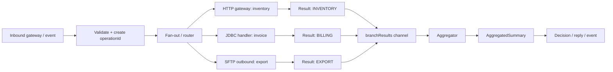
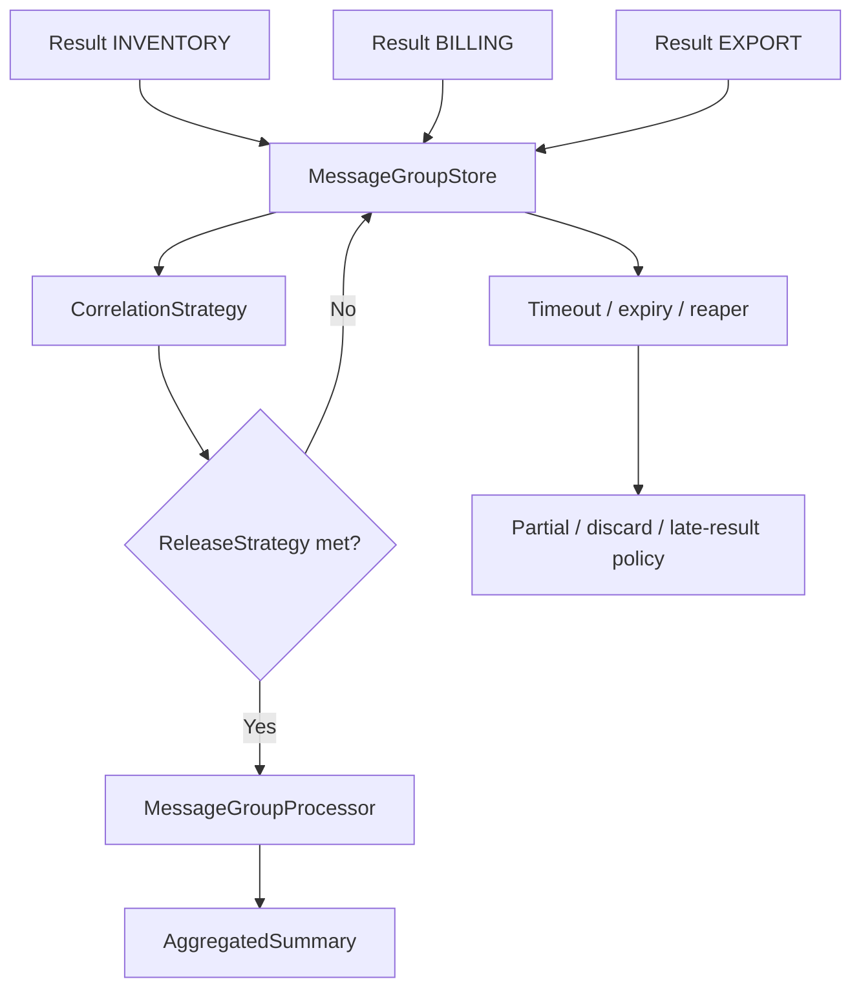
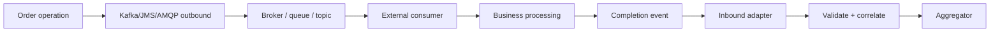
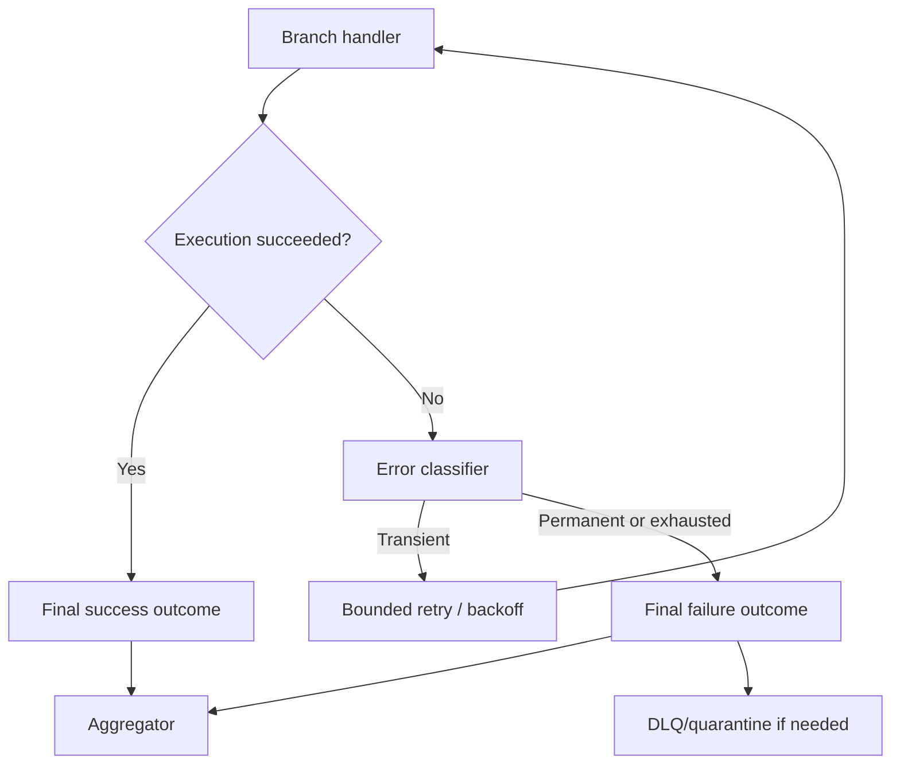
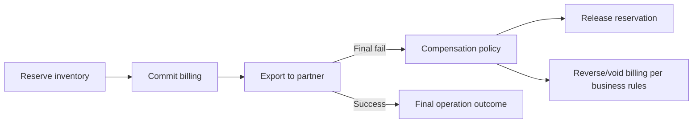

# Aggregator After Multiple Adapters

## 1. The Problem: One Request Needs Results from Multiple Systems

A commerce platform receives a `ConfirmOrder` request. To complete preparation, the system must execute three tasks:

1. **Check inventory** via an HTTP outbound gateway to the inventory service.
2. **Record an invoice** via a JDBC outbound adapter or a transactional persistence service.
3. **Export data to a partner** via a File/SFTP outbound adapter.

These branches can take different amounts of time: HTTP responds in 80 ms, the database commits in 120 ms, and SFTP takes 2 seconds. When one request is processed across multiple adapters, the system must answer:

- How do we know all three results belong to **the same order and the same execution**?
- When can we conclude we have enough results?
- If two branches succeed and one fails or never responds, what should happen?
- If a branch's result arrives twice due to retry, should it count as two branches?
- If a result arrives after timeout, do we store it, drop it, or revise the conclusion?
- If the service restarts while waiting, will the pending group of results be lost?
- Is HTTP 202, a Kafka producer ACK, or a finished SFTP upload enough to consider the **receiving domain's business logic** complete?

In Enterprise Integration Patterns, an **Aggregator** is a component that **combines related messages into a single result** once a completion condition is met. Placing an aggregator **after multiple adapters** is a *fan-out/fan-in* scenario (branching out and gathering results), also related to **Scatter–Gather** when dispatching requests to multiple recipients and collecting responses.

This lesson belongs to the **Design patterns** chapter in module `SPRING_INTEGRATION_ADAPTERS`: connecting external systems via **inbound/outbound adapters, gateways, pollers, and MessageChannels**, practicing File, SFTP, HTTP, JMS, AMQP, Kafka, and databases alongside message contracts, error handling, and connection lifecycles.

> **Decision point:** A **one-way outbound adapter** does not automatically emit a business reply for an aggregator to collect. Only when branches **emit result messages**—from gateways, completion events, callbacks, or confirmation endpoints—do you have valid inputs to aggregate.

## 2. Fan-Out/Fan-In Model in Spring Integration



The diagram illustrates a **reference** architecture. Each branch must actively emit **a defined result event**. For example, a JDBC handler does not automatically emit a result onto `branchResults` just because an SQL statement ran; you need an appropriate wrapper/service activator or completion mechanism.

### Inputs and outputs

```text
Input:
  operationId = op-8721
  orderId     = ORD-1001

Branch outcomes (arbitrary arrival order):
  {operationId: op-8721, branch: BILLING,   status: SUCCEEDED}
  {operationId: op-8721, branch: EXPORT,    status: SUCCEEDED}
  {operationId: op-8721, branch: INVENTORY, status: SUCCEEDED}

Aggregate:
  {operationId: op-8721, completed: 3/3, overall: SUCCEEDED}
```

The aggregated outcome must have an **agreed business meaning**. In the example, `EXPORT=SUCCEEDED` may only mean **the file upload finished**, not that the partner system imported it successfully. If partner processing completion is required, choose a different milestone—such as `PARTNER_IMPORTED` from a callback or inbound confirmation.

## 3. Distinguishing Aggregator, Splitter, Router, and Publish–Subscribe

| Pattern/component | Primary job | Relevance to this problem |
| --- | --- | --- |
| **Splitter** | One collection message → multiple messages | A 100-order batch into 100 tasks |
| **Router** | Picks one or more paths by condition | Routes work to matching branches |
| **Recipient-list router** | Sends to a selected list of recipients | Flexible configurable fan-out |
| **Publish–Subscribe channel** | Broadcasts messages to subscribers | Multi-branch fan-out, optionally with executors |
| **Transformer** | Changes payload representation | `Order` → JSON/CSV/SQL parameters |
| **Gateway** | Request–reply with external systems or app | HTTP call returning a response |
| **Outbound adapter** | One-way send/write | SFTP upload, Kafka/JMS publish, file write |
| **Aggregator** | Collects messages by key and release rule | Gathers all `BranchOutcome` messages |
| **Resequencer** | Reorders messages into sequence | Needed only if downstream requires strict order |
| **Barrier** | Holds flows until permitted to proceed | Task synchronization without necessarily building a summary |

An aggregator commonly follows a splitter. Here, however, **messages arrive from diverse adapters/branches** with different types, timings, and no shared out-of-the-box sequence metadata; hence a unified contract is required.

### Is Scatter–Gather always synchronous?

No. Scatter–Gather can run:

- **Synchronous:** multiple gateways call and reply within a bounded timeout.
- **Asynchronous:** dispatches over Kafka/JMS/AMQP or File/SFTP, then waits for separate completion events later.
- **Hybrid:** two gateways reply immediately while a file/broker branch finishes later.

The aggregator manages message groups; **result emission timing, state persistence, and source ack semantics** must match the actual flow model.

## 4. Adapters and Gateways: What Actually Produces a “Result”?

| System | Observable signal | What that signal **does NOT prove** |
| --- | --- | --- |
| **HTTP outbound gateway** | HTTP status, body, or mapped response | All async server-side business work finished, especially `202` |
| **File outbound adapter** | File written per handler and local status | External consumer read the file |
| **SFTP outbound adapter** | Upload/rename completed per adapter op | Partner imported the file |
| **JMS outbound adapter** | Sent to JMS provider per configured semantics | JMS consumer committed business work |
| **AMQP outbound adapter** | Publish/confirm/return per config | Consumer processed the message |
| **Kafka outbound adapter** | Producer acknowledgment per config | Downstream consumer processed it |
| **JDBC outbound adapter** | Statement executed/committed per transaction | Other systems saw or processed the event |
| **Database inbound polling** | Row matched query criteria | External job committed without an explicit confirmation contract |

**Only aggregate signals at the same semantic level.** If branch A means “business validated,” branch B means “broker accepted,” and branch C means “file uploaded,” name the summary accurately instead of mislabeling it “all business completed.”

### Selectable milestones

- **Accepted:** target system received the request/event.
- **Transport completed:** transport send/write succeeded.
- **Business completed:** target confirmed business processing.
- **Compensated:** earlier side effects were compensated after workflow failure.

If the real requirement is **business completed**, a Kafka publishing branch must wait for an inbound completion event or verified target state—not just a producer ACK.

## 5. Shared `BranchOutcome` Contract Across Branches

Define a standard structure so the aggregator does not need to understand raw HTTP responses, Kafka records, or SFTP sessions.

```json
{
  "operationId": "op-8721",
  "resultEventId": "result-2b09",
  "branch": "INVENTORY",
  "milestone": "BUSINESS_COMPLETED",
  "outcome": "SUCCEEDED",
  "code": "STOCK_RESERVED",
  "completedAt": "2026-11-23T09:00:01Z",
  "schemaVersion": 1
}
```

| Field | Role | What to watch |
| --- | --- | --- |
| `operationId` | Grouping key **for one execution** | Do not use plain email or orderId if an order can run multiple times |
| `resultEventId` | Unique result event identifier | Keep stable across redeliveries/retries of the same event |
| `branch` | Emitting branch | Must belong to an allowed enum/list |
| `milestone` | Confirmed completion level | Never conflate transport with business |
| `outcome` | `SUCCEEDED`, `FAILED`, or non-terminal state | Only terminal states satisfy release rules when required by contract |
| `code` | Standardized business/error code | Avoid raw exceptions and sensitive data |
| `completedAt` | Confirmation timestamp | Do not use as a unique key |
| `schemaVersion` | Contract version | Supports schema evolution |

Real records may also need verified `tenantId`, `deadlineAt`, `requiredBranches`, and evidence references. Never embed tokens, passwords, signed URLs, or customer payloads in outcomes just for “easy debugging.”

### Distinguishing request IDs from business IDs

- `orderId=ORD-1001` may span multiple edits/sync runs.
- `operationId=op-8721` represents **one specific coordination run**.
- `resultEventId=result-2b09` identifies duplicate deliveries of a single result.
- Spring message `id` can regenerate across conversions; **unsuitable as a stable cross-system business key**.

## 6. Correlation: Grouping Results of the Same Operation

Spring Integration's Aggregator groups messages by the **`CORRELATION_ID`** header by default. This can be replaced with a **`CorrelationStrategy`**.

In multi-adapter flows, generate **one trusted operation ID at ingress/orchestration** and pass it through every branch:

```text
operationId: op-8721
    ├─ HTTP inventory request    → outcome(operationId=op-8721)
    ├─ JDBC invoice operation    → outcome(operationId=op-8721)
    └─ SFTP export operation     → outcome(operationId=op-8721)
```

**Do not generate a different UUID per branch if they belong in the same group.** Each branch can have its own `resultEventId`, yet **`operationId` must remain identical**.

### Custom CorrelationStrategy

```java
// Conceptual example of a grouping strategy:
Object correlationKey(Message<?> message) {
    BranchOutcome result = (BranchOutcome) message.getPayload();
    return result.operationId();
}
```

If multiple tenants could generate colliding operation IDs, include a trusted namespace in the key: `(tenantId, operationId)`. Avoid unescaped string concatenation that risks collisions; use a structured key record or canonical encoding.

### When is the default `correlationId` enough?

If the entire path preserves `CORRELATION_ID` across the same sequence, the default may suffice. For callbacks/Kafka results coming from another process, original framework headers are usually absent; map the **business operation ID** onto the correlation header or use a custom strategy at reception.

## 7. Sequence Headers and `applySequence(true)`

Spring Integration uses sequence-related headers:

- `CORRELATION_ID`: groups messages in a sequence.
- `SEQUENCE_NUMBER`: position of the message in the sequence.
- `SEQUENCE_SIZE`: expected total elements in the sequence.

The default Aggregator uses **sequence size/sequence number** to decide when a group is complete. With a **Splitter**, sequence metadata is typically added by the splitter; with a **`PublishSubscribeChannel`** or recipient-list router, enable **`applySequence`** if you rely on default sequence-based release.

Conceptual example:

```java
@Bean
MessageChannel fanOutChannel() {
    PublishSubscribeChannel channel = new PublishSubscribeChannel();
    channel.setApplySequence(true);
    return channel;
}
```

This snippet illustrates fan-out configuration on a channel; check exact APIs and wiring for your version/libraries.

### Limitations of default sequences

- `SEQUENCE_SIZE=3` works only when **exactly 3 corresponding result messages** actually arrive.
- If one branch **filters/drops** without emitting a result, the aggregator can wait forever.
- If a branch fails inside a one-way adapter without emitting an outcome, the sequence never finishes.
- If a branch emits two results on retry, naive counting breaks.
- If a Kafka/SFTP callback arrives as a **brand-new message** without original sequence headers, metadata won't join automatically.

**In multi-adapter asynchronous flows, a custom `CorrelationStrategy` and `ReleaseStrategy` keyed by branch/operation are usually far clearer than relying entirely on `sequenceSize`.**

## 8. How Aggregator Maintains State

An Aggregator is **stateful**: it holds messages inside a **`MessageGroup`** until release criteria are met.



Component roles:

| Component | Question answered |
| --- | --- |
| `CorrelationStrategy` | Which group does this message belong to? |
| `MessageGroupStore` | Where are groups/messages stored? |
| `ReleaseStrategy` | Is the group ready to emit a result? |
| `MessageGroupProcessor` | What summary is built from branch outcomes? |
| `groupTimeout` / reaper | When are incomplete groups handled? |
| `discardChannel` | Where do invalid/too-late results go? |
| `expireGroupsUponCompletion` | Keep a completed-group tombstone or delete to allow key reuse? |

A `MessageGroup` is evaluated when new messages arrive; without timeouts/expiry, **incomplete groups can linger indefinitely**.

### In-memory defaults are insufficient for many production use cases

`SimpleMessageStore` is convenient for demos, yet does not survive restarts. For long-running flows and critical data, evaluate persistent stores, transaction durability, serialization, concurrency, retention, and group sizing.

## 9. Designing the Right ReleaseStrategy for Multiple Branches

Three common strategies:

| Policy | When it releases | Example |
| --- | --- | --- |
| **All required** | Terminal outcomes received from all required branches | Inventory + billing + export |
| **Quorum** | Enough weighted votes/results arrived | At least 2/3 independent lookup providers |
| **Deadline / partial** | Wait timeout expired; emit incomplete summary | Return `PARTIAL` after 15 seconds |
| **First useful result** | First qualifying result arrives | Racing read replicas |
| **Dynamic expected set** | All branches actually dispatched finish | Skipping a branch omitted by business rules |

### Why `group.size() == 3` is usually insufficient

Suppose:

```text
[INVENTORY: OK]
[INVENTORY: OK]  <-- duplicate redelivery
[BILLING: OK]
# EXPORT has not reported yet
```

`group.size() == 3` returns `true`, yet **EXPORT is missing**. Count **the distinct set of completed branches**, not raw message count.

### Does a `FAILED` branch count as completed?

Depends on the contract:

- If every branch must return a **terminal outcome** `SUCCEEDED/FAILED`, both count as **responded**, and the summary determines overall success/failure.
- If the workflow requires “all three succeed,” you can fail-fast on any terminal failure—yet you must still manage in-flight branches, side effects, and compensation.
- A branch returning only `ACCEPTED` is not business-completed if the milestone requires business outcomes.
- Errors swallowed/filtered **without emitting a failure outcome** usually stall groups until timeout; build an explicit failure path.

**An error does not mean a missing message.** A `FAILED` outcome message can be a valid input to the aggregator and must be recorded to summarize.

## 10. Defining a Java Model for Branch Outcomes

Java 17+ example using records and enums:

```java
import java.time.Instant;

enum Branch {
    INVENTORY, BILLING, EXPORT
}

enum Outcome {
    SUCCEEDED, FAILED
}

record BranchOutcome(
    String operationId,
    Branch branch,
    String resultEventId,
    Outcome outcome,
    String code,
    Instant completedAt
) {}

record AggregatedSummary(
    String operationId,
    java.util.Map<Branch, Outcome> results,
    boolean allSucceeded
) {}
```

Constraints to validate **before sending outcomes into the aggregator**:

1. `operationId` is non-empty, belongs to an authorized request, and matches namespace/tenant.
2. `branch` belongs to the set of branches dispatched for the operation.
3. `resultEventId` is stable for the same outcome and distinct from other events.
4. `outcome` is a **terminal result** for the milestone being aggregated.
5. `code` belongs to an allowed code list and contains no raw exceptions or secrets.
6. If multiple outcomes arrive for the same branch, explicit dedup/conflict rules apply.
7. `completedAt` carries timezone info; never rely on timestamps as absolute proof of cross-system ordering.

A durable operation table can store dispatched branches and deadlines rather than trusting self-reported `expectedCount` from incoming messages.

## 11. Java Example: Custom ReleaseStrategy by Branch Set

Inspecting received branch payloads in `MessageGroup`:

```java
import java.util.EnumSet;
import org.springframework.integration.store.MessageGroup;
import org.springframework.messaging.Message;

public final class BranchAggregationRules {

    private static final EnumSet<Branch> REQUIRED =
        EnumSet.of(Branch.INVENTORY, Branch.BILLING, Branch.EXPORT);

    private BranchAggregationRules() {}

    public static boolean canRelease(MessageGroup group) {
        EnumSet<Branch> present = EnumSet.noneOf(Branch.class);

        for (Message<?> message : group.getMessages()) {
            BranchOutcome outcome =
                (BranchOutcome) message.getPayload();

            // Group should only hold validated terminal outcomes.
            present.add(outcome.branch());
        }

        return present.containsAll(REQUIRED);
    }
}
```

This checks branch coverage rather than message count: duplicate `INVENTORY` never substitutes for `EXPORT`.

### Yet this code does not solve everything

- If an outcome **spoofs a branch**, validate source and permissions before the aggregator.
- If a branch emits `FAILED` and later `SUCCEEDED`, determine whether it was an in-attempt retry or **a new execution**.
- If expected branches vary per operation, a static `REQUIRED` set fails; read expected sets from a **trusted operation context**.
- If duplicate messages enter the group, set release still holds, yet the output processor must handle duplicates or dedup upfront.

**`ReleaseStrategy` only answers “ready to aggregate?”; it never replaces validation and idempotency.**

## 12. Java Example: Summarizing a Group into an Immutable Summary

A group processor can build an `AggregatedSummary` with one final outcome per branch:

```java
import java.util.EnumMap;
import java.util.Map;
import org.springframework.integration.store.MessageGroup;
import org.springframework.messaging.Message;

public final class BranchSummaryProcessor {

    private BranchSummaryProcessor() {}

    public static AggregatedSummary summarize(MessageGroup group) {
        Map<Branch, Outcome> byBranch = new EnumMap<>(Branch.class);
        String operationId = null;

        for (Message<?> message : group.getMessages()) {
            BranchOutcome result =
                (BranchOutcome) message.getPayload();

            if (operationId == null) {
                operationId = result.operationId();
            } else if (!operationId.equals(result.operationId())) {
                throw new IllegalStateException(
                    "Mixed operation IDs in a group");
            }

            Outcome previous =
                byBranch.putIfAbsent(result.branch(), result.outcome());

            if (previous != null && previous != result.outcome()) {
                throw new IllegalStateException(
                    "Conflicting final results for one branch");
            }
        }

        boolean complete =
            byBranch.keySet().containsAll(
                java.util.EnumSet.of(
                    Branch.INVENTORY, Branch.BILLING, Branch.EXPORT));

        if (!complete) {
            throw new IllegalStateException("Incomplete branch group");
        }

        boolean allSucceeded =
            byBranch.values().stream()
                .allMatch(v -> v == Outcome.SUCCEEDED);

        return new AggregatedSummary(
            operationId, Map.copyOf(byBranch), allSucceeded);
    }
}
```

This pattern rejects **conflicting terminal outcomes** for the same branch. It tolerates duplicate messages sharing the same `outcome`, yet not every duplicate is harmless: differing codes, versions, or side effects still require comparing `resultEventId` and source controls.

### Why produce an immutable summary?

Groups inside `MessageGroupStore` have their own lifecycle and may be purged after release. Never return a raw `Collection<Message<?>>` from the store expecting it to remain valid forever. Building a fresh summary DTO creates a clean boundary independent of MessageGroup internals.

## 13. Java DSL: Aggregating Results onto One Channel

The example below illustrates a flow dedicated to **branch result messages**, rather than directly invoking the three adapters.

```java
import org.springframework.context.annotation.Bean;
import org.springframework.context.annotation.Configuration;
import org.springframework.integration.dsl.IntegrationFlow;
import org.springframework.integration.store.MessageGroupStore;

@Configuration
public class FanInConfiguration {

    @Bean
    IntegrationFlow aggregateBranchResults(
            MessageGroupStore branchResultGroupStore) {

        return IntegrationFlow.from("branchResults")
            .aggregate(a -> a
                .correlationStrategy(message ->
                    ((BranchOutcome) message.getPayload()).operationId())
                .releaseStrategy(
                    BranchAggregationRules::canRelease)
                .outputProcessor(
                    BranchSummaryProcessor::summarize)
                .messageStore(branchResultGroupStore)
                // Retain completed group metadata to handle late replies
                // within the designed window.
                .expireGroupsUponCompletion(false))
            .channel("aggregatedSummaries")
            .get();
    }
}
```

### What this code does

1. `branchResults` is the **convergence** channel for all branch result producers.
2. `correlationStrategy` groups by `operationId`.
3. `releaseStrategy` waits for `INVENTORY`, `BILLING`, and `EXPORT`.
4. `outputProcessor` builds an `AggregatedSummary`.
5. `MessageGroupStore` persists the group while waiting.
6. `aggregatedSummaries` receives the released summary.
7. Retaining completed group metadata allows **rejecting late messages within the retention window**; you still must configure group cleanup and replay handling.

**This is a Java DSL example for the Aggregator layer** following familiar Spring Integration APIs. You must select a `MessageGroupStore` implementation, declare channels/producers/consumers, and verify exact dependency versions. The snippet **does not create the three adapters**, set timeouts, or guarantee cross-system transactions/exactly-once.

### Do not casually enable `expireGroupsUponCompletion(true)`

Deleting the entire group immediately on release allows **a late message with the same operation ID to start a brand-new group**. Retaining tombstones forever bloats state. Design **late-reply windows, state cleanup, and durable dedup**.

## 14. Multi-Branch Fan-Out in Java DSL

You can use a `PublishSubscribeChannel` or recipient-list router to dispatch messages to distinct processing flows.

Illustrative **fan-out step**:

```java
@Bean
IntegrationFlow distributeOrderOperations(BranchHandlers handlers) {
    return IntegrationFlow.from("orderOperations")
        .publishSubscribeChannel(s -> s
            .applySequence(true)
            .subscribe(f -> f.handle(handlers, "inventory"))
            .subscribe(f -> f.handle(handlers, "billing"))
            .subscribe(f -> f.handle(handlers, "export")))
        .get();
}
```

Here `BranchHandlers` is an **application-defined** service. Each handler:

- receives requests carrying `operationId` and permitted data;
- executes work through the matching gateway/adapter;
- upon obtaining a **trusted terminal outcome**, emits a `BranchOutcome` to `branchResults`;
- on permanent failures, emits a failure outcome or routes to retry/dead-letter policies able to resolve the group;
- prevents duplicate results from re-triggering side effects.

**Semantics warning:** `publishSubscribeChannel` copies the request message to subscribers, yet **does not automatically capture return values from the three `handle(...)` calls and aggregate them**. You must wire **branch outcomes → convergence channel**. `applySequence(true)` numbers those fan-out copies right there; outcome messages arriving later via brokers may be brand-new messages lacking original sequence headers.

### When branches are conditional

Suppose B2B orders skip SFTP export (`REQUIRED={INVENTORY,BILLING}`), whereas B2C orders require all three branches. The **expected set must be locked per operation** when the router decides—never hardcoded to `3` or trusted from arbitrary headers.

## 15. How Do Adapters/Gateways Produce `BranchOutcome`?

Build a **result producer** per branch—such as a service activator after a gateway, an adapter callback, or an event consumer.

### HTTP gateway: receive response and normalize

```text
Message<CheckInventoryRequest>
    -> HTTP outbound gateway
    -> HTTP response (status + body)
    -> validate response contract
    -> BranchOutcome(INVENTORY, SUCCEEDED/FAILED)
    -> branchResults
```

Distinguish:

- `200` returning a business result confirming stock reserved per API → branch completed.
- `202 Accepted` → accepted only; requires polling/callback if business results remain pending.
- `503`/timeout → retry policy; timeout does not guarantee the server skipped processing.
- `400/422` → usually data errors, eligible for terminal failure after classification.

### JDBC: emit per transaction

```text
Message<InvoiceCommand>
    -> JDBC outbound handler
    -> commit confirmed
    -> BranchOutcome(BILLING, SUCCEEDED)
    -> branchResults
```

Never emit success **before commit**. If JDBC times out around commit leaving ambiguous state, use business keys/idempotency or read back state to avoid double-billing before emitting an outcome.

### SFTP: finished upload is not partner processed

```text
Message<ExportFile>
    -> SFTP outbound adapter
    -> remote write + final rename confirmed
    -> BranchOutcome(EXPORT, SUCCEEDED at UPLOAD_COMPLETED)
    -> branchResults
```

If the contract demands `PARTNER_IMPORT_COMPLETED`, do not emit the final branch outcome on upload. Wait for inbound acknowledgment files, HTTP callbacks, message queues, or partner-supported status queries.

## 16. Asynchronous Results from Kafka, JMS, and AMQP

One-way message adapters only **publish**. To aggregate business outcomes:



Kafka example:

```text
orders.commands:
  key      = operationId
  payload  = {operationId, orderId, action: "CHECK_STOCK"}

orders.results:
  key      = operationId
  payload  = {
    operationId, branch: "INVENTORY",
    resultEventId, outcome: "SUCCEEDED"
  }
```

Never equate producer ACK with `BranchOutcome(INVENTORY, SUCCEEDED)` when expecting downstream consumers to finish business work.

### Additional conditions

- Consumers must preserve/map `operationId` when emitting results.
- Result inbound adapters must deserialize per supported schemas/versions.
- Duplicate results from at-least-once delivery must be deduplicated.
- Results from canceled or expired operations need late-arrival policies.
- AuthN/AuthZ must verify the result emitter is permitted to report for that branch.
- Cross-tenant results must never join another tenant's operation ID group.

## 17. When to Wait for All, Fail-Fast, or Return Partial?

### All required

Fits commands considered successful only when **every mandatory task** finishes.

```text
Inventory: SUCCEEDED
Billing:   SUCCEEDED
Export:    SUCCEEDED
=> READY / SUCCEEDED (per agreed milestone)
```

### Fail-fast

If inventory check returns `FAILED` and remaining steps should no longer proceed, you can terminate early and **cancel or compensate** remaining branches per policy.

However, fail-fast **does not automatically undo side effects** already committed in DB or SFTP. An already-sent branch will not vanish just because the aggregator concluded failure.

### Partial result

For dashboards or reports not requiring completeness, you can emit:

```json
{
  "operationId": "op-8721",
  "state": "PARTIAL",
  "results": {
    "INVENTORY": "SUCCEEDED",
    "BILLING": "SUCCEEDED"
  },
  "missingBranches": ["EXPORT"],
  "reason": "DEADLINE_EXCEEDED"
}
```

**Never set `allSucceeded=true` on a partial group.** Partial outcomes should also not trigger downstream side effects requiring all three steps unless explicitly allowed by business rules.

### Quorum

“2 of 3 succeeded” fits querying multiple independent sources. **Never use quorum for three mandatory side effects** merely for faster responses: it can leave one system un-updated.

## 18. Timeouts: Never Let a Group Wait Forever

If one branch fails to return an outcome, a pure release strategy may never return `true`. Define **deadlines** and clear policies.

### Two distinct timeouts

1. **Adapter timeout:** an HTTP request, SFTP upload, JDBC query, or broker send fails to complete within its window.
2. **Aggregation timeout:** the overall **operation** fails to collect all final outcomes by its deadline.

Example: HTTP 3s, SFTP 10s, overall operation deadline 30s. Values must match SLAs and retry strategies; never apply one blanket number everywhere.

### Spring Integration mechanisms

Aggregators support **group timeouts** and can combine `sendPartialResultOnExpiry` to release incomplete groups on expiry. `MessageGroupStoreReaper` also supports scheduled group scanning/expiry. **A group's timeout can reset as messages arrive** depending on configuration; do not assume it equals **an absolute deadline from operation start**.

Verify:

- Does `TaskScheduler` run and handle errors?
- Does timeout measure from creation, last message arrival, or an expression?
- On timeout, is the group discarded or released as a partial result?
- Does the summary processor tolerate groups missing branches?
- Across service restarts, do persisted groups expire properly?
- When scheduled timeout handlers fail, where do errors route?

### Absolute deadlines

If business rules mandate “no more than 30 seconds from request receipt,” persist `deadlineAt` with the operation and use a recoverable scheduler/state machine. Never rely on relative `groupTimeout` if each arriving message keeps pushing out the deadline.

## 19. Late Replies: What Happens After Release?

Two key group-lifecycle behaviors:

| Behavior | Benefit | Risk |
| --- | --- | --- |
| Keep completed group metadata (`expireGroupsUponCompletion=false`) | Lets you reject late messages within retention | Tombstones consume storage and need cleanup |
| Delete entire group on completion (`true`) | Frees state immediately | Late replies with the same correlation can create a brand-new group |

When a group expires due to timeout, default behavior and `expireGroupsUponTimeout`/`sendPartialResultOnExpiry` settings also govern late arrivals.

### Why you need more than a single boolean flag

If an operation emitted `PARTIAL` at 30s and the EXPORT branch delivers success at 31s, the system must decide:

- **Ignore** as a late result and audit-log.
- **Update operation state** to completed and emit a versioned **revision event**.
- **Compensate** or clean up if late arrival violates policy.
- **Escalate** if the result risks inconsistent state.

Never let a newly created group silently emit a second `AggregatedSummary` as if it were a fresh operation. For high reliability, maintain a durable **operation ledger** keyed by `operationId` and terminal status rather than relying solely on aggregator metadata.

## 20. Durable `MessageGroupStore` and Restart Impact

Aggregations can span seconds or hours. If a process restarts after receiving 2/3 outcomes:

```text
Before restart:
  operationId=op-8721
  inventory=OK
  billing=OK
  export=pending

After restart:
  export=OK arrives
```

If the first two results lived only in memory, the aggregator cannot build a full summary even though EXPORT succeeded.

### Choosing a `MessageGroupStore`

| Option | When appropriate | Notes |
| --- | --- | --- |
| In-memory `SimpleMessageStore` | Demos, tests, environments tolerating state loss | Restarts lose incomplete groups |
| JDBC-backed `MessageGroupStore` | Workflows needing durability/restart on a DB | Payloads/headers must serialize; transactions/indexes/cleanup |
| Redis/Mongo-backed store | Per infrastructure and deployment needs | Persistence, HA, TTL/locking, recovery |
| Dedicated operation ledger + aggregator | Critical multi-branch workflows | Aggregate state and event dedup need transaction coordination |

### Watch out for persisted headers

Spring Messages can carry `replyChannel`, `errorChannel`, or adapter objects that do not serialize cleanly into persistent stores. Never assume a request–reply gateway keeps an in-JVM **temporary reply channel** alive across process restarts.

For long workflows, prefer **operation ID + reply topics/callbacks/status APIs** rather than holding an HTTP request thread open indefinitely.

### Do not arbitrarily share a group store

Sharing one `MessageGroupStore` across multiple aggregators can misroute group/expiry callbacks. Configure namespaces/regions and ownership per implementation capabilities; review framework warnings and avoid sharing one store instance across aggregators with independent expiry policies if unsupported.

## 21. Idempotency and Duplicate Branch Outcomes

In distributed systems, duplicates are normal: producer retries, broker redeliveries, repeated HTTP callbacks, file re-polls, or pre-commit crashes.

```text
op-8721:
  inventory resultEventId=result-a1  SUCCEEDED
  inventory resultEventId=result-a1  SUCCEEDED  <- duplicate
  billing   resultEventId=result-b1  SUCCEEDED
  export    resultEventId=result-c1  SUCCEEDED
```

### Need two layers of deduplication

1. **Event dedup:** has this result event already been received?
2. **Business outcome dedup:** should an operation/branch only ever have one final outcome per policy?

Unique keys can be persisted:

```text
unique(resultEventId)
unique(operationId, branch, completionEpoch)
```

These are logical key examples; `completionEpoch` must be defined when true business retries exist. If a branch runs multiple attempts, use a state machine to decide the **final outcome** instead of treating every attempt output as terminal.

### Producer idempotence alone is not enough

Kafka producer idempotence is scoped to producer/broker writes; it does not guarantee consumer side effects or end-to-end fan-in exactly-once. Consumers still need duplicate protection across retries/redeliveries.

## 22. Two Conflicting Outcomes from the Same Branch

Suppose an outcome arrives:

```text
(op-8721, INVENTORY, FAILED)
```

and later:

```text
(op-8721, INVENTORY, SUCCEEDED)
```

At least three interpretations exist:

1. **Earlier attempt failed**, subsequent attempt succeeded; the first outcome was not terminal.
2. **Mis-emitted callback** or a contract failing to distinguish accepted from final.
3. **Spoofing/correlation bug**, or an operation ID was reused.

Never pick “last arrival wins” simply by larger timestamp. System clocks drift, and broker delivery order is not global business event order.

### Explicit policy

- Final results must carry verified `branch` and `operationId`.
- Separate `attemptId` and `attemptStatus` from `branchFinalStatus`.
- Once a final result is recorded, conflicting results must trigger inspection/error flows.
- If business permits revisions, enforce a monotonically increasing `revision` or `stateVersion` with transition rules.
- Alert on conflicts rather than silently mutating group data.

## 23. Error Flows, Retries, and Dead-Lettering in Fan-In

A branch error can occur **before an outcome message is emitted**—such as converter exceptions, HTTP timeouts, or SFTP permission denied.



**Error channels do not automatically replace outcome contracts.** An `ErrorMessage` wraps an exception and failed message; an aggregator waiting for `BranchOutcome` stays stuck unless a recoverer emits a proper terminal failure outcome.

### Choosing where to emit failure outcomes

- For transient errors, **do not emit terminal FAILED** until the retry budget is exhausted.
- When retries exhaust, distinguish **business failure** from **unresolved technical error**; some workflows should emit `INDETERMINATE` rather than asserting definite failure.
- If a branch produced a side effect yet lost its ACK, reconcile before emitting a final outcome.
- If no outcome can be built because `operationId` was lost, quarantine with source references, alert, and let the group deadline handle the missing branch.
- If the error handler/DLQ itself fails, never falsely log “parked”; protect source messages per ack policy.

### Synchronous vs. asynchronous

On `DirectChannel`, exceptions can unwind back to callers. With pollers, executor channels, or async adapters, errors may route to `errorChannel`. Test each endpoint and advice rather than assuming one global error handler catches everything cleanly.

## 24. Fan-In and Transactions: Aggregator Is Not a Distributed Transaction

Three branches may each execute side effects:

```text
Inventory reserved    -> succeeded
Invoice committed     -> succeeded
SFTP export           -> failed
```

The aggregator only **combines outcomes**; it cannot automatically roll back inventory reservations or invoices. This is a **workflow consistency** problem.

### When do you need a Saga or compensation?

- State mutates across multiple independent systems.
- No shared transaction wraps HTTP, SFTP, brokers, and DBs.
- One branch succeeds while another fails.
- Business rules require canceling or compensating completed steps.

Example:



**Do not call every compensation a technical rollback.** Issuing a refund or voiding an invoice is a new business action with its own audit trail and its own failure modes.

### Is an aggregator a saga orchestrator?

Not by default. An aggregator **collects state signals**; a saga/process manager **drives next steps, cancellations, compensations, timeouts, and recovery**. An aggregator can sit inside a saga, yet do not conflate the two roles.

## 25. Batch Aggregators vs. Multi-Adapter Aggregators

Both use aggregators, yet keys and completion criteria differ sharply.

| Scenario | Group key | Release condition |
| --- | --- | --- |
| **Multiple adapters for one order** | `operationId` | Terminal outcomes from all required branches |
| **Multiple records into one CSV file** | `batchId` | All records or batch-closed marker |
| **Multiple HTTP responses** | `requestId` | Required services or deadline |
| **Multiple Kafka results for one job** | `jobId` | All task shards report final |
| **Multiple files for one shipment** | `shipmentId` | Manifest confirms all files or completion marker |

### CSV batch example over File/SFTP

```text
Database polling -> 100 rows
       -> Splitter
       -> Transformer: row to CSV line
       -> Aggregator(batchId, expected=100)
       -> CSV document
       -> File/SFTP outbound adapter
```

In that example, the aggregator stands **before** the adapter collecting 100 rows. This lesson focuses on aggregators **after multiple adapters**, waiting for **branch result events**. Never blindly apply `sequenceSize=100` to business branches whose outcomes may be delayed or lost.

### Filters dropping messages

If a splitter emits 100 records and a filter drops 5 without adjusting the release policy, a default aggregator waits for 100 forever. Track actual expected counts or emit skip/compensation results per contract.

## 26. Formatting and Headers When Converging Multiple Protocols

An aggregator receiving results from diverse sources should sit **after a normalization step**.

```text
HTTP response DTO ────────────┐
JDBC commit status ──────────┤
SFTP delivery completion ────┤
Kafka business result ───────┼─> Normalize to BranchOutcome ─> Aggregate
JMS/AMQP consumer response ──┘
```

### At protocol boundaries

| Source | Input format | What to do before the aggregator |
| --- | --- | --- |
| HTTP gateway | DTO/JSON/String/bytes per converter | Validate HTTP contract; map terminal result |
| File/SFTP | File, path, or completion event | Verify complete file, metadata, and permissions |
| JMS | TextMessage/BytesMessage via converter | Decode, validate schema, correlate |
| AMQP | Body bytes + properties | Validate routing/source, decode version |
| Kafka | Key/value/headers/offset | Deserialize, check event ID and origin |
| JDBC | Record/row/map | Verify transaction outcome and business key |

**Never dump raw HTTP responses, `JmsMessage`, Kafka records, or `Throwable` instances together into a `MessageGroup`** without a strict output-processor contract. Build immutable result DTOs to reduce coupling and prevent non-serializable headers in persistent stores.

### Be careful with framework headers

`replyChannel`, `errorChannel`, and internal objects should not be serialized into Kafka or persistent stores indiscriminately. Propagate only **operationId, resultEventId, branch, schemaVersion**, and approved trace context.

## 27. Observability for Aggregators: Waiting Where, Missing Who?

To troubleshoot incidents, you don't need full branch payloads in logs—you need group state visibility.

| Metric/log | Meaning |
| --- | --- |
| `aggregation.groups.active` | How many operations are awaiting release? |
| `aggregation.group.age` | How long have groups been waiting? |
| `aggregation.branch.completed` | Terminal outcome counts by branch |
| `aggregation.branch.failed` | Which branches fail most often? |
| `aggregation.release.total` | Complete/partial/fail-fast counts |
| `aggregation.timeout.total` | How many groups missed deadlines? |
| `aggregation.late.results` | Results arriving after group closure |
| `aggregation.duplicate.results` | Redeliveries/duplicates |
| `aggregation.conflicting.results` | Conflicting terminal outcomes |
| `aggregation.store.errors` | `MessageGroupStore` failures |
| `aggregation.oldest.pending.age` | Stalled backlog risk |
| `aggregation.output.errors` | Summary released yet downstream failed |
| `aggregation.missing.branch` | Which branch was missing at deadline? |

### Sample safe logs

```text
event=aggregation.group.waiting
operationRef=op-8721 expectedBranches=3 observedBranches=2
missing=EXPORT ageMs=12100

event=aggregation.group.released
operationRef=op-8721 outcome=PARTIAL
missing=EXPORT deadlineExceeded=true
```

**Never use unverified `operationId`, customer emails, file paths, arbitrary Kafka keys, or raw API responses as metric labels.** Metric tags must have bounded cardinality; detailed IDs belong only in access-controlled logs/traces if needed.

### Cross-branch tracing

Traces can emit child spans for HTTP/JDBC/SFTP and a span tied to the aggregator. Callbacks arriving long after an HTTP request may not share the same live parent span; use **span links** or controlled operation correlation. Never put credentials or PII into trace baggage.

## 28. Testing Release and Aggregation Strategies

### 28.1. Unit-testing ReleaseStrategy

Must verify:

- All 3 branches arrive in different orders → releases.
- Only 2/3 arrive → does not release.
- 2 duplicate `INVENTORY` + 1 `BILLING` → **does not release** if EXPORT is missing.
- One terminal `FAILED` branch and two `SUCCEEDED` branches → releases complete group with overall failed.
- Same operation ID from a different tenant → rejected before aggregator.
- Conflicting terminal results → quarantined/alerted.
- Empty or unstable `operationId` → rejected.

### 28.2. Testing output contracts

```json
{
  "operationId": "op-8721",
  "results": {
    "INVENTORY": "SUCCEEDED",
    "BILLING": "SUCCEEDED",
    "EXPORT": "FAILED"
  },
  "allSucceeded": false
}
```

This case is valid for **result completeness**, yet is a **failed business outcome**; do not discard the message merely because one branch failed.

### 28.3. Testing IntegrationFlow

Use test channels or mock endpoints to send `BranchOutcome` messages in varying orders. Verify `aggregatedSummaries` receives a summary only when conditions are met. You can use an in-memory store for unit/integration tests, then run dedicated tests against a real persistent store.

### 28.4. Testing by adapter

| Branch | Failure scenario | Verify |
| --- | --- | --- |
| HTTP | `202` not final, `503`/timeout, schema mismatch | No false success or infinite wait |
| JDBC | Commit succeeds while caller times out | No duplicate writes; outcome via reconciliation |
| File/SFTP | Partial upload, incomplete rename, duplicate filename | Temp files never treated as completed |
| JMS | Message redelivery, converter failure | Stable outcome ID; group does not double-count |
| AMQP | Publisher confirm before consumer finishes | Not marked business complete |
| Kafka | Producer ACK, DLT, late callback, duplicate result | Groups accurately by operation; late/duplicate policies work |
| Poller | Re-reads file/row after restart | Does not mint a new operation ID for the same unfinished task |

### 28.5. Failure injection

Inject crashes at:

1. After 2/3 outcomes received, before final outcome.
2. After store saves final outcome, before summary publishes.
3. After summary publishes, before completed status is persisted.
4. After group timeout, before partial result is saved.
5. While `MessageGroupStore` or DB is temporarily failing.
6. When a result arrives very late after expiry/tombstone cleanup.

The goal is exposing anywhere groups can be lost, two summaries emitted, or side effects dropped.

## 29. End-to-End Scenario: Aggregating 3 Adapters When One Arrives Late

Suppose `operationId=op-8721` has a 20-second deadline and three required branches.

### Simulated timeline

| Time | Event | Current group state |
| --- | --- | --- |
| `t=0` | Dispatch INVENTORY, BILLING, EXPORT | No final outcomes yet |
| `t=80ms` | HTTP inventory returns terminal success | INVENTORY |
| `t=150ms` | JDBC billing commits, emits result | INVENTORY + BILLING |
| `t=4s` | SFTP times out; retries per policy | Still 2 branches |
| `t=20s` | Operation deadline expires | Missing EXPORT |
| `t=20s+` | Emits `PARTIAL/TIMED_OUT` per contract | Ledger records decided state |
| `t=23s` | SFTP retry succeeds and result arrives | Late result goes through policy |

### Two selectable policies

**Policy A — hard cutoff:**
Operation times out, late result is audit-logged and cleaned up; no additional success summary is emitted. Fits when callers are promised a final decision at deadline.

**Policy B — state revision:**
Emits partial at deadline, then ledger transitions to completed on late arrival and emits `operation.completed.v2`. Fits long workflows with callback/tracking channels; unsuitable if consumers treat partial as immutable final state.

**Never mix both policies ad hoc.** The contract must state whether summaries can be revised, versioned, and how revision events stay idempotent.

## 30. Common Anti-Patterns

| Anti-pattern | Consequence | Better approach |
| --- | --- | --- |
| “Outbound adapter sent = branch business success” | Concludes before consumers process | Define milestones and collect real completion events |
| Using `message.id` as cross-system operation key | Group breaks after transforms/brokers | Generate stable `operationId` prior to fan-out |
| Using `orderId` alone despite multiple runs | Outcomes from separate attempts mix | `operationId` + namespace/epoch |
| Omitting `applySequence` while expecting default release | Groups lack sequence metadata | Configure sequences properly or use custom strategies |
| `group.size()==3` with duplicates | Releases despite missing branch | Count distinct branches and deduplicate |
| Filter drops message without emitting outcome | Aggregator waits indefinitely | Emit skip/failure outcomes or update expected sets |
| No timeout/reaper | Orphaned groups grow forever | Deadlines, expiry, and cleanup |
| Using `SimpleMessageStore` for multi-hour workflows | Restarts wipe state | Persistent group stores/ledgers |
| Keeping tombstones forever | Store bloats | Late-reply windows and cleanup |
| Deleting tombstones immediately assuming no late arrivals | New group emits duplicate summary | Ledger/dedup or bounded metadata retention |
| Putting raw HTTP/JMS/Kafka objects into groups | Tight coupling, non-serializable headers | Normalize to `BranchOutcome` |
| Trusting client-supplied branch/operationId | Misgrouping and forged outcomes | Authenticate sources + authorize |
| Retries minting new `resultEventId` | Duplicates go undetected | Keep IDs stable across retries |
| Treating `FAILED` outcomes as aggregator errors | Drops information needed for decisions | Aggregate both final successes and failures |
| Trying to “roll back” everywhere when one branch fails | Irreversible side effects remain | Audited sagas/compensation |
| HTTP gateway waiting forever on three callbacks | Exhausts threads and times out clients | Async operation/status/callbacks |
| Using `operationId` as a metric tag | Cardinality explosion, potential PII leak | Bounded tags; IDs in secure logs |
| Testing only 3 outcomes in happy order | Misses duplicates, races, timeouts | Negative tests and failure injection |
| One global store across aggregators with expiry | Groups expire wrongly or collide | Clear store/region/ownership boundaries |

## 31. Self-Check Exercises

### Question 1: Three adapters but only one gateway replies

An HTTP gateway returns a response, while Kafka and SFTP outbound adapters send one-way. Can you configure an aggregator waiting on `SEQUENCE_SIZE=3` and expect all three?

**Answer:** No, not from outbound sends alone. Design the Kafka/SFTP branches to emit outcomes after a defined milestone—such as from callbacks or consumer confirmations—and route them to the aggregator with matching correlation.

### Question 2: Duplicate branch and premature release

A `MessageGroup` holds INVENTORY, INVENTORY, BILLING, missing EXPORT. Is releasing on `group.size()>=3` correct?

**Answer:** No. Check the required branch set and deduplicate; group size does not equal distinct branch outcomes.

### Question 3: 30-second timeout

Operation deadline is 30 seconds from request receipt. Does `groupTimeout(30000)` always enforce an absolute deadline?

**Answer:** No; group timeouts may reset on arriving messages depending on expressions/configuration. For absolute deadlines, persist creation/`deadlineAt` and use an appropriate scheduler.

### Question 4: Late reply after group deletion

Aggregator uses `expireGroupsUponCompletion(true)`; an old result arrives after group deletion. What is the risk?

**Answer:** The result can initialize a brand-new group with the same ID, creating orphan groups or duplicate summaries under certain conditions. Use a ledger/tombstone/dedup and late-result policy.

### Question 5: One branch reports FAILED

If all three branches deliver final outcomes and EXPORT=FAILED, should the aggregator still emit a summary?

**Answer:** Usually yes. “All results arrived” and “all results succeeded” are different. The summary records business failure and can trigger compensation.

### Question 6: Why not hold temporary HTTP `replyChannel` objects long-term?

Because async flows across brokers/persistent stores can outlive HTTP connections and in-JVM reply-channel instances. Use operation IDs with status APIs/callbacks/reply events for long workflows.

### Question 7: Handling JDBC commit succeeding while caller times out?

Never blindly re-run INSERT. Use idempotency keys, inspect commit state where possible, and emit a terminal outcome only once verified.

### Question 8: When to use an aggregator vs. a saga?

An aggregator fits **collecting results**; a saga/process manager is needed to **orchestrate steps, handle partial side effects, and compensate**. Both can be combined.

## 32. Implementation Checklist for Aggregator After Multiple Adapters

1. Is the goal **aggregating transport acks**, **business completion**, or another explicitly defined milestone?
2. Does every outbound adapter/gateway have a reliable path to emit a **terminal `BranchOutcome`**?
3. Is `operationId` generated prior to fan-out and preserved across branches/protocols?
4. Are `operationId`, `resultEventId`, `orderId`, and `message.id` clearly distinguished?
5. Are tenant/namespace and result-source permissions verified before joining groups?
6. Are required, optional, and dynamic per-operation branch sets defined?
7. When using splitters/pub-sub/recipient lists, do sequence headers and `applySequence` match semantics?
8. Is a custom `CorrelationStrategy` configured when results arrive from separate processes/brokers?
9. Does `ReleaseStrategy` check **distinct final branches** rather than just `group.size()`?
10. Are `FAILED`, `ACCEPTED`, and `INDETERMINATE` outcomes separated per contract?
11. Are duplicate `resultEventId` values and conflicting terminal outcomes for one branch handled?
12. Are adapter timeouts distinguished from **whole-operation** timeouts?
13. Have `groupTimeout`/reapers and schedulers been tested with missing branches?
14. Do partial results carry explicit states/missing branches instead of masquerading as success?
15. Do late replies follow an explicit discard, revision, or compensation policy?
16. Are `expireGroupsUponCompletion`/`expireGroupsUponTimeout` and tombstone cleanup designed?
17. Does `MessageGroupStore` provide needed durability, serialization/locking safety, and restart recovery?
18. Does an operation ledger/idempotency store protect critical workflows where needed?
19. Are raw headers/secrets and non-serializable payloads blocked from entering group stores?
20. Do File/SFTP signals reflect the right completion level without confusing upload with import?
21. Does HTTP handle `202`, timeouts, idempotency, and gateway reply semantics?
22. Do JMS/AMQP/Kafka emit terminal business result events when genuinely required?
23. Does JDBC emit success post-commit and resolve ambiguous transactions?
24. Can error/retry/dead-letter flows produce valid terminal failure outcomes or timeout handling?
25. When one branch creates side effects before another fails, is a saga/compensation policy in place?
26. Are summary state updates/emissions idempotent to avoid duplicate emissions after crashes?
27. Do logs/metrics/traces track group age, missing branches, duplicates, and late results without leaking PII?
28. Have tests covered out-of-order arrivals, duplicates, filtered/dropped messages, partials, timeouts, and crashes/restarts?
29. Are transport ACKs separated from final outcomes, with target-side state readbacks where needed?
30. Do operators know when to retry, compensate, cancel, or close a stalled pending operation?

## 33. Official Reference Documentation

- [Spring Integration Reference — Aggregator](https://docs.spring.io/spring-integration/reference/aggregator.html): correlation, release strategy, message group lifecycle, timeouts, and late messages.
- [Spring Integration Reference — Java DSL Aggregators and Resequencers](https://docs.spring.io/spring-integration/reference/6.2/dsl/java-aggregators.html): aggregator syntax in Java DSL.
- [Spring Integration Reference — Message Store](https://docs.spring.io/spring-integration/reference/message-store.html): choosing durable stores and serialization/header considerations.

The Java examples in this lesson illustrate **reference architectural patterns and APIs**; when implementing, verify your exact Spring Integration/Spring Boot/JDK versions, adapter settings, and partner contracts, then compile and test thoroughly.

### Key takeaways

**Aggregator after multiple adapters** solves **converging results returned at different times**—it does not magically turn one-way communication into request–reply. Doing it well requires **stable operation IDs, outcome contracts, correlation strategies, per-branch release strategies, `MessageGroupStore`, timeouts, late-result policies, and idempotency**. In Spring Integration, these combine with **MessageChannels, gateways, outbound/inbound adapters, pollers, error channels, and persistent stores** to build reliable fan-out/fan-in flows.

Most importantly, **aggregate only outcomes sharing the same business meaning**: an HTTP 202, a Kafka ACK, or a successful SFTP upload never proves on its own that the downstream consumer finished business work. When making final decisions, wait for **contract-defined completion events**, verify target state when necessary, and handle missing, duplicate, late, or failed outcomes under explicit policies.
