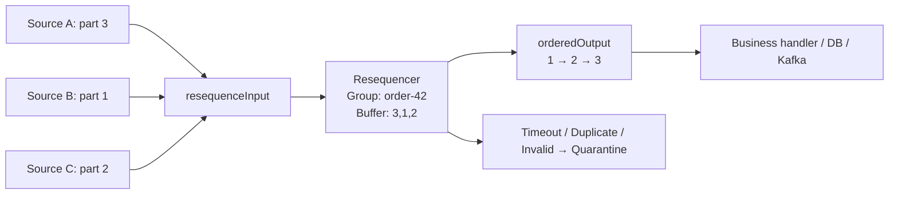
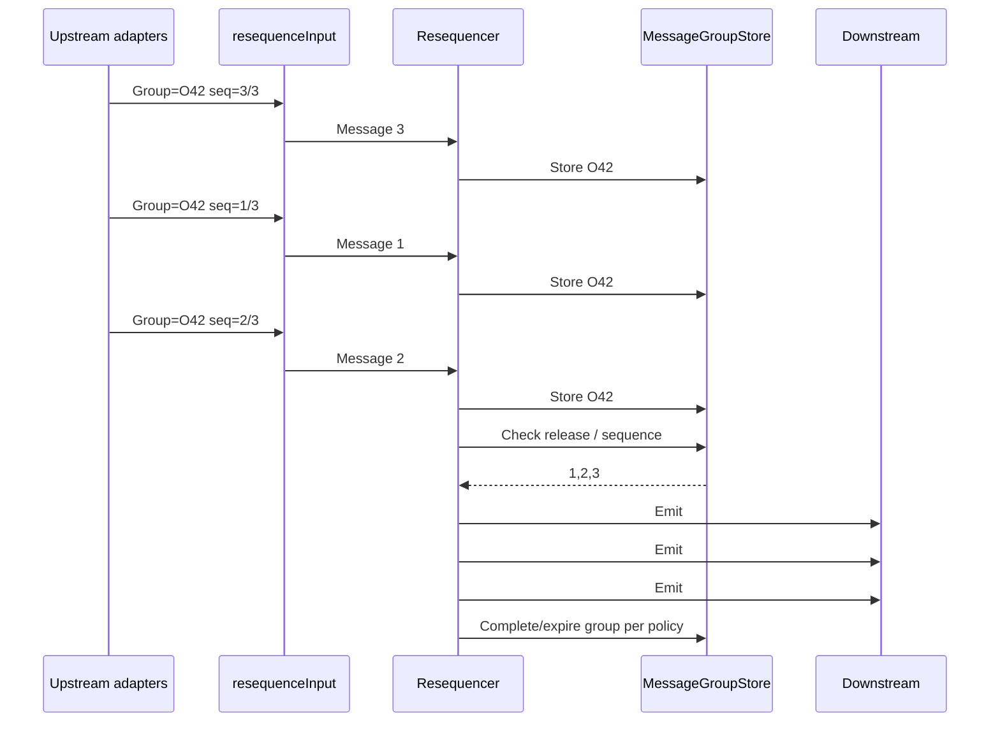
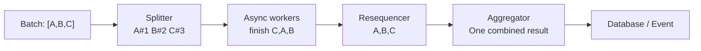
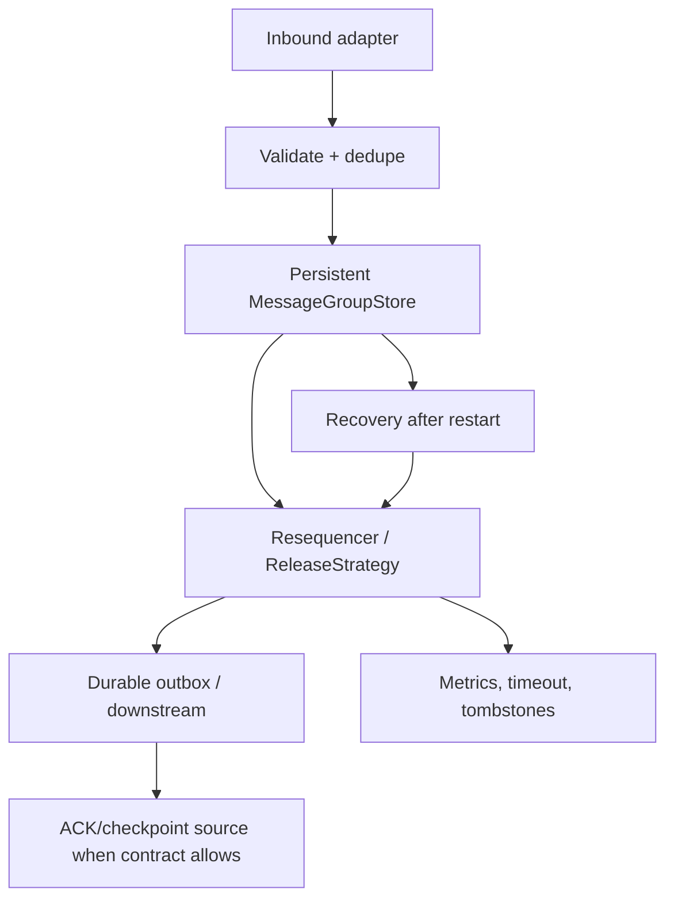
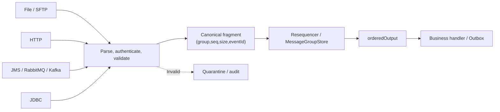
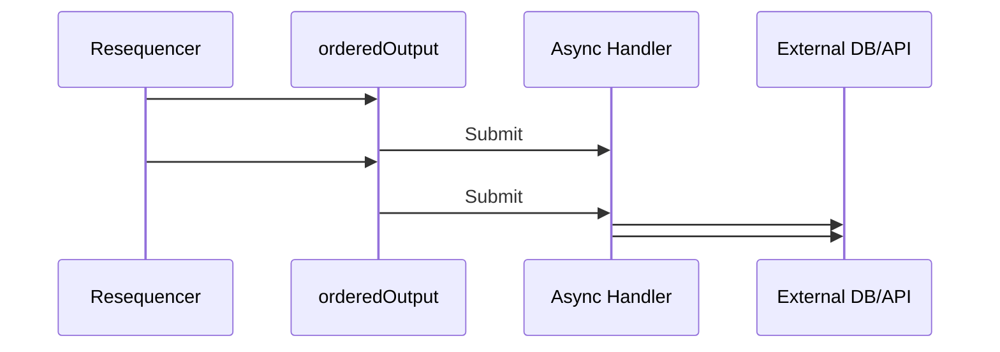

# Resequencer for Out-of-Order Messages in Spring Integration

> **Chapter:** Design patterns  
> **Lesson:** Resequencer for out-of-order messages  
> **Module:** `SPRING_INTEGRATION_ADAPTERS` — connecting external systems with Spring Integration via inbound/outbound adapters, gateways, pollers, and `MessageChannel`, including File, SFTP, HTTP, JMS, AMQP/RabbitMQ, Kafka, and JDBC alongside message contracts, error handling, and connection lifecycles.  
> **Audience:** Java/Spring Boot developers, integration engineers, and designers of EIP flows and asynchronous messaging systems.  
> **Code example context:** Java 17+, Spring Boot 3.x, and Spring Integration 6.x using compatible versions managed by the Boot BOM. DSL syntax and release/store policies should be checked against your exact application version before production rollout.

## 1. The Problem: Correct Data Arriving Out of Order

A partner sends an order split into three parts: `HEADER`, `DETAILS`, and `SUMMARY`. Even though the sender emits them in order 1 → 2 → 3, the receiver may observe 3 → 1 → 2. Causes include multiple Kafka partitions, multiple JMS/AMQP consumers, SFTP files completing at different times, out-of-order HTTP callbacks, or one fragment retrying slower than another.

If the processor saves `SUMMARY` before `HEADER`, it can persist an invalid order status, calculate totals without line items, or emit a completion event prematurely.

**Resequencer** is an Enterprise Integration Pattern (EIP) used to **group by a correlation key, buffer out-of-order messages, and re-emit them in sequence order** before passing them downstream.



**Resequencer does not turn an unordered transport into an exactly-once system.** It only solves **output ordering within a group** under configured metadata/store/release policies. No-data-loss, duplicate suppression, transactions, and adapter ACK timing must be designed separately.

### 1.1. Learning outcomes

After this lesson, you can:

1. Explain when a Resequencer is needed and how it differs from Aggregator, Splitter, Router, Sort, and Queue.
2. Define contracts for `correlationId`, `sequenceNumber`, `sequenceSize`, tenant/batch/version keys, and release conditions.
3. Use `IntegrationFlow.resequence()` to receive messages from a `MessageChannel`, group by correlation, and emit in order.
4. Write a Spring Boot lab deliberately sending **3 → 1 → 2** test data and verifying **1 → 2 → 3** output.
5. Recognize common failure modes: missing fragments, duplicate sequence numbers, inconsistent sequence sizes, late fragments, and never-completing groups.
6. Design release/timeout/expiry policies, `MessageGroupStore`, bounded memory, back-pressure, and restart recovery.
7. Connect Resequencer with File, SFTP, HTTP, JMS, AMQP, Kafka, and JDBC, including ACK/offset/checkpoint boundaries.
8. Establish acceptance criteria, metrics/alerts, runbooks, and failure testing for production.

### 1.2. Four limitations to remember

- **Per-group ordering, not system-wide:** `order-42` may interleave with `order-43`, as long as each group emits in its own sequence.
- **Order must be explicitly defined:** `sequenceNumber=2` is meaningful only when the producer assigns 1, 2, 3, ...; reliable business order cannot be “guessed” from arrival timestamps.
- **Receiving all messages does not mean durable processing:** downstream still has handlers, brokers, databases, and ACKs.
- **Define policies for missing/late arrivals:** holding forever stalls groups; dropping arbitrarily breaks business contracts.

## 2. How Does a Resequencer Work?

### 2.1. Logical steps

A Resequencer typically executes this cycle:

1. **Receive message** from an inbound channel.
2. **Compute correlation key** to identify which group the message belongs to.
3. **Read sequence metadata** and validate it.
4. **Persist into the message group store**, either in memory or durable storage.
5. **Evaluate release policy:** are all expected items present or contiguous from the expected position? Is partial release permitted?
6. **Emit messages in sequence order**, preserving required payloads/headers.
7. **Update or remove group state** per expiry/completion policy and clean up leftovers.
8. **Record metrics/audits** on duplicates, timeouts, late arrivals, or inconsistent metadata.



The diagram assumes a **hold-until-complete group policy**. Some Resequencer setups support releasing contiguous runs (partial sequences) earlier—for instance emitting #1 as soon as #1 arrives without waiting for #2/#3. Therefore distinguish **“output is always ordered”** from **“only emit once all N parts arrive”**; they are distinct requirements.

### 2.2. Sequence groups and buffering

Given three messages:

| Received at | Correlation key | Sequence number | Sequence size | Payload |
|---|---|---:|---:|---|
| 10:00:01 | `tenant-a:order-42:v1` | 3 | 3 | `SUMMARY` |
| 10:00:02 | `tenant-a:order-42:v1` | 1 | 3 | `HEADER` |
| 10:00:03 | `tenant-a:order-42:v1` | 2 | 3 | `DETAILS` |

The Resequencer must emit 1, 2, 3 per its release policy. If another message arrives for `tenant-b:order-42:v1`, it must belong to **a separate group**, because tenant is part of group identity.

### 2.3. Correlation is not ordering

- **Correlation ID:** determines which messages belong to the same group.
- **Sequence number:** indicates each message's position within the group.
- **Sequence size:** indicates expected group size, if known upfront.
- **Message ID:** identifies a single framework message instance, not a cross-retry business dedupe key.
- **Event ID / fragment ID:** identifies the same fragment across redeliveries; must stay stable across receipts.
- **Tenant/partner/batch:** provides namespace boundaries and permission checks, preventing cross-customer or cross-run mixing.

An HTTP message carrying header `correlationId=order-42` is not inherently trustworthy. If clients supply correlation/tenant fields, the backend must verify them and construct canonical keys from trusted identity/authorization context before entering the Resequencer.

## 3. Minimal Message Contract and Validation

### 3.1. Spring Integration headers

In modern Spring Integration versions, the common header group includes:

| Header | Typical value type | Example | Purpose |
|---|---|---|---|
| `correlationId` | Object/String | `tenant-a:O42:v1` | Selects the message group |
| `sequenceNumber` | Integer | `2` | Fragment position |
| `sequenceSize` | Integer | `3` | Expected fragment count |
| `id` | Framework-assigned UUID | One UUID per message | Internal tracing, not a fragment key |
| `timestamp` | Message creation timestamp | Epoch milliseconds | Observability aid, does not determine order |
| `eventId` | App-managed business string | `O42-p2-v1` | Idempotent dedupe |
| `tenantId` | Verified string | `tenant-a` | Isolation/authorization |

Exact key names and types must match your Spring Integration version. In Java, avoid magic strings where constants exist, such as `IntegrationMessageHeaderAccessor.CORRELATION_ID`, `SEQUENCE_NUMBER`, and `SEQUENCE_SIZE`. Standard **Splitters** typically populate these headers, whereas **not every inbound transport provides them automatically**.

### 3.2. Example fragment schema

```json
{
  "eventId": "O42-part-02-v1",
  "groupKey": "tenant-a:O42:v1",
  "sequenceNumber": 2,
  "sequenceSize": 3,
  "schemaVersion": 1,
  "tenantId": "tenant-a",
  "payload": {
    "kind": "DETAILS",
    "orderId": "O42",
    "items": [{"sku": "P100", "quantity": 2}]
  }
}
```

This is a **business** contract, not a built-in Resequencer format. At ingress:

1. Authenticate source/client and tenant before trusting `tenantId` or `groupKey`.
2. Validate `sequenceNumber >= 1`, and for known-size groups, `sequenceSize >= 1` and `sequenceNumber <= sequenceSize`.
3. Ensure group keys include tenant, business ID, and batch/version or generation to prevent mixing runs.
4. Keep `eventId` stable across retries; never generate a fresh UUID and treat it as a dedupe key.
5. Reject mid-flight changes to `sequenceSize` within the same group, or apply explicit schema/contract migrations.
6. Define behavior when two differing payloads share the same `groupKey + sequenceNumber`.
7. Bound payload sizes, maximum fragment counts, active group counts, and retention to avoid DoS/unbounded buffer growth.

### 3.3. Unknown sequence size upfront

If a stream source does not know the total part count, you cannot assume a group is “complete” merely because no new message arrived briefly. Require one of:

- An authenticated `EndOfBatch` event closing the group with the final fragment count.
- An agreed batch-closing watermark/condition plus tolerated latency.
- A chunked protocol carrying indices and an end marker.
- Bounded **partial sequence release** paired with gap/late-arrival handling.

**Never use a bare timeout to declare data complete** if business rules require all parts. A timeout only proves you waited too long—not that fragments are missing or will never arrive.

### 3.4. Which ordering is the right one?

Distinguish carefully:

| Ordering model | Source of truth | Does default Resequencer fit? |
|---|---|---|
| Fragment order 1..N in a batch | Producer-assigned `sequenceNumber` | **Yes**, given proper contracts and release policies |
| Entity version order | Monotonic version/offset/epoch | Usable if messages carry sequence metadata and gap policies |
| Event-time order | Event timestamps that may arrive late | Needs event-time watermarks/late-data policies; cannot infer from arrival |
| Broker partition receive order | Kafka offset within one partition | Kafka already orders per partition; resequencing may be unnecessary |
| Cluster-wide Kafka order | No global offset across partitions | **Cannot solve automatically** without a trusted global sequence |
| Business dependency order | Dependency DAG/causal graph | Needs causal ordering/workflow state; integer Resequencer may fall short |

## 4. How Resequencer Differs from Related EIP Patterns

### 4.1. Functional comparison

| Pattern | Question solved | Output | When needed |
|---|---|---|---|
| **Splitter** | How to break one message into multiple parts? | Multiple messages, optionally with sequence headers | Large files, order lists, batch records |
| **Resequencer** | How to re-emit parts in the right positional order? | Individual messages in per-group sequence order | Fragments arriving out of order |
| **Aggregator** | How to combine multiple messages into one result? | Usually a single combined message | Merging parts to emit one consolidated order |
| **Router** | Which processing flow/target to select? | One or more routes per router | Routing by event type/tenant |
| **Filter** | Which messages proceed? | Keeps or drops individual messages | Initial validation, dedup (when stateful) |
| **Delayer** | When is a message sent onward? | Delayed messages on schedule | Rate limiting, scheduling; does not sort order |
| **PublishSubscribeChannel** | Broadcast to multiple subscribers? | Multiple downstream copies | Fan-out; does not preserve order across async subscribers |

### 4.2. Splitter + Resequencer + Aggregator



Do not assume Splitter + Aggregator **always requires** a Resequencer. If the Aggregator performs an **order-independent** reduction (e.g., summing quantities), a Resequencer may be unnecessary. If the Aggregator requires a meaningful sequence (e.g., concatenating chunks by position), a Resequencer or ordering aggregation strategy is needed.

### 4.3. Consequences of introducing a Resequencer

- Adds **state**: must store fragments and group progress.
- Adds **latency**: early arrivals buffer while waiting for missing positions.
- Can cause **head-of-line blocking** inside a group.
- Requires **expiry** and missing-fragment policies.
- Demands **strict contracts** to avoid misgrouping or duplicate emissions.
- Requires watching downstream asynchrony: even after ordered emission, downstream executors/partitions can still complete side effects out of order.

Never add a Resequencer just to “fix every late message.” Prove which ordering was lost, at which boundary, and whether downstream truly requires ordered processing.

## 5. Resequencer in Spring Integration

### 5.1. Framework components

In Spring Integration, Resequencer belongs to **stateful correlation handlers**: it must remember arrived messages in the same group. Key objects:

| Component | Responsibility |
|---|---|
| `ResequencingMessageHandler` | Handler grouping by correlation and releasing in sequence |
| `MessageGroupStore` | Stores message groups/progress; may default to an in-memory store |
| `CorrelationStrategy` | Computes group keys from messages |
| `ReleaseStrategy` | Decides when a group/range qualifies for release |
| `MessageGroup` | State of messages sharing a correlation key |
| `MessageChannel` | Boundary moving messages into/out of the resequencer |
| `IntegrationFlow` / Java DSL | Declares topology and endpoint lifecycles |
| `MessageGroupStoreReaper` / expiry policy | Purges stale groups under intentional policies |

Not every item above needs manual bean wiring when using defaults. In production, however, you must **know what the defaults are** and define handling for incomplete groups.

### 5.2. Minimal flow

A Java DSL example:

```java
@Bean("orderedFragmentsFlow")
IntegrationFlow orderedFragmentsFlow() {
    return IntegrationFlow
        .from("resequenceInput")
        .resequence()
        .channel("orderedOutput")
        .get();
}
```

Meaning:

- `resequenceInput` is the input channel carrying fragments with trusted metadata.
- `.resequence()` adds the resequencing endpoint using Spring Integration's group/sequence conventions.
- `orderedOutput` receives messages emitted in **per-group** order.
- A consumer is needed on `orderedOutput`; on a synchronous channel with no subscriber, dispatch fails.
- Do not swap `orderedOutput` for an async channel and claim all **side effects** stay ordered: downstream executors/brokers can scramble execution order.

**Version note:** When using DSL callbacks to customize `releaseStrategy`, `messageStore`, `groupTimeout`, or expiry options, verify APIs against your exact Spring Integration 6.x/project version. The lab below uses basic `.resequence()` and tests **output order** without assuming unverified release settings.

### 5.3. Release mechanics: full group vs. contiguous runs

Two common business models:

**Model A — Release only after full group:** With `sequenceSize=3`, waits for 1, 2, 3 and then emits 1→2→3. Fits when every fragment must be ready before applying, at the cost of higher latency and memory.

**Model B — Release contiguous runs incrementally:** Receiving 3, 1, 2 can emit #1 as soon as #1 arrives, then #2 and #3 once contiguous. Fits consumers able to process incrementally, while requiring persisting `nextExpected` and blocking late duplicates from re-emitting.

Spring Integration's default release behavior and partial-sequence options depend on API/configuration: **never assert that `.resequence()` will always wait for all N parts before emitting anything**. To verify behavior, test with #3 only, then #1 without #2, and finally #2, measuring both early and final outputs.

### 5.4. Configuration decisions

| Decision | Question | Consequence |
|---|---|---|
| Correlation key | Group by order, batch, or tenant+order+version? | Wrong key mixes data across customers |
| Sequence extraction | Are headers normalized? | Wrong types/numbers stall group completion |
| Release policy | Full-group or contiguous partial? | Latency and business invariants |
| Message store | RAM or durable store? | Restart/crash recovery capability |
| Group expiry | How long to wait? | Memory/backlog vs. missing-part policy |
| Late arrivals | How to handle arrivals after group completion? | Duplicate/replay vs. reopening groups |
| Duplicate detection | Same group+sequence, differing eventId/payload? | Must quarantine conflicts |
| Concurrency | Can multiple ingress threads/instances touch the same group? | Locking/transactions/ordering |
| Downstream | Synchronous or asynchronous execution? | Emission order ≠ completion order |
| ACK boundary | When is the source considered done? | Data loss or duplicates |

## 6. Spring Boot Lab: Messages Arrive 3–1–2, Output 1–2–3

### 6.1. Goals and limitations

This purely **in-memory** lab creates three messages sharing one group ID, sends them to a `DirectChannel` in reversed order, uses `IntegrationFlow.resequence()`, and collects outputs to verify:

```text
INPUT             RESEQUENCER           OUTPUT
O42 #3  --------> buffer #3
O42 #1  --------> buffer/partial          O42 #1 (per release policy)
O42 #2  --------> #2 fills gap           O42 #2, O42 #3
                                       finally: #1, #2, #3
```

Because there is no broker, the test cannot prove JMS ACK, Kafka offset commits, SFTP checkpoints, or durable recovery. It proves **metadata mapping and ordered output** within a Spring Boot context.

### 6.2. Dependencies

Use a Spring Boot 3.x project with parent or imported BOM compatible with Java 17+. Example `<dependencies>` snippet in a valid POM:

```xml
<dependencies>
    <dependency>
        <groupId>org.springframework.boot</groupId>
        <artifactId>spring-boot-starter-integration</artifactId>
    </dependency>
    <dependency>
        <groupId>org.springframework.boot</groupId>
        <artifactId>spring-boot-starter-test</artifactId>
        <scope>test</scope>
    </dependency>
    <dependency>
        <groupId>org.springframework.integration</groupId>
        <artifactId>spring-integration-test</artifactId>
        <scope>test</scope>
    </dependency>
</dependencies>
```

Core/gateway/DSL/resequencer parts in this lab do not need SFTP/Kafka/JDBC adapter modules. When extending to real transports, add only the matching modules and runtime clients/starters. Never mix Spring Integration versions outside the Boot BOM.

Gradle Groovy DSL equivalent with Boot dependency management configured:

```groovy
dependencies {
    implementation 'org.springframework.boot:spring-boot-starter-integration'
    testImplementation 'org.springframework.boot:spring-boot-starter-test'
    testImplementation 'org.springframework.integration:spring-integration-test'
}
```

### 6.3. Directory structure

```text
resequencer-lab/
├── pom.xml
└── src/
    ├── main/
    │   ├── java/com/example/resequence/
    │   │   ├── ResequencerApplication.java
    │   │   ├── OrderPart.java
    │   │   ├── ResequencerConfig.java
    │   │   └── OrderedOutputProbe.java
    │   └── resources/application.yml
    └── test/
        └── java/com/example/resequence/
            └── ResequencerFlowTest.java
```

Use one unified package so `@SpringBootApplication` scans `@Configuration` and `@Component`. The Spring Boot context starts in tests; do not use external sources or messages containing real personal data.

### 6.4. Main class

File `ResequencerApplication.java`:

```java
package com.example.resequence;

import org.springframework.boot.SpringApplication;
import org.springframework.boot.autoconfigure.SpringBootApplication;

@SpringBootApplication
public class ResequencerApplication {
    public static void main(String[] args) {
        SpringApplication.run(ResequencerApplication.class, args);
    }
}
```

File `application.yml`:

```yaml
spring:
  application:
    name: resequencer-lab
  main:
    web-application-type: none

logging:
  level:
    com.example.resequence: INFO
    org.springframework.integration: INFO
```

Do not start an HTTP server for a purely in-memory lab. For production flows exposing HTTP inbound gateways, you need a web runtime and security—do not keep `web-application-type: none`.

### 6.5. Typed payload

File `OrderPart.java`:

```java
package com.example.resequence;

public record OrderPart(
        String orderId,
        String label,
        int fragmentNo,
        int fragmentCount
) {
    public OrderPart {
        if (orderId == null || orderId.isBlank()) {
            throw new IllegalArgumentException("orderId is required");
        }
        if (fragmentCount < 1
                || fragmentNo < 1
                || fragmentNo > fragmentCount) {
            throw new IllegalArgumentException("Invalid sequence metadata");
        }
    }
}
```

This record intentionally knows nothing about tenants/partners. In real multi-tenant apps, add verified tenant info to the contract and group key; never build IDs from untrusted external request fields.

### 6.6. Observable output probe for testing

File `OrderedOutputProbe.java`:

```java
package com.example.resequence;

import java.time.Duration;
import java.util.ArrayList;
import java.util.List;
import java.util.concurrent.BlockingQueue;
import java.util.concurrent.LinkedBlockingQueue;
import java.util.concurrent.TimeUnit;

import org.springframework.integration.IntegrationMessageHeaderAccessor;
import org.springframework.messaging.Message;
import org.springframework.stereotype.Component;

@Component
public class OrderedOutputProbe {

    public record Observed(
            Object group,
            int number,
            OrderPart payload
    ) {}

    private final BlockingQueue<Observed> events =
            new LinkedBlockingQueue<>();

    public void capture(Message<?> message) {
        Object raw = message.getHeaders().get(
            IntegrationMessageHeaderAccessor.SEQUENCE_NUMBER
        );
        Object group = message.getHeaders().get(
            IntegrationMessageHeaderAccessor.CORRELATION_ID
        );
        if (!(raw instanceof Number number)
                || !(message.getPayload() instanceof OrderPart part)) {
            throw new IllegalArgumentException(
                "Expected sequenced OrderPart"
            );
        }
        events.add(new Observed(group, number.intValue(), part));
    }

    public List<Observed> takeExactly(
            int expected, Duration timeout) throws InterruptedException {
        List<Observed> result = new ArrayList<>();
        long deadline = System.nanoTime() + timeout.toNanos();

        while (result.size() < expected) {
            long remaining = deadline - System.nanoTime();
            if (remaining <= 0) {
                break;
            }
            Observed event =
                events.poll(remaining, TimeUnit.NANOSECONDS);
            if (event == null) {
                break;
            }
            result.add(event);
        }
        return result;
    }

    public void clear() {
        events.clear();
    }
}
```

`LinkedBlockingQueue` provides a thread-safe probe within one JVM. In CI tests, `takeExactly` uses a **bounded deadline** instead of fixed `Thread.sleep`; if fewer events arrive, assertions display the actual received count.

This probe is for lab use only. Production must never buffer all payloads in RAM just for observation; use controlled metrics/tracing/auditing without logging sensitive data.

### 6.7. Bean configuration: inbound channel, Resequencer, and output consumer

File `ResequencerConfig.java`:

```java
package com.example.resequence;

import org.springframework.context.annotation.Bean;
import org.springframework.context.annotation.Configuration;
import org.springframework.integration.channel.DirectChannel;
import org.springframework.integration.dsl.IntegrationFlow;
import org.springframework.messaging.MessageChannel;

@Configuration(proxyBeanMethods = false)
public class ResequencerConfig {

    @Bean("resequenceInput")
    MessageChannel resequenceInput() {
        return new DirectChannel();
    }

    @Bean("orderedOutput")
    MessageChannel orderedOutput() {
        return new DirectChannel();
    }

    @Bean("resequencerFlow")
    IntegrationFlow resequencerFlow() {
        return IntegrationFlow
            .from("resequenceInput")
            .resequence()
            .channel("orderedOutput")
            .get();
    }

    @Bean("orderedSinkFlow")
    IntegrationFlow orderedSinkFlow(OrderedOutputProbe probe) {
        return IntegrationFlow
            .from("orderedOutput")
            .handle(message -> probe.capture(message))
            .get();
    }
}
```

Key points:

1. `resequenceInput` is an input channel, not a handler.
2. `.resequence()` manages stateful message grouping; it requires sequence headers.
3. `orderedOutput` is a `DirectChannel`, dispatching downstream synchronously. This lets the lab observe emission order, yet does not guarantee completion order if a downstream handler dispatches asynchronously.
4. `orderedSinkFlow` consumes emitted messages; missing subscribers on `orderedOutput` cause delivery errors.
5. Bean name `resequencerFlow` differs from channel names; name clearly for debugging and avoiding confusion.
6. This config **does not yet provide a durable group store**, expiry policy, business deduplication, or ingress ACK. Those are separate production concerns.

### 6.8. Publisher simulating out-of-order messages

File `OrderFragmentPublisher.java`, placed in the same package as a `@Component` bean:

```java
package com.example.resequence;

import org.springframework.beans.factory.annotation.Qualifier;
import org.springframework.integration.IntegrationMessageHeaderAccessor;
import org.springframework.messaging.MessageChannel;
import org.springframework.messaging.support.MessageBuilder;
import org.springframework.stereotype.Component;

@Component
public class OrderFragmentPublisher {

    private final MessageChannel input;

    public OrderFragmentPublisher(
            @Qualifier("resequenceInput") MessageChannel input) {
        this.input = input;
    }

    public boolean send(String groupKey, OrderPart part) {
        return input.send(
            MessageBuilder.withPayload(part)
                .setHeader(
                    IntegrationMessageHeaderAccessor.CORRELATION_ID,
                    groupKey
                )
                .setHeader(
                    IntegrationMessageHeaderAccessor.SEQUENCE_NUMBER,
                    part.fragmentNo()
                )
                .setHeader(
                    IntegrationMessageHeaderAccessor.SEQUENCE_SIZE,
                    part.fragmentCount()
                )
                .build()
        );
    }
}
```

Update the directory tree in section 6.3 by adding `OrderFragmentPublisher.java` in the same package as the other classes.

`send(...)` intentionally takes the group key from the caller. In production, an ingress validator must **compute canonical keys server-side**, such as `tenantId:orderId:batchVersion`, after verifying tenant and event source. Never pass raw external HTTP/JMS/Kafka headers straight into correlation groups unchecked.

Also note: the Spring-assigned message `id` per built message can differ after retries. For idempotency, carry a stable `eventId` or `fragmentId` inside application-governed payload/headers.

### 6.9. Running the application

For a Maven project with wrapper:

```bash
./mvnw spring-boot:run
```

Or the equivalent Gradle project:

```bash
./gradlew bootRun
```

On Windows, use `mvnw.cmd` or `gradlew.bat`. In the current setup, the app starts **without automatically emitting messages** since there is no inbound adapter or `ApplicationRunner`; message sending occurs in the tests in section 7.

You can add a demo `ApplicationRunner`, yet never auto-emit synthetic data on every production startup. Keep test fixtures and demo generators isolated to avoid duplicate events during scaling/rolling restarts.

## 7. Testing the Resequencer by Order and Group

### 7.1. Testing 3 → 1 → 2

File `ResequencerFlowTest.java`:

```java
package com.example.resequence;

import java.time.Duration;
import java.util.List;
import java.util.UUID;

import org.junit.jupiter.api.BeforeEach;
import org.junit.jupiter.api.Test;
import org.springframework.beans.factory.annotation.Autowired;
import org.springframework.boot.test.context.SpringBootTest;

import static org.assertj.core.api.Assertions.assertThat;

@SpringBootTest(properties = "spring.main.web-application-type=none")
class ResequencerFlowTest {

    @Autowired
    OrderFragmentPublisher publisher;

    @Autowired
    OrderedOutputProbe probe;

    @BeforeEach
    void clearProbe() {
        probe.clear();
    }

    @Test
    void resequencesOutOfOrderPartsWithinOneGroup()
            throws InterruptedException {
        String group = "tenant-a:O42:" + UUID.randomUUID();

        assertThat(publisher.send(
            group, new OrderPart("O42", "SUMMARY", 3, 3)
        )).isTrue();
        assertThat(publisher.send(
            group, new OrderPart("O42", "HEADER", 1, 3)
        )).isTrue();
        assertThat(publisher.send(
            group, new OrderPart("O42", "DETAILS", 2, 3)
        )).isTrue();

        List<OrderedOutputProbe.Observed> ordered =
            probe.takeExactly(3, Duration.ofSeconds(5));

        assertThat(ordered).hasSize(3);
        assertThat(ordered.stream()
                .map(OrderedOutputProbe.Observed::number))
            .containsExactly(1, 2, 3);

        assertThat(ordered.stream()
                .map(x -> x.payload().label()))
            .containsExactly("HEADER", "DETAILS", "SUMMARY");

        assertThat(ordered.stream()
                .map(OrderedOutputProbe.Observed::group))
            .containsOnly(group);
    }
}
```

**What this test proves:** Three fragments arrive in order 3, 1, 2, yet final output emits 1, 2, 3 within the same group. Count 3 verifies every fragment was emitted in that run.

**What this test does NOT prove:** zero fragment loss on JVM crash; zero duplicates on broker redelivery; timeout handling if #2 is missing; shared state across two pods. Those require additional tests in later sections.

### 7.2. Testing two interleaved groups

Example test added to the same class:

```java
@Test
void interleavedGroupsKeepTheirOwnOrder()
        throws InterruptedException {
    String a = "tenant-a:O10:" + UUID.randomUUID();
    String b = "tenant-a:O11:" + UUID.randomUUID();

    assertThat(publisher.send(a, new OrderPart("O10", "A-2", 2, 2)))
        .isTrue();
    assertThat(publisher.send(b, new OrderPart("O11", "B-2", 2, 2)))
        .isTrue();
    assertThat(publisher.send(a, new OrderPart("O10", "A-1", 1, 2)))
        .isTrue();
    assertThat(publisher.send(b, new OrderPart("O11", "B-1", 1, 2)))
        .isTrue();

    var all = probe.takeExactly(4, Duration.ofSeconds(5));
    assertThat(all).hasSize(4);

    assertThat(all.stream()
            .filter(x -> a.equals(x.group()))
            .map(OrderedOutputProbe.Observed::number))
        .containsExactly(1, 2);

    assertThat(all.stream()
            .filter(x -> b.equals(x.group()))
            .map(OrderedOutputProbe.Observed::number))
        .containsExactly(1, 2);
}
```

The goal is **per-group order**. **Do not assert** group A emits completely before B: independent groups can interleave based on arrival timing, concurrency, and release strategy.

### 7.3. Testing invalid metadata

An input with `sequenceNumber=0` or `sequenceNumber>sequenceSize` must be rejected **before** entering the Resequencer:

```java
@Test
void invalidPartMetadataIsRejected() {
    assertThatThrownBy(() -> new OrderPart(
        "O42", "INVALID", 4, 3
    )).isInstanceOf(IllegalArgumentException.class);
}
```

To compile this test, add the static import:

```java
import static org.assertj.core.api.Assertions.assertThatThrownBy;
```

This test validates the record constructor, **not every header supplied by external adapters**. In production, build an ingress validation filter/transformer verifying **both payloads and sequence headers** consistently, since a client may send a valid payload alongside invalid sequence headers.

### 7.4. Testing the exact release policy of your version

Do not merely send #1, #2, #3 and check output. Inspect **state before the group is complete**:

| Step | Input | What to check |
|---|---|---|
| A | Send only #3 | Does not emit #3 while #1 and #2 are missing |
| B | Send #1 | Determine whether #1 emits early or waits for full group per policy |
| C | Send #2 | Final output guarantees #1, #2, #3 |
| D | Send duplicate #2 | Store/handler and idempotency layer behavior |
| E | Never send #2 | Group timeout/expiry/quarantine triggers properly |
| F | Size changes 3 → 4 mid-flight | Metadata conflict rejected |

Specifically, if **all-or-nothing** is required, never rely on default `.resequence()` without proving it enforces that release policy. Choose a custom `ReleaseStrategy` or place an Aggregator upstream of downstream handlers to gate batch completion, depending on semantics.

### 7.5. Testing output is only part of the contract

In section 7.1, `publisher.send(...)` returning `true` indicates the channel accepted the message per contract. Because `DirectChannel` dispatches synchronously into the ingress handler, exceptions there propagate. Yet once you add `ExecutorChannel` or a Kafka inbound adapter, `send=true` **does not prove** the fragment was durably stored or produced downstream side effects.

For production evaluation, compare:

- **Input accepted:** ingress fragments validated and appropriately ACKed.
- **Stored:** fragments/groups currently buffered in store awaiting completion.
- **Released:** fragments emitted by the Resequencer.
- **Business completed:** fragments committed downstream per contract.
- **Source acknowledged:** source fragments ACKed/offset-committed.
- **Replayed/duplicates:** repeated receipts of the same business key.

Never lump everything into a single `messagesProcessed` metric that hides data-loss gaps.

## 8. Release Strategy: Full Group, Partial Release, and Head-of-Line Blocking

### 8.1. What does “complete” mean?

Define a group:

- Key `g = tenantId + businessId + batchVersion`.
- Expected fragment total `N`.
- Set of valid received fragments `S = {1, 2, ...}`.
- Next position to emit `nextExpected`.
- Set of emitted/confirmed fragments `released`.

**Full-group release** triggers when `S` contains all positions `1..N` (without conflicts). **Contiguous-run release** triggers whenever a contiguous sequence exists starting at `nextExpected`.

Example with `N=5`:

| Received | Full-group policy | Contiguous partial policy |
|---|---|---|
| `{4}` | Hold | Hold, missing #1 |
| `{1,4}` | Hold | May emit #1, nextExpected=2 |
| `{1,2,4}` | Hold | May emit #2, nextExpected=3 |
| `{1,2,3,4}` | Hold, missing #5 | May emit #3, #4 |
| `{1,2,3,4,5}` | Emit #1→#5 | Emit #5 if #1→#4 already emitted |

This table shows **two conceptual strategies**, not a claim about defaults of any specific DSL version. When choosing, ask downstream: “Is it valid to apply #1 without knowing whether #5 will ever arrive?” If no, use full-group readiness or an extra Aggregator/transaction boundary.

### 8.2. Gaps and head-of-line blocking

When #1, #3, #4, #5 have arrived without #2, a strict-order Resequencer must **hold #3..#5**. If the group belongs to a critical business transaction, releasing #3 just to “drain backlog” corrupts data.

Options:

1. **Wait within bounded deadline:** suits sources with SLAs for delivering all fragments.
2. **Request retransmission:** if the producer supports resends by `groupKey + sequenceNumber`.
3. **Quarantine group:** retain evidence and alert operators on missing fragments.
4. **Partial result:** only if business accepts missing parts, carrying an explicit `INCOMPLETE` flag/state.
5. **Compensation:** if partial steps already emitted, maintain protocols to fix/delete/re-version side effects on late arrivals.

Never silently rewrite `sequenceSize=5` to 4 when #2 is missing and treat the group as complete. That breaks producer contracts and makes debugging nearly impossible.

### 8.3. Reference algorithm (pseudocode)

The pseudocode below illustrates a **stateful incremental in-order release**, not Spring Integration's internal implementation:

```text
onFragment(fragment):
    validate source identity + canonical groupKey
    validate 1 <= sequenceNumber <= expectedSize
    lock(groupKey)

    state = loadDurableGroupState(groupKey)

    if state.completed:
        classifyLateArrivalOrDuplicate(fragment)
        unlock(groupKey)
        return

    if expectedSize conflicts with stored size:
        quarantine("SEQUENCE_SIZE_CONFLICT")
        unlock(groupKey)
        return

    if (groupKey, sequenceNumber) already exists:
        if same eventId + same payload digest:
            markDuplicateAndIgnore()
        else:
            quarantine("CONFLICTING_FRAGMENT")
        unlock(groupKey)
        return

    persist(fragment)
    while state.pending contains state.nextExpected:
        candidate = state.pending[nextExpected]
        publishOrStageDurably(candidate, sameBusinessKey)
        markAsReleasedWhenSafe(candidate)
        state.nextExpected += 1

    if state.nextExpected > state.expectedSize:
        markGroupCompleted()

    commitState()
    unlock(groupKey)
```

Key takeaways:

- `lock(groupKey)` must be **multi-instance** safe, not just in-JVM `synchronized`.
- `publishOrStageDurably` should not be an HTTP POST inside a long DB transaction without atomicity; use a **transactional outbox** for emission.
- `markAsReleasedWhenSafe` must specify after which step; marking “released” before durable send risks losing fragments.
- Expiry/retention/late arrivals must flow through an auditable group state.
- Deduplication and group sequencing are **two related yet distinct concerns**.

### 8.4. Resequencer cannot fix source-misnumbered data

If a producer accidentally tags `DETAILS` as #1 and `HEADER` as #2, the Resequencer faithfully emits in the **wrong metadata order**: DETAILS → HEADER. Validate `kind ↔ sequenceNumber` consistency per schema version prior to grouping when business rules require it.

If a producer reuses group keys for new batches, late fragments from an old batch can mix with new ones. Add `batchVersion`/`generation` and retention policies instead of using bare `orderId` as a permanent group key.

## 9. Duplicate, Missing, Late, and Conflicting Fragments

### 9.1. Four cases never to conflate

| Case | Example | Recommended action |
|---|---|---|
| **Exact duplicate** | Same group, sequence, eventId, payload hash | Record duplicate metric; avoid re-emitting |
| **Conflicting duplicate** | Same group+#2 with differing payload | Quarantine, check source/version; never pick randomly |
| **Missing fragment** | Have #1, #3 while #2 missing past SLA | Timeout, alert, recover/retransmit/quarantine |
| **Late fragment** | #2 arrives after group completed/expired | Apply tombstone/version/late-data policy; never reopen old groups carelessly |

A broker redelivering exact duplicates after a crash is normal under at-least-once. Conflicting duplicates, however, indicate producer bugs or security incidents requiring distinct classification and evidence preservation.

### 9.2. Suggested durable identity

A sound idempotency key:

```text
fragmentKey = tenantId + ":" + orderId + ":" + batchVersion + ":" + partNo
eventId     = publisherGeneratedStableId
digest      = SHA-256(canonicalized business payload)
```

Do not hash the entire framework message because retries alter `id`, `timestamp`, or benign headers. Compute digests over **canonical business payloads**, bound to schema versions with explicit equivalence fields.

If a producer can update fragment #2, add versioning: `partNo=2, revision=3` must never be silently dropped as an exact duplicate of revision=2.

### 9.3. Expiry and group timeouts

Spring Integration provides group timeout/expiry mechanisms and tools like `MessageGroupStoreReaper` for aging out old state. However, **setting a timeout does not automatically define where expired data goes**. Pick a policy:

| Expiry policy | Appropriate when | Risks to control |
|---|---|---|
| Retain group and alert | Correctness outweighs latency | Memory/storage growth without cleanup |
| Route group to quarantine/DLQ | Needs operator triage or producer resend | Must retain enough metadata for replay |
| Emit partial with `INCOMPLETE` status | Business tolerates provisional output | Downstream must handle incomplete + corrections |
| Delete group after durable audit evidence | Re-recoverable from source | Wrong if source already ACKed and cannot replay |
| Drop silently without trace | **Not recommended** for important data | Silent data loss |

Distinguish **group timeout (no progress)**, **max age (total group lifetime)**, and **post-completion retention**. Each serves a distinct purpose: detecting missing parts, bounding infinite groups, and catching late duplicates.

### 9.4. Expired groups still need tombstones

Deleting all metadata immediately when a group completes lets a broker-redelivered old fragment spawn **a brand-new group with the same ID**. To block reopening, keep a completion/tombstone record keyed by `groupKey + generation` longer than source retry/retention windows, or use an independent idempotency store.

Tombstones need minimal metadata: hashed group key, completion status/version, completion timestamp, and conflict counters—not full PII payloads. Retention duration depends on SLAs and compliance rules.

## 10. Resequencer State Storage: In-Memory or Durable?

### 10.1. In-memory default fits labs, does not guarantee recovery

Without a persistent `MessageGroupStore`, stateful EIP handlers typically rely on an in-process memory store. That is convenient for learning yet has hard limits:

- On JVM crash/restart, incomplete groups lose state.
- If upstream already ACKed messages into an in-memory store, the broker won't redeliver → **logical fragment loss**.
- Multiple pods with isolated stores **cannot see each other's fragments**.
- Without retention/caps, stalled groups grow heap unboundedly.

**Choose durable storage based on source and business criticality.** Small millisecond-lived groups easily replayed may accept RAM risks. Multi-minute or multi-hour SFTP/HTTP batches almost always need durable state.

### 10.2. Durable store model



Spring Integration supports `MessageGroupStore` with multiple implementations/store modules, including JDBC-backed stores depending on module and version. With JDBC, you need:

- `spring-integration-jdbc` and a `DataSource`/driver.
- Schema tables matching `JdbcMessageStore` and your exact module version, deployed via managed migrations.
- Proper transactions, serialization/type conversion for payloads/headers; avoid raw serialization of unversioned objects.
- Retention, indexes, capacity planning, locks, and concurrent access matching workload.
- Crash/restart tests against the real database—not an in-memory DB pretending to prove production recovery.

### 10.3. Structural example with `JdbcMessageStore`

The snippet below is an **illustrative replacement for the in-memory lab flow**; do not register two beans both named `resequencerFlow`:

```java
import javax.sql.DataSource;

import org.springframework.beans.factory.annotation.Qualifier;
import org.springframework.context.annotation.Bean;
import org.springframework.integration.dsl.IntegrationFlow;
import org.springframework.integration.jdbc.store.JdbcMessageStore;
import org.springframework.integration.store.MessageGroupStore;

@Bean("resequencerStore")
MessageGroupStore resequencerStore(DataSource dataSource) {
    return new JdbcMessageStore(dataSource);
}

@Bean("resequencerFlow")
IntegrationFlow durableResequencerFlow(
        @Qualifier("resequencerStore") MessageGroupStore store) {
    return IntegrationFlow
        .from("resequenceInput")
        .resequence(spec -> spec.messageStore(store))
        .channel("orderedOutput")
        .get();
}
```

**Prerequisites before running:** the project needs `spring-integration-jdbc`, Boot JDBC starter, a DB driver, standard schema tables for your Spring Integration version, and an application `DataSource`. Verify fluent DSL `messageStore(...)` and expiry/locking options against your exact version.

**Important:** Using `JdbcMessageStore` alone does not guarantee distributed sequencing correctness across multiple pods. You still need group-level locking, transaction isolation, upstream dedup, and safe release/ack semantics under concurrent instances. Test concurrency with **two `ApplicationContext`/process instances** sharing one store, not just single-JVM unit tests.

### 10.4. A durable group store alone is not enough for safe source ACK

Suppose a JMS consumer receives part #3, the Resequencer persists it to DB, and the listener ACKs. This works if `#3` is durably persisted and **a real recovery process resumes emitting** once #1/#2 arrive after restart. Saving #3 to a non-durable store and ACKing early loses the message.

Conversely, holding JMS messages **unacked until all N parts arrive** inflates prefetch/unacked counts, risks timeouts, and ties up consumers. Many systems adopt **durable inbox/fragment store → ACK ingress → resequence/compose → durable outbox** to decouple group wait times from consumer lifecycles.

### 10.5. Multi-instance and key ownership

At least three approaches exist:

1. **Key affinity:** identical `groupKey` values always route to one partition/worker owner—e.g., Kafka keys with controlled consumer group partition assignments.
2. **Shared durable group store + distributed lock:** multiple instances ingest fragments while synchronizing add/release operations per group.
3. **Dedicated sequencing service:** one service owns group state and publishes an ordered stream for downstream consumers.

Each carries trade-offs. Partition affinity fails if fragments arrive from both SFTP and HTTP without a shared routing key. Shared stores face contention and release races; distributed locks add latency and failure modes. Never use Java `synchronized` to guard a group across multiple pods.

### 10.6. Scale and capacity planning

First-order estimate for pending fragment memory/storage:

\[
\text{pendingBytes} \approx
\text{activeGroups} \times
\text{avgPendingFragmentsPerGroup} \times
\text{avgSerializedFragmentBytes}
\]

For example, assuming 10,000 groups × 5 pending fragments × 2 KiB ≈ 100,000 KiB (~98 MiB) **for payloads alone**, excluding Java objects, headers, indexes, metadata, caches, and GC overhead. If 5% of groups permanently miss a fragment, pending groups accumulate monotonically over time.

Enforce caps on active groups, bytes per group, group age, max sequence size, ingress rates, and alerts for expiry/lag rather than merely raising heap after `OutOfMemoryError`.

## 11. Connecting Resequencer with External Adapters

### 11.1. General rule: normalize first, sequence second

Messages from SFTP may be `File`; from HTTP, JSON; from JMS/AMQP, `Message`/bytes; from Kafka, offset-bearing records; from JDBC, table rows. These sources **do not share one contract out of the box**. Place an ingress normalization flow before the Resequencer:



Convert **external metadata into trusted canonical metadata**: tenant, partner, batch version, and sequence numbers must be cross-checked against payload/origin before populating Spring Integration headers. Never trust raw client `MessageHeaders` as authorization.

### 11.2. File inbound

Example partner drops:

```text
tenant-a/orders/O42-v1-part-003.json
tenant-a/orders/O42-v1-part-001.json
tenant-a/orders/O42-v1-part-002.json
```

Files can appear out of order due to copying, network timing, or renames. With `spring-integration-file`:

- Poller puts `File` into a channel.
- Parser extracts order/batch/part via **validated filename conventions** or trusted manifests.
- Verify `sequenceSize` from manifests/protocols; never guess total count from files currently visible in the folder.
- Ingest only complete files—e.g., producer uploads to staging then atomically renames.
- Resequencer emits by partNo; downstream processes and archives/checkpoints per contract.

A persistent accept-once filter may mark a file read before business work finishes. If the source cannot replay after filter state updates, durable group stores and explicit recovery must exist. **Never delete files merely because `MessageChannel.send()` succeeded.**

### 11.3. SFTP inbound

With `spring-integration-sftp`, you can sync locally or stream. Place the Resequencer **after download/parsing**:

```text
SFTP remote part files
    → SFTP SessionFactory + inbound synchronizer
    → local staging (file-complete policy)
    → validate fragment headers
    → Resequencer
    → downstream handler
```

Specific risks:

- Incomplete remote upload → malformed fragment JSON.
- Session disconnect causes re-downloading files.
- One partner reuses batch names of another → correlation collision without partner namespaces.
- Stream closes before reading finishes → I/O errors.
- Resequencer waits for #2 while the SFTP account lacks permission to read its remote directory.

Enforce host-key trust, secret management, and remote path validation; never accept unknown SSH host keys just to “fix” missing fragments.

### 11.4. HTTP inbound and outbound gateways

HTTP inbound gateways have request–reply contracts and timeouts. If a POST submits fragment #3 while the Resequencer holds #3 waiting for #1/#2, **never keep the HTTP request open for minutes** awaiting release.

Two sound contracts:

1. **Accepted after durable ingestion:** server validates and durably stores the fragment, returning `202 Accepted` with correlation/tracking IDs. Downstream runs asynchronously; clients query status separately.
2. **Synchronous batch completion:** viable only when aggregation finishes quickly within SLAs/timeouts; gateway awaits meaningful results and maps errors clearly.

Returning `202` while fragments live only in an in-memory group store means crashes lose data the client believes was accepted. Persist to a durable inbox/queue before replying.

With outbound HTTP, the Resequencer orders #1, #2, #3 at **request dispatch**, yet async requests/remote servers can still finish #2 before #1. If the API requires strict ordered effects, serialize per group or use remote versioning/conditional updates/idempotency contracts.

### 11.5. JMS

`spring-integration-jms` provides message-driven inbound adapters/gateways. Define:

- Provider `jakarta.jms.ConnectionFactory` and listener container setup.
- Message converters and mapping correlation/sequence fields into canonical headers.
- `Acknowledgment`/transaction boundaries: does ACK happen after **durable fragment persistence** or after whole-group release?
- Delivery modes, redelivery/DLQs, and poison-message handling.
- Multiple concurrent consumers can deliver fragments of one group out of order; higher concurrency does not preserve order.

Holding JMS messages unacked for minutes awaiting full groups raises session/prefetch/resource pressure. A **durable fragment inbox** prior to ACK is usually a more flexible boundary for slow batches. Design Resequencer and broker as two distinct state machines rather than equating source ACK with business ACK.

### 11.6. AMQP/RabbitMQ

`spring-integration-amqp` uses Spring AMQP, not `jakarta.jms.ConnectionFactory`. When consuming fragments:

- Consume from the right queue/vhost/exchange and verify publisher identity.
- Normalize sequence metadata from trusted payloads/headers.
- Monitor prefetch and unacked messages while groups remain incomplete.
- Handle nack/requeue with bounded retries and dead-lettering to avoid looping bad fragments.
- If inbound ACKs while the group store lives only in RAM, crashes lose fragments.

Outbound RabbitMQ publisher confirms do not verify downstream business processing. If the Resequencer publishes #1, #2, #3 across async channels, verify whether **destination queue order** is preserved under your exchange/routing/channel/publisher concurrency configuration.

### 11.7. Kafka

Kafka guarantees ordering **within a partition** by offset, with no global topic-wide offset. Evaluate before adding a Resequencer:

- If all fragments for one `orderId` share **the same Kafka key**, land in **one partition**, and are processed serially by one consumer, ordering may already hold without a Resequencer.
- If fragments come from multiple topics/partitions, multiple producers, or async steps, order can break. Require authenticated sequence metadata and group state.
- Resequencer emits by application `sequenceNumber`; it does not rewrite **Kafka offsets**.
- Source offset commits can occur once fragments are **durably stored**, without waiting for the entire group if proper recovery/replay exists.
- Never commit offsets after merely pushing into a `QueueChannel` or in-memory store when data loss is unacceptable.
- Consumer rebalances mid-group transfer partition ownership. Per-pod stores scatter state and stall groups.

If downstream Kafka publishes fragments across multiple partitions, another consumer may observe Resequencer outputs out of order again. Preserve end-to-end order via routing keys/partition affinity and per-group processing contracts.

### 11.8. JDBC

With `spring-integration-jdbc`, sources may be `NEW`/`PENDING` rows or an outbox. Queries without `ORDER BY` or multiple concurrent pollers can read rows out of `sequenceNumber` order. Yet **`ORDER BY` does not replace business sequencing** when rows are inserted and committed at different times.

- Store `tenantId`, `groupKey`, `seq`, `seqSize`, and `eventId` as indexed/constrained columns.
- Use transactional claims/leases so workers don't collide on rows; define when `PROCESSED` is marked.
- Marking rows done upon entering an in-memory Resequencer risks fragment loss on crashes.
- Persist to a durable inbox/fragment table prior to source ACK/claim completion.
- When outputting to Kafka, use a transactional outbox to decouple DB transactions from network publishes with idempotent retries.

Each adapter has **distinct redelivery semantics**. Interpret checkpoints per source rather than relying on a single boolean `processed=true`.

## 12. Ordering After the Resequencer: When Downstream Re-Scrambles Order

### 12.1. Ordered emission differs from ordered completion



If `orderedOutput` is a `DirectChannel` and the downstream handler **synchronously completes #1 before receiving #2**, effect order can hold along that chain. If the handler merely submits to a thread pool or async HTTP client, “emitted #1 first” **does not** guarantee “#1 committed before #2.”

### 12.2. Options for preserving effect order

| Approach | Pros | Trade-off |
|---|---|---|
| Per-group serial processing | Easy to reason about order within a group | Single-group throughput capped |
| Partition by group key | Parallelism across distinct groups | Must enforce one execution lane per key |
| Versioned conditional updates | DB rejects invalid out-of-order versions | Requires schema + retries when predecessors lag |
| Sequenced durable outbox | Prevents event loss; controlled replay | Adds DB/index/worker/publisher complexity |
| Causal dependency checks | Handles complex graphs | State/logic heavier than 1..N numbering |
| Eventual consistency | Higher throughput when strict order isn't needed | Intermediate state reads may appear skewed |

For example, a DB enforcing `version = currentVersion + 1` rejects #3 when `currentVersion=1`. This doesn't replace the Resequencer completely, yet serves as a **last line of defense** if downstream reorders work.

### 12.3. Do not use `DirectChannel` as broadcast

Attaching two consumers to one `DirectChannel` normally performs **point-to-point dispatch** to one selected subscriber—not both. To both publish to Kafka and persist audits, use an intentional `PublishSubscribeChannel`, wire tap, or outbox.

When fanning out over `PublishSubscribeChannel` and one branch fails, define whether “both must succeed” or “audit is optional.” Never mark a fragment complete merely because one branch ACKed.

## 13. Security, Tenant Isolation, and Resource Limits

### 13.1. Correlation IDs become security boundaries when misused

An attacker could submit fragments carrying another tenant's `groupKey`. If grouping solely by `orderId` or trusting client-supplied `tenantId` headers, fragments mix—corrupting payloads or leaking data through aggregated outputs.

Controls:

1. Authenticate identities at ingress adapters (HTTP auth, JMS/Rabbit broker identities, Kafka ACLs, SFTP accounts).
2. Bind tenants from trusted context; validate partner ownership of orders/batches.
3. Construct canonical group keys server-side with tenant + business ID + generation.
4. Prohibit clients from overriding verified correlation/sequence headers.
5. Cap payload sizes, sequence sizes, groups per tenant, and expiry to prevent resource exhaustion.
6. Never emit errors containing another tenant's payloads; protect metrics and audit metadata per policy.

### 13.2. Resource exhaustion via incomplete groups

If every request opens a new group with `sequenceSize=1000000` sending only #1, state grows unboundedly. Block via:

- Max fragments/group and max serialized bytes/group.
- Per-source/tenant rate limits and max concurrent groups.
- TTL/no-progress timeouts with alerts; expirations must have recovery policies.
- Store capacity quotas, DB index monitoring, and GC pressure tracking.
- Bounded ingress queues, back-pressure, and clean rejections with error codes/valid ACKs.
- Never spawn unbounded threads just because groups are slow.

If untrusted sources can forge sequence metadata, rate-limit **before** persisting to durable stores to prevent filling the database.

### 13.3. Safe metadata and logs

Log: pseudonymized `groupKey`, `eventType`, sequence number/size, group state, source type, consumer lag, timeout class, and retry count. Never log full file contents, HTTP tokens, SFTP private keys, JDBC passwords, or Kafka SASL configs.

Sample synthetic audit record:

```json
{
  "event": "RESEQUENCER_GROUP_TIMEOUT",
  "groupHash": "c0a7f1...",
  "expectedSize": 3,
  "receivedSequenceNumbers": [1, 3],
  "missingSequenceNumbers": [2],
  "source": "sftp-partner-a",
  "action": "QUARANTINE",
  "replayEligible": true
}
```

In production, compute `groupHash` safely for sensitive data—prefer keyed HMACs over plain hashes of guessable IDs. Avoid logging full business keys where policy prohibits.

## 14. Observability and Runbooks for Resequencer

### 14.1. Core metrics

| Suggested metric | Question answered | Warning sign |
|---|---|---|
| `fragments_received_total` | How many fragments arrived? | Rising while releases stall |
| `fragments_validated_total` | How many passed contract checks? | High validation failure rate |
| `fragments_duplicate_total` | How many exact duplicates? | Spikes after rebalances/restarts |
| `fragments_conflicting_total` | Same index with differing content? | Buggy source or spoofing |
| `resequencer_groups_active` | How many groups are waiting? | Growing monotonically without draining |
| `resequencer_fragments_buffered` | How many fragments held back? | Backlog due to gaps |
| `resequencer_oldest_group_age_seconds` | Age of oldest waiting group? | Exceeds producer SLA |
| `resequencer_gap_count` | How many unfilled gaps? | Lost fragments or stuck source |
| `resequencer_release_total` | Fragments emitted by Resequencer? | Mismatch vs. incoming/dedupe/retention |
| `resequencer_group_completed_total` | Completed groups? | Low completion ratio |
| `resequencer_timeout_total` | Expired groups? | Abnormal spike |
| `resequencer_quarantine_total` | Groups/fragments quarantined? | Spikes during schema changes |
| `resequencer_store_latency_seconds` | Store read/write speed? | Slow releases, lock contention |
| `downstream_completion_lag_seconds` | Emission to business commit lag? | Queue/outbound congestion |
| `source_unacked_or_lag` | Unacked source messages/lag? | Broker/offset pressure |
| `replay_recovered_total` | Fragments recovered after restart? | Spike after rollouts |

Set alerts per business SLA: document batches may tolerate 10-minute waits; payment state transitions alert far sooner. Never hardcode one timeout across all tenants and event types.

**Never use per-message `groupKey` or `eventId` as metric labels:** cardinality explodes and metadata leaks. Use bounded source type, service, environment, event type, and controlled tenant groupings; keep group details in access-controlled logs/audits.

### 14.2. Logging a group missing a fragment

Structured log example:

```json
{
  "event": "RESEQUENCER_WAITING_FOR_GAP",
  "service": "order-integration",
  "environment": "staging",
  "groupHash": "a14e...",
  "sequenceSize": 4,
  "received": [1, 3, 4],
  "missing": [2],
  "ageSeconds": 185,
  "source": "kafka-order-import",
  "store": "jdbc",
  "action": "WAIT_UNTIL_DEADLINE"
}
```

This log **contains no** credentials or PII payloads. Truncate lists like `received=[1,3,4]` when sequence sizes are huge; never print millions of indices just for debugging.

### 14.3. Runbook A — Group stalled on missing fragment

1. Look up `groupKey` in the access-controlled audit store, business generation, and source.
2. Inspect `sequenceSize`, received sequences, `nextExpected`, and group age.
3. Check whether the source still holds the missing fragment: remote files, Kafka offsets, JMS/Rabbit queues, HTTP request logs, DB inboxes.
4. Check if the message failed validation, retry/DLQ, deserialization, or authorization prior to the Resequencer.
5. If supported by the producer, request retransmission of that exact fragment using **the same event ID/sequence** without accidentally starting a new batch.
6. If past SLA, move the group to quarantine or `INCOMPLETE` per contract; record decision and owner.
7. Post-recovery, verify outputs and business completion, storing evidence to prevent duplicate reprocessing.
8. When stalled groups spike widely, inspect connectivity/consumer lag/store failures before triaging individual groups.

Never manually edit `sequenceSize` in the database to “unblock” a group without business authorization and audit approval.

### 14.4. Runbook B — Duplicates spike after rolling restart

1. Identify source (Kafka/JMS/AMQP/File/SFTP) and pre-restart ACK/offset/checkpoint state.
2. Separate **exact duplicates** from **conflicting duplicates** via event ID, revision, and canonical payload digest.
3. Verify whether group state lived in a durable store and recovered, or vanished when old pods exited.
4. Inspect broker redeliveries/consumer rebalances/remote file rescans and group generations.
5. Audit idempotent handlers and transactions/outboxes: did events cause duplicate side effects?
6. Add a fault-injection test at “downstream success, source ACK pending” if missing.
7. Never disable retries or advance ACKs prematurely just to shrink duplicate charts at the cost of losing data.

### 14.5. Runbook C — Store slow or filling up

1. Inspect `activeGroups`, buffered bytes, oldest group, index/lock waits, and DB/storage utilization.
2. Separate urgent active groups, quarantinable groups, and completed groups eligible for cleanup.
3. Throttle ingress per source/tenant; never allow unbounded buffer growth.
4. Check whether timeout/expiry jobs and reapers are running or skipping tombstones/retention.
5. Never wipe group store tables “to relieve load” while source messages are already ACKed.
6. Tune batch sizes, indexes, payload schemas/serialization, and per-group partition ownership.
7. Post-remediation, reconcile group/fragment counts and test controlled replay.

### 14.6. Runbook D — Downstream scrambles order despite accurate Resequencer emission

If probes observe `1, 2, 3` while final DB state is wrong:

- Check for `ExecutorChannel`, async HTTP calls, parallel consumers, Kafka partitions, or pub-sub fan-out **after** the Resequencer.
- Check whether retrying #1 finished after #2; a single timeout can flip side-effect order.
- Determine whether business requires **ordered emission** or **ordered completion**.
- Add per-group serialization or version-based conditional updates; add tests deliberately delaying #1.
- Keep event IDs stable and make retries idempotent—don't just “sort before sending.”

## 15. Failure Testing and Acceptance Criteria

### 15.1. Mandatory test matrix

| Test | Input/condition | Expected outcome |
|---|---|---|
| Normal order | Group A: 1, 2, 3 | Emits 1, 2, 3 |
| Out-of-order | Group A: 3, 1, 2 | Emits 1, 2, 3 |
| Two interleaved groups | A2, B2, A1, B1 | Each group emits 1, 2; no global order required |
| Missing middle | 1, 3 with N=3 | Never emits #3 before #2; proper timeout/recovery |
| Missing first | 2, 3 with N=3 | Waits for #1; never assumes sequence starts at #2 |
| Duplicate exact | 1, 2, 2, 3 same business fragment | No doubled side effects |
| Duplicate conflict | Two group+#2 messages with differing payloads | Quarantined and audited |
| Incorrect sequence size | N=3 and N=4 in same generation | Rejected/flagged conflict |
| Invalid seq | 0 or 4/3 | Rejected before group store |
| Same order ID, different tenants | Tenants A/B both send `O42` | Groups stay isolated |
| Late fragment after completion | #2 arrives late post-completion | Deduped/quarantined per tombstone policy |
| Old generation after new batch | V1 late while V2 active | Never mixes V1 with V2 |
| Partial-release decision | Have #1, #3 while missing #2 | Matches configured policy, explicitly asserted |
| Group timeout | Missing fragment past deadline | Alert/quarantine/partial per business rule |
| Restart in-memory | Crash mid-group | Limitation documented; never marked durability PASS |
| Restart with durable store | Crash and reconnect DB/store | Recovers pending group and continues validly |
| Two nodes same group | Concurrent ingress into shared store | No double release or store corruption |
| Downstream async reorder | #1 delayed, #2 finishes fast | Guard preserves ordered business effects |
| Source ACK early fault | ACK then crash before durable persist | Test must expose fragment-loss risk |
| Source redelivery | Redelivers already-stored fragment | Deduped; no second side effect |
| Quota exhausted | Too many groups/huge sequence size | Back-pressure/rejection with error code and telemetry |
| Expiry cleanup | Group completed/expired | Audited cleanup/tombstone, no orphan state |

### 15.2. Three-point fault-injection tests

**Point F1 — before storing fragment:** Kill process after consumer receive before durable store commit. Source must redeliver or prove zero loss. If HTTP returned `202` prior to F1, the ingestion contract is broken.

**Point F2 — after storing fragment, before source ACK:** Fragment sits in the durable store while source may redeliver. Store deduplication must prevent inserting duplicates; never rely on runtime-generated message IDs.

**Point F3 — after Resequencer emits #3, before downstream business commit:** Source/store may retry #3. Downstream must be idempotent or version-guarded. Prove `released` is never recorded before replay/commit guarantees hold by design.

In these tests, record **durable checkpoint**, **business completion**, **source ACK**, and **recovery outcome**. Verifying in-memory ordering alone is insufficient.

### 15.3. Performance and load

Test with three distinct workload shapes:

- **Many small complete groups:** measures baseline resequencing throughput overhead.
- **Few large groups with long gaps:** evaluates head-of-line blocking and memory/store pressure.
- **Many never-completing groups:** tests timeouts, quarantine, cleanup, and retention.

Monitor p50/p95/p99 group completion latency, max buffered fragments, store contention, GC, DB pools, and source lag. Increasing concurrency helps independent groups while worsening contention on **the same group key**; never assume linear scaling.

### 15.4. Distinguishing three PASS tiers

1. **Classpath/bean PASS:** Boot app wires `IntegrationFlow` and channels cleanly with no dependency conflicts.
2. **Resequencing PASS:** complete messages emit in per-group order, with duplicate/gap/timeout matching policy.
3. **End-to-end reliability PASS:** source/ACK/store/downstream commit/restart/races all prove business contract preservation.

A single-JVM `@SpringBootTest` lab primarily proves tiers 1–2. Never claim “production exactly-once PASS” without tier-3 testing on real transports.

## 16. Integrated Design Scenarios

### 16.1. Case A — Three-file order, SFTP to Kafka

**Requirement:** Partner sends `HEADER`, `DETAILS`, `SUMMARY` over SFTP; files may finish out of order. App must normalize and publish three events to Kafka in order per order.

Proposal:

```text
SFTP files (.tmp → atomic rename)
    → SFTP inbound sync/stream + trusted identity
    → parse filename/manifest + schema validation
    → canonical tenant:order:batch correlation key
    → durable fragment inbox/group store
    → Resequencer (#1 → #2 → #3)
    → durable outbox with stable eventId
    → Kafka producer keyed by orderId
    → consumer with version/idempotency checks
```

**Hard parts:** Kafka partition keys must keep one order's fragments in one ordering lane; producer callbacks/acks do not prove downstream processed them. If `DETAILS` is missing past SLA, quarantine the group and request resend—never emit SUMMARY just because “we waited long enough.”

### 16.2. Case B — HTTP webhook retries delivering the same fragment twice

Sender calls webhook for part #2, times out after server persists to durable inbox, then retries the same payload.

Solution: use `fragmentKey` with a unique constraint or equivalent dedup before adding to the group; return an idempotent response on retry. Never use newly minted Spring message IDs to distinguish retries.

If the second payload **differs** under the same `groupKey + seq + revision`, route to a conflict queue; never apply “last write wins” without an explicit fragment-update contract.

### 16.3. Case C — High JMS/AMQP concurrency scrambles groups

Multiple consumers pull fragments of one batch. Producer sends 1, 2, 3 in order, yet handlers see 2, 3, 1 due to prefetch, redeliveries, or multiple workers.

Two options:

- Lower concurrency with appropriate key/queue routing if throughput and SLAs allow.
- Use a Resequencer with durable store, group keys, and explicit locking/ACKs if parallel source consumption is truly required.

Choose Resequencer only when added state/latency pays off. If a sequential queue/consumer suffices, simpler is better.

### 16.4. Case D — JDBC poller processing invoice versions

A table holds `InvoiceUpdated(v1)`, `InvoiceUpdated(v2)`, and `InvoiceUpdated(v3)` polled by multiple instances. Row v3 commits before v2 due to network retries.

A Resequencer can order by `invoiceId + version` only if a contract defines predecessors/expected versions. For open-ended version streams without a final size, use **versioned conditional updates** and persisted `nextExpected`/version guards rather than assuming `sequenceSize=N` exists.

### 16.5. Case E — Kafka is ordered per partition yet the pipeline still reorders

Producer keys by `orderId`; Kafka offsets 100, 101, 102 arrive in order. Consumer submits to a thread pool and the DB sees #102 before #101.

**Diagnosis:** Don't blame Kafka; ordering broke at the **async processing boundary**. Serialize handlers per key, use partition-aware workers, or enforce version guards. Adding a Resequencer **before** the same thread pool won't fix ordered completion.

### 16.6. Case F — Missing fragment arrives after group expiry

Fragment #2 arrives 24 hours after the group timed out/quarantined while a newer batch version is running.

Design needs tombstones/retention, batch generation separation, and late-arrival policies. Operators can replay **that quarantined group** once complete data is confirmed, or emit a versioned correction event. Never automatically reopen old groups and re-emit side effects without business approval.

## 17. Acceptance Checklist and Self-Assessment Exercises

### 17.1. Resequencer design checklist

- [ ] Proven where ordering is lost; clarified whether downstream needs ordered emission or ordered completion.
- [ ] Chosen `correlationId` combining tenant/partner + business key + batch/generation, never trusting external headers blindly.
- [ ] `sequenceNumber` starts at contract index; for 1..N, validated `1 <= seq <= N`.
- [ ] `sequenceSize` consistent within groups, or `EndOfBatch`/watermark policy for unknown sizes.
- [ ] Schema validation and canonical mapping from File/SFTP/HTTP/JMS/AMQP/Kafka/JDBC.
- [ ] Decided full-group vs. contiguous partial release and tested outputs **before group completion**.
- [ ] Duplicate, conflict, late-arrival policies and stable business idempotency keys exist.
- [ ] Missing-fragment SLAs, expiry/timeout/quarantine, and resend/replay procedures defined.
- [ ] Message group store matches crash/power-loss risk with versioned schemas/transactions/serialization/retention.
- [ ] Multi-instance deployments enforce key affinity or distributed concurrency control; tested across two processes.
- [ ] Caps exist on active groups, bytes/group, sequence size, timeouts, and source quotas.
- [ ] Sources are never ACKed/committed earlier than durable acceptance/business completion per contract.
- [ ] Async downstream paths use version guards, key serialization, or outboxes to keep effects ordered.
- [ ] Telemetry tracks group age, gap counts, buffered fragments, timeouts, duplicates, quarantine, and releases.
- [ ] Tested crashes/rebalances/retries/expiry, not just the 3→1→2 happy path.
- [ ] Runbooks exist for missing fragments, conflicting duplicates, full stores, rollbacks, and post-restart recovery.
- [ ] Secrets, PII, and sensitive correlation IDs are never logged outside authorized scopes.

### 17.2. Tiered practice exercises

**Tier 1 — Basic lab:**

1. Create `ResequencerApplication`, `OrderPart`, `ResequencerConfig`, `OrderedOutputProbe`, and add `OrderFragmentPublisher` from section 6.8.
2. Send 3, 1, 2 for one group and verify 1, 2, 3 output.
3. Send two interleaved groups A/B, asserting **per-group** order without asserting global cross-group order.
4. Try `sequenceNumber=0` or `sequenceNumber>sequenceSize` and explain why ingress validation is mandatory.

**Tier 2 — Release policies and errors:**

5. Write tests for “only #3”, “#3 then #1”, “add #2” to document the active full-group/partial release behavior.
6. Intentionally omit #2 and implement timeouts/quarantine to prevent groups from hanging forever.
7. Resend identical fragments and send conflicting duplicates; measure duplicate/conflict counters.
8. Resend #2 after group completion; propose tombstone retention or a suitable state machine.

**Tier 3 — Production reliability:**

9. Swap the in-memory store for a persistent `MessageGroupStore` in a separate lab copy; add schema/migrations and test restarts.
10. Have two processes receive fragments of the same group; add locking/ownership or key-based routing.
11. Simulate Kafka/JMS/AMQP redelivery after durable fragment storage before ACK; verify idempotency.
12. Have downstream receive in order while #2 finishes before #1; propose version guards/per-key serial executors.
13. Build dashboards for active groups, max group age, gap counts, and completion rates; define owned alerts.
14. Write a runbook for a partner SFTP sending missing file #2 while Kafka already received #1: define state, owner, and safe replay.

### 17.3. Scoring rubric

| Criterion | Points |
|---|---:|
| Understands EIP Resequencer, differences from Aggregator/Splitter, and ordering needs | 15 |
| Designs correlation, sequence, tenant/batch identity, and validation | 20 |
| Java DSL `.resequence()` lab and 3→1→2, multi-group tests | 20 |
| Sound release/timeout/duplicate/missing/late policies | 15 |
| `MessageGroupStore`, ACK/replay, multi-instance, and ordered downstream | 15 |
| Adapter analysis, security, metrics, runbooks, and fault injection | 15 |
| **Total** | **100** |

**Passing condition:** Learners must demonstrate **1, 2, 3 ordered output per correlation group**, state exactly **at which boundary ordering is guaranteed**, define missing/duplicate fragment policies, and explain why in-memory lab results cannot certify post-crash exactly-once.

### 17.4. Review questions

1. How does Resequencer differ from Aggregator in output and state?
2. Why can't you use bare `orderId` as a correlation key in multi-tenant, multi-batch systems?
3. When a source sends 3→1→2, how can full-group release and partial release differ on when #1 emits?
4. Why is knowing `sequenceSize` upfront critical for all-or-nothing guarantees?
5. How do missing fragments differ from late fragments regarding timeouts and tombstones?
6. When two messages share `groupKey+seq` with different payloads, why is “last write wins” dangerous?
7. Why doesn't `MessageChannel.send() == true` prove downstream Kafka/DB committed?
8. Why does ACKing JMS/Rabbit/Kafka right after pushing into an in-memory Resequencer risk data loss?
9. When two pods use separate RAM stores and each receives half of a group's fragments, what happens?
10. `JdbcMessageStore` recovers groups across restarts, yet which multi-instance issues does it leave unsolved?
11. If Kafka already guarantees per-partition ordering, when is a Resequencer unnecessary?
12. How can a thread pool after a Resequencer scramble side-effect order?
13. Can event timestamps replace `sequenceNumber`? What watermarks and late-data policies are required?
14. How does a Resequencer protect against producers sending maliciously huge `sequenceSize` values?
15. When a group times out after the source already ACKed, what data must you have to replay?
16. In tests, why check state **while #2 is missing** instead of only sending all three parts?
17. Why shouldn't reapers/expiry delete incomplete groups without writing evidence/quarantine?
18. If fragment #2 arrives after a new batch version starts, how do you avoid mixing old and new state?

## Conclusion

**Resequencer** solves a well-defined problem: **emitting messages belonging to the same correlation group according to trusted sequence metadata**, even when adapters deliver them out of order. In Spring Integration, `IntegrationFlow.resequence()` offers a clean starting point, yet correlation contracts, validation, release strategies, message group stores, and downstream threading determine real-world safety.

Across File, SFTP, HTTP, JMS, AMQP, Kafka, and JDBC, sound designs connect **group ordering** with **accurate boundary ACKs/offsets/checkpoints**, duplicate/late-data handling, durable recovery, expiry/quarantine, tenant isolation, and observability. When fragments are missing or downstream commits are uncertain, systems must never declare success by “skipping gaps”; they must **know what is missing, preserve evidence, and recover or remediate per business contract**.
