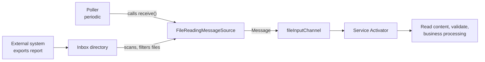

# File inbound channel adapter for reading a directory

## 1. Lesson Objectives

Within the scope of **SPRING_INTEGRATION_ADAPTERS**, Spring Integration connects external systems using inbound/outbound adapters, gateways, pollers, and `MessageChannel`. This lesson focuses on a real-world scenario: **another system exports files into a directory and a Spring application proactively picks them up for processing**.

After this lesson, you will be able to:

- Explain why a File inbound channel adapter is a **one-way data reception** point from the file system into a Spring Integration flow.
- Configure `FileReadingMessageSource`, `Poller`, `MessageChannel`, and file filters.
- Distinguish between **file detection**, **content reading**, and **successful business processing**.
- Identify risks such as files still being written, duplicate processing, application restarts, and consumer failures.
- Test a file reading flow with a small Spring Boot example.

## 2. How does a File inbound channel adapter work?

Suppose an accounting system does not call an HTTP API, and instead exports `*.csv` files into a shared directory. Our application needs to pick up these files, validate the data, and forward them to the business layer.

A **File inbound channel adapter** creates an entry point for a message flow by **polling a directory on a schedule**. The commonly used source component is `FileReadingMessageSource`. On each poll, the source finds a matching file and brings it into Spring Integration as a message whose **payload is a `java.io.File` object**.

> Important note: the adapter announces *which file needs to be processed*. By default, it does not read the entire file content, parse CSV, delete the file, or move the file to an archive directory. Those operations belong to downstream processing steps.



The flow above has four separate responsibilities:

| Component | Role | What it does not do automatically |
| --- | --- | --- |
| `FileReadingMessageSource` | Scans directory, selects file, and emits `Message<File>` | Does not automatically parse content or confirm business success |
| `Poller` | Proactively calls the source on a schedule, throttles messages per batch | Does not turn the directory into a real-time push mechanism |
| `MessageChannel` | Transfers the message to the next step | Does not automatically determine whether the file was processed safely |
| `Service Activator` or transformer | Reads, transforms, or processes the payload | Does not automatically decide archive/retry policies on failure |

This is an **inbound adapter**, because data flows *from the file system into* the integration flow. A **File outbound adapter** is used to write files out. A gateway is suitable when a request–response model is needed; the periodic file reception flow in this example is one-way.

## 3. Project Setup

The example below uses Spring Boot, Java 17+, and annotation-based Spring Integration configuration. If the application uses Spring Boot for dependency version management, you can declare:

```xml
<dependencies>
    <dependency>
        <groupId>org.springframework.boot</groupId>
        <artifactId>spring-boot-starter-integration</artifactId>
    </dependency>
    <dependency>
        <groupId>org.springframework.integration</groupId>
        <artifactId>spring-integration-file</artifactId>
    </dependency>
</dependencies>
```

Prepare the `data/inbox` directory relative to the **working directory of the application process**. The external system will place files into this directory, for example:

```text
data/
└── inbox/
    ├── orders-001.csv
    ├── orders-002.csv
    └── uploading.tmp
```

Example requirements: accept files whose names end with `.csv`, check the directory every two seconds, process up to five messages per poll, and read UTF-8 content to observe the result. The `uploading.tmp` file must not be picked up.

## 4. Configuring a complete file reception flow

```java
import java.io.File;
import java.io.IOException;
import java.nio.charset.StandardCharsets;
import java.nio.file.Files;
import java.nio.file.Path;

import org.springframework.context.annotation.Bean;
import org.springframework.context.annotation.Configuration;
import org.springframework.integration.annotation.InboundChannelAdapter;
import org.springframework.integration.annotation.Poller;
import org.springframework.integration.annotation.ServiceActivator;
import org.springframework.integration.channel.DirectChannel;
import org.springframework.integration.config.EnableIntegration;
import org.springframework.integration.core.MessageSource;
import org.springframework.integration.file.FileReadingMessageSource;
import org.springframework.integration.file.filters.AcceptOnceFileListFilter;
import org.springframework.integration.file.filters.CompositeFileListFilter;
import org.springframework.integration.file.filters.SimplePatternFileListFilter;
import org.springframework.messaging.MessageChannel;

@Configuration
@EnableIntegration
public class FileInboundConfig {

    private static final Path INBOX = Path.of("data", "inbox");

    @Bean
    public MessageChannel fileInputChannel() {
        return new DirectChannel();
    }

    @Bean
    @InboundChannelAdapter(
        channel = "fileInputChannel",
        poller = @Poller(fixedDelay = "2000", maxMessagesPerPoll = "5")
    )
    public MessageSource<File> fileMessageSource() {
        FileReadingMessageSource source = new FileReadingMessageSource();
        source.setDirectory(INBOX.toFile());

        CompositeFileListFilter<File> filters = new CompositeFileListFilter<>();
        filters.addFilter(new SimplePatternFileListFilter("*.csv"));
        filters.addFilter(new AcceptOnceFileListFilter<>());
        source.setFilter(filters);

        return source;
    }

    @ServiceActivator(inputChannel = "fileInputChannel")
    public void processCsv(File file) throws IOException {
        String contents = Files.readString(
            file.toPath(), StandardCharsets.UTF_8
        );
        System.out.printf(
            "Read %s: %d characters%n",
            file.getName(),
            contents.length()
        );
    }
}
```

In a typical Spring Boot application, `@SpringBootApplication` provides the application startup configuration; the `FileInboundConfig` class needs to be within the component scan scope or imported into the context. The directory must exist and the process must have read permissions.

### Reading each part of the configuration

**`FileReadingMessageSource`** takes a directory via `setDirectory(...)`. When polled, it searches for an eligible file. The emitted payload is a `File`, so the consumer receives a path/reference to the file and then opens and reads its content itself. You should not assume the payload at this step is a CSV string or a byte array.

**`@InboundChannelAdapter`** connects the source to `fileInputChannel`. The configuration `@Poller(fixedDelay = "2000", maxMessagesPerPoll = "5")` means the polling schedule uses a fixed delay of 2,000 ms and fetches at most five messages per batch if files remain at the source. The latency from placing a file to processing it depends on the poll timing, system load, and consumer execution time; this is not a guarantee of processing in exactly two seconds.

**`DirectChannel`** delivers messages directly to the subscriber on the message-sending calling thread. With the example configuration, the execution time of `processCsv` can affect the polling rate. When you need to decouple reception speed from processing speed, you must design an additional queue/executor and load-limiting policy rather than merely increasing scan frequency.

**`@ServiceActivator`** binds a Java method to a channel. Spring Integration passes the `File` payload to the `processCsv(File file)` parameter. If access to headers is needed, the method can accept `Message<File>` and use `message.getPayload()`. In this example, the method only **reads and prints the character count** for easy verification; it does not yet validate CSV, save to a database, or move the file to an archive.

**`CompositeFileListFilter`** combines two rules:

1. `SimplePatternFileListFilter("*.csv")` restricts to files with matching names.
2. `AcceptOnceFileListFilter<File>` prevents re-emitting the same file within the lifecycle of the **in-memory** filter state.

When calling `source.setFilter(...)`, we explicitly supply all required filters. Using only a filename filter without an *accept once* condition can cause the same file to be re-emitted across poll cycles. The filter in this example **does not persist history across application restarts**.

## 5. Testing and Observing

1. Create `data/inbox` in the application's working directory, then start Spring Boot.
2. Add the file `orders-001.csv` with content:

   ```csv
   order_id,total
   OD-001,120000
   OD-002,95000
   ```

3. Observe a log line similar to `Read orders-001.csv: ... characters` after the poller detects the file.
4. Add `notes.txt` and `orders-002.csv`; only matching CSV files are picked up.
5. Leave `orders-001.csv` in place and observe subsequent polls: with the in-memory `AcceptOnceFileListFilter`, that file is not re-emitted just because it still resides in the directory.

Two behaviors should be noted: **the original file remains in `inbox`** after a successful read, and if you restart the application with the filter in the example, the old file may be picked up again because the in-memory accept-once state is lost. This leads directly to the design of duplicate handling and state persistence in the next section.

## 6. Partially written files: do not read too early

A poller may see `orders-003.csv` as soon as the sender creates the file, before the sender finishes writing. If the consumer opens the file at that moment, the content may be missing lines or incomplete. The `*.csv` filter **does not prove that the file has finished being written**.

An easy-to-control file exchange contract is:

1. The sender writes data to `orders-003.csv.tmp`.
2. The sender closes the file, ensuring all required data has been written, and then renames it to `orders-003.csv` upon completion.
3. The adapter only filters `*.csv`, so it ignores temporary files and picks up the file after the rename step.

If possible, perform the rename within the **same file system** to leverage the atomicity of the rename operation; you need to verify the actual behavior of the shared directory and operating system in use. If you cannot coordinate naming conventions with the sender, consider `LastModifiedFileListFilter` to only accept files whose last modified time is old enough, or an appropriate lock/ready-marker mechanism. Waiting for a period of time is only a risk-mitigation measure and does not provide an absolute guarantee that the data is complete.

## 7. Preventing duplicates and handling errors properly

**Detecting a file only once is not equivalent to exactly-once business processing.** The accept-once filter manages *selecting and emitting the file*; it does not confirm that the business transaction has committed.

Consider this scenario:

1. The adapter selects `orders-001.csv` and the filter records that the file has been accepted.
2. The consumer begins reading and writing data to the database.
3. The consumer throws an exception partway through.
4. The file remains on disk, yet the in-memory filter may not automatically re-emit that file.

Therefore, adding `AcceptOnceFileListFilter` cannot be treated as a retry policy. For critical business flows, design additional layers of protection:

| Risk | Appropriate measure |
| --- | --- |
| Restart causes files to be re-read | Use a persistent accept-once filter, such as `FileSystemPersistentAcceptOnceFileListFilter` paired with an appropriate `MetadataStore`; or move completed files out of `inbox` |
| Duplicate data written to DB | Assign a business key to records/files and process idempotently, e.g., unique constraints or an import history table |
| Consumer fails partway through | Have a bounded retry policy, log per file, perform compensating actions, or move the file to `failed/` for operational inspection |
| File picked up but not actually finished processing | Only mark business processing complete or move to `archive/` after the work succeeds |
| Multiple instances scanning the same directory | Design an atomic ownership/locking mechanism or shared state store; do not rely on per-JVM local filters |

`FileSystemPersistentAcceptOnceFileListFilter` helps remember file information across restarts **when the `MetadataStore` is actually persisted**. Using an in-memory `MetadataStore` does not achieve that goal. When a file's content changes, how the filter detects changes also needs to be evaluated against business requirements.

Exceptions from the consumer should be observed via the flow/poller error-handling mechanism, such as handling `ErrorMessage` through `errorChannel` when properly configured. You should not assume errors will be retried safely on their own. In particular, errors occurring after the filter has marked a file as accepted may require a separate recovery path.

A common operational workflow is:

```text
inbox/     -> adapter picks up file -> validate/parse -> write business data
                                                        |-> success: archive/
                                                        |-> failure: failed/ + error details
```

Note: moving files, recording status, and committing data do not automatically form an atomic transaction across the file system and DB. When reliability is mandatory, you must clearly define crash recovery at each step and ensure repeated imports do not corrupt data.

## 8. Tuning the poller and performance

The two most observable parameters in the example are:

- `fixedDelay`: wait interval between poll executions per the schedule configuration; setting it too low causes overly frequent scanning, while setting it too high delays data reception.
- `maxMessagesPerPoll`: limits the number of source messages fetched in a single batch; a large value can clear a backlog faster but also makes the consumer hold resources longer.

Do not assume that five messages per poll means five files are processed **in parallel**. With `DirectChannel` and a synchronous consumer, work still runs on the current calling thread. To run in parallel, you need to design an executor, concurrency limits, and thread-safety for processing multiple files.

When there are tens of thousands of files, frequently scanning the entire directory and keeping all processed files in `inbox` can cause I/O and memory pressure. You should limit the backlog of files, move completed files to a separate archive area, and monitor backlog size and processing time. If near-real-time latency is required, you can explore a file-system event-based scanner option, while still handling race conditions and recovery mechanisms.

## 9. Common Issues

| Symptom | What to check |
| --- | --- |
| No messages received | Which working directory is `data/inbox` resolved against? Does the directory exist and does the app have read permission? Do filenames match `*.csv`? Has the poller started? |
| A file appears multiple times | Was the default filter accidentally replaced with only a pattern filter? Did the application just restart? Are multiple instances scanning together? |
| File read with missing data | Is the sender still writing the file? Is there a temporary filename and rename-on-completion convention? |
| File errored but is not reprocessed | Did the filter accept the file before the consumer failed? Have retry paths and a process to move files to `failed/` been designed? |
| File still remains in inbox after processing | This is normal behavior for the sample config; add an archive/delete step per operational policy |
| Many new files but slow processing | Check `maxMessagesPerPoll`, synchronous processing time, file sizes, I/O speed, and poll frequency |

Additionally, for data provided by external systems, validate file size, encoding, CSV structure, and resource limits before passing it to business logic. Never treat a file whose name matches the filter as trustworthy data.

## 10. Hands-on Exercises

1. **Change reception rate:** set `maxMessagesPerPoll = "1"`, add three CSV files, and observe them being picked up gradually across poll cycles. Note the impact of consumer processing time.
2. **Test format filtering:** add `a.csv`, `b.txt`, and `c.csv.tmp`. Explain why only one file is accepted.
3. **Reproduce partial-write errors:** have a sender write slowly to `partial.csv`; then switch to the `partial.csv.tmp` → `partial.csv` convention. Compare the results.
4. **Restart behavior:** leave a processed file in `inbox`, restart the application, and observe it being picked up again. Propose a way to avoid duplicate imports across restarts.
5. **Design an error path:** describe how to record the filename, failure reason, and allow controlled reprocessing without duplicating data in the DB.

### Self-Check Questions

**Q1.** What does a message from `FileReadingMessageSource` contain?  
**Answer:** The payload is typically a `java.io.File` pointing to the selected file, not automatically the entire file content.

**Q2.** Why is using only `SimplePatternFileListFilter` not enough?  
**Answer:** It filters by name; to avoid re-emitting a file across multiple polls, you also need an accept-once strategy or equivalent state management.

**Q3.** Does accept-once guarantee that a file was processed successfully?  
**Answer:** No. It only governs selecting the file at the source; business success, retries, and idempotency must be designed separately.

**Q4.** When should a file be renamed from `*.tmp` to `*.csv`?  
**Answer:** After the sender finishes writing and closes the file; this signal helps the adapter avoid picking up a partially created file.

## 11. Key Takeaways

A File inbound channel adapter is the **filesystem → Spring Integration** bridge. `Poller` triggers `FileReadingMessageSource`; the source creates `Message<File>`; `MessageChannel` delivers the message to the consumer; the consumer is responsible for reading and processing the data. Production designs must add a file-completion contract, filtering/deduplication policies, error handling, archiving, and recovery across restarts or crashes. This is also the mindset to apply when working with other inbound adapters in Spring Integration such as SFTP, JMS, AMQP, or Kafka, even though each system has different reading and acknowledgment mechanisms.
