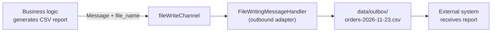
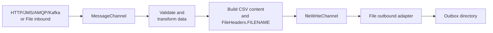

# File outbound channel adapter for writing files

## 1. Lesson Objectives

In the **SPRING_INTEGRATION_ADAPTERS** module, Spring Integration provides inbound/outbound adapters, gateways, pollers, and `MessageChannel` to connect external systems. In the **File Adapter** chapter, we examine the reverse direction of file reading: **the application creates a message and writes its payload to a file on the file system**, for another system to consume.

After this lesson, you will be able to:

- Explain the path of a `Message<?>` from a `MessageChannel` to a **File outbound channel adapter**.
- Configure `FileWritingMessageHandler` in Java and write CSV files from a `byte[]` payload.
- Identify the roles of the payload, filename header, destination directory, and `FileExistsMode` policy.
- Distinguish between an **outbound channel adapter** (one-way write), an **outbound gateway** (with reply), and a poller.
- Design safe file-writing conventions: filenames, temporary files, error handling, duplicate prevention, and operational observability.

## 2. Problem statement: exporting data from Spring Integration to a directory

Suppose a sales application has aggregated daily orders. An external accounting system only accepts reports via a `data/outbox` directory. Each report must have a clear name and contain UTF-8 encoded CSV content.

The application will create a message with:

- **Payload:** report data, for example CSV bytes.
- **Header:** destination filename, such as `orders-2026-11-23.csv`.
- **Channel:** the `fileWriteChannel` channel delivering the message to the handler.

A **File outbound channel adapter** is a one-way output endpoint of an integration flow. The `FileWritingMessageHandler` component receives a message, determines the filename, and writes the payload to the configured directory.



The file-writing component does not query the database itself, decide report contents, or confirm that the recipient has consumed the file. It only fulfills the responsibility of **turning a message into data on the filesystem** according to its configuration.

### How do inbound, outbound adapters, and gateways differ?

| Component | Data direction | Typical mechanism | Replies with result via message? |
| --- | --- | --- | --- |
| File inbound channel adapter | Filesystem → `MessageChannel` | `FileReadingMessageSource` invoked by a poller to scan a directory | Not a request–reply contract |
| File outbound channel adapter | `MessageChannel` → filesystem | `FileWritingMessageHandler` receives message, writes file | No; one-way output |
| File outbound gateway | `MessageChannel` → filesystem → downstream flow | Handler writes file and produces a reply message when configured in gateway mode | Yes; typically passes information about the written file |

An **outbound adapter does not need a poller if its input is a `DirectChannel` with a subscriber**: it is invoked whenever a message is sent to the channel. A poller belongs to feeding messages from a scheduled source or an endpoint reading from a `PollableChannel`; writing a file does not inherently require configuring a poller.

## 3. Message contract before writing a file

Spring Integration sends data as a `Message<T>` consisting of `payload` and `headers`. For file outbound, at least three elements must be specified:

| Element | Example | Meaning |
| --- | --- | --- |
| `payload` | UTF-8 encoded `byte[]` | The actual content to be written to the file |
| `FileHeaders.FILENAME` | `orders-2026-11-23.csv` | Filename used by the file name generator |
| Handler destination directory | `data/outbox` | Output location on the filesystem |

The payload can be `String`, `byte[]`, or `File` depending on the flow and handler capabilities. Choosing `byte[]` in this example allows **exact control over encoding** without relying on the host machine's default charset. When the payload is a `File`, note that the handler can use the source file to write/copy to the destination file; that does not mean the source file will automatically be deleted.

The filename header is merely **metadata carried with the message**. The handler needs a `FileNameGenerator` (which you can configure) to determine the actual name. When the name comes from an external system, it must be validated or normalized before use; never take an arbitrary string as a file-writing path.

## 4. Spring Boot Setup

The example uses Java 17+, Spring Boot dependency management, and Spring Integration File. In `pom.xml`:

```xml
<dependencies>
    <dependency>
        <groupId>org.springframework.boot</groupId>
        <artifactId>spring-boot-starter-integration</artifactId>
    </dependency>
    <dependency>
        <groupId>org.springframework.integration</groupId>
        <artifactId>spring-integration-file</artifactId>
    </dependency>
</dependencies>
```

The application needs permissions to create directories and write files at `data/outbox`. Relative paths are resolved from the **working directory of the JVM process**, not necessarily the directory containing the source code.

Assume a report named like `orders-2026-11-23.csv` with data:

```csv
order_id,total
OD-001,120000
OD-002,95000
```

## 5. Configuring the File outbound channel adapter

The following code provides **a complete flow**: a `MessageChannel`, a file-writing handler, and an `ApplicationRunner` that sends a sample message for testing.

```java
import java.io.File;
import java.nio.charset.StandardCharsets;

import org.springframework.beans.factory.annotation.Qualifier;
import org.springframework.boot.ApplicationRunner;
import org.springframework.context.annotation.Bean;
import org.springframework.context.annotation.Configuration;
import org.springframework.integration.annotation.ServiceActivator;
import org.springframework.integration.channel.DirectChannel;
import org.springframework.integration.config.EnableIntegration;
import org.springframework.integration.file.FileHeaders;
import org.springframework.integration.file.FileWritingMessageHandler;
import org.springframework.integration.file.support.FileExistsMode;
import org.springframework.messaging.Message;
import org.springframework.messaging.MessageChannel;
import org.springframework.messaging.MessageHandler;
import org.springframework.messaging.support.MessageBuilder;

@Configuration
@EnableIntegration
public class FileOutboundConfig {

    @Bean
    public MessageChannel fileWriteChannel() {
        return new DirectChannel();
    }

    @Bean
    @ServiceActivator(inputChannel = "fileWriteChannel")
    public MessageHandler fileOutboundHandler() {
        FileWritingMessageHandler handler =
                new FileWritingMessageHandler(new File("data/outbox"));

        handler.setAutoCreateDirectory(true);
        handler.setFileExistsMode(FileExistsMode.FAIL);
        handler.setTemporaryFileSuffix(".writing");
        handler.setExpectReply(false);

        handler.setFileNameGenerator(message -> {
            Object raw = message.getHeaders().get(FileHeaders.FILENAME);

            if (raw instanceof String fileName
                    && fileName.matches(
                            "[A-Za-z0-9][A-Za-z0-9._-]{0,99}\\.csv"
                    )
                    && !fileName.contains("..")) {
                return fileName;
            }

            throw new IllegalArgumentException(
                    "Invalid CSV file name"
            );
        });

        return handler;
    }

    // For testing only; a real application will emit messages from business logic.
    @Bean
    public ApplicationRunner sendSampleReport(
            @Qualifier("fileWriteChannel") MessageChannel outputChannel) {
        return args -> {
            String csv = "order_id,total\n"
                    + "OD-001,120000\n"
                    + "OD-002,95000\n";

            Message<byte[]> message = MessageBuilder
                    .withPayload(csv.getBytes(StandardCharsets.UTF_8))
                    .setHeader(
                            FileHeaders.FILENAME,
                            "orders-2026-11-23.csv"
                    )
                    .build();

            boolean accepted = outputChannel.send(message);
            if (!accepted) {
                throw new IllegalStateException(
                        "Channel did not accept the message"
                );
            }
        };
    }
}
```

The configuration class must be within the component scan area of the `@SpringBootApplication` or imported into the Spring context. Before re-running the example, delete or rename **the output file created by the previous run**; `FileExistsMode.FAIL` intentionally raises an error when the target file already exists.

### Why does this configuration work?

**1. `MessageChannel` and endpoint.** `DirectChannel` pushes the message to its subscriber on the sender's calling thread. The `@ServiceActivator(inputChannel = "fileWriteChannel")` annotation registers the handler as a subscriber of the channel. When `send(message)` occurs, the handler processes the message; if file writing fails, the exception can propagate back to the synchronous send call.

**2. `FileWritingMessageHandler`.** The constructor specifies the destination directory. `setAutoCreateDirectory(true)` allows creating the directory if needed and if filesystem permissions permit. This does not grant extra OS-level permissions and does not guarantee that every supplied path is valid.

**3. `setFileNameGenerator(...)`.** The generator reads `FileHeaders.FILENAME` and only accepts names matching a simple CSV pattern. It rejects empty names, directory separators, absolute paths, and `..` segments. The example intentionally restricts names to ASCII to make the contract explicit; applications supporting Unicode names need an appropriate name-validation policy.

**4. `setFileExistsMode(FileExistsMode.FAIL)`.** Duplicate filenames cause writing to fail rather than silently overwriting data. Suitable for versioned or daily exported reports where each export requires a unique file.

**5. `setTemporaryFileSuffix(".writing")`.** For write modes that support temporary files, the handler writes to a temporary name and then renames it to the final name upon completion. This approach lets the recipient watch only `*.csv` and avoid reading a file mid-write. You should verify rename behavior on the filesystem/shared directory in use; temporary and final files do not inherently form a distributed transaction.

**6. `setExpectReply(false)`.** The handler is used as a **one-way outbound channel adapter**, producing no reply message for a subsequent step. The `boolean` return value of `MessageChannel.send(...)` only reflects sending the message into the channel; it is not a receipt that the external system has read the report.

## 6. Observing results and manual testing

On the first successful run, the expected file structure is:

```text
data/
└── outbox/
    └── orders-2026-11-23.csv
```

Open `data/outbox/orders-2026-11-23.csv` and verify the CSV content matches the payload. If the recipient only looks for `*.csv`, it should not pick up any `*.writing` files left behind when a write is interrupted.

Continue testing:

1. **Send a new file:** change the header to `orders-2026-11-24.csv`, run again, and verify a new file is added.
2. **Test duplicate file:** keep `orders-2026-11-23.csv` in the outbox and send the exact same name again. With `FAIL`, observe the file-writing error. This is configured behavior, not a random bug.
3. **Test invalid names:** try `../secret.csv` or `folder/report.csv`; the generator must reject them before the handler uses that name to write.
4. **Test write permissions:** point output to a directory the application is not permitted to write to in the test environment; observe the exception and how the application reports the error.
5. **Test encoding:** send Vietnamese characters using `StandardCharsets.UTF_8` and read them back as UTF-8 to verify the output data.

For an independent exercise, you can replace `ApplicationRunner` with a controller, scheduler, or a transformer step converting database records into CSV bytes; **the file-writing adapter does not need to change** as long as the payload and header contract remains intact.

## 7. Choosing FileExistsMode by exchange contract

When a filename collision occurs, the file-writing policy dictates what the application must do. Do not rely on defaults when data is critical.

| Mode | Behavior when target file already exists | When to consider |
| --- | --- | --- |
| `FAIL` | Throws an error instead of writing to the existing file | One-time report export with a unique name; need to detect duplicate send events |
| `REPLACE` | Replaces the old file's content | Snapshot reports where the recipient agrees to allow updates |
| `APPEND` | Appends to the end of the existing file | Logs or cumulative data whose format permits concatenation |
| `IGNORE` | Skips the write operation if the file already exists | Sender intentionally accepts a policy of keeping the first copy |

For example, CSV files have a **header line**. If you use `APPEND` to concatenate complete reports, the file may end up containing multiple header lines in the middle of the content. When CSV appending is required, you must separately design first-time header writing, concurrent write locking, and recovery when an append completes only partially.

`REPLACE` and `IGNORE` also carry risks: a later write may erase earlier content, or new data may be skipped. For an application with audit requirements, storing export keys and export status in a database is usually more helpful than relying solely on filenames.

## 8. Safe writing: temp files, filenames, and access permissions

### 8.1. Temporary files and the contract with the recipient

A common file export protocol:

```text
Spring Integration            Shared directory         Receiving system
       |                             |                       |
       |--- write report.csv.writing>|                       |
       |--- close/finish writing --->|                       |
       |--- rename report.csv ------>|                       |
       |                             |--- scan *.csv ------->|
       |                             |                       |--- read file
```

The recipient only processes files with the final name. Do not design a consumer that reads `*.writing`; temporary files may have incomplete bytes or be left behind after errors. On filesystems that support atomic rename **within the same filesystem**, renaming narrows the window in which a consumer sees an incomplete file. However, durability after power loss and atomicity on network shares still depend on the environment and must be verified with real tests.

### 8.2. Do not trust input filenames

If a filename comes from an HTTP request, queue, or an external system, strings like `../../config.yml`, `C:\temp\secret.txt`, or names containing control characters can alter the write location or cause incidents. A file-writing flow should:

- Generate names from validated business identifiers rather than using raw names from requests verbatim.
- Only accept valid characters, lengths, and extensions.
- Restrict writes to the authorized destination directory, avoiding special filenames or path traversal escaping the directory.
- Run with an OS account having **least-privilege write permissions**; control symlinks/shared paths if untrusted input is involved.

The example generator only uses simple filenames; in a real application, you also need to consider case-sensitivity collisions across filesystems and path redirection through symlinks.

### 8.3. Large payloads

Encoding the entire CSV into a `byte[]` works well for small reports. For very large files, holding all data in one `String` and converting to `byte[]` increases memory pressure. You can consider streaming or writing data out to a managed temporary file before passing a `File` to the handler. Whichever approach you take, you must still define size limits, disk capacity checks, error cleanup, and backpressure capability.

## 9. File writing errors and recovery strategies

Invoking the handler can fail due to insufficient write permissions, out-of-disk-space, invalid filename, existing target file, I/O errors, or concurrent write conflicts. A successful message send into the processing flow **does not mean** the external receiving system has received the data.

In the `DirectChannel` example, the consumer is invoked synchronously. If the handler throws an exception, the caller can catch the exception at `send(...)`. For flows running across executors, pollers, queues, or brokers, error forwarding and retries must be designed according to each endpoint's characteristics; an error channel/`ErrorMessage` mechanism can be used where appropriate.

For reliable operations, store at least:

| Business state | Meaning | Next action |
| --- | --- | --- |
| `READY` | Payload is ready to be exported | Generate unique filename/export ID and send |
| `WRITING` | Write in progress | Monitor duration, errors, and temporary files |
| `EXPORTED` | Target file finished writing per filesystem contract | Record path, size, or checksum if needed |
| `FAILED` | Write failed or output state undetermined | Inspect remaining files, check for duplicates, and retry in a controlled manner |
| `CONSUMED` | External system reported receipt/processing | Only set this state if there is a dedicated confirmation mechanism from the recipient |

**Never infer `CONSUMED` from `EXPORTED`**. A successfully exported file may never be scanned by the external system, or the external system may read it and fail. If outcome confirmation is needed, an additional contract such as an ACK file, callback, reply message, or a dedicated status channel is required.

### Retries and idempotency

Suppose the handler finishes writing the file, but the process loses connectivity or stops right before the application saves the `EXPORTED` state. On rerun, it cannot know for sure whether the file was already exported. Repeating the same name in `FAIL` mode causes a duplicate-file error; arbitrarily switching to a new name could cause the recipient to process **two identical reports**.

A robust design needs an **export ID** or business key, a filename derived deterministically from that key, and a reconciliation procedure after failures. You can:

1. Save a record with the export ID and expected hash/size before exporting.
2. Write the file and verify content, while determining the write operation status.
3. On retry, check whether the destination file exists and matches the export ID/checksum.
4. If it matches, recover the state without creating a new report; if it does not match, route to controlled error handling.

File writing and database commits normally **do not participate in the same atomic transaction**. Recovery must be designed for moments where only one side completes.

## 10. Combining inbound and outbound in one flow

An integration application often receives data via an inbound adapter or gateway, normalizes data through a transformer, and then pushes it out to an outbound adapter:



The critical seam is the **message contract**. The transformation step must emit a properly formatted payload and a valid filename header; the outbound adapter only needs to perform the write responsibility. When switching the source from HTTP to JMS, or changing the destination from file to SFTP, the business layer should be minimally affected if the message contract stays stable.

When connecting via SFTP, JMS, AMQP, Kafka, or a database, adapters have different synchronization, acknowledgment, and failure semantics. Do not impose the assumption "the file exists so the recipient processed it" onto other systems, or use a broker ACK to infer that business processing succeeded.

## 11. Common Issues

| Symptom | Causes to check | Resolution |
| --- | --- | --- |
| No output file appears | Message did not reach channel; wrong channel name; app writing to a different working directory | Check endpoint wiring, actual absolute path, and logs |
| Error immediately on second run | `FileExistsMode.FAIL` rejects an existing filename | Use a new export ID/name or run recovery for the old file |
| Leftover `*.writing` file | File write or rename was interrupted | Inspect logs/I/O; reconcile before cleanup |
| File written with corrupted Vietnamese content | Byte producer and recipient use different encodings | Standardize on UTF-8, check BOM/format per contract |
| Recipient reads incomplete file | Recipient scans temp files too, or filesystem lacks a safe publication convention | Scan only final names, verify rename/ready contract |
| File overwritten unexpectedly | Using `REPLACE` or multiple producers with the same name | Switch to `FAIL` where appropriate, lock name/ID per business key |
| Slow writes or disk full | Payload too large, disk nearly full, slow network share | Limit sizes, monitor disk, account for backlog and cleanup |
| Same report exported twice | Retry generated a new name instead of reconciling export ID | Use stable IDs and an idempotent procedure |

In production, monitor export success/failure counts, write latency, backlog of files in the outbox, disk space, and wait times for confirmation from the receiving system. Sensitive data in reports requires access control, retention, and deletion policies per business requirements.

## 12. Hands-on Exercises

**Exercise 1 — Change collision policy.** Send the same file twice with `FAIL`, then try `REPLACE`. Record the file contents and explain why changing the mode cannot replace a business key.

**Exercise 2 — Test header contract.** Omit `FileHeaders.FILENAME` or use `../report.csv`. Observe the error from the generator. Propose a naming convention supporting date, transaction ID, and partner code.

**Exercise 3 — Export Unicode data.** Create a CSV file containing `Sản phẩm,Đơn giá`. Write it using `StandardCharsets.UTF_8` and read it back with the same encoding to verify there are no corrupted accents.

**Exercise 4 — Consume after write completion.** Write a test consumer that picks up only `*.csv` from the outbox. Observe the temporary file if the write process is interrupted and explain why the consumer should not read `*.writing`.

**Exercise 5 — Crash recovery.** Describe three scenarios: (a) file not yet created, (b) temp file remains, (c) final file exists but DB has not recorded `EXPORTED`. Propose how to reconcile each state without generating duplicate reports.

### Self-Check Questions

**Q1. What payload and header are used in the example?**  
The `byte[]` payload is the CSV content; the `FileHeaders.FILENAME` header provides the filename validated by the generator.

**Q2. Why is a poller not needed for an outbound adapter connected to DirectChannel?**  
Because the subscriber is invoked when another party sends a message to `DirectChannel`; only periodic sources or `PollableChannel` endpoints require a poller by design.

**Q3. How do `FAIL` and `APPEND` differ?**  
`FAIL` refuses to write when the destination file already exists; `APPEND` adds content to the end, so concurrency and file format must be controlled.

**Q4. Does a file present in the outbox mean the external system has processed it?**  
No. It only indicates the result exists on the filesystem; recipient confirmation requires an independent mechanism.

**Q5. Do temporary files solve the entire retry problem?**  
No. Temporary files prevent publishing partially written content; business state, existing destination files, retries, and idempotency still need separate management.

## 13. Key Takeaways

A **File outbound channel adapter** moves messages from Spring Integration to the filesystem via `FileWritingMessageHandler`. `MessageChannel` transports the message, `FileNameGenerator` determines the destination name, `FileExistsMode` governs naming collisions, and temporary files support the convention of publishing files only after writing completes. When integrating files with HTTP, SFTP, JMS, AMQP, Kafka, or databases, keep message contracts explicit and separately design error tracking, deduplication, connection lifecycles, and recipient confirmations.
