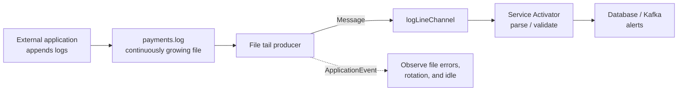
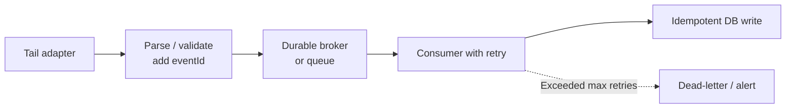

# File tail adapter for reading growing files

## 1. Objectives and real-world problem

The **SPRING_INTEGRATION_ADAPTERS** module guides you through connecting external systems to Spring Integration using inbound/outbound adapters, gateways, pollers, and `MessageChannel`, while handling message contracts, errors, and connection lifecycles. In the **File Adapter** chapter, this lesson examines the case where a file **continuously has new content appended**, such as a payment log.

The payment system appends new lines to `data/logs/payments.log`:

```text
2026-11-23T08:30:00 INFO payment=PM-001 status=CREATED
2026-11-23T08:30:01 INFO payment=PM-001 status=PAID
2026-11-23T08:30:02 WARN payment=PM-002 status=RETRY
```

The requirement is to **receive each new line** without reloading the entire file each time, then parse it, emit alerts, or forward it to a database, JMS, AMQP, or Kafka.

After this lesson, you will be able to:

- Explain how a File tail adapter watches a growing file and emits `Message<String>`.
- Distinguish a tail adapter from a File inbound channel adapter that scans a directory.
- Configure `ApacheCommonsFileTailingMessageProducer` in Java and distinguish it from `OSDelegatingFileTailingMessageProducer`.
- Understand options for starting at the beginning/end of the file, check delay, and reopening the file.
- Handle scenarios involving restarts, log rotation, truncation, partial lines, downstream errors, and re-read data.

## 2. Mechanism of the File tail inbound adapter

**Tailing** means continuing to read from a tracked position in a file, picking up lines **appended** afterwards. This is an **inbound adapter**, because data flows **from the filesystem into the Spring Integration flow**. It is similar to the `tail -f` command on Unix/Linux operating systems.



Each complete line normally becomes a message with a `String` payload. The source file is recorded via headers:

```text
payload = "2026-11-23T08:30:02 WARN payment=PM-002 status=RETRY"
headers[FileHeaders.FILENAME] = "payments.log"
headers[FileHeaders.ORIGINAL_FILE] = File(".../payments.log")
```

`FileHeaders.FILENAME` is the **filename** (`File.getName()`); to get the absolute path, retrieve the `File` from `FileHeaders.ORIGINAL_FILE` and call `getAbsolutePath()`. Do not mistake the payload here for the entire file content or a `java.io.File` object.

### How does tailing differ from directory scanning?

| Characteristic | File inbound channel adapter | File tail adapter |
| --- | --- | --- |
| Input source | Multiple files in a directory | Appended content of a single file |
| Common component | `FileReadingMessageSource` | `FileTailingMessageProducerSupport` and subclasses |
| Typical payload | `File` | `String` of a single line |
| Execution model | Endpoint polls `MessageSource` on a schedule | Producer watches the file and proactively emits messages |
| Use cases | Finished CSV/JSON files, batch imports | Logs, audit trails, or append-only text events |
| Key risks | Reading incomplete files, duplicate processing | Rotation, truncation, restarts, lines missing newline |

A file tail is a **message producer with its own lifecycle**. If you declare the producer bean directly as in the example below, **do not attach `@InboundChannelAdapter(poller=...)`** to it. The internal polling delay parameter of Apache Commons Tailer is not a `@Poller` of a regular `MessageSource`.

## 3. Two tail implementations in Spring Integration

Spring Integration File provides two primary producers:

| Producer | Principle | When to consider |
| --- | --- | --- |
| `ApacheCommonsFileTailingMessageProducer` | Uses Apache Commons IO's `Tailer` to periodically check the file | Running Java on Windows or avoiding OS command dependencies |
| `OSDelegatingFileTailingMessageProducer` | Runs the OS `tail` utility and reads lines from stdout | Unix/Linux with a compatible `tail` command; often offers good efficiency |

In the native option, the common flags `-F -n 0` mean tracking **by filename** and reading only new content from startup onward. `tail -f` and `tail -F` can behave differently when filenames change during log rotation; exact behavior depends on the command version on the host.

This lesson uses **Apache Commons IO** so it can be verified on Windows. The `end`, `reopen`, and `pollingDelay` options apply cleanly to this implementation.

## 4. Spring Boot Project Setup

The example uses Java 17+ and Spring Boot dependency version management:

```xml
<dependencies>
    <dependency>
        <groupId>org.springframework.boot</groupId>
        <artifactId>spring-boot-starter-integration</artifactId>
    </dependency>
    <dependency>
        <groupId>org.springframework.integration</groupId>
        <artifactId>spring-integration-file</artifactId>
    </dependency>
</dependencies>
```

`ApacheCommonsFileTailingMessageProducer` relies on `commons-io`. Ensure the `commons-io:commons-io` dependency is present on the classpath via the dependency graph or declare it with an appropriately managed version if the project does not already include it.

Create the test file:

```text
data/
└── logs/
    └── payments.log
```

`data/logs` is resolved relative to the **JVM working directory**, which may differ when running from an IDE, Docker, or a service manager. The application needs read permission on the file; in the example we convert it to an absolute path before passing it to the tailer.

## 5. Complete Java Example

The configuration class below creates a channel, an executor for the long-running watch task, an Apache Commons tail producer, and a consumer:

```java
import java.io.File;

import org.springframework.beans.factory.annotation.Qualifier;
import org.springframework.context.annotation.Bean;
import org.springframework.context.annotation.Configuration;
import org.springframework.context.event.EventListener;
import org.springframework.integration.annotation.ServiceActivator;
import org.springframework.integration.channel.DirectChannel;
import org.springframework.integration.config.EnableIntegration;
import org.springframework.integration.file.FileHeaders;
import org.springframework.integration.file.tail.ApacheCommonsFileTailingMessageProducer;
import org.springframework.integration.file.tail.FileTailingMessageProducerSupport.FileTailingEvent;
import org.springframework.messaging.Message;
import org.springframework.messaging.MessageChannel;
import org.springframework.scheduling.concurrent.ThreadPoolTaskExecutor;

@Configuration
@EnableIntegration
public class TailFileConfig {

    @Bean
    public MessageChannel logLineChannel() {
        return new DirectChannel();
    }

    @Bean
    public ThreadPoolTaskExecutor fileTailExecutor() {
        ThreadPoolTaskExecutor executor = new ThreadPoolTaskExecutor();
        executor.setCorePoolSize(1);
        executor.setMaxPoolSize(1);
        executor.setQueueCapacity(0);
        executor.setThreadNamePrefix("file-tail-");
        return executor;
    }

    @Bean
    public ApacheCommonsFileTailingMessageProducer paymentsLogTailer(
            @Qualifier("logLineChannel") MessageChannel output,
            @Qualifier("fileTailExecutor") ThreadPoolTaskExecutor executor) {

        ApacheCommonsFileTailingMessageProducer producer =
                new ApacheCommonsFileTailingMessageProducer();

        producer.setFile(
                new File("data/logs/payments.log").getAbsoluteFile()
        );
        producer.setOutputChannel(output);
        producer.setTaskExecutor(executor);
        producer.setPollingDelay(1000);       // Check every 1 second
        producer.setEnd(true);                // Only receive new lines
        producer.setReopen(true);             // Reopen file between reads
        producer.setTailAttemptsDelay(3000);  // Retry when source is not ready

        return producer;
    }

    @ServiceActivator(inputChannel = "logLineChannel")
    public void consumeLine(Message<String> message) {
        String line = message.getPayload();
        String fileName =
                (String) message.getHeaders().get(FileHeaders.FILENAME);

        System.out.printf("[%s] %s%n", fileName, line);
        // In practice: parse, validate, forward to business step.
    }

    @EventListener
    public void onTailingEvent(FileTailingEvent event) {
        System.out.println("Tail status: " + event);
    }
}
```

The `TailFileConfig` class must reside within the `@SpringBootApplication` component scan scope or be imported into the context. The producer is a Spring-managed lifecycle bean, so there is no need to spawn a thread and call `start()` manually.

### Component Breakdown

**`ApacheCommonsFileTailingMessageProducer`** reads lines from the specified file and emits `Message<String>` to `logLineChannel`. If the file does not exist yet or is temporarily unreadable, the producer has a retry mechanism; status events help observe these incidents.

**`ThreadPoolTaskExecutor`** dedicates a worker thread for tailing. The watching task can run long-term; do not share a single-threaded executor with other tasks that must run concurrently.

**`DirectChannel`** delivers messages to `consumeLine` synchronously on the sending thread. If the consumer is very slow, reading and dispatching new lines can be slowed down accordingly. When offloading or parallel processing is needed, design a queue, executor, and rate-limiting capability.

**`@ServiceActivator`** forwards the payload/headers to the Java method. The example merely prints the log line; parsing, validating data, and writing to a database are the consumer's own responsibilities.

**`@EventListener`** receives `FileTailingEvent` notifications emitted by the producer via Spring application events, such as when a file becomes inaccessible and later reappears. These events are **distinct** from the log-line messages sent to `logLineChannel`.

### Understanding the options accurately

| Setting | Effect |
| --- | --- |
| `setFile(File)` | Specifies the single file to tail |
| `setOutputChannel(...)` | Destination channel for line messages |
| `setPollingDelay(1000)` | Apache Tailer checks for new data roughly every 1,000 ms; exact latency is not guaranteed |
| `setEnd(true)` | Starts at the end of the file; lines already present at startup are not emitted |
| `setEnd(false)` | Starts from the beginning of the file, emits history, then continues receiving new lines |
| `setReopen(true)` | Closes/reopens the file between reads; does not guarantee avoiding duplicates or lost lines on rotation |
| `setTailAttemptsDelay(3000)` | Wait interval between tail attempts when the file is unavailable or the source encounters an error |
| `setTaskExecutor(...)` | Executor running the file-watching task |

These parameters only govern reading behavior within **a single run**. No setting automatically turns a file tail into a data source with **persistent offset checkpoints** and exactly-once processing guarantees.

## 6. Hands-on: appending lines and observing

In PowerShell from the right working directory, create the directory and file if they do not exist:

```powershell
New-Item -ItemType Directory -Force -Path .\data\logs
New-Item -ItemType File -Path .\data\logs\payments.log
```

If `payments.log` already exists, **skip the file creation command** to avoid accidentally altering existing data.

Start Spring Boot, then open another terminal window and append two lines:

```powershell
Add-Content -Path .\data\logs\payments.log -Encoding UTF8 -Value '2026-11-23T08:31:00 INFO payment=PM-003 status=PAID'
Add-Content -Path .\data\logs\payments.log -Encoding UTF8 -Value '2026-11-23T08:31:02 WARN payment=PM-004 status=RETRY'
```

The application will print output similar to:

```text
[payments.log] 2026-11-23T08:31:00 INFO payment=PM-003 status=PAID
[payments.log] 2026-11-23T08:31:02 WARN payment=PM-004 status=RETRY
```

This is illustrative output, not logs captured from a live test run. Actual arrival times depend on the check interval, I/O speed, and consumer execution time.

Continue experimenting with variations:

1. Append a line **before starting** the application with `end=true`. That line is not emitted.
2. Append a line **after startup**. The new line is sent through the channel once the tailer detects it.
3. Stop the application, append a new line, and restart with `end=true`. Lines written while the application was down may be missed.
4. Switch to `end=false` and restart. Existing lines in the file are re-emitted, potentially creating downstream duplicates.

In Bash, you can append using `printf '%s\n' 'new log line' >> data/logs/payments.log`. Ensure the data ends with a newline character. The tailer processes **lines**, so a chunk of bytes without a newline will not necessarily produce a message immediately.

## 7. Start from the beginning or the end of the file?

| Choice | Behavior on startup | Suitable for | Risk |
| --- | --- | --- | --- |
| `end=true` | Skips old data; waits for new lines | Live monitoring where history is not needed | Loses lines written while the application was stopped |
| `end=false` | Reads from the start of the file, then watches new data | Demos, re-imports, or full replays | May re-read duplicates after restarts; large files create a backlog |

The `end` value determines **the initial position when the Tailer is initialized**, not a place where offsets are saved after each successful line. If you must not miss events across restarts, you need a processing-position store, idempotency, and a replay contract, or a broker that manages offsets/acks (such as Kafka, JMS, or AMQP depending on design). Re-reading from the start with `end=false` does not solve everything if the old file was rotated, deleted, or truncated.

## 8. Log rotation, truncation, and missing files

To prevent logs from growing indefinitely, logging software typically performs:

- **Rename + create:** renames `payments.log` to `payments.log.1`, then creates a new `payments.log`.
- **Copytruncate:** copies content to an archive file, then truncates the original file.
- **Delete/recreate:** deletes or replaces the file under the same name.

```text
Before rotation               After rotation
payments.log          ->      payments.log.1 (old)
                               payments.log   (new)
```

| Scenario | What can happen | What to do |
| --- | --- | --- |
| Rename old file and create new file | Old handle may still point to the old file or must re-track by filename | Verify behavior on the actual filesystem and library |
| File is truncated | Previous read offset may exceed the new file size | Test truncation detection and handle lines around the transition window |
| File deleted/temporarily inaccessible | Producer cannot receive new data during the interruption | Monitor `FileTailingEvent`, check retry delay and access permissions |
| Restart right during rotation | In-memory read state is lost, new file may already have grown | Require a replay/event ID reconciliation plan |

`setReopen(true)` helps reopen the file between reads, **not a guarantee that every log rotation has zero lost or duplicate lines**. With native tail, `tail -F` generally tracks filenames across rotations better than `tail -f` on supported systems, but it still must be verified by testing with the exact logging tool and OS version.

For files used as critical business event sources, **assign an identifier to each record** and have a recovery plan from a durable source. Tailing itself does not replace an event store.

## 9. Incomplete lines, charset, and multi-line records

### Lines without a newline

The writer might write `status=` first and append `PAID\n` a few seconds later. Adapters typically treat **line endings** as record boundaries; do not assume every few-byte append immediately produces a message. If rotation happens right when a line is only partially written, consider the risk of truncated trailing content.

### Encoding

Standardize encoding (usually UTF-8), line endings (`\n` or `\r\n`), and BOM handling between writer and reader. If logs contain Vietnamese text, reading with the wrong charset can break parsers. Always verify the charset behavior of the tail implementation on the library version you use.

### One event may span multiple lines

```text
ERROR payment=PM-005 request failed
java.lang.IllegalStateException: timeout
    at example.PaymentClient.call(PaymentClient.java:42)
```

This can become **three separate messages**. If you want to group them into one event, the consumer needs start/end rules, timeouts, and length limits. A file tail adapter does not inherently understand stack traces, JSON Lines, or application-specific formats.

## 10. Monitoring and error handling

The producer follows the Spring context start/stop lifecycle. A file existing on disk does not mean the endpoint is healthy. Monitor endpoint status, file-inaccessible events, time without new lines, ingestion rate, and consumer error counts.

Spring Integration provides `FileTailingEvent` for status updates. Additionally, `FileTailingIdleEvent` can be emitted when `idleEventInterval` is configured and no new data arrives during that interval. **Idle is not necessarily an error**: the upstream system may simply not have logged anything. With native `tail`, not all platforms emit the exact same status notifications.

### Downstream errors do not rewind the read position

If `consumeLine` throws an exception or the database temporarily fails, do not assume the tailer will **safely re-read the failed line**. Tailing does not provide an atomic transaction between reading the file and committing business state. With `DirectChannel`, a slow or failing consumer can also impact the message-publishing thread.

One approach for systems requiring recovery:



Even with a broker, a gap remains between the tailer reading a line and the broker confirming persistence. If zero event loss is a strict requirement, the event producer should write directly to a source with contractual durability/replay rather than relying solely on a log file.

### Multiple instances

If two instances tail the same file, **both can receive the same lines** and perform duplicate business updates. The tail adapter does not automatically partition lines to a single instance. You need an ownership/leader mechanism or an external consumer group/queue design.

### Message contract

Downstream consumers should know which file a line came from, whether an event ID exists, the format/charset, how malformed lines are handled, and the retry policy. When forwarding to HTTP, JMS, AMQP, Kafka, or a database, never treat "read from file" as proof of "successfully committed at the destination system."

## 11. Choosing the right tool for the requirement

| Need | Suitable component |
| --- | --- |
| Pick up finished CSV files in a directory | File inbound channel adapter + poller + filter |
| Read log lines being appended | File tail inbound adapter |
| Write reports out to files | File outbound channel adapter |
| Request–reply over HTTP | HTTP outbound gateway |
| Need replay/offsets and multi-consumer coordination | Appropriate broker like Kafka/JMS/AMQP with matching contracts |
| Read files on another server | Appropriate SFTP/FTP/SMB adapter |

## 12. Common Issues

| Symptom | Causes to check |
| --- | --- |
| No new lines appear | Wrong path/working directory; file lacks read permission; `end=true` with only old lines; line not yet terminated |
| Restart misses lines written while down | Tailer started at end of file with `end=true` |
| Restart re-reads full history | `end=false`; no persistent checkpoint |
| Delayed lines | `pollingDelay`, slow I/O, or slow synchronous consumer |
| Duplicates/drops during rotation | Rename, truncate, reopen, and restart timing |
| Corrupted Vietnamese accents | Mismatched charset between writer and reader |
| Stack trace split apart | One line equals one message; grouping logic needed |
| File has data but business state does not update | Consumer error, full queue, dead thread, or stopped endpoint |
| Two pods process one event twice | Both tailing the same file; no ownership coordination |

## 13. Hands-on Exercises

1. **Direct observation:** configure `end=true`, append three lines one second apart, and record order and latency.
2. **Compare read positions:** pre-populate ten lines, run with `end=true` and then `end=false`. Explain the difference across restarts.
3. **Test partial lines:** write a line without a newline, then append the newline. Observe when the message appears.
4. **Test rotation:** rename `payments.log` to `payments.log.1`, create a new file with the same name and append; then test truncation. Record the messages and events received.
5. **Inject consumer error:** throw an exception when encountering `status=RETRY`, observe the impact, and design an appropriate recovery path.
6. **Prevent duplicate processing:** extract `paymentId` and `status` from the log line and create a business key so re-emitted records do not update the DB multiple times.

### Self-Check Questions

**Q1. What payload does a tail adapter emit?**  
Usually a `String` line; `FileHeaders.ORIGINAL_FILE` contains a reference to the source file.

**Q2. Why doesn't the example add `@Poller`?**  
Because `ApacheCommonsFileTailingMessageProducer` watches the file itself and proactively emits messages; `pollingDelay` is an internal setting of the Tailer.

**Q3. Does `end=true` guarantee no missed lines across restarts?**  
No. It starts at the end of the file, which can skip new lines written while the application was stopped.

**Q4. Does `reopen=true` guarantee safety across all rotation cases?**  
No. Rename/truncate behavior must be verified against the exact library, operating system, and filesystem.

**Q5. Can log tailing replace a transactional broker?**  
Not by default. If you need durability, retry/replay, and distribution across multiple consumers, you must design a message source with matching semantics.

## 14. Key Takeaways

The **File tail inbound adapter** serves **growing files**, bringing each new line from the filesystem into a `MessageChannel` as `Message<String>`. The two key options are `ApacheCommonsFileTailingMessageProducer` and `OSDelegatingFileTailingMessageProducer`. In practice, you must define the initial read mode, charset, newline handling, rotation/truncation handling, producer lifecycle, downstream errors, and recovery across restarts. If the data carries transactional meaning, add appropriate identifiers and replay mechanisms.

### References

- [Spring Integration Reference — Reading Files (Tailing Files)](https://docs.spring.io/spring-integration/reference/file/reading.html)
- [Spring Integration API — ApacheCommonsFileTailingMessageProducer](https://docs.spring.io/spring-integration/api/org/springframework/integration/file/tail/ApacheCommonsFileTailingMessageProducer.html)
- [Spring Integration API — FileTailingMessageProducerSupport](https://docs.spring.io/spring-integration/api/org/springframework/integration/file/tail/FileTailingMessageProducerSupport.html)
