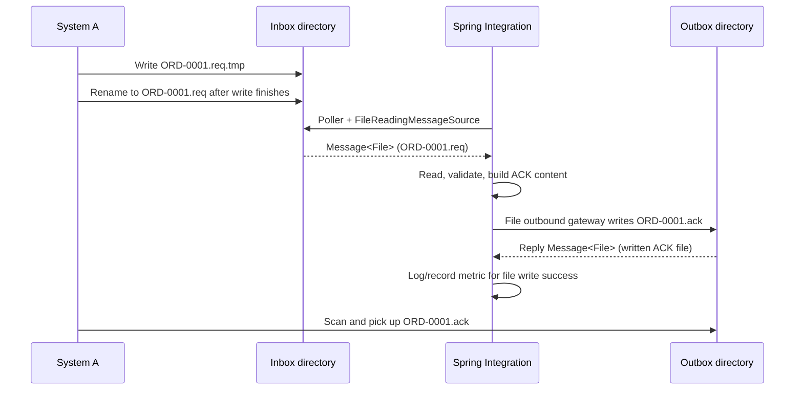
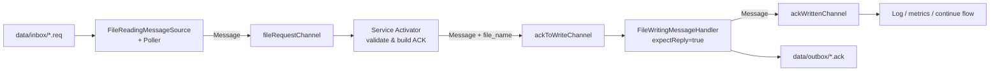

# File inbound gateway combining reading and replying

## 1. Objectives and problem statement

In the **SPRING_INTEGRATION_ADAPTERS** module, Spring Integration brings data from external systems into an application using inbound/outbound adapters, gateways, pollers, and `MessageChannel`. Flows also need to manage **message contracts, error handling, and connection lifecycles**. In the **File Adapter** chapter, this lesson builds a specialized pattern: **receiving a request file, processing its content, and publishing a corresponding response file**.

Suppose System A exports an order validation request into `data/inbox`:

```text
data/inbox/ORD-0001.req
```

File content:

```text
ORD-0001
```

The Spring Integration application picks up the request, validates the format, and writes the result to `data/outbox/ORD-0001.ack`:

```text
requestId=ORD-0001
status=ACCEPTED
```

System A scans `data/outbox` to retrieve the result. This is **request–reply at the file-exchange contract layer**: each `*.req` file has an `*.ack` response carrying the same request code.

After this lesson, you will be able to:

- Distinguish between a **File inbound channel adapter**, a **file outbound gateway**, and a **messaging gateway**.
- Design a flow of reading file → validating/transforming → writing response file → continuing to process the write result.
- Understand how `FileReadingMessageSource`, `Poller`, `MessageChannel`, and `FileWritingMessageHandler` collaborate.
- Configure request–reply output with `setExpectReply(true)` and receive back the written `File` object.
- Recognize the difference between **an internal Spring Integration reply** and **a business ACK by the external system**.
- Handle scenarios involving read failures, write failures, duplicate filenames, timeouts, restarts, and duplicate processing.

## 2. Clarifying terminology: is there a dedicated "File inbound gateway"?

In **Spring Integration File** for the local filesystem, the primary endpoints are:

| Component | Input / Output | Role |
| --- | --- | --- |
| `FileReadingMessageSource` / File inbound channel adapter | Directory → `Message<File>` | Scans a directory, finds files, and emits messages via a poller |
| `FileWritingMessageHandler` in outbound adapter mode | `Message<?>` → file | One-way file write, emits no reply message |
| `FileWritingMessageHandler` in **outbound gateway** mode | `Message<?>` → file → `Message<File>` | Writes the file and returns the **target file object** to a downstream internal step |
| `@MessagingGateway` | Java method call ↔ message flow | Allows Java code to invoke a Spring Integration flow and receive a return value |

**There is no dedicated standard endpoint named "file inbound gateway" for local filesystems analogous to an HTTP inbound gateway.** The accurate interpretation of this lesson's title is **combining a file inbound adapter with processing steps and a reply mechanism**. Spring Integration cannot automatically send a reply back to a file that was read: a file is passive data with no open request–reply connection.

For HTTP, JMS, or AMQP connections, an inbound gateway can have a reply channel/address bound to the request. For files, if the sender needs to receive a result, both parties must agree on **a response directory, naming convention, result format, and timeout window**.

## 3. Directory-based request–reply exchange architecture



Logical flow inside Spring Integration:



There are **two reply layers** to distinguish:

1. **Internal reply message**: `FileWritingMessageHandler` in gateway mode emits a `File` payload representing the written file. Downstream steps can log, record metrics, move files, or continue a flow.
2. **Response to the external sender**: the `*.ack` file appearing in `outbox`. Confirming that the partner actually read, accepted, or processed the ACK requires another confirmation mechanism if business logic demands it.

Just because the handler produced a reply `Message<File>` **does not mean** the partner has received or agreed with the result.

## 4. File and message contracts

Before writing code, both systems should agree on the contract:

| Attribute | Request | Response |
| --- | --- | --- |
| Directory | `data/inbox` | `data/outbox` |
| Name | `ORD-0001.req` | `ORD-0001.ack` |
| Content | Order ID in UTF-8, single line | `requestId=...` and `status=...`, UTF-8 |
| Safe to read when | After renaming from `*.tmp` to `*.req` | After handler finishes writing and publishes `*.ack` |
| Correlation key | `ORD-0001` | Same `ORD-0001` code |
| On error | Agreed handling/retry policy | Per contract: rejection ACK or separate error-reporting mechanism |

The File inbound adapter emits a **`java.io.File`** payload along with useful headers such as `FileHeaders.FILENAME` and `FileHeaders.ORIGINAL_FILE`. It **does not automatically read CSV or parse content**.

After the processing step, the example builds a `Message<byte[]>`:

```text
payload = bytes("requestId=ORD-0001\nstatus=ACCEPTED\n", UTF-8)
headers[FileHeaders.FILENAME] = "ORD-0001.ack"
```

The File outbound gateway reads the filename header to determine the destination name (via the file-name generator) and writes the bytes. When `expectReply=true`, it emits a reply whose payload is the `File` of the written result.

Do not confuse `FileHeaders.FILENAME` with `replyChannel`: the first specifies the **filename**; the second is used for **routing reply messages** in Spring Integration.

## 5. Spring Boot Setup

The example uses Java 17+, Spring Boot, and Spring Integration File. With Maven, when Spring Boot manages dependency versions:

```xml
<dependencies>
    <dependency>
        <groupId>org.springframework.boot</groupId>
        <artifactId>spring-boot-starter-integration</artifactId>
    </dependency>
    <dependency>
        <groupId>org.springframework.integration</groupId>
        <artifactId>spring-integration-file</artifactId>
    </dependency>
</dependencies>
```

Prepare the two directories `data/inbox` and `data/outbox`. Both are resolved **relative to the JVM working directory**. In production, use absolute paths or externalize via configuration properties and grant appropriate read/write permissions.

## 6. Configuring the read-and-reply flow in Java

Here is a self-contained example for a file-based request–reply flow. It consists of four functional channels/endpoints: receiving the file, processing the request, writing the ACK in outbound gateway mode, and recording the write outcome.

```java
import java.io.File;
import java.io.IOException;
import java.nio.charset.StandardCharsets;
import java.nio.file.Files;

import org.springframework.context.annotation.Bean;
import org.springframework.context.annotation.Configuration;
import org.springframework.integration.annotation.InboundChannelAdapter;
import org.springframework.integration.annotation.Poller;
import org.springframework.integration.annotation.ServiceActivator;
import org.springframework.integration.channel.DirectChannel;
import org.springframework.integration.config.EnableIntegration;
import org.springframework.integration.core.MessageSource;
import org.springframework.integration.file.FileHeaders;
import org.springframework.integration.file.FileReadingMessageSource;
import org.springframework.integration.file.FileWritingMessageHandler;
import org.springframework.integration.file.filters.AcceptOnceFileListFilter;
import org.springframework.integration.file.filters.CompositeFileListFilter;
import org.springframework.integration.file.filters.SimplePatternFileListFilter;
import org.springframework.integration.file.support.FileExistsMode;
import org.springframework.messaging.Message;
import org.springframework.messaging.MessageChannel;
import org.springframework.messaging.support.MessageBuilder;

@Configuration
@EnableIntegration
public class FileRequestReplyFlow {

    @Bean
    public MessageChannel fileRequestChannel() {
        return new DirectChannel();
    }

    @Bean
    public MessageChannel ackToWriteChannel() {
        return new DirectChannel();
    }

    @Bean
    public MessageChannel ackWrittenChannel() {
        return new DirectChannel();
    }

    @Bean
    @InboundChannelAdapter(
        channel = "fileRequestChannel",
        poller = @Poller(fixedDelay = "2000", maxMessagesPerPoll = "5")
    )
    public MessageSource<File> fileRequestSource() {
        FileReadingMessageSource source = new FileReadingMessageSource();
        source.setDirectory(new File("data/inbox"));

        CompositeFileListFilter<File> filter =
                new CompositeFileListFilter<>();
        filter.addFilter(new SimplePatternFileListFilter("*.req"));
        filter.addFilter(new AcceptOnceFileListFilter<>());
        source.setFilter(filter);

        return source;
    }

    @ServiceActivator(
        inputChannel = "fileRequestChannel",
        outputChannel = "ackToWriteChannel"
    )
    public Message<byte[]> buildAck(File requestFile) throws IOException {
        String requestId = Files.readString(
                requestFile.toPath(),
                StandardCharsets.UTF_8
        ).trim();

        // Illustrates a contract of one order code per file.
        String status = requestId.matches("ORD-[0-9]{4}")
                ? "ACCEPTED" : "REJECTED";

        String fileName = requestFile.getName();
        String ackName = fileName.substring(
                0, fileName.length() - ".req".length()
        ) + ".ack";

        String ack = "requestId=" + requestId + "\n"
                + "status=" + status + "\n";

        return MessageBuilder
                .withPayload(ack.getBytes(StandardCharsets.UTF_8))
                .setHeader(FileHeaders.FILENAME, ackName)
                .build();
    }

    @Bean
    @ServiceActivator(
        inputChannel = "ackToWriteChannel",
        outputChannel = "ackWrittenChannel"
    )
    public FileWritingMessageHandler writeAckGateway() {
        FileWritingMessageHandler handler =
                new FileWritingMessageHandler(new File("data/outbox"));

        handler.setAutoCreateDirectory(true);
        handler.setFileExistsMode(FileExistsMode.FAIL);
        handler.setTemporaryFileSuffix(".writing");
        handler.setExpectReply(true);
        return handler;
    }

    @ServiceActivator(inputChannel = "ackWrittenChannel")
    public void onAckWritten(File writtenFile) {
        System.out.println(
                "Written ACK file: " + writtenFile.getAbsolutePath()
        );
    }
}
```

The `FileRequestReplyFlow` class must be within the `@SpringBootApplication` component scan scope or imported into the context. The `data/inbox` directory must exist and the process must have read permission. The outbound handler can create `outbox` if it does not yet exist.

### Analyzing each stage

**1. File inbound + poller.** `FileReadingMessageSource` is invoked by the poller at a 2-second fixed delay. It filters `*.req` and uses `AcceptOnceFileListFilter` to avoid emitting the same file multiple times while the filter remains in memory. `maxMessagesPerPoll = 5` caps the number of messages fetched per poll; it does not mean 5 files are processed in parallel.

**2. Request processing.** `buildAck` reads UTF-8 content and creates a `Message<byte[]>` for the write step. In this example, the `ACCEPTED` outcome is only a **code format check**, not verification that the order actually exists in the database. In real business logic, replace this illustrative rule with proper validation and transactions.

**3. Outbound gateway.** `FileWritingMessageHandler` receives the byte payload, retrieves `FileHeaders.FILENAME`, and writes to `data/outbox`. With `setExpectReply(true)`, after writing succeeds, the handler creates a **reply message** with a `File` payload representing the written file. Because the endpoint declares `outputChannel = "ackWrittenChannel"`, the reply goes to the next consumer.

**4. Observing the outcome.** `onAckWritten(File)` prints the path of the newly written file. This is an internal step after the file outbound gateway, **not a direct reply to the sender**. The partner receives the response via the `*.ack` file in `outbox`.

**5. Duplicate filenames.** `FileExistsMode.FAIL` causes writing to fail if the ACK filename already exists. The example intentionally selects this mode to avoid silently overwriting a published response. In production, store request/ACK state and reconcile before retrying.

**6. Temporary files.** `setTemporaryFileSuffix(".writing")` supports writing to a temporary file and publishing the final name on completion, allowing the recipient to scan only `*.ack`. Rename atomicity depends on the filesystem and actual operations; the recipient needs a complete file-pickup contract.

## 7. End-to-end walkthrough

Create directories and a test file. PowerShell example, run from the application working directory:

```powershell
New-Item -ItemType Directory -Force -Path .\data\inbox
New-Item -ItemType Directory -Force -Path .\data\outbox
$utf8NoBom = [System.Text.UTF8Encoding]::new($false)
[System.IO.File]::WriteAllText(
    (Join-Path (Get-Location).Path 'data\inbox\ORD-0001.req'),
    'ORD-0001', $utf8NoBom
)
```

`WriteAllText` here explicitly writes UTF-8 **without BOM**, ensuring `requestId.matches(...)` receives the exact expected string on both Windows PowerShell 5.1 and newer PowerShell versions. This exercise assumes inputs are standardized as UTF-8 without BOM; if external data includes a BOM, define and handle it during parsing.

After starting the application, the poller will pick up `ORD-0001.req`. Expected layout:

```text
data/
├── inbox/
│   └── ORD-0001.req
└── outbox/
    └── ORD-0001.ack
```

Content inside `ORD-0001.ack`:

```text
requestId=ORD-0001
status=ACCEPTED
```

In the console, the final consumer will print:

```text
Written ACK file: .../data/outbox/ORD-0001.ack
```

Try adding a file `ORD-0002.req` containing `UNKNOWN`: the example returns `status=REJECTED` because the content does not match the `ORD-[0-9]{4}` rule. This is still a **valid business response** from the flow, not a technical error.

To retest the same file from scratch, plan how to clean up test files intentionally. Because both request and ACK remain on disk, restarting the application or resending the same name can collide with `FileExistsMode.FAIL`. Never delete production files just to make a retry "succeed."

### When the sender is still writing

Do not create `ORD-0003.req` directly before finishing writing its data. A safer publishing pattern is:

1. The sender writes the full content to `ORD-0003.req.tmp`.
2. The sender closes the file and renames it to `ORD-0003.req` after writing completes.
3. The inbound filter only accepts `*.req`, so it ignores the temporary file.

If renaming is not possible, consider a "ready"/"done" marker file or an appropriate last-modified time filter. Filename filters and `AcceptOnceFileListFilter` **do not prove** a file has been completely written.

## 8. Distinguishing reply channels from ACK files

In message-based request–reply architectures, a **gateway reply** typically follows `replyChannel` in headers or the endpoint's `outputChannel`. However, a file on a filesystem **does not carry an open return connection** like a socket or HTTP request.

| Action | Who receives it? | Meaning |
| --- | --- | --- |
| Inbound source emits `Message<File>` | Channel in Spring Integration | The system has detected the request file |
| Service Activator returns `Message<byte[]>` | `ackToWriteChannel` | The application has built the response content |
| Outbound gateway returns `Message<File>` | `ackWrittenChannel` | The handler has written the target file successfully |
| System A reads `*.ack` | External partner | The partner has received the response via its own mechanism |
| Partner sends follow-up confirmation | Application, if a dedicated mechanism exists | Only then is there evidence the partner consumed/processed the result |

Suppose the outbound gateway writes successfully while System A is stopped: the ACK still sits in `outbox`. Conversely, if the handler reports a write error, Spring Integration cannot treat `ackWrittenChannel` as a successful reply.

Production contracts should include a **correlation ID**—a unique request identifier to pair request files with response files. In the example, `ORD-0001` serves as the correlation ID. With multiple requests in a single file or multiple processing sessions, include an explicit ID field in every record.

## 9. Messaging gateway: another style of "read and reply"

If the caller is **a Java component inside the application**, you can expose a method-style API using `@MessagingGateway`. The method accepts a `File`, the Spring Integration flow reads the content, and it **returns the response string directly to the calling code**. This is a messaging gateway, not a directory scanner.

The following supplemental example can live in the same application:

```java
import java.io.File;
import java.io.IOException;
import java.nio.charset.StandardCharsets;
import java.nio.file.Files;

import org.springframework.context.annotation.Bean;
import org.springframework.context.annotation.Configuration;
import org.springframework.integration.annotation.Gateway;
import org.springframework.integration.annotation.IntegrationComponentScan;
import org.springframework.integration.annotation.MessagingGateway;
import org.springframework.integration.annotation.ServiceActivator;
import org.springframework.integration.channel.DirectChannel;
import org.springframework.integration.config.EnableIntegration;
import org.springframework.messaging.MessageChannel;

@MessagingGateway(defaultRequestChannel = "manualReadChannel")
public interface ManualFileReadGateway {

    @Gateway(replyTimeout = 5000)
    String read(File file);
}

@Configuration
@EnableIntegration
@IntegrationComponentScan
class ManualReadFlow {

    @Bean
    public MessageChannel manualReadChannel() {
        return new DirectChannel();
    }

    @ServiceActivator(inputChannel = "manualReadChannel")
    public String readFile(File file) throws IOException {
        return Files.readString(
                file.toPath(), StandardCharsets.UTF_8
        );
    }
}
```

> This is a **separate illustration** for Java-based invocation, not required to run the `*.req` reading and `*.ack` writing flow above. When putting this into Java source, a `public` interface must live in its own file per Java rules; the configuration class can be in another file. Restrict which `File` paths are permitted to be read and validate the request origin before calling, to avoid letting the application open arbitrary sensitive files.

A Java bean can inject `ManualFileReadGateway` and call:

```java
String contents = manualFileReadGateway.read(
        new File("data/inbox/ORD-0001.req")
);
```

Here, **the method's return value** is the messaging gateway's reply. It creates no `*.ack` file and uses no poller because the Java call itself supplies the request. To combine with a file poller, you still need a flow initiated by `FileReadingMessageSource`.

## 10. Errors, timeouts, and recovery

A file-based request–reply system has no automatic end-to-end transaction spanning the filesystem, application, database, and partner. Separate failures at each stage:

| Failure point | Consequence | Required handling |
| --- | --- | --- |
| Partially written file | Consumer reads incomplete content | Temporary file then rename convention, or ready marker |
| Unreadable file | Cannot build an ACK from content | Log cause; route to `failed/` or operational procedure |
| Malformed input | Business validation rejects it | Return ACK with `REJECTED` if that is a valid outcome |
| ACK write fails | Sender receives no response | Monitor exceptions, disk space, write permissions, and retries |
| ACK already exists | `FileExistsMode.FAIL` reports conflict | Reconcile request ID and ACK content to prevent duplicate processing |
| Application restarts | In-memory `AcceptOnceFileListFilter` forgets seen files | Persist state or move files to an archive in a controlled manner |
| Partner misses ACK deadline | Sender may time out/retry | Timeout contract, deterministic IDs, reconciliation, and avoid returning two conflicting outcomes |
| Two instances read the same inbox | A file can be processed twice | Coordinate ownership, shared metadata store/lock, or proper partitioning |

### Why is accept-once not enough?

`AcceptOnceFileListFilter` marks **file selection**, not a successful business transaction. For example:

1. The poller selects `ORD-0001.req`.
2. The consumer reads the file and computes the response.
3. The `outbox` disk is full, so the outbound gateway cannot write `ORD-0001.ack`.
4. The request file still exists, yet the filter may not re-emit it during this run.

Therefore, a dedicated recovery plan is required. You can use `FileSystemPersistentAcceptOnceFileListFilter` with an appropriate `ConcurrentMetadataStore` to preserve file-selection state across restarts, yet **persistent selection is not equivalent to successful processing**. For critical business files, maintain a status table keyed by `requestId`, such as `RECEIVED → PROCESSING → RESPONDED`, or move files through `processing/`, `archive/`, and `failed/` directories per operational contract.

### Retries must be idempotent

If the ACK was written but the application crashes before updating database state, a retry may find the ACK file already present. Do not generate a different ACK with a conflicting outcome just because of a retry. Check:

1. Has this request ID ever been processed?
2. What is the latest processing state in the database?
3. Does the existing ACK file match the same request ID, status, and expected checksum?
4. If it matches, record success according to policy; if not, route to conflict handling.

A file ACK mechanism only provides a **published result**, not a system-wide "exactly once" guarantee.

### Where do timeouts live?

The File inbound adapter is polled on a schedule, so **there is no synchronous HTTP caller holding a socket open waiting for a reply**. Request–reply timeouts over files must be defined on **the sender side**: if no matching `*.ack` appears within a given window, the sender can query status, retry with the same ID, or alert operations.

Specifically, the `@MessagingGateway` example has `replyTimeout = 5000` for the Java call. That timeout applies to waiting for **a Spring Integration reply message**, not an external system's file ACK timeout. With a synchronous `DirectChannel`, execution time may occur on the caller's thread; account for the impact of long-running processing.

## 11. Monitoring and connection lifecycle

Although local files lack network sessions like SFTP or JMS, there is still a lifecycle to manage: directory creation, access permissions, poller start/stop, backlogs, temporary files, failure counts, and graceful shutdown.

At a minimum, collect:

- Count of newly received `*.req` files, written ACKs, and errored requests.
- Latency from request file completion to ACK creation.
- File counts remaining in `inbox`, `outbox`, and `failed`, plus disk space.
- Retry counts, ACK naming collisions, and request IDs without responses.
- Content errors, read/write permission failures, disk-full events, and partner wait times.

If you need confirmation that the partner has **consumed** the ACK, add a separate step: the partner creates a `*.received` file, sends a broker message, calls an HTTP callback, or updates a shared status table. **"ACK file written" and "partner read the ACK" are two distinct events.**

When integrating with SFTP, HTTP, JMS, AMQP, Kafka, or databases, choose adapters/gateways according to **protocol semantics**: files provide file presence, whereas brokers or HTTP have their own response, timeout, or acknowledgment mechanisms.

## 12. Common Misconceptions

**"File inbound gateway is a built-in XML tag."** For local files, Spring Integration documentation describes `inbound-channel-adapter` to read files and `outbound-gateway` to write and emit a reply. We combine them to achieve a file-based request–reply model.

**"File outbound gateway sends the response directly back to the machine that sent the file."** It returns an **internal message** whose payload is the destination file. The partner needs its own convention to scan or receive the ACK file.

**"Receiving a reply means the external system processed the ACK."** The reply in the flow only confirms that the handler executed the file write per contract; it does not prove the partner process read or committed the data.

**"A request file is always processed only once."** Filters only prevent source-level re-emission within the scope of their state. Restarts, multiple instances, retries, and crashes can still cause duplicate processing.

**"The poller always produces a reply after exactly two seconds."** Fixed delay is a scheduling configuration, not an SLA. Latency also depends on processing time, backlog, I/O, and application state.

## 13. Hands-on Exercises

1. **Happy path:** write `ORD-0001.req`, run the application, and verify `ORD-0001.ack` contains `ACCEPTED`. Explain the role of each channel.
2. **Rejected request:** create `ORD-0002.req` with malformed content and observe the `REJECTED` ACK. Distinguish a rejected business outcome from a technical exception.
3. **Duplicate file write:** rerun with the old request ID while the ACK still exists. Explain `FileExistsMode.FAIL` and propose an idempotent handling approach.
4. **Incomplete file test:** write a temporary file and rename it upon closing. Compare this with writing `*.req` directly.
5. **Write failure:** configure `outbox` without write permissions. Observe the exception and design a strategy to route to `failed/` for reprocessing.
6. **Restart behavior:** keep `inbox` unchanged and restart the application. Find a way to distinguish successfully processed files from files still awaiting an ACK.
7. **Java gateway:** call `ManualFileReadGateway.read(...)` and receive a `String`. Explain why this is in-JVM request–reply rather than directory-based request–reply.

### Self-Check Questions

**Q1. What payload does the File inbound adapter emit?**  
Typically a `java.io.File` object representing the discovered file.

**Q2. What payload does the File outbound gateway return after a successful write?**  
Typically a `File` representing the written file; the reply is sent to the next channel in the flow.

**Q3. Why is a correlation ID necessary?**  
To match each request with its corresponding ACK, especially when there are multiple files, retries, or out-of-order results.

**Q4. How does `@MessagingGateway` differ from a file inbound adapter?**  
`@MessagingGateway` turns a Java method call into a request message and receives a reply; a file inbound adapter is a directory-scanning source driven by a poller.

**Q5. Why can't we infer "partner processed successfully" from `ackWrittenChannel`?**  
Because that channel only receives confirmation that the file was written within Spring Integration; the partner must still read and process the file itself.

## 14. Key Takeaways

"File inbound gateway combining reading and replying" should be understood as **a file-based integration pattern**: `FileReadingMessageSource` + poller receives the request, `MessageChannel` transports data, a service activator produces the result, and a **file outbound gateway** writes the ACK and emits an internal `Message<File>`. When a Java request–reply API is needed, use `@MessagingGateway` as a separate invocation layer. Correctness of the overall flow depends on file contracts, correlation IDs, handling partially written files, retries/idempotency, errors, timeouts, and recovery after restarts.

### References

- [Spring Integration Reference — Reading Files](https://docs.spring.io/spring-integration/reference/file/reading.html)
- [Spring Integration Reference — Writing Files / Outbound Gateway](https://docs.spring.io/spring-integration/reference/file/writing.html)
- [Spring Integration Reference — Messaging Gateways](https://docs.spring.io/spring-integration/reference/gateway.html)
