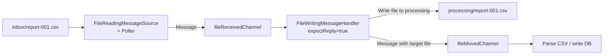

# File outbound gateway for filesystem operations

## 1. Problem statement and objectives

The **SPRING_INTEGRATION_ADAPTERS** module guides you through connecting external systems to Spring Integration via inbound/outbound adapters, gateways, pollers, and `MessageChannel`, while handling message contracts, errors, and connection lifecycles. In the **File Adapter** chapter, this lesson focuses on the **File outbound gateway**: writing a file to the filesystem and returning a message containing the resulting file so the processing flow continues.

Suppose a partner drops `report-001.csv` into `data/inbox`. The application wants to pick up the file, **move it to `data/processing`**, and then parse the content from the file at the new location. If the destination file already exists, the application must report a conflict. If writing fails, it must not be considered successfully processed.

After this lesson, you will be able to:

- Distinguish between a **file outbound channel adapter** and a **file outbound gateway**.
- Configure `FileWritingMessageHandler` and enable replies with `setExpectReply(true)`.
- Build a flow of **file inbound adapter → outbound gateway → consumer**.
- Distinguish copying, move-like behavior, renaming, replacing, and appending files.
- Use `FileExistsMode`, `FileNameGenerator`, temporary files, directory expressions, and metadata.
- Design retries/idempotency, source/destination file management, I/O error handling, and application lifecycle.

## 2. A gateway that writes files and returns the result

The File outbound gateway in Spring Integration File uses `org.springframework.integration.file.FileWritingMessageHandler`. The handler can write content from `java.io.File`, `String`, `byte[]`, or `InputStream` payloads. After processing, **the gateway emits a reply message whose payload is the destination file**, allowing downstream steps to continue reading/transforming it.

| Component | How it works | Reply message? |
| --- | --- | --- |
| File outbound channel adapter | Receives a message and writes a file to the filesystem | No, end of a one-way flow |
| File outbound gateway | Receives a message, writes a file, and emits the resulting file | Yes, typically `Message<File>` |
| File inbound channel adapter | Uses `FileReadingMessageSource` to scan a directory | Acts as the source emitting messages into the flow |
| Messaging gateway | Turns a Java method call into a request/reply message | Returns a result to the Java method |

For Java configuration, two essential steps are `setExpectReply(true)` and wiring an `outputChannel` on the endpoint. **No separate poller is needed for a File outbound gateway** if its input is a `DirectChannel`; it is invoked whenever a message arrives. A poller may be used in the step that reads files from a directory.



The reply from the gateway **is not an external partner ACK**. It reports the outcome of the file operation inside Spring Integration and lets an internal consumer use the target file. If you need to know whether another system successfully read the file, you need a dedicated confirmation mechanism.

### Payload and file headers

An input message might contain:

```text
payload = File("data/inbox/report-001.csv")
headers[FileHeaders.FILENAME] = "report-001.csv" (if present)
```

The gateway determines the destination name using a `FileNameGenerator`. The default generator prioritizes the name specified by the `FileHeaders.FILENAME` header; for a `File` payload, it can take the name from `File.getName()` itself. If the payload has no specific name, the handler can generate one based on the message ID. For documents exported to partners, name files by contract using a header or a custom generator.

The reply after writing can be visualized as:

```text
reply.payload = File("data/processing/report-001.csv")
```

When file content is needed, downstream components invoke a parser/reader themselves. The gateway does not automatically convert CSV into business objects.

## 3. File operations supported by the gateway

**The local File outbound gateway primarily writes files.** Copy/move behaviors are built from writing plus optional handling of the source file:

| Requirement | Configuration | Meaning |
| --- | --- | --- |
| Write text/bytes content | `String` or `byte[]` payload | Creates the file and returns the target file |
| Copy file | `File` payload, `deleteSourceFiles=false` | Keeps the source file, creates the target copy |
| Move file | `File` payload, `deleteSourceFiles=true` | Writes the target copy then deletes the source per policy |
| Rename on move | `FileNameGenerator` chooses the new target name | Independent of the original name |
| Choose directory per message | Directory expression | Target directory is evaluated per message |
| Continue processing after write | `expectReply=true` and reply/output channel | Next step receives the target `File` payload |
| Delete/rename arbitrary files on command | Filesystem APIs in a dedicated Java step | Requires path validation and access-control policies |

Do not confuse a **local** File outbound gateway with FTP/SFTP/SMB outbound gateways: remote gateways have protocol-specific commands such as `ls`, `get`, `rm`, `mv`, `put`, etc. `setDeleteSourceFiles(true)` on `FileWritingMessageHandler` is not an arbitrary file-delete command, and this move-like operation **is not an atomic rename by default**.

## 4. Project Setup

The example uses Java 17+, Spring Boot, and Spring Integration File. Declare dependencies in `pom.xml` (versions managed by Spring Boot):

```xml
<dependencies>
    <dependency>
        <groupId>org.springframework.boot</groupId>
        <artifactId>spring-boot-starter-integration</artifactId>
    </dependency>
    <dependency>
        <groupId>org.springframework.integration</groupId>
        <artifactId>spring-integration-file</artifactId>
    </dependency>
</dependencies>
```

Create the directories as follows:

```text
data/
├── inbox/
│   └── report-001.csv
└── processing/
```

Content of `report-001.csv`:

```csv
id,amount
P-001,125000
P-002,98000
```

Note that relative paths are resolved from the **JVM working directory**, not necessarily the directory containing the source code. To run the example in move mode, the process needs permissions to **read the source file, write the target file, and delete the source file**.

## 5. Complete Java example: receiving, moving, and processing files

The example uses `FileReadingMessageSource` to pick up CSV files, `FileWritingMessageHandler` to write them to `processing` and delete the source, and sends the reply to a consumer that reads the file at its new location.

```java
import java.io.File;
import java.io.IOException;
import java.nio.charset.StandardCharsets;
import java.nio.file.Files;

import org.springframework.context.annotation.Bean;
import org.springframework.context.annotation.Configuration;
import org.springframework.integration.annotation.InboundChannelAdapter;
import org.springframework.integration.annotation.Poller;
import org.springframework.integration.annotation.ServiceActivator;
import org.springframework.integration.channel.DirectChannel;
import org.springframework.integration.config.EnableIntegration;
import org.springframework.integration.core.MessageSource;
import org.springframework.integration.file.FileReadingMessageSource;
import org.springframework.integration.file.FileWritingMessageHandler;
import org.springframework.integration.file.filters.AcceptOnceFileListFilter;
import org.springframework.integration.file.filters.CompositeFileListFilter;
import org.springframework.integration.file.filters.SimplePatternFileListFilter;
import org.springframework.integration.file.support.FileExistsMode;
import org.springframework.messaging.MessageChannel;

@Configuration
@EnableIntegration
public class FileMoveGatewayConfig {

    @Bean
    public MessageChannel fileReceivedChannel() {
        return new DirectChannel();
    }

    @Bean
    public MessageChannel fileMovedChannel() {
        return new DirectChannel();
    }

    @Bean
    @InboundChannelAdapter(
        channel = "fileReceivedChannel",
        poller = @Poller(
            fixedDelay = "2000",
            maxMessagesPerPoll = "2"
        )
    )
    public MessageSource<File> csvSource() {
        FileReadingMessageSource source = new FileReadingMessageSource();
        source.setDirectory(new File("data/inbox"));

        CompositeFileListFilter<File> filters =
                new CompositeFileListFilter<>();
        filters.addFilter(new SimplePatternFileListFilter("*.csv"));
        filters.addFilter(new AcceptOnceFileListFilter<>());
        source.setFilter(filters);

        return source;
    }

    @Bean
    @ServiceActivator(
        inputChannel = "fileReceivedChannel",
        outputChannel = "fileMovedChannel"
    )
    public FileWritingMessageHandler moveFileGateway() {
        FileWritingMessageHandler handler =
                new FileWritingMessageHandler(new File("data/processing"));

        handler.setAutoCreateDirectory(true);
        handler.setExpectReply(true);
        handler.setDeleteSourceFiles(true);
        handler.setFileExistsMode(FileExistsMode.FAIL);
        handler.setTemporaryFileSuffix(".writing");
        handler.setPreserveTimestamp(true);
        return handler;
    }

    @ServiceActivator(inputChannel = "fileMovedChannel")
    public void importProcessedFile(File movedFile) throws IOException {
        String csv = Files.readString(
                movedFile.toPath(), StandardCharsets.UTF_8
        );

        System.out.printf(
                "Received target file %s, %d characters%n",
                movedFile.getAbsolutePath(),
                csv.length()
        );
        // In practice: parse, validate, write to DB, and store import status.
    }
}
```

The configuration class must be inside the component scan scope of `@SpringBootApplication` or imported into the context. The `data/inbox` directory must already exist when the source begins scanning. `setAutoCreateDirectory(true)` lets the handler create `processing` if missing and if permissions allow.

### Step-by-step execution

1. The poller calls `FileReadingMessageSource` periodically, selecting `*.csv` files; each batch fetches at most two messages.
2. `fileReceivedChannel` forwards `Message<File>` to the outbound gateway.
3. The handler writes the destination copy. With `FileExistsMode.FAIL`, if the target already exists it throws an exception.
4. `setDeleteSourceFiles(true)` requests deletion of the source file after writing according to the handler's mechanism.
5. `setExpectReply(true)` creates a reply `Message<File>` carrying the resulting file and sends it to `fileMovedChannel`.
6. `importProcessedFile` reads the file **at the new location**, and can then parse, validate, and write to the DB.

`DirectChannel` invokes the consumer synchronously. `maxMessagesPerPoll = 2` limits messages per poll, **not meaning two files run in parallel**. Slow downstream processing can delay detection of subsequent files.

### Why enable replies?

```java
handler.setExpectReply(true);
```

A File outbound **adapter** sets reply expectation to `false` and terminates the flow at the write step. A File outbound **gateway** needs a reply so downstream steps know which destination file to operate on. Receiving the reply does not mean the downstream consumer has successfully committed a business transaction.

### Why is it move-like rather than atomic?

With a `File` payload, the handler performs a write/copy to the destination; `setDeleteSourceFiles(true)` enables deleting the source afterwards. If an I/O error occurs midway, the system may be left with the source file, temporary file, or destination file. Therefore, **copy + delete** should not be treated as an atomic rename or a transaction spanning the database.

## 6. Testing and Observing

Prepare the test file in PowerShell. To avoid an unwanted BOM, the example writes UTF-8 without BOM:

```powershell
New-Item -ItemType Directory -Force -Path .\data\inbox
New-Item -ItemType Directory -Force -Path .\data\processing
$csv = @('id,amount', 'P-001,125000', 'P-002,98000') -join [Environment]::NewLine
$utf8 = [System.Text.UTF8Encoding]::new($false)
[System.IO.File]::WriteAllText(
    (Join-Path (Get-Location).Path 'data\inbox\report-001.csv'),
    $csv,
    $utf8
)
```

`WriteAllText` will overwrite `report-001.csv` if it already exists; run this only inside the practice directory. Start the application and observe:

```text
BEFORE:
  data/inbox/report-001.csv
AFTER:
  data/inbox/                  (report-001.csv is gone)
  data/processing/report-001.csv
```

Next, verify that the consumer reads the content of the file in `processing`. If the target file already exists from a previous run, `FAIL` throws an error instead of overwriting. Never delete real environment data just to make an example run again.

### Trying copy instead of move

Change:

```java
handler.setDeleteSourceFiles(false);
```

Then the destination file is written while the source file remains in `inbox`. `AcceptOnceFileListFilter` prevents re-emitting the same file while in-memory state lasts; after a restart, that state can be lost and the source file picked up again. That is why real workflows need a durable way to mark files as processed.

### Trying renaming files while moving

`FileNameGenerator` can compute the target filename from the payload or headers:

```java
handler.setFileNameGenerator(message -> {
    Object payload = message.getPayload();
    if (!(payload instanceof File source)) {
        throw new IllegalArgumentException("File payload required");
    }

    String original = source.getName();
    if (!original.matches("[A-Za-z0-9_-]+\\.csv")) {
        throw new IllegalArgumentException("Invalid file name");
    }
    return "processed-" + original;
});
```

With `report-001.csv`, the destination file becomes `processed-report-001.csv`. This change must also align with downstream logic if the consumer depends on the filename. The sample generator only accepts simple ASCII names, rejecting strings containing path separators or `..`. In production, add Unicode filename rules (if needed) and prevent ID collisions.

## 7. Policies when the destination file already exists

The `FileExistsMode` value determines behavior when a file already exists:

| Mode | Handling | Notes |
| --- | --- | --- |
| `REPLACE` | Replaces the target file's content; this is the default | Risk of overwriting old data |
| `REPLACE_IF_MODIFIED` | Replaces if source and destination timestamps differ per handler rules | Based on modification time, not checksum comparison |
| `APPEND` | Appends to the existing file | Does not use the temporary file mechanism used for new files |
| `APPEND_NO_FLUSH` | Appends and keeps buffer/file open | Better performance, but increases risk of data loss on crash |
| `FAIL` | Throws an exception when target file already exists | Suitable when duplicate names must be detected |
| `IGNORE` | Does not write the new payload if target already exists | The gateway can still return the old existing destination file |

`REPLACE_IF_MODIFIED` compares the `lastModified` timestamp of the `File` payload against the destination file. For other payloads, the handler can rely on `FileHeaders.SET_MODIFIED` if the value is a number; lacking a valid value, it may still overwrite. When selecting this mode, `setPreserveTimestamp(true)` is usually more meaningful, yet timestamps still do not prove two files share the same content.

`APPEND` and `APPEND_NO_FLUSH` require understanding record boundaries. If full CSVs are appended repeatedly, the file may contain multiple header rows between batches. `APPEND_NO_FLUSH` requires flush and shutdown policies because unflushed data can be lost if the process stops abruptly.

With `IGNORE`, the reply can contain **the pre-existing target file**. Therefore, merely seeing a `Message<File>` reply is insufficient to conclude the new message was actually written. If business rules require "a new send updates the data," `IGNORE` may be the wrong choice.

## 8. Temporary files, timestamps, and dynamic directories

### Writing to a temporary name

Normally the handler uses a `.writing` suffix while the file is being written. Once writing finishes, the file is published under its official name. External systems should only scan official names, such as `*.csv`, to avoid picking up incomplete data.

```text
data/processing/report-001.csv.writing  <- while writing
data/processing/report-001.csv          <- final name
```

For `APPEND`, writes go directly to the existing file and therefore do not rely on temporary files this way. Rename atomicity, durability across power loss, and behavior on network shares all depend on the environment and must be tested on the actual filesystem.

### Preserving timestamps and permissions

`setPreserveTimestamp(true)` preserves the source file's last modified timestamp for `File` payloads. For other payloads, the `FileHeaders.SET_MODIFIED` header can be used. On POSIX filesystems, target file permissions can be configured using octal notation; on Windows, use corresponding ACLs. Grant least-privilege permissions to the application account, especially when using `deleteSourceFiles=true`.

### Choosing directories per message

To write into multiple directories, you can use a directory expression instead of a fixed path:

```java
import org.springframework.expression.Expression;
import org.springframework.expression.spel.standard.SpelExpressionParser;

Expression destination = new SpelExpressionParser()
        .parseExpression("headers['targetDirectory']");

FileWritingMessageHandler handler =
        new FileWritingMessageHandler(destination);
handler.setExpectReply(true);
handler.setFileExistsMode(FileExistsMode.FAIL);
```

This snippet is an **alternative** to the fixed-directory constructor; do not register a second handler on the same channel in the example unless intended. The `targetDirectory` header must evaluate to a `String`, `File`, or `Resource` pointing to a directory. Before setting the header, map partner codes against an allowlist of directories; never pass user-supplied paths directly, to avoid writing outside authorized data areas.

## 9. Errors, retries, and idempotency

The gateway can fail because the source file was deleted, the destination lacks write permissions, the disk is full, the target filename collides, network share I/O fails, or another process is locking the file. Distinguish between **a successful file operation** and **a successful business import**.

| Scenario | Possible consequence | Handling approach |
| --- | --- | --- |
| Destination exists and mode is `FAIL` | Handler throws an exception, no success reply | Reconcile ID/content, handle conflict cleanly |
| Partial write or interrupted rename | `.writing` file may remain | Verify checksum/size and clean up per policy |
| Target file complete while source still exists | Two copies exist | Compare source and target before retrying |
| Source deleted before downstream commits DB | File exists only in `processing` | Retry from the target file, do not wait for file to return to inbox |
| Application restarts | In-memory filter state is lost | Persistent filter or durable import-status tracking |
| Multiple instances read the same directory | Risk of duplicate processing | Ownership/locking or a coordinated distribution mechanism |

### Why is accept-once not equivalent to successful processing?

`AcceptOnceFileListFilter` records file selection at the source; it does not know whether subsequent file-writing and DB-import steps succeed. For example, a file is selected by the poller, but the outbound gateway fails due to a filename collision; the in-memory filter may not re-emit that file on subsequent polls. Thus, retries must live inside a well-defined business workflow.

`FileSystemPersistentAcceptOnceFileListFilter` combined with a durable `MetadataStore` tracks selected files across restarts, yet **does not automatically confirm DB transactions committed**. For critical data, track import ID, checksum, source/destination file, and status:

```text
RECEIVED -> MOVED_TO_PROCESSING -> IMPORTED -> ARCHIVED
                                    |
                                    +----> FAILED / QUARANTINED
```

To retry safely, consumers must be idempotent (business keys/unique constraints or an import log table). When an error occurs after a file has been moved, recover from `processing` and avoid re-reading from the beginning as if it were a brand-new request.

### Synchronous errors and error channels

With `DirectChannel`, errors from the gateway or consumer can propagate back up the synchronous call stack. When flows use pollers, executors, or queues, errors can be routed to an `ErrorMessage`/`errorChannel` mechanism depending on the endpoint. Design bounded retries per error category; invalid filenames or malformed CSVs will not magically heal by retrying repeatedly.

### Lifecycle and monitoring

Besides exception logs, monitor file counts in `inbox`, `processing`, and `failed`, wait times, failed write counts, processing throughput, disk capacity, and retry counts. When the application stops between writing and DB import, remaining files alongside status records enable recovery.

## 10. When to use a File outbound gateway?

| Goal | Suitable component |
| --- | --- |
| Simply write a report to a file and stop | File outbound channel adapter |
| Write a file and pass the resulting file to another processing step | **File outbound gateway** |
| Pick up a file and move it to a processing directory | File inbound adapter + File outbound gateway |
| Manipulate remote files needing protocol commands | Matching SFTP/FTP/SMB adapter or outbound gateway |
| Arbitrarily delete or rename local files | Java step using filesystem APIs with validation |
| Want a transaction spanning filesystem and database | Dedicated recovery/idempotency design |

## 11. Hands-on Exercises

1. **Receive target file:** create `report-001.csv` and check whether the `Message<File>` reply has path `processing/report-001.csv`.
2. **Copy vs. move:** change `deleteSourceFiles` from `true` to `false`, and compare the presence of source and target files.
3. **FAIL mode:** pre-create the target file, recreate the same-named source file, and observe the exception and conflict handling.
4. **Renaming:** use `FileNameGenerator` to add a `processed-` prefix; test filenames containing `../` or path separators to verify validation.
5. **IGNORE mode:** switch `FAIL` to `IGNORE` when the target already exists, inspect the reply, and confirm old content is unchanged.
6. **Post-move failure:** make the downstream consumer throw an exception, locate where the file resides, and design a retry that avoids duplicating DB rows.
7. **Dynamic directory:** select a path from an allowlist by partner code; test a header value outside permitted directories.
8. **Crash scenarios:** design recovery plans when only the source file exists, when a temp file remains, when both source and target exist, and when only the target exists before DB commit.

### Self-Check Questions

**Q1. What payload does the gateway return after writing?**  
Usually a `java.io.File` object representing the destination file.

**Q2. Does `setDeleteSourceFiles(true)` perform an atomic rename?**  
No. It is a policy to delete the source after writing the target; errors between steps must be handled.

**Q3. Why doesn't a reply under `FileExistsMode.IGNORE` prove a new file was written?**  
Because the gateway can return the already-existing destination file without writing the new payload.

**Q4. When is `FileNameGenerator` needed?**  
When you want to determine or transform filenames per message and enforce naming rules.

**Q5. Does a local file gateway provide built-in `ls`/`rm` commands like an SFTP gateway?**  
No. Use appropriate filesystem APIs or a remote endpoint for that protocol.

**Q6. Does moving a file to processing guarantee the business import succeeded?**  
No. You need import state tracking, error handling, retries, and DB idempotency mechanisms.

## 12. Key Takeaways

A **File outbound gateway** uses `FileWritingMessageHandler` to write data to the filesystem and then returns `Message<File>` to the rest of the flow. A `File` payload enables copying or moving files when combined with `setDeleteSourceFiles(true)`, without guaranteeing an atomic move. To operate reliably, define `FileExistsMode`, naming/path policies, temporary files, metadata, access permissions, error handling, and restart recovery. Adapters for SFTP, HTTP, JMS, AMQP, Kafka, or databases have their own reply/acknowledgment semantics and should not substitute for local file flow business state.

### References

- [Spring Integration Reference — Writing Files / Outbound Gateway](https://docs.spring.io/spring-integration/reference/file/writing.html)
- [Spring Integration Reference — Reading Files](https://docs.spring.io/spring-integration/reference/file/reading.html)
- [Spring Integration API — FileWritingMessageHandler](https://docs.spring.io/spring-integration/api/org/springframework/integration/file/FileWritingMessageHandler.html)
