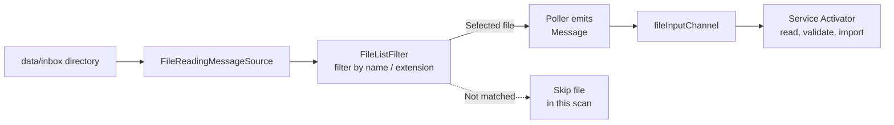
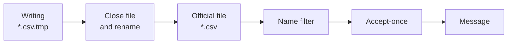

# FileListFilter by name pattern and extension

## 1. Context and lesson objectives

In the **SPRING_INTEGRATION_ADAPTERS** module, applications use inbound/outbound adapters, gateways, pollers, and `MessageChannel` to connect with external systems. In the **File Adapter** chapter, a common requirement is **only accepting files whose names or extensions match the exchange contract**.

Suppose a partner places data into the `data/inbox` directory:

```text
data/inbox/
├── orders_20261123.csv
├── orders_20261124.csv
├── orders_20261125.CSV
├── orders_20261126.csv.tmp
├── customers_20261123.csv
├── readme.txt
└── orders_20261127.json
```

The order import flow must only process CSV files named according to convention. Without a filter, the application could mistakenly pick up temporary files, instruction files, or data belonging to another business flow.

After this lesson, you will be able to:

- Explain how `FileListFilter` participates in selecting files before the File inbound channel adapter emits `Message<File>`.
- Use `SimplePatternFileListFilter` for simple name patterns such as `*.csv` and `orders_*.csv`.
- Use `RegexPatternFileListFilter` when strict rules, multiple extensions, or case-insensitivity are required.
- Combine filename filters with `AcceptOnceFileListFilter` to avoid a file being selected repeatedly.
- Distinguish between filtering by name, validating content format, verifying a file has finished writing, and confirming business processing success.
- Self-verify filtering behavior, handle retries, restarts, and common configuration mistakes.

## 2. Where does FileListFilter sit in a Spring Integration flow?

When using `FileReadingMessageSource`, the source scans a directory and selects eligible `java.io.File` objects before emitting messages. `FileListFilter<F>` is the input filtering contract; for local filesystems, the element type is `File`.



Each component has a distinct responsibility:

| Component | Responsibility |
| --- | --- |
| `FileReadingMessageSource` | Scans the directory, fetches eligible files, and creates messages with a `File` payload |
| `FileListFilter<File>` | Accepts or rejects files by criteria such as name, extension, or selection history |
| `Poller` | Triggers the source on a schedule; regulates frequency and messages fetched per poll |
| `MessageChannel` | Delivers messages to downstream endpoints |
| Consumer/transformer | Opens the file, reads content, parses data, validates, and executes business logic |

**The filter only decides which files are selected at the source.** Simply having a `.csv` extension does not mean a file has finished writing, is valid CSV, or has been imported successfully. Those conditions must be checked in separate steps.

### Filtering names vs. filtering content

For example, `orders_20261123.csv` passes the `*.csv` filter even if its actual content is JSON or empty. Conversely, `orders_20261123.csv.tmp` does not pass this filter even if its contents are valid CSV.

Therefore, **two validation layers** are typically needed:

1. **File ingestion layer**: filename, extension, selection status, and file-readiness conditions.
2. **Processing layer**: encoding, size, CSV structure, schema, business data, and error policy.

## 3. SimplePatternFileListFilter: matching simple name patterns

`SimplePatternFileListFilter` accepts a pattern string and matches it against the **filename**. It is suitable when only `*` wildcard rules are needed:

```java
import org.springframework.integration.file.filters.SimplePatternFileListFilter;

SimplePatternFileListFilter csvOnly =
        new SimplePatternFileListFilter("*.csv");

SimplePatternFileListFilter orderCsv =
        new SimplePatternFileListFilter("orders_*.csv");
```

Common patterns:

| Pattern | Meaning | Matching examples |
| --- | --- | --- |
| `*.csv` | Name ends with `.csv` | `orders.csv`, `customers.csv` |
| `orders_*.csv` | Starts with `orders_` and ends with `.csv` | `orders_20261123.csv` |
| `report-*.txt` | Text file with prefix `report-` | `report-daily.txt` |
| `*.tar.gz` | File with full suffix `.tar.gz` | `backup.tar.gz` |
| `batch_*_done.csv` | Pattern with multiple `*` wildcards | `batch_42_done.csv` |

One point to remember: this is a **simple pattern** using Spring's string matching mechanism, not a full shell or Ant glob language. Do not assume `?`, `[0-9]`, `**/`, or `{csv,tsv}` carry the same meaning as in Bash. When you need positional constraints, character counts, extension groups, or casing rules, use a regular expression.

### Case sensitivity

The `*.csv` pattern is usually matched **case-sensitively** at the string comparison level. Therefore `orders_20261125.CSV` is not selected merely because the operating system might treat uppercase and lowercase extensions as equivalent.

If a partner may send both `.csv` and `.CSV`, define the contract explicitly or use `RegexPatternFileListFilter` with the `(?i)` flag.

## 4. RegexPatternFileListFilter: constrained names and extensions

When filenames must include an eight-digit date, or allow both CSV and TSV, `RegexPatternFileListFilter` expresses the rules more clearly.

```java
import org.springframework.integration.file.filters.RegexPatternFileListFilter;

RegexPatternFileListFilter orderDataFilter =
        new RegexPatternFileListFilter(
                "(?i)^orders_[0-9]{8}\\.(csv|tsv)$"
        );
```

Meaning of the expression:

- `(?i)`: case-insensitive matching.
- `^orders_`: name starts with `orders_`.
- `[0-9]{8}`: requires exactly eight digits, e.g., `20261123`.
- `\\.` in a Java string: produces `\.` in regex, meaning a **literal dot**.
- `(csv|tsv)`: allows either of the two extensions.
- `$`: ends the name there, disallowing suffixes like `.tmp`.

| File | `*.csv` | Regex `(?i)^orders_[0-9]{8}\\.(csv|tsv)$` | Reason |
| --- | --- | --- | --- |
| `orders_20261123.csv` | Yes | Yes | Matches name and extension |
| `orders_20261124.CSV` | No | Yes | Regex permits uppercase |
| `orders_20261125.tsv` | No | Yes | Regex accepts TSV |
| `orders_2026-11-25.csv` | Yes | No | Date contains hyphens |
| `customers_20261123.csv` | Yes | No | Lacks `orders_` prefix |
| `orders_20261123.csv.tmp` | No | No | Has `.tmp` suffix |
| `orders_20261123.json` | No | No | Invalid extension |
| `orders_20261123.csv.bak` | No | No | Has extra trailing extension |

**Note:** the regex checks for eight digits, but does not verify whether `20261399` is a valid calendar date. If the date is critical business data, parse it with `LocalDate` and `DateTimeFormatter` in a downstream processing step.

### When to choose simple patterns vs. regex?

Choose `SimplePatternFileListFilter` when the rule is only a prefix or suffix, such as `*.csv`. Choose `RegexPatternFileListFilter` when multiple extensions, strict naming structures, fixed lengths, or case-insensitivity are required. Regexes are prone to escaping errors or overly broad matches; test against a suite of valid and invalid filenames before deploying to production.

## 5. Complete Spring Boot example: accepting only CSV files

The following example uses Java 17+ and Spring Boot, with `spring-boot-starter-integration` and `spring-integration-file`:

```xml
<dependencies>
    <dependency>
        <groupId>org.springframework.boot</groupId>
        <artifactId>spring-boot-starter-integration</artifactId>
    </dependency>
    <dependency>
        <groupId>org.springframework.integration</groupId>
        <artifactId>spring-integration-file</artifactId>
    </dependency>
</dependencies>
```

We want to read `*.csv` files in `data/inbox`, picking up at most three eligible files every two seconds. During processing, we only print name and size to observe the flow; CSV parsing/DB writes belong to subsequent steps.

```java
import java.io.File;

import org.springframework.context.annotation.Bean;
import org.springframework.context.annotation.Configuration;
import org.springframework.integration.annotation.InboundChannelAdapter;
import org.springframework.integration.annotation.Poller;
import org.springframework.integration.annotation.ServiceActivator;
import org.springframework.integration.channel.DirectChannel;
import org.springframework.integration.config.EnableIntegration;
import org.springframework.integration.core.MessageSource;
import org.springframework.integration.file.FileReadingMessageSource;
import org.springframework.integration.file.filters.AcceptOnceFileListFilter;
import org.springframework.integration.file.filters.ChainFileListFilter;
import org.springframework.integration.file.filters.SimplePatternFileListFilter;
import org.springframework.messaging.MessageChannel;

@Configuration
@EnableIntegration
public class CsvFileFilterConfig {

    @Bean
    public MessageChannel csvFileChannel() {
        return new DirectChannel();
    }

    @Bean
    @InboundChannelAdapter(
        channel = "csvFileChannel",
        poller = @Poller(
            fixedDelay = "2000",
            maxMessagesPerPoll = "3"
        )
    )
    public MessageSource<File> csvInboundSource() {
        FileReadingMessageSource source = new FileReadingMessageSource();
        source.setDirectory(new File("data/inbox"));

        ChainFileListFilter<File> filters = new ChainFileListFilter<>();
        filters.addFilter(new SimplePatternFileListFilter("*.csv"));
        filters.addFilter(new AcceptOnceFileListFilter<>());

        source.setFilter(filters);
        return source;
    }

    @ServiceActivator(inputChannel = "csvFileChannel")
    public void consume(File file) {
        System.out.printf(
            "Received file: %s (%d bytes)%n",
            file.getName(),
            file.length()
        );
        // Next step: open file, parse CSV, validate, and write data.
    }
}
```

The configuration must be inside `@SpringBootApplication`'s component scan scope or imported into the Spring context. Create `data/inbox` before running. Relative paths are resolved from the **process working directory**, which may differ when running from an IDE, Docker, or a service manager. The process must have read permissions on the directory and files.

### Why use ChainFileListFilter?

`ChainFileListFilter` runs filters **in sequence**:

1. `SimplePatternFileListFilter` eliminates files without the `.csv` suffix.
2. `AcceptOnceFileListFilter` inspects only the remaining files and prevents selecting them multiple times during the filter state's lifecycle.

This ordering matters when combining **stateful** filters. The accept-once filter should be placed after filename-exclusion or file-readiness conditions to reduce the risk of recording a file you never intended to process.

`CompositeFileListFilter` also combines multiple filters requiring all of them to accept. When requiring a sequential chain of conditions with stateful filters, `ChainFileListFilter` makes the application order explicit. Do not assume all filter composition options behave identically when filters have side effects.

### Why is AcceptOnceFileListFilter needed?

A File inbound adapter can scan the same directory across many poll cycles. If only a name pattern filter is set and the file remains in the directory, it can be selected repeatedly. `AcceptOnceFileListFilter<File>` remembers accepted files in the **filter's state**, preventing unchanged files from being re-emitted during a normal run.

When calling `source.setFilter(...)`, you **explicitly replace the source's filter**. Therefore, do not configure only a filename filter and assume the default accept-once mechanism is still retained. The sample flow explicitly declares both conditions.

Limitation: accept-once does not confirm that the consumer wrote to the database successfully. In-memory state is also lost on restart. If file selection history must survive restarts, consider a persistent accept-once filter with a durable `MetadataStore` and business-level idempotency mechanisms.

## 6. Changing conditions to accept only order reports

To allow only files named `orders_YYYYMMDD.csv` or `orders_YYYYMMDD.tsv` (case-insensitive), replace the pattern filter line in the example with:

```java
import org.springframework.integration.file.filters.RegexPatternFileListFilter;

filters.addFilter(
        new RegexPatternFileListFilter(
                "(?i)^orders_[0-9]{8}\\.(csv|tsv)$"
        )
);
```

This is a **drop-in replacement** for:

```java
filters.addFilter(new SimplePatternFileListFilter("*.csv"));
```

Keep `AcceptOnceFileListFilter` after the regex. Note that when accepting `.tsv` as well, the downstream consumer must know how to parse TSV structure rather than applying a comma-delimited CSV parser to every file. Filename filters do not choose parsers automatically.

If the contract only requires `*.csv` files regardless of name, use a simple pattern; if names must match partner codes, replace the regex with e.g. `^(?:partnerA|partnerB)_[0-9]{8}\\.csv$` and re-validate the ID during import.

## 7. Hands-on: verifying accepted and rejected files

Place the following files into `data/inbox` **before starting the application**:

```text
data/inbox/
├── orders_20261123.csv
├── customers_20261123.csv
├── orders_20261124.CSV
├── orders_20261125.csv.tmp
├── notes.txt
└── orders_20261126.tsv
```

With the `*.csv` filter from section 5, expected outcomes are:

| File | Outcome | Reason |
| --- | --- | --- |
| `orders_20261123.csv` | Accepted | Matches `.csv` suffix |
| `customers_20261123.csv` | Accepted | Pattern filter checks only suffix, not business entity type |
| `orders_20261124.CSV` | Ignored | Uppercase differs from `.csv` |
| `orders_20261125.csv.tmp` | Ignored | Name ends with `.tmp` |
| `notes.txt` | Ignored | Not CSV |
| `orders_20261126.tsv` | Ignored | Extension is TSV |

Switch to the regex from section 6 and run in a **fresh application session** or with a separate test directory:

| File | Outcome |
| --- | --- |
| `orders_20261123.csv` | Accepted |
| `customers_20261123.csv` | Ignored due to wrong prefix |
| `orders_20261124.CSV` | Accepted due to `(?i)` |
| `orders_20261125.csv.tmp` | Ignored because full name does not match |
| `notes.txt` | Ignored |
| `orders_20261126.tsv` | Accepted if consumer supports TSV |

To observe accept-once, leave an accepted file in place and wait for several more polls: it is not re-emitted merely because it remains on disk. After a restart, behavior may differ because the in-memory filter state is reinitialized.

If the sender frequently modifies file contents **under the same filename**, design an explicit file versioning/identification policy; never assume filename checks or accept-once alone can safely handle content updates.

## 8. Filtering by extension does not mean the file finished writing

A partner might create `orders_20261123.csv` immediately and write data slowly. The poller sees a valid name and picks up the file before the sender closes it. The consumer may then read incomplete data.

A practical contract should specify:

1. The sender writes to `orders_20261123.csv.tmp`.
2. The sender closes the file and ensures writing is complete, then renames it to `orders_20261123.csv`.
3. The `*.csv` or regex filter only accepts the final name after the rename.



If possible, rename within the same filesystem to leverage atomic publication of the final name, while verifying behavior on actual network shares and filesystem types. When temporary filenames cannot be coordinated, you can add a **last-modified time filter** (`LastModifiedFileListFilter`) to accept only sufficiently old files, or a ready-marker mechanism. Waiting reduces risk but does not guarantee a file is complete.

The key rule is to **place stateful filters after file-readiness conditions**, avoiding marking a file as accepted before it meets processing requirements.

## 9. Filename validation does not replace security and data validation

### Protecting ingested data

A `.csv` extension can appear on spoofed files or files containing invalid data. After receiving a file, validate:

- Maximum file size and read permissions.
- Encoding (e.g., UTF-8), delimiters, header row, and column count.
- Required fields, data types, and business rules.
- Duplicate records, import IDs, and rollback or compensation mechanisms on failure.

If you use filenames to identify a partner or transaction code, validate the extracted ID rather than trusting it implicitly.

### Overly broad patterns and sensitive files

A `*` pattern or overly broad regex can accidentally pick up log files, backups, or configuration files in the same directory. Restrict each contract to dedicated directories, specific name patterns, and minimal filesystem permissions. Never rely on extensions to authenticate data origin or allow writing/deleting paths outside the workspace.

### Case sensitivity, dots, and operating systems

Filesystems may treat `Report.csv` and `report.csv` differently depending on the OS, while Java filters match strings per filter rules. The `(?i)` regex handles mixed case but can cause ID collisions when two files differ only by letter case. Standardize on a single naming convention when systems span multiple platforms.

## 10. Operations: error handling, restarts, and multiple instances

| Scenario | Possible consequence | Handling approach |
| --- | --- | --- |
| Configured `*.csv` only without accept-once | Files remaining on disk may be re-emitted | Combine a history filter or move finished files |
| Filename matches but content is corrupt | Consumer fails during parse/import | Route to `failed/`, record error info, and apply retry policy |
| New file still being written | Partial data read | Temp file + rename, ready marker, or stability filter |
| Application restarts | In-memory accept-once state is lost | Persistent metadata if needed and idempotent processing |
| Two instances scan the same inbox | Same file may be processed twice | Coordinate ownership, locking, or shared state storage |
| Regex misses valid files | Name differs in casing, escaping, or date format | Test against sample filename suites and partner contract |
| `maxMessagesPerPoll` set too low | Backlog grows when many files arrive | Monitor ingestion rate, processing time, and tune poller |
| `DirectChannel` with slow consumer | Processing time slows poll rate | Decouple processing via bounded queue/executor if needed |

**Filters do not manage business transactions.** If the consumer fails after a file was selected, a stateful filter may not re-emit that file on the next poll. For critical imports, maintain business checkpoints/statuses, controlled retries, and idempotent keys in the database. Never treat adding accept-once as achieving an exactly-once guarantee.

Furthermore, while a filter only matches filenames at the inbound source, the rest of the module still follows protocol-specific semantics: FTP/SFTP have remote name filters and file transfer handling, JMS/AMQP/Kafka manage messages/acks at the broker level, and HTTP uses request/response. Do not assume changing a filename filter suffices to manage errors or connection lifecycles for other adapters.

## 11. Hands-on Exercises

1. **Extension filtering:** create `a.csv`, `b.CSV`, `c.txt`, and `d.csv.tmp`. Use `*.csv` and explain the result for each file.
2. **Prefix filtering:** change the pattern to `orders_*.csv`. Test `orders_1.csv`, `customers_1.csv`, and `orders_.csv`. Determine whether the simple pattern requires a non-empty middle section.
3. **Switch to regex:** use `(?i)^orders_[0-9]{8}\\.csv$`. Test names with 8-digit dates, hyphenated dates, and uppercase extensions.
4. **Combine multiple filters:** accept only CSVs whose content has not changed for a waiting period per a readiness criterion, then apply accept-once. Explain why order matters.
5. **Re-run behavior:** ingest a file, leave it in the directory, and restart the application. Propose how to avoid duplicate database inserts.
6. **Incomplete file simulation:** write `sample.csv.tmp`, close it, then rename to `sample.csv`. Observe that the poller picks up the file only when the official name appears.
7. **Parse error:** create `orders_20261123.csv` with the right name but JSON content. Design a content validation step and move invalid files to a quarantine area.
8. **Multiple senders:** let two partners drop files into the same directory. Propose naming patterns, metadata, permission separation, and collision avoidance.

### Self-Check Questions

**Q1. Does `SimplePatternFileListFilter("*.csv")` read CSV content?**  
No. It only checks the filename; parsing and validation are the consumer's responsibility.

**Q2. How do you accept both `.csv` and `.CSV`?**  
Use a regex with `(?i)` or standardize on a single extension casing on the sender side.

**Q3. Why combine a name pattern with accept-once?**  
So a file remaining in the directory is not automatically selected repeatedly on every poll during the filter's lifecycle.

**Q4. Does accept-once guarantee processing succeeded?**  
No. It records source selection, not completion of parsing or database writes.

**Q5. Why is `orders_20261123.csv.tmp` not picked up by `*.csv`?**  
Because the name ends with `.tmp`; this convention helps avoid picking up files still being written.

**Q6. If a regex requires eight digits, does it validate a real calendar date?**  
No. Validating calendar dates requires a dedicated date parser and business rules.

## 12. Key Takeaways

`FileListFilter` helps **select the right files before the File inbound channel adapter emits messages**. `SimplePatternFileListFilter` fits simple name and suffix patterns; `RegexPatternFileListFilter` supports strict rules or multiple extensions. When combining with `AcceptOnceFileListFilter`, pay attention to filter order and state across restarts. Filtering names accurately is only the first step: real systems must still verify files finished writing, validate data, handle errors, and prevent duplicate imports.

### References

- [Spring Integration Reference — Reading Files](https://docs.spring.io/spring-integration/reference/file/reading.html)
- [Spring Integration API — FileListFilter](https://docs.spring.io/spring-integration/api/org/springframework/integration/file/filters/FileListFilter.html)
- [Spring Integration API — SimplePatternFileListFilter](https://docs.spring.io/spring-integration/api/org/springframework/integration/file/filters/SimplePatternFileListFilter.html)
- [Spring Integration API — RegexPatternFileListFilter](https://docs.spring.io/spring-integration/api/org/springframework/integration/file/filters/RegexPatternFileListFilter.html)
