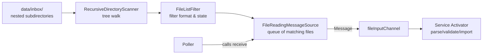

# RecursiveDirectoryScanner for nested directories

## 1. Context and objectives

In the **SPRING_INTEGRATION_ADAPTERS** module, Spring Integration helps connect external systems using inbound/outbound adapters, gateways, pollers, and `MessageChannel`. The **File Adapter** chapter addresses bringing files on a filesystem into a message flow. Sometimes partners do not place all files in a flat directory, instead organizing them by partner, year, month, or data type.

For example, an order report ingestion system:

```text
data/inbox/
├── partner-a/
│   ├── direct.csv
│   └── 2026/
│       └── 11/
│           ├── orders-001.csv
│           ├── orders-002.csv
│           └── upload.csv.tmp
├── partner-b/
│   └── 2026/
│       └── 11/
│           └── orders-001.csv
└── readme.txt
```

The two `orders-001.csv` files belong to **different** partners, even though they share the same filename. Scanning only the top level of `data/inbox` would skip most of the data. Using deduplication based solely on filename risks confusing the two reports.

**RecursiveDirectoryScanner** solves this by walking **the entire directory tree** up to a configured depth and passing eligible files to `FileReadingMessageSource`. After this lesson, you will be able to:

- Compare `DefaultDirectoryScanner` and `RecursiveDirectoryScanner`.
- Configure an inbound adapter that scans subdirectories in Java, coordinating `Poller`, `FileListFilter`, and `MessageChannel`.
- Use `setMaxDepth`, `setAlwaysAcceptDirectories`, and `setForRecursion(true)` in the right places.
- Retrieve relative paths from `FileHeaders.RELATIVE_PATH` to preserve source directory information.
- Avoid filename collisions across branches, unintended deep scans, reading unfinished files, or duplicate processing after restarts.
- Evaluate scan cost, message ordering, permission errors, and recovery strategies at high file volumes.

## 2. What does RecursiveDirectoryScanner do?

`FileReadingMessageSource` is a message source with a `java.io.File` payload. It uses a `DirectoryScanner` to **list eligible files**, enqueue them in an internal queue, and emit one file per poll.

By default, `DefaultDirectoryScanner` inspects only the immediate input directory. `RecursiveDirectoryScanner` extends traversal using Java NIO's `Files.walk(...)`, collecting files inside subdirectories as well. This class has been available since Spring Integration 5.0.



Role of each component:

| Component | Responsibility | Notes |
| --- | --- | --- |
| `RecursiveDirectoryScanner` | Walks the directory tree and lists files per traversal config | Scanning alone does not read file contents |
| `FileListFilter<File>` | Filters by name, format, and selection status | Name filters do not prove a file finished writing |
| `FileReadingMessageSource` | Receives scan results, queues them, emits `Message<File>` | Can hold pending files in an internal queue |
| `Poller` | Triggers the source and caps messages per poll | Does not guarantee exactly-once business processing |
| `MessageChannel` and consumer | Delivers messages, then reads and processes data | Requires separate idempotency, retries, and error management |

This is still a **File inbound channel adapter**. Adding a recursive scanner does not turn it into a request–reply gateway, nor does it turn each subdirectory into its own channel.

## 3. Directory tree depth and traversal rules

`RecursiveDirectoryScanner` relies on `Files.walk(Path start, int maxDepth, FileVisitOption...)`. When counting depth, **the root directory is level 0**:

```text
data/inbox/                         depth 0 (root)
data/inbox/partner-a/               depth 1
data/inbox/partner-a/direct.csv     depth 2
data/inbox/partner-a/2026/          depth 2
data/inbox/partner-a/2026/11/       depth 3
data/inbox/partner-a/2026/11/orders-001.csv   depth 4
```

Thus, `scanner.setMaxDepth(2)` picks up `partner-a/direct.csv` but misses `partner-a/2026/11/orders-001.csv`; `setMaxDepth(4)` or higher is required for this example.

| Configuration | Outcome on sample tree |
| --- | --- |
| `DefaultDirectoryScanner` | Lists the top level of `inbox`; does not recurse into the tree |
| `RecursiveDirectoryScanner`, `maxDepth=2` | Picks up files directly inside `partner-a`, skips deeper files |
| `RecursiveDirectoryScanner`, `maxDepth=4` | Reaches files under `partner-a/2026/11` and `partner-b/2026/11` |
| Unbounded depth in recursive scanner | Traverses all accessible levels below root; can be expensive |

By default, `RecursiveDirectoryScanner` does not request `FOLLOW_LINKS`. Be careful if enabling symbolic link traversal, as links can point outside the storage area, create link cycles, or expose the same file through multiple paths.

The **root** directory is excluded from scan results; subdirectories and files beneath it are subject to the configured filter. This is why a filename pattern filter can break recursive scanning if it rejects all subdirectories.

## 4. Crucial pitfall: setting the filter on the scanner

When passing a custom `RecursiveDirectoryScanner` to `FileReadingMessageSource`, set the filter and locker (if any) **on the scanner itself**.

**Correct configuration:**

```java
RecursiveDirectoryScanner scanner = new RecursiveDirectoryScanner();
scanner.setFilter(myFilter);

FileReadingMessageSource source = new FileReadingMessageSource();
source.setDirectory(new File("data/inbox"));
source.setScanner(scanner);
```

Do not call `source.setFilter(myFilter)` **after supplying a custom scanner**, because filter/locker ownership belongs to the injected scanner, and configuring both places may be rejected or cause unexpected behavior depending on the version.

### Why can a pattern accepting only `*.csv` cause trouble?

`SimplePatternFileListFilter("*.csv")` rejects **directories** by default because directory names do not match `*.csv`. When used with a recursive scanner, explicitly allow **directories to pass through while checking extensions only on files**:

```java
SimplePatternFileListFilter csvPattern =
        new SimplePatternFileListFilter("*.csv");
csvPattern.setAlwaysAcceptDirectories(true);
```

This setting lets subdirectories pass the pattern filter; it does not mean the consumer will receive directories as payloads. The file inbound source emits messages for matching files.

If using `RegexPatternFileListFilter` instead of `SimplePatternFileListFilter`, you must also call `setAlwaysAcceptDirectories(true)` when you want the regex to validate **filenames** while still traversing the directory tree.

## 5. Spring Boot example: ingesting CSVs in nested directories

The example uses Java 17+, Spring Boot, and Spring Integration File; dependency versions are managed by Spring Boot:

```xml
<dependencies>
    <dependency>
        <groupId>org.springframework.boot</groupId>
        <artifactId>spring-boot-starter-integration</artifactId>
    </dependency>
    <dependency>
        <groupId>org.springframework.integration</groupId>
        <artifactId>spring-integration-file</artifactId>
    </dependency>
</dependencies>
```

The configuration below:

- Walks `data/inbox` down to depth 4.
- Accepts only filenames with the `.csv` extension (case-sensitive).
- Allows subdirectories to pass through the filter.
- Prevents re-selecting the same file using a metadata filter keyed by **full path** during the session.
- Routes matching files to `fileInputChannel`.

```java
import java.io.File;

import org.springframework.context.annotation.Bean;
import org.springframework.context.annotation.Configuration;
import org.springframework.integration.annotation.InboundChannelAdapter;
import org.springframework.integration.annotation.Poller;
import org.springframework.integration.annotation.ServiceActivator;
import org.springframework.integration.channel.DirectChannel;
import org.springframework.integration.config.EnableIntegration;
import org.springframework.integration.core.MessageSource;
import org.springframework.integration.file.FileHeaders;
import org.springframework.integration.file.FileReadingMessageSource;
import org.springframework.integration.file.RecursiveDirectoryScanner;
import org.springframework.integration.file.filters.ChainFileListFilter;
import org.springframework.integration.file.filters.FileSystemPersistentAcceptOnceFileListFilter;
import org.springframework.integration.file.filters.SimplePatternFileListFilter;
import org.springframework.integration.metadata.SimpleMetadataStore;
import org.springframework.messaging.Message;
import org.springframework.messaging.MessageChannel;

@Configuration
@EnableIntegration
public class RecursiveFileInboundConfig {

    @Bean
    public MessageChannel fileInputChannel() {
        return new DirectChannel();
    }

    @Bean
    @InboundChannelAdapter(
        channel = "fileInputChannel",
        poller = @Poller(fixedDelay = "2000", maxMessagesPerPoll = "5")
    )
    public MessageSource<File> recursiveFileSource() {
        FileReadingMessageSource source = new FileReadingMessageSource();
        source.setDirectory(new File("data/inbox"));

        RecursiveDirectoryScanner scanner = new RecursiveDirectoryScanner();
        scanner.setMaxDepth(4);

        SimplePatternFileListFilter csvNames =
                new SimplePatternFileListFilter("*.csv");
        csvNames.setAlwaysAcceptDirectories(true);

        // This store lives in memory: suitable for demos, not durable across restarts.
        FileSystemPersistentAcceptOnceFileListFilter acceptOnce =
                new FileSystemPersistentAcceptOnceFileListFilter(
                        new SimpleMetadataStore(),
                        "recursive-csv:"
                );
        // Use the full path as key, accepting directories on every scan.
        acceptOnce.setForRecursion(true);

        ChainFileListFilter<File> filters = new ChainFileListFilter<>();
        filters.addFilter(csvNames);
        filters.addFilter(acceptOnce);

        // When using a custom scanner, the filter must be set on the scanner.
        scanner.setFilter(filters);
        source.setScanner(scanner);

        return source;
    }

    @ServiceActivator(inputChannel = "fileInputChannel")
    public void consume(Message<File> message) {
        File file = message.getPayload();
        Object relativePath =
                message.getHeaders().get(FileHeaders.RELATIVE_PATH);

        System.out.printf(
                "Received file: %s | relativePath=%s%n",
                file.getAbsolutePath(),
                relativePath
        );
        // In practice: read file, parse CSV, validate, write to database.
    }
}
```

Place this class within `@SpringBootApplication`'s component scan scope or import it into the Spring context. The root `data/inbox` directory must exist and the process must have traversal permissions through subdirectories. Relative paths are resolved from the JVM **working directory**, which can vary between an IDE, Docker, and background services.

### Why use FileSystemPersistentAcceptOnceFileListFilter?

In a recursive tree, `partner-a/2026/11/orders-001.csv` and `partner-b/2026/11/orders-001.csv` share the **same filename** yet are two independent sources.

`FileSystemPersistentAcceptOnceFileListFilter` offers `setForRecursion(true)`, which uses the **full path** when constructing metadata keys and **always accepts directories** so subsequent scans can continue traversing the tree. This works much better than a stateful filter keyed only by short name or one that accidentally blocks subdirectories after the first scan.

However, **`SimpleMetadataStore` in this example only stores data in memory**. Even though the filter class name includes "Persistent," metadata is not persisted across JVM restarts unless the backing store actually writes to disk or an external store. In production, use a durable or shared `ConcurrentMetadataStore` and design business keys to prevent duplicate imports.

### Why use ChainFileListFilter?

`ChainFileListFilter` executes each filter **in sequence**: first selecting files with matching names and letting directories pass through, and only then marking accepted files in the metadata store.

This matters when a filter holds state. If a metadata filter ran before a "file is ready" rule, it could record an ineligible file and cause it to be skipped in future scans. The arrangement in the example separates **name validation** from **recording selection**.

### What is inside the received message?

The payload is a `File`, not CSV text:

```text
payload = File("data/inbox/partner-a/2026/11/orders-001.csv")
headers[FileHeaders.FILENAME] = "orders-001.csv"
headers[FileHeaders.ORIGINAL_FILE] = File(".../orders-001.csv")
headers[FileHeaders.RELATIVE_PATH] = <relative path portion under data/inbox>
```

`FileHeaders.RELATIVE_PATH` gives the path relative to the scanned root directory, which can be used to classify partners or recreate directory structures when writing elsewhere. **Read the actual value and path separators from the incoming message** rather than hardcoding slashes or relying solely on `FileHeaders.FILENAME`. The `FILENAME` header only holds the leaf filename and cannot distinguish colliding filenames across branches.

## 6. Testing across scenarios

Create the lesson's directory tree (or equivalent) and place the sample files `orders-001.csv`, `orders-002.csv`, and `upload.csv.tmp`. Start the Spring Boot application.

| Path relative to `data/inbox` | File depth | Result with `maxDepth=4`, `*.csv` |
| --- | ---: | --- |
| `partner-a/direct.csv` | 2 | Accepted |
| `partner-a/2026/11/orders-001.csv` | 4 | Accepted |
| `partner-a/2026/11/orders-002.csv` | 4 | Accepted |
| `partner-b/2026/11/orders-001.csv` | 4 | Accepted, independent from the identically named file under partner-a |
| `partner-a/2026/11/upload.csv.tmp` | 4 | Ignored due to `.tmp` suffix |
| `readme.txt` | 1 | Ignored because it does not match `*.csv` |

Test three changes:

1. **Reduce depth:** change to `scanner.setMaxDepth(2)`; files under `2026/11` will no longer be within scan range, while files directly under `partner-a` are still picked up.
2. **Create a new directory:** while the application is running, create `partner-c/direct.csv`. When the source scans again, the new file will be picked up if within allowed depth.
3. **Test duplicate names:** keep both `orders-001.csv` files in their respective branches. Observe `File.getAbsolutePath()` and `FileHeaders.RELATIVE_PATH` to verify they are treated as two distinct files.

To observe new files arriving after startup, keep `data/inbox` steady and then add new files. `fixedDelay=2000` only sets the polling cadence; it does not guarantee a file reaches the consumer in exactly two seconds: the source's internal queue, total file count, scan duration, and consumer execution time all affect latency.

## 7. Internal queue, ordering, and scanEachPoll

`FileReadingMessageSource` places eligible files from the scanner into an **internal queue**. By default, `scanEachPoll=false`: the source can wait until the existing queue drains before performing another scan. This is helpful when directories hold many files because it reduces expensive I/O tree walks.

If you need the list continuously refreshed even while older queued files remain:

```java
source.setScanEachPoll(true);
```

When `scanEachPoll=true`, newly arrived files may be inserted ahead of older queued files according to the comparator. If the contract requires processing files by date or partner code, **do not rely on the traversal order returned by `Files.walk`**. Provide an explicit comparator to `FileReadingMessageSource` and test behavior under load.

Additional illustrative example:

```java
FileReadingMessageSource source = new FileReadingMessageSource(
        java.util.Comparator.comparing(File::getName)
                .thenComparing(File::getAbsolutePath)
);
```

The snippet above is an **alternative constructor** to `new FileReadingMessageSource()` when filename priority is needed. It **does not guarantee** partners finish writing files in filename order; strict business ordering also requires a completion contract, sequence locks, or proper buffering.

`maxMessagesPerPoll=5` caps how many messages the endpoint pulls per poll. With `DirectChannel` and a synchronous consumer, this **does not mean** five files are processed in parallel. When directory trees are deep and file counts are high, increasing the poll rate can spike I/O without improving throughput.

## 8. Directory traversal, filters, and partially written files

In practice, a partner may write directly to `orders-003.csv` before finishing its contents. The recursive scanner sees the valid filename as soon as the file appears, even while still being written. The accept-once filter only tracks **file selection**, not readiness.

A safer contract:

1. The partner writes to `orders-003.csv.tmp` in the appropriate subdirectory.
2. The partner closes the file and renames it to `orders-003.csv` when finished.
3. The `*.csv` pattern ignores the temp file and accepts only the final name.

If the sender does not support renaming, consider `LastModifiedFileListFilter` to defer selection until a file is old enough, or a marker file such as `orders-003.done`. With `ChainFileListFilter`, name and readiness filters should run **before** the stateful accept-once filter. An age threshold reduces risk but does not prove the file is complete.

Another pitfall is **mistaking a directory for a file**. When `setAlwaysAcceptDirectories(true)` is set, directories pass the name filter so the scanner can see files inside; that does not mean business logic should process a directory as a CSV file. Consumers should still confirm `file.isFile()` before opening and parsing when handling custom sources.

## 9. Operations: performance, symlinks, and permissions

Walking an entire tree with `Files.walk` grows in cost with entry count and depth. A tree holding years of history, already-processed files, and backups can introduce heavy latency on every scan.

| Issue | Impact | Mitigation |
| --- | --- | --- |
| Too many files/directories | Increases listing time, I/O, and memory usage | Cap `maxDepth`, move processed files out of inbox, partition sources by dataset |
| `scanEachPoll=true` on large trees | Repeated full listings despite existing backlog | Use only as needed; monitor scan time and queued file count |
| Directory lacks permissions | A branch may be unreadable, scanner may throw errors | Grant traversal permissions per directory; log and alert clearly on failing branches |
| Symlinks/junctions | May escape root, duplicate paths, or cause loops | Do not enable link following without verification; restrict root and OS permissions |
| Two instances scan the same root | May duplicate file imports | Shared metadata store, ownership/locking, and idempotency |
| Processed files remain in place | Scanner keeps encountering them on every scan | Stateful filters and proper archiving |
| Duplicate filenames across branches | Confusing one partner's report with another's | Include full path/relative path in identification keys |

### Restricting subdirectories

`setMaxDepth` caps depth, yet **does not restrict which partner branches are allowed**. If only `partner-a` and `partner-b` are permitted, configure approved roots explicitly or build a filter/scan strategy checking relative paths. A leaf-only pattern like `*.csv` will accept matching files in any scanned subdirectory.

In multi-partner environments, be cautious with externally supplied directory names, inbox write permissions, and symlinks. Extension filtering **does not replace** source authentication and filesystem read permissions.

## 10. Errors, restarts, and idempotency

### Accept-once state differs from successful import state

Even when the filter keys by full path, it only knows the file was selected once. Consider this sequence:

1. The recursive scanner finds `partner-a/2026/11/orders-001.csv`.
2. The filter records in metadata that the file was accepted.
3. The consumer begins parsing and hits a database write error.
4. The file remains in `inbox`, yet the filter may not re-emit it immediately.

Therefore, **do not treat accept-once as a business retry mechanism**. Persist import status keyed by partner code, batch ID, relative path, or checksum; the consumer must be idempotent so retries do not duplicate data.

### Across restarts

In the example, `SimpleMetadataStore` uses an in-memory `ConcurrentHashMap`. When the JVM restarts, selection metadata is lost and files remaining on disk may be picked up again. Replace `SimpleMetadataStore` with a truly persistent or shared `ConcurrentMetadataStore` as needed.

When using persistent accept-once on a directory tree, `setForRecursion(true)` also changes key generation to **full path**. If you switch a live system from `forRecursion=false` to `true`, legacy keys may stop matching and historical files may be re-ingested; plan metadata migration or replay handling accordingly.

Persisting metadata still does not fix the case where a file is marked selected but the consumer fails before committing to the DB. Design retries/reconciliation or move files cleanly across `processing`, `archive`, and `failed` directories.

### Concurrent multi-instance execution

Two pods can scan the same tree and pick up the same file simultaneously, even though each pod has its own in-memory filter. If a file must be imported by only one instance, use a shared claim mechanism (such as a shared metadata store supporting compare-and-set, a lock, or root partitioning), and still protect business data with unique keys/idempotency. When configuring a `FileLocker` on the scanner, define proper unlock rules so locks are not left held after processing.

## 11. Comparing file scanning options

| Mechanism | When suitable | Notes |
| --- | --- | --- |
| `DefaultDirectoryScanner` | Flat directory, no branch traversal needed | Simpler and lower overhead |
| `RecursiveDirectoryScanner` | Need to traverse multi-level subdirectory structures | Cost scales with tree size; watch directory filtering |
| Java DSL `recursive(true)` (Spring Integration 5.5+) | Want concise setup in `IntegrationFlow` DSL | Shares the same recursive scanning semantics of the file source |
| `WatchServiceDirectoryScanner` | Want filesystem event-driven detection instead of full scans | Configured independently from custom scanners; must handle overflow, renames, and events |
| Separate source per root | Roots have different permissions, schedules, or filter policies | More endpoints to manage, but isolates failures cleanly |

`WatchServiceDirectoryScanner` can watch subdirectories, but `useWatchService` **cannot be combined with `setScanner(customScanner)` on the same `FileReadingMessageSource`**. If switching to WatchService, carefully review directory registration, event overflow, and file-state persistence.

When integrating with SFTP, FTP, SMB, or other remote sources, do not copy local recursive scanner logic verbatim to remote adapters: each protocol has its own remote scanner/filter and transfer semantics. Spring Integration also supports HTTP, JMS, AMQP, Kafka, and databases, where source selection and message acknowledgment follow each system's contract.

## 12. Hands-on Exercises

1. **Multi-level scan:** create `partner-a/2026/11` and `partner-b/2026/11`, add CSVs to both branches, and run the example. Inspect full paths and relative paths.
2. **Depth limit:** change `setMaxDepth(4)` to `setMaxDepth(2)`. Predict which files will still be accepted and verify in practice.
3. **Remove directory acceptance:** remove `csvNames.setAlwaysAcceptDirectories(true)`, observe scan results, and explain the role of directories in filters.
4. **Duplicate filenames:** create `orders-001.csv` under both partners, use `setForRecursion(true)`, and compare metadata keys. Describe the risk of using only `File.getName()` as an import ID.
5. **Temporary files:** create `orders-002.csv.tmp`, finish writing, then rename to `orders-002.csv`. Observe when the file is picked up.
6. **Restart:** leave a file in place after reading and restart the application using `SimpleMetadataStore`. Propose a durable state and duplicate-prevention design.
7. **Queue ordering:** create files under different partners with out-of-chronological-order names; test `FileReadingMessageSource`'s comparator and `scanEachPoll=true`, and verify actual order.
8. **Error testing:** make the consumer throw an exception on invalid CSV content. Design a `failed` path, retries, and explicit import ID logging.

### Self-Check Questions

**Q1. Why is `DefaultDirectoryScanner` insufficient for data organized by partner/year/month?**  
Because it does not automatically traverse subdirectories; `RecursiveDirectoryScanner` or another scanning strategy is needed.

**Q2. When attaching a custom scanner, where should `FileListFilter` be configured?**  
On the scanner via `scanner.setFilter(...)`, not simultaneously on `FileReadingMessageSource`.

**Q3. Why is `setAlwaysAcceptDirectories(true)` important?**  
So the name filter rejects non-matching files while still allowing subdirectories to participate in traversal.

**Q4. Why is `setForRecursion(true)` useful on the metadata filter?**  
Because it uses full paths as keys and lets directories pass on subsequent scans; two identically named files in different branches are not treated as the same file.

**Q5. Does `SimpleMetadataStore` survive restarts?**  
No; with the default constructor, data resides in memory. A persistent store is required to retain history across restarts.

**Q6. Does `RecursiveDirectoryScanner` guarantee a file finished writing and the DB import succeeded?**  
No. It locates files; readiness, validation, idempotency, and retries are responsibilities of the flow design.

## 13. Key Takeaways

`RecursiveDirectoryScanner` lets a File inbound channel adapter **traverse nested directories** and emit `Message<File>` from multiple branches. When replacing the default scanner, configure filters on the **scanner**, ensure name filters **accept directories** to permit deep traversal, and enable `setForRecursion(true)` on persistent accept-once filters when full-path keys are required. Cap depth, account for scan cost and message ordering, and handle incomplete files, errors, metadata across restarts, and business-layer deduplication.

### References

- [Spring Integration Reference — Reading Files: Directory Scanning and Polling](https://docs.spring.io/spring-integration/reference/file/reading.html)
- [Spring Integration API — RecursiveDirectoryScanner](https://docs.spring.io/spring-integration/api/org/springframework/integration/file/RecursiveDirectoryScanner.html)
- [Spring Integration API — AbstractDirectoryAwareFileListFilter](https://docs.spring.io/spring-integration/api/org/springframework/integration/file/filters/AbstractDirectoryAwareFileListFilter.html)
- [Spring Integration API — FileSystemPersistentAcceptOnceFileListFilter](https://docs.spring.io/spring-integration/api/org/springframework/integration/file/filters/FileSystemPersistentAcceptOnceFileListFilter.html)
