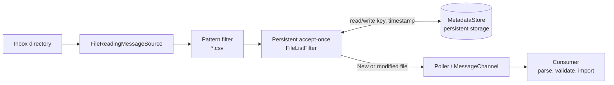
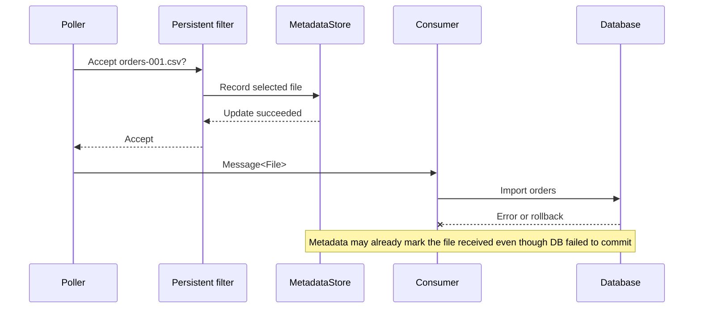

# MetadataStore to prevent re-reading the same file

## 1. Problem statement: the same file is picked up again after a restart

In the **SPRING_INTEGRATION_ADAPTERS** module, applications connect to external systems using inbound/outbound adapters, gateways, pollers, and `MessageChannel`. With the **File Adapter**, a partner system may drop CSV files into a shared directory for a Spring Integration application to import into a database. The operational challenge is: **how do you prevent re-emitting the same file across multiple poll cycles and after application restarts?**

Example:

```text
data/
├── inbox/
│   ├── orders-001.csv
│   ├── orders-002.csv
│   └── orders-003.csv.tmp
└── metadata/
    └── file-import.properties
```

The flow must read the two `*.csv` files, ignore `*.tmp`, and remember which files have already been **selected by the source**. After stopping and restarting the application, `orders-001.csv` and `orders-002.csv` remain in the inbox but should not be selected again if unchanged. If the partner updates a file's content and its last-modified time changes, the system may treat it as a new version.

After this lesson, you will be able to:

- Explain the roles of `MetadataStore` and `ConcurrentMetadataStore` in Spring Integration.
- Compare the in-memory `AcceptOnceFileListFilter` with `FileSystemPersistentAcceptOnceFileListFilter` backed by a metadata store.
- Configure `PropertiesPersistingMetadataStore` to retain a record of selected files across restarts.
- Understand keys, values, prefixes, last-modified timestamps, `flushOnUpdate`, and behavior when files change.
- Distinguish **preventing duplicate selection** from **successful business processing**; design appropriate retries and idempotency.
- Identify limitations with multiple instances, non-persistent disks, or partially written files.

## 2. Where does MetadataStore sit in the flow?

`FileReadingMessageSource` scans the directory, uses `FileListFilter<File>` to decide which files are accepted, and emits `Message<File>` when the poller calls `receive()`. A **persistent accept-once** filter uses `MetadataStore` to record seen files.



A key distinction is **adapter metadata** versus **business state**:

| State | Managed by | Question it answers |
| --- | --- | --- |
| Has the file ever been selected by the source? | `FileSystemPersistentAcceptOnceFileListFilter` + `MetadataStore` | Should this file be emitted again? |
| Has the file been written to the DB successfully? | Consumer and business state store | Has the import committed? |
| Did the external system receive a response? | Target system's ACK contract | Has the partner consumed the result? |

**MetadataStore is not an import transaction log.** The filter can record a file *before* the consumer writes to the database. If the consumer fails, metadata may still mark the file as selected, and subsequent polls will skip it.

## 3. From AcceptOnceFileListFilter to persistent filters

`AcceptOnceFileListFilter<File>` is typically used when you only need to remember seen files within a single JVM session. It stores state in memory, so on restart that information is lost. For files still sitting in the inbox, the adapter may emit them again.

`FileSystemPersistentAcceptOnceFileListFilter` differs by using an externally supplied `ConcurrentMetadataStore`. It stores a file fingerprint, typically based on **file path/name** and **last modified timestamp** (`lastModified`). If the store is truly durable, that record survives restarts.

| Criterion | `AcceptOnceFileListFilter` | `FileSystemPersistentAcceptOnceFileListFilter` |
| --- | --- | --- |
| State location | In the filter's memory | Inside `ConcurrentMetadataStore` |
| Across restarts | Normally lost | Retained if the store and backing storage are truly durable |
| Handling modified files | Depends on the in-memory filter's detection mechanism | Can re-accept when last-modified timestamp differs from stored value |
| Shared across multiple instances | No | Possible if the shared store provides proper atomic operations |
| Confirms DB commit | No | No |

Having **Persistent** in the class name does not guarantee persistence across restarts on its own. For example:

```java
new FileSystemPersistentAcceptOnceFileListFilter(
        new SimpleMetadataStore(), "orders:"
);
```

This is a persistent filter **by filter type**, yet `SimpleMetadataStore` keeps data in RAM by default. It works for testing the API, but does not meet the requirement of surviving JVM restarts.

## 4. MetadataStore and ConcurrentMetadataStore

`MetadataStore` is a key–value interface in Spring Integration. Its core operations are `get(key)`, `put(key, value)`, and `remove(key)`. `ConcurrentMetadataStore` adds atomic operations such as `putIfAbsent(key, value)` and `replace(key, oldValue, newValue)`.

Using `ConcurrentMetadataStore` matters because two pollers/instances may see the same file at once. If both perform "read key → see absent → write key" as two separate steps, both may think they own the file. The store's atomic operations help the filter coordinate file acceptance **within the guarantees of the implementation and backing storage**.

| Store type | Where state lives | Typical use case |
| --- | --- | --- |
| `SimpleMetadataStore` | JVM memory | Demos/tests; does not retain history across restarts |
| `PropertiesPersistingMetadataStore` | Properties file in a designated directory | Single standalone app needing state across restarts on durable disk |
| `RedisMetadataStore` | Redis | Multiple instances needing shared metadata and concurrent operations |
| `JdbcMetadataStore` | Database | Needing shared metadata or unified management with database infrastructure |

Implementations vary in configuration and durability. **Never use a properties file edited concurrently by multiple pods as a distributed lock.** When running multiple instances, use a store designed for sharing that guarantees atomic operations across processes. When using a database or Redis, also design permissions, connections, retries, monitoring, and store lifecycle.

## 5. How the filter identifies a file

For `FileSystemPersistentAcceptOnceFileListFilter`, the key–value model is:

```text
key   = "orders-import:" + <recognized-file-path>
value = <file lastModified>
```

Illustrative example (not the exact byte format of a properties file):

```text
orders-import:/app/data/inbox/orders-001.csv -> 1795380600000
orders-import:/app/data/inbox/orders-002.csv -> 1795380660000
```

If the key does not exist, the file is accepted and the filter stores the entry. If the key exists with the same timestamp, the file is treated as already seen. If the timestamp changes, the filter may re-accept the file and update metadata. **`lastModified` is not a content checksum.**

| Scenario | Typical expected behavior |
| --- | --- |
| New file, no key yet | Accepted |
| Old file, same key and timestamp | Ignored |
| Old file, timestamp changed | May be accepted again |
| File content changed while timestamp preserved | May be ignored |
| Two identically named files in different directories | Ensure keys distinguish full paths |
| Root path changed between runs | Keys may differ and files may be treated as new |

Do not use last-modified time to conclude data differs from a business perspective. Filesystems have varying timestamp resolutions; copy operations, clock sync, or timestamp edits can make comparisons diverge from actual content.

### Prefixes for namespace isolation

The constructor's `prefix` parameter separates metadata across flows:

```java
new FileSystemPersistentAcceptOnceFileListFilter(
        store, "orders-import:"
);
```

Use a stable, meaningful prefix scoped by **application + flow + data source**, especially if multiple inbound adapters share the same store. Changing the prefix after deployment makes old keys unreachable and can re-emit historical files; when changing a prefix, plan metadata migration or replay handling.

## 6. Complete Spring Boot example with state persisted across restarts

The example uses Java 17+, Spring Boot, and Spring Integration File. With Spring Boot managing dependencies, declare in Maven:

```xml
<dependencies>
    <dependency>
        <groupId>org.springframework.boot</groupId>
        <artifactId>spring-boot-starter-integration</artifactId>
    </dependency>
    <dependency>
        <groupId>org.springframework.integration</groupId>
        <artifactId>spring-integration-file</artifactId>
    </dependency>
</dependencies>
```

Input is `data/inbox`; metadata lives in `data/metadata/file-import.properties`. **The `data/metadata` directory must survive restarts and have read/write permissions**. In containers, mount a persistent volume instead of using ephemeral directories wiped when containers are replaced.

```java
import java.io.File;

import org.springframework.context.annotation.Bean;
import org.springframework.context.annotation.Configuration;
import org.springframework.integration.annotation.InboundChannelAdapter;
import org.springframework.integration.annotation.Poller;
import org.springframework.integration.annotation.ServiceActivator;
import org.springframework.integration.channel.DirectChannel;
import org.springframework.integration.config.EnableIntegration;
import org.springframework.integration.core.MessageSource;
import org.springframework.integration.file.FileReadingMessageSource;
import org.springframework.integration.file.filters.ChainFileListFilter;
import org.springframework.integration.file.filters.FileSystemPersistentAcceptOnceFileListFilter;
import org.springframework.integration.file.filters.SimplePatternFileListFilter;
import org.springframework.integration.metadata.PropertiesPersistingMetadataStore;
import org.springframework.messaging.MessageChannel;

@Configuration
@EnableIntegration
public class PersistentFileInboundConfig {

    @Bean
    public MessageChannel fileImportChannel() {
        return new DirectChannel();
    }

    @Bean
    public PropertiesPersistingMetadataStore fileImportMetadataStore() {
        PropertiesPersistingMetadataStore store =
                new PropertiesPersistingMetadataStore();
        store.setBaseDirectory("data/metadata");
        store.setFileName("file-import.properties");
        return store;
    }

    @Bean
    @InboundChannelAdapter(
        channel = "fileImportChannel",
        poller = @Poller(
            fixedDelay = "2000",
            maxMessagesPerPoll = "3"
        )
    )
    public MessageSource<File> fileImportSource(
            PropertiesPersistingMetadataStore fileImportMetadataStore) {

        FileReadingMessageSource source = new FileReadingMessageSource();
        source.setDirectory(new File("data/inbox"));

        FileSystemPersistentAcceptOnceFileListFilter seenFiles =
                new FileSystemPersistentAcceptOnceFileListFilter(
                        fileImportMetadataStore,
                        "orders-import:"
                );

        // Store implements Flushable: write changes to disk after each update.
        seenFiles.setFlushOnUpdate(true);

        ChainFileListFilter<File> filters = new ChainFileListFilter<>();
        filters.addFilter(new SimplePatternFileListFilter("*.csv"));
        filters.addFilter(seenFiles);
        source.setFilter(filters);

        return source;
    }

    @ServiceActivator(inputChannel = "fileImportChannel")
    public void importFile(File file) {
        System.out.printf(
                "Receiving: %s (%d bytes)%n",
                file.getAbsolutePath(),
                file.length()
        );
        // Demo only observes. Real processing must parse and save DB status.
    }
}
```

The configuration class must lie within `@SpringBootApplication`'s component scan scope or be imported into the Spring context. Ensure `data/inbox` and `data/metadata` exist, have appropriate permissions, and the JVM **working directory** stays consistent across runs.

### Why use ChainFileListFilter?

In the example:

1. `SimplePatternFileListFilter("*.csv")` excludes temporary `*.csv.tmp` files and non-matching extensions.
2. `FileSystemPersistentAcceptOnceFileListFilter` sees only files passing the name rule and updates metadata.

`ChainFileListFilter` evaluates conditions **in order**. This matters for stateful filters: you should not mark a file as "selected" before simple filters or "file-ready" checks run. `CompositeFileListFilter` also combines filters, but different execution semantics can affect stateful filters; pick a mechanism intentionally and verify against your version.

When calling `source.setFilter(filters)`, you explicitly supply the source's filter. Do not assume `FileReadingMessageSource`'s default filter stays active after replacing it with a custom filter.

### Why set flushOnUpdate=true?

`PropertiesPersistingMetadataStore` implements `Flushable`. `seenFiles.setFlushOnUpdate(true)` tells the filter to flush whenever metadata is updated, writing state to the properties file promptly rather than keeping changes solely in memory until lifecycle shutdown/flush.

This **does not create an atomic transaction with DB imports**, nor does it guarantee zero data loss on host power failure or disk errors. It only defines when metadata sync is attempted within the store's mechanism. In production storage, evaluate volume durability, backups, and recovery procedures.

## 7. Hands-on: verifying across restarts

Create `data/inbox` and `data/metadata` from the application's working directory. Add two CSV files and one temp file:

```text
data/inbox/orders-001.csv
data/inbox/orders-002.csv
data/inbox/orders-003.csv.tmp
```

The content of `orders-001.csv` can be:

```csv
order_id,total
ORD-001,150000
```

Proceed in order:

1. **First run:** start the application. Wait for the poller to detect the two `*.csv` files; `*.tmp` is ignored.
2. **Inspect metadata:** observe `data/metadata/file-import.properties` being created/updated. Do not manually edit keys while the application is running.
3. **Stop and restart:** keep inbox, metadata, and working directory intact. The two old files with unchanged timestamps will not be re-emitted by the source.
4. **Add a new file:** create `orders-004.csv`; it is accepted because no metadata record exists yet.
5. **Modify timestamp:** update `orders-001.csv` so its last-modified time changes; the source may pick it up again because the file's fingerprint changed.
6. **Test state recovery:** in an isolated test environment, temporarily move the metadata file aside and restart; the old files may be treated as new. Restore the saved metadata file before continuing the exercise.

These are **expected outcomes from the configuration**, not live logs captured from a run. Actual observed behavior also depends on the filesystem, poll timing, file presence, last-modified timestamps, and actual metadata persistence.

### Scenario table for self-verification

| File in inbox | Metadata exists? | Timestamp changed? | Expectation |
| --- | --- | --- | --- |
| `orders-001.csv` | No | — | Accepted |
| `orders-001.csv` | Yes | No | Ignored |
| `orders-001.csv` | Yes | Yes | May be accepted again |
| `orders-002.csv` | Yes, but metadata lost after restart | — | Accepted again |
| `orders-003.csv.tmp` | No | — | Rejected by `*.csv` filter |
| `orders-004.csv` | No | — | Accepted |

## 8. Replay prevention and exactly-once are two different requirements

Real-world example: an application picks up a file and inserts orders into a database.



The problem: metadata records the marker **before** business work is guaranteed to succeed. If `importFile` throws an exception after the filter recorded the file, re-polling the same file is not a guaranteed retry path. Blindly deleting metadata to force re-ingestion can duplicate data if the DB actually committed right before the app crashed.

A more reliable workflow needs business state tracking:

```text
DISCOVERED -> PROCESSING -> IMPORTED -> ARCHIVED
                 |
                 +----> FAILED / RETRY_PENDING
```

For example, a `file_import` table with `import_id`, `source_path`, `checksum`, `status`, `attempt_count`, and `last_error`. The consumer uses unique keys on orders or import IDs for **idempotency**: reprocessing the same batch does not create duplicate rows.

The two layers have distinct goals:

- **Persistent filter:** reduces source-level re-emission of unchanged files, including across restarts.
- **Import state + idempotent consumer:** determines whether business work completed and allows safe recovery on failure.

Never claim **end-to-end exactly-once** merely because `MetadataStore` is used. The filesystem, metadata store, and DB rarely share a single atomic transaction.

## 9. Partially written files and filter combination order

If the sender creates `orders-005.csv` directly and writes data over several seconds, the filter may pick up the file as soon as it appears. Metadata is then updated while the consumer reads incomplete content.

A safer file ingestion contract:

1. The sender writes to `orders-005.csv.tmp`.
2. The sender closes the file, finishes all data, and renames it to `orders-005.csv`.
3. The `*.csv` filter accepts only the final name.
4. The persistent filter records the file after it passes the naming rule.

If renaming is impossible, add `LastModifiedFileListFilter` to wait until the file's last-modified time is old enough, or require a `*.done` marker file. Place the "file is ready" filter **before** persistent accept-once in `ChainFileListFilter`.

Waiting for an interval only **reduces the probability** of reading a file mid-write; it does not prove the file is complete. Define an explicit file contract with the sender rather than merely increasing wait times.

## 10. When files change, get renamed, or move directories

A metadata key can depend on the file path and last-modified time. Therefore:

- **Content and timestamp change:** the filter may view the file as a new version. Consumers must know whether this is an update or a duplicate delivery.
- **Content changes while timestamp is preserved:** the filter may ignore it. If partners frequently overwrite the same filename, require version/hash metadata or unique filenames.
- **Renaming or moving files inside the scanned area:** can produce a new key, causing re-ingestion.
- **Changing working directory or mount path after deploy:** old files may be seen under a different path. Configure stable absolute paths.
- **Old files removed from inbox:** stale metadata may linger. Establish archive and metadata cleanup policies aligned with data retention, deleting keys only after reconciling business status.

In nested directories, pay special attention to identically named files in different branches. `FileSystemPersistentAcceptOnceFileListFilter` supports `setForRecursion(true)` to use the full path and always permit directory traversal during recursive scans. When using a custom `RecursiveDirectoryScanner`, filters belong on the scanner, and name filters must also accept directories so the scanner can descend.

**Do not expect `setForRecursion(true)` alone to enable recursive scanning.** It changes how the filter identifies files; actual tree traversal requires configuring `RecursiveDirectoryScanner` or an equivalent mechanism.

## 11. Multiple instances and sharing MetadataStore

Suppose two pods point to a shared directory:

```text
                   +--> Pod A: FileReadingMessageSource
Shared inbox ------|
                   +--> Pod B: FileReadingMessageSource

                         |
                         v
               Shared ConcurrentMetadataStore
```

If each pod uses a `SimpleMetadataStore` or its own local properties file, both can treat `orders-001.csv` as new and process it concurrently. **`PropertiesPersistingMetadataStore` is not a safe shared metadata store for multiple processes writing to one file.**

To coordinate across instances, you need:

1. A **truly shared** `ConcurrentMetadataStore` guaranteeing atomic operations across processes (such as properly configured Redis/JDBC).
2. Consistent prefix, file paths, and timestamp rules across instances.
3. Clear ownership rules for recovering when a pod crashes after claiming a file from the filter.
4. Database-level idempotency to guard against retries or uncertain states.

Atomic `putIfAbsent`/`replace` coordinates **file selection decisions**, but provides no post-business-processing ACK. When a pod claims a file and dies before committing, you need ownership reclamation or reconciliation; do not assume the file simply staying in inbox is enough.

## 12. Recovering failed files and managing metadata

In production operations, maintain a file processing pipeline:

```text
inbox/ -> processing/ -> archive/
                     \-> failed/
```

For example, after picking up a file, the app can move it to `processing`, assign an import ID, and write to the DB. On failure, keep the file in `failed` with the error reason and attempt count. On retry, the consumer picks it back up from `failed`/`processing` based on import status, rather than relying on the persistent filter re-emitting the file from inbox.

`FileSystemPersistentAcceptOnceFileListFilter` implements `ResettableFileListFilter`, providing `remove(file)` to make a file eligible again. However, **never call `remove` casually inside a running consumer**, because the source's internal queue, concurrent processing, and partial DB commits may still be in play. If you must reopen a file, do so inside a locked/idempotent retry workflow after verifying exact file and metadata states.

Similarly, do not manually edit the properties file while the application is running. Modifying keys with a wrong prefix or wiping metadata can cause a flood of historical files to be re-imported.

## 13. Monitoring and Troubleshooting

| Symptom | Common causes | Checks/Remediation |
| --- | --- | --- |
| Restarts still re-read all files | Using `SimpleMetadataStore`, ephemeral metadata file, changed prefix or path | Verify actual store, volume, keys, and working directory |
| New files not picked up | Name does not match `*.csv`, missing read permissions, filter already holds key/timestamp | Check name, path, timestamp, and poller logs |
| Updated file re-ingested | Timestamp changed | Verify versioning contract; use import ID/idempotency |
| File selected but DB has no data | Consumer failed after metadata updated | Use import status tracking and controlled retry paths |
| Properties file not found | Wrong path, store not flushed, insufficient permissions | Check `setBaseDirectory`, write permissions, `flushOnUpdate`, and lifecycle |
| Two instances import same file | Isolated stores, no cross-pod atomic coordination | Use a shared atomic metadata store, align prefix and IDs |
| Cannot read new CSV due to partial write | Final filename published too early | Use `*.tmp` → `*.csv` convention or ready marker |
| Old files re-ingested after deploy | Mount path changed, prefix changed, or metadata lost | Plan state migration and verify replay behavior |
| Metadata grows unbounded | Old files archived while keys remain | Design retention/cleanup only after reconciling business state |

For monitoring, collect: selected file count, successful/failed import counts, latency from file readiness to pickup, inbox/failed queue sizes, metadata write errors, and store read/write latency. A filter merely reporting "no new files" cannot distinguish an empty directory from permission errors or broken metadata.

## 14. Connections to other adapters

The `MetadataStore` concept also appears in adapters downloading files from **SFTP, FTP, or SMB**, though remote file identification and local filtering work separately. An SFTP flow may have a **remote persistent filter** deciding which files to download and a **local file filter** deciding which downloaded files are emitted as messages. Preventing duplicate downloads and preventing duplicate processing are two distinct layers.

HTTP, JMS, AMQP, Kafka, and database adapters have different reply, acknowledgment, or offset contracts. Never carry the misconception "metadata written means done" over to broker ACKs or database transactions. `MessageChannel` only transports messages between endpoints; ultimate reliability depends on each source, destination, and recovery mechanism.

## 15. Hands-on Exercises

1. **First ingestion:** create two `*.csv` files and one `*.csv.tmp`; run the application and identify which files enter `fileImportChannel`.
2. **Restart with durable store:** stop and restart the application keeping the metadata file intact; verify unchanged files are not re-emitted.
3. **Compare with in-memory store:** swap `PropertiesPersistingMetadataStore` for `SimpleMetadataStore` in a test configuration. Explain why restarts trigger re-ingestion.
4. **Modified file:** alter content and timestamp of an already-read file and observe when it is accepted again. Assess the risk if the sender preserves timestamps.
5. **Prefix change:** change `orders-import:` to `orders-import-v2:` in a test environment; predict the impact on existing keys.
6. **Failure after selection:** have the consumer throw an exception; inspect metadata, then propose a separate retry flow that avoids duplicate DB rows.
7. **Multiple pods:** describe the issue if each pod maintains its own properties file, then propose a shared `ConcurrentMetadataStore` and ownership rules.
8. **Crash recovery:** simulate a file imported into the DB before the process crashes prior to recording status. Design an import ID/unique constraint and reconciliation step.
9. **Recursive scanning:** add two identically named files in two subdirectories; explain why full paths must be distinguished and the role of `setForRecursion(true)`.

### Self-Check Questions

**Q1. What does MetadataStore save in this example?**  
A key–value file-identification record, typically combining prefix/file path and last-modified timestamp, used to decide whether to accept the file again.

**Q2. Is `FileSystemPersistentAcceptOnceFileListFilter` always durable across restarts?**  
No. It depends on a truly persistent store; `SimpleMetadataStore` stores data only in memory by default.

**Q3. Why does the filter require `ConcurrentMetadataStore`?**  
To provide atomic key–value operations for coordinating file acceptance under concurrent access.

**Q4. Why can a file whose timestamp changed be picked up again?**  
Because persistent accept-once treats the last-modified timestamp as part of the seen-file fingerprint.

**Q5. Does `flushOnUpdate=true` guarantee a transaction between metadata and the DB?**  
No. It only asks a `Flushable` metadata store to flush after metadata updates.

**Q6. If a consumer fails, should you delete all metadata to rerun?**  
No. Identify incomplete files and use idempotency and controlled retries to prevent duplicate imports.

**Q7. Is a properties file sufficient for two pods processing the same inbox?**  
Not by default. You need a shared metadata store with cross-instance atomic operations and ownership recovery mechanisms.

## 16. Key Takeaways

`MetadataStore` enables **the File inbound channel adapter to remember previously selected files**, while `FileSystemPersistentAcceptOnceFileListFilter` uses `ConcurrentMetadataStore` to decide whether to re-emit files based on path and last-modified timestamp. `PropertiesPersistingMetadataStore` is a simple option for testing restart persistence on **a single standalone application**, provided the metadata file sits on durable disk and is flushed appropriately.

For reliable file ingestion, continue designing **file completion contracts, import states, retries, idempotency, and crash recovery**. Persistent filters prevent duplicate selection at the start of the flow; they **do not confirm DB commits** and do not replace coordination mechanisms in distributed systems.

### References

- [Spring Integration Reference — Reading Files](https://docs.spring.io/spring-integration/reference/file/reading.html)
- [Spring Integration Reference — Metadata Store](https://docs.spring.io/spring-integration/reference/meta-data-store.html)
- [Spring Integration API — FileSystemPersistentAcceptOnceFileListFilter](https://docs.spring.io/spring-integration/api/org/springframework/integration/file/filters/FileSystemPersistentAcceptOnceFileListFilter.html)
- [Spring Integration API — AbstractPersistentAcceptOnceFileListFilter](https://docs.spring.io/spring-integration/api/org/springframework/integration/file/filters/AbstractPersistentAcceptOnceFileListFilter.html)
- [Spring Integration API — PropertiesPersistingMetadataStore](https://docs.spring.io/spring-integration/api/org/springframework/integration/metadata/PropertiesPersistingMetadataStore.html)
