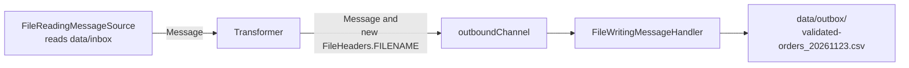
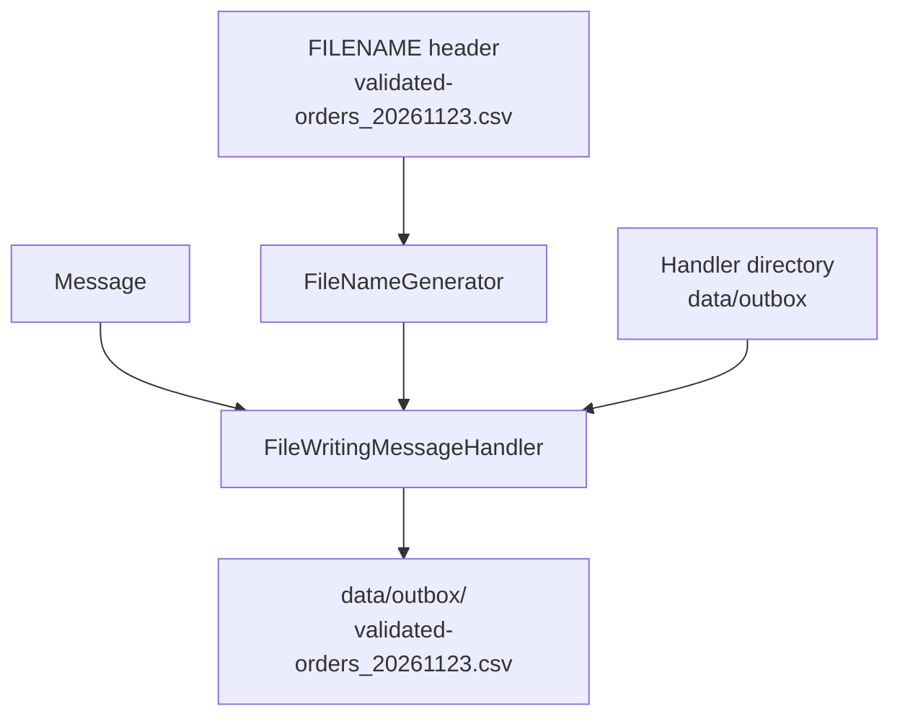

# FileHeaders and file paths in messages

## 1. Context and lesson objectives

In the **SPRING_INTEGRATION_ADAPTERS** module, external systems connect to Spring Integration via inbound/outbound adapters, gateways, pollers, and `MessageChannel`. When exchanging files, a message carries more than just the data to read or write: it can also carry **filename, original file reference, and relative path information**. Misunderstanding these details easily leads to reading the wrong file, overwriting the wrong location, or losing track of which files were processed.

In the **File Adapter** chapter, consider an application that ingests reports into `data/inbox` and exports validated copies to `data/outbox`:

```text
data/
├── inbox/
│   └── orders_20261123.csv
└── outbox/
    └── validated-orders_20261123.csv
```

The input may be `Message<File>`: the payload is the inbox file object, while headers supply related metadata. After a transformer, the payload may become `byte[]`, while a new header specifies **the filename to write in outbox**. Because payload types and file locations can change across endpoints, an explicit **message contract** is essential.

After this lesson, you will be able to:

- Distinguish between a `File` payload, filename, relative path, and absolute path.
- Recognize common headers in `org.springframework.integration.file.FileHeaders`, especially `FILENAME`, `ORIGINAL_FILE`, `RELATIVE_PATH`, and `SET_MODIFIED`.
- Explain when inbound adapters populate file metadata and when outbound adapters consume it.
- Construct new messages with `MessageBuilder` without accidentally losing or misusing source file metadata.
- Configure `FileWritingMessageHandler` with a fixed output directory and validated filenames.
- Design safe path handling, path-traversal prevention, duplicate-write protection, error handling, and idempotency.

## 2. Two parts of a Spring Integration message

Spring Messaging defines `Message<T>` as consisting of **payload** and **headers**:

```java
Message<File> message = ...;

File inputFile = message.getPayload();
Object inputName = message.getHeaders().get(FileHeaders.FILENAME);
```

The payload holds the primary data of the message. Headers are accompanying metadata fields used to describe or route the message. For files, a header is often very useful because downstream steps may have converted the payload from `File` to `byte[]`, `String`, or a business DTO.



A conceptual illustration:

```text
Inbound message:
  payload = File("data/inbox/orders_20261123.csv")
  headers[FileHeaders.FILENAME] = "orders_20261123.csv"

Message after transformer:
  payload = byte[] containing CSV content
  headers[FileHeaders.FILENAME] = "validated-orders_20261123.csv"
  headers["sourceAbsolutePath"] = ".../data/inbox/orders_20261123.csv"
```

Here, `sourceAbsolutePath` is an **application-defined header**, not a constant in `FileHeaders`. Never invent header names like `file_path` and assume Spring Integration will automatically understand them.

## 3. Key FileHeaders to understand

`FileHeaders` provides header names used by Spring Integration's File components. Not every endpoint automatically populates **all** of the headers below; check the adapter type, library version, and specific message path.

| Constant | Purpose | Typical value type | Notes |
| --- | --- | --- | --- |
| `FileHeaders.FILENAME` | Filename to reference or create | `String` | Usually the **leaf filename**, not an absolute path |
| `FileHeaders.ORIGINAL_FILE` | Reference to the original source file | `File` | Useful after payload transformation; not a guarantee the file still exists |
| `FileHeaders.RELATIVE_PATH` | Relative path associated with reading a file from a directory tree | Path information, typically a string | Especially relevant for recursive sources; do not assume always present |
| `FileHeaders.SET_MODIFIED` | Metadata to control the target file's last-modified timestamp when writing | Modification time value per endpoint contract | Not a header recording "business processing completion time" |

Additionally, every `Message<?>` has standard headers such as `MessageHeaders.ID`, `MessageHeaders.TIMESTAMP`, and possibly `replyChannel` and `errorChannel`. These identify/route messages and **do not represent file paths**.

### 3.1. FILENAME is a name, not a full path

Suppose a source reads `C:\app\data\inbox\orders_20261123.csv` or `/srv/app/data/inbox/orders_20261123.csv`. The header:

```text
FileHeaders.FILENAME = "orders_20261123.csv"
```

is insufficient to reconstruct the original file location. Two files in different directories can easily share the exact same `FileHeaders.FILENAME`. When you need to read the actual file, use the `File` payload or `FileHeaders.ORIGINAL_FILE` if supplied in that context.

### 3.2. ORIGINAL_FILE differs from the post-transformer payload

With a File inbound adapter, the initial payload is normally `java.io.File`. If a transformer reads the file and changes the payload to bytes/DTO, you may want to retain **source information** for auditing, error reconciliation, or archiving.

Do not assume `ORIGINAL_FILE` automatically stays on the message across every step: a transformer may build a fresh message without copying headers, and some routers/gateways have their own header-copying or filtering rules. Decide explicitly which metadata to preserve.

### 3.3. RELATIVE_PATH is for directory structures

Suppose a scanner picks up two files:

```text
data/inbox/partner-a/2026/11/orders.csv
data/inbox/partner-b/2026/11/orders.csv
```

Both have `FILENAME = "orders.csv"`. Relative path information, when supplied by the source, helps distinguish each file's context. However, **do not hardcode assumptions about the format** of `RELATIVE_PATH` (whether it includes the leaf filename, `/` vs. `\`, etc.) without inspecting actual messages.

If a write step needs to mirror the directory tree, normalize the relative path with `Path`, verify it stays beneath the **outbox root**, and enforce a policy on symbolic links. Never concatenate an external header directly onto an output path.

### 3.4. SET_MODIFIED does not replace message timestamps

`FileHeaders.SET_MODIFIED` sets the target file's last-modified attribute when supported by the handler. `MessageHeaders.TIMESTAMP` is when the message was created in Spring Messaging. These two values have different meanings: one belongs to filesystem metadata, the other to the message.

A successfully written file does not necessarily have a `lastModified` equal to business completion time. If you need to audit import times, store business state and timestamps separately in a database or appropriate metadata store.

## 4. Absolute paths, relative paths, and filenames

The following concepts are frequently confused:

| Concept | Linux example | Windows example | Purpose |
| --- | --- | --- | --- |
| Filename | `orders.csv` | `orders.csv` | Leaf name of the file |
| Relative path | `partner-a/orders.csv` | `partner-a\orders.csv` | Location relative to a defined root |
| Absolute path | `/srv/app/inbox/partner-a/orders.csv` | `C:\app\inbox\partner-a\orders.csv` | Exact location on a filesystem |
| Root directory | `/srv/app/inbox` | `C:\app\inbox` | Scanning or writing boundary |

Java example:

```java
File file = new File("data/inbox/orders.csv");

System.out.println(file.getName());
System.out.println(file.getPath());
System.out.println(file.getAbsolutePath());
System.out.println(file.toPath().toAbsolutePath().normalize());
```

- `getName()` returns only the leaf filename.
- `getPath()` returns the `File` object's path string, which may be relative.
- `getAbsolutePath()` resolves against the current working directory; it does not prove the file actually exists.
- `toAbsolutePath().normalize()` syntactically normalizes `.` and `..` segments. It **does not by itself protect against symlinks**.

With relative paths, the JVM working directory differs across IntelliJ, Maven, Docker, Windows services, or production environments. Never assume `new File("data/inbox")` always points to the project folder.

### Example of filename collisions

```text
inbox/
├── vendor-1/orders.csv
└── vendor-2/orders.csv
```

If an **import key** uses only `FILENAME = orders.csv`, both files will be treated as the same source. You may need to combine `relativePath + fileName`, partner code, file size, checksum, or a business ID. When deploying a recursive scanning filter, configure full-path file identification appropriately.

## 5. How does the File outbound adapter use names and directories?

`FileWritingMessageHandler` needs two distinct pieces of information:

1. **Destination directory**: configured on the handler, e.g., `data/outbox` or a directory expression.
2. **Destination filename**: determined by `FileNameGenerator`, usually from `FileHeaders.FILENAME` or the payload per configuration.



Do not put an entire absolute path into `FileHeaders.FILENAME` expecting the handler to perform security validation for you. If a name received from an external system contains `../secret.txt`, directory separators, or Windows drive paths, there is a risk of writing outside the intended directory unless the application validates it.

A good rule is **the handler controls the directory**, while the generator only returns a **valid basename**. When a subdirectory structure is genuinely needed, derive the directory from an allowed mapping instead of accepting raw path strings from the sender.

## 6. End-to-end Spring Boot example: keeping source path, renaming target file

Illustrative application:

1. Poll `data/inbox` for files named `orders_YYYYMMDD.csv`.
2. Receive `Message<File>` with source headers.
3. Transformer reads the file into `byte[]` and stores the source path in a dedicated audit header.
4. Transformer resets `FileHeaders.FILENAME` to `validated-orders_YYYYMMDD.csv`.
5. File outbound adapter validates the name again and writes to `data/outbox`.

Maven dependencies (versions managed by Spring Boot):

```xml
<dependencies>
    <dependency>
        <groupId>org.springframework.boot</groupId>
        <artifactId>spring-boot-starter-integration</artifactId>
    </dependency>
    <dependency>
        <groupId>org.springframework.integration</groupId>
        <artifactId>spring-integration-file</artifactId>
    </dependency>
</dependencies>
```

Java example using Java 17+:

```java
import java.io.File;
import java.io.IOException;
import java.nio.file.Files;

import org.springframework.context.annotation.Bean;
import org.springframework.context.annotation.Configuration;
import org.springframework.integration.annotation.InboundChannelAdapter;
import org.springframework.integration.annotation.Poller;
import org.springframework.integration.annotation.ServiceActivator;
import org.springframework.integration.channel.DirectChannel;
import org.springframework.integration.config.EnableIntegration;
import org.springframework.integration.core.MessageSource;
import org.springframework.integration.file.FileHeaders;
import org.springframework.integration.file.FileReadingMessageSource;
import org.springframework.integration.file.FileWritingMessageHandler;
import org.springframework.integration.file.filters.AcceptOnceFileListFilter;
import org.springframework.integration.file.filters.ChainFileListFilter;
import org.springframework.integration.file.filters.SimplePatternFileListFilter;
import org.springframework.integration.file.support.FileExistsMode;
import org.springframework.messaging.Message;
import org.springframework.messaging.MessageChannel;
import org.springframework.messaging.support.MessageBuilder;

@Configuration
@EnableIntegration
public class FileHeadersFlowConfig {

    @Bean
    public MessageChannel incomingFiles() {
        return new DirectChannel();
    }

    @Bean
    public MessageChannel outgoingBytes() {
        return new DirectChannel();
    }

    @Bean
    @InboundChannelAdapter(
        channel = "incomingFiles",
        poller = @Poller(fixedDelay = "2000", maxMessagesPerPoll = "3")
    )
    public MessageSource<File> fileSource() {
        FileReadingMessageSource source = new FileReadingMessageSource();
        source.setDirectory(new File("data/inbox"));

        ChainFileListFilter<File> filter = new ChainFileListFilter<>();
        filter.addFilter(new SimplePatternFileListFilter("orders_*.csv"));
        filter.addFilter(new AcceptOnceFileListFilter<>());
        source.setFilter(filter);
        return source;
    }

    @ServiceActivator(
        inputChannel = "incomingFiles",
        outputChannel = "outgoingBytes"
    )
    public Message<byte[]> prepareFile(Message<File> inbound)
            throws IOException {

        File sourceFile = inbound.getPayload();
        String sourceName = sourceFile.getName();

        if (!sourceName.matches("orders_[0-9]{8}\\.csv")) {
            throw new IllegalArgumentException(
                    "Source filename does not match convention: " + sourceName
            );
        }
        if (!sourceFile.isFile()) {
            throw new IllegalArgumentException(
                    "Source is not a file: " + sourceFile
            );
        }

        byte[] content = Files.readAllBytes(sourceFile.toPath());
        String targetName = "validated-" + sourceName;

        // Build a new message and EXPLICITLY retain needed metadata.
        MessageBuilder<byte[]> builder = MessageBuilder
                .withPayload(content)
                .setHeader(FileHeaders.FILENAME, targetName)
                .setHeader("sourceAbsolutePath",
                        sourceFile.toPath().toAbsolutePath()
                                .normalize().toString())
                .setHeader("sourceFileName", sourceName);

        Object relativePath =
                inbound.getHeaders().get(FileHeaders.RELATIVE_PATH);
        if (relativePath != null) {
            builder.setHeader(
                    "sourceRelativePath",
                    relativePath.toString()
            );
        }

        return builder.build();
    }

    @Bean
    @ServiceActivator(inputChannel = "outgoingBytes")
    public FileWritingMessageHandler fileOutput() {
        FileWritingMessageHandler handler =
                new FileWritingMessageHandler(new File("data/outbox"));

        handler.setAutoCreateDirectory(true);
        handler.setExpectReply(false);
        handler.setFileExistsMode(FileExistsMode.FAIL);
        handler.setTemporaryFileSuffix(".writing");

        handler.setFileNameGenerator(message -> {
            Object raw =
                    message.getHeaders().get(FileHeaders.FILENAME);
            if (raw instanceof String name
                    && name.matches(
                            "validated-orders_[0-9]{8}\\.csv"
                    )) {
                return name;
            }
            throw new IllegalArgumentException(
                    "Invalid destination filename"
            );
        });

        return handler;
    }
}
```

The configuration class must lie within `@SpringBootApplication`'s component scan scope or be imported into the Spring context. `data/inbox` must exist before the inbound source starts, and the process needs source read / destination write permissions. `outbox` can be created by the handler if permissions allow.

### Why not copy all input headers?

The example **creates a new** `Message<byte[]>` and forwards only the audit fields actually needed:

- `FileHeaders.FILENAME` is **overwritten** to refer to the **destination** filename.
- `sourceAbsolutePath` and `sourceFileName` describe the **source file**; these are application headers.
- `sourceRelativePath` is set only when the inbound message actually carries `FileHeaders.RELATIVE_PATH`.

Blindly copying all input headers could cause a downstream step to accidentally use the old `FileHeaders.FILENAME` and write to an unintended name, or retain `FileHeaders.ORIGINAL_FILE` causing a later step with `deleteSourceFiles` to act on the source file unexpectedly. Also avoid copying `MessageHeaders.ID` or `TIMESTAMP` as a substitute for a business import ID.

In some flows, you want to keep `FileHeaders.ORIGINAL_FILE` for post-processing archiving or cleanup; in that case **retain it intentionally** while controlling how downstream uses it. That is a message contract design decision, not a mandatory rule for every transformer.

### Role of the two filename validation steps

`SimplePatternFileListFilter("orders_*.csv")` lets the source skip files outside the general pattern. The transformer checks more strictly: exactly eight date digits. Outbound `FileNameGenerator` re-validates the **target filename** against convention. These steps protect different boundaries:

| Step | Checked data | Purpose |
| --- | --- | --- |
| Inbound filter | Filename on disk | Reduces unrelated files entering the flow |
| Transformer | Filename, file type, and content if needed | Verifies input satisfies business contract |
| FileNameGenerator | Output filename from message | Blocks writing files with invalid names or paths |

The regex `[0-9]{8}` confirms eight digits, **not a valid calendar date**. If the date affects business logic, parse it with `LocalDate` and `DateTimeFormatter` after basic validation.

## 7. Testing and observing headers

Create `data/inbox/orders_20261123.csv` with content:

```csv
order_id,total
OD-001,120000
OD-002,95000
```

Start Spring Boot. Once the poller picks up the file and writes successfully, expected layout:

```text
data/
├── inbox/
│   └── orders_20261123.csv
└── outbox/
    └── validated-orders_20261123.csv
```

In this example, the source file **is not deleted**. The handler receives a `byte[]` payload, `setDeleteSourceFiles(true)` is not enabled, and the output file takes its name from `FileHeaders.FILENAME` set by the transformer.

Try these scenarios:

1. **Valid name:** `orders_20261124.csv` → `validated-orders_20261124.csv`.
2. **Fewer than eight digits:** `orders_123.csv` passes `orders_*.csv` yet is rejected by the transformer.
3. **Temporary file being written:** `orders_20261125.csv.tmp` fails the filter and is ignored.
4. **Duplicate name in outbox:** if `validated-orders_20261123.csv` already exists, `FileExistsMode.FAIL` fails the write instead of silently overwriting.
5. **Restart:** because the example uses an in-memory `AcceptOnceFileListFilter`, the source file may be re-selected after restart; output collisions must then be handled.
6. **Changing payload type:** try changing the transformer output to a DTO. The File outbound handler does not automatically serialize arbitrary DTOs; a mapper/transformer must convert it back to a supported format.

When inspecting live messages, log **a curated set of headers** (do not dump all headers unconditionally). For example, inside `prepareFile`:

```java
System.out.println("payload.File = " + sourceFile.getAbsolutePath());
System.out.println("fileNameHeader = "
        + inbound.getHeaders().get(FileHeaders.FILENAME));
System.out.println("originalFileHeader = "
        + inbound.getHeaders().get(FileHeaders.ORIGINAL_FILE));
System.out.println("relativePathHeader = "
        + inbound.getHeaders().get(FileHeaders.RELATIVE_PATH));
```

Absolute paths can expose server directory layouts or partner names; in production, log only when necessary with proper access control and masking for sensitive data.

## 8. When using nested directories

With a recursive scanner, business rules may require routing files to a partner-specific target directory:

```text
inbox/partner-a/orders.csv  ->  outbox/partner-a/validated-orders.csv
inbox/partner-b/orders.csv  ->  outbox/partner-b/validated-orders.csv
```

This is a **directory routing** problem, not just renaming `FILENAME`. You can use `FileWritingMessageHandler`'s directory expression or a router selecting a handler per authorized area. For instance, parse/validate `partnerId` from the relative path, then map it:

```java
import java.nio.file.Path;
import java.util.Map;

Path outRoot = Path.of("data/outbox")
        .toAbsolutePath().normalize();
Map<String, String> allowedPartners = Map.of(
        "partner-a", "partner-a",
        "partner-b", "partner-b"
);

String partner = "partner-a"; // Validated value.
String folder = allowedPartners.get(partner);
if (folder == null) {
    throw new IllegalArgumentException("Partner not allowed");
}

Path targetDirectory = outRoot.resolve(folder).normalize();
if (!targetDirectory.startsWith(outRoot)) {
    throw new IllegalArgumentException("Path escapes outbox");
}
```

This is an **illustration of directory-selection logic**, not a complete handler bean. When using directory expressions in practice, pass only a `File`/`Path` validated through an allowlist into the expression. `normalize()` + `startsWith()` protects far better than raw string concatenation, yet does not eliminate **symlink** risks on its own; verify real paths and filesystem permissions if sources are untrusted.

If a consumer re-reads a file from relative metadata, anchor it against an **authorized root directory** rather than opening an arbitrary path supplied by a message.

## 9. SET_MODIFIED and managing file modification times

Some file-exchange workflows need to preserve or set the output file's timestamp:

- The sender asks the recipient to keep the source's `lastModified`.
- The system identifies the latest snapshot by timestamp.
- A sync flow updates a file when the source timestamp differs from the target timestamp.

`FileWritingMessageHandler` can be configured to **preserve source file modification time** when the payload is a `File`, for example:

```java
handler.setPreserveTimestamp(true);
```

For messages no longer carrying a `File` payload, `FileHeaders.SET_MODIFIED` can pass modification timestamp metadata to the handler per the corresponding API and version contract. Do not confuse this field with `MessageHeaders.TIMESTAMP` or business timestamps inside the CSV.

**Warning:** File timestamps have filesystem-dependent precision, can change during copies/downloads, and are not content fingerprints. If strict version-based deduplication is required, use a dedicated **hash, export ID, or version ID**.

## 10. Security: never trust external paths or filenames

Typical failure modes:

| Unwanted input | Risk | Control |
| --- | --- | --- |
| `../config.yml` | Escapes the intended target directory | Disallow paths in filenames; validate basename |
| `C:\Windows\...` | Absolute path from an untrusted source | Forbid path separators/drive letters in names |
| `folder/../../secret.csv` | Path traversal via relative path | Resolve against root, normalize, check real path and allowlist |
| Two partners both send `orders.csv` | Filename collision, misattributed partner | Combine partner ID with business key and path |
| Source file is a symlink | Reads outside inbox or points to sensitive areas | Least-privilege OS permissions and symlink policy |
| Valid name but spoofed content | Corrupt or malicious data ingested | Parse/schema validation, size limits, source verification |

Never pass `FileHeaders.ORIGINAL_FILE` or `sourceAbsolutePath` from an untrusted source directly into a file-deletion API. If an archive/cleanup step exists, it must verify the path lies within an authorized area alongside import ID and access permissions.

The `FILENAME` header is merely metadata and **does not authenticate the sender**. With SFTP, HTTP, JMS, AMQP, Kafka, or databases, each adapter also has its own authentication, routing, and confirmation contracts. Never rely on a self-declared header in place of endpoint authorization.

## 11. Errors, retries, and file lifecycle

After a file is selected at the inbound source, many things can fail:

| Stage | Possible failures | Required action |
| --- | --- | --- |
| Scanning inbox | Wrong path, missing read permission | Verify working directory, permissions, and poller |
| Reading file | File deleted, mid-write, wrong encoding/format | Temp file + rename, content validation, and exception handling |
| Creating new message | Lost `FILENAME`, accidentally retained source headers | Verify transformer message contract |
| Writing outbox | Name collision, disk full, no write permission | `FileExistsMode` and controlled recovery mechanisms |
| Restart | In-memory filter forgets selected files | Persistent metadata or durable business state |
| Downstream processing | Database/broker fails to commit even though file was written | Independent status tracking, retries/idempotency |

### Do not treat FileHeaders as successful processing state

`FileHeaders.FILENAME` can help identify a file, yet it cannot tell you:

- Has the file finished writing or is it still changing?
- Did the consumer parse the CSV successfully?
- Did the database commit?
- Has the external system pulled the file from outbox?
- Is this retry a redelivery of the exact same job?

A production flow might track states like:

```text
DISCOVERED -> VALIDATED -> EXPORTED -> ACKNOWLEDGED
                    |
                    +----> FAILED / RETRY_PENDING
```

Here `ACKNOWLEDGED` is set only upon **explicit confirmation** from the recipient, not merely because the file appeared on disk. Store `importId`/`exportId`, source name, normalized path, checksum, processing time, and status. On retry, verify whether an existing destination file matches the ID/checksum before writing.

## 12. Common Misconceptions

**"The `FILENAME` header is an absolute path."** Usually not. It is the filename; the actual directory is determined by the source or writing handler.

**"Changing payload from `File` to `byte[]` makes headers disappear automatically."** It depends on how the transformation step builds the message. To preserve or change metadata, make it explicit in code with `MessageBuilder`.

**"If `ORIGINAL_FILE` is present, the source file definitely still exists."** No. The source file may be moved, deleted, or modified between message creation and consumer execution.

**"If `RELATIVE_PATH` is present, you can write directly to any relative path."** No. It must be anchored to an authorized root, validated, and checked against path traversal/symlinks.

**"`MessageHeaders.TIMESTAMP` and `SET_MODIFIED` are the same value."** No. One belongs to the message, the other to the file's modification-time metadata.

**"Renaming the output file is enough to prevent duplicates."** No. Retries can generate a new name for the same content, or reuse the same name for different content. You need import/export IDs and business-layer idempotency.

## 13. Hands-on Exercises

1. **Observe inbound headers:** place `orders_20261123.csv` into inbox and selectively log `FILENAME`, `ORIGINAL_FILE`, and `RELATIVE_PATH`. Explain which headers are present or absent in the actual configuration.
2. **Rename output:** replace the `validated-` prefix with `accepted-`, updating the generator validation accordingly. Verify the file in outbox has the expected name.
3. **Prevent path traversal:** send a test message with `FileHeaders.FILENAME="../secret.txt"` directly into the output channel. Ensure the generator rejects it.
4. **Payload transformation:** change the transformer to emit a `String` or DTO, then add an appropriate serialization step before the file outbound handler.
5. **Duplicate names in two subdirectories:** create `partner-a/orders.csv` and `partner-b/orders.csv`. Design output naming and import keys without losing partner identity.
6. **Preserve audit metadata:** create a new message with `MessageBuilder`, keeping `sourceAbsolutePath` and `sourceFileName`; avoid accidentally keeping the source path as the destination filename.
7. **Restart test:** process a file, leave it in inbox, and restart. Explain why an in-memory accept-once filter can pick up the file again.
8. **File modification time:** compare `File.lastModified()`, `MessageHeaders.TIMESTAMP`, and `FileHeaders.SET_MODIFIED` in a copy scenario; describe the meaning of each value.
9. **Retry after write failure:** pre-create the target file, run the flow with `FileExistsMode.FAIL`, and propose a strategy to verify checksum/import ID before retrying.

### Self-Check Questions

**Q1. How do a `File` payload and `FileHeaders.FILENAME` differ?**  
A `File` payload represents the file object and its path; `FILENAME` is typically just the filename used in the message contract.

**Q2. What should you do when you need to preserve the source path across a transformer?**  
Create a new message with explicit audit headers, or intentionally forward the appropriate source header; never assume metadata will always remain intact.

**Q3. Why can two files in different directories have the same `FILENAME`?**  
Because `FILENAME` is the leaf name and does not include the full file location.

**Q4. Should `RELATIVE_PATH` be used directly to write files?**  
No. It must be scoped inside an allowed root, validated, and checked for path traversal/symlinks.

**Q5. Is `FileHeaders.SET_MODIFIED` equivalent to the message creation timestamp?**  
No. It controls file modification-time metadata, whereas the message creation timestamp belongs to `MessageHeaders`.

**Q6. Why can't FileHeaders alone guarantee exactly-once?**  
Because headers describe the message/file, not business transaction commits; durable state, retries, and idempotency are still required.

## 14. Key Takeaways

**FileHeaders** are an essential part of file message contracts in Spring Integration: `FILENAME` specifies the filename, `ORIGINAL_FILE` can hold the source file reference, `RELATIVE_PATH` is useful when the source scans subdirectories, and `SET_MODIFIED` governs target file modification-time metadata. **A filename is not a full path**, and headers do not prove a file was processed successfully.

In a File inbound → transformer → File outbound flow, explicitly define **payload type, source headers, target headers, actual directories, and valid naming rules**. When integrating downstream with SFTP, HTTP, JMS, AMQP, Kafka, or databases, keep message contracts clear, reject untrusted paths, and design errors/retries/idempotency per endpoint.

### References

- [Spring Integration Reference — Reading Files](https://docs.spring.io/spring-integration/reference/file/reading.html)
- [Spring Integration Reference — Writing Files](https://docs.spring.io/spring-integration/reference/file/writing.html)
- [Spring Integration API — FileHeaders](https://docs.spring.io/spring-integration/api/org/springframework/integration/file/FileHeaders.html)
- [Spring Integration API — FileWritingMessageHandler](https://docs.spring.io/spring-integration/api/org/springframework/integration/file/FileWritingMessageHandler.html)
