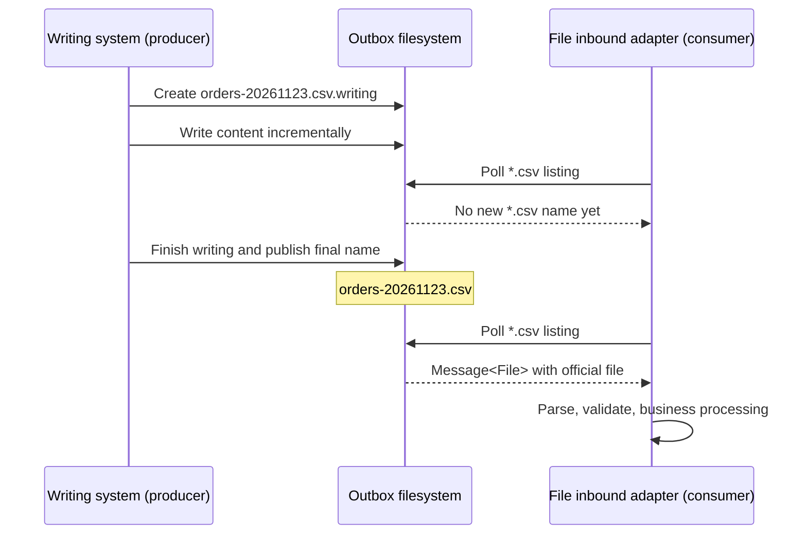
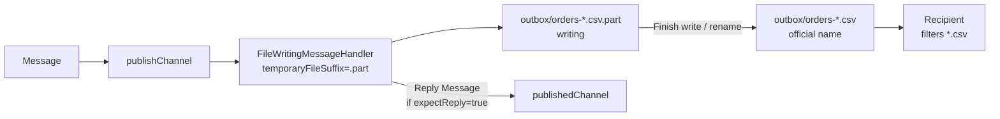

# Temporary file suffix and atomic operations

## 1. Problem statement: a file appears before writing finishes

In the **SPRING_INTEGRATION_ADAPTERS** module, Spring Integration connects external systems through inbound/outbound adapters, gateways, pollers, and `MessageChannel`. When exchanging files, the hard part is not merely writing bytes to disk: **the recipient must know when a file is complete enough to begin processing**. This lesson belongs to the **File Adapter** chapter and focuses on `temporary file suffix`, file publication mechanics, and the limits of filesystem atomicity.

Suppose Application A exports a 100 MB order report. Application B runs a File inbound adapter polling the shared directory every second:

```text
data/outbox/
└── orders-20261123.csv
```

If A immediately creates `orders-20261123.csv` and takes 30 seconds to write all the content, B may see the filename in the first second and **read an incomplete report**. The `*.csv` filter only inspects the filename; it does not know whether the writer has closed the data stream.

A better convention is writing under a **temporary name**:

```text
Stage 1: orders-20261123.csv.writing    (writing)
Stage 2: orders-20261123.csv            (published)
```

The reader selects only `*.csv`, ignoring `*.writing`. Only when the writer finishes writing and renames the file does it become eligible for processing.

### Learning Objectives

After this lesson, you will be able to:

- Describe the **write temporary → rename final** mechanism in Spring Integration File.
- Use `FileWritingMessageHandler.setTemporaryFileSuffix(...)` to customize the temporary suffix.
- Distinguish **atomic visibility of a rename** from **durability, exactly-once, and end-to-end transactions**.
- Understand the impact of `FileExistsMode`, especially `REPLACE`, `FAIL`, `IGNORE`, `APPEND`, and `APPEND_NO_FLUSH`.
- Coordinate the writer and the reader's File inbound adapter via a filename contract.
- Identify leftover temporary files after crashes, filename conflicts, writer contention, and network filesystem risks.
- Design retries, recovery, monitoring, testing, and output path protection.

## 2. Difference between an incomplete file and a ready file

File export typically has three distinct moments:

1. **Start writing:** the file appears and its size grows.
2. **Finish writing:** the application closes the stream or completes the write operation.
3. **Publish:** the file gets the official name the recipient is permitted to process.

With temporary names, these three moments are clearly separated. The recipient does not have to guess that a file is old enough or unchanged for a few seconds to be considered complete.



**A temporary suffix is a coordination convention between writer and reader**, not a business transaction. The reader must still verify that the file is readable, its schema is valid, and its content is complete per contract.

## 3. FileWritingMessageHandler and temporary file suffix

Spring Integration File uses `FileWritingMessageHandler` to write `File`, `String`, `byte[]`, and `InputStream` payloads to the filesystem. It can act as:

| Configuration | Meaning |
| --- | --- |
| File outbound **channel adapter** | Writes the file and ends the export step; `expectReply=false` |
| File outbound **gateway** | Writes the file and emits a reply message with the target `File` payload; `expectReply=true` |

For standard file creation/writing operations, the handler uses **`.writing`** as the default temporary suffix. The Java API lets you change it:

```java
FileWritingMessageHandler handler =
        new FileWritingMessageHandler(new File("data/outbox"));

handler.setTemporaryFileSuffix(".part");
```

For a target filename `orders-20261123.csv`, the file while being written appears as `orders-20261123.csv.part` and is published under its final name once the handler finishes.

In the XML namespace, both file outbound channel adapter and outbound gateway have the `temporary-file-suffix` attribute. In Java DSL, `FileWritingMessageHandlerSpec` supports `temporaryFileSuffix(...)`. The Java config example in this lesson calls `setTemporaryFileSuffix` directly to avoid depending on a specific DSL syntax.

### Components in the flow



`FileHeaders.FILENAME` is typically used to determine the **destination filename** via `FileNameGenerator`. This is a filename, not a path validation mechanism. The output directory is configured on the handler or via a directory expression; never accept arbitrary write paths from untrusted sources.

## 4. What does "atomic" mean in this context?

An **atomic operation** means an operation is observed as an indivisible step within the system's guarantees: an observer never sees an intermediate state of **that operation itself**.

For example, if the filesystem supports atomic rename and writing occurs within an eligible region:

```text
Before rename: orders.csv.part exists; orders.csv has not appeared yet
After rename:  orders.csv appears; .part name is gone
```

A reader scanning official names can avoid seeing a **partial write** under the official name. However, this **does not mean**:

- Writing 100 MB of data is an atomic operation.
- The file is guaranteed to have been `fsync`ed/durably flushed to storage hardware.
- Moving across two different filesystems/volumes is also atomic.
- Every network filesystem, Windows share, or sync tool has identical semantics.
- The consumer processes only once or the database has committed.
- Two writers outputting the same filename are safely coordinated.

Temporary naming and final renaming is an **atomic publication** technique under supported conditions; it does not turn all I/O in the chain into a single transaction.

### Three levels of guarantees to distinguish

| Property | Question | Does temporary suffix solve it? |
| --- | --- | --- |
| **Visibility** | Can the reader see the official name while the file is still being written? | Significantly reduces risk when the writer publishes only after completion |
| **Durability** | After power loss, are the bytes and filename truly persisted? | Not guaranteed automatically; depends on filesystem, flush/fsync, and hardware |
| **Business atomicity** | Do file write, database write, and broker send commit/rollback together? | No; requires recovery workflows, idempotency, or another protocol |

Spring Integration supports writing via a temp name and renaming; the **actual atomicity** of publication must be verified on the target OS, filesystem, and deployment path. Never promise "every file is always safe" solely because `.writing` is used.

## 5. Complete Spring Boot configuration: writing files with a temporary suffix

The example uses Java 17+, Spring Boot, and Spring Integration File. In Maven, use dependencies whose versions are managed by Spring Boot:

```xml
<dependencies>
    <dependency>
        <groupId>org.springframework.boot</groupId>
        <artifactId>spring-boot-starter-integration</artifactId>
    </dependency>
    <dependency>
        <groupId>org.springframework.integration</groupId>
        <artifactId>spring-integration-file</artifactId>
    </dependency>
</dependencies>
```

The Java code below includes an inbound message channel, a file outbound gateway, and a consumer receiving the `File` after writing:

```java
import java.io.File;
import java.nio.charset.StandardCharsets;

import org.springframework.beans.factory.annotation.Qualifier;
import org.springframework.boot.ApplicationRunner;
import org.springframework.context.annotation.Bean;
import org.springframework.context.annotation.Configuration;
import org.springframework.integration.annotation.ServiceActivator;
import org.springframework.integration.channel.DirectChannel;
import org.springframework.integration.config.EnableIntegration;
import org.springframework.integration.file.FileHeaders;
import org.springframework.integration.file.FileWritingMessageHandler;
import org.springframework.integration.file.support.FileExistsMode;
import org.springframework.messaging.MessageChannel;
import org.springframework.messaging.support.MessageBuilder;

@Configuration
@EnableIntegration
public class AtomicFilePublishConfig {

    @Bean
    public MessageChannel publishChannel() {
        return new DirectChannel();
    }

    @Bean
    public MessageChannel publishedChannel() {
        return new DirectChannel();
    }

    @Bean
    @ServiceActivator(
        inputChannel = "publishChannel",
        outputChannel = "publishedChannel"
    )
    public FileWritingMessageHandler writeReportGateway() {
        FileWritingMessageHandler handler =
                new FileWritingMessageHandler(new File("data/outbox"));

        handler.setAutoCreateDirectory(true);
        handler.setExpectReply(true);
        handler.setFileExistsMode(FileExistsMode.FAIL);
        handler.setTemporaryFileSuffix(".part");

        // Do not allow external messages to specify arbitrary paths.
        handler.setFileNameGenerator(message -> {
            Object raw = message.getHeaders()
                    .get(FileHeaders.FILENAME);
            if (raw instanceof String name
                    && name.matches("orders-[0-9]{8}\\.csv")) {
                return name;
            }
            throw new IllegalArgumentException(
                    "Invalid report file name"
            );
        });
        return handler;
    }

    @ServiceActivator(inputChannel = "publishedChannel")
    public void onReportPublished(File completedFile) {
        System.out.println(
                "Published: " + completedFile.getAbsolutePath()
        );
        // Can record metrics, audit logs, or emit notification events.
    }

    @Bean
    public ApplicationRunner sendSample(
            @Qualifier("publishChannel") MessageChannel channel) {
        return args -> {
            String csv = "id,total\n"
                    + "ORD-001,150000\n"
                    + "ORD-002,220000\n";

            boolean accepted = channel.send(
                    MessageBuilder
                            .withPayload(
                                    csv.getBytes(StandardCharsets.UTF_8)
                            )
                            .setHeader(
                                    FileHeaders.FILENAME,
                                    "orders-20261123.csv"
                            )
                            .build()
            );
            if (!accepted) {
                throw new IllegalStateException(
                        "Message not accepted by publishChannel"
                );
            }
        };
    }
}
```

The `AtomicFilePublishConfig` class must lie within `@SpringBootApplication`'s component scan scope or be imported into the context. For a handler bean in Java config, Spring manages the endpoint lifecycle; there is no need to invoke `handleMessage(...)` manually.

### Explanation of each setting

| Setting | Effect |
| --- | --- |
| `setAutoCreateDirectory(true)` | Creates `data/outbox` if it does not exist and permissions allow |
| `setExpectReply(true)` | Sends a `Message<File>` reply once writing finishes |
| `setTemporaryFileSuffix(".part")` | Uses temporary name `orders-20261123.csv.part` while writing |
| `setFileExistsMode(FileExistsMode.FAIL)` | Rejects the write if the destination name already exists per handler policy |
| `setFileNameGenerator(...)` | Allows only a contract-compliant basename, reducing path-traversal risk |
| `FileHeaders.FILENAME` | Output filename supplied by the message and checked by the generator |

The example fixes the name `orders-20261123.csv` for easy verification. **On a second startup** in the same directory, if the target file still exists, it will fail due to `FAIL`. This is intentional behavior to prevent accidental overwrites, not a bug in temporary suffixes. When retesting, use a new report name or a separate test directory.

### Why use an outbound gateway in the example?

Because `expectReply=true`, `onReportPublished(...)` receives the resulting `File` object. If you simply need to write and stop, set `expectReply=false` and remove `outputChannel` / the reply consumer; the endpoint then behaves as a **file outbound channel adapter**. In both modes, the temporary naming policy applies to the write operation.

Do not infer that a reply means the external partner has received the file. The internal reply relates only to the handler's write step; the recipient may still be shut down or have not polled the file yet.

## 6. Testing and verifying filenames

Start the application with `data/outbox` free of an identically named report. During writing, a file with the `.part` suffix may exist briefly; once complete, expected state:

```text
data/outbox/
└── orders-20261123.csv
```

Expected content:

```csv
id,total
ORD-001,150000
ORD-002,220000
```

Because the example is small, the write may complete before you can observe the `.part` file. Not seeing the temporary file with the naked eye **does not mean** the temporary naming mechanism was skipped.

### Tests to perform

1. **Empty directory:** run the application and verify only the official name remains after success.
2. **Duplicate filename:** keep `orders-20261123.csv` and rerun. Expect an error from `FileExistsMode.FAIL`.
3. **Invalid name:** change `FileHeaders.FILENAME` to `../config.yml`. The generator must reject it before writing.
4. **Different suffix:** replace `setTemporaryFileSuffix(".part")` with `setTemporaryFileSuffix(".writing")`; the temporary name changes while the official name stays the same.
5. **Large file:** send a larger payload while a reader continuously watches the directory; verify the reader picks up `*.csv` only after the file completes.
6. **Disk full / write permissions:** test in a controlled directory with restricted permissions or quota; observe the exception and that a temp file may remain after failure.

> The code above is a configuration example, not logs captured from a live run. Never intentionally trigger disk-full conditions or delete files in production to test.

## 7. Coordinating with a File inbound adapter on the receiving side

The reader must **agree on the filename convention**. For example, configure `FileReadingMessageSource` to accept only `*.csv`:

```java
import java.io.File;

import org.springframework.integration.file.FileReadingMessageSource;
import org.springframework.integration.file.filters.ChainFileListFilter;
import org.springframework.integration.file.filters.SimplePatternFileListFilter;
import org.springframework.integration.file.filters.AcceptOnceFileListFilter;

FileReadingMessageSource source = new FileReadingMessageSource();
source.setDirectory(new File("data/outbox"));

ChainFileListFilter<File> filters = new ChainFileListFilter<>();
filters.addFilter(new SimplePatternFileListFilter("*.csv"));
filters.addFilter(new AcceptOnceFileListFilter<>());
source.setFilter(filters);
```

This is a **source configuration snippet** meant to be placed in an inbound endpoint with a poller or a separate `IntegrationFlow`; it is not a required second bean inside the writer application from section 5.

| File seen in outbox | Result of `*.csv` | Reason |
| --- | --- | --- |
| `orders-20261123.csv.part` | Ignored | Name ends with `.part` |
| `orders-20261123.csv.writing` | Ignored | Name ends with `.writing` |
| `orders-20261123.csv` | Accepted | Matches `.csv` extension |
| `orders-20261123.csv.bak` | Ignored | Has `.bak` suffix |
| `readme.txt` | Ignored | Does not match name format |

`AcceptOnceFileListFilter` prevents re-emitting the same file during a single run; it **does not confirm** the file was parsed or written to the database successfully. If history must persist across restarts, use a durable metadata store and track business state separately.

### When the writer is not managed by Spring Integration

If an external partner writes directly to `*.csv` from the start, the `*.csv` filter **is insufficient** to prevent reading partial files. Both systems must agree on a publication technique, such as:

- Writing `*.tmp` and renaming to `*.csv` after closing the file.
- Creating a `*.done` marker only after writing the data file succeeds; the reader checks for the marker.
- When the sender cannot be changed, consider a last-modified time filter or file-stability mechanism; this only mitigates risk and is not an absolute guarantee.

Spring Integration provides `FileSystemMarkerFilePresentFileListFilter` for marker-file contracts. When using markers, clearly specify naming conventions, when markers are created, marker cleanup/rotation procedures, and handling of stale markers left from previous runs.

## 8. FileExistsMode and interaction with suffixes

`FileExistsMode` governs what happens when the output filename already exists. Picking the wrong mode can defeat the goal of "only publishing complete files."

| Mode | Behavior toward target file | Relation to temporary names |
| --- | --- | --- |
| `REPLACE` | Replaces target file content; default | Normally writes temp file then publishes; understand impact on readers of replacing an existing file |
| `REPLACE_IF_MODIFIED` | Rewrites when source and target timestamps differ per handler rules | Based on file modification time, not checksums |
| `FAIL` | Throws an exception if destination already exists | Prevents silent overwrites; requires retry and conflict handling |
| `IGNORE` | Ignores new payload when destination already exists | When using temp suffixes, may ignore if **either the final or temp name** already exists |
| `APPEND` | Appends data directly to the existing file | **Ignores temporary-file-suffix**; target file may be read between appends |
| `APPEND_NO_FLUSH` | Appends without flushing/closing after each message | Provides no per-message publication boundary via rename; risks losing unflushed data |

### IGNORE and leftover temporary files

Suppose the application previously stopped mid-write:

```text
data/outbox/
└── orders-20261123.csv.part
```

On retry with `FileExistsMode.IGNORE`, the handler may **ignore the new payload because the temporary file still exists**, even though `orders-20261123.csv` does not exist yet. Therefore, never rely on `IGNORE` as an automatic recovery mechanism for an interrupted write.

A long-lived `.part` file requires investigation: which writer owns it, is the process still running, is the file still open, what are its size and checksum? Never blindly rename an unverified temporary file to its final name.

### How do FAIL and REPLACE differ?

- With `FAIL`, an existing official file with the same name causes the new write to fail. Suits a model where **each report ID has one immutable file**.
- With `REPLACE`, the writer can publish an updated version under the same name. Readers that already opened the old file or are mid-read can observe platform-dependent behavior; you must design versioning, reader locking, or replacement procedures.
- With `REPLACE_IF_MODIFIED`, the timestamp can come from a `File` payload or `FileHeaders.SET_MODIFIED` for other payloads. Equal modification times do not mean identical content; verify checksums when needed.

In multi-partner systems, include **report ID or version** in the filename and use `FAIL` to avoid collisions. Use `REPLACE` only when the contract explicitly allows replacing published files.

## 9. APPEND: no rename boundary per record

For example, a `String` message appended to `daily-events.csv`:

```java
handler.setFileExistsMode(FileExistsMode.APPEND);
handler.setTemporaryFileSuffix(".part"); // Has no effect with APPEND
```

In this mode, data is appended directly to the existing file. A reader scanning the file can see **a partial new record** if the writer has not finished the append. `APPEND_NO_FLUSH` also keeps buffers/files open to increase throughput, risking loss of unflushed content if the process crashes.

If you want one file containing multiple messages while ensuring readers only read after the **entire batch** finishes, use one of these approaches:

1. The writer aggregates the batch in memory or in a separate staging file, then outputs a **final file** via rename.
2. The writer appends to a staging file, closes it when the batch completes, and publishes the final name using a verified filesystem mechanism.
3. The writer emits a `*.done` marker by contract, and the reader begins processing only when the marker is present.

Merely setting a temporary suffix on a handler using `APPEND` does not create a "write complete" barrier per message.

## 10. Real atomic moves via Java NIO when needed

When an application **does not use `FileWritingMessageHandler`** and writes files directly, Java NIO allows requesting an atomic rename:

```java
import java.io.IOException;
import java.nio.charset.StandardCharsets;
import java.nio.file.AtomicMoveNotSupportedException;
import java.nio.file.Files;
import java.nio.file.Path;
import java.nio.file.StandardCopyOption;

Path outbox = Path.of("data/outbox").toAbsolutePath().normalize();
Files.createDirectories(outbox);

Path staging = outbox.resolve("orders-20261123.csv.part");
Path published = outbox.resolve("orders-20261123.csv");

// Demo runs only when staging and published names are managed separately.
Files.writeString(staging, "id,total\nORD-001,150000\n",
        StandardCharsets.UTF_8);

try {
    Files.move(staging, published, StandardCopyOption.ATOMIC_MOVE);
} catch (AtomicMoveNotSupportedException ex) {
    throw new IOException(
            "Filesystem does not support atomic move; file not published",
            ex
    );
}
```

This is a **standalone Java NIO example**, not a required configuration for `FileWritingMessageHandler` to work. When specifying `ATOMIC_MOVE`, the application asks the filesystem to perform an atomic move. If unsupported, the example **refuses to publish** rather than silently falling back to a non-atomic operation.

Understand the limitations:

- Placing staging and published files on the **same filesystem** is an essential practical requirement; moving across volumes typically does not support atomic move.
- With `ATOMIC_MOVE`, behavior when the **target file already exists** can be implementation-dependent. Do not rely on this snippet alone to prevent overwrites with multiple writers.
- If multiple writers could share a staging name, use per-session unique staging names and ownership/locking, and verify who is authorized to publish the final name.
- `ATOMIC_MOVE` **does not automatically sync bytes and metadata to storage hardware**. If durability across power loss is needed, evaluate flushing/fsyncing both the file and parent directory for your platform.
- `Files.writeString` in the example can overwrite staging content if it already exists. Run only with dedicated test paths; in production, prefer creating staging files with unique names and `CREATE_NEW`.

**Key point:** `FileWritingMessageHandler` manages temporary filename conventions for integration flows; Java NIO offers an API-level option to request an atomic move. Neither approach creates a transaction spanning database or broker operations.

## 11. Crashes and retries: states to distinguish

Suppose the application stops at different points:

| Failure point | File state that may remain | Handling approach |
| --- | --- | --- |
| Before writing starts | Neither temp nor final file exists | Retry with the same report ID |
| Mid-write to temp file | Incomplete `*.part` | Investigate writer, clean up/rewrite after confirming no longer active |
| Write finished before rename | Temp file may be complete, final name absent | Check checksum/size and publication preconditions before retrying |
| Rename succeeded, app crashed before DB status update | Final file exists, DB does not reflect result | Reconcile by file/report ID and update state idempotently |
| Final file read by partner without ACK | Producer does not know partner processed it | Require dedicated ACK, timeout window, and reconciliation |
| Two writers use the same name | Temp/target file collision, overwrite or failure | Enforce ownership, unique names, and contention rules |

### Recovery is not "rename every `.part` file"

Never assume every `*.part` file finished writing. A temporary file may be truncated mid-CSV-line or unflushed. At a minimum:

1. Determine whether the writer is dead or still active (PID, lease/lock, or coordinator state).
2. Reconcile report ID, expected size, checksum, or record count.
3. Check whether the final name already exists and carries the same data version.
4. If the data is untrustworthy, quarantine the temp file and rerun from a durable source.
5. If eligible for publication, execute in a controlled manner and record audit and business status.

Automatic cleanup rules must avoid deleting a temp file belonging to an active writer; relying solely on "file older than N minutes" can fail for very large exports or congested I/O.

## 12. Atomicity, idempotency, and business state

A report-publishing workflow might use states such as:

```text
CREATED -> WRITING_TEMP -> PUBLISHED -> ACKNOWLEDGED
               |
               +----> FAILED / RETRY_PENDING
```

Where:

- `WRITING_TEMP`: writer is preparing content; file is not yet ready for the partner.
- `PUBLISHED`: final filename has been published under filesystem rules.
- `ACKNOWLEDGED`: partner **confirmed receipt/processing** via a dedicated protocol; never inferred from file rename.
- `FAILED`: technical or business error needing handling/investigation.

For each report, store `reportId`, `version`, `targetFile`, `checksum`, `status`, `attemptCount`, and `lastError`. On retry, before writing again:

1. Check if the final file already exists.
2. If it exists, match report ID/checksum and status.
3. If it matches the expected copy, treat publication as complete instead of overwriting.
4. If it does not match, stop and report a conflict; do not use `IGNORE` to mask errors.

There is no shared atomic transaction across **file writing, database updates, and Kafka/JMS/AMQP notifications** solely from temporary suffixes. When high reliability is required, use recovery workflows, the outbox pattern, or message sources with endpoint-appropriate replay/ack semantics.

## 13. Performance, locking, and security considerations

### Multiple writers and colliding temp names

If two instances both create `orders-20261123.csv.part`, adding a suffix does not partition ownership. A handler with `FileExistsMode.FAIL` helps catch collisions, yet correctness under race conditions still depends on the filesystem and locks. Assign one writer per report ID or use unique staging names per execution ID with a coordinated publication step.

### Untrusted directories and filenames

`FileHeaders.FILENAME` can originate from a partner's message. Never accept names containing `../`, path separators, or absolute paths directly. The lesson's example accepts only `orders-[0-9]{8}\\.csv`. For dynamic directories, map partner codes against an allowlisted root; check normalized paths, real paths, and symlink policies.

### Network filesystems

On NFS/SMB or cloud-synced folders, **renames, metadata caching, and client visibility timing** can differ from local filesystems. Cached or asynchronously synced systems can cause final names to appear late or in unexpected states. Test against the exact mount type and OS used in production and collect publish-to-consume latency metrics.

### Throughput and large files

For large files, reading/writing directly via `byte[]` increases JVM memory pressure. Use `File` or `InputStream` payloads where appropriate, while managing stream ownership, retryability, and source file lifecycle. If you need the destination path returned after writing, configure an outbound gateway; if you only need to publish without a reply, use a channel adapter.

## 14. Troubleshooting

| Symptom | Possible causes | Remediation |
| --- | --- | --- |
| Reader receives incomplete file | Writer writes directly to final name or reader fails to exclude temp names | Standardize temp suffix/marker and inbound filter |
| Temp file never observed during test | Small file written too quickly | Check final filename and config; test with larger files |
| Only `*.part` seen, no final name | Writer errored, stopped, or rename failed | Inspect exceptions, permissions, disk space, and filesystem |
| Retry does not rewrite file | `FAIL` or `IGNORE` with existing final/temp file | Reconcile state; do not delete or rename blindly |
| Reader still sees partial reads under `APPEND` | `APPEND` ignores temporary suffix | Use batch staging or marker files |
| Final file exists while DB reports unexported | Crash after rename before DB update | Run recovery by report ID/checksum |
| Two pods write to the same file | Missing ownership, non-unique staging names | Coordinate a single writer, locks, and publication rules |
| Rename fails on network share | Rename limitations, permissions, mount, or file locks | Test directly and adjust publication convention if needed |
| Partner does not see file despite handler reply | Partner has not polled yet, caching, or network delay | Distinguish internal reply from recipient ACK |

## 15. Hands-on Exercises

1. **Default suffix:** remove `setTemporaryFileSuffix(".part")` and explain the `.writing` name the handler uses.
2. **Custom suffix:** use `.uploading`, add a reader accepting only `*.csv`, and verify temporary files are ignored.
3. **Filename collision:** send two messages creating the same `orders-20261123.csv` with `FAIL`. Observe the error and design a unique report ID rule.
4. **IGNORE mode:** test when only a `.part` file remains; explain why the new write may be skipped per handler policy.
5. **APPEND mode:** switch to `APPEND`, send multiple lines, and observe the final file growing directly; explain how it differs from temp-file writes.
6. **Crash recovery:** simulate (in a test area) a stale temp file alongside an existing final file, and propose a checksum verification algorithm before retrying.
7. **NIO atomic move:** run `Files.move(..., ATOMIC_MOVE)` on a permitted test filesystem; document handling when unsupported.
8. **Path error:** send a `FILENAME` header with `../secret.csv` or directory separators; verify the generator rejects it.
9. **Reader restart:** leave an official file in outbox, restart a reader using in-memory accept-once, and assess duplicate-processing risks and persistent metadata storage.
10. **Broker integration:** design a post-publish flow sending events to Kafka/JMS. Identify the gap if the app crashes between rename and event publish, and propose a reconciliation mechanism.

### Self-Check Questions

**Q1. What is the default temporary file suffix in the file outbound handler?**  
Typically `.writing`, which can be changed via `setTemporaryFileSuffix(...)`.

**Q2. Why does a reader filtering `*.csv` normally skip files being written with a `.part` suffix?**  
Because the temporary name does not end with `.csv`. The reader sees only the final name after the publication step.

**Q3. Does a temporary suffix guarantee exactly-once across multiple instances?**  
No. It does not manage writer contention, DB state, or recipient ACKs.

**Q4. Does `APPEND` use temporary suffixes the way new-file writes do?**  
No. `APPEND` writes directly to the target file and ignores `temporary-file-suffix`.

**Q5. Why shouldn't you automatically rename all leftover `*.part` files?**  
Because they may be incomplete, unflushed, or belong to a writer that is still running.

**Q6. Does `Files.move(..., ATOMIC_MOVE)` replace a database transaction?**  
No. It only requests an atomic filesystem move; databases and brokers remain independent.

## 16. Key Takeaways

**Temporary file suffixes** establish a **file publication boundary**: the writer writes under a temporary name like `.writing` or `.part` and renames to the final name when finished. The recipient selects only files with official names to reduce the risk of reading incomplete data. Spring Integration File supports this via `FileWritingMessageHandler.setTemporaryFileSuffix(...)` for applicable write modes; `APPEND` does not use temporary-file renaming.

**Atomic rename is not an end-to-end transaction.** Reliability still depends on the filesystem, crash durability, duplicate-filename policies, access permissions, recovery, idempotency, and target-system confirmations. When chaining flows to SFTP, HTTP, JMS, AMQP, Kafka, or databases, keep message contracts, errors, and connection lifecycles explicit at every boundary.

### References

- [Spring Integration Reference — Writing Files](https://docs.spring.io/spring-integration/reference/file/writing.html)
- [Spring Integration Reference — Reading Files, Dealing with Incomplete Data](https://docs.spring.io/spring-integration/reference/file/reading.html)
- [Spring Integration API — FileWritingMessageHandler](https://docs.spring.io/spring-integration/api/org/springframework/integration/file/FileWritingMessageHandler.html)
- [Java NIO Files.move and StandardCopyOption.ATOMIC_MOVE](https://docs.oracle.com/en/java/javase/17/docs/api/java.base/java/nio/file/Files.html#move(java.nio.file.Path,java.nio.file.Path,java.nio.file.CopyOption...))
