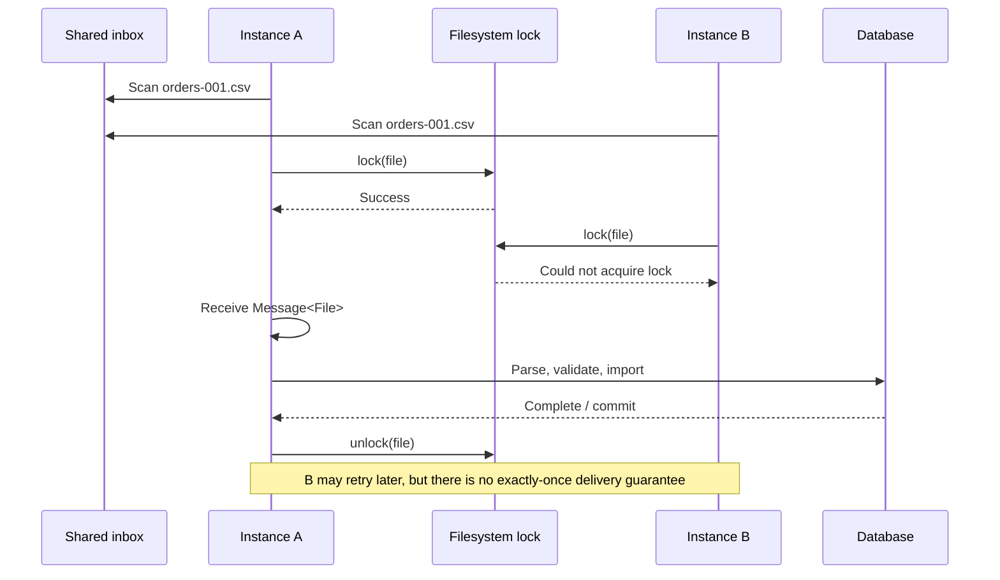
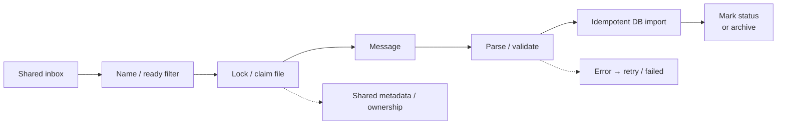

# File locking when multiple processes read concurrently

## 1. Problem statement: multiple processes see the same file

The **SPRING_INTEGRATION_ADAPTERS** module guides you through connecting external systems using inbound/outbound adapters, gateways, pollers, and `MessageChannel`, while handling message contracts, errors, and connection lifecycles. In the **File Adapter** chapter, an important scenario is **multiple applications or instances watching the same ingestion directory**.

Suppose two instances of an order-import service are running:

```text
                  data/inbox/
                  orders-001.csv
                       |
            +----------+----------+
            |                     |
        Instance A            Instance B
        Poller 2s             Poller 2s
            |                     |
       Import DB?             Import DB?
```

If both A and B see `orders-001.csv`, both processes may import the orders into the database simultaneously. Consequences can include duplicate rows, double inventory updates, or duplicate payment notifications for one order.

**File locking** helps cooperating processes coordinate exclusive read/processing access to a file over the same period. In Spring Integration File, the primary extension point is `FileLocker`, with a built-in `NioFileLocker` implementation backed by Java NIO.

After this lesson, you will be able to:

- Describe the lifecycle: **find file → attempt lock → receive message → process → unlock**.
- Distinguish `FileLocker`, `NioFileLocker`, `FileListFilter`, `AcceptOnceFileListFilter`, and `MetadataStore`.
- Configure `FileReadingMessageSource.setLocker(...)` in a File inbound channel adapter.
- Call `FileLocker.unlock(File)` at the right time, including when the consumer throws an exception.
- Identify lock limitations across multiple JVMs, multiple pods, or network filesystems.
- Design retries, ownership assignment, file readiness, deduplication, and crash recovery.

## 2. Where does FileLocker sit in a Spring Integration flow?

`FileReadingMessageSource` scans a directory, selects eligible files, and emits each `Message<File>` on the poller schedule. A `FileLocker` can be configured on the source so it **attempts to hold a lock before the file is accepted**.



This is an example of **coordinating concurrent file reading**, not a message distribution protocol like Kafka or JMS. Even though Spring Integration acquires the lock at ingestion, it **does not automatically unlock the file after processing**: the application must do so itself once the lock is no longer needed.

### Role of each component

| Component | What it does | What it does not do |
| --- | --- | --- |
| `FileReadingMessageSource` | Selects files and emits `Message<File>` | Does not confirm DB commits |
| `FileLocker` | Strategy for checking, acquiring, and releasing file locks | Does not guarantee end-to-end exactly-once |
| `NioFileLocker` | Uses Java NIO file locks to coordinate cooperating processes | Cannot force uncooperative software to obey |
| `FileListFilter<File>` | Filters by name, file age, or selection record | Does not hold locks across business transactions |
| `AcceptOnceFileListFilter` | Prevents re-emitting the same file per filter state | Not durable across restarts on its own |
| `MetadataStore` | Stores key/value records of selected files across polls or restarts | Does not replace held locks or business processing state |

Typically, a system needs **multiple coordination mechanisms**, not just flipping on a lock switch.

## 3. The FileLocker contract

The `org.springframework.integration.file.FileLocker` interface has three core operations:

```java
public interface FileLocker {
    boolean isLockable(File file);
    boolean lock(File file);
    void unlock(File file);
}
```

- `isLockable(file)` checks lockability according to the implementation's logic; it does not alter lock state itself.
- `lock(file)` attempts to acquire the lock, returning `true` on success or `false` if it cannot be locked per policy; it may throw an exception depending on the implementation/filesystem.
- `unlock(file)` releases the held lock for the corresponding file.

**The interface does not prescribe a uniform safety guarantee across all implementations.** When writing a custom `FileLocker`, clearly define who owns the lock, its lease duration, contention handling, network failures, and lock release.

### How does NioFileLocker relate to Java NIO locks?

`org.springframework.integration.file.locking.NioFileLocker` uses `java.nio.channels.FileLock` to implement a file-locking strategy. NIO file locks are enforced according to OS and filesystem semantics.

Key points:

1. NIO locks are generally meaningful **across processes** cooperating via OS mechanisms, yet do not necessarily stop another program from reading the file if that program does not participate in locking.
2. `FileChannel` locks are JVM-scoped per Java NIO semantics. `NioFileLocker` **should not be relied on to prevent duplicate selection across different sources in the same JVM** if each source uses a separate locker. If multiple `FileReadingMessageSource` beans in one JVM must coordinate, use a shared locker and appropriate filters/state.
3. This mechanism can hold `FileLock` and `FileChannel` resources while the lock is active. Forgetting `unlock` after processing can retain resources and cause memory/descriptor leaks.
4. Locking many files simultaneously carries overhead; it is not suited by default for tens of thousands of files processed concurrently.

**Do not confuse "holding a lock" with "file finished writing."** A writer not using the same locking convention can still write to a file being read, depending on the filesystem. During file exchange, the writer should use a temporary name `*.writing` and rename to the final name after writing completes.

## 4. Acquiring and releasing locks: who is responsible?

When a File inbound adapter is configured with a locker, Spring Integration **takes responsibility for attempting to acquire the lock before letting the file be accepted**. However, Spring Integration **does not take responsibility for releasing the lock** after business processing finishes.

The application must determine the proper release point:

```text
File ready
    |
    v
Attempt lock(file) -- failed --> do not admit into flow at this time
    |
    v
Read file / validate / business updates
    |
    +--> Success   --> unlock(file)
    |
    +--> Exception --> log error / mark status --> unlock(file)
```

With a **synchronous** consumer, release the lock inside `finally` after processing finishes or an error is handled:

```java
try {
    // Read and process the locked file.
} finally {
    fileLocker.unlock(file);
}
```

If the consumer hands work off to an executor, queue, or **asynchronous** workflow, do not unlock immediately after enqueueing and claim the file was processed. Clearly establish **who owns the lock** and when work truly ends; in particular, `FileLock`-based locks should not be held indefinitely while a consumer waits on external services.

In large-scale file processing systems, filesystem locks may be held only during the **file reading or claiming stage**; long-running business work should rely on durable state and dedicated ownership tracking.

## 5. Spring Boot example: locking a file before importing CSV

The example uses Java 17+ and Spring Boot managing Spring Integration versions. Maven:

```xml
<dependencies>
    <dependency>
        <groupId>org.springframework.boot</groupId>
        <artifactId>spring-boot-starter-integration</artifactId>
    </dependency>
    <dependency>
        <groupId>org.springframework.integration</groupId>
        <artifactId>spring-integration-file</artifactId>
    </dependency>
</dependencies>
```

Input file: `data/inbox/orders-001.csv`, with content:

```csv
order_id,amount
ORD-001,120000
ORD-002,95000
```

The example configures a shared `NioFileLocker` for both source and consumer. The poller fetches at most two files per batch, and the channel and consumer are synchronous. The consumer counts lines instead of writing to a DB so locking can be safely observed on test data.

```java
import java.io.BufferedReader;
import java.io.File;
import java.io.IOException;
import java.io.UncheckedIOException;
import java.nio.charset.StandardCharsets;
import java.nio.file.Files;

import org.springframework.context.annotation.Bean;
import org.springframework.context.annotation.Configuration;
import org.springframework.integration.annotation.InboundChannelAdapter;
import org.springframework.integration.annotation.Poller;
import org.springframework.integration.annotation.ServiceActivator;
import org.springframework.integration.channel.DirectChannel;
import org.springframework.integration.config.EnableIntegration;
import org.springframework.integration.core.MessageSource;
import org.springframework.integration.file.FileLocker;
import org.springframework.integration.file.FileReadingMessageSource;
import org.springframework.integration.file.filters.AcceptOnceFileListFilter;
import org.springframework.integration.file.filters.ChainFileListFilter;
import org.springframework.integration.file.filters.SimplePatternFileListFilter;
import org.springframework.integration.file.locking.NioFileLocker;
import org.springframework.messaging.MessageChannel;
import org.springframework.messaging.MessageHandler;

@Configuration
@EnableIntegration
public class LockedFileInboundConfig {

    @Bean
    public MessageChannel lockedFileChannel() {
        return new DirectChannel();
    }

    @Bean
    public FileLocker fileLocker() {
        return new NioFileLocker();
    }

    @Bean
    @InboundChannelAdapter(
        channel = "lockedFileChannel",
        poller = @Poller(fixedDelay = "2000", maxMessagesPerPoll = "2")
    )
    public MessageSource<File> lockedFileSource(FileLocker fileLocker) {
        FileReadingMessageSource source = new FileReadingMessageSource();
        source.setDirectory(new File("data/inbox"));

        ChainFileListFilter<File> filters = new ChainFileListFilter<>();
        filters.addFilter(new SimplePatternFileListFilter("*.csv"));
        filters.addFilter(new AcceptOnceFileListFilter<>());
        source.setFilter(filters);

        // Source will attempt to acquire lock before emitting the file.
        source.setLocker(fileLocker);
        return source;
    }

    @Bean
    @ServiceActivator(inputChannel = "lockedFileChannel")
    public MessageHandler processLockedFile(FileLocker fileLocker) {
        return message -> {
            File file = (File) message.getPayload();

            try (BufferedReader reader =
                    Files.newBufferedReader(
                        file.toPath(), StandardCharsets.UTF_8)) {

                long lineCount = 0;
                while (reader.readLine() != null) {
                    lineCount++;
                }

                System.out.printf(
                    "Processed %s (%d lines)%n",
                    file.getAbsolutePath(), lineCount
                );
                // If writing to DB, perform and confirm commit
                // before considering business processing successful.
            }
            catch (IOException ex) {
                throw new UncheckedIOException(
                    "Cannot read " + file, ex
                );
            }
            finally {
                // Important: the source does NOT unlock automatically.
                fileLocker.unlock(file);
            }
        };
    }
}
```

Place this class within `@SpringBootApplication`'s component scan scope or import it into the Spring context. `data/inbox` must exist and the app needs read and locking permissions. This example is not executed inside the article; real behavior must be verified on the target OS/filesystem.

### Why configure it this way?

| Setting | Purpose |
| --- | --- |
| `FileReadingMessageSource` | Creates messages with a `File` payload |
| `SimplePatternFileListFilter("*.csv")` | Excludes temporary files and non-CSV files |
| `AcceptOnceFileListFilter` | Reduces re-emitting files during the filter's lifecycle in this instance |
| `source.setLocker(fileLocker)` | Attempts to lock the file during selection/ingestion |
| `DirectChannel` | Consumer runs synchronously, making it clear when to unlock |
| `finally { fileLocker.unlock(file); }` | Releases the lock once the consumer no longer needs the file |

**Note when using a custom scanner:** if you replace the default scanner with a `DefaultDirectoryScanner` or `RecursiveDirectoryScanner` you instantiated and passed to `source.setScanner(scanner)`, configure **both filter and locker on the scanner**, not also on `FileReadingMessageSource`. Spring Integration may throw `IllegalStateException` if configured in both places.

Example with a custom scanner:

```java
import org.springframework.integration.file.DefaultDirectoryScanner;

DefaultDirectoryScanner scanner = new DefaultDirectoryScanner();
scanner.setFilter(filters);
scanner.setLocker(fileLocker);

FileReadingMessageSource source = new FileReadingMessageSource();
source.setDirectory(new File("data/inbox"));
source.setScanner(scanner);
```

This is a **replacement for the source configuration**; do not keep `source.setFilter(...)` and `source.setLocker(...)` on the same source that uses a custom scanner.

## 6. Do not confuse locks with accept-once and MetadataStore

The three mechanisms serve different purposes:

| Mechanism | Primary protection scope | Across restarts | When consumer fails |
| --- | --- | --- | --- |
| `NioFileLocker` | Prevents cooperating processes from holding the file **simultaneously** | Process locks may be released by the OS when a process dies | Lock may be released, but does not trigger retries |
| `AcceptOnceFileListFilter` | Reduces **re-emission** of a file from the same source | In-memory state is lost | May have already marked the file as selected |
| `FileSystemPersistentAcceptOnceFileListFilter` + shared `ConcurrentMetadataStore` | Shares selected-file records across instances and restarts | Yes, if the store is truly durable | Still does not mean the consumer committed |

### When using only NioFileLocker

Two instances cannot hold the lock at the exact same instant. However, after A finishes and unlocks, B **can pick up the file next** if the file remains in the directory and B has not recorded it as selected. Thus locking **does not guarantee each file is processed only once over the lifetime of the system**.

### When using only a shared MetadataStore

A persistent accept-once filter backed by a shared metadata store can stop two instances from claiming a new file concurrently via compare-and-set, provided the store implements atomic operations. Yet it can also mark a file as received before business work commits. If the winning instance crashes, the file may be skipped later without recovery.

### Combining them still requires idempotency

An architecture can combine locks to reduce file contention, shared metadata to reduce duplicate ingestion, and **unique keys** in the database to prevent duplicate records. Still, the three together do not form an atomic transaction across the filesystem, metadata store, and DB. High reliability requires explicit ownership policies, timeouts/leases, retries, and reconciliation.



This diagram is a **recommended architecture**, not a claim that the steps share a single transaction.

## 7. Why isn't finally enough to guarantee successful processing?

In the example, `finally` ensures application code **attempts to release the lock** when reading finishes or throws an exception. However, there are two other scenarios:

1. **Failure before the consumer receives the message:** the source tried to lock the file, yet the message failed to reach the consumer as expected (stopped endpoint, delivery failure, etc.). Monitor the inbound adapter's lifecycle and error channel.
2. **Crash before `finally` runs:** the application may terminate abruptly. OS locks are usually released when the process exits, yet metadata and business state may be left half-finished. Network filesystems may have delays or different lock semantics.

Additionally, when a consumer throws an exception, `AcceptOnceFileListFilter` may have already marked the file as selected. **Releasing the lock does not clear accept-once history.** Therefore, the file will not necessarily be re-emitted on the next poll.

If retries are required:

- Move the file into `PROCESSING`/`FAILED` state or record an import ID in durable storage.
- Reset filter/metadata only after reconciling that business work did not complete, avoiding re-emitting all old files.
- Design idempotent consumers, e.g., `UNIQUE(import_id, order_id)` or conditional versioned upserts.
- Perform bounded retries, separating transient errors like database timeouts from invalid CSV data errors.

For flows with asynchronous consumers, never rely on a `finally` block that only enqueues work to conclude a transaction finished; use a claim/lease mechanism capable of long-term recovery.

## 8. Locks and partially written files

Another producer may write directly to `orders-001.csv` while consumers are scanning. File locking **cannot replace a file publication contract** when the producer does not participate in locking.

Recommended convention:

```text
Producer:
  orders-001.csv.writing   ->  finish write  ->  orders-001.csv

Consumer:
  filter *.csv  ->  attempt FileLocker lock  ->  process  ->  unlock
```

If the producer cannot be changed, combine `LastModifiedFileListFilter` to delay file pickup or require a `*.done` marker, though waiting a few seconds does not prove the file is complete.

For stateful filters, use `ChainFileListFilter` so **name and file-readiness** conditions run before accept-once, avoiding marking files that are not yet ready to process.

## 9. Two instances in the same JVM vs. two separate JVMs

This is a common area of misunderstanding with `NioFileLocker`:

| Scenario | What to know |
| --- | --- |
| Two `FileReadingMessageSource` beans in the same JVM | Share one `FileLocker` and coordinate filters; NIO locks are JVM-scoped and must not be treated as inter-thread distributed locks |
| Two independent JVMs on one host | Coordination depends on OS locks and both using compatible locking mechanisms |
| Two pods on a shared volume | Depends on CSI driver/network filesystem semantics; cross-pod mutual exclusion must be tested |
| A consumer not using locks | Cannot assume it will avoid files locked by the Spring application |
| A writer replacing a file via rename | Locking a file/handle does not permanently lock a **pathname**; a publication contract is still needed |

**Do not use two instances to prove exactly-once just by observing one successful run.** Repeat tests many times, induce controlled contention, kill one instance mid-processing, and observe recovery.

### When should a different claim mechanism be used?

With Kubernetes or multiple hosts, one strategy is **claiming files** prior to processing:

```text
inbox/orders-001.csv
     |
     +--> claim/worker-a/orders-001.csv
                  |
                  +--> imported/     (success)
                  +--> failed/       (failure)
```

Moving files across directories can represent ownership, provided renames, filesystems, permissions, and race conditions are verified. `FileWritingMessageHandler.setDeleteSourceFiles(true)` is not an atomic move by default; if atomic rename is required, design NIO operations with proper path checks.

When event sources carry high transactional value, using a broker such as JMS/AMQP/Kafka or an outbox pattern with keys/idempotency can be simpler than building a distributed queue on a filesystem.

## 10. XML namespace: a more concise way to declare a locker

Spring Integration File also supports XML configuration:

```xml
<int-file:inbound-channel-adapter
    id="lockedFiles"
    directory="file:data/inbox"
    channel="fileInputChannel"
    prevent-duplicates="true">
    <int-file:nio-locker/>
    <int:poller fixed-delay="2000"/>
</int-file:inbound-channel-adapter>
```

This is an **illustrative configuration snippet**. An XML project also needs Spring Integration namespace declarations, a `fileInputChannel` bean, and a consumer; the consumer remains responsible for calling `unlock` at the right time. For custom lockers, the namespace supports `<int-file:locker ref="customLocker"/>`. Never configure a locker both on a custom scanner and on the adapter in conflicting ways.

## 11. Real-world testing with two processes

Prepare a **test-only** directory containing:

```text
data/inbox/
├── orders-001.csv
├── orders-002.csv
└── orders-003.csv.writing
```

Steps:

1. **Single instance:** start the application, observe `*.csv` files being processed and locks released afterward.
2. **Two instances:** start two JVMs pointing to the same inbox path on a real filesystem; lengthen consumer processing time (e.g., insert a sleep in tests) to create a contention window.
3. **Locking unsupported:** test on the production filesystem type; check for exceptions/lock failures rather than assuming mutual exclusion always works.
4. **Temp files:** verify `orders-003.csv.writing` is ignored.
5. **Restart:** leave files in inbox and restart; with in-memory accept-once, files may be re-emitted.
6. **Crash:** terminate one instance while a file is being processed; inspect locks, DB/metadata state, and re-ingestion under the recovery plan.
7. **Many files:** increase file counts and observe open lock count, poll speed, memory footprint, and processing duration.

> Never intentionally lock/delete another service's files or kill a production process to verify. Crash/race tests should run only against synthetic data and test filesystems.

### Observability suggestions

Log in a controlled format:

```text
instance=A file=orders-001.csv stage=LOCKED
instance=A file=orders-001.csv stage=PROCESSING
instance=A file=orders-001.csv stage=UNLOCKED
```

This is a **recommended log format** for observation, not events automatically emitted by the framework under those exact stage names. Correlating `instanceId`, `file path`, `importId`, and timestamps reveals whether the same file was ever processed concurrently.

## 12. Common operational issues

| Symptom | Possible causes | Remediation |
| --- | --- | --- |
| File not picked up despite valid name | Another process holds lock; permission error, FS lacks lock support | Check lock status, permissions, and exception logs |
| File still re-ingested after unlock | Lock only protects concurrent processing window | Use selection state/DB idempotency and archiving |
| Growing memory/resource usage | Holding `FileLock`/`FileChannel` without calling `unlock` | Ensure `finally` or monitored release path |
| One instance dies and file is never reprocessed | Persistent filter/claim recorded before business commit | Reconciliation and lease/timeout retries; do not wipe metadata blindly |
| Two pods process same file on network share | FS lock unsupported/untested; unshared owner/filter | Shared metadata/ownership with CAS, idempotent DB |
| Writer still writing when reader starts | Writer does not cooperate with locks or publishes name too early | Temp suffix + rename/marker |
| Startup error after switching to custom scanner | Filter/locker set on both source and scanner | Set both on the custom scanner |
| File finishes processing but stays stuck in inbox | Missing archive/cleanup or blocked by filter | Manage file lifecycle state after import |
| Two identically named files in subdirectories | Basename identification is insufficient | Use full paths and configure recursive filters properly |
| Duplicate DB inserts despite active locking | Lock does not cover retries/commits/business keys | Unique keys and DB-level idempotency |

## 13. Hands-on Exercises

1. **Configure NioFileLocker:** run the example and explain at which step the source acquires the lock and where the consumer releases it.
2. **Remove unlock:** in a test environment, temporarily remove `finally`; measure the effect when multiple files are selected and explain why `unlock` must be restored.
3. **Two instances:** run two JVMs against a shared inbox, add a sleep in the consumer, and check whether both instances ever process one file simultaneously.
4. **Accept-once and restarts:** keep files in inbox, restart each JVM, and document why locking alone is not enough to prevent re-ingestion.
5. **Inject read errors:** create a file without read permission or throw an `IOException` in the consumer. Verify the `finally` branch and design a retry plan.
6. **Unready data:** write `*.writing` and rename to `*.csv` after completion; observe how name filters coordinate with locking.
7. **Custom scanner:** replace the source's scanner with a custom `DefaultDirectoryScanner`, move filter/locker onto the scanner, and explain why duplicate configuration is disallowed.
8. **Shared metadata:** compare two JVMs using isolated stores versus a shared store with CAS; identify where file loss can still occur if one instance dies.
9. **Large-file scenario:** test many large files on a test filesystem; observe open lock counts and wait times, and propose ways to bound concurrent files.
10. **Recovery:** diagram the state machine `DISCOVERED → CLAIMED → IMPORTED/FAILED` with import IDs, lease timeouts, and database unique constraints.

### Self-Check Questions

**Q1. Who acquires the lock in a File inbound adapter?**  
The configured `FileReadingMessageSource`/scanner attempts to acquire the lock before admitting the file into the flow.

**Q2. Who is responsible for calling unlock?**  
The application/consumer must actively call `FileLocker.unlock(file)` at the appropriate time; Spring Integration does not unlock automatically after processing.

**Q3. Does NioFileLocker guarantee exactly-once between two pods?**  
No. It only provides locking per filesystem semantics; it does not confirm business commits or govern post-crash retries.

**Q4. How do AcceptOnceFileListFilter and FileLocker differ?**  
Accept-once remembers previously selected files; a locker protects concurrent access during a phase. Neither replaces successful import state.

**Q5. Why must finally be used in synchronous processing?**  
To attempt releasing the lock even if reading the file or business processing throws an exception.

**Q6. Why configure the locker on a custom scanner?**  
Because the custom scanner owns listing/filtering/locking files; configuring them on the source as well can cause errors.

**Q7. Once a file is unlocked, can it be processed again?**  
Yes. Locking does not prevent subsequent **sequential** processing; you need selection state, archiving, or idempotent processing.

## 14. Key Takeaways

**File locking** addresses **contention when reading/processing the same file over the same period**. Spring Integration supports `FileLocker` and `NioFileLocker`, configured through `FileReadingMessageSource` or its scanner. The most important operational rule is: **the framework acquires the lock, and the application must unlock it itself** when finished.

Locks do not prove a file finished writing, do not persist in place of import state, and **do not provide end-to-end exactly-once**. When multiple JVMs/pods read concurrently, test on the real filesystem and combine filters, shared metadata stores, ownership assignment, retries, archiving, and database business keys. SFTP, HTTP, JMS, AMQP, Kafka, and database systems have their own ACK, timeout, locking, or transaction mechanisms; never apply `FileLock` semantics mechanically to those protocols.

### References

- [Spring Integration Reference — Reading Files (locking, scanning, polling)](https://docs.spring.io/spring-integration/reference/file/reading.html)
- [Spring Integration API — FileLocker](https://docs.spring.io/spring-integration/api/org/springframework/integration/file/FileLocker.html)
- [Spring Integration API — NioFileLocker](https://docs.spring.io/spring-integration/api/org/springframework/integration/file/locking/NioFileLocker.html)
- [Spring Integration API — FileReadingMessageSource](https://docs.spring.io/spring-integration/api/org/springframework/integration/file/FileReadingMessageSource.html)
- [Java NIO FileLock](https://docs.oracle.com/en/java/javase/17/docs/api/java.base/java/nio/channels/FileLock.html)
