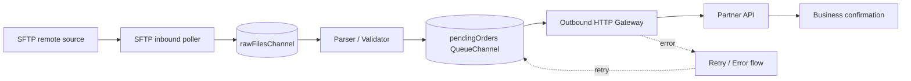
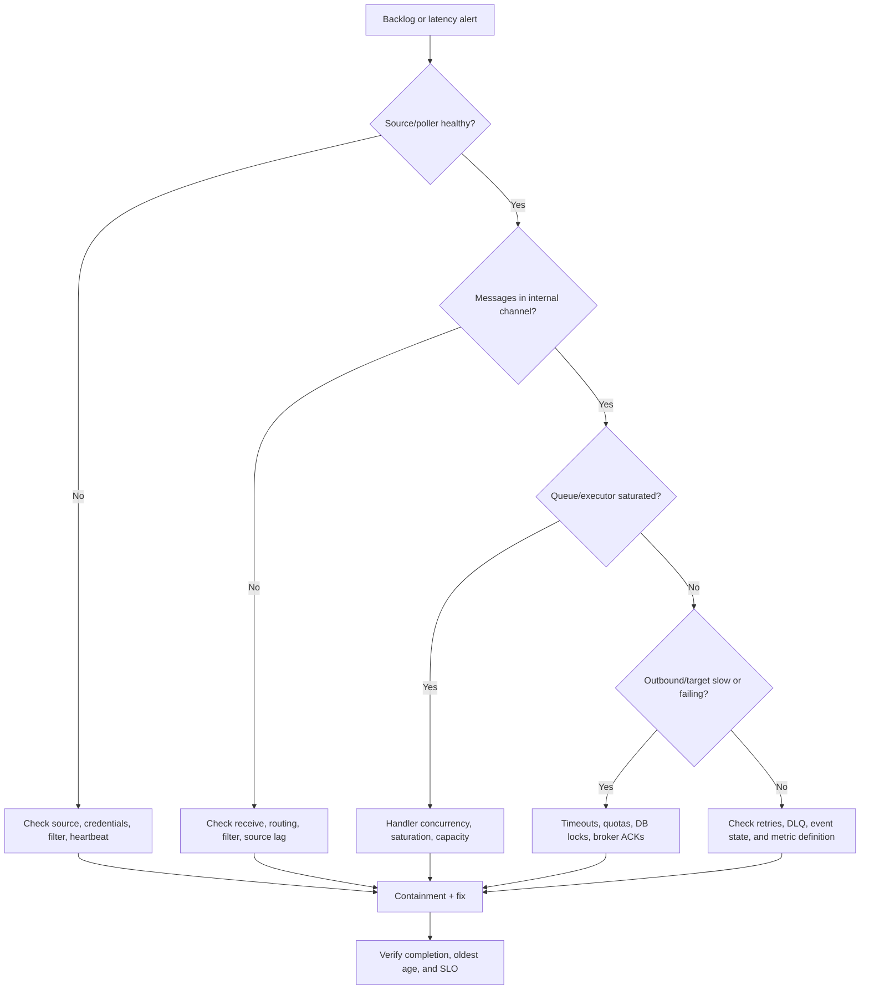

# Monitoring Backlog and Latency in Spring Integration Adapters in Production

## 1. Why Are Backlog and Latency Critical Operational Concerns?

An integration flow can report **zero errors** and still fail business requirements. For example:

- **SFTP inbound adapter** keeps polling successfully, yet thousands of files sit waiting in the folder for hours because the transformer is slow.
- **Kafka consumer** steadily receives records while processing slower than the producer, causing **consumer lag** to climb.
- **JMS/AMQP queue** stays connected, yet ready or unacknowledged message counts grow and business tasks miss deadlines.
- **HTTP outbound gateway** calls a partner API that gets progressively slower; synchronous threads stay occupied, backing up queues in earlier stages.
- **JDBC polling adapter** reads data cleanly, yet write-step transactions hit locks or retries, raising the age of incomplete work.
- **File adapter** writes output files with no completion marker; operations struggle to tell whether latency sits in reading, processing, or exporting.
- Internal **`MessageChannel`** is properly declared, yet a saturated executor stalls messages in wait; **health indicators** only report dependencies are reachable.

**Backlog** is work that has entered the measured scope but **has not yet reached the defined completion state**. **Latency** is the elapsed time between two specific milestones in a message's lifecycle. The two concepts are related, not interchangeable.

In the **Production** chapter of the `SPRING_INTEGRATION_ADAPTERS` module, the **"Monitoring Backlog and Latency"** lesson teaches how to design trustworthy signals to operate **inbound/outbound adapters, gateways, pollers, and `MessageChannel`** across **File, SFTP, HTTP, JMS, AMQP, Kafka, and databases**, while upholding delivery contracts, error handling, and connection lifecycles.

After this lesson, you will be able to:

1. Distinguish backlogs in sources, channels, brokers, retries, and target systems.
2. Measure **queue wait**, **processing latency**, **external call latency**, and **end-to-end latency** without muddling timestamps.
3. Correctly interpret queue depth, Kafka consumer lag, oldest message age, throughput, and retry backlogs.
4. Use **Micrometer/Actuator** alongside broker/adapter metrics while accounting for version differences.
5. Set alert thresholds from **SLOs, work age, backlog growth rate, and recovery time**, rather than a single raw count.
6. Pinpoint bottlenecks using flow graphs, metrics, logs, traces, and target readbacks.
7. Tune pollers, concurrency, backpressure, retries, queue capacity, and autoscaling safely.
8. Test under load spikes, broker redeliveries, downstream outages, and deployments/restarts.

> **Guiding principle:** a nearly empty queue does not guarantee low latency; a large queue does not automatically mean an SLA breach. Inspect **oldest work age, arrival/completion rates, latency distributions, and business deadlines**.

## 2. Measurement Vocabulary: Backlog, Lag, Latency, Throughput, and Freshness

### 2.1. Definitions

| Concept | Definition | Common Units | Key Caveat |
|---|---|---|---|
| **Backlog depth** | Work units waiting or incomplete within the measured scope | Messages, files, rows, tasks | Must define which states count |
| **Queue wait** | From entering a queue until starting processing | ms, s | Do not mix with processing time |
| **Processing time** | Duration a handler spends executing one attempt | ms, s | May exclude broker waits or retries |
| **External-call latency** | From invoking API/DB/broker until receiving contractual response | ms, s | ACK/commit does not equal business completion |
| **End-to-end latency** | From chosen source milestone to verified business completion | s, minutes | Requires clear clocks/timestamps and completion criteria |
| **Consumer lag** | Distance between consumer progress and readable source head | Records, offsets | Calculation may use position vs. committed offset |
| **Oldest pending age** | Age of the oldest incomplete work item | s, minutes, hours | Usually more sensitive to stuck messages than depth |
| **Arrival rate** | New work arriving per unit time | messages/s | Bursts distort averages |
| **Completion rate** | Work completing criteria per unit time | messages/s | Do not count attempts as logical events |
| **Retry rate** | Re-execution frequency due to failures | attempts/s | Retries inflate load without raising completions |
| **Freshness** | Recency of output data relative to source/business time | s, minutes | Quiet sources can look stale legitimately |

**An unscoped backlog count is ambiguous.** For example, "1,200 messages" could mean 1,200 uncommitted Kafka records, 1,200 **ready** messages in RabbitMQ, 1,200 **unacked** messages, 1,200 messages in `QueueChannel`, or 1,200 incomplete business events across all layers. They are **not inherently equal**.

### 2.2. Three Observation Layers

Separate clearly:

- **Source backlog:** work still sitting at its origin, e.g., remote SFTP folder, Kafka partition, JMS/AMQP queue, unmarked DB table rows.
- **In-process backlog:** messages in `QueueChannel`, tasks waiting in executors or retry schedulers, groups waiting in aggregators.
- **End-to-end outstanding work:** business events already due or accepted that lack a verified target outcome.

**Never blindly sum counts across all three layers.** A single business event may appear in Kafka lag (uncommitted), sit inside an internal queue, and appear in outstanding records simultaneously; summing them **double-counts**.

For **business decisions**, build a **one-record-per-logical-event** state registry or reconcile via stable IDs. For **operational bottlenecks**, still display per-layer queues and lag separately.

## 3. Message Journey and Timestamps to Capture

Consider a flow:



One message passes through several milestones here:

| Timestamp | Created By | Meaning |
|---|---|---|
| `source_occurred_at` | Trusted business source / manifest / file metadata | When did the work originate at the source? |
| `discovered_at` | Poller or inbound adapter | When did the system discover the work? |
| `accepted_at` | Channel after inbound | When was the work accepted into the flow? |
| `enqueued_at` | Upon entering internal queue | Start of queue wait |
| `processing_started_at` | Worker picks up message and starts attempt | End of attempt queue wait |
| `external_request_started_at` | Before outbound call | Start of external system call |
| `external_response_at` | Upon receiving relevant response/ACK | End of external-call segment |
| `attempt_finished_at` | When attempt finishes (success/failure) | Attempt execution time |
| `completed_at` | When business outcome is verified at target | End-to-end contractual completion |
| `due_at` | Flow-specific SLA/SLO | Target deadline |

Not every flow has all milestones. For an **HTTP inbound gateway**, the source event may be the incoming request itself; for **partner files**, file creation time may suffer clock skew or fail to reflect when the file became ready to read. When lacking a trusted source timestamp, report **"latency since system intake"**, never claiming it reflects true event creation time.

### 3.1. Meaningful Latency Calculations

\[
T_{\mathrm{discovery}}=t_{\mathrm{discovered}}-t_{\mathrm{source}}
\]

\[
T_{\mathrm{queue}}=t_{\mathrm{processing\_started}}-t_{\mathrm{enqueued}}
\]

\[
T_{\mathrm{attempt}}=t_{\mathrm{attempt\_finished}}-t_{\mathrm{processing\_started}}
\]

\[
T_{\mathrm{external}}=t_{\mathrm{response}}-t_{\mathrm{request\_started}}
\]

\[
T_{\mathrm{end\_to\_end}}=t_{\mathrm{completed}}-t_{\mathrm{source}}
\]

**Never sum overlapping segments blindly.** `T_attempt` may already enclose `T_external`; adding both double-counts the same span. With retries, end-to-end also includes **retry/backoff waits** between attempts.

When measuring a segment inside one JVM, use a **monotonic clock** (such as `System.nanoTime()` or Micrometer `Timer`) for elapsed time instead of subtracting two wall-clock timestamps vulnerable to system clock adjustments. Cross-process milestones require UTC/offset-aware wall-clock timestamps, synchronized clocks, and recorded trust levels.

### 3.2. Concrete Timeline Example

A business file appears per source timestamp at **08:00**; SFTP poller discovers it at **08:03**, it enters the queue at **08:04**, a worker starts at **08:05**, and target verification completes at **08:11**.

| Segment | Calculation | Result |
|---|---|---|
| Source → discovery | 08:03 − 08:00 | **3 minutes** |
| Discovery → enqueue | 08:04 − 08:03 | **1 minute** |
| Queue wait | 08:05 − 08:04 | **1 minute** |
| Processing start → target verified | 08:11 − 08:05 | **6 minutes** |
| Total source → target | 08:11 − 08:00 | **11 minutes** |
| Total system intake → target | 08:11 − 08:03 | **8 minutes** |

If the SLA demands **10 minutes from source time**, this example misses by **1 minute**; if the app's own SLO starts at channel entry with a 10-minute budget, the app meets it. **Never shift the start milestone after seeing results** to turn a breach into a pass.

**Limitation:** this example assumes reliable source timestamps and timely milestone recording. If partners modify file `mtime`, document the uncertainty.

## 4. Backlog Count and Oldest Pending Age

### 4.1. Absolute Backlog

At time `t`, define:

\[
B(t)=\left|\{m \mid m\ \text{is within the measured scope and incomplete at}\ t\}\right|
\]

Depending on scope, `m` can be a **record**, **message**, **file**, **job**, **processing attempt**, or **logical business event**. Uncommitted Kafka records do not equal incomplete orders because one order may emit multiple events and one record may be reprocessed.

Document definitions on dashboards:

```text
metric: integration_backlog
scope: kafka/orders.created/group=orders-consumer
unit: records
definition: approximate log-end-offset minus committed next offset
snapshot_time: ...
notes: includes records processed but not yet committed
```

This is **metric-describing metadata**, not a built-in Spring Integration schema.

### 4.2. Oldest Pending Age

\[
A_{\mathrm{oldest}}(t)
=\max_{m\in\mathrm{pending}(t)} (t-t_{\mathrm{accepted}}(m))
\]

Define **accepted timestamp** per scope: source creation, broker append, app intake, or retry enqueue. When a queue is empty, represent **no waiting work** (*no data/null*) instead of reporting "oldest age = 0", which looks identical to a brand-new message; using `0` is a dashboard choice that must be annotated.

**Steadily climbing age paired with a tiny backlog** is an important signal: a **single poison message** may be stuck without dead-letter/quarantine, or one partition may be blocked.

If a queue uses priorities, delayed delivery, reordering, retries, or custom selectors, never assume the head of the queue is the **oldest by business time**. Measure over the true pending set or publish the chosen proxy explicitly.

### 4.3. Where Are In-Flight and Retry Messages Counted?

A thorough dashboard categorizes:

| State | In Incomplete Backlog? | In Queue Depth? |
|---|---|---|
| `READY/ENQUEUED` | Yes | Usually yes |
| `IN_FLIGHT/PROCESSING` | Yes until completion reached | Usually **no** longer in ready queue |
| `RETRY_WAIT` | Yes | Depends on dedicated queue, scheduler, or DB |
| `REDELIVERED` | Still the same logical work | May raise attempt counts |
| `DEAD_LETTER` | Per policy: usually business-incomplete | Not in main queue, but sits in DLQ/DLT |
| `SUCCEEDED_AND_VERIFIED` | No | No |
| `CANCELLED_WITH_APPROVAL` | No if contract confirms valid cancellation | No |
| `UNKNOWN` | Never assume completed | May be invisible from channels |

Therefore, an empty queue does not prove **zero outstanding work** if messages moved to a DLQ or hung in-flight.

## 5. Arrival Rate, Completion Rate, and Backlog Growth Trends

Within a reconcilable scope, if `A` is **newly arrived** work and `C` is **contractually completed** work over \([t_0,t_1]\), ignoring cross-scope transitions:

\[
B(t_1)\approx B(t_0)+A(t_0,t_1)-C(t_0,t_1)
\]

This is a **work-conservation model**, not an automatic identity in the presence of duplicates, replays, drops, DLQ moves, cancellations, or scope changes. Account for those state transitions during reconciliation.

Approximate backlog growth rate:

\[
g = \lambda_{\mathrm{in}}-\mu_{\mathrm{complete}}
\]

Where:

- \(\lambda_{\mathrm{in}}\): logical work arrival rate (messages/s).
- \(\mu_{\mathrm{complete}}\): verified logical work completion rate (messages/s).

**Example:** 20 items/s arrive on average while the system completes 15 items/s. Holding steady, backlog grows by **5 items/s**. Raising concurrency helps only if the **actual bottleneck can parallelize**, not when downstream enforces a fixed quota.

**Conversely**, with 360 pending items, arrivals continuing at 20/s, and completions at 25/s, **net drain = 5/s**. Under constant rates and zero retries:

\[
T_{\mathrm{drain}}\approx \frac{360}{25-20}=72\ \mathrm{seconds}
\]

This is an **idealized estimate**, not an SLA promise. In reality, bursts, partitioning, skewed processing times, retries, ordering constraints, and throttling can lengthen drain times substantially.

### 5.1. When to Use Little's Law

In a **steady-state** system with consistent work units and measurement windows, Little's Law states:

\[
L=\lambda W
\]

- `L`: average work items in the system.
- \(\lambda\): average throughput of the steady flow.
- `W`: average residence time of an item in scope.

Use it to **sanity-check** queue/processing figures when steady-state, conservation, and sufficient window duration hold. **Never** divide rapidly growing consumer lag by instantaneous throughput to announce an "exact ETA"; steady-state fails and latency distributions can be heavily skewed.

### 5.2. Cases Where Aggregate Throughput Masks Bottlenecks

- Kafka has 8 partitions; total completion rate looks high while **1 partition holding a poison record** stalls completely.
- JMS has multiple consumers; one wedged consumer drives `unacked` up even as `ready` falls.
- HTTP gateway shows great aggregate throughput on a short route while a critical business route's p99 spikes.
- SFTP pulls many small files while one huge file blows past its deadline.
- JDBC processes most rows quickly while one transaction stays lock-blocked for minutes.

Therefore inspect **distributions**, **per-partition/per-flow views**, **oldest age**, and **SLOs**—not just aggregate averages.

## 6. Measuring Latency with Percentiles and SLOs

### 6.1. Why Averages Are Not Enough

Suppose 990 messages finish in 100 ms while 10 messages take 60 seconds. Averages obscure the severely delayed tail. **p95/p99**, deadline-miss rates, and pending ages expose tail latency.

| Metric | What It Shows | Caveat |
|---|---|---|
| Average latency | Mean across measured items | Skewed by outliers |
| p50 | Median | Can hide severe tails |
| p95 | 95% of samples complete within threshold | Needs sufficient samples of the same business type |
| p99 | Slower tail bound | Noisy on small sample sizes |
| `late_completed_total` | Work completed after deadline | Excludes still-incomplete items unless supplemented |
| `overdue_open` | Open work already past deadline | Captures stuck backlog lacking completion latency |
| `oldest_pending_age` | Age of longest-waiting item | Catches poison messages and lingering backlogs |

**Statistical caveat:** percentiles over **completed** messages suffer from **survivorship bias**—when a system wedges, the slowest messages haven't finished yet, so they don't appear in completion histograms. Production dashboards must pair them with **pending age** and **overdue open** counts.

### 6.2. Defining Testable SLIs/SLOs

Example hypothetical organizational SLO:

> 99% of **validly accepted** order events must have a **committed and verified** DB write within **5 minutes**, measured over a **7-day window**; events still incomplete past the deadline count as missed.

Clarify every term:

- **Denominator:** which events count as validly accepted; are schema rejections excluded?
- **Numerator:** what defines verified commit? JDBC API return, transaction record, or readback?
- **Start clock:** source event time or accepted time?
- **Deadline:** 5 minutes per logical event, not 5 minutes per retry.
- **Scope:** production, which partner cohorts, which event types?
- **Exclusions:** approved maintenance, canceled events, or ultra-late source data per policy?
- **Open work:** overdue-but-incomplete items must stay visible rather than vanishing from the denominator.

### 6.3. Clock Skew and Time Sources

- **Wall-clocks** across systems should use UTC or explicit offsets, NTP sync, and recorded time sources.
- **Monotonic clocks** should measure elapsed durations within one JVM whenever possible.
- **Source timestamps** from files/SFTP or external callers are not inherently trustworthy; account for timezones, clock skew, and metadata edits.
- **Broker append timestamps** and event timestamps can differ; Kafka records carry `CreateTime` or `LogAppendTime` depending on topic/broker config.
- **Metrics scrape timestamps** differ from when messages were actually received/processed.
- **Async logging** can timestamp emission after handlers finish; never use log-sink ingestion time as processing time.

When clock skew yields a negative duration, never silently apply `abs()` and report valid latency. Log a data-quality fault and fix the timestamp source.

## 7. `QueueChannel`, `DirectChannel`, and `ExecutorChannel`

Spring Integration `MessageChannel` implementations behave differently, requiring distinct backlog measurements.

| Channel | Characteristics | Backlog Stored in Channel? | Key Signals |
|---|---|---|---|
| `DirectChannel` | Synchronous dispatch | Normally no internal queue | Handler latency, send blocks, errors, upstream waits |
| `QueueChannel` | Pollable channel; messages sit in queue | **Yes** | Queue depth, capacity, oldest enqueue age, poll rate |
| `ExecutorChannel` | Dispatches via executor | Not a `QueueChannel` message queue, though executor may queue tasks | Active threads, executor queue size, rejected tasks, handler latency |
| `PublishSubscribeChannel` | Multiple subscribers; sync or async | Depends on executor/subscribers | Per-branch latency, subscriber errors, task backlogs |
| Broker-backed / integration store | Buffered per implementation | Depends on store/transport | Durable/ACK, queue/lag, and store state |

### 7.1. `DirectChannel`: Slow Even When Depth Equals 0

An **HTTP inbound gateway → `DirectChannel` → HTTP outbound gateway** can block callers for 30 seconds due to a slow external API, yet **no channel queue depth exists to measure**. Observe instead:

- HTTP request concurrency and p95/p99 latencies.
- Timeouts, exceptions, circuit breakers, connection-pool saturation.
- Web server thread pools (active, queued tasks) and concurrent request limits.
- In-flight requests and error rates.

**Never conclude there is no backlog simply because `QueueChannel.size() == 0`** when work is stuck synchronously inside handlers.

### 7.2. `QueueChannel`: Visibility into Waiting Messages

`QueueChannel` buffers messages for consumers/pollers. When capacity-bounded, track:

- `queue_size` and `remaining_capacity`.
- Enqueue/receive timestamps to measure queue wait.
- Poller heartbeats, poll rates, and batch/`maxMessagesPerPoll`.
- Whether the message store is **in-memory or persistent**.
- Full-queue handling: blocking timeout, exception, rejection/backpressure.

**An in-memory `QueueChannel` is not a durable queue**; process crashes can lose messages not preserved at the source or in a store. If backed by a persistent message store, verify transaction semantics and real crash recovery.

### 7.3. `ExecutorChannel`: Backlog Lives in the Task Executor

`ExecutorChannel` hands dispatch to an executor. If a `ThreadPoolTaskExecutor` has 8 threads, a 500-slot queue, and downstream takes 10 seconds/operation, task backlogs pile up inside the executor before handlers run.

Monitor:

- `active_threads`, `pool_size`, `executor_queue_depth`.
- `tasks_rejected_total`, `task_wait_duration`.
- `handler_duration`, `external_call_duration`, `inflight`.
- `queue_capacity` and saturation policy.

Never make executor queues unbounded just to keep `rejected = 0`. That risks OOMs and hides overload sources.

### 7.4. Aggregators, Resequencers, and Delayed Processing

Flows using **Aggregator/Resequencer** hold message groups until sequences complete or time out. Waiting work sits inside the **message group store**, not necessarily in `QueueChannel`.

Track additionally:

- Open message group counts and oldest group age.
- Messages waiting for group completion.
- Group timeout/expiry/partial-release rates.
- Duplicate correlation keys, orphan groups, and cleanup.
- Message store transactions and storage growth.

Do not lump `open_group_count` and `message_count` into one unlabeled "backlog" number.

## 8. Pollers: Zero Messages Received Does Not Mean Zero Backlog

**Polling consumers** or inbound pollers drive intake schedules from File/SFTP/JDBC or `QueueChannel`. Parameters like **fixedDelay/fixedRate/cron**, `maxMessagesPerPoll`, executors, transactions, and concurrency directly govern backlog drain speed.

Example:

- SFTP source holds 500 files, while the poller takes at most 1 message every 5 seconds.
- Ideally, the poller alone caps intake at ~**0.2 files/s**.
- Even if downstream handlers are instant, adding handler threads **will not bypass** the poller ceiling.
- If each poll grabs 10 files with connection overhead, evaluate batch/transaction trade-offs instead of blindly raising numbers.

Operational questions:

1. Is the poller `running` and beating on schedule?
2. Is `receive()` or `poll()` hung on network I/O or locks?
3. Are multiple endpoints sharing a tiny scheduler thread pool?
4. Are file/metadata filters wrongly excluding valid data?
5. Do `maxMessagesPerPoll`, batch size, and fixed delay throttle throughput?
6. Do transaction commits/rollbacks cause messages to be re-polled?
7. When paused via Control Bus, does the source keep accumulating and do SLAs shift?

**Minimum poller signals:** `last_poll_started_at`, `last_poll_completed_at`, `poll_duration`, `poll_errors_total`, `messages_produced_total`, `polls_without_messages_total`, and `endpoint_running`, matching available instrumentation.

Never treat "0 messages received" as proof of "0 files/rows waiting" if the poller stopped hours ago.

## 9. Kafka: Consumer Lag Is Not Only Time Delay

### 9.1. Defining Lag by Offsets

In Kafka, a per-partition backlog metric can be defined as:

\[
L_p=\max(0,\ E_p-C_p)
\]

Where:

- `E_p`: **log end offset** (position right after the latest record at measurement time).
- `C_p`: consumer group's **committed next offset** if measuring uncommitted work.
- `L_p`: offset delta, commonly used as an estimate of uncommitted records.

Summed across partitions assigned to the group:

\[
L_{\mathrm{group}}=\sum_{p\in P} L_p
\]

**This is one definition**, and not every metric named `records-lag` uses committed offsets. Some Kafka client metrics compute against **consumer position** rather than committed offset; monitoring tools may query broker/group committed offsets. Document explicitly whether you use **position, committed offset, or high watermark**, and how new partitions, retention, and compaction are handled.

**Example:** partition end offset is 125,000 and the group committed next offset 124,200. The gap is **800 offset positions**. If the consumer processed records without committing the batch yet, this figure overstates unprocessed business work.

### 9.2. Lag Count Differs from Lag Time

| Metric | Unit | Usage |
|---|---|---|
| Per-partition lag | Offset/record estimate | Spot lagging partitions |
| Sum consumer-group lag | Offset/record estimate | View aggregate backlog |
| Max partition lag | Offset/record estimate | Stop sums from hiding one wedged partition |
| Event processing delay | Seconds/minutes | Event creation time to processing/completion |
| Oldest unprocessed event age | Seconds/minutes | Check SLO compliance for aged data |
| Consumer record processing rate | Records/s | Track speed by group/instance |
| Retry/DLT backlog | Records/topic/attempts | Failed work still business-incomplete |
| Commit latency/rate | Seconds/count | Separate processing from committed progress updates |

If one partition holds 10 very old records while the producer is quiet, total lag count is tiny yet **data freshness may be hours behind**. Conversely, a 100,000-record producer burst inflates lag counts for minutes while healthy capacity still meets SLOs.

### 9.3. Retries, Redeliveries, and Offsets

- Consumers can process a record and crash **before commit** → redelivery occurs, so lag does not exactly mirror missing logical business events.
- With retry topics/DLTs, records leave the **main topic** while still business-incomplete; monitor retries and DLQ/DLT separately.
- Batching and transactions can delay commits, causing lag to drop in steps.
- Never sum retry-topic lag and main-topic lag as "incomplete orders" if duplicates/copies exist.
- Partition assignments/rebalances cause metric jitter; annotate deploy/rebalance markers on dashboards.

**Final check:** offset commits do not prove **JDBC transactions**, HTTP calls, or business side effects succeeded unless commit logic is tied to processing.

## 10. JMS and AMQP: Ready, Unacked, Retries, and Dead-Letters

### 10.1. JMS

In **JMS**, queue depth typically comes from provider/broker management metrics; metric names and granularity depend on ActiveMQ Artemis, ActiveMQ Classic, or other providers.

Distinguish:

- Messages still sitting in the **broker queue**.
- Messages **dispatched** to listeners/containers but not yet ACKed/committed.
- Messages inside **in-progress transactions**.
- **Redelivered** messages after rollbacks or connection drops.
- Messages routed to **DLQ** per policy.
- Messages ACKed while downstream business work isn't verified.

A hung consumer can shrink **ready depth** because messages were dispatched while total outstanding remains high. Combine `inflight`, processing latency, transaction outcomes, DLQs, and oldest pending age.

### 10.2. AMQP/RabbitMQ

RabbitMQ commonly exposes:

- **Ready:** messages queued and ready for dispatch.
- **Unacknowledged:** messages delivered to consumers awaiting ACK.
- **Total messages:** typically ready + unacked in broker stats.
- **Prefetch:** cap on unacked messages held by a consumer.
- **Dead-letter:** messages routed to DLX/queues on reject/expiry/delivery-limit per config.

**Never alert on `messages_ready` alone.** When prefetch is high and consumers wedge, ready looks tiny while `unacked`, message age, and end-to-end latency climb.

| Signal | Question to Ask |
|---|---|
| Ready climbing | Are consumers pulling fast enough? |
| Unacked climbing | Are handlers, downstreams, or ACKs slow/hung? |
| Redelivery rate climbing | Transaction/consumer failures or requeue loops? |
| DLQ count climbing | Poison messages or contract errors? |
| Publisher confirm latency climbing | Is broker accept/persistence slow? |
| Oldest queue age climbing | Are messages waiting past deadlines? |
| Connection/consumer count dropping | Did listeners stop or broker connections fail? |

Broker **publisher confirms** do not prove consumers processed business logic; **consumer ACKs** do not prove another downstream system verified the data unless contracts/transactions guarantee it.

## 11. File, SFTP, and JDBC: Off-Broker Backlogs

### 11.1. File Inbound

Backlog may be ready files sitting in a directory awaiting adapter intake or business completion. Decide:

- How is file write completion signaled? Temp extension, atomic rename, manifest, or marker file?
- Which filename pattern/filter defines eligible files?
- Are any files marked by accept-once filters yet still lacking business completion?
- Could huge files linger or fill disks?
- Do files in `error`, `retry`, or `archive` directories count toward outstanding work?

**Scanning huge directories every few seconds to count backlog** causes expensive I/O and contends with pollers. Prefer metadata/indexes, incremental scans, batch counters, or periodic inventory jobs with clear snapshot times.

### 11.2. SFTP

SFTP source backlogs must track:

- Remote directory and upload-completion criteria.
- Filter patterns, metadata/accept-once stores, duplicate filenames.
- Last successful poll/session, host-key verification, and auth.
- Downloads in progress, local temp files, transfer throughput.
- Files waiting remotely, local files awaiting processing, files moved to error/quarantine.

A dashboard showing "0 files" when SFTP sessions **cannot connect** must never report backlog = 0. Show **UNKNOWN / STALE** with the visibility gap reason.

**Never rely solely on remote file `mtime` as event time** when partners can alter timestamps or clocks drift. For strict SLAs, require manifests/event metadata with trusted timestamps and file IDs.

### 11.3. JDBC/Database Polling

Backlogs usually mean **rows in ready/pending states** or unpublished outbox events; however, full-table counts add DB load.

Consider:

- Query using `status`, `created_at`, `next_attempt_at`, and proper indexes.
- Claimed/locked rows may vanish from pending queries while still incomplete.
- Transaction rollbacks can make rows reappear.
- Poller `maxMessagesPerPoll`, paging, watermarks, or locking can starve subgroups.
- Published outbox rows do not guarantee downstream consumers committed business results.
- Align DB clocks, app clocks, and event clocks—or explicitly record skew.

A **throughput counter** is cheaper than heavy `COUNT(*)` queries every few seconds; however, derived counts drift across restarts, skipped events, and duplicates and require periodic reconciliation.

### 11.4. HTTP Inbound/Outbound Has No Built-In Durable Backlog

**HTTP inbound gateways** are typically request–reply: requests occupy threads or connections, with no default "broker queue depth". Measure:

- Active/in-flight HTTP requests and server worker queues.
- Request p95/p99 latency, timeouts, 429/5xx responses.
- HTTP client connection pool pending/active counts, retries, and circuit breakers.
- Dedicated queues **if** the app explicitly buffers requests into `QueueChannel`/brokers/outboxes.

**Never hardcode `http_backlog=0` and assume no requests are stuck.** Synchronous gateways can trap many requests inside handlers/outbound calls with zero messages in any internal queue.

## 12. A Sufficient Production Metrics Strategy

Combine **two metric groups**:

1. **Application-emitted metrics:** logical event states, queue waits, business completions, in-flight counts, retries, deadlines.
2. **Framework/transport metrics:** Kafka consumer lag, RabbitMQ ready/unacked, JMS broker queue depth, DataSource pools, HTTP server/clients, Spring Integration channels/handlers, executors.

Some telemetry comes from Spring Integration Management, Micrometer Observation, Spring Boot Actuator, or specific connectors **depending on version and configuration**. Never assume a metric name exists out of the box simply because it appears in lesson notes.

### 12.1. Recommended Metrics and Explicit Units

| Suggested Metric | Type | Unit | Scope / Definition |
|---|---|---|---|
| `integration_messages_accepted_total` | Counter | Message | Validly accepted logical events |
| `integration_messages_completed_total` | Counter | Message | Events with verified business outcomes |
| `integration_message_attempts_total` | Counter | Attempt | Processing attempts, including retries |
| `integration_message_failures_total` | Counter | Attempt/event (specify) | Failures by category |
| `integration_queue_depth` | Gauge | Message | Work currently sitting in a specific queue |
| `integration_queue_capacity` | Gauge | Slot | Bound of a bounded queue |
| `integration_queue_remaining_capacity` | Gauge | Slot | Remaining free slots |
| `integration_inflight_messages` | Gauge | Message | Started attempts not yet finished |
| `integration_oldest_pending_age_seconds` | Gauge | Seconds | Oldest outstanding message within scope |
| `integration_overdue_open` | Gauge | Logical event | Open outstanding events past deadline |
| `integration_queue_wait_seconds` | Histogram/Timer | Seconds | Enqueue → attempt start |
| `integration_handler_duration_seconds` | Histogram/Timer | Seconds | Handler execution time per attempt |
| `integration_external_call_duration_seconds` | Histogram/Timer | Seconds | Transport/target call to contractual response |
| `integration_end_to_end_duration_seconds` | Histogram/Timer | Seconds | Source/accepted milestone → verified completion |
| `integration_retry_waiting` | Gauge | Event | Logical work waiting for retry |
| `integration_poller_last_success_age_seconds` | Gauge | Seconds | Time since last successful transport poll |
| `integration_telemetry_collection_failures_total` | Counter | Count | Broken collector/metric source |

**These names are lesson proposals**, not assertions that Micrometer/Actuator emits them automatically. Adapt names/units to Prometheus conventions, OpenTelemetry Semantic Conventions, and built-in framework instruments to avoid duplicates.

### 12.2. Cardinality and Data Safety

Keep metric labels **bounded**:

```text
flow="orders-import"
stage="validate"
adapter="sftp"
outcome="success"
target="partner-a"
environment="production"
```

Avoid labels like:

```text
messageId="..."
traceId="..."
orderId="..."
filename="private-customer-2026.csv"
payloadHash="..."
rawException="..."
```

A unique `messageId` per record explodes metric series linearly with traffic. Keep IDs in **access-controlled structured logs/traces** for investigation, never in unbounded metric tags. Even `target` needs a curated catalog if partners/topics/tenants are dynamic.

When shipping telemetry externally, never include raw payloads, tokens, passwords, private keys, sensitive HTTP headers, or PII in logs or trace attributes.

### 12.3. Dashboards Should Show Multiple Perspectives Simultaneously

A useful flow dashboard includes:

- **Intake:** arrival rate, source backlog, poller heartbeats, connection errors.
- **Queues:** depth, oldest age, utilization/capacity, ingress vs. drain rates.
- **Processing:** in-flight counts, p50/p95/p99 handler latencies, retry rates, error categories.
- **External systems:** HTTP/DB/broker p95, timeouts, ACKs/commits, connection pools.
- **Business outcomes:** completion rate, end-to-end percentiles, overdue open counts, SLO compliance.
- **Infrastructure:** CPU, heap/GC, executor active/queued/rejected, network, disk.
- **Telemetry health:** latest metric timestamp, missing/stale metrics, collector failures.

**Separate "request emitted" from "target verified"** on charts. In async flows, these are distinct milestones.

## 13. Java DSL Example: Bounded `QueueChannel` and Queue Depth Metrics

Example internal flow: messages from `ordersIngress` go into `pendingOrders` (a bounded `QueueChannel`), drained by a poller into a business handler.

```java
import java.time.Duration;

import org.springframework.beans.factory.annotation.Qualifier;
import org.springframework.context.annotation.Bean;
import org.springframework.context.annotation.Configuration;
import org.springframework.integration.channel.DirectChannel;
import org.springframework.integration.channel.QueueChannel;
import org.springframework.integration.config.EnableIntegration;
import org.springframework.integration.dsl.IntegrationFlow;
import org.springframework.integration.dsl.Pollers;
import org.springframework.messaging.MessageChannel;
import org.springframework.messaging.MessageHandler;

@Configuration
@EnableIntegration
public class OrdersBacklogFlowConfiguration {

    @Bean
    MessageChannel ordersIngress() {
        return new DirectChannel();
    }

    @Bean
    QueueChannel pendingOrders() {
        // Bounded; do not treat an in-memory QueueChannel as a durable queue.
        return new QueueChannel(500);
    }

    @Bean
    IntegrationFlow enqueueOrders() {
        return IntegrationFlow.from("ordersIngress")
                .channel("pendingOrders")
                .get();
    }

    @Bean
    IntegrationFlow drainOrders(
            @Qualifier("ordersOutboundHandler") MessageHandler handler) {

        return IntegrationFlow.from(
                        "pendingOrders",
                        endpoint -> endpoint.poller(
                                Pollers.fixedDelay(Duration.ofMillis(200))
                                        .maxMessagesPerPoll(10)
                        )
                )
                .handle(handler, endpoint ->
                        endpoint.id("ordersOutboundEndpoint"))
                .get();
    }
}
```

**Assumption:** `ordersOutboundHandler` is an application-provided `MessageHandler` bean implementing contractual error/result handling; this example does not directly wire HTTP/Kafka/JDBC. Verify Java DSL syntax and compile against the **exact Spring Integration version** in your project.

Key points:

- `QueueChannel(500)` caps capacity per config; it does not automatically cap all other memory in the app.
- `fixedDelay(200 ms)` and `maxMessagesPerPoll(10)` define framework polling cadence and batch cap; **they do not guarantee 50 messages/s** if handlers block.
- When full, senders block or fail per timeout/send policy. **Never ignore send boolean returns or exceptions**, as silent drops break contracts.
- If messages vanish on a process crash, whether sources redeliver depends on SFTP/file metadata, broker acks, or durable queue architecture.
- Never equate entering `pendingOrders` with HTTP delivery or JDBC commit.

### 13.1. Registering Gauges via Micrometer

Use a `MeterBinder` to expose queue depth and remaining capacity without scanning messages on every scrape:

```java
import io.micrometer.core.instrument.Gauge;
import io.micrometer.core.instrument.binder.MeterBinder;

import org.springframework.beans.factory.annotation.Qualifier;
import org.springframework.context.annotation.Bean;
import org.springframework.context.annotation.Configuration;
import org.springframework.integration.channel.QueueChannel;

@Configuration
public class OrdersQueueMeterConfiguration {

    @Bean
    MeterBinder ordersQueueMeters(
            @Qualifier("pendingOrders") QueueChannel queue) {
        return registry -> {
            Gauge.builder(
                    "integration_queue_depth",
                    queue,
                    QueueChannel::getQueueSize
            )
            .description("Messages waiting in this QueueChannel")
            .tag("flow", "orders-import")
            .tag("channel", "pendingOrders")
            .register(registry);

            Gauge.builder(
                    "integration_queue_remaining_capacity",
                    queue,
                    QueueChannel::getRemainingCapacity
            )
            .description("Remaining slots in bounded QueueChannel")
            .tag("flow", "orders-import")
            .tag("channel", "pendingOrders")
            .register(registry);
        };
    }
}
```

**Measurement warning:** `getQueueSize()`, `getRemainingCapacity()`, and meter binding depend on channel type and version. Use this snippet only with `QueueChannel` beans exposing those methods in your version; verify compilation first. If backed by a persistent message store, verify the cost and semantics of size lookups—never trigger heavy DB queries on every metrics scrape.

**Gauges sample at scrape time.** A queue can spike to 10,000 and drain back to 500 between scrapes; pair gauges with arrival/completion counters and oldest pending age to catch bursts.

### 13.2. Measuring Handler Latency Without Logging Payloads

Sample using Micrometer's `Timer.Sample` to time each execution attempt:

```java
import io.micrometer.core.instrument.MeterRegistry;
import io.micrometer.core.instrument.Timer;
import org.springframework.messaging.Message;

public final class TimedOrderProcessor {

    private final MeterRegistry registry;
    private final OrderService service;

    public TimedOrderProcessor(
            MeterRegistry registry,
            OrderService service) {
        this.registry = registry;
        this.service = service;
    }

    public void handle(Message<?> message) {
        Timer.Sample sample = Timer.start(registry);
        String outcome = "success";

        try {
            service.process(message);
        } catch (RuntimeException ex) {
            outcome = "failure";
            throw ex;
        } finally {
            sample.stop(
                    Timer.builder("integration_handler_duration_seconds")
                            .tag("flow", "orders-import")
                            .tag("outcome", outcome)
                            .register(registry)
            );
        }
    }

    public interface OrderService {
        void process(Message<?> message);
    }
}
```

In this example:

- `Timer` measures **handler attempt runtime**, excluding prior queue wait.
- If `service.process()` only submits an async task and returns, `Timer` measures **submission time**, **not** async completion.
- `outcome=success` means normal method return; it does not prove downstream business state committed.
- Never write `message.getPayload().toString()` into tags or logs.
- In Micrometer, Prometheus unit suffixes depend on registry naming conventions; check **actual exported names** so appending `_seconds` manually doesn't produce duplicate/wrong suffixes. Example names are illustrative only.

### 13.3. Measuring Queue Wait Requires Timestamps at the Exact Boundary

`QueueChannel` depth alone cannot tell how long individual messages waited. One approach:

1. Record a timestamp **immediately before successful enqueue**, or attach it as a message header on channel send.
2. Read that milestone when the poller dequeues and starts the handler.
3. Compute queue wait and record a histogram, separating processing attempts from logical events.
4. For persistent stores surviving restarts, use persisted message timestamps and synchronized clocks; `System.nanoTime()` from a dead process **is meaningless after restart**.
5. When a message re-enters a queue for retry, keep the **original accepted time** for end-to-end latency and use the **new retry enqueued time** for per-attempt queue wait.

Never use log-exporter timestamps recorded after task completion to back-calculate enqueue times: async logging lags behind execution.

## 14. Illustrative SQL: Outstanding, Overdue, and p95 Latency

Suppose the application maintains its own **business event state/snapshot** (not built-in Spring Integration tables). To measure **logical business backlog** without double-counting retry attempts, a snapshot can use the key:

```text
(snapshot_at, flow_id, event_id)
```

and fields:

```text
source_occurred_at
accepted_at
due_at
state                    # PENDING | PROCESSING | RETRY_WAIT | DONE | CANCELLED
processing_started_at
completed_at
verified_at
retry_attempts
target_system
```

One row per `event_id` within **one snapshot**. `event_id` must be a stable logical event identifier—never `MessageHeaders.ID` if transformers/retries mint new messages.

### 14.1. Backlog and Overdue at Snapshot Time

PostgreSQL example:

```sql
WITH pending AS (
    SELECT
        flow_id,
        event_id,
        snapshot_at,
        accepted_at,
        due_at,
        state
    FROM integration_message_snapshot
    WHERE snapshot_at =
          TIMESTAMPTZ '2026-11-23 15:00:00+07'
      AND state IN ('PENDING', 'PROCESSING', 'RETRY_WAIT')
      AND accepted_at IS NOT NULL
)
SELECT
    flow_id,
    COUNT(*) AS outstanding_events,
    COUNT(*) FILTER (
        WHERE due_at IS NOT NULL AND due_at < snapshot_at
    ) AS overdue_open,
    ROUND(
        MAX(
            EXTRACT(EPOCH FROM (snapshot_at - accepted_at))
        )::numeric,
        1
    ) AS oldest_pending_age_seconds,
    COUNT(*) FILTER (WHERE state = 'RETRY_WAIT')
        AS retry_waiting
FROM pending
GROUP BY flow_id
ORDER BY oldest_pending_age_seconds DESC;
```

**Critical assumptions:**

- `integration_message_snapshot` must store **actual state as of `snapshot_at`**, not a mutable current-state table overwritten later.
- `accepted_at` has consistent semantics across the flow.
- States treated as incomplete match approved policy.
- Events missing `accepted_at` must surface in a separate **data-quality report** rather than vanishing from investigation.
- When `due_at` is `NULL`, distinguish "no SLA" from "missing data"—never count NULLs as compliant automatically.
- Overdue uses `due_at < snapshot_at`; if policy considers exact-deadline items overdue, use `<=` and document it.

### 14.2. p95 of Completed Events

Assuming a lifecycle table holding one row per logical event:

```sql
SELECT
    flow_id,
    COUNT(*) AS completed_events,
    ROUND(
        percentile_cont(0.95) WITHIN GROUP (
            ORDER BY EXTRACT(
                EPOCH FROM (verified_at - accepted_at)
            )
        )::numeric,
        2
    ) AS p95_verified_latency_seconds
FROM integration_message_lifecycle
WHERE accepted_at IS NOT NULL
  AND verified_at IS NOT NULL
  AND verified_at >= accepted_at
  AND verified_at >=
      TIMESTAMPTZ '2026-11-16 00:00:00+07'
  AND verified_at <
      TIMESTAMPTZ '2026-11-23 00:00:00+07'
GROUP BY flow_id
ORDER BY flow_id;
```

This query computes percentiles over **verified timestamps** of events completed in the window. It **does not measure the whole SLO by itself** because overdue-yet-unverified events are absent. Pair it with `overdue_open` and intake cohorts grouped by deadline.

Optimize schemas/indexes, retention, volume, and scheduling. Never run heavy analytical queries inside `/actuator/health` requests or every metrics scrape.

### 14.3. Reconciling Retried Events

One event can execute multiple attempts:

```text
event-42, attempt 1 -> HTTP timeout
event-42, attempt 2 -> HTTP 503
event-42, attempt 3 -> DB commit verified
```

**Logical backlog** at any point is **one incomplete `event-42`**; **attempt count** is three. If a snapshot table holds one row per attempt and you run `COUNT(*)` directly, backlog is miscounted.

## 15. Multi-Signal Production Alerting

A good alert does not merely fire when a queue hits 100 messages. It explains **what work is late against and why intervention is needed now**.

### 15.1. Suggested Alert Matrix

| Signal | Alert Condition | Why Useful |
|---|---|---|
| Oldest pending age | Sustained breach of time budget | Spots stuck events |
| Overdue open | Incomplete events already past deadline | Ties directly to SLA |
| Backlog growth | Sustained climb with \(\lambda_{\mathrm{in}}>\mu_{\mathrm{complete}}\) | Risk of prolonged overload |
| Queue utilization | Near capacity; send timeouts/rejections rising | Message-loss / backpressure risk |
| Completion rate = 0 | Arrivals or backlog present with zero completions | Detects stalled flows |
| Kafka max partition lag | One partition climbs while group sum looks okay | Catches partition starvation |
| JMS/AMQP unacked rising | Consumers receive messages without completing ACKs | Detects hung handlers/transactions |
| Retry/DLT growth | Poison messages or broken dependencies | Separates data faults from capacity faults |
| Poller heartbeat stale | No successful scheduled poll | Separates empty source from dead poller |
| External-call p95 rising | Downstream turning into bottleneck | Points straight to investigation target |
| Missing/stale metrics | Collector silent | Prevents false "zero errors" |

**Thresholds must tie to SLOs**, normal hourly/daily baselines, traffic scale, priority, and risk. Saying "backlog 500 is Critical" makes no sense if 500 messages drain in one second against a 15-minute deadline.

### 15.2. Illustrative Alert Rule

Assuming the app **exports** `integration_oldest_pending_age_seconds` as defined in this lesson, a Prometheus-style rule:

```yaml
groups:
  - name: integration-orders
    rules:
      - alert: IntegrationOldestPendingTooOld
        expr: integration_oldest_pending_age_seconds{flow="orders-import"} > 300
        for: 5m
        labels:
          severity: warning
        annotations:
          summary: "Order ingestion: oldest pending item exceeds 5 minutes"
          description: "Check queue, retries, poller and downstream latency"
```

This rule is **illustrative**; adjust to product naming/exporters and deadlines. `for: 5m` means the condition must hold continuously for 5 minutes—it does not magically warn before the deadline. For a strict 5-minute SLO, alerting only after 5 minutes overdue + 5 minutes `for:` is far too late. Set **early warnings** ahead of breach thresholds where needed.

**The rule above does not catch completely missing metrics.** Add a dedicated `absent`/scrape-failure/freshness alert per your collector config. If empty queues omit the metric, distinguish valid empty states from export failures.

### 15.3. Separating Warning, Critical, and Incident Escalations

Example tiers:

- **Warning:** queue age climbs and deadline margin shrinks, yet throughput still exceeds arrival rate.
- **Critical:** overdue events exist, completion rate trails arrival rate persistently, or capacity nears exhaustion.
- **Incident:** multiple business items overdue, target unreachable, sends rejected, or data loss/duplication risks active.

Never copy one 5-minute/500-message threshold across every flow. Every alert needs an owner, runbook, severity, paging policy, maintenance windows, and verified auto-resolution.

### 15.4. Alerts Must Never Trigger Harmful Automation Loops

If automation reacts to rising backlogs by repeatedly restarting pods or stopping/starting Kafka consumers, it can trigger rebalance, redelivery, and worse congestion. Automated actions require:

- **Multi-signal conditions**, never a single gauge.
- Cooldowns/hysteresis and action-count limits.
- Desired-state tracking via Control Bus or orchestrator.
- **Verification of actual effect** before taking another step.
- Decision audits and rollback/stop conditions.

## 16. Processing Capacity, Backpressure, and Forecasting

When \(\lambda_{\mathrm{in}}\) exceeds \(\mu_{\mathrm{complete}}\) persistently, queues grow unless load is shed, throttled, or capacity expands. **Backpressure** throttles intake before exhausting memory or violating delivery contracts.

### 16.1. Levers to Evaluate

| Action | When Useful? | Risks to Test |
|---|---|---|
| Raise handler concurrency | Independent CPU/I/O headroom exists | DB/API quotas, message order, duplicates, thread exhaustion |
| Add consumers | Broker partitions/queues can parallelize | Partition counts, rebalances, transactions |
| Optimize batching | Polling/JDBC/Kafka has high per-message overhead | Tail latency, oversized transactions |
| Bounded queues | Memory protection required | Send rejections, upstream retries, message loss |
| Rate limiting | Downstream enforces quotas | Needs durable buffers or upstream backpressure |
| Circuit breakers | External target has prolonged outages | Must manage post-recovery retry bursts |
| Retry backoff + jitter | Transient errors across multiple instances | Retry storms, DLQs, deadline breaches |
| DLQ/quarantine | Poison messages stall flows | Never treat DLQ routing as business completion |
| Autoscale workers | Bottlenecks can scale horizontally | DB/broker limits, startup/rebalance overhead |
| Optimize DB/indexes | JDBC polling/writing bottleneck | Locking, query plans, transaction lengths |
| Control Bus pause intake | Approved maintenance/containment | Backlog builds at source; resume surge |

**No lever works everywhere.** If a partner API caps at 100 requests/s, scaling workers from 10 to 100 may just generate HTTP 429s and retries.

### 16.2. Preserving Messages When Queues Fill

A bounded `QueueChannel` can hit capacity. At that point:

1. Enforce an appropriate `send timeout` or policy.
2. When upstream is Kafka/JMS/AMQP, configure ACK/commit so records are **never marked processed** before contractual durable acceptance.
3. When the source is synchronous HTTP, return controlled errors or 429/503—never silent "success".
4. When the source is a File/SFTP poller, preserve file/metadata state so subsequent polls pick them up.
5. Monitor `rejected`, `retry`, `overflow`, and source backlog age.
6. Test restarts/redeploys while queues are saturated.

**Important caveat:** broker ack/commit behavior varies by listener container, transaction mode, and adapter version; `QueueChannel` alone proves nothing. Test against real brokers/testcontainers under the exact delivery policy.

### 16.3. Scale-Out Consequences

- **Kafka:** throughput caps at the partition count parallelizable within one consumer group; scaling instances beyond partitions adds idle consumers for those partitions.
- **JMS/AMQP:** more consumers can raise throughput but shift prefetch, in-flight counts, and downstream pressure.
- **File/SFTP:** multiple replicas polling the same directory can double-ingest unless distributed filters/locks/claims are designed.
- **JDBC:** multiple pollers contend on rows/locks; enforce claims/leases/transactions.
- **HTTP:** scaling out can push cluster-wide concurrent calls past external partner quotas.

**Adding pods does not prove backlog will shrink.** Post-scale, measure net drain rate, p95 latency, error/retry rates, duplicate counts, and downstream health.

## 17. Runbook: Rising Backlog and SLO Latency Breaches

Suppose an alert fires: **"orders-import oldest pending age > 5 minutes, backlog growing continuously"**. Investigation can proceed in this order.

### Step 1 — Confirm Metric Meaning and Scope

- Is this queue depth, broker lag, file count, or logical outstanding events?
- Are metric timestamps fresh, or did collectors fail / drop series?
- Does the threshold measure from accepted time, source event time, or retry enqueue time?
- Is there an intentional maintenance window or Control Bus pause?

If metrics are stale or SFTP is unreachable, **never** report "backlog is 0" just because charts look empty.

### Step 2 — Identify Recent Changes Near Incident Onset

- Recent deployments, config updates, or poller schedule changes?
- Kafka partition/rebalance changes or dropped JMS/AMQP consumer counts?
- Credential rotation, TLS/SSH updates, or API quota changes?
- New JDBC locks, index issues, or slow queries?
- Traffic bursts or partner backfills?

Check change logs and correlated logs—never assume "just traffic".

### Step 3 — Compare Ingress and Completion Rates

Measure over the same window:

```text
accepted_rate: 120 logical events/s
completed_rate: 80 logical events/s
net_growth: approximately +40 events/s
retry_attempt_rate: 60 attempts/s
```

When accepted persistently exceeds completed, backlog grows per conservation. High retry rates can burn capacity without adding business completions.

### Step 4 — Locate Where Items Are Accumulating



Use the **integration graph** to trace channel/handler topology; use **logs/traces/metrics** to pinpoint where messages actually stalled. Graphs show topology, not proof that every message crossed an edge.

### Step 5 — Inspect Downstreams

- SFTP/file: discovery rate, partial downloads, disk/network quotas.
- Kafka: per-partition lag, commits, consumer assignments, and DLT.
- JMS/AMQP: ready/unacked counts, redeliveries/DLQ, consumer health.
- HTTP: p95/timeouts/429/503, connection pools, circuit breakers.
- JDBC: pool saturation, transaction locks, query plans, commits.
- Executors: active/queued/rejected counts and thread starvation.

### Step 6 — Contain Before Tuning

If facing OOM risk, message loss, or duplicate side effects, prioritize:

- Controlled intake throttling.
- Preserving source retention and ACK/commit integrity.
- Pausing adapters via approved mechanisms if necessary.
- Quarantining poison messages per policy.
- Aligning retry budgets and stopping retry storms.
- Alerting downstream owners to fix root causes.

**Never purge queues, jump offsets to latest, or manually ACK to turn dashboards green** without business signoff on data loss and full reconciliation.

### Step 7 — Recover Within Capacity

- When targets stabilize, reopen consumers/pollers gradually.
- Watch CPU, pools, timeouts, net drain, and p95.
- Before raising concurrency, verify idempotency, partition ordering, transactions, and rate limits.
- Check DLQ/DLT for items needing controlled replay.
- Verify files/rows/messages **actually finished at the target**, not merely exited queues.

### Step 8 — Reconcile and Close the Incident

- Oldest pending age stops climbing and drops.
- Backlog drains steadily; \(\mu_{\mathrm{complete}}>\lambda_{\mathrm{in}}\) sustained.
- Overdue open counts fall and are resolved/accounted for.
- No spikes in duplicates, DLQs, or retries post-recovery.
- End-to-end samples pass target verification.
- Document timeline, root cause, action owners, and preventive alerts.

Never close an incident simply because **queue depth hit 0** if messages shifted to DLQs or sources stopped being polled.

## 18. Load and Fault-Injection Test Scenarios

Production-like tests should use **logical work units** with stable IDs, controlled test sources, and verifiable targets—never leaking sensitive data or firing unauthorized live transactions.

| Scenario | What Must Be Proven |
|---|---|
| 5x ingress burst | Bounded queues/backpressure work; zero OOM |
| Arrival rate > completion rate | Backlog climbs as expected; alerts fire accurately |
| Downstream HTTP timeout | Queue wait/oldest age rise; retries stay bounded |
| HTTP returns 429 | Rate limiting/backoff engages without retry storms |
| JDBC locks / pool exhausted | Handler latency rises; health and transaction metrics stay distinct |
| One Kafka partition holds poison record | Max partition lag/age catches stall despite healthy aggregate throughput |
| JMS/AMQP unacked climbs | Dashboards do not rely solely on ready depth |
| Kafka consumer rebalance | Metrics do not falsely claim data loss from transient jitter |
| Poller stops | Heartbeat alert fires; zero intake isn't misread as empty source |
| SFTP auth failure | Source backlog shows UNKNOWN/stale when inventory fails |
| File metadata store error | No duplicate ingestion or silent file loss beyond policy |
| Queue full | Senders handle timeouts/rejections/ACKs without false success |
| Message retried 3 times | Attempt counter = 3, logical backlog counts 1 event |
| Mid-processing crash/restart | Durable state, replays, and idempotency verified |
| DLQ/DLT receives poison message | Outstanding business state does not silently vanish |
| Metric exporter down | Missing-telemetry alert fires; 0 events isn't treated as normal |
| Cross-service clock skew | Negative latencies are flagged, not reported as valid |
| Control Bus pause/resume | Alerts respect maintenance intent; source backlog stays tracked |
| Scale 2 → 6 workers | Net drain and downstream errors measured rather than assumed better |
| Rolling deployment | Counters and historical time series aren't misinterpreted as resets |
| Past SLO deadline yet incomplete | Overdue open continues counting |

### 18.1. Concrete Bounded-Queue Test

For an isolated unit test with `QueueChannel(2)`:

1. Create the queue with no attached consumer.
2. Send two messages with appropriate timeouts; assert queue size is 2.
3. Send a third message with a short timeout; verify **rejection/full behavior** matches your API and policy.
4. Confirm queue depth metric does not report 0 when full.
5. Poll one message; confirm remaining capacity increments.
6. Verify ordering and wait times if FIFO policy applies.
7. For persistent stores/restarts, write dedicated integration tests rather than relying on in-memory unit tests.

**Never assume** send always returns `false` when full: depending on channel, timeout, and error path, it may throw an exception. Tests must verify the actual contract.

## 19. Accurately Counting One Logical Event Across Retries

This is the easiest way dashboards lie.

Suppose `order-event-42` goes through:

| Attempt | Path | Status |
|---|---|---|
| Attempt 1 | Kafka inbound → JDBC | DB timeout |
| Attempt 2 | Retry topic → JDBC | DB deadlock |
| Attempt 3 | Retry worker → JDBC | Commit succeeded |
| Verification | Readback / order state | Completed |

If every attempt increments `messages_received_total`, dashboards may show "4 processed" for **1 logical event**. Separate metrics cleanly:

- `logical_events_accepted_total`: counts distinct event IDs per intake contract.
- `processing_attempts_total`: counts every execution attempt.
- `retries_total`: counts retry-triggered attempts.
- `logical_events_completed_total`: counts verified completions once per event.
- `outstanding_logical_events`: tracks distinct incomplete event IDs by current state.

**Never use trace IDs as idempotency keys**: retries can spawn fresh traces. Spring `MessageHeaders.ID` can also change when transformers/replays recreate messages. Use a stable `event_id`/business key backed by deduplication and transactions.

## 20. Dashboards Tailored to Different SLO Styles

### 20.1. Scheduled File/SFTP

Suppose a partner must deliver a transaction file **before 06:00** and processing must finish **before 06:15**.

Measure separately:

- **Arrival SLO:** did the file finish uploading before 06:00?
- **Discovery delay:** from file ready until poller detection?
- **Processing SLO:** from file ready/accepted until target verified before 06:15?
- **Missing-file condition:** past deadline with no file; cannot appear as queue backlog if never sent.
- **Partial file/error:** metadata exists yet file isn't ready or moved to quarantine.

A dashboard showing only files/min throughput cannot spot **an expected file that never arrived**. Add expected-arrival schedules and business manifests/reconciliation.

### 20.2. Near-Real-Time Kafka Streaming

Suppose the product requires **99% of events applied to DB within 30 seconds**.

- Measure `source/accepted → verified` per logical event.
- Track Kafka lag per partition and max partition lag.
- Track consumer processing p95, commit rate, and retries/DLT.
- Track DB transaction p95, pool pending, and deadlocks.
- Alert on **overdue open** even before completion latency registers.

**Kafka lag = 0** does not prove DB state is correct; misconfigured consumers can commit offsets before DB writes.

### 20.3. HTTP Request–Reply

Suppose an HTTP gateway has an SLO of **p95 response under 800 ms**.

- Measure server request p95, outbound client p95, executor queue waits, and concurrency.
- Track status codes, timeouts, and circuit breakers.
- Separate returning `202 Accepted` from completing async background work.
- If the API writes requests to a durable queue, define a **second SLO** for background completion—never equate a fast HTTP 202 with end-to-end done.

### 20.4. Batch JDBC

Suppose a poller runs every 10 minutes and processes 5,000 rows in 4 minutes normally. Throughput graphs sit at 0 for minutes between batches.

Never trigger outages on `no_messages_for_60s`. Track **last scheduled batch start**, **last successful batch completion**, **pending row age**, **batch duration**, and **business deadlines**.

## 21. What NOT to Do When Handling Backlogs

1. **Grow heaps/queues unboundedly** just to hide capacity-full errors.
2. **Purge queues or skip Kafka offsets** without approval and data-loss reconciliation.
3. **Scale consumers past downstream limits**, triggering more HTTP 429s / DB locks.
4. **Count every retry attempt as a new business event**, distorting backlog counts.
5. **Trust `consumer-lag=0`** as proof all business mutations committed.
6. **Watch only RabbitMQ ready depth**, ignoring unacked counts.
7. **Run full `COUNT(*)` / full SFTP directory scans on every metrics scrape**, adding self-inflicted load.
8. **Use log ingestion time as business event time**, fabricating fake latencies.
9. **Judge full SLO compliance from completed-event histograms**, ignoring overdue open work.
10. **Sum source lag + `QueueChannel` depth + DLQ without dedupe**, double-counting items.
11. **Monitor averages only**, missing p95/p99 tails and oldest items.
12. **Share one threshold across streaming and batch flows**, causing alert fatigue.
13. **Leave stale metrics unalerted**, making silent dashboards look healthy.
14. **Report queue empty when sources are unreachable**, hiding blind spots.
15. **Restart pods in liveness probes on external dependency errors**, sparking retry/rebalance storms.
16. **Treat flow graphs as proof messages traversed every handler**—graphs show topology only.
17. **Check only adapter `isRunning()`**, ignoring poll heartbeats and ACKs/commits.
18. **Treat outbound ACK as final business verification** when downstream steps remain.
19. **Send alerts without owners or runbooks**, leaving alerts unactionable.
20. **Use filenames, customer IDs, or trace IDs as Prometheus labels**, causing cardinality explosions and data leaks.
21. **Ignore aggregator message group stores**, where incomplete-group backlogs hide outside queues.
22. **Pause intake without watching source backlogs**, unleashing massive bursts on resume.
23. **Replay without checking idempotency**, draining backlogs by duplicating side effects.
24. **Optimize one handler without checking net drain**, missing shifted bottlenecks.
25. **Conflate send accepted with target verified**, claiming completion prematurely.

## 22. Self-Check Exercises

**Exercise 1 — Backlog growth.** A flow accepts 20 logical events/s and completes 15 events/s steadily for 10 minutes. Ignoring drops/retries, how much does the backlog grow?

**Suggested answer:** Grows by \((20-15)\times600=3,000\) events. Starting from 100 yields roughly 3,100 at period end. Adjust the conservation equation if retries, cancellations, or scope shifts occur.

**Exercise 2 — Net drain.** Initial backlog is 360 events. Arrival rate holds steady at 20/s and completion rate holds steady at 25/s. How long to drain under the ideal model?

**Answer:** \(\frac{360}{25-20}=72\) seconds. This is a constant-rate estimate, not an SLA guarantee.

**Exercise 3 — Empty queue yet slow requests.** A `DirectChannel` connects HTTP inbound to HTTP outbound. Queue depth is always 0, yet HTTP p99 hits 30 seconds. Is there a contradiction?

**Answer:** No. `DirectChannel` executes synchronously, so work blocks inside threads/handlers/HTTP connection waits rather than a channel queue. Inspect handler duration, in-flight counts, client pools/timeouts, and server concurrency.

**Exercise 4 — Kafka lag.** A partition has end offset 125,000 and committed next offset 124,200. What is the delta and what does it prove?

**Answer:** 800 offset positions. That is lag defined as `end - committed`; it does not prove exactly 800 unprocessed business events or uncommitted DB rows due to batching, replays, and offset semantics.

**Exercise 5 — RabbitMQ.** `messages_ready=5`, `messages_unacked=1,000`, and consumers are timing out. Is alerting only on `ready > 500` enough?

**Answer:** No. Very high unacked shows many deliveries sit unconfirmed in consumers. Inspect in-flight counts, handler latency, prefetch, ACKs, and downstream health.

**Exercise 6 — Missing file.** A partner must deliver a file before 06:00, yet at 06:05 none arrived; directory backlog is 0. Can the pipeline claim SLO compliance?

**Answer:** No. This may be a **missing expected arrival** despite observed backlog = 0. Use schedules/manifests and deadline alerts alongside poller/transport health checks.

**Exercise 7 — Biased percentiles.** During an incident, p95 latency of completed messages is 200 ms, while oldest pending age is 45 minutes. Why?

**Answer:** Histograms only record finished events; wedged messages haven't entered the sample. Check outstanding age, `overdue_open`, retries, and tail analysis.

**Exercise 8 — Double-counted retries.** One logical event retries three times and succeeds. The dashboard shows accepted=3, completed=1. Were two events definitely lost?

**Answer:** Not necessarily. `accepted` may be counting **attempts**. Separate event-ID metrics from attempt counters, enforce deduplication, and track logical backlog independently.

**Exercise 9 — Poller ceiling.** SFTP holds 500 files; the poller takes at most 1 file per 5 seconds even though handlers finish instantly. Ignoring other overhead, what is the minimum intake duration?

**Answer:** Roughly \(500\times5=2,500\) seconds (41 minutes 40 seconds), assuming a 5-second cadence per file without extra parallelism. Check `maxMessagesPerPoll` and actual schedules before scaling workers.

**Exercise 10 — Queue full.** `QueueChannel(500)` fills up. The Kafka inbound sender gets a send failure, yet the app commits the offset. What is the risk?

**Answer:** Records may be marked consumed without durable persistence or completion; depending on config, messages can be lost. Fix ACK/transaction coupling, retry/backpressure, and redelivery tests.

**Exercise 11 — HTTP 202 response.** A gateway returns 202 immediately upon enqueuing an order. Can you measure end-to-end completion at the 202 timestamp?

**Answer:** Not if the contract requires DB or third-party completion. 202 means accepted only; track a separate background SLO for verified completion.

**Exercise 12 — Missing metrics.** Kafka lag drops to 0 on dashboards right after the exporter crashes. Why shouldn't you assume the backlog cleared?

**Answer:** Series may disappear/go stale or dashboards may fill gaps with 0. Add scrape/collector alerts and distinguish null/unknown from 0.

**Exercise 13 — Scale-out.** Kafka consumers scale from 4 to 12 instances in a group reading 6 partitions; the downstream DB still caps at 200 events/s. Will throughput triple?

**Answer:** No. Partition count limits useful group parallelism, and the DB bottlenecks throughput; extra instances can also trigger rebalances. Measure net drain, commits, DB latency, and retries.

**Exercise 14 — Time arithmetic.** Source 08:00, poller sees 08:03, queued 08:04, handler starts 08:05, target verified 08:11. What are end-to-end latency from source and queue wait?

**Answer:** 11 minutes end-to-end (assuming trusted source clock) and 1 minute queue wait. If you can only measure from flow intake, state that scope explicitly.

**Exercise 15 — Status transitions.** A message moves to DLT due to a schema error. The main queue is now empty. Can you drop that message from the business backlog?

**Answer:** Only if policy defines DLT as a valid terminal state or an approved cancellation exists. Normally it remains incomplete work requiring an owner, deadline, quarantine, and controlled replay.

## 23. Production Monitoring Implementation Checklist

- [ ] Every flow defines **owner, transport, work unit, scope, and SLO**.
- [ ] **Source backlog, in-process backlog, and end-to-end outstanding** are separated.
- [ ] Multi-layer backlogs are never summed without logical-event deduplication.
- [ ] Source/accepted/queued/start/verified timestamps exist to compute required latencies.
- [ ] **Monotonic timers** measure intra-JVM durations; UTC/offset clocks handle cross-process spans.
- [ ] Track **queue depth, oldest pending age, accepted/completed rates, and overdue open**.
- [ ] Track p50/p95/p99 latencies without ignoring incomplete work.
- [ ] Monitor poller heartbeats, `maxMessagesPerPoll`, timeouts, and schedules.
- [ ] Monitor `QueueChannel` capacity and `ExecutorChannel`/executor saturation.
- [ ] Kafka tracks per-partition/group lag, retries/DLT, offset semantics, and consumer throughput.
- [ ] JMS/AMQP tracks ready, unacked, redeliveries, DLQ, and broker/consumer health.
- [ ] File/SFTP tracks ready sources, file age, session/poll errors, metadata stores, and duplicate risks.
- [ ] HTTP tracks request p95, in-flight counts, pool waits, 429/5xx, and circuit breakers.
- [ ] JDBC tracks pending rows/outbox, connection pools, locks, transactions, and verified commits.
- [ ] Aggregators/resequencers track group-store backlogs and timeouts if used.
- [ ] Alerts separate **backlog counts, pending age, growth rates, and stale metrics**.
- [ ] Dashboards link alerts to runbooks/owners and respect maintenance windows.
- [ ] Metric labels stay low-cardinality; never log payloads, secrets, or PII.
- [ ] Tested full queues, timeouts, retries, redeliveries, DLQs, crashes/restarts, and replays.
- [ ] Backpressure, durable buffers, idempotency, and throttling policies are approved.
- [ ] Scaling/tuning measures **actual completion rates and downstream impact**.
- [ ] Target readback/business verification confirms completion rather than relying on intermediate enqueues or ACKs.
- [ ] Verified metric names/instrumentation APIs against your project's **exact Spring Integration/Spring Boot and transport versions**.
- [ ] Alerts catch exporter/collector outages instead of turning missing data into 0.
- [ ] Post-incident reviews cover latency tails, unresolved overdue items, dropped events, and root causes.

## Key Takeaways

**Monitoring backlog and latency** in production means far more than plotting a single **queue depth** line. Define **work units and measurement scopes**, capture **arrival/completion rates, queue waits, handler/external latencies, oldest pending age, SLO deadlines, and verified business outcomes**. With **Spring Integration Adapters**, backlogs can sit in **File/SFTP sources, `QueueChannel`, executors, Kafka consumer groups, JMS/AMQP brokers, JDBC/outboxes, or retries/DLQs**; synchronous HTTP flows can stall with zero queues. Combine **Micrometer/Actuator, broker metrics, poller heartbeats, integration graphs, structured logs, tracing, and health indicators**, and pair them with **bounded queues, backpressure, bounded retries, idempotency, and runbooks** for safe recovery. The real goal is not "green queues", but **messages processed accurately, never lost or duplicated outside contract, and completed within business deadlines**.
