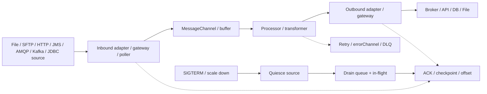
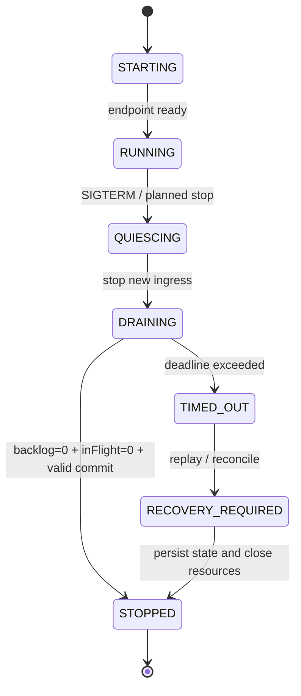
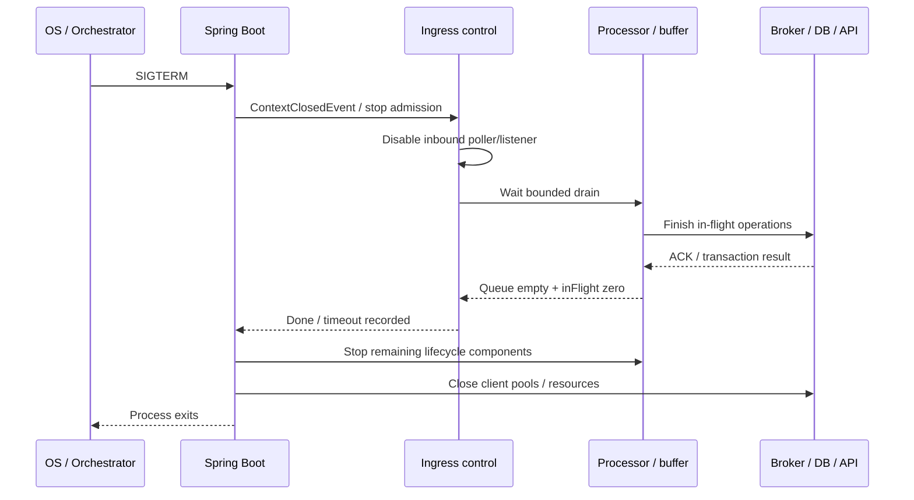
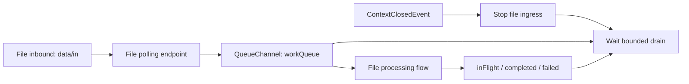
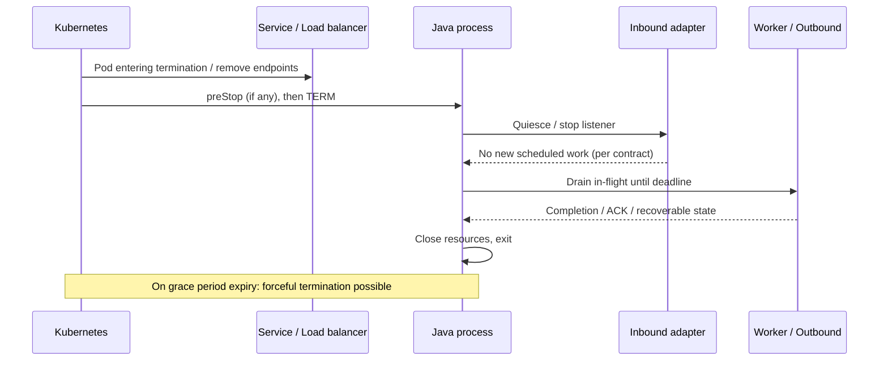

# Graceful Shutdown and Message Draining in Spring Integration Adapters

> **Chapter:** Production  
> **Topic:** Graceful shutdown and message draining  
> **Module:** `SPRING_INTEGRATION_ADAPTERS` — connecting external systems with inbound/outbound adapters, gateways, pollers, and `MessageChannel`; exchanging File, SFTP, HTTP, JMS, AMQP/RabbitMQ, Kafka, and databases; handling message contracts, errors, and connection lifecycles.  
> **Audience:** Java/Spring Boot developers, integration engineers, SREs, consumer and synchronous pipeline operators.  
> **Illustrative environment:** Java 17+, Spring Boot 3.x, Spring Integration 6.x aligned via Boot BOM. API names, container behaviors, and defaults may vary by version; verify against your actual project before deploying examples to production.

## 1. Why Is Graceful Shutdown Part of Correctness?

An integration application does more than handle HTTP requests. It may be polling SFTP, holding an unacked JMS message, reading an uncommitted Kafka record, updating a JDBC table, or writing an outbound file. When Kubernetes sends `SIGTERM`, runs a rolling update, or operators stop a connector, **killing the process immediately** can cause data loss, duplicate side effects, or leave resources in ambiguous states.

Example: a worker reads `orders-001.csv`, publishes `OrderImported` to Kafka, then updates the database. Right after the Kafka publish succeeds, the process is killed before writing the source checkpoint. After restart, the file is re-read and the event may be published a second time. Simply tweaking "shutdown waits 30 seconds longer" without idempotency fails whenever a node loses power or crashes.

**Graceful shutdown** is the procedure of reducing or blocking new work, giving active work a bounded window to finish, confirming ACKs/commits at the right boundaries, closing connections, and handing unfinished work over to durable replay/redelivery.

**Message draining** means finishing messages already accepted or sitting in buffers/queues under an explicit contract until allowed backlogs clear, the wait budget expires, or control shifts to safe recovery. It **does not mean** every message sitting on a broker must be drained before stopping one instance.

### 1.1. Learning Outcomes

After this lesson, you will be able to:

1. Distinguish abrupt shutdown, graceful stop, ingress quiesce, backlog draining, ACK/commit, and replay.
2. Identify work **received, processing, unacked, and queued**, along with observability limits per adapter.
3. Design stop ordering across `Inbound Adapter → MessageChannel → Transformer/Handler → Outbound Adapter/Gateway`.
4. Understand `ContextClosedEvent`, `SmartLifecycle`, phases, Spring Boot timeouts, graceful web server shutdown, and why they don't automatically enforce broker/file semantics.
5. Implement a Java/Spring Integration lab with File inbound, `QueueChannel`, worker pollers, and a bounded drain coordinator.
6. Define safe shutdown flows for File, SFTP, HTTP, JMS, AMQP/RabbitMQ, Kafka, and JDBC, managing connections, streams, and transactions.
7. Configure readiness, `SIGTERM`, `terminationGracePeriodSeconds`, rollouts/rollbacks, and acceptance criteria when messages remain in-flight.
8. Write shutdown tests across failure windows, prove **no messages vanish silently**, and handle duplicates via business idempotency.

### 1.2. End-to-End Picture



**Core principle:** Never issue an ACK/commit to the source earlier than the agreed business completion boundary. Never wait indefinitely on one message hoping for a "graceful" exit. If work cannot finish in time, ensure **redelivery/replay or reconcilable evidence** exists.

## 2. Vocabulary and States Requiring Exact Definitions

### 2.1. Quiesce, Drain, and Terminate Differ

| Concept | Meaning | Must NOT Be Inferred |
|---|---|---|
| **Quiesce ingress** | Stop polling/receiving/subscribing to new work or stop routing new requests to the instance | That already-accepted requests/messages are all finished |
| **In-flight** | Message actively inside an executing processing step | That it sits in a queue or is counted by the framework |
| **Backlog** | Messages received and waiting in buffers/`QueueChannel` or brokers | That every broker message must drain before shutdown |
| **Drain** | Finish backlog/in-flight work within a time budget | That counts always hit zero if downstream fails |
| **ACK / offset commit** | Notify source per delivery/processing policy | That downstream DBs and APIs committed unless contractually linked |
| **Checkpoint** | Progress marker that can be persisted durably | That any arbitrary checkpoint equals exactly-once |
| **Graceful terminate** | Close listeners, workers, and resources in order | Protection against `SIGKILL`, power loss, or node crashes |
| **Replay/redelivery** | Re-submit unfinished messages in a later run | That duplicates cannot happen |
| **Readiness** | Whether an instance should receive new work | That draining has finished |

### 2.2. Tracking `received`, `queued`, `inFlight`, `completed`, `acked`

An `inFlight=0` metric is insufficient if `QueueChannel` still holds 1,000 messages. Conversely, `queueDepth=0` is insufficient if a consumer already pulled a message and is blocking on an HTTP response.

Example progression:

```text
t0: inbound received 10, queueDepth=8, inFlight=2
t1: stop accepting new work (quiesce)
t2: queueDepth=5, inFlight=2, completed=3
t3: queueDepth=0, inFlight=1, completed=9
t4: queueDepth=0, inFlight=0, completed=10  -> worker drain complete
t5: close sources/outbound, confirm ACK/checkpoints per transport
```

This illustrates only **work already inside workers**. With brokers like Kafka/JMS, you must still inspect listeners and transactions/commits for valid ACKs; with in-memory buffers, data is lost on timeout or process kill.

### 2.3. State Machine Model



**Never equate `TIMED_OUT` with `SUCCESS`.** An expired drain must emit `remainingQueue`, `inFlight`, pending ACK counts, and a replay plan in metrics/logs/evidence. Never log "all messages processed" when only "process exited" is true.

## 3. Completion Contract: When Is ACK Allowed?

Before writing a shutdown hook, define **what counts as successful processing**.

### 3.1. Easily Confused Boundaries

| Action | Can Be Concluded | Cannot Yet Be Concluded |
|---|---|---|
| `MessageChannel.send(...)` returns `true` | Channel accepted handoff per channel contract | Downstream broker or DB committed if channel is async |
| Message dequeued from `QueueChannel` | No longer in in-memory queue | Business handler finished processing |
| HTTP outbound returns `2xx` | Server returned success per API contract | Action cannot duplicate after retry/crash |
| Kafka producer callback succeeds | Broker responded per producer `acks`/error policy | Consumer processed the message |
| JMS/AMQP consumer ACK | Broker stops redelivering per ACK semantics | A separate DB transaction committed unless guaranteed |
| JDBC transaction commit | DB mutations committed inside that transaction | Kafka/HTTP side effects also committed atomically |
| File archived | File moved per procedure | All target events persisted without coordinated checkpoints |

Synchronous `DirectChannel` normally propagates handler errors back to the sender on the same call stack. `ExecutorChannel`, `QueueChannel`, or async listeners introduce **thread/transaction boundaries**; acking right upon pushing into an async channel can be premature—a major anti-pattern when promoting flows from local tests to production.

### 3.2. Redelivery Decision Matrix

| When Process Dies | Proper Source/ACK Design | Expected Outcome |
|---|---|---|
| Before receiving message | Broker/source still retains message | New instance picks it up |
| After receive, before processing | Source unacked; File/SFTP needs re-pick/checkpoint | Redelivery/replay |
| Calling downstream, no response yet | May or may not have succeeded | Retry with **idempotency key** and reconciliation |
| Downstream succeeded, before source ACK | Source retains redelivery duty | Transport duplicate occurs; business dedupes |
| After source ACK/commit | Source considers it done | Ensure ACK point never precedes business boundary |
| After drain timeout, `SIGKILL` | Uncommitted work can replay | Fault-test and record evidence/alerts |

### 3.3. At-Most-Once, At-Least-Once, and Exactly-Once

- **At-most-once:** avoids duplicates, yet work can be lost on premature ACKs or lost in-memory buffers.
- **At-least-once:** avoids losing source-persisted messages under assumptions, yet retries/rebalances/crashes can repeat processing.
- **Business-scoped exactly-once effect:** requires combining transactions, dedupe keys, outboxes/inboxes, idempotent handlers, and explicit boundaries—it never appears merely by enabling graceful shutdown.

Kafka transactions can provide exactly-once semantics **within certain Kafka → Kafka flows** when properly configured. Never assume they span PostgreSQL, HTTP, or filesystems. For `JDBC → Kafka`, transactional outbox/CDC or explicit consistency models are far easier to verify than best-effort post-transaction sends.

## 4. How Spring Boot and Spring Integration Shut Down Applications

### 4.1. `ApplicationContext` Shutdown Lifecycle

When a process stops **in an orderly way** (e.g., `SIGTERM` triggering Spring's JVM shutdown hook), Spring closes `ApplicationContext`. `ContextClosedEvent` fires, the lifecycle processor stops `SmartLifecycle` beans, and bean destruction callbacks run. Exact ordering depends on phases, dependencies, and how each endpoint/container implements stop.



**Limitation:** This sequence is a **desired order**, not automatically guaranteed for every Spring Integration adapter. If the lifecycle processor stops consumers before sources or destroys an executor before queues drain, work gets abandoned. Configure and test stop order with real implementations.

### 4.2. `SmartLifecycle` and Phases

`SmartLifecycle` defines `start()`, `stop()`, `stop(Runnable callback)`, `isRunning()`, and `getPhase()`. During lifecycle shutdown, higher-phase groups typically **stop before** lower phases; startup runs in reverse. However, **dependencies, implementations, and stop callbacks** also affect concrete ordering.

Design principle:

- **Ingress/sources:** stop receiving first.
- **Workers/consumers:** keep running to drain accepted backlogs.
- **Outbound clients, transaction managers, connection pools:** stay alive until processing/commits complete.
- **Cleanup:** close connections and shared resources last.

Never alter system-wide `phase` values on untested assumptions: inbound endpoints, listener containers, and task executors may have version- and config-dependent default phases. When implementing `SmartLifecycle.stop(Runnable)`, always **invoke the completion callback exactly once** after stopping—even on timeout or error—or the lifecycle processor can stall until timeout unexpectedly.

### 4.3. Relevant Spring Boot Properties

```yaml
spring:
  lifecycle:
    timeout-per-shutdown-phase: 30s
  main:
    # For a real web app, configure shutdown per Boot version.
    # A worker without an HTTP server does not need web enabled just for graceful shutdown.
    web-application-type: none
```

`spring.lifecycle.timeout-per-shutdown-phase` sets the lifecycle processor's wait budget **per phase group**, not a cap on **total shutdown**, and does not automatically drain every `IntegrationFlow`.

When an app **runs an HTTP server**, graceful web-server shutdown also depends on the embedded server, Boot version, and runtime config. In Boot releases supporting `server.shutdown=graceful`, that setting governs draining HTTP requests at the web server—it does not stop Kafka, JMS, SFTP, or JDBC pollers. Activation and defaults vary across Boot versions, so verify real deployments.

### 4.4. `ContextClosedEvent` Is an Orchestration Hook, Not a Transaction

A `ContextClosedEvent` listener can proactively stop sources and wait a bounded window for in-flight/backlog items while endpoints stay alive. However, it has limits:

- Listeners run synchronously or asynchronously depending on the configured event multicaster.
- A source endpoint might be mid-poll; calling `stop()` does not prove no message is currently being handed off.
- A `QueueChannel` reflects only the in-JVM queue, not brokers or arriving HTTP requests.
- Work may sit inside a separate executor missed by naive counters.
- On ungraceful JVM kills, hooks **never run** or run out of time.

In production, build a tight **ingress admission fence**, count work before handoff, enforce a quiescence barrier, emit metrics/timings, and maintain durable replay. The lab below demonstrates building blocks—**never claiming to replace broker ACKs, metadata stores, or distributed transaction locks**.

### 4.5. Graceful Web Shutdown and Readiness

For HTTP inbound gateways, halting new traffic normally requires **flipping readiness to Not Ready**, letting load balancers drop routes, giving the HTTP server time to finish active requests, and having adapters return replies/timeouts per contract. On `SIGTERM`, timing gaps between readiness propagation, proxy caches, `preStop` hooks, and server shutdown create a brief window where new requests still arrive.

For **message-driven consumers** (Kafka, AMQP, JMS), HTTP readiness **does not automatically stop consumers**. Stop/pause listener containers via supported APIs and align ACK/offset strategies.

## 5. Designing Stop Order Around Spring Integration Topology

### 5.1. "Source First, Sink Last" Principle

Consider a pipeline:

```text
File/SFTP/Kafka inbound
         |
         v
  MessageChannel
         |
         v
 Validate / Transform
         |
         v
 DB transaction / HTTP / Kafka outbound
         |
         v
   Source ACK / checkpoint
```

During rolling updates or scale-downs, the target sequence is:

1. **Quiesce sources:** stop fetching new files/rows, stop listeners, or pull pod out of HTTP routing.
2. **Block new admission:** ensure late-arriving requests are rejected/redirected per protocol rather than accepted as new work.
3. **Wait for active stages:** already-polled-but-unhanded items, internal queues, consumer handlers, downstream calls, callbacks/ACKs.
4. **Commit durable outcomes:** ACK/commit/checkpoint only after business conditions are satisfied.
5. **Handle leftovers:** if deadlines expire, leave sources eligible to redeliver or persist incomplete work durably.
6. **Close connections:** stop workers, close sessions/file streams, HTTP/JDBC pools, producers/consumers, and executors.
7. **Verify:** log drain outcomes, event/correlation IDs, queue depths, and items needing recovery.

"Source first, sink last" is a **design goal**, not an automatic default guaranteed by Spring Boot in all scenarios.

### 5.2. Blocking New Intake Differs from Blocking Old Work

With a `QueueChannel`, never stop consumers at the start of shutdown; if the source quiesced while 100 messages sit in the queue, consumers must keep running to drain them. Conversely, if consumers are slow while sources keep polling, queues never reach zero.

With a synchronous `DirectChannel` from File poller to handler, `inFlight` may simply be the poller's active execution. With `ExecutorChannel`, count tasks submitted to the executor that are **queued** as well as running. A metric counting only handler method entry misses the executor's queue.

### 5.3. Admission Gates and Quiescence Barriers

An **admission gate** decides whether to accept new messages. Properly built, it acts atomically:

- When `OPEN`, increment accepted-work counter **before** handing off downstream.
- When `CLOSING`, reject/redirect new work per transport contract.
- When handlers finish or cleanly return work to the source per policy, decrement the counter **exactly once**.
- Only when no producer can admit new items and all accepted work has finished or persisted durably has the barrier been reached.

For example, counting `inFlight` only when a consumer method starts lets an active source poll hand off work right after a controller observed `queueDepth=0` and `inFlight=0`. Combine **counting + quiescence** with zero state gaps—never treat `while(queue.size()==0)` as absolute proof of drain.

### 5.4. Sync, Async, and Late Callbacks

| Pattern | Where Messages May Sit | Required Drain Step |
|---|---|---|
| `DirectChannel` | Poller/gateway/handler call stack | Wait for call stack to unwind; inspect exceptions |
| In-memory `QueueChannel` | Queue memory and consumer threads | Stop source; keep polling queue until empty or deadline |
| `ExecutorChannel` | Executor queue, running, or rejected | Block new submissions; wait boundedly for queued + running tasks |
| `PublishSubscribeChannel` | One or more subscribers, possibly async | Check completion/ACK of **all mandatory branches** |
| Broker inbound | Broker inflight/prefetched messages + app | Stop listener; ACK/nack per container and processing |
| Outbound async producer | Client buffers/network and callbacks | Flush/await callbacks, record outcomes, release client |

If a fan-out commits DB on branch A and sends Kafka on branch B, "branch A done" does not mean the whole message is done. Define completion per business contract, avoiding letting optional branches block shutdown forever.

## 6. Shutdown Per Inbound Adapter

### 6.1. File Inbound: Pollers, Persistent Filters, and Intact Files

**Behavior to understand:** `Files.inboundAdapter(...)` scans directories and emits `File` messages into flows; file intake has no broker ACK protocol. To avoid losing business work, design explicit processing proof, archiving, and checkpoints.

Sequence:

1. Stop the File polling endpoint to prevent new polls.
2. Wait for files already admitted into channels to finish and get downstream ACKs.
3. Archive/mark done only after business effects commit durably.
4. On errors or expired shutdowns, retain source files and metadata for safe replay.
5. Close file streams cleanly without leaving half-written outputs; for outbound files, write temp suffixes and use atomic rename where filesystems support it.

**Pitfall:** A persistent accept-once filter may mark a file seen **before** downstream commits. If the process dies between marking and processing, the file remains on disk while the filter skips it—losing business processing. Track `claimed → processing → completed` with expired-claim recovery rather than calling persistent filters "exactly-once".

**Idempotency:** Derive keys from business contents, checksums/file versions, or governed partner+file identities. Never treat bare filenames as immutable keys if partners can overwrite files.

### 6.2. SFTP Inbound: Sessions and Remote Files

SFTP polling/streaming adds SSH/SFTP sessions and remote/local sync states:

- Stop polling first so no new downloads begin.
- With **synchronized inbound**, distinguish files staged locally yet unprocessed; define recovery for local staging and remote sources.
- With **streaming inbound**, ensure downstream reads/closes `InputStream` cleanly; never close sessions before streams finish reading.
- Enforce host-key verification and managed keys/credentials; never disable trust checks to paper over shutdown/reconnect errors.
- Remote renames/markers or persistent filters must remain safe if shutdown hits mid-upload/download.
- Since remote SFTP lacks cross-system transactions, rely on state/idempotency and whole-file checks rather than treating rename/ACK as atomic with DB/Kafka.

If SFTP `SessionFactory` uses caching, stopping the endpoint and stopping/cleaning up the session cache are distinct steps. Closing sessions too early aborts active streams; closing too late causes pods to miss grace periods.

### 6.3. HTTP Inbound: Halting Traffic and Responding Responsibly

HTTP inbound gateways follow request–reply semantics. On shutdown:

1. Flip readiness so load balancers stop routing new requests.
2. Allow in-flight server requests to finish within `server.shutdown`/grace periods and app timeouts.
3. For late-arriving requests, return an explicit contract response (typically `503 Service Unavailable` or contract code) with retry guidance instead of accepting work and dropping it.
4. Never return `200/202` before work is durably persisted if the contract requires durability.
5. Close client pools/callbacks after valid requests finish or convert into replayable jobs.

**Caveat:** HTTP server graceful shutdown only knows about HTTP request/connection lifecycles. If an inbound gateway returns `202 Accepted` after pushing work into an in-memory queue, the HTTP request ends while the job is non-durable—a pod crash loses it. Persist to a durable queue/outbox before HTTP ACK.

### 6.4. JMS Inbound: Stopping Listeners, ACKs, and Transactions

For Spring Integration JMS message-driven inbound, inspect the actual listener container and provider used by the adapter:

- Stop new deliveries via the listener container/endpoint lifecycle.
- Track active listeners, concurrency, and prefetched/unacknowledged messages.
- With **transacted sessions**, commit only on contractual processing success; errors roll back/redeliver per provider/broker.
- With **client ACK/auto ACK**, know exactly when the container actually ACKs—never assume dispatching onto an async channel means processing succeeded.
- On timeout, uncommitted/unacked messages must remain eligible for redelivery; DLQs bound poison messages.
- Close `jakarta.jms.ConnectionFactory`/connections per container and provider rules after listeners stop.

In a JMS → `ExecutorChannel` → DB flow, the consumer may hand off to another thread before DB commit. Guaranteeing "ACK after DB commit" requires proper bridging/transaction boundaries—not merely raising shutdown timeouts.

### 6.5. AMQP/RabbitMQ: Prefetch and Requeue

Spring Integration AMQP relies on Spring AMQP listeners/handlers. Distinguish:

- `prefetch`: brokers can push multiple unacked messages to consumers before executors even begin processing them.
- `manual ack` / container ack policy: when the broker considers messages complete.
- `nack/requeue`: error/timeout behavior; infinite requeues cause poison-message loops.
- Publisher confirms/returns: on RabbitMQ outbound, await confirmations before marking business complete where required.

During quiescence, stop listeners first while keeping workers and outbound connections alive long enough to finish active work; watch broker unacked counts, consumer counts, and DLQs. If containers stop mid-message, brokers redeliver after connections close per ACK state. **Redelivery is normal** in at-least-once systems; keep handlers idempotent.

### 6.6. Kafka Inbound: Offset Commits and Rebalances

Kafka consumers operate via consumer groups, poll loops, partitions, offsets, and listener containers. When stopping:

1. Stop fetching new records via the appropriate container API; drain records already admitted into the flow within shutdown bounds.
2. Commit offsets strictly for records processed per policy.
3. Expect rebalances when consumers leave groups; surviving instances take over partitions.
4. With async handlers, a "submitted" callback is not proof of business commit; check ack modes and async ack/offset ordering for your version.
5. When outbound producers still buffer records, `flush` and await callbacks within deadline before closing.

**Pitfall:** Committing an offset for a higher-sequence record while earlier records remain unfinished loses replay safety. For async/out-of-order execution, track contiguous per-partition completed offsets via supported listener strategies. Never claim `enable-auto-commit=false` solves it alone.

Align `max.poll.interval.ms`, batch runtimes, and shutdown timeouts: slow handlers can trigger group rebalances **mid-drain**. Never raise all timeouts infinitely; cap batch/in-flight sizes and offload slow work to durable queues where needed.

### 6.7. JDBC Inbound: Claims/Locks and Rollbacks

JDBC polling sources query eligible rows and often mark them processed. To shut down cleanly:

- Stop firing new poll queries; finish active transactions or roll back cleanly.
- Distinguish `NEW`, `CLAIMED`, `PROCESSING`, `COMPLETED`, and `FAILED` states.
- With multiple instances, claim inside transactions/locks so two workers don't grab the same row.
- If a process dies while a row is `CLAIMED`, use leases/timeouts and reconciliation to re-process it.
- Avoid holding DB transactions open across slow HTTP calls when outbox/async patterns fit.
- Close pools only after dependent transactions finish, never before.

Spring Integration's JDBC adapter provides endpoint/query plumbing—it **does not automatically create business checkpoints or distributed transactions**. For `JDBC → Kafka`, outbox/CDC and consumer idempotency are essential.

## 7. Outbound Adapters and Completing Side Effects

### 7.1. Draining Must Observe All the Way to the Target

| Outbound | Stronger Completion Criterion Than "Sent to Channel" | On Deadline Expiry |
|---|---|---|
| File writer | File written safely per policy; rename/flush verified | Keep temp file and reconcile; never publish partial files |
| SFTP uploader | Remote upload complete; temp rename/marker per contract | Retain local checkpoint and idempotently retry |
| HTTP gateway | Meaningful response received; timeout does not rule out server commit | Look up via idempotency key/correlation before retrying |
| JMS producer | Send/transaction succeeded per provider semantics | Outbox/retry; never assume broker saved it |
| RabbitMQ publisher | Confirm/return handled per policy and routing succeeded | Keep event durable for resend |
| Kafka producer | Producer callback/acks satisfied; bounded flush | Zero event loss if backed by durable outbox |
| JDBC handler | Transaction committed; resources closed cleanly | Roll back/retry/reconcile by key |

### 7.2. Outbound Gateways vs. Outbound Adapters

**Outbound gateways** carry responses onward in the flow (e.g., HTTP or JMS request–reply); requests awaiting replies must count as in-flight. On reply timeouts, define whether late callbacks still listen or drop, while preserving request IDs and idempotency.

**Outbound channel adapters** look one-way from the flow perspective. Yet underlying APIs may offer callbacks/confirms; if business guarantees require durable confirmation, build async completion tracking or an outbox. Never equate a "one-way" endpoint type with delivery acknowledgement.

### 7.3. Blocking Duplicate Side Effects During Shutdown

Example flow File → HTTP create order → JDBC:

- File filter accepted `order-42.csv`.
- HTTP timed out after 5 seconds.
- Process received `SIGTERM` before JDBC wrote `DONE`.
- After restart, the file is re-picked and HTTP may be called again.

Risk reduction: construct a **business idempotency key** `partnerId + orderId + schemaVersion`, pass it via a partner-supported header or persist a dedupe table before/within the proper transaction. Retries must keep the **exact same key**—never mint a fresh UUID per attempt. When servers lack idempotency support, build external status lookup/reconciliation before resending.

## 8. Spring Boot Lab: Quiesce File Ingress and Drain `QueueChannel`

### 8.1. Goals and Limitations

Let's build a Spring Boot worker:



Goal: accept files while running; when the context closes cleanly, a coordinator stops the File source and waits up to a deadline for the queue and handlers to drain. **There is no durable broker or database in this lab.** Never deploy this verbatim where zero message loss is required: default `QueueChannel` lives in RAM and loses data on `SIGKILL`, crashes, or timeouts. Furthermore, counting in-flight solely inside the handler is **not yet** an atomic admission barrier.

### 8.2. Dependencies

In a Maven project using the Spring Boot parent/BOM, add these dependencies (valid POM fragment):

```xml
<dependencies>
    <dependency>
        <groupId>org.springframework.boot</groupId>
        <artifactId>spring-boot-starter-integration</artifactId>
    </dependency>
    <dependency>
        <groupId>org.springframework.integration</groupId>
        <artifactId>spring-integration-file</artifactId>
    </dependency>
    <dependency>
        <groupId>org.springframework.boot</groupId>
        <artifactId>spring-boot-starter-test</artifactId>
        <scope>test</scope>
    </dependency>
    <dependency>
        <groupId>org.springframework.integration</groupId>
        <artifactId>spring-integration-test</artifactId>
        <scope>test</scope>
    </dependency>
</dependencies>
```

Equivalent Gradle Groovy DSL (with Boot dependency management imported):

```groovy
dependencies {
    implementation 'org.springframework.boot:spring-boot-starter-integration'
    implementation 'org.springframework.integration:spring-integration-file'
    testImplementation 'org.springframework.boot:spring-boot-starter-test'
    testImplementation 'org.springframework.integration:spring-integration-test'
}
```

No Kafka/JMS/Rabbit starters are needed to study an in-JVM `QueueChannel`. Conversely, if you wire real brokers into a topology, add the corresponding adapter modules, clients/providers, and real ACK/redelivery tests.

### 8.3. File Layout and Configuration

```text
graceful-drain-lab/
├── pom.xml
└── src/
    ├── main/
    │   ├── java/com/example/drain/
    │   │   ├── DrainApplication.java
    │   │   ├── WorkCounters.java
    │   │   ├── FileWorkFlows.java
    │   │   └── DrainOnShutdown.java
    │   └── resources/application.yml
    └── test/java/com/example/drain/
        └── WorkCountersTest.java
```

File `src/main/resources/application.yml`:

```yaml
spring:
  application:
    name: graceful-drain-lab
  main:
    web-application-type: none
  lifecycle:
    timeout-per-shutdown-phase: 30s

app:
  file:
    inbox: ./data/in
  drain:
    timeout: 15s

logging:
  level:
    com.example.drain: INFO
    org.springframework.integration: INFO
```

`web-application-type: none` indicates this worker serves no HTTP traffic. `timeout-per-shutdown-phase` caps Spring Boot lifecycle phases, while `app.drain.timeout` is the **limit used by the lab coordinator**. They do not add up to one guaranteed total process exit window—leave headroom for bean destruction and orchestration.

File `DrainApplication.java`:

```java
package com.example.drain;

import org.springframework.boot.SpringApplication;
import org.springframework.boot.autoconfigure.SpringBootApplication;

@SpringBootApplication
public class DrainApplication {
    public static void main(String[] args) {
        SpringApplication.run(DrainApplication.class, args);
    }
}
```

### 8.4. Active Task Counters

File `WorkCounters.java`:

```java
package com.example.drain;

import java.util.concurrent.atomic.AtomicInteger;
import java.util.concurrent.atomic.AtomicLong;
import org.springframework.stereotype.Component;

@Component
public class WorkCounters {
    private final AtomicInteger inFlight = new AtomicInteger();
    private final AtomicLong completed = new AtomicLong();
    private final AtomicLong failed = new AtomicLong();

    public void entered() {
        inFlight.incrementAndGet();
    }

    public void succeeded() {
        completed.incrementAndGet();
    }

    public void failed() {
        failed.incrementAndGet();
    }

    public void exited() {
        inFlight.decrementAndGet();
    }

    public int inFlight() {
        return inFlight.get();
    }

    public long completed() {
        return completed.get();
    }

    public long failures() {
        return failed.get();
    }
}
```

`AtomicInteger` and `AtomicLong` make counters thread-safe within **one process**. These counters do not cover messages already picked up by the File source before reaching the queue, hidden executor queues, or broker-prefetched records; production systems must track admission/handoffs and source states too.

### 8.5. Creating Two `IntegrationFlow` Beans

File `FileWorkFlows.java`:

```java
package com.example.drain;

import java.io.File;
import java.time.Duration;

import org.slf4j.Logger;
import org.slf4j.LoggerFactory;
import org.springframework.beans.factory.annotation.Value;
import org.springframework.context.annotation.Bean;
import org.springframework.context.annotation.Configuration;
import org.springframework.integration.channel.QueueChannel;
import org.springframework.integration.dsl.IntegrationFlow;
import org.springframework.integration.dsl.Pollers;
import org.springframework.integration.file.dsl.Files;

@Configuration(proxyBeanMethods = false)
public class FileWorkFlows {
    private static final Logger log =
            LoggerFactory.getLogger(FileWorkFlows.class);

    @Bean("workQueue")
    QueueChannel workQueue() {
        // Bounded queue: caps in-JVM buffer; NOT durable.
        return new QueueChannel(100);
    }

    @Bean("fileIngressFlow")
    IntegrationFlow fileIngressFlow(
            @Value("${app.file.inbox}") String inbox) {
        return IntegrationFlow
            .from(
                Files.inboundAdapter(new File(inbox))
                     .autoCreateDirectory(true)
                     .patternFilter("*.txt"),
                endpoint -> endpoint
                    .id("fileIngressEndpoint")
                    .poller(
                        Pollers.fixedDelay(Duration.ofMillis(300))
                               .maxMessagesPerPoll(1)
                    )
            )
            .channel("workQueue")
            .get();
    }

    @Bean("fileProcessorFlow")
    IntegrationFlow fileProcessorFlow(WorkCounters counters) {
        return IntegrationFlow
            .from(
                "workQueue",
                endpoint -> endpoint.poller(
                    Pollers.fixedDelay(Duration.ofMillis(150))
                           .maxMessagesPerPoll(1)
                )
            )
            .handle(message -> {
                File file = (File) message.getPayload();
                counters.entered();
                try {
                    // SIMULATION ONLY for slow work; never sleep like this in production.
                    Thread.sleep(700);
                    log.info("PROCESSED file={}", file.getName());
                    counters.succeeded();
                } catch (InterruptedException ex) {
                    Thread.currentThread().interrupt();
                    counters.failed();
                    throw new IllegalStateException(
                        "Processing interrupted", ex
                    );
                } catch (RuntimeException ex) {
                    counters.failed();
                    throw ex;
                } finally {
                    counters.exited();
                }
            })
            .get();
    }
}
```

**Reading the flow:**

1. `fileIngressEndpoint` is the source endpoint ID stopped during shutdown.
2. `FileReadingMessageSource` pushes `File` payloads into `QueueChannel` `workQueue`.
3. The processor flow polls `workQueue` and simulates ~700 ms work per file.
4. `QueueChannel(100)` caps the queue; when full, sends fail or block per timeout semantics and source configuration. **Never ignore handoff errors.**
5. `WorkCounters` counts work **after dequeuing**; reliable production systems extend this to cover admission and durable state.

### 8.6. Shutdown Coordinator on Context Close

File `DrainOnShutdown.java`:

```java
package com.example.drain;

import java.time.Duration;
import java.util.concurrent.TimeUnit;
import java.util.concurrent.atomic.AtomicBoolean;

import org.slf4j.Logger;
import org.slf4j.LoggerFactory;
import org.springframework.beans.factory.annotation.Qualifier;
import org.springframework.beans.factory.annotation.Value;
import org.springframework.context.ApplicationContext;
import org.springframework.context.Lifecycle;
import org.springframework.context.event.ContextClosedEvent;
import org.springframework.context.event.EventListener;
import org.springframework.integration.channel.QueueChannel;
import org.springframework.stereotype.Component;

@Component
public class DrainOnShutdown {
    private static final Logger log =
            LoggerFactory.getLogger(DrainOnShutdown.class);

    private final ApplicationContext context;
    private final QueueChannel queue;
    private final WorkCounters counters;
    private final Duration timeout;
    private final AtomicBoolean closing = new AtomicBoolean(false);

    public DrainOnShutdown(
            ApplicationContext context,
            @Qualifier("workQueue") QueueChannel queue,
            WorkCounters counters,
            @Value("${app.drain.timeout:15s}") Duration timeout) {
        this.context = context;
        this.queue = queue;
        this.counters = counters;
        this.timeout = timeout;
    }

    @EventListener(ContextClosedEvent.class)
    public void onContextClosed() {
        if (!closing.compareAndSet(false, true)) {
            return;
        }

        log.info("DRAIN_START queue={} inFlight={}",
                 queue.getQueueSize(), counters.inFlight());

        // Stop source first while keeping the processor poller running during drain.
        Lifecycle ingress =
            context.getBean("fileIngressEndpoint", Lifecycle.class);
        ingress.stop();

        long deadline = System.nanoTime() + timeout.toNanos();
        boolean interrupted = false;

        while (System.nanoTime() < deadline) {
            if (queue.getQueueSize() == 0 && counters.inFlight() == 0) {
                break;
            }
            try {
                TimeUnit.MILLISECONDS.sleep(100);
            } catch (InterruptedException ex) {
                Thread.currentThread().interrupt();
                interrupted = true;
                break;
            }
        }

        boolean drained =
            queue.getQueueSize() == 0 && counters.inFlight() == 0
            && !interrupted;

        if (drained) {
            log.info("DRAIN_FINISHED completed={} failed={}",
                     counters.completed(), counters.failures());
        } else {
            log.warn("DRAIN_INCOMPLETE queue={} inFlight={} failed={}",
                     queue.getQueueSize(), counters.inFlight(),
                     counters.failures());
        }
    }
}
```

**Honest safety assessment:**

- The `ContextClosedEvent` handler runs during normal context closure. Under Spring's default synchronous event multicaster, it keeps processors alive before lifecycle bean stop runs.
- It calls `stop()` on the File source by endpoint ID, then polls `queueDepth` and `inFlight` until 0 or deadline.
- `@EventListener` **is not a formally proven quiescence barrier**: a race window exists if an active poll is midway through handing off a message before updating the queue/counter; an async event multicaster changes ordering too.
- `DRAIN_FINISHED` proves only that **two observed counters read 0**; it does not prove downstream durability or that no file is mid-read at the source boundary. Production requires an admission fence confirming all source tasks quiesced plus completion tracking before ACK/checkpoint.
- If items remain in the queue on timeout, **this lab loses in-memory data**. Never copy that as a production recovery strategy. Use durable brokers, persistent `MessageStore`, or transactions/outboxes as required, and test stopping mid-poll.

### 8.7. Running and Observing the Lab

From the Maven wrapper project root:

```bash
./mvnw spring-boot:run
```

On Windows use `mvnw.cmd spring-boot:run`. Create mock files `data/in/order-001.txt`, `order-002.txt`, `order-003.txt`. Since the processor is slower than file polling, you can watch the queue grow and then drain.

To simulate an orderly stop, run in a terminal and press **Ctrl+C** (or send `SIGTERM` to the JVM PID when managing processes directly). **Never** use `kill -9` when testing the graceful path; reserve `SIGKILL` for dedicated crash-recovery tests once durability is in place.

Expected log pattern:

```text
PROCESSED file=order-001.txt
DRAIN_START queue=2 inFlight=1
PROCESSED file=order-002.txt
PROCESSED file=order-003.txt
DRAIN_FINISHED completed=3 failed=0
```

Exact ordering, counter values, and counts vary with thread timing and how many files were polled; **this is illustrative expected output, not an observed test run**. If stopped early before polling finishes, remaining files stay on disk for processing on restart depending on file-filter settings.

### 8.8. Testing an Overly Short Deadline

Change:

```yaml
app:
  drain:
    timeout: 200ms
```

Drop several files into the inbox and stop. You will likely see `DRAIN_INCOMPLETE` with positive queue or in-flight counts. Takeaway: bounded waits surface **how much work remains**, yet **do not** make unfinished messages durable. Never report success when buffered work remains; build a replay strategy before production use.

### 8.9. Mandatory Upgrades Before Production

1. Replace the in-memory queue with a **durable work store/broker** whenever message loss is unacceptable.
2. Implement an **atomic admission fence** before every handoff; once closed, sources accept zero new jobs and drain waits for source tasks already inside the critical section.
3. Track completed/failed/retry/recoverable counts; tie completion to **business IDs** and downstream commits.
4. Ensure file sources never ACK/checkpoint ahead of business completion; build leases/claims and crash replay.
5. Add poison-message quarantine so one bad item never stalls drains indefinitely.
6. Verify exact endpoint graceful-stop behavior on your chosen Spring Integration version rather than guessing by bean name.
7. Test stops mid-read, mid-queue, mid-handler, mid-outbound, and mid-commit via fault injection and process kills.
8. Add observability, audits, deadlines, and clean handoff of unfinished work to new instances or operators.

## 9. Testing Shutdown and Failure Points in the Lab

### 9.1. Counter Unit Test Without Spring Context

File `WorkCountersTest.java`:

```java
package com.example.drain;

import org.junit.jupiter.api.Test;
import static org.assertj.core.api.Assertions.assertThat;

class WorkCountersTest {

    @Test
    void tracksCompletionAndActiveWork() {
        WorkCounters counters = new WorkCounters();

        counters.entered();
        counters.entered();
        assertThat(counters.inFlight()).isEqualTo(2);

        counters.succeeded();
        counters.exited();
        assertThat(counters.inFlight()).isEqualTo(1);
        assertThat(counters.completed()).isEqualTo(1);

        counters.failed();
        counters.exited();
        assertThat(counters.inFlight()).isZero();
        assertThat(counters.failures()).isEqualTo(1);
    }
}
```

This tests basic counter math only. It **does not test admission-gate races, listener stops, session closes, or queue durability**. Never use a passing unit test here to claim pod-kill safety.

### 9.2. Observable Test Matrix

| Scenario | Setup | What You Should Observe | What Cannot Be Inferred |
|---|---|---|---|
| Stop while idle | No active files | Fast `DRAIN_FINISHED`, queue 0 / inFlight 0 | That all other sources are safe |
| Stop mid-handler | At least one file inside `Thread.sleep` | Process waits for handler or hits deadline | That files cannot duplicate on restart |
| Stop under growing backlog | More `*.txt` files than processor speed | Queue shrinks while budget lasts | That in-memory queues survive crashes |
| Overly short deadline | `app.drain.timeout=200ms`, many files | `DRAIN_INCOMPLETE` / remaining counts logged | That unfinished data is recoverable |
| Source keeps polling | Deliberately omit stopping source in a lab copy | Backlog may never reach zero | That tweaking counters suffices |
| Processor throws exception | Add failure branch for `bad.txt` | Failure metric climbs; error logged | That queue messages auto-redeliver |
| Forceful process kill | `SIGKILL` in isolated test | Close hook skipped; zero drain | Acceptable when queue is non-durable |
| Restart with existing files | Keep source files after stop | Files may be re-read | Exactly-once is NOT proven |
| Queue full | >100 files, fast producer | Backpressure/send failures must be handled | That dropping messages is acceptable |
| Multi-instance | Two apps polling same directory | Duplicate-ingestion risk | `QueueChannel` shares locks across pods |

**Engineering bar:** Reproduce stops in three places: **before queue**, **mid-processing**, and **after downstream succeeds before checkpoint**. The third typically needs fault injection/mocks plus a durable store; Section 8's lab models only the basics.

### 9.3. Why Observing `DRAIN_FINISHED` Logs Is Still Insufficient

- `inFlight` increments only when the handler starts; messages in transit from file source to queue are uncounted.
- The handler marks `completed` after sleeping—without real transactions or broker confirms.
- An in-JVM `QueueChannel` disappears on process crashes.
- File accept-once filters can record state differently from business completion.
- Poller/worker lifecycles vary across Spring Integration versions.

In test reports, always state the **exact guarantee scope**: "Drained observed queue and in-flight work in a single process during orderly shutdown"—never "zero data loss across all failures".

### 9.4. Bringing the Lab Closer to Production

An upgraded lab can introduce:

1. Durable `PendingWork` store tracking `eventId`, source ID, `PENDING/PROCESSING/DONE`, and leases.
2. Ingress claims work in a transaction; **never** delete/checkpoint sources before durable commits.
3. Processors verify downstream outcomes using business idempotency keys.
4. Mark `DONE` inside transactions with reconciliation for ambiguous outcomes.
5. On startup, scan expired leases and idempotently retry.
6. On shutdown, close admission, wait for active tasks; on expiry, leave `PENDING/PROCESSING` for the next instance.
7. Test real process crashes in isolation—not just manually invoking `onContextClosed()`.

In practice, use **JMS/AMQP/Kafka** for durable ingress or **JDBC outbox/inbox**; there is rarely a need to hand-roll a DB queue when a broker already supplies the right durable boundary.

## 10. Kubernetes: `terminationGracePeriod` and Rolling Deployments

### 10.1. Pod Shutdown Timeline

When a Pod terminates normally, Kubernetes starts a **grace period**; any `preStop` hook executes inside that budget, then the runtime sends the stop signal (`SIGTERM`) to the container, and finally force-kills (`SIGKILL`) on expiry. Total budget must cover hooks, propagation, drain, cleanup, and safety margin.



**Never guarantee** load balancers stop routing instantly; endpoint propagation delays and keep-alive connections exist. For inbound HTTP, combine readiness, graceful server shutdown, and error/retry contracts. For Kafka/JMS/Rabbit listeners, stop consumers directly—HTTP readiness never reduces prefetch or stops polls.

### 10.2. Abbreviated Deployment Config Example

```yaml
apiVersion: apps/v1
kind: Deployment
metadata:
  name: order-integration
spec:
  replicas: 2
  strategy:
    type: RollingUpdate
    rollingUpdate:
      maxUnavailable: 0
      maxSurge: 1
  selector:
    matchLabels:
      app: order-integration
  template:
    metadata:
      labels:
        app: order-integration
    spec:
      terminationGracePeriodSeconds: 90
      containers:
        - name: worker
          image: example.invalid/order-integration:release-tag
          # Command/entrypoint must forward TERM signals to the JVM.
          env:
            - name: JAVA_TOOL_OPTIONS
              value: "-XX:+ExitOnOutOfMemoryError"
          resources:
            requests:
              cpu: "200m"
              memory: "256Mi"
            limits:
              memory: "512Mi"
```

**This is illustrative YAML**, omitting real images, probes, service accounts, network policies, ConfigMaps, Secrets, volumes, and mandatory deployment controls. `example.invalid` is intentionally non-production.

Why `90s` here: if drain + lifecycle takes tens of seconds, it leaves margin for `preStop`, signal delivery, and cleanup. It is **not** a universal optimum—measure `p99` processing latencies, queue/backlogs, broker rebalances, downstream SLAs, shutdown callbacks, and signal timing in your real cluster.

### 10.3. Time Budget Arithmetic

Define:

- `T_hook`: `preStop` hook and routing drain wait, if used.
- `T_quiesce`: stopping sources/listeners and finishing current poll ticks.
- `T_drain`: completing received in-flight work and commits/ACKs.
- `T_cleanup`: closing producers, pools, file streams, and context.
- `T_margin`: buffer for jitter, scheduling, network, and logging.

Design so that:

\[
T_{\text{hook}} + T_{\text{quiesce}} + T_{\text{drain}} +
T_{\text{cleanup}} + T_{\text{margin}}
\le T_{\text{terminationGracePeriod}}
\]

**Illustrative example:** `preStop` 5 s + quiesce 5 s + drain 40 s + cleanup 10 s + buffer 15 s = 75 s, fitting inside a 90 s grace period. This is a planning model, not a framework-enforced guarantee. If `spring.lifecycle.timeout-per-shutdown-phase=30s` spans multiple phases, total Spring shutdown can exceed 30 s—measure and bound the total under the orchestrator's deadline.

### 10.4. PID 1, `ENTRYPOINT`, and Signals

If a container launches through a shell wrapper that swallows `SIGTERM`, JVM shutdown hooks never run; from the JVM's view, it simply gets hard-killed when the grace period expires. Use exec-form entrypoints that forward signals properly.

Dockerfile principle example:

```dockerfile
# Illustrates exec form only; image and JAR must be real.
ENTRYPOINT ["java", "-jar", "/app/app.jar"]
```

Avoid `sh -c "java -jar ..."` without `exec` or explicit signal forwarding. Test `kubectl delete pod` in staging and verify **`DRAIN_START`/`DRAIN_FINISHED` logs, replayed counts, and elapsed time**.

### 10.5. `preStop` Hooks: Use Purposefully, Never Sleep Blindly

`preStop` helps when calling an **authenticated** endpoint to halt work intake before `TERM` or letting load balancers drain routes. By contrast, a bare `sleep 30` simply **burns** termination budget without verifying messages drained.

If a hook calls an admin API, enforce RBAC/allowlists, auditing, timeouts, and keep it private. For broker consumers without HTTP management APIs, let Spring's shutdown hook stop listeners on `SIGTERM` instead of inventing an HTTP API just to justify a `preStop`.

### 10.6. Scale-Down, Rolling Updates, and Rebalances

- **Kafka:** when replicas leave consumer groups, partitions rebalance. Processing speed, `max.poll.interval.ms`, and commit policies decide what replays.
- **JMS/AMQP:** brokers redeliver unacked messages to peers; queue depth/unacked are critical metrics.
- **SFTP/File/JDBC polling:** two replicas can observe a shared source lacking exclusive claims; scaling demands persistent locks/leases/idempotency.
- **HTTP:** pods with active requests need time to reply or hand off to durable queues.
- **Critical workloads:** `PodDisruptionBudget`, rollout surge, and readiness cut disruption, yet **never replace** ACK/replay logic.

With tenant/partner routing, new deployments must validate secrets/hosts/topics/DBs for the **right environment and tenant** before accepting work. Rolling updates must never silently cross-route traffic.

## 11. Measuring Draining and Designing Useful Alerts

### 11.1. Separate Metrics for Sources and Processing

| Metric | Meaning | Failure Exposed |
|---|---|---|
| `shutdown_state` | `RUNNING`/`QUIESCING`/`DRAINING`/`STOPPED`/`TIMED_OUT` | Pod terminated before draining |
| `ingress_accepting` | Still accepting new work? | Readiness false while source still polls |
| `queue_depth` | Messages waiting inside app | Counting only in-flight misses backlogs |
| `in_flight` | Messages running in handlers/outbound | Queue=0 while work remains active |
| `accepted_total` | Admitted messages | Exposes gaps between admission and completion |
| `completed_total` | Verified business completions | Separates channel sends from downstream commits |
| `failed_total` / `retry_total` | Failures and retries | Poison-message loops |
| `acked_total` / `committed_total` | Completed source checkpoints | Premature or missing ACKs |
| `drain_duration_seconds` | Duration of a shutdown drain | Grace-period tuning |
| `drain_timeout_total` | Deadline-expiry count | Alerts on unsafe shutdowns |
| `replay_total` / `duplicate_total` | Reprocessed or deduplicated work | Measures at-least-once/idempotency health |
| `consumer_lag` / `broker_unacked` | Off-JVM backlogs | Prevents mistaking empty app queues for empty brokers |

**Transport-dependent:** `acked_total` cannot be computed reliably from consumer handler logs alone; pull from client/container callbacks or transactions. When tagging by tenant/partner, keep label cardinality bounded—never use `eventId` or message IDs as metric tags.

### 11.2. Structured Logs per Phase

Example log event **free of secrets**:

```json
{
  "event": "DRAIN_INCOMPLETE",
  "service": "order-integration",
  "instance": "pod-17",
  "sourceType": "kafka",
  "phase": "DRAINING",
  "deadlineMs": 40000,
  "queued": 7,
  "inFlight": 2,
  "uncommitted": 4,
  "lastErrorCode": "DOWNSTREAM_TIMEOUT",
  "recovery": "REDELIVERY_EXPECTED"
}
```

Never log passwords, bearer tokens, Kafka SASL configs, SFTP private keys, connection strings with credentials, or full PII payloads. Keep event/correlation IDs in protected audit logs—never millions of unique IDs inside metric tags.

### 11.3. Alerts and SLOs

A practical alert suite covers:

- Graceful terminations hitting `DRAIN_INCOMPLETE` past approved thresholds.
- Source-acked messages lacking business-completion evidence.
- Kafka consumer lag or RabbitMQ unacked failing to drop after quiescence.
- Expired File/SFTP claim leases lacking retries/recovery.
- Shutdown durations repeatedly approaching `terminationGracePeriodSeconds`.
- Sharp spikes in duplicates/dedupes post-rollout.
- New pods failing readiness due to broker/DB/TLS or wrong topic/queue/host.
- Non-empty in-memory queues at process exit—treat as data-loss risk needing remediation.

**Set SLOs according to flow criticality.** Alerts like "drain timeouts exceeded threshold across last 100 deploys" require sufficient samples and clear response workflows. Never claim zero data loss from app logs unless sources and sinks have durable proof.

## 12. Operations Runbook: Stopping Workers and Handling Drain Timeouts

### 12.1. Runbook A — Planned Rolling Update

**Before rollout:**

1. Confirm image/config changes, active profiles, broker/DB/SFTP endpoints, and environment-matched identities/secrets.
2. Check current backlogs, `p95/p99` latency, downstream error rates, consumer lag, and active jobs.
3. Confirm `terminationGracePeriodSeconds` covers stop/drain/cleanup with margin; verify `spring.lifecycle.timeout-per-shutdown-phase` and custom drain deadlines.
4. Confirm new version compatibility with message schemas, idempotency keys, and checkpoints; rollouts are not covert data migrations.
5. Check retries/DLQs, durable stores/outboxes, alerts, and operator incident permissions.
6. Confirm container `SIGTERM` handling and rollback path to the prior version.

**While stopping an instance:**

1. Mark the instance unavailable for new work per boundary: readiness for HTTP, stop/pause listeners or pollers elsewhere.
2. Keep workers and outbound dependencies alive within budget to drain in-flight items.
3. Monitor `accepted/completed`, `queueDepth`, `inFlight`, broker unacked/consumer lag, and open transactions.
4. Exit upon completion or deadline; on expiry, log `DRAIN_INCOMPLETE` and let durable sources redeliver per policy.
5. Confirm new pods reach readiness, point to right endpoints, show normal duplicate rates, and leave zero stranded work.

**Post-rollout:** Compare pre/post message counters, queue lag, duplicates, DLQs, HTTP errors, file ages, and recovery status. When encountering ambiguous points (e.g., Kafka send callback succeeded before DB checkpoint), trigger reconciliation by business ID rather than blind replays.

### 12.2. Runbook B — Drain Misses Deadline

**Symptoms:** `queueDepth` or `inFlight` stays non-zero, `ContextClosedEvent` logs `DRAIN_INCOMPLETE`, or the orchestrator nears grace-period expiry.

Steps:

1. Identify source (`File/SFTP`, `HTTP`, `JMS/AMQP/Kafka`, or `JDBC`) and where messages sit.
2. Check whether new ingress is still arriving; if so, isolate and stop the exact endpoint.
3. Classify stuck tasks: network timeouts, deadlocks, DB locks, slow HTTP, retry loops, poison messages, or non-exiting executors.
4. Inspect **replayability**: unacked broker messages / uncommitted offsets, unarchived files, active DB leases, pending outboxes.
5. If hard kill is imminent, **never fake ACKs/commits** to tidy metrics. Record remaining state if time permits and let sources redeliver.
6. After restart, inspect backlogs, reconciliation, and business idempotency; close incidents only after verifying zero lost or duplicate side effects.
7. Open a postmortem evaluating timeouts, pools, batch sizes, async topologies, quiescence races, shutdown phases, and retry policies.

If tasks cannot interrupt safely, redesign **single work steps** to finish within grace periods, or checkpoint long tasks onto resumable durable executors.

### 12.3. Runbook C — Credentials or Connections Revoked Mid-Drain

For instance, SFTP sessions close or RabbitMQ rotates credentials while an instance is stopping.

- Never disable TLS/SSH validation to "finish draining".
- Never tight-loop retries on expired credentials or locked accounts.
- Log error categories and counts needing recovery—never secrets.
- Leave incomplete items in sources/retry stores per contract.
- Rotate/reconfigure credentials via approved workflows on new instances; verify connectivity and permissions.
- Reconcile ambiguous tasks where downstream succeeded before source ACK.

### 12.4. Runbook D — Old and New Workers Running Simultaneously

**Risk:** Kafka group rebalances, RabbitMQ competing consumers, and File/SFTP/JDBC pollers claiming the same record. During rolling updates, never assume only one instance reads a source.

Controls:

- **Kafka/JMS/AMQP:** rely on broker consumer semantics, idempotent handlers, and offset/ACK policies; watch duplicates during handovers.
- **File/SFTP:** shared locks/leases, remote renames/markers, or partitioned sources; coordinate checkpoints across instances.
- **JDBC:** transactional claims, row-level locks/leases, and recovery when old workers die.
- **HTTP:** load balancers route to ready pods, request IDs/idempotency, avoiding accepting work only to drop it when unrouted.
- **Outbound:** outboxes/deduplication so overlapping old/new workers never double-publish.

Never rely solely on `replicas: 1` to prevent races: crashes and rolling updates still create overlaps or replays. Enforce correctness at the data layer.

## 13. Production Anti-Patterns and Fixes

| Anti-Pattern | Consequence | Mitigation |
|---|---|---|
| Putting `Thread.sleep(30_000)` in `preStop` as "draining" | Burns grace period without stopping sources or counting work | True quiescence, completion tracking, bounded waits |
| Waiting solely on `queueDepth == 0` | Misses running handlers, executor queues, or source handoffs | Track accepted, in-flight, buffers, and quiescence |
| Stopping consumers before sources | Queues pile up or messages go unacked | Stop ingress first, sinks/processors after |
| Closing connection pools immediately on `TERM` | Cuts active transactions and HTTP callbacks | Keep outbound resources alive until completion/deadline |
| Acking upon sending to an async channel | Drops messages when downstream fails | Move ACK to business completion boundary |
| Committing Kafka offsets past unfinished earlier messages | Skips records on restart | Track contiguous per-partition completion |
| Marking Files processed right upon polling | Crashes skip unread/unprocessed files | Claim/lease/checkpoint post-completion with recovery |
| Ignoring RabbitMQ prefetch | App queue empty while broker holds many unacked | Track consumer unacked counts and ACKs |
| Enabling only Boot graceful web server | Kafka/JMS pollers keep running or stop out of order | Stop/coordinate each adapter explicitly |
| Setting infinite timeouts | Pods get `SIGKILL`ed; prolongs rollouts and outages | SLA-aligned deadlines and durable retries |
| Using in-memory `QueueChannel` for critical work | Loses backlog on crashes | Durable brokers, message stores, or outboxes |
| Generating random event IDs on retries | Breaks side-effect deduplication | Stable business idempotency keys |
| Deleting files/rows before verifying downstream | Destroys replay source | Archive/complete strictly per contract |
| Assuming `stop()` means zero source tasks active | Races between stop and ongoing poll/dispatch | Quiescence barriers, stop callbacks, and tests |
| Shell wrapper swallowing `SIGTERM` | Hooks never run; hard kills only | Exec-form entrypoints forwarding signals + staging tests |
| Equating `DRAIN_FINISHED` with "exactly-once" | False guarantees and painful investigations | State bounds; verify ACKs/commits + durable evidence |

### 13.1. Four Questions to Evaluate Any Design

- **Did the source truly stop dispatching new work?** If you only flipped HTTP readiness false, are broker listeners still pulling?
- **What is the completion criterion?** Processed in RAM, received HTTP response, confirmed by broker, or committed in DB?
- **If killed at any line, where does the work sit?** Broker, File, remote SFTP, pending DB row, durable outbox, or RAM only?
- **On restart, how are duplicates handled?** Do business keys, replay plans, and reconciliation evidence exist?

If any answer is missing, **you have no basis to claim graceful shutdown protects data**.

## 14. Practice Exercises and Evaluation

### 14.1. Learner Tasks

1. Sketch a `Source → MessageChannel → Processor → Outbound` topology and pinpoint exact ACK/checkpoint boundaries.
2. Build Section 8's lab with `workQueue`, `fileIngressFlow`, and `fileProcessorFlow`; verify mock files ingest and process via pollers.
3. Add `DrainOnShutdown`, drop multiple files into `data/in`, stop cleanly, and record `queueDepth`/`inFlight`/`completed` before and after.
4. Set a short drain timeout to trigger `DRAIN_INCOMPLETE` and explain what data remained unprotected.
5. Implement an atomic admission fence incrementing **before handoff** plus a barrier awaiting active ingress calls; add a stop-vs-send race test.
6. Propose a durable alternative (Kafka/JMS/RabbitMQ or JDBC outbox/leases); specify source ACK vs. business completion moments.
7. Design tests for File/SFTP stopping mid-download, mid-parse, and after Kafka publish before checkpoint.
8. Compare `DirectChannel`, `QueueChannel`, and `ExecutorChannel`: which counters are required to drain accurately?
9. For Kafka, write safe offset-commit rules under async, out-of-order record completion.
10. For RabbitMQ, analyze a consumer with high prefetch holding 10 unacked messages when `TERM` arrives.
11. Build a Kubernetes shutdown time budget proving `preStop`, drain, cleanup, and margin fit inside the grace period.
12. Write a runbook resolving a `DRAIN_INCOMPLETE` incident covering message counts, reconciliation, and rollback.

### 14.2. Minimum Pass/Fail Matrix

| Test | Condition | PASS Criteria |
|---|---|---|
| Idle stop | Zero active work | Endpoints stop cleanly; zero leaked connections |
| Graceful in-flight | One handler running | Handler finishes or unacked work remains replayable |
| Backlog drain | Multiple queued messages | Queue/inFlight hit zero within deadline or log explicit timeout |
| New work blocked | Submit work after quiesce | Never silently accepts and drops new jobs |
| Short deadline | Intentionally tiny timeout | Logs `DRAIN_INCOMPLETE` with recovery plan |
| Force kill | Hard kill in isolated test | Durable source/replay preserves recoverable work |
| Source redelivery | Message unacked | Reprocesses cleanly under same business key |
| Duplicate replay | Source resends completed message | Side effects do not duplicate |
| Outbound timeout | Target may have committed | Idempotency/reconciliation handles safely |
| Kafka rebalance | Remove one consumer from group | Partitions reassign; offsets never skip incomplete business work |
| Rabbit prefetch | Consumer holds unacked backlog | No premature ACK; clean redelivery/DLQ |
| JDBC row lease | Instance dies while `CLAIMED` | Lease expires; row safely reclaimed |
| SFTP partial file | Shutdown mid-stream | Sessions/streams clean up; file retried safely |
| Rollout | Two overlapping instances | Zero lost effects; duplicates controlled |

### 14.3. Suggested Grading Rubric

| Criterion | Points |
|---|---:|
| Understanding quiesce/drain, in-flight, backlog, ACK/replay states | 20 |
| Designing stop order: source → drain → sink/cleanup | 20 |
| Spring Integration File + `QueueChannel` + coordinator and counters lab | 20 |
| Accurate analysis across File/SFTP/HTTP/JMS/AMQP/Kafka/JDBC | 15 |
| Kubernetes grace period, `SIGTERM`, readiness, and rollout handling | 10 |
| Fault tests, idempotency, metrics, runbooks, and stated limitations | 15 |
| **Total** | **100** |

**Passing bar:** Learners never confuse `ContextClosedEvent` or `queueDepth=0` with an exactly-once guarantee, articulate accurate stop ordering, recognize when durable queues/outboxes are required, distinguish per-transport ACKs, and produce a `SIGTERM`/timeout/replay test plan.

### 14.4. Advanced Review Questions

1. How does graceful shutdown differ from calling `System.exit(0)` right after stopping pollers?
2. Why doesn't `spring.lifecycle.timeout-per-shutdown-phase=30s` guarantee total shutdown finishes in 30 seconds?
3. When `QueueChannel` is empty yet handlers await HTTP responses, is it safe to close connection pools?
4. Why doesn't stopping a File source automatically prove active polls stopped handing off messages?
5. What mechanism prevents an in-RAM `QueueChannel` from losing work on `SIGKILL`?
6. In JMS/AMQP, what bug occurs when acking the source immediately after sending to `ExecutorChannel`?
7. Why can RabbitMQ `prefetch` leave many broker unacked messages even when internal app queues are empty?
8. In Kafka, what is the risk of committing the last offset in a batch while an earlier record is unfinished?
9. If an HTTP POST times out right after the partner created an order, how do you retry without creating a second order?
10. What must SFTP streaming inbound finish before closing `SessionFactory`?
11. With `preStop` sleeping 20 s and `terminationGracePeriodSeconds=30`, how much budget remains for drain and cleanup?
12. Why doesn't `readiness=false` stop Kafka consumers or JDBC pollers?
13. If a file filter recorded "read" before DB commit, what happens on restart?
14. In `JDBC → Kafka`, how does an outbox solve one side committing while the other fails?
15. If a deployment logs `DRAIN_FINISHED` yet duplicates appear post-rollout, is graceful shutdown necessarily broken?
16. When `p99` processing exceeds the termination grace period, how should task architecture change?

## 15. Production Checklist and Conclusion

### 15.1. Pre-Production Checklist

- [ ] Topology diagram and completion contracts exist for every inbound/outbound endpoint.
- [ ] Know every place messages can sit: source, prefetch, queue, executor, handler, producer buffer, DB transaction.
- [ ] Ingress quiesce, admission fences, and confirmation that sources stopped admitting new work exist.
- [ ] Queue/in-flight/ACK counters and business-ID correlation exist—beyond mere `isRunning()`.
- [ ] Bounded drain timeouts and incomplete-drain recovery plans exist.
- [ ] ACKs/offsets/checkpoints occur strictly at business completion boundaries—never on async channel handoff.
- [ ] Idempotency keys, retries/replays, DLQ/quarantine, and reconciliation are active.
- [ ] Persistent state / durable brokers back every flow where message loss is unacceptable.
- [ ] Connections, sessions, producers, and pools stay alive through drain before orderly close.
- [ ] Boot lifecycle phases, timeouts, readiness, and graceful web shutdown match your versions.
- [ ] Containers forward `SIGTERM` cleanly; Pod grace periods fit budgets; force-kills tested.
- [ ] Multi-replica rollouts use lock/claim/consumer-group strategies preventing duplicate processing.
- [ ] Shutdowns tested under idle, in-flight, full-queue, timeout, broker-outage, and restart scenarios.
- [ ] Metrics, logs, alerts, and `DRAIN_INCOMPLETE` runbooks exist for operators.
- [ ] Zero secrets or PII appear in shutdown logs; manual stop/start actions are audited.
- [ ] Rollout/rollback policies and post-deploy reconciliation are defined.

### 15.2. What Can and Cannot Be Guaranteed

**Achievable goals:** Controlled intake stops, finishing accepted work within deadlines, contractual ACKs/commits, orderly resource teardown, and idempotent replay of unfinished work.

**Cannot be inferred from a shutdown hook alone:** Zero data loss during power loss or `SIGKILL`, cross-system exactly-once, all async callbacks succeeding, or correctness of non-durable filters/checkpoints.

**Conclusion:** Graceful shutdown in Spring Integration is an **end-to-end operational protocol**, not a single property. Coordinate **quiesce ingress → drain queues and in-flight → complete/ACK at boundaries → persist or replay leftovers → close connections and context**, alongside Kubernetes budgets, observability evidence, and idempotency across File, SFTP, HTTP, JMS, AMQP, Kafka, and JDBC. When draining cannot finish in time, a sound system **knows exactly what stayed unfinished and how to recover safely**, rather than blindly trying to exit with status zero.
