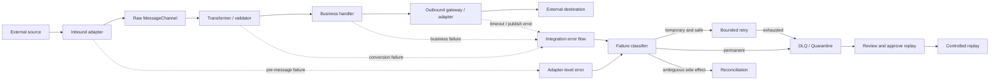
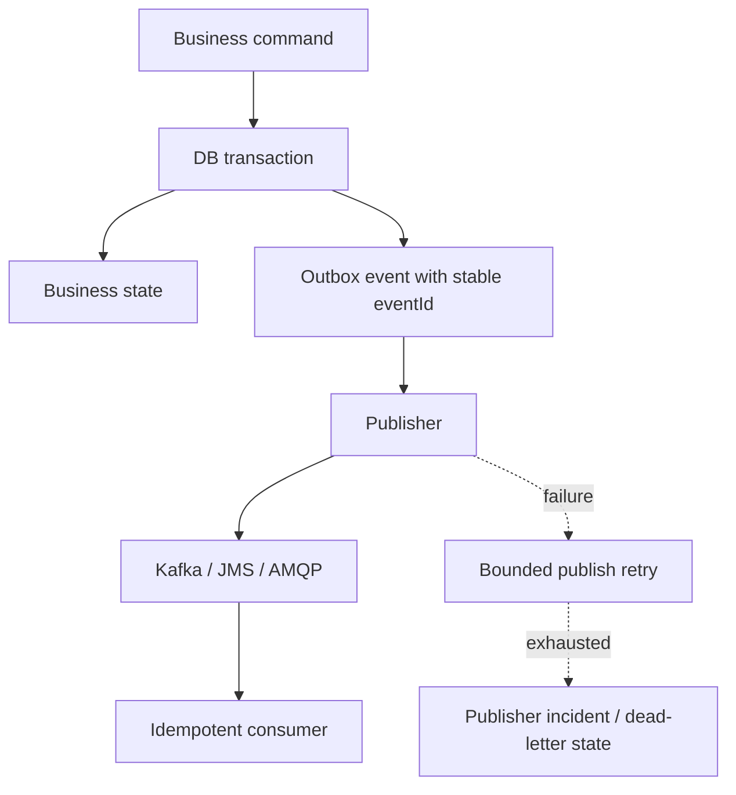
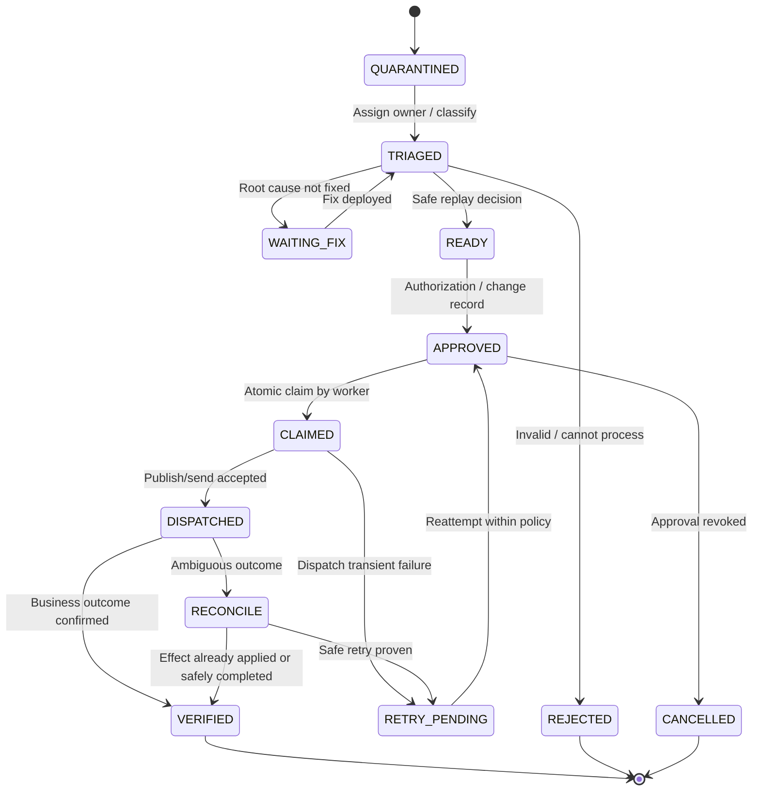
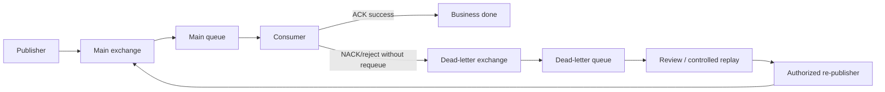
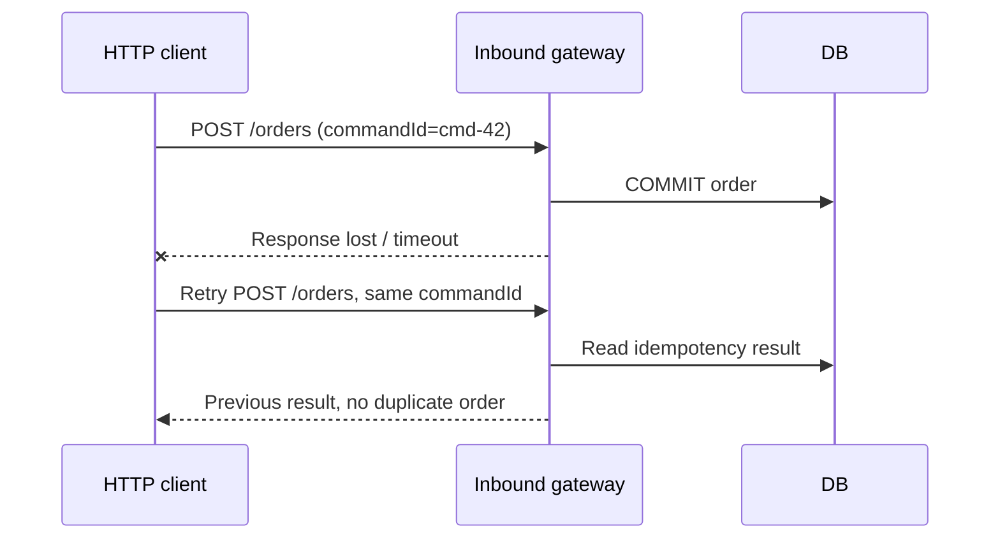

# Message Replay and Dead-Letter Operations in Spring Integration Adapters

In **production**, a message can fail because of invalid JSON, schema changes, permission denials, database overload, external API timeouts, broker disconnects, or consumer bugs. Retrying immediately every time risks **poison messages**, stalled queues/partitions, resource exhaustion, or duplicate business effects. Dropping messages loses data and destroys investigative evidence. Two essential capabilities solve this: **dead-lettering** and **replaying**.

- **Dead-lettering:** routing messages that cannot succeed on the normal path into a managed failure zone—such as a **dead-letter queue (DLQ)**, **dead-letter topic (DLT)**, error table, or quarantine directory—alongside reason codes and metadata.
- **Replay:** re-introducing stored messages into a chosen processing flow **after** verifying root cause, safety conditions, schemas, permissions, idempotency, and business state.

The lesson **"Message Replay and Dead-Letter Operations"** belongs to the **Production** chapter of the **SPRING_INTEGRATION_ADAPTERS** module. Its focus is connecting external systems via **inbound/outbound adapters, gateways, pollers, and `MessageChannel`** across **files, SFTP, HTTP, JMS, AMQP, Kafka, and databases**, spanning message contracts, error classification, redelivery/acknowledgement semantics, operational runbooks, auditing, and connection lifecycles.

> **Core principle:** Dead-lettering **does not mean the message had zero business impact**, and replay **is not a "resend until it works" button**. Before replaying, know *which message*, *what effects already occurred*, *which code version will run it*, *who is authorized to execute it*, and *what mechanism prevents duplicate side effects*.

## 1. Learning Objectives

After this lesson, learners will be able to:

1. Distinguish **retry**, **redelivery**, **dead-letter**, **quarantine**, **replay**, **reconciliation**, and **compensation**.
2. Know when failures should auto-retry, when to route to DLQ/DLT, and when to halt and inspect external state.
3. Design an **error envelope** carrying correlation ID, event ID, source, schema, attempts, reason, and payload reference.
4. Explain how `ErrorMessage`, `MessagingException.getFailedMessage()`, error channels, and adapter-level error handlers work.
5. Establish policies for **durable capture, retention, security, access control, replay approval, and audit trails**.
6. Build a state machine for dead-letters and replays that prevents two workers from claiming the same record.
7. Keep **idempotency keys** stable and separate event identity from replay-run identity.
8. Understand DLQ capabilities and limits across **JMS, AMQP/RabbitMQ, Kafka, File/SFTP, HTTP, and JDBC/outboxes**.
9. Design batched replays, canaries, rate limiting, backpressure, ordering guards, and rollbacks.
10. Test crash windows, ambiguous outcomes, publish failures, schema migrations, DLQ backlogs, and duplicate side effects.

## 2. Terminology: All "Re-Processing" Serves Different Goals

| Concept | Definition | Common Confusion |
|---|---|---|
| **Immediate retry** | Retries an operation right inside the active attempt, usually bounded. | Can repeat effects when prior outcome is unknown. |
| **Delayed retry** | Retries after backoff or via a dedicated retry queue/topic. | Still needs deadlines, attempt budgets, and dedupe. |
| **Broker redelivery** | Broker re-dispatches an unacknowledged/uncommitted message. | Consumer may already have committed DB changes. |
| **DLQ/DLT** | Storage for messages unable to continue on the normal path. | Does not prove side effects never executed. |
| **Quarantine** | Isolates data requiring inspection/fixes/approval before reprocessing. | Not necessarily a broker-backed queue. |
| **Replay** | Re-submits stored records through a chosen pipeline. | Schema, code version, or auth context may differ from original run. |
| **Reconciliation** | Compares actual outcomes across systems. | Not the same as retry; often required before replay. |
| **Compensation** | Executes a business action offsetting a prior effect. | Does not erase original effect history. |

### 2.1. A Running Example

An application receives `OrderPaid`, saves the order to DB, and calls outbound HTTP to send a receipt. The provider processes the request and sends the email, yet the **response times out**. If the consumer treats timeout as "email not sent" and replays the entire `OrderPaid` event, it could record revenue and send the email **twice**.

Better handling classifies each step's outcome, queries the provider when available, keeps a stable **notification ID**, and replays only the missing step once safety is proven.

## 3. A Failed Message Can Sit at Multiple Layers



Branches are shown **logically**, not as a complete Spring Integration wiring. Errors in HTTP decoders, Kafka deserializers, or SFTP sessions can occur **before a Spring `Message` exists**, so never assume every error handler receives `failedMessage`.

### 3.1. Four Boundaries to Pinpoint

1. **Transport receipt:** did the broker/HTTP/file/JDBC source consider the message received or read?
2. **Decode/validation:** did the payload turn into a valid DTO yet?
3. **Business commit:** did the business transaction commit durably?
4. **Downstream delivery:** did external HTTP/Kafka/JMS/email/payment receive and apply it?

A message dead-lettered after step (3) may already have produced side effects even though step (4) failed.

## 4. What Problem Does Dead-Lettering Solve?

A well-designed DLQ/DLT/quarantine serves at least five goals:

- **Isolation:** permanent data errors do not block queues, partitions, or pollers indefinitely.
- **Preservation:** payloads or payload references survive for investigation per policy.
- **Diagnostics:** captures reason codes, sources, event IDs, and attempt evidence.
- **Recovery:** enables fixing root causes, triaging, approving, and replaying.
- **Auditing:** records actor, timestamp, decision, status, and outcome.

Never treat a DLQ as a place to "dump failed messages and forget". A DLQ lacking an owner, SLA, or backlog alert simply **turns an immediate incident into accumulating operational debt**.

### 4.1. A DLQ Is Not a Long-Term Data Lake

Broker queues/topics enforce TTLs, retention limits, capacity caps, and deletion policies. If long-term evidence retention is required, maintain a **governed data store or audit archive** with proper retention, encryption, access controls, and deletion workflows. Never assume a DLQ keeps payloads forever.

## 5. Classify Errors Before Deciding to Replay

| Error | Nature | Typically Appropriate Operational Path |
|---|---|---|
| Malformed JSON/XML/CSV | **Permanent for same payload/code** | Dead-letter/quarantine; producer fixes or approved mapping applied. |
| Invalid charset | Usually permanent | Quarantine raw bytes, verify contract; avoid lossy replacement decoding. |
| Unsupported schema version | Contract/version | Deploy compatible decoder or approved migration before replay. |
| Missing required source header | Contract/adapter mapping | Fix producer/mapper; never guess tenant. |
| Permission denied | Security/policy | Never "retry around permissions"; requires authorized resolution. |
| JDBC deadlock | Often transient | Bounded transaction retry with idempotency. |
| Transient Kafka/JMS/AMQP disconnect | Often transient | Bounded reconnect/retry per broker policy. |
| HTTP `429` / `503` | Usually transient | Honor `Retry-After`/backoff; retry only safe operations. |
| HTTP timeout after data-mutating POST | **Ambiguous outcome** | Reconcile or retry with **same idempotency key** if provider guarantees it. |
| Business rule violation | Usually definitive rejection | Record rejected state; never replay identically forever. |
| Unknown whether DB committed | Undetermined | Inspect transaction/business state before replaying. |
| Bug in newly deployed converter | Infrastructure/code defect | Fix/deploy/test then canary replay; may need schema-version pinning. |

**Note:** the same exception class can mean different things depending on stage. A timeout **before sending a request** differs from a timeout **after the server recorded an effect**. Decide using error class + operation contract + stage + evidence.

## 6. Why Not Retry Forever Instead of Dead-Lettering?

Suppose a Kafka record contains malformed JSON. The consumer keeps throwing exceptions, the framework retries endlessly, and policy prevents committing/skipping the record. The partition stalls; valid records behind it wait indefinitely.

```text
record offset 120: MALFORMED_JSON
record offset 121: valid OrderCreated
record offset 122: valid OrderCancelled

If offset 120 retries forever:
  offsets 121 and 122 may never progress in the current flow.
```

You need a **termination policy**:

1. Bounded retry for recoverable failures.
2. When permanent or budget exhausted, route to dead-letter with **confirmed durable write**.
3. Only after durable isolation succeeds, ack/commit/skip the source per contract.
4. If dead-letter publishing fails, **never claim the message was safely preserved**.
5. Maintain alerts, owners, and controlled replay paths.

## 7. Acknowledgement Semantics: ACK, Commit, Archive, and Source State

| Source | Processed Signal from Source Side | Danger Zone |
|---|---|---|
| JMS | Listener/container ACK or session transaction commit. | DB commits while ACK fails → redelivery. |
| AMQP | ACK/NACK/REJECT, requeue/dead-letter per policy. | Infinite NACK requeues or ACK before DLQ write. |
| Kafka | Consumer offset commit / transaction per config. | Offset commits before DLQ write → record loss risk. |
| File/SFTP | File filters, move/rename/archive, metadata store. | Marking seen before processing succeeds, followed by crash. |
| JDBC polling | Claims/leases, status updates, or checkpoint rows. | Marking processed before side effects or non-atomically afterward. |
| HTTP inbound | HTTP response/status returned to caller. | Returning success without durable persistence; caller retries on timeout. |

There is no single unified Spring Integration ACK across all transports. **An `ErrorMessage` arriving on an error channel does not automatically prove the source message was acked**, and conversely, a source ACK does not guarantee all downstream side effects completed.

## 8. Mandatory Message Contract Before Storing Failures

An integration event should carry enough metadata to reconstruct context:

| Field | Purpose | Notes |
|---|---|---|
| `eventId` / `commandId` | Identity of a logical event/operation. | Kept invariant across retries/replays. |
| `producerId` / `sourceSystem` | Originating system. | Verified at transport boundary. |
| `tenantId` | Authorization/dedupe scope. | Never trust unverified self-asserted client headers. |
| `correlationId` / `traceId` | Links execution across hops. | Never substitutes for idempotency keys. |
| `schemaId` / `schemaVersion` | Decoding and data migration. | Preserve original contract version. |
| `contentType` / `charset` | Selects proper converter. | Distinguish wire content type from Java payload type. |
| `sourceLocation` | Queue/topic/partition/offset, file path, row key... | Normalize per transport; avoid leaking sensitive details. |
| `receivedAt` / `failedAt` | Measures record age and SLAs. | UTC instant. |
| `reasonCode` / `failureStage` | Root-cause classification. | Use stable codes; never rely on raw exception strings. |
| `attempt` | Execution count prior to isolation. | Distinguish attempt count vs. replay generation. |
| `payloadReference` / `payloadHash` | Integrity checks, payload retrieval. | Hashes do not replace encryption or access control. |
| `processingOutcome` | `FAILED`/`UNKNOWN`/`PARTIAL_APPLIED`... | Never guess without evidence. |

### 8.1. Raw Headers Are Not a Data Contract

Spring `MessageHeaders` may carry `replyChannel`, `errorChannel`, or non-serializable Java objects. HTTP headers carry tokens/cookies; Kafka headers may be `byte[]`; JMS/AMQP have distinct property types. When routing messages to DLQ/quarantine, **never blindly serialize all raw headers**. Use a typed schema with an explicit metadata allowlist.

## 9. Designing a Shared Error Envelope

An operational JSON example:

```json
{
  "failureId": "fail-2026-00981",
  "originalEventId": "evt-1001",
  "correlationId": "req-72e4",
  "sourceSystem": "partner-a",
  "tenantScope": "tenant-a",
  "adapterType": "KAFKA",
  "sourceLocation": {
    "topic": "orders.v1",
    "partition": 3,
    "offset": 48102
  },
  "receivedAt": "2026-11-23T08:01:00Z",
  "failedAt": "2026-11-23T08:01:03Z",
  "failureStage": "VALIDATION",
  "reasonCode": "MALFORMED_JSON",
  "retryable": false,
  "attempt": 3,
  "schemaVersion": "v1",
  "wireContentType": "application/json",
  "processingOutcome": "NOT_APPLIED_CONFIRMED",
  "payloadReference": "quarantine/fail-2026-00981",
  "payloadSha256": "example-hash-from-ingress"
}
```

This is an **illustrative schema**, not a built-in Spring Integration object or output. Values like `processingOutcome=NOT_APPLIED_CONFIRMED` should only be written when backed by evidence; when uncertain, record `UNKNOWN`.

### 9.1. Distinguish Three Identifiers

```text
originalEventId = business event identifier; stays invariant during replay
failureId       = identifier of a specific failure/quarantine record
replayRunId     = identifier of an approved replay batch run
```

One event may fail multiple times and generate multiple failure records. If a replay generates a new `eventId`, consumers may treat it as a **new transaction** and duplicate side effects.

### 9.2. Never Expose Raw Stack Traces to Every Consumer

Exception messages and stack traces can leak payloads, internal URLs, SQL, tokens, or sensitive paths. Publish only necessary **reason codes**, stages, and evidence references; store debug details inside access-controlled logs per retention rules.

## 10. Preserving the Original Message in Spring Integration

Spring Integration builds on Spring Messaging abstractions:

```java
Message<T>
MessageHeaders
ErrorMessage
MessagingException
```

In many flows, `ErrorMessage` carries a `Throwable` payload. When the exception exposes `MessagingException.getFailedMessage()`, error flows can inspect the failed message's payload and headers. Some `ErrorMessage` instances also carry `getOriginalMessage()`.

**However**:

- `ErrorMessage.getHeaders()` **does not automatically contain all headers of the failed message**.
- Exceptions may be wrapped multiple layers deep; never assume `getCause()` is always one hop.
- Deserializer errors prior to Spring `Message` creation may have **no `failedMessage`**.
- Never fabricate a fake `originalMessage` when source evidence is unavailable.

### 10.1. Transformer Preserving `failedMessage`

```java
import com.fasterxml.jackson.core.JsonProcessingException;
import com.fasterxml.jackson.databind.ObjectMapper;
import org.springframework.integration.annotation.Transformer;
import org.springframework.messaging.Message;
import org.springframework.messaging.MessageHandlingException;
import org.springframework.stereotype.Component;

@Component
public class OrderInboundTransformer {

    private final ObjectMapper mapper;

    public OrderInboundTransformer(ObjectMapper mapper) {
        this.mapper = mapper;
    }

    @Transformer(
        inputChannel = "rawOrdersChannel",
        outputChannel = "canonicalOrdersChannel"
    )
    public OrderCreated convert(Message<byte[]> message) {
        try {
            return mapper.readValue(
                message.getPayload(), OrderCreated.class
            );
        } catch (JsonProcessingException ex) {
            throw new MessageHandlingException(
                message, "ORDER_JSON_INVALID", ex
            );
        }
    }
}
```

On bad data, the exception attaches `message` so error handlers can recover `eventId`, `correlationId`, and normalized headers. This snippet omits schema validation, size limits, and `ObjectMapper` hardening.

### 10.2. Controlled Context Extraction in an Error Handler

```java
import org.springframework.integration.annotation.ServiceActivator;
import org.springframework.messaging.Message;
import org.springframework.messaging.MessagingException;
import org.springframework.messaging.support.ErrorMessage;
import org.springframework.stereotype.Component;

@Component
public class IntegrationErrorObserver {

    @ServiceActivator(inputChannel = "ordersErrorChannel")
    public void observe(ErrorMessage error) {
        Message<?> failed = findFailed(error);

        Object eventId = failed == null
            ? null : failed.getHeaders().get("eventId");

        Object correlation = failed == null
            ? null : failed.getHeaders().get("correlationId");

        // Map to validated, allowlisted error envelope.
        // Persist quarantine + metadata; never log raw payloads or secrets.
        // Source ACK/offset must NOT be inferred from this method.
    }

    private static Message<?> findFailed(ErrorMessage error) {
        Throwable failure = error.getPayload();

        // In production, walk cause chains with a bounded depth.
        if (failure instanceof MessagingException messagingException
                && messagingException.getFailedMessage() != null) {
            return messagingException.getFailedMessage();
        }

        return error.getOriginalMessage();
    }
}
```

This snippet illustrates extracting metadata only—it is not a complete DLQ handler. Verify which channel your actual endpoint/adapter sends errors to and who owns publish, ack, and retry behavior.

## 11. Synchronous vs. Asynchronous Error Paths

### 11.1. `DirectChannel` and Synchronous Gateways

On synchronous paths, transformer/handler exceptions can **propagate back to the caller**. Never assume every exception turns into an `ErrorMessage` on the global `errorChannel`.

Example:

```text
HTTP inbound gateway
   -> DirectChannel
   -> service activator
   -> exception
   -> gateway error mapping / HTTP response per config
```

If the request wasn't durably saved, a client timing out and retrying can create duplicates. Critical commands need request IDs/idempotency contracts and durable storage rather than relying solely on HTTP responses.

### 11.2. Pollers and Message-Driven Adapters

Pollers, executors, and listeners may use **error channels, error message strategies, or container error handlers**. Names, publish behavior, retry ordering, and acks depend on implementation.

Before designing a shared DLQ, answer:

1. Can errors happen **before** `Message<?>` is built?
2. Does the container retry errors **before** reaching the Spring Integration error flow?
3. Does `ErrorMessage` preserve the original message?
4. Does writing to the DLQ share a transaction with ACK/offset commit?
5. If DLQ publishing fails, does the source redeliver or drop the message?
6. When the error handler succeeds, how is the original message marked handled?

## 12. Three Outcome States to Distinguish Before Replay

| Outcome | What Can Be Asserted | Next Step |
|---|---|---|
| `NOT_APPLIED_CONFIRMED` | Evidence proves side effects did not execute. | Safe to replay once contract/version/permissions are valid. |
| `APPLIED_CONFIRMED` | Side effects committed or confirmed externally. | Do not re-run that effect; recover only missing downstream steps. |
| `UNKNOWN` | No conclusive evidence either way. | Reconcile before risky replays, or retry with provider-guaranteed idempotency key. |

### 12.1. Why `FAILED` Alone Is Usually Insufficient

An HTTP POST timeout can mean:

1. Never reached the server.
2. Reached the server and was rejected.
3. Reached the server, committed, and response was lost.
4. Reached the server and async processing is still running.

If the DLQ records only `status=FAILED`, operators easily replay it as a new operation even though the earlier attempt committed. For external effects, **record outcomes from verified evidence, not merely because the caller saw an exception**.

## 13. Idempotency Is a Prerequisite for Replay

An **at-least-once** system can redeliver messages after crashes or lost ACKs. Manual replays add further deliveries. You must guarantee **one logical event applies its permitted business side effect at most once**.

Example:

```text
EventId:       evt-1001
First process: DB commit -> crash before ACK
Redelivery:    event evt-1001 again
Manual replay: event evt-1001 again

Business effect count must stay at 1 if semantics require exactly-once effect.
```

### 13.1. Choosing the Right Key

A key may combine:

```text
verifiedTenantId | verifiedProducerId | operationType | originalEventId
```

Requirements:

- **Invariant across retries, DLQ, and replays**.
- Distinguishes two distinct valid events.
- Bound to verified source/tenant identity where required.
- Paired with a request fingerprint / semantic hash to catch **same key, different body**.
- Persisted durably across restarts and concurrency.
- Retained at least as long as the committed redelivery/replay window.

### 13.2. Never Use `replayRunId` as the Business Idempotency Key

```text
originalEventId = evt-1001
replayRunId     = replay-2026-11-23-batch-3

Idempotency remains:
  tenant-a | partner-a | create-order | evt-1001
```

`replayRunId` is an audit identifier, never authorization to apply a business effect a second time.

## 14. Transactional Inbox Blocking Duplicates Within One DB

A proven pattern uses a `processed_event` table with a unique key and side effects **inside the same DB transaction**.

```sql
CREATE TABLE processed_event (
    tenant_id      VARCHAR(64) NOT NULL,
    producer_id    VARCHAR(64) NOT NULL,
    event_id       VARCHAR(128) NOT NULL,
    payload_hash   VARCHAR(64) NOT NULL,
    processed_at   TIMESTAMPTZ NOT NULL DEFAULT now(),
    PRIMARY KEY (tenant_id, producer_id, event_id)
);

CREATE TABLE order_projection (
    tenant_id      VARCHAR(64) NOT NULL,
    order_id       VARCHAR(128) NOT NULL,
    total_cents    BIGINT NOT NULL,
    PRIMARY KEY (tenant_id, order_id)
);
```

Illustrative PostgreSQL transaction:

```sql
BEGIN;

INSERT INTO processed_event (
    tenant_id, producer_id, event_id, payload_hash
)
VALUES (
    'tenant-a', 'partner-a', 'evt-1001', 'hash-of-approved-payload'
)
ON CONFLICT DO NOTHING;

-- Application must inspect ROW_COUNT:
--   If inserted = 1: apply business effect.
--   If inserted = 0: read existing record, compare hash/contract,
--                    do NOT apply business effect a second time.

INSERT INTO order_projection (
    tenant_id, order_id, total_cents
)
VALUES ('tenant-a', 'ORD-42', 159900);

COMMIT;
```

This illustrates **transaction flow logic**, not a literal copy-paste script: application code must **branch on the insert row count** rather than unconditionally running `INSERT order_projection` on duplicates.

### 14.1. Crash Windows

| Scenario | With Marker + Side Effect in Same Transaction | Outcome |
|---|---|---|
| Crash before commit | Both roll back. | Redelivery processes cleanly. |
| Crash after commit, before ACK | Both are durable. | Replay recognizes duplicate and skips effect. |
| Two concurrent consumers | Unique constraint/transaction arbitrates. | One logical key never applies duplicate effects. |
| Same key, different content | Code compares fingerprints. | Conflict raised; never silently treated as success. |

**Limitation:** a DB transaction does not span Kafka publishes, emails, or payment APIs. Off-DB side effects need dedicated protocols (provider idempotency, outboxes, status lookups, or reconciliation).

## 15. Transactional Outbox and Publisher Dead-Letters

A DB transaction writes business mutations plus an outbox row. A publisher reads outbox rows and sends to the broker. If it publishes successfully and crashes before marking `SENT`, it may publish the **same event** again.



**Outboxes do not automatically publish exactly once.** A publisher's DLQ may contain events the broker already accepted without the publisher knowing; keep `eventId` invariant on replay and keep consumers idempotent.

### 15.1. Never Mark `SENT` Too Early

- Marking `SENT` **before** publishing risks losing events on crashes.
- Publishing first then marking `SENT` risks duplicate publishes after crashes.
- Outboxes + stable IDs + consumer idempotency embrace at-least-once delivery while protecting business state.

## 16. A State Machine for DLQ/Replay

Never manage a DLQ with a single `isReplayed` boolean. Use explicit states and guarded transitions:



### 16.1. Define Permissions at Every Transition

- Who can **triage** and view payloads?
- Who can edit schemas or payloads?
- Who approves production replays?
- Who can cancel a replay run?
- Who confirms an outcome as `VERIFIED`?
- Is **two-person approval** required for payment/financial effects?
- How does the system audit actors, timestamps, and diffs?

Not every environment needs every single state, yet high-impact effects must separate **ready**, **approved**, **dispatched**, and **verified**.

## 17. Designing Persistence for Dead-Letter Records

A table can store **metadata** plus a blob/quarantine reference:

```sql
CREATE TABLE integration_dead_letter (
    failure_id        VARCHAR(128) PRIMARY KEY,
    event_id          VARCHAR(128),
    source_system     VARCHAR(128) NOT NULL,
    tenant_scope      VARCHAR(64),
    adapter_type      VARCHAR(24) NOT NULL,
    reason_code       VARCHAR(128) NOT NULL,
    failure_stage     VARCHAR(64) NOT NULL,
    outcome           VARCHAR(40) NOT NULL,
    state             VARCHAR(32) NOT NULL,
    schema_version    VARCHAR(64),
    payload_ref       TEXT,
    payload_sha256    VARCHAR(64),
    replay_run_id     VARCHAR(128),
    claimed_by        VARCHAR(128),
    claim_until       TIMESTAMPTZ,
    attempt_count     INTEGER NOT NULL DEFAULT 0,
    created_at        TIMESTAMPTZ NOT NULL DEFAULT now(),
    updated_at        TIMESTAMPTZ NOT NULL DEFAULT now()
);

CREATE INDEX idx_dead_letter_state_created
    ON integration_dead_letter (state, created_at);
```

This uses PostgreSQL timestamp syntax and **is not a default framework schema**. Production designs also need audit history, bounded reason details, request fingerprints, retention, version counters, and workload-tuned indexes.

### 17.1. Durable Claims Prevent Two Replay Workers from Picking the Same Failure

Conditional claim statement:

```sql
UPDATE integration_dead_letter
SET state = 'CLAIMED',
    claimed_by = :worker_id,
    claim_until = now() + INTERVAL '2 minutes',
    updated_at = now()
WHERE failure_id = :failure_id
  AND state = 'APPROVED'
RETURNING failure_id, event_id, payload_ref, payload_sha256;
```

If zero rows return, another worker already claimed it or the record is no longer eligible. **This coordinates only the replay dispatcher**; it does not prevent double-publishing if a worker crashes after publishing and before updating status. Stable event IDs and idempotent recipients remain essential.

### 17.2. Lease Expiry Alone Does Not Reveal Send Outcomes

When a lease expires in `CLAIMED`/`DISPATCHED`:

- Inspect broker confirms, delivery records, outcome logs, or provider status.
- If publish success cannot be confirmed, mark **`UNKNOWN`**—never mint a new event.
- If retrying publish, preserve event identity and fingerprint.
- Append per-attempt history rather than overwriting older evidence.

## 18. Replay Dispatcher and Safety Preconditions

A well-designed dispatcher:

1. Selects **`APPROVED`** records matching scope, version, and validity.
2. Acquires an atomic claim or lease.
3. Loads payloads from an access-controlled store and verifies checksums/hashes.
4. Validates schema, producer/source, tenant, destination allowlist, and current state.
5. Preserves `originalEventId`, `schemaVersion`, and business idempotency keys.
6. Attaches `replayRunId`, `replayAttempt`, and **verified** provenance.
7. Dispatches via adapters/outbound gateways with rate limits and timeouts.
8. Determines outcome from ACKs/confirms and corresponding **business-level verification**.
9. On ambiguous outcomes, transitions to `RECONCILE`—never guessing success or failure.
10. Writes durable audit events and supports safe resumption after restarts.

### 18.1. Replay Pseudocode

```text
replay(failureId, operatorContext):
    assert operator is authorized for source/tenant/operation
    record = atomicClaim(failureId, expectedState=APPROVED)
    if no record: return ALREADY_CLAIMED_OR_NOT_APPROVED

    payload = secureLoad(record.payloadRef)
    verifyHash(payload, record.payloadSha256)
    verifyContractVersion(record.schemaVersion)
    assert destination is allowlisted
    assert key remains original business event key

    if record.outcome == APPLIED_CONFIRMED:
        return RECONCILIATION_OR_NEXT_STEP_ONLY

    if record.outcome == UNKNOWN:
        return REQUIRE_RECONCILIATION

    message = buildReplayMessage(
        payload,
        originalEventId=record.eventId,
        replayRunId=currentRun.id
    )

    publishOrInvoke(message, boundedTimeout)
    persist dispatch evidence

    if transportAcknowledged and businessOutcomeVerified:
        transition to VERIFIED
    else:
        transition to DISPATCHED_OR_RECONCILE

    never mark business success based only on an in-memory function return
```

This pseudocode models **decision flow**, not a substitute for transactions, broker-specific publisher confirms, or response contracts. For pure Kafka-to-Kafka events, broker confirms may satisfy one publish stage; for payment APIs, verify the **business outcome** at the provider.

## 19. Spring Integration: Where Should Replayed Messages Enter?

Several valid entry points exist:

| Replay Source | How It Enters the Flow | Best Fit When |
|---|---|---|
| Database quarantine table | JDBC/`MessageSource` polling or service dispatcher. | Approval workflows, state machines, and durable claims are needed. |
| Kafka DLT | Dedicated DLT consumer; never auto-process unapproved records. | High volume, retained event logs. |
| JMS DLQ | Dedicated listener with recovery policy. | Queue-based workflows. |
| AMQP DLQ | DLQ listener, governed dead-letter exchange/routing-key replay. | Broker routing via dead-letter exchanges. |
| SFTP/file quarantine | Dedicated file source/poller reading an `APPROVED` folder. | Batch files stored raw for inspection/replay. |
| HTTP admin action | Admin API creating a durable **replay job** instead of calling sync business logic blindly. | Selective, formally approved replays. |

### 19.1. Never Wire a DLQ Straight Back into Production Input

A loop like:

```text
DLQ -> inbound handler -> main channel -> DLQ
```

without guardrails creates an **infinite loop**: bad messages return immediately, fail again, and re-enter DLQ. Failure records require **terminal states**, replay authorization, limits, and an independent decision gate.

### 19.2. Example Internal Replay Message Factory with Controlled Headers

```java
import org.springframework.messaging.Message;
import org.springframework.messaging.MessageHeaders;
import org.springframework.messaging.support.MessageBuilder;
import org.springframework.util.MimeTypeUtils;

public final class ReplayMessageFactory {

    public Message<byte[]> create(
        byte[] originalBytes,
        String originalEventId,
        String correlationId,
        String replayRunId
    ) {
        if (originalEventId == null || originalEventId.isBlank()) {
            throw new IllegalArgumentException("eventId is required");
        }

        return MessageBuilder.withPayload(originalBytes)
            .setHeader("eventId", originalEventId)
            .setHeader("correlationId", correlationId)
            .setHeader("replayRunId", replayRunId)
            .setHeader("replayed", true)
            .setHeader(
                MessageHeaders.CONTENT_TYPE,
                MimeTypeUtils.APPLICATION_JSON
            )
            .build();
    }
}
```

**Limitation:** applies only when payloads are truly JSON bytes. In production, read content type/schema from a **verified contract** rather than assuming every quarantined payload is JSON. Never copy tokens, `replyChannel`, or `errorChannel` from old messages into replayed external dispatches.

## 20. Replays Must Never Arbitrarily "Edit" Payloads

Three data-recovery strategies exist:

- **Exact replay:** keep original payload untouched and run with the matching schema decoder/handler.
- **Versioned migration:** transform v1 → v2 via an approved mapping recording both source and output hashes.
- **Business correction:** issue a deliberate **new command** rather than pretending this is the old event.

### 20.1. When Is a New Command Required?

If an order had the wrong amount and the sender corrected it upstream, issue a **`CorrectionEvent`** or new business command with a new event ID referencing the old event. Never silently alter raw bytes while reusing the old event's idempotency key if the semantic fingerprint changed; consumers are right to reject that as an **idempotency conflict**.

### 20.2. Traceable Schema Migrations

A migration log/mapping record should record:

```text
original eventId: evt-1001
original schema: order-created-v1
original hash:   sha256(...)
migration:       order-v1-to-v2 version 3
migrated schema: order-created-v2
migrated hash:   sha256(...)
approved by:     designated operator
replay run:      replay-42
```

When currency semantics, timezones, or business keys change, require business review—not just JSON field tweaks to make parsing pass.

## 21. JMS: Dead-Letters and Redelivery in Production

JMS listeners/containers run with transactions or acknowledgement modes. Brokers/providers support **dead-letter queues** after redelivery limits; queue names, delay configs, and policies vary by product.

### 21.1. Critical Failure Window

```text
JMS receive
 -> DB COMMIT
 -> application crash before ACK
 -> JMS redelivery
```

If the handler is not idempotent, DB effects execute twice. A DLQ record generated by a listener **does not prove the DB never committed**.

### 21.2. JMS Delivery Counts

Some JMS providers populate `JMSXDeliveryCount` or redelivery metadata; never assume every provider uses the same property name, reliability, or semantics. Test listener factories, acks/transactions, redelivery policies, and Spring `Message` mappings.

### 21.3. JMS DLQ Handling Procedure

1. Identify source destination and DLQ per broker config.
2. Inspect message type (`TextMessage`/`BytesMessage`) and converters.
3. Inspect correlation/event IDs, delivery attempts, and schema version.
4. Confirm whether failure is permanent or transient.
5. Reconcile DB/provider outcomes if consumers cause side effects.
6. Prepare replays through a **controlled producer** keeping the logical event ID.
7. Approve, rate-limit, and monitor ACKs, redeliveries, and business outcomes.
8. Close incidents only after outcomes verify and backlogs/metrics normalize.

**Never blindly copy all JMS transport headers** onto new messages; brokers mint new `JMSMessageID` and delivery headers while business event IDs remain contractual.

## 22. AMQP/RabbitMQ: DLX, DLQ, and Requeues

In RabbitMQ, dead-lettering typically uses **dead-letter exchanges (DLX)** routing to target queues. Messages dead-letter on reject/nack without requeue, TTL expiry, or broker-specific rules, depending on broker, queue type, and version.



### 22.1. Avoid Unbounded `requeue=true`

If malformed JSON triggers immediate reject-with-requeue, messages spin continuously, burning CPU/network and jamming queues. Enforce:

- Bounded retries for recoverable errors.
- Delayed retry queues/strategies when appropriate.
- Dead-lettering for permanent faults or exhausted budgets.
- Monitoring DLQ depth and oldest age.
- Replaying only after fixing schemas/code or approved operational decisions.

### 22.2. Death/Redelivery Headers

RabbitMQ adds dead-letter metadata (such as `x-death` headers along applicable routes). This is **broker-specific evidence**, never a replacement for stable business `eventId`s, and should not be copied carelessly across manual republishes.

### 22.3. Publisher Confirms and Dead-Letter Durability

When an app moves messages from source queues to DLQs itself, verify **atomicity** between DLQ publish and source ACK. If DLQ publish fails after source ACK, **messages are lost**. If DLQ publish succeeds before source ACK fails, **DLQ duplicates occur**. Guard with broker/transaction guarantees, stable failure IDs, and replay deduplication—never confuse confirms with business commits.

## 23. Kafka: DLT, Offset Commits, and Replay Ordering

Kafka uses topics/partitions/offsets; dead-letters usually live in a **DLT** (dead-letter topic). Spring Kafka offers helpers like `DeadLetterPublishingRecoverer`, `DefaultErrorHandler`, and `ErrorHandlingDeserializer`; these belong to **Spring Kafka**, distinct from Spring Integration's global error channel.

### 23.1. Illustrative Kafka Flow

```text
orders.v1 (topic)
  -> Kafka consumer/Integration adapter
  -> converter/handler
      | success:
      |   business commit, offset handling
      |
      | failure:
      |   bounded retry
      |   publish to orders.v1.DLT
      |   source offset handled according to listener/container policy

orders.v1.DLT
  -> monitored retention
  -> approval / replay orchestrator
  -> replay with same logical eventId
```

### 23.2. Uncommitted Offset After Business Commit

```text
record offset 48102
 -> DB COMMIT
 -> crash before offset commit
 -> redelivery offset 48102
```

Non-idempotent consumers duplicate DB effects. If a record later lands in a DLT after partial DB effects committed, replays require reconciliation.

### 23.3. DLT Publishes and Offsets

Never assume frameworks commit source offsets **strictly after** durable DLT publishes without verifying transaction, error-handler, and publisher configs. Test:

- DLT broker unavailable.
- DLT publisher throws errors.
- DLT publish succeeds, process crashes before source offset commit.
- Deserialization fails before Spring Integration builds `Message<?>`.
- Replaying schema v1 messages after code upgraded to v2.

### 23.4. Ordering

Kafka preserves log order **within a partition**. Yet if a record skips into a DLT, later records process ahead of it, and replaying the old record **inverts business order**.

Example:

```text
offset 100: OrderCreated v1 -> DLT
offset 101: OrderCancelled v2 -> processed
replay offset 100 later -> must not re-open cancelled order
```

Solutions: aggregate versions, state machines, optimistic locking, proper partition keys, or verifying current state on replay. **Deduplication alone does not solve ordering.**

### 23.5. Never Use Offsets as Global Event IDs

Offsets only have meaning within `(topic, partition)`. A DLT record gets a **new** offset, so preserve `originalEventId` for the logical event alongside original topic/partition/offset metadata for traceability.

## 24. File/SFTP: Dead-Letters Are Usually Quarantine Folders

File and SFTP lack broker DLQs. Instead, pipelines typically use:

```text
remote/incoming/
   -> local/staging/
   -> parse + validate + business process
       -> success: archive/
       -> failure: quarantine/
                      + failure metadata manifest
                      + original bytes/checksum
```

### 24.1. Never Rely on File Extensions Alone

`orders.csv` might be UTF-8, Windows-1252, truncated, or malformed. Enforce **partner contracts**, schemas, charsets, and file readiness. Never rename a broken file to `.ok` just to silence parser errors.

### 24.2. Quarantine Manifest Example

```yaml
failureId: fail-file-00042
sourceSystem: sftp-partner-a
originalRemotePath: /incoming/orders-42.csv
originalFilename: orders-42.csv
receivedAt: 2026-11-23T08:01:00Z
schemaVersion: csv-v2
reasonCode: INVALID_CSV_QUOTE
businessOutcome: NOT_APPLIED_CONFIRMED
payloadReference: quarantine/fail-file-00042.bin
replayEligible: false
```

Build manifests from validated metadata; never turn untrusted source paths directly into local write paths without sanitization and directory-traversal confinement.

### 24.3. Atomic Moves and File Readiness

Systems can write temporary files then atomically rename within **the same filesystem** when supported, or use marker files to signal completed uploads. On SFTP, agree on producer completion conventions. Never treat seeing a filename in polling as proof the upload finished.

### 24.4. Replaying Large Files

For multi-record files, decide:

- Replay the **entire file** or **only failed records**?
- Did earlier valid records already commit?
- Does every line have a record ID / idempotency key?
- Can the parser stream records cleanly?
- When a record fails mid-file, how are checkpoints saved?
- Do record volume and downstream capacity permit replaying the whole batch?

Replaying an entire file where 999/1,000 rows succeeded is dangerous without record-level deduplication.

## 25. HTTP: No Built-In "HTTP DLQ"

HTTP inbound gateways handle synchronous request/responses without a built-in broker saving failed requests. To replay HTTP commands, applications must implement a **durable command inbox** persisting requests per contract before responding.

### 25.1. HTTP Request with Lost Response



If clients mint a fresh `commandId` per retry, servers treat each as a brand-new request. HTTP contracts must distinguish **client retrying the same intent** from **user submitting a new intent**.

### 25.2. Outbound HTTP Gateway Timeouts

If Spring Integration calls external APIs for payments, shipments, or notifications and times out, error records must stay `UNKNOWN_OUTCOME` until proof arrives. Replays are allowed only via:

- **Same provider idempotency key** within provider guarantees.
- Or status lookup by business reference.
- Or reconciliation / manual operator decision.

Never issue a new command with a fresh ID just because the previous HTTP call threw an exception.

## 26. JDBC and Database Outboxes: Separate Error Tables from Active Queues

With JDBC polling, rows may store JSON/XML payloads and work states:

```text
integration_outbox
  event_id
  payload_json
  schema_version
  status = NEW / CLAIMED / SENT / INVALID / ...
```

A row failing parsing can transition to `INVALID` alongside a failure record in the same transaction where appropriate, rather than letting pollers repeatedly pick up `status=NEW`.

### 26.1. Atomic Claims

Multiple pollers can query `NEW` rows simultaneously. Use atomic claims, leases, row locking, or optimistic versioning per DB dialect. Plain `SELECT ... WHERE status='NEW'` never guarantees single-worker ownership.

### 26.2. Reopening After a Fix

When an `INVALID` row is cleared for replay:

1. Verify root cause is fixed.
2. Verify data, contract, and prior side effects.
3. Transition state conditionally while recording `replayRunId`.
4. Workers reclaim rows safely.
5. Dedupe on `event_id` in case handlers previously committed.
6. Record `VERIFIED` or `RECONCILE` from evidence.

**Never bulk-update `INVALID → NEW` in production without limits, snapshots, and owners.** That triggers burst load and erases who authorized the replay.

## 27. Error Handling: Prevent the DLQ from Failing Twice

An error handler itself can fail when:

- DLQ broker/database is unreachable.
- Error-envelope JSON serializer chokes on an exception object.
- Error payload embeds non-serializable `MessageChannel` or `InputStream` objects.
- Target topic/queue name is invalid.
- DLQ publisher credentials expired.
- Payload exceeds maximum broker message size.
- Quarantine storage quota/retention ran out.

### 27.1. Fallbacks and Terminal Sinks

Design a fallback path for **the error pipeline itself**:

```text
original processing error
  -> error mapper
  -> DLQ publish failure
      -> bounded retry/reconnect
      -> terminal incident + durable local/outbox fallback
      -> original source ACK/commit policy remains correct
```

Never build an infinite cycle:

```text
errorChannel -> error handler -> exception -> errorChannel -> ...
```

If failure records cannot persist durably, **never report the message preserved**. In many setups, let sources redeliver or pause consumers to prevent loss, aligned with each adapter's transaction and safety model.

## 28. Batched Replays and Load Control

Replaying 100,000 records at once can saturate APIs, databases, brokers, connection pools, or schedulers. Operational tooling needs:

- Bounded **batch sizes** and per-batch checkpoints.
- **Rate limits** by source, tenant, operation, and dependency.
- **Concurrency caps**—avoid two workers racing on the same aggregate when ordering matters.
- **Canary replays** of a few hand-picked records.
- Audited **pause/resume/cancel** controls.
- **Circuit breakers** when downstreams fail.
- **Backpressure** as queue/broker/DB backlogs rise.
- **Deduplication** across replay runs.
- **Deadlines** and auto-halt rules when error rates exceed thresholds.
- **Dry-runs** evaluating contracts and impact before live dispatch.

### 28.1. Dry-Run Is Not Live Execution

A dry-run can:

- Parse/validate payloads.
- Verify schema versions, resource scopes, and current state.
- Classify prior outcomes.
- Estimate invocation counts and cost.
- Flag expected key conflicts/duplicates.

Yet dry-runs **cannot prove** race conditions won't happen between validation and replay. Live execution still requires transactions, claims, and idempotency.

## 29. Ordering and Aggregate Rules During Replay

Consider this sequence:

```text
E1: OrderCreated version 1  -> DLT
E2: OrderConfirmed version 2 -> processed
E3: OrderCancelled version 3 -> processed
```

Replaying `E1` after `E3` completes must never revert the order back to `CREATED`.

Controls include:

- Aggregate ID + version and state-machine enforcement.
- Optimistic locking or conditional updates.
- Partitioning by aggregate key on publish/consume.
- Reconciling current state before replaying older versions.
- Replaying only **unexecuted steps** rather than re-running the whole pipeline.
- Batching to preserve relative per-aggregate order.

**Idempotency answers "have we seen this event before?"; ordering answers "is this event still valid against current state?".** They are two separate problems.

## 30. Replay Dispatcher Crash Windows

| Crash Timing | What Can Happen | Required Protection |
|---|---|---|
| Before atomic claim | Record stays `APPROVED`. | Another worker can claim it. |
| After claim, before dispatch | Zero side effects from this attempt. | Lease expiry and controlled retry. |
| After broker accepts, before `DISPATCHED` saved | Retries may double-send. | Stable event ID, publisher evidence, consumer dedupe. |
| After HTTP provider commits, before response | Ambiguous outcome. | Provider status lookup / idempotency key. |
| After DB business commit, before source ACK | Source may redeliver. | Transactional inbox/dedupe. |
| After `VERIFIED`, before ops notification | Replay finished, notification missing. | Separate notification outbox/idempotency. |
| During operator cancel | Some items may already be dispatched. | Cancel blocks new items; reconcile active ones. |

Never build replay systems assuming **every step shares one global ACK**. Persist durable state transitions and support safe resumption.

## 31. Production Configuration and Separation of Duties

An app configuration might declare policies (illustrative YAML, **not built-in Spring Integration auto-config**):

```yaml
app:
  dead-letter:
    enabled: true
    retention-days: 30
    max-payload-bytes: 1048576
    require-payload-encryption: true
    alert-oldest-age-minutes: 60

  replay:
    require-approval: true
    dry-run-first: true
    max-batch-size: 50
    max-in-flight: 5
    max-attempts-per-record: 3
    require-idempotency-key: true
    stop-on-error-rate-percent: 10
```

Code, beans, and services must enforce these settings. Numbers are illustrative; tune to SLAs, data risk, infra cost, and compliance.

### 31.1. Separating Three Roles

| Role | Responsibility |
|---|---|
| **Application owner** | Defines business semantics, idempotency, schemas, and outcomes. |
| **Platform/operations** | Manages brokers/DLQs/quarantine, retention, credentials, capacity, and alerts. |
| **Replay approver/operator** | Triages tickets, approves scope, executes safely, verifies outcomes, and audits. |

In sensitive systems, whoever **edits payloads** should not unilaterally **approve replays**; separate data-viewing rights from business-replay authorization.

## 32. Dead-Letter Security and Privacy

Dead-letters often hold **the trickiest data**: malformed PII, headers carrying credentials, legacy payloads with sensitive fields, and untrusted partner inputs. Failure stores must never have looser access controls than production sources.

Controls:

1. **Encrypt at rest and in transit** for sensitive payloads and references.
2. **RBAC/ABAC:** separate metadata viewing, raw payload download, editing, approving, and replaying.
3. **Tenant isolation:** prevent tenant A operators from viewing/replaying tenant B events without authorization.
4. **Redact secrets** from logs, metrics, error envelopes, and alerts.
5. **Retention** aligned with contracts/regulations—never keep forever "just in case".
6. **Immutable audits:** track who viewed, edited, approved, replayed, or canceled.
7. **Checksums:** confirm payloads weren't tampered with in storage.
8. **Destination allowlists:** never let users supply arbitrary topics, HTTP URLs, or file paths.
9. **Schema validation:** treat DLQ payloads as untrusted input on replay.
10. **Deletion workflows:** enforce retention/erasure mandates without scattering sensitive payload copies everywhere.

### 32.1. Replay Headers Are Not Authorization

An old payload carrying `role=ADMIN` or `tenantId=tenant-b` does not authorize execution under current runtime rules. Validate sources, tenants, and authorization at governed boundaries—never elevate client-asserted metadata into privileges.

## 33. Schema Evolution, Replays, and New Deployments

A DLQ record saved last month might be replayed today when:

- Java classes/DTOs have changed.
- Schema v1 was retired.
- Event types were renamed.
- Business rules changed.
- Tenant or API keys were revoked.
- Downstream endpoints moved.
- Retention or data policies changed.

### 33.1. Three Options

| Option | Advantage | Risk |
|---|---|---|
| **Maintain compatible v1 decoder** | Preserves original event verbatim. | Ongoing cost of legacy parsers. |
| **Versioned v1 → v2 migration** | Uses modern pipeline. | May shift semantics; needs audits and tests. |
| **Skip replay; issue new correction command** | Transparent about new business intent. | Requires separate contract and approval workflow. |

Never resolve deserializers from a client-supplied Java class-name header. Govern `eventType + schemaVersion → converter/validator` mappings via an allowlist.

## 34. Observability: Dashboards for DLQ/Replay

Separate **ingress errors**, **dead-letter capture**, **replay attempts**, and **business outcomes**.

| Metric | Meaning |
|---|---|
| `integration_error_total{adapter,reason}` | Errors by adapter and reason code. |
| `dead_letter_created_total{source,reason}` | Records isolated into dead-letter. |
| `dead_letter_publish_failure_total` | Failures writing to dead-letter storage itself. |
| `dead_letter_pending_count{state}` | Backlog by state. |
| `dead_letter_oldest_age_seconds` | Age of oldest waiting record. |
| `dead_letter_storage_bytes` | Storage footprint. |
| `replay_requested_total` | Replay requests submitted. |
| `replay_approved_total` | Replay requests approved. |
| `replay_dispatched_total` | Actual dispatch attempts. |
| `replay_verified_total` | Confirmed business outcomes. |
| `replay_failed_total{reason}` | Replay failures. |
| `duplicate_suppressed_total` | Duplicates blocked by idempotent consumers. |
| `ambiguous_outcome_pending_count` | Effects awaiting reconciliation. |
| `dlq_retention_expiry_total` | Records reaching retention expiry. |

Metric names are **suggestions**, not all auto-generated by Spring Integration. Keep cardinality low: never attach `eventId`, `correlationId`, raw HTTP URLs, or user IDs as metric labels. Use access-controlled logs/traces for granular queries.

### 34.1. Example Replay Audit Log

```json
{
  "event": "REPLAY_RUN_ITEM_VERIFIED",
  "replayRunId": "replay-2026-0007",
  "failureId": "fail-2026-00981",
  "originalEventId": "evt-1001",
  "sourceSystem": "partner-a",
  "tenantScope": "tenant-a",
  "approvedBy": "ops-reviewer",
  "replayedBy": "replay-dispatcher",
  "schemaVersion": "v1",
  "result": "DUPLICATE_SUPPRESSED",
  "businessEffectCountAdditional": 0
}
```

Values are illustrative; real audit entries must verify claims, execution counts, and actual results. Never assume `businessEffectCountAdditional=0` without dedupe/business-transaction proof.

## 35. Alerting and Operational SLOs

Key alert signals:

- DLQ backlog climbing continuously per source.
- Oldest dead-letter age exceeding SLO.
- Malformed payload rate jumping after a deployment.
- `UNKNOWN_OUTCOME` records lingering un-reconciled too long.
- Replay run exceeding expected duration.
- DLT publisher failing or quarantine storage nearing full.
- Unusual spikes in `duplicate_suppressed_total` after restarts/cutovers.
- DLQ retention about to purge untriaged records.
- Error mapper failures breaking metadata lineage.
- Source brokers/file pollers stalled or failing to reconnect.

### 35.1. Alerts Must Be Actionable

A good alert states:

```text
What:    Kafka orders.v1.DLT oldest age > SLO
Scope:   tenant group / producer / schema version
Impact:  orders may be delayed, no known double-charge proof
Action:  open DLQ triage dashboard / runbook
Owner:   integration on-call + domain owner
Evidence: incident ID / metric / trace query
```

Never embed raw sensitive payloads in email/Slack alerts. A naive "DLQ count > 0" alert can be noisy when known records are actively under review.

## 36. Dead-Letter Operations Runbook: Triage to Replay

**Step 1 — Identify and Scope**

Pinpoint topic/queue/folder/table, source, count, backlog age, reason codes, consumer version, and SLA impact. If errors spiked right after a release, pause/isolate the flow instead of replaying immediately.

**Step 2 — Preserve Evidence**

Capture `failureId`, `originalEventId`, `schemaVersion`, content type, source location, payload hash, and metadata per permissions. Never export raw data to personal laptops or public tickets "just to inspect".

**Step 3 — Classify Root Cause**

Distinguish permanent contract errors, transient infra faults, security rejections, business rejections, code bugs, and ambiguous downstream outcomes. Confirm whether the root cause is fixed.

**Step 4 — Reconcile Side Effects**

Check authoritative DB business state, provider status, outboxes/inboxes, source offsets/ACKs, and verified logs. Tag each item `NOT_APPLIED_CONFIRMED`, `APPLIED_CONFIRMED`, or `UNKNOWN`. Route `UNKNOWN` to reconciliation before replaying write commands.

**Step 5 — Verify Replay Readiness**

Check schema version, DTOs, tenants, authorization, retention, checksums, idempotency keys, ordering, and destinations. Any payload changes require reviewed migrations/corrections.

**Step 6 — Dry-Run and Canary**

Run side-effect-free validation; pick a small representative sample with rate limits and concurrency caps and inspect outcomes. Never run destructive replay tests on live production data outside approved scopes.

**Step 7 — Approve**

Create a replay run listing failure IDs, selection criteria, approver, rollback/pause plan, and load limits. Payment/order systems may enforce two-person approval.

**Step 8 — Controlled Dispatch**

Use atomic claims, preserve `originalEventId`, omit secrets, log `replayRunId`/attempts, and prevent two dispatchers from double-sending uncoordinatedly.

**Step 9 — Business Verification**

Compare dispatched counts against `VERIFIED`, `DUPLICATE_SUPPRESSED`, `REJECTED`, and `UNKNOWN` counts. Never treat "broker ACK" as "business completed" when async downstreams exist.

**Step 10 — Close Run and Improve**

Transition records to accurate final states, keep audit history, and update metrics, root-cause records, tests, contracts, and runbooks. Assign owners to unresolved outcomes; never close incidents merely because DLQ counts dropped.

## 37. When Should You NOT Replay?

Halt or choose a different workflow when:

1. **Payment outcome is `UNKNOWN`** and the provider lacks reliable idempotency guarantees/lookups.
2. **`APPLIED_CONFIRMED`** yet replaying would re-trigger the entire side-effect chain.
3. **Security rejection** whose identity/permission issue remains unresolved.
4. **Schema migration** changes monetary amounts, tenants, or resource semantics without approval.
5. **Event is stale** relative to the current aggregate version.
6. **Payload is corrupt** or fails integrity verification.
7. **Data retention** or current consent/permissions no longer allow processing.
8. **Replay destination** differs from approved production targets.
9. **Downstream is currently down or overloaded**, so replays only worsen incidents.
10. **Operation lacks idempotency** where executing twice is forbidden.

In these cases, use reconciliation, compensation, business corrections, customer support, or an audited discard decision.

## 38. Mandatory Fault-Injection Testing

| Test Case | Fault Injection Point | Expected Result |
|---|---|---|
| Malformed JSON | Converter | Quarantined; no infinite retry. |
| Unsupported schema v1 | Version routing | Reason code captured; post-fix replay preserves semantics. |
| `ErrorMessage` lacks `failedMessage` | Pre-conversion adapter | Honest missing-lineage log; transport metadata preserved. |
| DLQ publisher offline | Error pipeline | Source not falsely acked/lost per policy; terminal failure alerts. |
| DLT published, source uncommitted | Kafka listener | DLT duplicate possible; idempotent/capture dedupe handles cleanly. |
| DB committed, JMS ACK lost | Consumer | Redelivery occurs yet DB effect count stays 1. |
| AMQP infinite requeue | Broker policy | Moves to DLQ after max attempts; no infinite loop. |
| SFTP file replayed after archive failure | File lifecycle | Record-level dedupe prevents repeated effects. |
| HTTP response lost after POST commit | Outbound gateway | `UNKNOWN` outcome; status lookup / same provider key. |
| Two dispatchers race to claim | Replay table | Only one claim succeeds; crash window still protected. |
| Replay run canceled mid-flight | Operator control | Halts new dispatches; already-sent items reconciled. |
| Same event replayed after 30 days | Dedupe retention | Guarantee holds or replay blocked/routed for approval. |
| Same event ID, different payload | Fingerprint check | Conflict raised; never overwrites old event. |
| Older event arrives after newer state version | Ordering | State machine does not roll backward. |
| Payload altered in storage | Checksum | Replay rejected; security incident if tampered. |
| Replay 1,000 records with limit 50 | Rate/batch control | Batched cleanly with checkpoints. |
| Error handler itself throws | Error pipeline | Terminal sink catches it; no infinite error loop. |
| Retention job deletes untriaged records | Data lifecycle | Blocked/alerted per policy; never silently purged. |

### 38.1. Measure **Business Effect Count**, Not Just Handler Calls

Expected profile:

```text
original deliveries:       1
broker redeliveries:       1
manual replay deliveries:  1
handler invocations:       3
business effect commits:   1
duplicates suppressed:     2
```

A healthy at-least-once system **may invoke a handler three times**. What matters is proving business effects **never multiply unintentionally**.

## 39. Java Testing: Failed Message Mapping and Idempotency

Unit test example focused on error context:

```java
import static org.junit.jupiter.api.Assertions.*;

import org.junit.jupiter.api.Test;
import org.springframework.messaging.Message;
import org.springframework.messaging.MessageHandlingException;
import org.springframework.messaging.support.MessageBuilder;
import org.springframework.messaging.support.ErrorMessage;

class DeadLetterContextTest {

    @Test
    void failedMessageRetainsEventIdentity() {
        Message<byte[]> input = MessageBuilder
            .withPayload(new byte[] {1, 2, 3})
            .setHeader("eventId", "evt-1001")
            .setHeader("correlationId", "req-72e4")
            .setHeader("sourceSystem", "partner-a")
            .build();

        MessageHandlingException failure =
            new MessageHandlingException(
                input, "INVALID_PAYLOAD", new IllegalArgumentException()
            );

        ErrorMessage error = new ErrorMessage(
            failure, java.util.Map.of("errorStage", "decode"), input
        );

        assertSame(input, failure.getFailedMessage());
        assertSame(input, error.getOriginalMessage());
        assertEquals(
            "evt-1001",
            failure.getFailedMessage().getHeaders().get("eventId")
        );
    }
}
```

This test proves only that exceptions preserve references and metadata—it **does not** prove dead-letters persist durably or source ACKs behave properly. Write integration tests against real transports.

### 39.1. Retry + Deduplication Tests

With a DB mock/integration test:

1. Send `evt-1001` initially and verify the business row is created.
2. Resend the same event ID/payload and verify **zero second side effects**.
3. Send the same event ID with a different payload and verify conflict detection.
4. Run two concurrent consumers with the same event ID.
5. Inject a crash after DB commit before source ACK.
6. Replay from quarantine and verify business effect count remains exact.

Concurrency cases require a real database with production-like transaction semantics; mocks test logic only, never race safety.

## 40. Production Checklist for Dead-Lettering and Replay

- [ ] Errors classified into permanent, transient, ambiguous, and business rejections.
- [ ] Bounded retries, backoff/jitter/budgets, and terminal dead-lettering are explicitly designed.
- [ ] Known whether failures occur before or after Spring `Message` creation.
- [ ] Context extracted from `failedMessage`/`originalMessage` where available without fabricating lineage.
- [ ] Stable error envelope schema with reason codes, source, event ID, and schema version.
- [ ] Raw headers, tokens, and `Channel` objects never leak to brokers/quarantine.
- [ ] ACKs/offsets/archives/status transitions match durable capture guarantees.
- [ ] Tested DLQ publisher failures, source ACK failures, and crash windows.
- [ ] Stable logical-event idempotency keys plus fingerprints blocking key conflicts.
- [ ] DB-side deduplication shares the same DB transaction as business mutations.
- [ ] External APIs use provider idempotency, status lookups, or reconciliation.
- [ ] Never treat DLQ presence as proof business effects never happened.
- [ ] State machine separates `TRIAGED`, `APPROVED`, `CLAIMED`, `DISPATCHED`, `VERIFIED`, and `UNKNOWN`.
- [ ] Replay dispatcher uses atomic claims/leases and durable attempt histories.
- [ ] Replays enforce batch, rate, concurrency, deadline, and source/tenant bounds.
- [ ] Dry-runs/canaries, pause/cancel controls, and rollback runbooks exist.
- [ ] Replays preserve original event IDs instead of swapping in `replayRunId`.
- [ ] Payload hashes, schemas, versions, tenants, and destinations are verified before dispatch.
- [ ] Ordering/aggregate version checks exist where needed.
- [ ] Kafka DLT/source offset semantics tested with real listeners.
- [ ] AMQP DLX/NACK/requeue/dead-letter policies avoid infinite loops.
- [ ] JMS transactions/ACKs/redelivery and provider DLQ policies verified.
- [ ] File/SFTP quarantine preserves raw file/batch/record metadata, readiness, and idempotency.
- [ ] HTTP command inboxes and outbound `UNKNOWN` outcomes have explicit strategies.
- [ ] JDBC pollers/claims/status transitions enforce transactions and duplicate controls.
- [ ] Dead-letter stores enforce encryption, retention, access control, auditing, and deletion policies.
- [ ] Replay approvals match risk with owners and business-outcome verification criteria.
- [ ] Dashboards track DLQ backlogs, oldest age, publish failures, and replay outcomes.
- [ ] Alerts fire on broken dead-letter capture, pending reconciliation, or approaching retention limits.
- [ ] Tested schema migrations, duplicates, concurrency, crashes, legacy DLT replays, and error-pipeline faults.
- [ ] Assigned error owners and SLAs so DLQs never become forgotten graveyards.

## 41. Anti-Patterns to Avoid

| Anti-Pattern | Consequence | Replace With |
|---|---|---|
| Retrying every error infinitely | Poison messages and retry storms. | Error classification, caps, and DLQ. |
| Storing only `exception.getMessage()` in DLQ | Loses event ID, source, schema, and recovery data. | Structured error envelope + controlled payload ref. |
| Auto-replaying DLT straight to main topic | Infinite error loops and duplicates. | Approvals, rate limits, and reconciliation. |
| Treating dead-lettered as "never processed" | Side effects may already have committed. | Outcome inspection and idempotency. |
| Minting a new UUID event ID on replay | Bypasses dedupe; creates a new logical event. | Keep original event ID; use separate `replayRunId`. |
| Using Kafka offsets as cross-DLT IDs | Offsets change on republish. | Business event ID + separate source locator. |
| Marking DB row `PROCESSED` before saving DLQ | Can lose records if DLQ publish fails. | Durable capture + proper transaction/ack policy. |
| Publishing to DLQ then acking without crash safety | Risks DLQ duplicates or lost messages. | Stable IDs, publish confirms, crash-window tests. |
| Copying all headers into DLT | Leaks tokens, framework objects, sensitive data. | Allowlists and sanitized envelopes. |
| Infinite retention | Storage bloat and privacy risk. | Policy-driven retention and legal holds. |
| Short retention with no alerts | Records expire before triage. | SLOs, oldest-age alerts, and capacity planning. |
| Replaying 100% of backlog at once | Overloads downstreams. | Canaries, batches, rate limits, and pause controls. |
| Silently changing schema under same event ID | Fingerprint conflicts and corrupt logic. | Approved versioned migrations or corrections. |
| Measuring only "replay sent" | Blind to business outcomes. | `VERIFIED` vs. `UNKNOWN`, reconciliation. |
| In-memory-only deduplication | Restarts/multi-replica cause duplicates. | Durable unique keys/transactions. |
| Leaving DLQ publisher errors unhandled | Loses source data or spawns loops. | Terminal fallback and alerts. |
| Letting operators pick arbitrary destinations | Data exfiltration or misrouting into prod. | Destination allowlists / RBAC. |
| Closing incidents merely when DLQ count drops | Masks lost data or duplicate effects. | Business-level verification and audits. |

## 42. Practice Scenarios

### Scenario A — Kafka DLT After DB Commit

A consumer writes to the DB successfully then fails calling outbound HTTP; the record moves to Kafka DLT. An operator wants to replay the entire handler.

**Question:** Why can replaying the whole handler be unsafe?

**Hint:** DLT does not prove the DB didn't commit. Verify which steps already applied, check idempotency/inbox state, and recover only the HTTP step if unexecuted or guarded by a safe provider key.

### Scenario B — AMQP Requeue Loop

A message with invalid JSON is NACKed with `requeue=true` endlessly, spiking CPU and stalling valid messages.

**Question:** How should the policy fix this?

**Hint:** Classify malformed JSON as permanent, apply bounded retries only if warranted, route via DLX/DLQ, and alert the owner—never requeue immediately forever.

### Scenario C — JMS DLQ Lacking Correlation

The provider moves a message to DLQ, yet the error dashboard only shows `JMSMessageID` with no business event ID.

**Question:** What contract improvement is needed?

**Hint:** Producers/adapters must emit stable business event IDs, correlation mappings, and schema versions; JMS transport IDs change on republishing.

### Scenario D — CSV File with 1 Bad Record Out of 1,000

An SFTP file committed 999 records before the final record failed formatting. An operator wants to replay the entire file after fixing that one line.

**Question:** How do you stop the 999 successful records from re-applying?

**Hint:** Record-level idempotency, batch/record identities, explicit schema migration/correction, checkpoints, and supporting failed-record-only replays when contracts permit.

### Scenario E — HTTP Timeout Sending Payment

A payment API timed out, though the provider may have captured funds. The DLQ record reads `FAILED` and an operator prepares to POST again with a fresh key.

**Question:** Where must this stop?

**Hint:** Mark `UNKNOWN`, query provider status or retry with the **same provider-guaranteed idempotency key**—never automatically issue a new payment intent.

### Scenario F — Concurrent Replay from Two Instances

Two replay workers read an `APPROVED` record simultaneously and both publish to Kafka before updating the database.

**Question:** Does atomic claiming eliminate all duplicates?

**Hint:** Atomic claims prevent concurrent dispatches, yet a post-publish crash can still duplicate; keep `eventId` stable and consumers idempotent.

### Scenario G — Schema v1 Removed

A DLT holds a v1 JSON event from three months ago; production now only has v2 DTOs and the parser fails.

**Question:** Can you just overwrite header `schemaVersion=v2` to re-parse it?

**Hint:** Not if structure or semantics changed. Use a compatible v1 decoder or a tested, audited, approved versioned migration.

### Scenario H — DLT Publisher Fails While Main Consumer Commits

The Kafka DLT broker is down, yet the error handler marks every exception "handled".

**Question:** What is the risk?

**Hint:** Source offsets can commit without durable DLT storage, losing data. Check error-handler/transaction semantics and how the app reacts to DLT publish failures.

### Scenario I — Stale Event Reverts State

`OrderCancelled v3` already processed; later, `OrderCreated v1` replays from DLQ.

**Question:** Why isn't event-ID idempotency enough?

**Hint:** This is an ordering/state-machine/versioning issue. Allow transitions only when valid for the current aggregate version.

### Scenario J — DLQ Retention About to Expire

A DLT retains 7 days; 2,000 untriaged records are 6 days old.

**Question:** What must happen before expiry?

**Hint:** Alert owners, apply policy-compliant legal holds or secure archiving, prioritize triage, ensure safe retention, and avoid blindly extending retention forever.

### Scenario K — Header Contains Bearer Token

A failed message carries an HTTP `Authorization` header; the DLQ publisher copies all headers onto a broadly readable topic.

**Question:** At which layer did this fail?

**Hint:** Trust boundary / privacy. Normalize error envelopes stripping secrets; enforce RBAC on DLQs, audit access, and assess data exposure if it occurred.

### Scenario L — Replay Succeeds at Broker Before Business Finishes

A replay dispatcher receives Kafka producer ACKs and marks all records `VERIFIED`, while downstream consumers still have backlog.

**Question:** Which status label fits better?

**Hint:** `DISPATCHED` or broker-acknowledged; use `VERIFIED` only once business outcomes are proven per contract—or when the current boundary's scope strictly ends at durable publish.

## 43. Key Takeaways

**Dead-lettering and replay are two halves of one reliable operational capability**: dead-lettering preserves failed messages with investigable metadata and causes; replaying re-introduces messages under strict controls after verifying **processability, idempotency, permissions, schemas, and business outcomes**.

In **Spring Integration Adapters**, where a failure occurs dictates available evidence: `Transformer` errors can inspect `failedMessage`; transport-layer HTTP/Kafka/JMS/AMQP errors can happen prior to Spring `Message` creation; File/SFTP uses quarantine directories; JDBC/outboxes rely on status tables. **`MessageChannel`, gateways, pollers, and adapters do not automatically provide cross-system exactly-once guarantees**.

A production runbook must answer:

1. **Which side effects did this message already trigger, and what remains `UNKNOWN`?**
2. **Does the dead-letter record retain enough payload/reference, event ID, source, version, and reason code to reprocess safely?**
3. **If replayed twice, do consumers/recipients block duplicate business effects?**
4. **Who may view, edit, approve, and run replays, and is every action audited?**
5. **Do replays enforce load caps, canaries, emergency stops, ordering checks, and reconciliation?**
6. **If the broker, DB, or error pipeline itself fails, are messages still preserved durably without getting dropped?**

**The definition of done is not "the DLQ is empty"**—it is **every record reaching a proven final state with zero lost or duplicated business effects, full privacy compliance, and a complete audit trail**.
