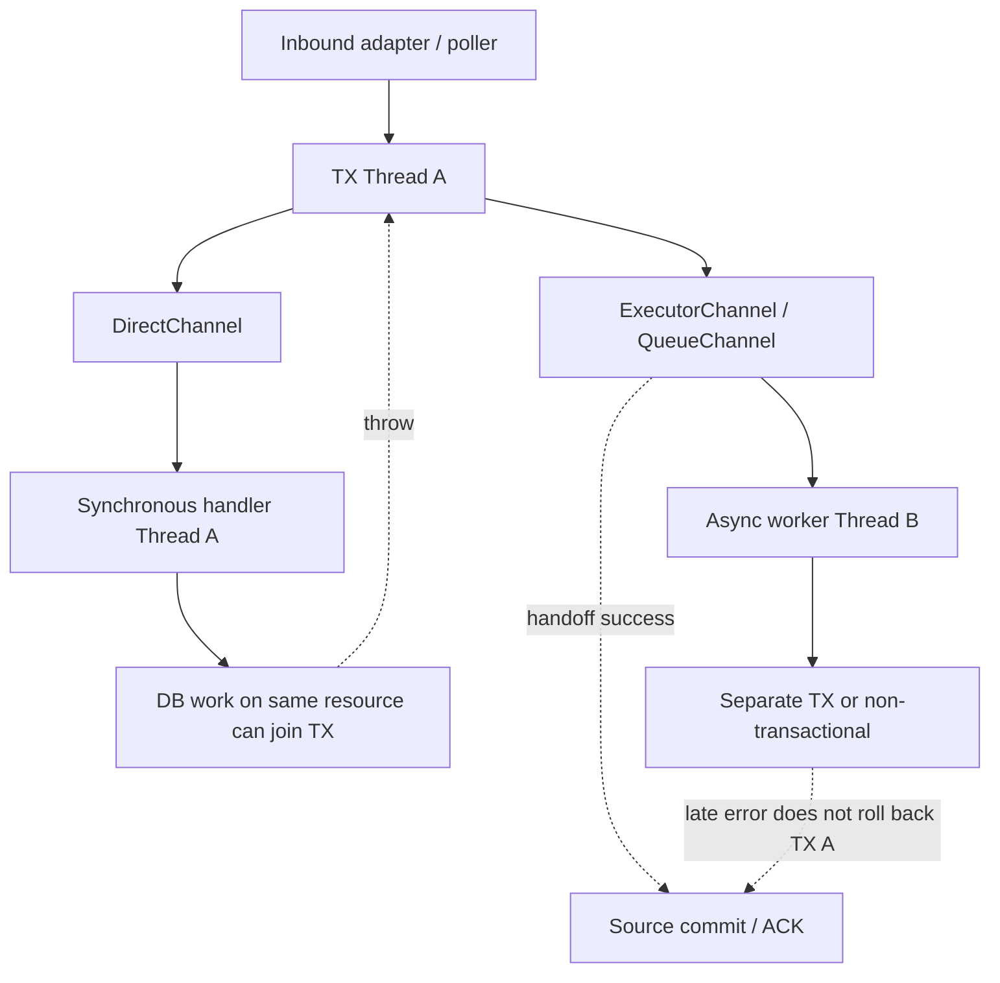
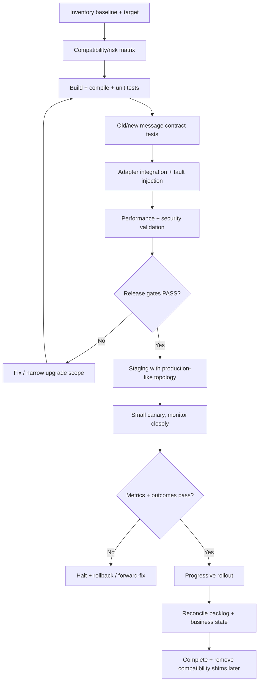
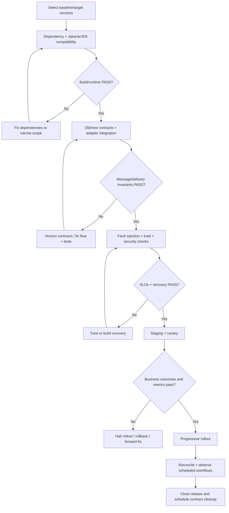

# Compatibility Testing When Upgrading Spring Integration Adapters

## 1. A Successful Upgrade Is More Than a Green Build

A Spring Integration application can compile cleanly after upgrading Java, Spring Boot, Spring Framework, Spring Integration, or drivers, yet still fail in runtime:

- A JDBC inbound adapter stops reading/claiming rows the same way and silently skips records.
- A File/SFTP inbound adapter re-downloads already-processed files or fails to connect because negotiated SSH algorithms changed.
- A JMS/AMQP listener receives messages, yet acknowledgement, retry, or dead-letter behavior diverges from the old contract.
- A Kafka producer/consumer alters serializer, header mapping, or ack/offset behavior, causing duplicates or lost work.
- An HTTP gateway changes converters or error mapping; a payload partners previously accepted now returns `415` or `400`.
- A previously synchronous flow unexpectedly crosses a thread boundary; database transactions no longer wrap the final handler.
- SSL/TLS settings, certificates, pools, schedulers, and metrics still boot yet exhibit different latency, connectivity, or recovery behavior.

**Compatibility testing during upgrades** means proving after changes that the system preserves **data contracts, processing semantics, error/recovery guarantees, security, and performance** within committed boundaries—not merely that dependencies resolve or a `@SpringBootTest` starts up.

This lesson belongs to the **Production** chapter of the **SPRING_INTEGRATION_ADAPTERS** module. Its scope covers inbound/outbound adapters, gateways, pollers, and `MessageChannel` connecting **File, SFTP, HTTP, JMS, AMQP, Kafka, and databases**. These principles also apply when upgrading Spring Boot, Spring Framework, JDK, Spring Kafka, Spring AMQP, JDBC drivers, JMS providers, brokers, and authentication libraries.

### Learning Objectives

After this lesson, you will be able to:

1. Build dependency maps and a **compatibility matrix** across JDK, Spring Boot/Framework/Integration, Jakarta APIs, Spring Kafka/AMQP, drivers, and brokers.
2. Distinguish **API compatibility**, **binary compatibility**, **message contract compatibility**, and **behavioral compatibility** in an `IntegrationFlow`.
3. Identify fragile points when upgrading File/SFTP, HTTP, JMS, AMQP, Kafka, and JDBC adapters.
4. Design regression tests for payloads, headers, acknowledgements, offsets, transactions, retries, DLQs, lifecycles, and backpressure.
5. Execute a preflight → staging → canary → rollout → rollback workflow with explicit evidence and stop criteria.
6. Apply **expand–migrate–contract** changes so old and new versions can coexist safely during transitions.

## 2. Compatibility Has Many Dimensions

| Dimension | Question to Prove | Failure Examples |
|---|---|---|
| **Source compatibility** | Does Java/DSL/XML code still compile? | Changed method/factory signatures, removed imports |
| **Binary/runtime compatibility** | Zero `NoSuchMethodError`, `ClassNotFoundException`, or linkage errors? | Mixed Spring versions on classpath, Jakarta/Javax mismatch |
| **Configuration compatibility** | Do property names, bean names, namespaces, and defaults mean the same thing? | Different poller intervals or listener ack policies |
| **Message schema compatibility** | Are DTOs, JSON/XML/Avro/Protobuf, content types, and encodings still readable? | Adding a required field breaks older consumers |
| **Header/metadata compatibility** | Are routing keys, correlation IDs, trace headers, and JMS/Kafka properties mapped accurately? | Header types shift or fail to propagate |
| **Transport/protocol compatibility** | Can clients connect to servers/brokers over TLS, SASL, SSH, and protocol versions? | SFTP key exchange has no common algorithm |
| **Transaction/delivery semantics** | Do receive, ack, commit, retry, redelivery, and duplicate handling stay intact? | Source acks early; handler errors stop rolling back |
| **Thread/lifecycle compatibility** | Do `MessageChannel`, schedulers, executors, and listener containers start/stop cleanly? | Async handoffs sever transaction contexts |
| **Security compatibility** | Do truststores, credentials, cipher suites, ACLs, and auth remain valid? | New provider rejects weak certs or legacy auth mechanisms |
| **Performance/capacity** | Do throughput, p95/p99 latency, memory, connections, and backlogs meet SLOs? | Producer buffers grow, queue lag rises, GC pressure spikes |
| **Operational compatibility** | Do metrics, logs, traces, health/readiness, and runbooks remain observable? | Dashboards miss stopped listeners |
| **Data/replay compatibility** | Can old events, files, DLQs, outboxes, and offsets still process/replay safely? | New consumers fail decoding pre-upgrade stored messages |

An upgrade can pass the first dimension while failing many downstream ones. **Compatibility must be tested end-to-end**, from source intake to business outcomes and recovery paths.

### 2.1 Distinguish "API Compatibility" from "Behavioral Compatibility"

For example, an `IntegrationFlow` using `Jms.messageDrivenChannelAdapter(...)` still runs after an upgrade, yet:

- A converter stops mapping a header the same way.
- The container routes exceptions through a different error channel.
- Messages enter an `ExecutorChannel`, causing the upstream JMS transaction to commit before downstream processing finishes.

Code compiles, yet the **redelivery contract** silently changed. Therefore test **broker and database state after fault injection**, not just sending one happy-path message.

### 2.2 Boundary Contracts Matter More Than Implementation Details

Abstractions like `MessageChannel` decouple flows from transports, yet never erase transport semantics. JMS acknowledgements, Kafka offsets, AMQP publisher confirms, SFTP file renames, and HTTP responses are fundamentally different outcomes. Compatibility tests must define **what counts as success** at each boundary.

## 3. Establish Baseline and Target Before Changing Dependencies

### 3.1 Deliberate Inventory Collection

Before upgrading, build an inventory:

| Component | Baseline to Record | Target to Verify |
|---|---|---|
| Java runtime/toolchain | Vendor, major version, GC, TLS settings | Target JDK and bytecode target |
| Spring Boot | Version and managed BOM | Target Boot BOM and migration guides |
| Spring Framework | Actual resolved version | Version compatible with Boot/Integration |
| Spring Integration | Core + HTTP/JMS/Kafka/AMQP/SFTP/JDBC modules | Uniformly managed version set |
| Spring Kafka / Spring AMQP | Resolved versions, client dependencies | Adapter, broker, and listener compatibility |
| JDBC/JPA | Driver, dialect, connection pool, database | Type mapping, transaction/isolation behavior |
| JMS provider | Client API + broker/server version | `jakarta.jms`/`javax.jms`, broker protocol |
| SFTP SSH library | Client implementation, host key/algorithms | Key exchange, auth, host-key validation |
| HTTP client | Library, TLS, proxies, redirects, timeouts | Converters, pools, connection reuse, errors |
| Serialization | Jackson, schema registry, converters | Default typing, field handling, encoding |
| Observability | Micrometer/tracing, metric names | Dashboards, logs, health/alerts |
| External systems | API versions, certificates, broker settings | Compatibility windows and rollback options |

**Never assume declared versions in one build file match runtime reality**: dependency management, BOMs, transitive dependencies, plugins, and conflict resolution can yield different resolved versions.

### 3.2 Freeze the Test Baseline

A strong baseline includes:

1. Artifact/build ID and effective dependency lock/BOM.
2. Versioned configuration free of secrets.
3. Production-representative message/file/test fixtures with PII stripped or masked.
4. Golden outputs: serialized payloads, headers, DB state, broker acks, file outcomes.
5. Pre-upgrade metrics/SLOs: lag, throughput, retries, DLQs, CPU/heap, connection counts.
6. Known issues list and acceptance criteria with clear owners.

Avoid upgrading five major components simultaneously when avoidable. Even when an upgrade entails several required shifts, **split change groups** into focused commits/configs/tests so regressions are easy to isolate.

### 3.3 Compatibility Manifest Example

```yaml
compatibilityReview:
  service: "SPRING_INTEGRATION_ADAPTERS"
  environment: "staging"
  baseline:
    java: "<baseline-java-version>"
    springBoot: "<baseline-boot-version>"
    springIntegration: "<baseline-integration-version>"
  target:
    java: "<approved-target-java-version>"
    springBoot: "<approved-target-boot-version>"
    springIntegration: "<approved-target-integration-version>"
  endpoints:
    - id: "orders-jdbc-in"
      transport: "JDBC"
      contract: "claim+process+rollback"
    - id: "orders-kafka-out"
      transport: "KAFKA"
      contract: "event-schema-v2+publish-confirmation"
    - id: "invoices-sftp-in"
      transport: "SFTP"
      contract: "accepted-file+deduplication"
  owners:
    development: "integration-team"
    operations: "platform-oncall"
  gates:
    compile: "required"
    contractTests: "required"
    faultInjection: "required"
    canaryMetrics: "required"
    rollbackDryRun: "required"
```

Values inside `<...>` are placeholders to populate after inspecting your system; this lesson does not assume a specific pre-assigned project version.

## 4. Checking the Java – Boot – Framework – Integration – Jakarta Matrix

### 4.1 Use BOMs and Release Trains Instead of Mixing Versions Arbitrarily

In Spring Boot projects, Boot's BOM/dependency management coordinates compatible Spring Framework, Spring Integration, and supporting library versions. If you override an individual Spring Integration module, Spring Core, or Jackson version, prove compatibility across the **entire** runtime classpath.

Steps:

1. Select target Spring Boot or Spring Framework per platform requirements.
2. Read official release notes and compatibility guidance for relevant major versions.
3. Align the BOM/dependency management governing Spring Integration and adapter modules.
4. Inspect resolved dependencies: confirm no unintended mixed Spring Integration versions sit on the classpath.
5. Check adapter-specific clients: Kafka, RabbitMQ, JMS vendors, HTTP clients, SSH, JDBC drivers.
6. Run smoke/contract tests on the **production target JDK**, not just a developer laptop JDK.

### 4.2 Major Migration Example: `javax` → `jakarta`

A notable ecosystem shift moving from older Spring Framework/Boot generations to Jakarta-compatible generations is enterprise APIs migrating **package namespaces** from `javax.*` to `jakarta.*`—such as `javax.jms` → `jakarta.jms` and `javax.servlet` → `jakarta.servlet`.

| Change Area | Mandatory Checks |
|---|---|
| Source imports | All source code, custom converters, custom adapters, test fixtures |
| Library artifacts | JMS clients, servlet containers, Jakarta Persistence/Validation, transitive deps |
| Provider compatibility | Does the broker client/provider offer a Jakarta API matching runtime? |
| Reflection/config | Class names in YAML/XML, serializers, exception handlers, plugin loaders |
| Integration tests | Do JMS/HTTP endpoints actually start, connect, and exchange messages? |

**Common historical example:** Spring Framework 6 and Spring Boot 3 adopted a Java 17 baseline and Jakarta EE APIs, requiring many projects to migrate imports and dependencies across that major boundary. When planning an upgrade to another target, read **official requirements for that exact target**—never assume all Spring Integration versions share one baseline.

### 4.3 Never Fix Imports and Skip Runtime Testing

Java code referencing `jakarta.jms.Message` can still fail at runtime if the provider client or adapter uses an incompatible API generation. Likewise, apps can compile cleanly yet throw `NoClassDefFoundError` when listener containers initialize, because auto-configuration wasn't exercised in unit tests.

Add smoke tests that boot **every adapter endpoint** used in production and execute at least one round-trip against test/staging brokers or containers.

### 4.4 Avoid Accidentally Mixing Module Majors

Combining `spring-integration-core` version A with `spring-integration-kafka` or `spring-integration-sftp` version B causes subtle compile, linkage, or runtime bugs when internal APIs evolve. Check artifact graphs and dependency convergence using your build tool's ecosystem conventions—never run arbitrary commands across repositories without knowing their actual Gradle/Maven setup.

## 5. API and Java DSL Checklist Post-Upgrade

Upgrading Spring Integration can affect:

- `IntegrationFlow`, inbound/outbound adapter and gateway factory methods.
- `Pollers`, `PollerMetadata`, `SourcePollingChannelAdapter`, `PollingConsumer`.
- Handler/endpoint specs for File, SFTP, JDBC, JMS, AMQP, Kafka, and HTTP.
- Message converters, transformers, header mappers, and generic type parameters.
- Deprecated, removed, or replaced DSL methods.
- Java config, annotations, XML namespaces, bean registration, and lifecycles.

### 5.1 From Compile Fixes to Behavioral Tests

When compilation reports a missing method:

1. Locate the target replacement API in official release notes.
2. Make minimal edits preserving **message contracts**.
3. Run unit tests for transformers/handlers.
4. Run integration tests with real adapters.
5. Verify threads, transactions, acknowledgements, and error channels.

Never swap in a "similar-looking" API with different semantics. Replacing an inbound gateway with an inbound adapter drops reply/correlation mechanics and HTTP responses callers expect.

### 5.2 Structural Before/After API Migration Skeleton

```java
// Structural pattern; does not assert a breaking change
// between any specific version pair.
IntegrationFlow flow = IntegrationFlow
    .from(inboundMessageSource,
        endpoint -> endpoint.poller(
            Pollers.fixedDelay(Duration.ofSeconds(2))
                .maxMessagesPerPoll(1)))
    .transform(payloadTransformer)
    .channel("outboundInput")
    .get();
```

Post-DSL-change checklist:

- Is the source still a **polling** source, or did it switch to a message-driven listener?
- Do `maxMessagesPerPoll`, fixed delay/rate, and receive timeouts behave as expected?
- Does one `receive()` return one message or a list/batch? For JDBC, row counts do not automatically equal message counts.
- Does `outboundInput` have the right subscriber, and is the channel intentionally sync vs. async?
- Does the handler run on the same thread so transaction advice wraps it?
- If the transformer throws, which `errorChannel` catches it, and can the source still retry?

### 5.3 Checking XML Namespaces and Bean Names

Older projects may use XML `<int:poller>`, `<int-jms:...>`, or `<int-file:...>`. When upgrading:

- Cross-check new schema/namespace mappings.
- Check deprecated/changed attributes, property defaults, and validation errors.
- Verify endpoint IDs and bean names referenced by monitoring, Control Bus, or ops scripts.
- Never treat Spring context startup alone as sufficient: adapters often lazy-connect and only fail on the first poll.

## 6. Message Contracts Are the Most Important Invariant

An `IntegrationFlow` bridges systems, so producer–consumer contracts usually outlive code implementations.

### 6.1 Golden Messages

Prepare a representative fixture suite:

- Legacy/new JSON with optional fields, unknown fields, nulls, Unicode, and nested objects.
- XML with namespaces, attributes, and specific content types.
- Old and new Avro/Protobuf schemas if used.
- Header/correlation metadata, Kafka record keys, JMS properties.
- Empty files, large files, Unicode filenames, partial SFTP uploads.
- Pre-upgrade messages already sitting in DLQs/outboxes.

For each fixture, store **expected business state**, valid serialized payloads, error classifications, and target destinations. Never snapshot Java objects via `toString()`—that is not the wire contract.

### 6.2 Forward, Backward, and Full Compatibility

- **Backward compatibility:** new consumers still read events produced by old producers.
- **Forward compatibility:** old consumers still read new events within agreed bounds.
- **Full/bidirectional:** both directions work concurrently during multi-version rollouts.

Tie these claims to **concrete schema formats and consumer logic**. Adding an optional JSON field breaks old consumers configured with strict unknown-property rejection; adding an enum value can break exhaustive switches even if JSON parses.

### 6.3 Header Mapping and Correctness

Spring Integration `MessageHeaders` map through converters to:

- JMS headers/properties and `JMSCorrelationID`.
- Kafka headers, record keys, and topic/partition metadata.
- AMQP properties, routing keys, and correlation fields.
- HTTP request/response headers.
- Filenames, directories, and content types across File/SFTP.

When upgrading mappers or frameworks, **never assume every header passes through untouched**. Tests must verify:

1. Required headers arrive at the destination.
2. Header data types haven't changed.
3. Allowlists, security filters, or type restrictions didn't strip needed headers.
4. Frameworks didn't duplicate or overwrite headers.
5. Correlation, tenant, and idempotency keys survive retries and relays.

Never inject tokens, credentials, or private keys into headers "for compatibility". Follow the destination's security contract instead.

### 6.4 Serialization, Charsets, and Size Limits

Converter or serializer upgrades can shift byte formatting, escaping, timezones, enum representation, or error handling. Compare `byte[]` or payloads against the **contract** rather than expecting byte-for-byte equality when field order doesn't matter. Conversely, for digital signatures, canonicalization, or schema registries, byte-level compatibility may be strictly required.

Check **post-serialization payload sizes** plus transport framing overhead. A logically compatible schema that breaches Kafka/broker/HTTP size caps is a **production incompatibility**.

## 7. Adapter Compatibility Matrix: What to Check per Protocol

| Adapter | Data Contract | Operational Contract | Minimum Regression Tests |
|---|---|---|---|
| **File inbound/outbound** | Filenames, encoding, filtering, checksums, directory layout | Polling, locks/temp files, metadata stores, move-on-success | Old/new files, restarts, partial writes, duplicates |
| **SFTP inbound/outbound** | Remote filenames, directories, charsets, attributes | SSH auth, host keys, key exchange, session pools, reconnects | Connect/auth, sync, rename, network drops, retries |
| **HTTP inbound/outbound gateway** | Method, URI, query, headers, JSON/XML, status | Timeouts, TLS, redirects, proxies, pooling, streaming | 2xx/4xx/5xx contracts, charsets, timeouts, large bodies |
| **JMS inbound/outbound** | Text/Bytes/Map messages, correlation, destinations | Jakarta/Javax APIs, session transactions, ACKs, listener recovery | Delivery, rollback/redelivery, reply correlation |
| **AMQP inbound/outbound** | Exchanges/routing keys, properties, converters | Ack/nack/requeue, publisher confirms, DLQs, broker recovery | Routing, reject/requeue, returned messages, duplicates |
| **Kafka inbound/outbound** | Record keys, topics, headers, serializers/schemas | Consumer groups, offsets, partition order, producer acks/tx | Rebalance/retry, schemas, DLT, duplicates |
| **JDBC inbound/outbound** | SQL columns, row mappers, BLOB/CLOB, batches | Poller transactions, isolation/locks, pools, driver type mapping | Claim+rollback, concurrency, pagination, restarts |

This matrix is a **checklist map**, not a claim every adapter breaks on every upgrade. Ground real diffs in release notes and testing of your **exact baseline–target pair**.

## 8. File Adapter: Filters, Metadata Stores, and File Lifecycles

### 8.1 File Inbound

File inbound adapters scan folders and filter files. Across upgrades, verify:

- `FileReadingMessageSource` and filter behavior on filenames, timestamps, and case sensitivity.
- `AcceptOnceFileListFilter` or persistent metadata stores: did keys, namespaces, serialization, or retention change?
- Are files re-ingested after restarts or skipped due to legacy metadata?
- Does the poller wait for completed writes? Do producers write temp files then rename atomically where supported?
- Permissions, symlinks, path-traversal guards, file timestamp precision, and filename encoding.
- `maxMessagesPerPoll`, schedulers, concurrent pollers, and file ordering.

**Mandatory scenario:** directory holds already-processed files, unprocessed files, and one partially written file; restart with the new app version. Confirm **zero skipped new files**, zero duplicate business effects on old files, and partial files aren't prematurely processed.

### 8.2 File Outbound

Outbound adapters often write temp files and rename on completion. Verify:

- Paths, directory creation, file-exists modes, and overwrite policies.
- Write → close → rename behavior across process crashes.
- Checksums/sizes and line-ending encodings if transformers changed.
- What happens if DB commits then file move fails? **Filesystems do not roll back with JDBC.**
- Cleanup of temp/partial files and error ownership.

Test writing to a temp file, deliberately denying rename permission, and verifying DB/business state plus partial-file handling per policy. Never treat `afterCommit` callbacks as true distributed file transactions.

## 9. SFTP Adapter: Verify Both SSH Protocols and File Integrity

SFTP compatibility depends on Spring Integration, SSH client libraries, JDK crypto providers, OpenSSH servers, and server security policies.

### 9.1 Changes That Break Connectivity Even When APIs Match

- Key-exchange, host-key signature, cipher, or MAC algorithms no longer intersect.
- SSH private/public key formats or passphrases rejected by the new client.
- Server host key rotated, `known_hosts` mismatched, or host-key verification policy changed.
- Username, chroot, remote directory, or session permissions shifted.
- Idle pool reuse, reconnects, keepalives, timeouts, or session factory cleanup changed.
- Proxies/jump hosts, DNS, or IPv6 behavior affected.

**Never fix upgrade failures by disabling host-key verification or re-enabling weak algorithms indefinitely.** When legacy algorithms drop out of support, upgrade configs/servers or coordinate an audited, approved crypto migration.

### 9.2 Inbound Synchronization Tests

Minimum test:

1. Spin up an SFTP test server with valid users/keys and `known_hosts`.
2. Stage valid remote files, duplicate-named files, and one partial upload.
3. Sync via the target adapter; inspect local files and remote filters/metadata.
4. Deliberately drop the connection mid-download, then reconnect.
5. Verify incomplete uploads are never marked done locally, and checksums/sizes match after retry.
6. Restart and verify zero re-downloads/re-processing under once-per-file metadata contracts, or clean business idempotency under at-least-once.

### 9.3 Outbound Upload/Rename Tests

Test temporary-to-final renames per config and server filesystem capabilities, including rename failure after upload finishes. On client timeouts, the remote file **may already exist**. Use content hashes/manifests or versioned filenames before re-uploading.

### 9.4 Connection/Session Lifecycles

Beyond happy paths, watch open session counts and shutdowns. Upgrades altering session caching can cause:

- Session leaks when handlers throw exceptions.
- Excessive connections post-rollout.
- Hung polls when servers go down.
- Apps failing to shut down cleanly due to unclosed threads/sockets.

Include connect/handshake latencies, session counts, reconnect attempts, and transfer failure metrics in compatibility gates.

## 10. HTTP Adapters/Gateways: Methods, Statuses, Converters, and Client Behavior

### 10.1 HTTP Gateway Contracts

When changing Spring Framework/Boot or HTTP client backends, check:

- HTTP methods, URI template expansion, query-parameter encoding.
- Request/response body types, charsets, `Content-Type`/`Accept`.
- Header propagation, auth token handling, correlation/tracing.
- Status mapping across 2xx/4xx/5xx and `ResponseErrorHandler`/exception policies.
- Connect/read/response timeouts, redirects, proxies, connection pooling.
- Multipart, streaming, compression, and max in-memory buffering.
- TLS truststores, hostname verification, and HTTP/1.1 vs. HTTP/2 negotiation.

Classic pitfall: a new client changes default converters, altering DTO JSON structure or headers so the server returns `415 Unsupported Media Type`. Unit handler tests miss it because no real HTTP request ran.

### 10.2 Contract Tests with a Mock HTTP Server

Using `WireMock` or `MockWebServer`, test:

| Scenario | Assertions |
|---|---|
| 200 JSON | URI/method/headers/body match; DTO parses cleanly |
| 201 Created | `Location` header and response body map properly |
| 202 Accepted | Accepted is never confused with business completed |
| 400/422 | Deterministic validation errors never infinitely retry |
| 401/403 | Token/auth scopes accurate; zero secret logging |
| 404 | Error mapping matches domain contract |
| 408/429/503 | Retries/backoffs follow contract without retry storms |
| 5xx after remote side effect | Idempotency keys and reconciliation active |
| Timeout after server recorded response | Outcome marked unknown; never assumed unexecuted |
| Redirect/cert error | Credentials never leak to non-allowlisted hosts |

### 10.3 Inbound Gateways and Response Semantics

For HTTP inbound gateways, verify status codes, exception translation, and timeouts when downstream handlers run slowly. Replacing `DirectChannel` with an async channel or reactive boundary can finish the HTTP thread/connection before business work completes. API clients must never get success merely for internal enqueuing unless the contract explicitly specifies `202 Accepted` with an operation ID.

### 10.4 Response Memory Limits

HTTP client/codec upgrades can alter default buffering limits. Test large responses and binary streams for memory/GC impact—never blindly raise `maxInMemorySize` to infinite. Use streaming or object-storage references for large payloads.

## 11. JMS Adapter: Jakarta, Listener Transactions, and Correlation

### 11.1 API/Provider Compatibility

When crossing Spring/Jakarta boundaries, check consistency across:

- `jakarta.jms` vs. `javax.jms` packages in app code and JMS adapters.
- Vendor `ConnectionFactory`/client libraries compatible with the broker/server.
- JMS message converters and `TextMessage`/`BytesMessage`/`MapMessage` mappings.
- `JMSCorrelationID`, `JMSReplyTo`, and headers/properties.
- Listener container concurrency, durable subscriptions, and temporary reply destinations.

JMS clients/providers follow different Jakarta migration timelines; **never swap in a similarly named artifact without running round-trip integration tests**.

### 11.2 Acknowledgement and Transaction Regressions

With `DefaultMessageListenerContainer` or your active listener container, test:

1. Handler succeeds: JMS receive commits/acks per policy.
2. Handler throws synchronously: rolls back / redelivers per session/container.
3. Handler catches error and returns: verify whether container treats it as complete.
4. Handler crosses `ExecutorChannel`: worker failures post-handoff may not roll back receives.
5. DB commits before JMS commit fails: broker redelivers; inbox ledger blocks duplicate business effects.
6. Poison messages: retry budget/DLQ/quarantine work properly.

**Never infer from `sessionTransacted=true` that JDBC transactions roll back together.** `JmsTransactionManager` and `DataSourceTransactionManager` manage distinct local resources unless proper XA/JTA is configured.

### 11.3 Request/Reply Gateways

For JMS inbound/outbound gateways, check:

- Correlation ID mappings still match.
- Replies arrive at expected client destinations.
- Reply timeouts don't spawn duplicate requests on client retry.
- Late replies are handled safely.
- Business event/request IDs stay stable across retries.

An upgrade can keep message receives working while breaking response correlation: the backend processes requests, callers time out and retry, creating duplicates.

## 12. AMQP Adapter: Topology, ACKs, and Publisher Confirms

With Spring Integration AMQP/RabbitMQ, compatibility goes beyond opening a broker connection. Verify:

- Exchanges, queues, bindings, routing keys, and declaration policies.
- Queue arguments like TTL, DLX, dead-letter routing, and quorum/classic types.
- Message converters, headers/properties, charsets, and payload sizes.
- Listener container ack modes, requeue policies, and retry/error handlers.
- Publisher confirms and returned-message handling for unroutable messages.
- Channel/connection recovery, heartbeats, pools, and concurrency.

### 12.1 Distinguish Publisher Confirms from Consumer ACKs

Producers receiving publisher confirms know the broker accepted the publish per config. Consumers haven't necessarily processed the business event yet. Test suites need **both assertions**: one for publication and one for consumption/business state.

### 12.2 AMQP Regression Matrix

| Scenario | What to Observe |
|---|---|
| Valid route | Message lands in expected queue |
| Unbound routing key | Returned/rejected per mandatory/confirm policy |
| Handler throws | Proper nack/requeue/DLQ without message loss |
| Poison message | Quarantined after budget; healthy messages continue |
| Consumer crashes after DB commit, before broker ack | Redelivery with idempotent business effect |
| Broker restart | Clean reconnect without mis-declaring queue topology |
| Increased concurrency | Business ordering and memory remain within bounds |

Never use JMS `CLIENT_ACKNOWLEDGE` constants to describe AMQP acks—they are distinct APIs and protocols.

## 13. Kafka Adapter: Schemas, Offsets, Rebalances, and Producer Behavior

### 13.1 Producer Compatibility

For Kafka outbound adapters, verify:

- Key/value serializers and schema registry compatibility if used.
- Mapped headers, topics, and partition keys.
- Producer `acks`, retries, idempotence, and transactional IDs if used.
- Callback/future semantics: `MessageChannel.send()` returning **does not equal broker ACK** for async producers.
- Record/request/batch sizes, compression, buffer memory, and timeouts.
- Error channels and async failure routing—never mark outboxes `SENT` before broker confirmation.

### 13.2 Consumer Compatibility

Verify:

- Deserializers, schema readers, and handling of unknown/malformed payloads.
- Consumer group IDs, partition assignment, and rebalance behavior.
- Ack modes and manual/auto commits per container config.
- Error handlers, seek/retry, retry topics/DLTs, and listener exceptions.
- Offset retention, reset policies, and startup behavior for new consumer groups.
- Per-partition/aggregate ordering and duplicate suppression.

### 13.3 Mandatory Crash Test

Send event `E-101`. Let the consumer **commit DB** then crash **before offset commit**:

1. Record redelivers after restart/rebalance.
2. Consumer receives it a second time, matching business event ID and inbox unique constraint to skip duplicate mutations.
3. Offset/progress commits per container contract.

Conversely, committing offsets **before** DB writes complete causes **lost work** on DB failures. Test both directions to lock in the right order and transaction model.

### 13.4 Kafka Transactions Are Not Automatically XA with DBs

Kafka producer transactions and offset coordination operate within Kafka's supported scope. Never assume a service `@Transactional` atomically commits DBs, Kafka topics, and HTTP APIs together. Use outboxes/inboxes and retries/reconciliation or explicit transaction coordination where needed.

### 13.5 Schema Registry and Rolling Upgrades

While old and new instances run concurrently:

- New consumers must read legacy events still sitting in topics.
- While old consumers run, new events must stay readable by them **or route to versioned topics**.
- Schema registry compatibility modes must fit the migration sequence.
- Adding required fields or changing enums needs defaults, dual-reads, or versioned events—not just bumping `schemaVersion`.

Test both **old producer → new consumer** and **new producer → old consumer** when canary coexistence is required.

## 14. JDBC Adapter: Claims, Transactions, Drivers, and Database Consistency

### 14.1 JDBC Inbound Pollers

JDBC polling often runs a `SELECT` to fetch rows and an `UPDATE` to mark them claimed. Verify:

- SQL syntax/dialect, named parameters, row mappers, and JDBC types.
- `maxRows` vs. `maxMessagesPerPoll`: a single receive may emit one message containing a list of rows.
- Does the source update share a transaction with synchronous downstream handlers?
- Are `DataSource`/transaction managers, connection pools, and timeouts intact?
- Do isolation levels and concurrent claims stop duplicate grabs across instances?
- Do null/LOB/timestamp/timezone mappings preserve contracts on the new driver?

### 14.2 Negative Rollback Test

Insert a `NEW` row, let the poller read/update claim and the handler write to a ledger before throwing `RuntimeException`. When poller transaction advice and `DirectChannel` protect the same `DataSource`, expected state is:

```sql
-- After rollback, read using an independent transaction/connection:
SELECT status FROM incoming_order WHERE id = 101;
-- Expected: NEW

SELECT COUNT(*) FROM order_ledger WHERE order_id = 101;
-- Expected: 0
```

**Important:** `@Transactional` on the **JUnit test method** causes false positives by auto-rolling back, and uncommitted fixtures stay invisible to poller threads. Commit fixtures first and read back on independent connections.

### 14.3 Outbound JDBC

Outbound JDBC adapters use prepared statements, batch updates, upserts, and type conversions. Verify:

- Nulls map to proper SQL types.
- Booleans, timestamps/timezones, JSON/JSONB, UUIDs, decimal precision, and LOBs cross the new driver cleanly.
- Mid-batch errors: do partial commits match transaction scope?
- Duplicate business keys, deadlocks, lock timeouts, and retries.
- Whether outbound source rows were acked/claimed before target DB commit.

### 14.4 Expand–Contract Database Schema Migrations

When upgrading adapters alongside schemas:

1. **Expand:** add new columns/fields while old apps can still read/write.
2. **Controlled dual-read or dual-write:** allow old and new versions to interpret data if needed.
3. **Migrate/backfill:** migrate legacy rows with counts and checksums.
4. **Switch:** cut producers/consumers over to the new contract.
5. **Contract:** drop legacy columns/formats only after zero old apps/consumers/replays depend on them.

Never drop columns or make incompatible type changes before canary/rollback windows close. Binary rollbacks cannot undo one-way schema changes.

## 15. Pollers, `MessageChannel`, and Transaction Boundaries Post-Upgrade

Endpoints may "boot cleanly" yet shift behavior because schedulers, executors, channels, or advice chains changed relative to baseline—bugs notoriously invisible to unit tests.

### 15.1 Poller Contracts

Inspect each endpoint:

- Triggers: fixed-delay, fixed-rate, cron, initial delay.
- `maxMessagesPerPoll`, receive timeouts, and executions per cycle.
- Correct `TaskScheduler`/`TaskExecutor` beans wired.
- Poller advices: retries, transaction interceptors, metrics, custom filters.
- Endpoint lifecycles: `autoStartup`, phases, stop/start, graceful shutdown.
- Backpressure: when sources continuously return items, do pollers pause cleanly or flood executors?

A `SourcePollingChannelAdapter` polling JDBC can emit **one message holding multiple rows**, while a `PollingConsumer` drains `QueueChannel`. Never equate poll counts with row counts or logical business messages. Compare both sides on upgrade.

### 15.2 `DirectChannel` vs. `ExecutorChannel`



**Never assume a major upgrade automatically preserves channel types** if configs or refactors accompany the upgrade. One accidental DSL wiring change can make JMS listeners ack early or JDBC pollers commit claims before handlers execute.

### 15.3 Advice Chains and Exception Propagation

Verify:

1. `TransactionInterceptor` stays attached to the right poller/handler.
2. Whether retry advice sits inside or outside transactions—does each attempt open a fresh transaction?
3. Whether `errorChannel` catches exceptions and treats them as handled.
4. Whether synchronous errors reach listener containers to trigger rollback/redelivery.
5. Where async producer callback failures get recorded.

When upgrading changes error-handling paths, tests must assert **final source state + target business state**, not merely count `ERROR` logs.

### 15.4 Graceful Shutdown

Test stopping the old version and booting the new one while:

- JDBC polls/transactions are active.
- JMS/AMQP listeners hold unacknowledged messages.
- Kafka consumers process batches with uncommitted offsets.
- SFTP transfers files and HTTP gateways await responses.
- `QueueChannel` holds in-memory or persistent messages.

Inspect sources, brokers, files, and DBs after restart. On transient duplicates, consumers must stay idempotent. Never assume in-memory queues survive restarts.

## 16. Retry, DLQ, and Outbox Compatibility

### 16.1 Preserve Error Contracts

An older build might classify an error as retryable while the new version classifies it permanent, or vice versa—altering retry counts, acks, DLQs/quarantine, and operations.

| Error Group | Regression Expectation |
|---|---|
| Validation/schema | Never infinitely retry; quarantine/DLQ with metadata |
| Transient network | Backoff/jitter, retry budgets, reconnects |
| Auth/authorization | Never tight-loop retry bad credentials; alert without leaking secrets |
| Timeout with unknown outcome | Never assume unexecuted; idempotent retry or reconcile |
| Oversized payload | Never wastefully retry identical bytes |
| Deadlock / tx conflict | Roll back and retry cleanly without duplicate effects |
| Poison message | Bounded budget leads to durable failure state and owner |
| `AfterCommit` callback failure | Commit already happened—never fake rollback; reconcile |

### 16.2 Verify Legacy DLQs Remain Readable

Post-upgrade, run the new consumer over historical DLQ records:

- Do headers/exception metadata written by the old version still parse?
- Can new converters read legacy schemas?
- Do replays preserve original event IDs?
- Do DLT/DLQ destinations, names, retention, and ACLs match?
- On DLQ retries, do consumers update business state idempotently?

**Never purge DLQs or reset offsets just to turn dashboards green** without business review and recovery procedures.

### 16.3 Outbox Publishers and Producer Acknowledgements

Outboxes persist publish intent alongside business state, yet publishers can resend after crashes. Post-upgrade, verify:

- `SENT` marks only after **qualifying publisher confirmation**, never on `MessageChannel.send()`.
- If async producer callbacks/futures changed, new code still handles late failures.
- Worker claims/leases/fencing and retry schedules stay safe while old and new versions coexist.
- Payloads/headers emitted by new workers stay readable by old consumers during coexistence.

Test **broker accepts event while DB mark-`SENT` fails**: after restart, publisher resends the same event ID. PASS requires zero lost events and zero duplicate business effects.

## 17. Security and Authentication Across Upgrades

### 17.1 Dependency Upgrades Can Shift Crypto Policies

JDK, HTTP/TLS, SSH/SFTP, JMS/AMQP/Kafka security clients, or crypto providers can tighten supported algorithms and defaults. Check before rollout:

- TLS versions/cipher suites and server hostname verification.
- Truststore/keystore formats, chains, expirations, and rotations.
- Kafka/broker SASL/SCRAM/OAuth or client-cert auth.
- SSH host-key verification, key exchange, key types, and private-key formats.
- Proxies/`NO_PROXY`, service discovery, DNS caching, timeouts.
- ACLs across topics, queues, destinations, directories, and schemas.
- Secret injection/rotation without baking into images or test artifacts.

### 17.2 Fail-Safe Security Behavior

If an upgrade causes an endpoint to fail authentication:

- Readiness/health must reflect committed unavailability.
- Never disable TLS certificate validation or SSH host-key checking.
- Bound retries; bad credentials must never tight-loop.
- Never commit/ack source messages if outbound effects lack durable recovery.
- Emit error codes and endpoint IDs without logging passwords, bearer tokens, or private keys.

An "upgrade that works" only after weakening authentication fails the **security compatibility gate** until formally reviewed and approved.

### 17.3 Trust Boundaries and Metadata

If a new mapper alters headers, never let untrusted callers control destinations, file paths, SQL fragments, or tenant IDs. Test:

- Spoofed destination headers are blocked.
- Filename path traversal is rejected.
- Source tenant IDs are verified before propagating outbound.
- Oversized payloads / decompression bombs face bounded parsing.
- Logs/traces do not newly leak raw sensitive headers/payloads post-upgrade.

Upgrades must preserve features **without resurrecting previously patched vulnerabilities**.

## 18. Seven-Layer Testing Strategy

Structure upgrade evidence from cheapest to most realistic:

1. **Dependency validation:** target dependency graph, Java/Jakarta APIs, missing/conflicting classes.
2. **Compile + unit tests:** transformers, validators, routers, error classifiers.
3. **Application-context tests:** endpoint beans, pollers, channels, advices, converters, health/lifecycle.
4. **Consumer-driven contract tests:** old/new JSON/headers/schemas, request/reply, routing.
5. **Integration tests:** real/test-equivalent brokers, SFTP servers, HTTP mocks, DBs, transaction managers.
6. **Failure/recovery tests:** broker outages, crashes/rollbacks, duplicates, DLQs, timeouts, in-flight items.
7. **Performance/operational gates:** throughput, backlogs, memory, connection counts, drain/shutdown, canaries.

Not every test runs on every commit—split into CI smoke, nightly regression, and release gates. Never skip layers 5–7 and declare a major production upgrade verified.

### 18.1 Choose Representative Test Environments

| Layer | Tools / Materials | What It Proves |
|---|---|---|
| Java unit | JUnit 5, Mockito | Transform logic, validation, routing |
| Spring integration test | `@SpringBootTest`, `@SpringIntegrationTest`, `MockIntegrationContext` | Bean/flow/advice wiring |
| JDBC | Testcontainers PostgreSQL/MySQL or equivalent test DB | Transactions, locks, driver type conversions |
| JMS | Test provider matching production | Session acks, redelivery, reply correlation |
| AMQP | RabbitMQ test broker with matching policies | Routing, confirms, nack/DLQ |
| Kafka | Kafka test broker + schema registry if used | Serializers, offsets/rebalances, DLT |
| HTTP | `WireMock`/`MockWebServer` and staging APIs | Status/body/headers/timeouts/auth |
| SFTP | SFTP test server with host-key/crypto policies | Handshakes, sync, renames, retries |
| Chaos/performance | Controlled kills/network outages + load generators | Recovery, backlogs, pools/capacity |

**Note:** mocks or embedded brokers often diverge from production providers. Whenever contracts rely on vendor-specific behavior, release gates must test an equivalent environment matching major version, ACK config, TLS, and routing.

### 18.2 Never Run Entire Polling Tests Inside the Runner's Transaction

When testing pollers, commit fixtures **first** so scheduler/listener threads can see them. Putting `@Transactional` on the JUnit test causes false-positive rollbacks or hides uncommitted fixtures from poller threads. Run assertions on separate transactions and stop endpoints before cleanup to avoid races.

### 18.3 Keep Golden Test Fixtures Immutable

Version and label golden messages clearly:

```text
fixtures/
  contract-v1-order-created.json
  contract-v2-order-created.json
  legacy-jms-text-message.json
  legacy-amqp-headers.json
  legacy-kafka-key-value.json
  sftp-unicode-filename.txt
  jdbc-legacy-row.json
```

This layout is **illustrative**; do not create extra files outside task scope. For sensitive payloads, craft synthetic fixtures rather than copying unauthorized customer data.

## 19. Old/New Matrix Testing: Beyond Linear Upgrades

During multi-instance rollouts, old and new versions publish and consume side-by-side, forming a **2×2 matrix**:

| Producer | Consumer | Requirement |
|---|---|---|
| **Old** | **Old** | Baseline remains intact until rollout |
| **Old** | **New** | Backward read compatibility, especially backlogs/DLQs |
| **New** | **Old** | Forward compatibility during canary/rollback windows |
| **New** | **New** | Target contract works end-to-end |

### 19.1 When Is Testing New → Old Mandatory?

- Old and new instances share a Kafka topic, JMS queue, or AMQP exchange.
- Gateway traffic through new nodes can reach older nodes via load balancers.
- Binary rollbacks may happen after new events/schemas were emitted.
- Dead-letters/replays occur across multi-version windows.

If New → Old is incompatible, use **versioned topics/queues/endpoints**, feature gates, or sequenced rollouts so new schemas never hit old consumers. Never assume all queue consumers run the identical version during rolling deploys.

### 19.2 Producer/Consumer Contract Tests

Suppose `OrderCreated` v2 adds `discountReason`:

- New consumers still handle v1 backlogs.
- Old consumers accept v2 only if the field is optional or tolerant decoders are active per contract.
- If v2 changes the meaning of `totalAmount`, that is a major semantic break even if JSON parses.
- Adding new enum values can break old consumers with exhaustive `switch` statements.

Test anonymized production-like fixtures asserting **business outcomes**, not just schema parsing.

### 19.3 Coexisting Metadata Stores and Offsets

Beyond payloads, old and new versions may share:

- File/SFTP persistent filter metadata keys.
- JDBC row claim states or outbox status/lease fields.
- Kafka consumer group IDs and committed offsets.
- JMS durable subscription / client IDs.
- AMQP queue declarations, DLX, and TTL arguments.

These shared states must stay **bidirectionally compatible** or be cleanly isolated/migrated. Never rename a Kafka group ID to "reset the problem" without accounting for full topic/backlog replays.

## 20. Sample Contract Test for an Adapter Route

Below is **Spring/JUnit-style pseudocode** focusing on invariants to prove; `TestFlowHarness`, `BrokerProbe`, and `DbProbe` represent project abstractions to implement rather than built-in framework APIs.

```java
@SpringBootTest
class UpgradeCompatibilityIT {

    @Autowired TestFlowHarness flow;
    @Autowired BrokerProbe broker;
    @Autowired DbProbe db;

    @Test
    void legacyEventIsStillAcceptedByNewConsumer() {
        Message<byte[]> legacy = flow.loadGoldenMessage("order-created-v1");
        flow.deliverToNewConsumer(legacy);

        flow.awaitBusinessOutcome("order-101", Duration.ofSeconds(10));
        assertEquals("CREATED", db.orderStatus("order-101"));
        assertEquals(1, db.businessEffectCount("order-101"));
    }

    @Test
    void rollbackPreservesSourceAndBusinessState() {
        flow.insertCommittedJdbcFixture(101L, "NEW");
        flow.enableFault("AFTER_DB_WRITE_BEFORE_POLLER_COMMIT");
        flow.startJdbcPoller();
        flow.awaitRollback(Duration.ofSeconds(10));
        flow.stopJdbcPoller();

        assertEquals("NEW", db.sourceStatus(101L));
        assertEquals(0, db.ledgerCount(101L));
    }

    @Test
    void publisherDoesNotMarkSentBeforeBrokerConfirmation() {
        flow.createCommittedOutboxEvent("event-101");
        broker.failProducerAcknowledgmentFor("event-101");
        flow.runOutboxPublisherOnce();

        assertNotEquals("SENT", db.outboxStatus("event-101"));
        assertTrue(db.isRetryable("event-101"));
    }
}
```

These tests are **contract templates**. Real tests must exercise true boundaries using equivalent test DBs/brokers, committed fixtures, deadlines, cleanup, and faults injected at exact failure windows—never pass purely on mocked expectations.

### 20.1 Byte-Level and Header-Level Checks When Needed

```java
// Example assertions on messages after transformers/mappers.
assertEquals("application/json", headers.get("contentType"));
assertEquals("event-101", headers.get("eventId"));
assertTrue(serializedPayload.length <= allowedPayloadBytes);
// Also verify on the real broker, because keys/properties/headers
// and framing can exceed limits even for small payloads.
```

Assume `headers`, `serializedPayload`, and `allowedPayloadBytes` come from test setup. Never equate `payload.length` with total wire/broker message size.

### 20.2 Channel Handoff Tests

Run the same business event through:

1. `DirectChannel` + synchronous transactional handler.
2. `ExecutorChannel` + asynchronous handler.

Inject a fault in the final handler and inspect source claims/acks and DB state. Unsafe wiring can pass under `DirectChannel` yet silently fail once traffic crosses an executor.

## 21. Performance Regressions: Capacity Compatibility

A target build can be functionally right yet breach production throughput/latency due to changes in connection pools, codecs, thread schedulers, compression, or broker clients.

### 21.1 Compare Against Baseline Under Identical Workloads

| SLI | Baseline to Record | Example Gate |
|---|---|---|
| Throughput | Messages/s, bytes/s per route | Does not drop beyond approved threshold |
| End-to-end latency | p50/p95/p99 from receive to business commit | Meets deadlines |
| Poll latency | `receive()` duration, source rows/s | No abnormal spike |
| Broker lag | Oldest message age, Kafka lag, queue depth | Backlog drains cleanly |
| Retry/redelivery | Retry counts/rates, DLQ growth | No surge on identical load |
| CPU/heap | Heap used, GC pauses, allocation rate | Headroom intact at peak |
| Connection pools | Active, idle, pending, timeouts | Zero pool exhaustion |
| Thread pools | Active, queued, rejected tasks | Zero deadlocks or starvation |
| SFTP/HTTP | Connection/session counts, handshake latency, timeouts | No leaks or reconnect storms |
| Database | Lock waits, deadlocks, transaction p99 | Within budget |
| Shutdown/restart | Stop/drain time, recovery lag | Meets operational SLAs |

These columns show what to measure, not universal numbers. Base gates on real baselines, product targets, and capacity instead of arbitrary universal percentages.

### 21.2 Test with Real Concurrency

Single-producer/single-consumer tests miss critical regressions:

- Multi-instance JDBC pollers contend on rows.
- Kafka producer batching shifts throughput/latency under concurrency.
- JMS/AMQP listener containers spin extra sessions/consumers affecting order.
- SFTP pools trigger concurrent SSH handshakes.
- HTTP pools exhaust from timeouts or leaks.
- Aggregators hold messages in `MessageStore` longer, raising heap use.

Run at least one peak-equivalent load test and one controlled slow/failing-downstream test. Inspect **backpressure and resource cleanup**, not just peak throughput.

### 21.3 Benchmark Under Equivalent Conditions

For fair comparisons:

1. Keep payload shapes and message distributions constant.
2. Keep broker/DB/server settings identical aside from mandatory upgrade diffs.
3. Warm up, sample long enough, and record JDK/GC/CPU/memory quotas.
4. Never compare baseline production-peak p99 against idle staging target runs.
5. Separate config-tuning gains from dependency-upgrade impacts.

When targets change JDK/GC or broker versions, call those variables out explicitly. "10% faster" means nothing under mismatched workloads.

## 22. Safe Production Upgrade Roadmap

### 22.1 Overall Flow



### 22.2 Phase A — Discovery and Change Scope

- Define the upgrade path between **actual baseline** and approved target.
- Separate JDK, BOM, Integration DSL, broker client, and schema changes.
- List active adapters, endpoint IDs, and owners.
- Identify vendors/partners needing certificate, protocol, or API coordination.
- Freeze golden fixtures plus baseline metrics, incidents, and DLQ/outbox snapshots.
- Flag hard-to-reverse risks: one-way schemas, offset migrations, cert rotations, and new data formats.

### 22.3 Phase B — Build and Test on Upgrade Branch

- Resolve dependency graphs and address incompatibilities per official migration guides.
- Compile on target JDK.
- Run unit/contract tests and full context loading across all endpoints.
- Run adapter integration tests against equivalent test brokers/DBs/SFTP/HTTP.
- Run crash/retry/redelivery tests across guaranteed-delivery routes.
- Verify zero resource leaks, performance bounds, and security checks.

Every code change needs **concrete evidence**: resolved compile changes, golden message compatibility, broker outcomes, and business state. Never tick "tests passed" without documenting coverage.

### 22.4 Phase C — Multi-Version Staging

If production rolling deploys:

1. Run old producer → new consumer.
2. Run new producer → old consumer whenever rollbacks/coexistence can happen.
3. Test shared queues/topics/directories/DBs with properly separated endpoint IDs.
4. Simulate broker restarts, DB failovers, network timeouts, and process kills.
5. Verify DLQs/outboxes/backlogs emitted by the old version still process under the new one.
6. Verify stopping the old version drops zero in-flight work.

For JMS durable subscribers, Kafka consumer groups, and SFTP metadata stores, be careful sharing IDs between old and new builds: they can fight over partitions or corrupt shared state. Design staging topologies honoring provider rules (never share exclusive client IDs).

### 22.5 Phase D — Canary

Pick an initial traffic/capacity slice small enough to bound blast radius yet broad enough to hit **tricky message types**. Options include:

- One new replica in a consumer group where partition assignment fits safely.
- A canary service with controlled routing or destinations.
- Read-only / shadow consumption with side effects disabled—only if guaranteed not to falsely ack/commit sources.
- A deliberately routed tenant/event cohort.

**Never mirror side-effecting commands** (payments, emails, invoices) into two active handlers just to diff outputs. Shadow modes must isolate writes or enforce strict idempotency and authorization.

### 22.6 Phase E — Progressive Rollout

Once canary passes:

1. Expand replicas/traffic in checkpointed waves.
2. Monitor metrics and business outcomes split by a low-cardinality **version label**.
3. Verify queues/topics drain cleanly after each wave.
4. Keep rollback viable before flipping contracts exclusively to target.
5. After full rollout, keep watching long enough to cover slow scheduled jobs: nightly polls, weekly files, and deferred DLQ replays.

Never declare a rollout finished the moment pods turn healthy if scheduled pollers or periodic SFTP jobs haven't run yet.

## 23. Canary Gates and Explicit Stop Criteria

### 23.1 Define Quantitative and Qualitative Gates

A canary passes when:

- **Functional:** golden events flow source-to-target with exact outputs and mappings.
- **Delivery:** zero spike in lost messages, unacked backlogs, or duplicate business effects.
- **Reliability:** error rates, timeouts, retries, and DLQs stay inside approved bounds.
- **Latency/capacity:** p95/p99, oldest queue age, connection counts, and heap stay within SLOs.
- **Security:** zero fail-open TLS/SSH/auth or credential leaks.
- **Recoverability:** stop/restart and rollback/failback tested; runbooks have active owners.

### 23.2 Release Gate Manifest Example

```yaml
releaseGates:
  artifact:
    candidate: "<build-id>"
    dependencyLockReviewed: true
  contracts:
    oldProducerToNewConsumer: "PASS"
    newProducerToOldConsumer: "PASS_OR_NOT_APPLICABLE"
    messageHeadersAndSchema: "PASS"
  reliability:
    jdbcRollback: "PASS"
    jmsRedelivery: "PASS"
    kafkaOffsetRecovery: "PASS"
    sftpRestart: "PASS"
    httpUnknownOutcome: "PASS"
  operations:
    metricsAvailable: true
    errorBudgetWithinApprovedThreshold: true
    noUnownedDlqOrQuarantine: true
    rollbackDrill: "PASS"
  approval:
    releaseOwner: "<approved-owner>"
    rollbackOwner: "<approved-oncall>"
```

Fields are an **illustrative governance checklist**, not a built-in Spring Integration CI/CD system. Use `PASS_OR_NOT_APPLICABLE` only with explicit justification—never to skip forward compatibility when production genuinely has old consumers.

### 23.3 Never Rely Solely on "Pod Healthy"

An app can report healthy while:

- SFTP host-key verification hasn't run because the poll tick hasn't fired.
- JMS listener containers sit in stop/reconnect loops.
- Kafka consumers lack assigned partitions or lag climbs.
- JDBC pollers see zero rows due to broken query/mapper changes.
- HTTP gateways only fail when calling partner endpoints.
- Outbox publishers miss callbacks so `SENT` never updates.

Canaries require **reconcilable synthetic business transactions** or verifiable production-like traffic plus metrics from each active adapter.

## 24. Prepare Rollback Plans Before Rollout

"Re-deploying the old image" is only part of a rollback. Account for **data, broker state, offsets, metadata, and security changes** created while the target ran.

### 24.1 Three Types of Rollback

| Type | Meaning | Risk |
|---|---|---|
| **Binary rollback** | Re-deploy previous app version | Can the old app still read new data/events? |
| **Config rollback** | Restore poller, producer/consumer, TLS/routing configs | Can alter ACK/retries or invalidate rotated secrets |
| **Data/contract recovery** | Backfill, replay, restore/migrate schemas, or repair state | Often non-reversible; needs reconciliation and approval |

### 24.2 Conditions for a Clean One-Step Rollback

A binary rollback is safe when:

- Database schemas remain backward-compatible.
- Target-emitted events stay readable by old consumers or safely isolated by versioned routes.
- Offset/metadata compatibility holds.
- Broker queues/topics and file destinations weren't destructively altered.
- The old binary works with current credentials, TLS/certs, and dependency protocols.

If any condition fails, choose a **forward-fix** or pre-designed recovery workflow. Never blindly roll back when data has already been written in formats the old app cannot read.

### 24.3 Rollback After Emitting New Events

Suppose the target producer emitted `OrderCreatedV2` while old consumers only read V1:

1. Halt further rollout expansion; switch producers back to compatible mode or pause cleanly.
2. Record affected event IDs, destinations, and offsets.
3. Never arbitrarily reset consumer group offsets, which triggers uncontrolled reprocessing.
4. Use compatible translators, dual-readers, or versioned topics where supported.
5. Reconcile business state for V2 events before deciding on replays.
6. Roll back binaries only after confirming old consumers can handle already-emitted target data.

### 24.4 Rollback After Database Migrations

If the target renamed/dropped columns or altered claim/outbox formats, the old app may fail on startup or runtime. The **expand–migrate–contract** pattern preserves compatibility across the rollback window; make the contract/drop step a separate release after stabilization confirms zero legacy dependencies.

### 24.5 Rollback with In-Flight Messages

Before stopping the target:

- Halt new intake cleanly.
- Let active handlers finish within timeout or roll back/ACK per semantics.
- Inspect durable state of unfinished jobs, claim leases, unacked messages, and pending outboxes.
- Boot the old version with capacity to drain remaining backlogs.
- Verify zero duplicate business effects and zero lost pending records.

Runbooks must clarify whether "pause then drain" applies to **every adapter**; File/SFTP pollers and Kafka listeners start and stop differently.

## 25. Incident Runbook When an Upgrade Breaks Adapters

### Phase A — Detect

1. Identify exact build/version, rollout timestamp, and affected endpoints.
2. Compare error rates, latencies, backlogs, and DLQs between baseline and canary.
3. Isolate failure type: connect/auth/protocol, converter/schema, ack/transaction, metadata store, or performance.
4. Pinpoint first occurrence: context boot, first poll, post-broker-reconnect, or heavy batch.
5. Capture source/target state with event IDs—never secrets.

### Phase B — Mitigate

1. **Halt progressive rollout** and freeze concurrent changes that muddy diagnostics.
2. Lower concurrency or pause endpoints cleanly if retry storms or duplicates appear.
3. Never wipe queues, DLQs, outboxes, unprocessed files, or reset offsets blindly.
4. On security handshake failures, never disable verification as an unapproved workaround.
5. On DB lock/pool exhaustion, throttle polling and producer load.

### Phase C — Decide Rollback vs. Forward-Fix

1. Can the old binary read newly written schemas, events, and states?
2. Are host/broker APIs still compatible with the old client?
3. Identify data already written under the new contract plus incomplete operations.
4. Based on impact and time-to-recover, choose a safe rollback or tested hotfix.
5. For ambiguous outcomes, reconcile before replaying.

### Phase D — Recover

1. Stop/drain/restart endpoints cleanly per transport.
2. Restore compatible routes/versions and validate credentials/certs.
3. Reprocess pending/failed messages with stable business IDs and bounded retry budgets.
4. Reconcile source DBs, brokers, File/SFTP, and HTTP targets.
5. Monitor lag, retries, commits/rollbacks, and idempotent duplicate suppression.

### Phase E — Postmortem

Record dependency/version diffs, root cause, broken contract, affected data window, missing test coverage, recovery actions, and new regression tests. An incident report stating only "upgraded dependency caused error" without naming **which contract broke** will not prevent recurrence.

## 26. Comprehensive Example: Upgrading a Multi-Adapter Order System

Suppose a Spring Integration service runs three flows:

**Flow A — Order intake from SFTP**

```text
Remote SFTP /incoming/orders/
    -> SFTP inbound synchronization
    -> File reading adapter + polling
    -> CSV transformer/validation
    -> DirectChannel
    -> JDBC save order + outbox event
```

**Flow B — Publishing events to Kafka**

```text
JDBC outbox poller
    -> claim event
    -> JSON + headers transformer
    -> Kafka outbound
    -> broker confirmation
    -> mark outbox SENT
```

**Flow C — Reconciliation requests via JMS**

```text
JMS queue reconciliation.requests
    -> transacted listener container
    -> DirectChannel
    -> JDBC reconciliation handler
    -> JMS reply gateway/outbound adapter
```

### 26.1 Hypothetical Change Matrix

| Component | Baseline | Target | Top Risks |
|---|---|---|---|
| Spring/JDK | Legacy framework generation | Approved BOM release set | Runtime / Jakarta APIs |
| SFTP client | Legacy SSH library/host-key policy | New client, updated cipher rules | Connect failures / partial downloads |
| Kafka producer | Legacy serializer + headers | New client/adapter set | Header/key/ack semantics |
| JMS client | Legacy provider API | Target-runtime-compatible client | Namespace + session transactions |
| JDBC driver | Legacy driver | New driver | Timestamp/JSON mappings, locks |
| Outbox publisher | Send then mark `SENT` | Preserve confirmation ordering | Lost events from async callbacks |

**Do not state concrete version numbers without an inventory.** The exercise is choosing and proving compatibility for your real target rather than assuming the newest release is always compatible.

### 26.2 Regression Suite for Flow A

1. SFTP connects with verified host keys and private keys.
2. Downloads pre-upgrade CSV files preserving encoding/line endings.
3. Temp files mid-upload **never process before completion** per producer contract.
4. Transformers parse dates and monetary values under identical locales/formats.
5. Handlers persist business rows and outbox records in **one DB transaction**.
6. Pre-commit fault: both business row and outbox roll back; file remains retryable.
7. Crash after DB commit before remote rename: replay creates zero duplicates thanks to business IDs.
8. Inspect persistent filter metadata post-restart; zero skipped unprocessed files.

### 26.3 Regression Suite for Flow B

1. Target transformers handle both V1 and V2 outbox events.
2. Kafka record keys match aggregate IDs per contract, with accurate headers/correlation.
3. Serialized payloads stay within transport limits.
4. Broker send confirmations precede `status='SENT'`.
5. Broker ACK succeeds while marking `SENT` fails: worker resends cleanly; consumers dedupe.
6. Two workers race on the same outbox row: leases/fencing protect ownership.
7. Kafka outage: backlogs stay durable with bounded retry/backoff and no pool exhaustion.
8. Old consumers read target events during canary, or versioned routing isolates them.

### 26.4 Regression Suite for Flow C

1. JMS client/provider APIs match target runtime; queues connect cleanly.
2. Payload/header mappers and `JMSCorrelationID` stay intact.
3. Handler throws inside `DirectChannel`: JMS receive rolls back/redelivers.
4. DB commits before JMS commit fails on crash: inbox idempotency protects state.
5. Reply timeout: clients retry with the same business request ID without duplicating effects.
6. Poison messages route to DLQ/quarantine without tight-loop retries.
7. Stopping target listener containers leaves unacked requests recoverable.

### 26.5 What Makes a Release FAIL Even When Smoke Tests Are Green?

Suppose all three flows connect cleanly, yet:

- SFTP re-downloads all legacy files because persistent accept-once metadata changed format.
- Kafka outbound marks outboxes `SENT` right after async send, before broker future success.
- JMS listeners dispatch through `ExecutorChannel`, acking receives before DB reconciliation finishes.

Those are **FAIL**s because production correctness broke. Catch them with assertions over business rows, offsets, broker messages, file metadata, and audits.

## 27. Go / No-Go Decision Table Template

| Area | PASS | NO-GO / Needs Action |
|---|---|---|
| Dependency graph | Java/Spring/Jakarta/clients aligned with target | Classpath conflicts, unsupported providers |
| Source/API | Compile, tests, deprecated replacements reviewed | Startup/linkage failures |
| Contracts | Old/new payloads, headers, routes, request/reply match | Old consumers fail on new events during coexistence |
| JDBC | Claims/rollbacks, locks, driver mappings verified | Partial commits, duplicate claims |
| JMS/AMQP/Kafka | Acks, offsets, retries, DLQs, idempotency verified | Lost work or duplicate business effects |
| File/SFTP | Host keys, transfers, filters, restarts, cleanup verified | Auth bypasses, lost/skipped files |
| HTTP | Responses/errors/timeouts/idempotency accurate | Silent retries or payload incompatibilities |
| Capacity | p95/p99, backlogs, pools, memory within thresholds | Resource leaks, backlogs fail to drain |
| Security | TLS/SSH/ACLs and secrets compliant | Unapproved verification bypass or weakened standards |
| Operations | Dashboards, alerts, canary, rollback drill, owners ready | Unobservable or lacking rollback paths |

### 27.1 One Critical Failure Still Means NO-GO

Never hide a safety-critical failure behind a high overall test pass rate. Even if 98% of tests pass, failing "JMS receives message then DB fails without redelivery" blocks upgrades for systems forbidding data loss.

### 27.2 When Are Exceptions Acceptable?

If a contract is retired in a new version, a breaking change is acceptable **only when**:

- A versioned API/topic/schema plan exists.
- Affected partners/consumers were notified or migrated.
- Controlled migration/backfill/replay plans exist.
- SLOs and operational owners are assigned.
- Rollback/forward recovery is approved and tested.

Never mark something compatible merely because there's a plan to "fix it later".

## 28. Anti-Patterns to Avoid When Upgrading Spring Integration Adapters

**"Upgraded Spring Boot, compile is green, we're done."** Classpaths and DSL may compile while converters, acks, retries, and file states shift.

**"Just bump all Spring modules to latest."** Mixing Spring Integration core, adapter modules, and Spring Framework outside BOM compatibility guidance causes runtime failures.

**"Changing imports to `jakarta.jms` finishes the JMS upgrade."** Provider clients, listener containers, converters, and broker round-trips still require testing.

**"No need to test legacy data because new code emits new schemas."** Backlogs, DLQs, retained Kafka logs, and historical files still hold old formats.

**"Adding an optional JSON field is always backward/forward-safe."** Old consumers may enforce strict schemas, exhaustive enums, or altered business logic.

**"One successful Kafka send test proves brokers/consumers handled it."** Async producer confirmations, broker accepts, and consumer business commits are separate milestones.

**"A working JMS listener means rollback semantics didn't change."** Transacted sessions, ack modes, error channels, and async channels can alter outcomes.

**"Swap `DirectChannel` to `ExecutorChannel` just for speed."** Thread/transaction boundaries change, requiring durable handoffs and separate retries.

**"Change Kafka group ID on upgrade to skip old offsets."** Can reprocess the entire topic or drop messages depending on offset reset policy; build a migration plan.

**"Just raise broker limits if the new serializer inflates payloads."** Producers, brokers, consumers, networks, memory, and contracts all impose limits.

**"SFTP connection fails? Disable host-key verification."** Fail-open security; fix keys, algorithms, and certs properly.

**"Test only one brand-new file on SFTP."** Old files, metadata stores, partial uploads, and restarts are where failures hide.

**"Metadata stores don't matter—they're just caches."** Persistent accept-once filters and claim states determine whether files are duplicated or skipped.

**"Spring app booted means endpoints are healthy."** Unfired pollers, unassigned Kafka partitions, or uncalled HTTP gateways mask broken configs.

**"A 1% traffic canary is always enough."** Rare routes, end-of-day batch jobs, or DLQ replays may never hit a tiny canary.

**"Rollback just means re-deploying the old image."** New schemas, events, offsets, credentials, or metadata may already be incompatible.

**"Running old and new together has no side effects since traffic splits."** Consumer groups, SFTP polling, and shared DB claims contend and cause duplicates.

**"Infinite retries protect reliability."** Poison messages and auth/config bugs spark retry storms and backlogs.

**"Skip performance testing because functional tests pass."** P99 latency, memory leaks, pool exhaustion, and retry load can still take systems down.

**"Run one migration test and silence alerts post-rollout."** Compatibility also surfaces on periodic jobs, broker outages, and recovery actions—keep watching.

## 29. Pre-Production Execution Checklist

### A. Baseline–Target Preparation

- [ ] Recorded exact baseline/target versions and resolved dependency graphs?
- [ ] Read JDK/Boot/Framework/Integration requirements and release notes?
- [ ] Confirmed all Spring Integration modules are managed in sync?
- [ ] Checked `jakarta.*`/`javax.*` and client/provider compatibility?
- [ ] Snapshotted configs, contract fixtures, SLOs, and rollback owners?
- [ ] Classified risks per File/SFTP/HTTP/JMS/AMQP/Kafka/JDBC endpoint?

### B. API and Message Contracts

- [ ] Compiles and passes unit tests on target JDK?
- [ ] DSL/XML endpoint IDs and bean wiring intact?
- [ ] Golden V1/V2 messages parse/serialize per schema contract?
- [ ] Headers, correlation IDs, routing keys, content types, and encodings accurate?
- [ ] Tested both old → new and new → old when coexistence is possible?
- [ ] Converter/serializer mappings tested against real external transports?

### C. Delivery Semantics

- [ ] JDBC poller transaction advice rolls back both source + handler?
- [ ] JMS listener redelivery/ACK/transactions obey policy?
- [ ] AMQP nack/requeue/DLQ and publisher confirms work properly?
- [ ] Kafka consumer offsets/rebalances, producer acks, and DLT work properly?
- [ ] `errorChannel`, retry advice, and async callbacks never swallow errors?
- [ ] Outboxes never mark `SENT` before broker confirmation?
- [ ] Inboxes/idempotency block duplicate business effects across crashes/restarts?

### D. File/SFTP/HTTP and Security

- [ ] File filters/metadata stores remain compatible across restarts?
- [ ] SFTP host-key verification, SSH algorithms, session lifecycles, and renames tested?
- [ ] HTTP methods/paths/queries/bodies/statuses/timeouts/headers compatible?
- [ ] Certificates, truststores, TLS/SASL/ACLs, and token rotations pass security gates?
- [ ] Zero secrets in logs/traces; zero fail-open security?
- [ ] Partial files, HTTP unknown outcomes, and remote duplicates have reconciliation paths?

### E. Production Rollout

- [ ] Staging ran integration/fault-injection tests with equivalent providers?
- [ ] Verified retries, DLQs, backlogs, resource leaks, and peak load?
- [ ] Canary covers rare routes and large messages?
- [ ] SLO/go-no-go thresholds, dashboards, and on-call owners ready?
- [ ] Pause/drain/resume and in-flight shutdown plans ready?
- [ ] Binary rollbacks can still read new schemas/events/offsets?
- [ ] Dry-ran rollbacks/forward recoveries and data reconciliation?
- [ ] Owners and retention defined for quarantined/DLQ/outbox events?

## 30. Case-Based Exercises

### Scenario A — Spring Boot/Jakarta Upgrade, JMS Fails to Start

An app upgrades from an older Spring generation to a Jakarta release. Java imports switch to `jakarta.jms`, yet the listener container throws `ClassNotFoundException` initializing `ConnectionFactory`.

**Task:** Build a verification checklist covering JDK, Boot BOM, Spring Integration JMS module, JMS provider client, and server version. Why don't updated imports prove runtime compatibility? List round-trip and fault-rollback tests needed before production.

*Hint:* Dependency convergence, API-matched provider artifacts, DMLC listeners, transacted sessions, redelivery.

### Scenario B — New Kafka Schema Breaks Old Consumers

During canary, the target producer adds an enum value to `OrderStatus`. New consumers handle it fine, yet old consumers fail deserialization/mapping and route records to DLT.

**Task:** Explain why target compile tests missed this. Build a 2×2 old/new matrix and propose versioned events or compatibility gates preserving rollback capability.

*Hint:* Forward compatibility, consumer-driven contracts, schema evolution, DLT replays.

### Scenario C — SFTP Re-Downloads Thousands of Files Post-Deploy

The target app connects to SFTP cleanly, yet re-downloads every historical file. Operations discovers persistent filter metadata store keys aren't read the same as baseline.

**Task:** Propose restart/filter-state tests, a reconciliation plan, and business-ID duplicate protection. Why is testing one new file insufficient?

*Hint:* Persistent metadata, accept-once, remote/local filters, checksums, and replays.

### Scenario D — JDBC Polling Rollback Broken During Flow Refactor

Alongside an upgrade, a team swaps `DirectChannel` for `ExecutorChannel` to raise throughput. The worker thread throws an exception, yet the source row stays `CLAIMED` and is never re-polled.

**Task:** Diagram old vs. new transaction boundaries, write a negative test with DB readback, and propose durable queues/leases plus idempotency. Why is this a regression even though all classes are valid?

*Hint:* Thread-bound transactions and handoff boundaries.

### Scenario E — HTTP Gateway Returns 202 While Business Work Remains Unfinished

Post-upgrade, an HTTP outbound gateway calls an API cleanly. The API returns `202 Accepted`, which the handler treats as payment completed; later, no callback arrives and the request is lost.

**Task:** Separate accepted from completed contracts. Design operation IDs, timeouts, reconciliation, idempotent retries, and regression tests with delayed callbacks.

*Hint:* Response semantics and unknown outcomes.

### Scenario F — JMS Listener Duplicates After Crash

A new consumer uses a local JMS transacted session. DB commits, then the app dies before JMS commit. The broker redelivers, invoking the handler twice.

**Task:** Did the JMS transaction malfunction? Design an inbox unique constraint and verify tests PASS by business effect count. Contrast JMS vs. JDBC transactions.

*Hint:* At-least-once, two independent commits, idempotency.

### Scenario G — Canary Passes While Nightly Batch Fails

Canary runs during daytime on small HTTP requests. Post-rollout, a nightly JDBC aggregator packs data into large Kafka records; the producer gets rejected by `max.request.size`/broker limits.

**Task:** Design canary coverage including scheduled batch shapes, serialized byte budgets, size-aware splitting, backpressure, and go/no-go gates.

*Hint:* Daytime happy paths do not represent batch peaks; wire record/batch sizes exceed payload length.

### Scenario H — Binary Rollback Cannot Read Updated Database

The target app converted a `state` column to a new enum and dropped the old column. On binary rollback, the old JDBC inbound adapter query errors out and the poller halts.

**Task:** Propose multi-release expand–migrate–contract, dual-reads/writes, and rollback compatibility checks. When is forward-fix safer than binary rollback?

*Hint:* One-way schema migrations and contract coexistence.

### Scenario I — AMQP Publisher Confirm Succeeds While Consumers Fail

After upgrading the producer client, a team sets `outbox.status=SENT` on publisher confirm. The broker accepts messages, yet consumers reject every message due to incompatible schemas.

**Task:** Explain why broker confirmation is not business success. What consumer contract tests, DLT monitoring, and end-to-end business SLOs are missing?

*Hint:* Publication and consumption are separate milestones.

### Scenario J — Legacy TLS/SSH Algorithms Rejected

The target SSH/TLS client refuses to negotiate legacy algorithms with a partner server. Someone suggests disabling host-key/certificate validation to restore connectivity.

**Task:** Assess security compatibility, server-side crypto migration options, dual-compatibility windows, handshake evidence, and NO-GO triggers.

*Hint:* Never trade away security for a "green deployment".

## 31. Final Decision Flow



When asked "is the new version compatible?", answer with **evidence for every contract**:

1. Are dependency graphs, JDK, and Jakarta APIs aligned?
2. Do inbound/outbound endpoints start, connect, and **actually exchange messages**?
3. Do old/new schemas, headers, and serialization parse as required?
4. Do transactions, acks, retries, offsets, and claims uphold invariants under faults?
5. Do File/SFTP/HTTP remote side effects have recovery paths and idempotency?
6. Do capacity, SLOs, security, and monitoring hold on representative workloads?
7. Can rollbacks safely handle data/events already written by the target?

## 32. Key Takeaways

**Upgrade compatibility testing** in Spring Integration Adapters means **protecting production integration contracts**, not merely bumping library version numbers. Verify **dependency compatibility**, **Java/Jakarta APIs**, **message schemas/headers**, **File/SFTP/HTTP/JMS/AMQP/Kafka/JDBC adapter semantics**, **poller/`MessageChannel` thread boundaries**, **transactions/acks/retries/DLQs**, **security**, **performance**, and **recoverability**. A safe upgrade combines a **clear baseline, old/new test suites, integration/fault-injection testing, gated canaries, data-compatible rollbacks, and reconciliation**. Success is confirmed only when **business data is neither lost nor duplicated outside contract and the system keeps serving within committed SLOs**.

## Directional References

- Spring Integration Reference — [Overview](https://docs.spring.io/spring-integration/reference/), Message Channels, Pollers, Transaction Support, and individual adapter modules.
- Spring Integration — Release Notes / Migration Guides for your **exact** baseline–target pair.
- Spring Boot Reference — Dependency Management, Upgrade/Migration Guides, and production-ready monitoring.
- Spring Framework Reference — Transaction Management, JMS listener containers, HTTP clients, serialization, and testing.
- Spring Kafka / Spring AMQP Reference — Consumer/listener acks, offsets, error handling, DLQ/DLT, and publisher confirms.
- Apache Kafka / JMS provider / RabbitMQ / SFTP server and JDBC driver documentation — protocol/client compatibility, brokers, ciphers, limits, and transaction behavior.
- Java / Jakarta EE documentation — JDK requirements, API namespace migration, and runtime behavior.

Versions, YAML, Java code, and test harnesses in this lesson illustrate methodology. **No specific baseline/target pair was supplied**, so never claim any specific version pair has been verified compatible. Before production upgrades, consult **official release notes and compatibility guidance for your running components**, then prove compatibility via tests and rollout gates in a representative environment.
