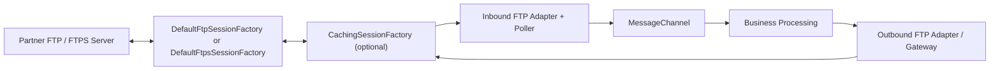

# FTP Session Factory and Server Connectivity in Spring Integration

## 1. Context and Objectives

Suppose an application needs to receive order files from a partner over FTP, pass the data into a processing workflow, and then send an acknowledgment file back to the server. In Spring Integration, the **FTP Adapter** performs the file reading/writing, while the **FTP session factory** is responsible for creating connection sessions so the adapter or gateway can interact with the remote server.

This is part of the **SPRING_INTEGRATION_ADAPTERS** module: connecting external systems using *inbound/outbound adapters*, *gateways*, *pollers*, and *MessageChannels*, while managing message contracts, errors, and connection lifecycles. Alongside FTP, the module also covers file, SFTP, HTTP, JMS, AMQP, Kafka, and databases. This lesson focuses on the FTP connectivity layer; message flow components are placed in context so you can see how the session factory serves them.

After this lesson, you will be able to:

- Distinguish between FTP, FTPS, and SFTP, and choose the right session factory type and port.
- Configure the host, credentials, data transfer mode, timeouts, and file type.
- Use `CachingSessionFactory` to reuse sessions, limit concurrent connections, and test whether sessions are still alive.
- Verify real connectivity, close/return sessions properly, and isolate connection, authentication, permission, or data transfer errors.

## 2. Where Does the Session Factory Sit in the FTP Flow?



The diagram illustrates **usage relationships**, not separate TCP connections between each box. When a remote operation is needed, the adapter/gateway borrows a `Session<FTPFile>` from `SessionFactory<FTPFile>`; this session communicates with the server. With `CachingSessionFactory`, calling `close()` on a session usually means **returning the session to the cache**, rather than always tearing down the TCP connection immediately.

| Component | Responsibility |
| --- | --- |
| `DefaultFtpSessionFactory` | Creates FTP sessions based on Apache Commons Net `FTPClient`; configures host, login, data mode, and timeouts. |
| `DefaultFtpsSessionFactory` | Creates **FTPS** (FTP protected by TLS) sessions using `FTPSClient`. |
| `Session<FTPFile>` / `FtpSession` | Represents an active session; provides `list`, `read`, `write`, `remove`, `rename`, `close`, etc. |
| `CachingSessionFactory<FTPFile>` | Wraps the underlying factory to limit and reuse sessions. |
| Inbound adapter + poller | Periodically checks/downloads remote files and sends messages into a `MessageChannel`. |
| Outbound adapter / gateway | Uses a session to upload files or execute remote manipulation commands. |
| `FtpRemoteFileTemplate` | Java API for FTP operations that automatically manages borrowing and returning/closing sessions in a callback. |

**Lifecycle distinction:** creating a `DefaultFtpSessionFactory` bean only configures how to connect; the server is not necessarily contacted when the application starts. Calling `getSession()` or executing an operation through an adapter/template forces the application to open or acquire a real connection.

## 3. Choosing the Right Protocol Before Configuring

The names are easy to confuse, but FTP, FTPS, and SFTP are **not directly interchangeable**:

| Protocol | Common Port | Security Mechanism | Corresponding Factory |
| --- | --- | --- | --- |
| FTP | TCP **21** (control channel) | Credentials and data are typically sent in cleartext; only suitable for test environments or controlled trusted networks. | `DefaultFtpSessionFactory` |
| FTPS explicit | Usually TCP **21** | Initial FTP connection upgraded to TLS via `AUTH TLS`. | `DefaultFtpsSessionFactory` with *explicit* mode. |
| FTPS implicit | Usually TCP **990** | Starts the connection directly with TLS. | `DefaultFtpsSessionFactory` with *implicit* mode. |
| SFTP | Usually TCP **22** | File transfer over SSH; completely different protocol from FTP/FTPS. | `DefaultSftpSessionFactory` from the Spring Integration SFTP module. |

A server may use a different port depending on the partner's configuration. **Do not set port 22 on `DefaultFtpSessionFactory` to connect to SFTP**: the client will still speak the FTP protocol and the handshake will fail.

FTP/FTPS typically uses **two connections**: a control channel for sending commands and a data channel for `LIST`, `RETR`, and `STOR`. In **passive** mode, the client actively connects to a data port provided by the server; this option is usually easier to deploy when the application sits behind NAT or a firewall. **Active** mode requires the server to connect back to the client, which requires corresponding network rules.

## 4. Configuring the FTP Session Factory in Java

### 4.1. Adding the Dependency and Externalizing Configuration

With Maven in a project that already uses a compatible Spring Boot BOM or Spring Integration BOM:

```xml
<dependency>
    <groupId>org.springframework.integration</groupId>
    <artifactId>spring-integration-ftp</artifactId>
</dependency>
```

Declare parameters in `application.yml`:

```yaml
partner:
  ftp:
    host: ${PARTNER_FTP_HOST}
    port: ${PARTNER_FTP_PORT:21}
    username: ${PARTNER_FTP_USER}
    password: ${PARTNER_FTP_PASSWORD}
    incoming-directory: /incoming/orders
```

The `PARTNER_FTP_*` variables should be supplied from the deployment environment or a secret manager. The `/incoming/orders` path is a path **on the FTP server**, not a path on the application's local disk.

### 4.2. Creating the Factory and Cache

```java
import org.apache.commons.net.ftp.FTP;
import org.apache.commons.net.ftp.FTPClient;
import org.apache.commons.net.ftp.FTPFile;
import org.springframework.beans.factory.annotation.Qualifier;
import org.springframework.beans.factory.annotation.Value;
import org.springframework.context.annotation.Bean;
import org.springframework.context.annotation.Configuration;
import org.springframework.integration.file.remote.session.CachingSessionFactory;
import org.springframework.integration.file.remote.session.SessionFactory;
import org.springframework.integration.ftp.session.DefaultFtpSessionFactory;
import org.springframework.integration.ftp.session.FtpRemoteFileTemplate;

@Configuration
public class PartnerFtpConfiguration {

    @Bean
    public SessionFactory<FTPFile> partnerFtpSessionFactory(
            @Value("${partner.ftp.host}") String host,
            @Value("${partner.ftp.port}") int port,
            @Value("${partner.ftp.username}") String username,
            @Value("${partner.ftp.password}") String password) {

        DefaultFtpSessionFactory target = new DefaultFtpSessionFactory();
        target.setHost(host);
        target.setPort(port);
        target.setUsername(username);
        target.setPassword(password);

        // Firewall/NAT typically works better with passive mode.
        target.setClientMode(FTPClient.PASSIVE_LOCAL_DATA_CONNECTION_MODE);
        // Preserve bytes of ZIP, PDF, CSV, image, and arbitrary files.
        target.setFileType(FTP.BINARY_FILE_TYPE);
        target.setConnectTimeout(10_000);   // ms: connection establishment
        target.setDefaultTimeout(10_000);   // ms: control socket
        target.setDataTimeout(30_000);      // ms: data transfer socket

        CachingSessionFactory<FTPFile> cache =
                new CachingSessionFactory<>(target, 5);
        cache.setSessionWaitTimeout(3_000); // ms: wait for an idle session
        cache.setTestSession(true);         // test session when borrowing from cache
        return cache;
    }

    @Bean
    public FtpRemoteFileTemplate partnerFtpTemplate(
            @Qualifier("partnerFtpSessionFactory")
            SessionFactory<FTPFile> sessionFactory) {
        return new FtpRemoteFileTemplate(sessionFactory);
    }
}
```

This example creates at most **5 concurrently active sessions** in the cache. If all 5 are currently borrowed, a sixth thread waits up to **3 seconds** for an idle session before a timeout error may occur. This is an **internal resource wait** timeout, distinct from `connectTimeout` (connecting to the server) and `dataTimeout` (data socket).

Key properties:

| Property | Meaning and Choices |
| --- | --- |
| `host`, `port` | DNS/IP and protocol port provided by the partner. |
| `username`, `password` | FTP credentials; avoid committing real values to Git or logging them. |
| `clientMode` | `FTPClient.PASSIVE_LOCAL_DATA_CONNECTION_MODE` for passive; `ACTIVE_LOCAL_DATA_CONNECTION_MODE` when infrastructure requires active. |
| `fileType` | `FTP.BINARY_FILE_TYPE` prevents byte transformation; suitable for most application exchange files. |
| `connectTimeout` | Time limit for establishing the socket connection to the server. |
| `defaultTimeout` | Control socket timeout; not the same as the total download time for an entire file. |
| `dataTimeout` | Read/write timeout on the FTP data socket; consider file size and network quality. |
| `controlEncoding` | Character encoding of the command channel/filenames when the server has special requirements; prefer standardizing on UTF-8 if both sides support it. |
| `sessionCacheSize` | Maximum number of sessions managed by the cache/pool; consider actual concurrency and server connection limits. |
| `sessionWaitTimeout` | How long to wait to borrow a session when the cache has reached its limit. |
| `testSession` | Sends a check command (FTP: `NOOP`) before reusing a cached session; reduces errors caused by the server closing idle connections. |

**No default caching:** Since Spring Integration 3.0, sessions are no longer cached automatically. Without wrapping in `CachingSessionFactory`, every borrow/close cycle may open and close a new connection. Caching reduces repeated login overhead, though it does not automatically solve all network errors and should not be scaled without bound.

## 5. Testing Connectivity and Session Lifecycle

### 5.1. Verifying with a Real Operation

A meaningful test is to **log in, list the directory the application will use**, and verify access permissions. `FtpRemoteFileTemplate` borrows a session, runs the callback, and returns/closes the session even if the operation throws an error.

```java
import org.apache.commons.net.ftp.FTPFile;
import org.springframework.beans.factory.annotation.Qualifier;
import org.springframework.beans.factory.annotation.Value;
import org.springframework.integration.ftp.session.FtpRemoteFileTemplate;
import org.springframework.stereotype.Service;

@Service
public class PartnerFtpConnectionProbe {

    private final FtpRemoteFileTemplate ftpTemplate;
    private final String incomingDirectory;

    public PartnerFtpConnectionProbe(
            @Qualifier("partnerFtpTemplate") FtpRemoteFileTemplate ftpTemplate,
            @Value("${partner.ftp.incoming-directory}") String incomingDirectory) {
        this.ftpTemplate = ftpTemplate;
        this.incomingDirectory = incomingDirectory;
    }

    // Invoke on demand for diagnostics; do not run continuously on startup.
    public int countFilesInIncomingDirectory() {
        Integer count = ftpTemplate.execute(session -> {
            FTPFile[] entries = session.list(incomingDirectory);
            return entries.length;
        });
        if (count == null) {
            throw new IllegalStateException("Did not receive FTP listing result");
        }
        return count;
    }
}
```

If the method returns `0`, the directory may simply be empty; that result **does not mean the connection failed**. If an exception occurs, check layer by layer: DNS/port → login → data channel → directory permissions. A check that only calls `isOpen()` is not enough to confirm that the `LIST` command can run over the data channel.

### 5.2. If Acquiring a Session Directly, Always Return It

```java
import java.io.IOException;
import org.apache.commons.net.ftp.FTPFile;
import org.springframework.integration.file.remote.session.Session;
import org.springframework.integration.file.remote.session.SessionFactory;

public class FtpSessionDemo {
    public int countFiles(SessionFactory<FTPFile> factory) throws IOException {
        try (Session<FTPFile> session = factory.getSession()) {
            return session.list("/incoming/orders").length;
        } // close(): returns to cache or closes the underlying session, depending on the factory
    }
}
```

Do not store a `Session` in a singleton service for threads to share; each operation should borrow its own session and return it immediately. When using `readRaw(...)`, you must close the `InputStream` **and** call `finalizeRaw()` according to the API contract before returning the session. For routine operations, prefer `FtpRemoteFileTemplate` and adapters so you do not have to manage these steps manually.

Regarding caching:

- Calling `close()` on a borrowed session returns it to the pool for another operation to reuse; the underlying connection may stay open.
- `testSession(true)` validates a session when borrowed from the pool, but does not guarantee the server will not drop the connection mid-transfer.
- `resetCache()` removes idle sessions and marks in-use sessions to be closed when returned; useful when connections need to be refreshed. If a password changes, update the corresponding factory/bean configuration first rather than only calling `resetCache()`.
- A severely broken session should be discarded; never reuse a corrupted session object by storing it in a global variable.

## 6. Wiring the Session Factory into Adapters and Gateways

FTP endpoints use the same `SessionFactory<FTPFile>` type; adapters handle **message formatting** and flow rules, while the factory handles **connectivity**.

Example business flow:

1. A **Poller** periodically triggers the inbound FTP adapter; the adapter uses the session factory to access `/incoming/orders`, filters and downloads files to a local directory, and then emits messages containing a `File` onto a `MessageChannel`.
2. A handler receives the file, validates its contents (for example CSV), transforms it into a domain object, and persists it to a database.
3. The outbound FTP adapter receives a `Message<File>` or suitable payload to upload an acknowledgment file to the server; an outbound gateway can execute commands such as `ls`, `get`, `put`, or `rm` as needed.

Conceptual configuration flow:

```text
FTP server
  → inbound adapter + poller
  → MessageChannel("incomingOrders")
  → validate / transform / persist
  → MessageChannel("outgoingAcknowledgements")
  → outbound FTP adapter
  → FTP server

            both inbound and outbound use SessionFactory<FTPFile>
```

Note the responsibilities **separate** from the session factory:

| Concern | Where to Handle It |
| --- | --- |
| How many seconds between file checks? | `Poller` configuration. |
| Should already-processed files be re-downloaded? | Remote/local file filters, persisted processing state, and idempotency strategy. |
| What are the message payload and headers? | Adapter, transformer, and `Message<?>` contract. |
| Where do data processing errors go? | Error channel, retry advice, and dead-letter/error-file storage per application architecture. |
| Maximum concurrent FTP sessions? | `CachingSessionFactory` and server connection limits. |
| Socket timeouts, TLS, passive/active? | Session factory along with network/FTP server configuration. |

**Real-world scenario:** the poller runs every 5 seconds, but the previous file download took 20 seconds. If you enable concurrent processing or also have an outbound gateway sharing a 5-session cache, tasks will compete for sessions. Choose cache size and timeouts based on the number of tasks that can run concurrently, rather than only on the poller interval.

## 7. When the Server Requires FTPS

A partner may require **FTP over TLS** to protect login credentials and file contents. In that case, replace the target factory with `DefaultFtpsSessionFactory`. Example core configuration for **explicit FTPS**:

```java
import org.apache.commons.net.ftp.FTP;
import org.apache.commons.net.ftp.FTPClient;
import org.springframework.integration.ftp.session.DefaultFtpsSessionFactory;

DefaultFtpsSessionFactory ftps = new DefaultFtpsSessionFactory();
ftps.setHost("ftps.partner.example"); // illustrative host
ftps.setPort(21);                       // explicit FTPS: typically port 21
ftps.setUsername(System.getenv("FTPS_USER"));
ftps.setPassword(System.getenv("FTPS_PASSWORD"));
ftps.setImplicit(false);
ftps.setProtocol("TLS");
ftps.setProt("P");                      // protect the data channel as well
ftps.setEndpointCheckingEnabled(true); // verify certificate hostname
ftps.setClientMode(FTPClient.PASSIVE_LOCAL_DATA_CONNECTION_MODE);
ftps.setFileType(FTP.BINARY_FILE_TYPE);
```

This is only the connection configuration and does not replace setting up a **trusted truststore/CA**, verifying the server certificate, following enterprise-approved TLS policies, and testing against the real server. Do not use a trust-all trust manager to "quick-fix" TLS errors. For **implicit FTPS**, you typically need `setImplicit(true)` and the appropriate port (usually 990), according to the partner's specification.

FTPS still uses FTP's **control/data connection** mechanism, so passive data ports still need to be allowed through the firewall. If the partner provides **SFTP/SSH**, you must use the `spring-integration-sftp` module and a dedicated SFTP session factory, along with SSH host key verification; you cannot handle it by changing the port on an FTP/FTPS factory.

## 8. Diagnosing Connection Errors

Session creation consists of dependent steps:

```text
Read configuration → DNS resolution → TCP/control connection
→ FTP banner response → USER/PASS or FTPS handshake
→ set transfer mode → open data connection on LIST/RETR/STOR
→ read/write file → return/close session
```

Knowing which step failed keeps you from mistaking a firewall issue for a password error.

| Symptom | Potential Cause | How to Check/Resolve |
| --- | --- | --- |
| `Connection refused`, `connect timed out` | Wrong host/port, firewall, server down, DNS. | Verify host/port with the partner; test TCP connectivity to the **control port** from the application's runtime environment. |
| FTP reply `530`, `Login incorrect` | Wrong username/password, locked account, or server requires another auth mechanism. | Check actual secrets, login permissions, and server logs; do not print passwords to logs. |
| Login succeeds, but `LIST`/`RETR` hangs; `425 Can't open data connection` | Data channel blocked by firewall/NAT; wrong passive/active mode or server passive port range. | Try passive mode; inspect the IP/port returned by the server and data-port firewall rules. |
| `550 File unavailable` or unable to list directory | Wrong remote path, missing permissions, file does not exist yet. | Check path relative to the FTP account's root; verify list/read/write permissions per directory. |
| Cached sessions frequently fail after idle periods | Server closes idle sessions; network path changes. | Enable `testSession(true)`, set appropriate timeouts, return sessions properly, and consider refreshing the cache. |
| `SSLHandshakeException`, FTPS certificate error | Untrusted CA, hostname mismatch, wrong TLS or implicit/explicit port configuration. | Check truststore, SAN/hostname, port, and FTPS mode; ensure data channel protection is enabled. |
| Many tasks stuck or session wait errors | Cache exhausted due to high concurrency or missing `close()`. | Monitor active session count; close/return sessions via try-with-resources/template, tune cache size and `sessionWaitTimeout`. |

During diagnostics, you can temporarily enable scoped `DEBUG` or `TRACE` logging for `org.springframework.integration.file` and related FTP components. Sanitize sensitive data and avoid logging `USER`/`PASS`, payloads, or file contents. FTP server logs and the result of `LIST` usually distinguish "login succeeded" from "data transfer succeeded."

## 9. Operational Principles

1. **Prefer secure protocols:** use FTPS with certificate validation or SFTP when allowed; plain FTP only for environments appropriate for security requirements.
2. **Apply least privilege:** inbound accounts only need list/read permissions, outbound accounts only need the corresponding write permissions; separate accounts if partner policies allow.
3. **Externalize configuration from source code:** load host, port, and credentials from configuration/secret manager; never package secrets in build artifacts.
4. **Choose passive/binary and timeouts intentionally:** verify paths for both control and data channels; do not disable timeouts to hide errors.
5. **Manage sessions as finite resources:** set appropriate cache limits, always return sessions after operations, and never share a session across threads.
6. **Account for partial failures:** a file upload may succeed on the server while the application fails to receive the response. Use temp-naming/rename-after-complete conventions, deduplication, and appropriate retries at the adapter/business-flow layer.
7. **Observe the right signals:** measure connect/login failure counts, session borrow times, data channel errors, and processed file counts; distinguish network health from business errors.

## 10. Self-Check Exercise

**Exercise:** A service receives `/incoming/orders/*.csv` from a partner's server, with at most 4 file-download tasks running concurrently. The server uses FTP on port 21, only opens passive data ports, and closes idle connections after a few minutes.

Determine:

1. Which factory and `clientMode` should be used?
2. Roughly what cache size should be configured, and why is `testSession` needed?
3. Why does a successful TCP connection test to port 21 not prove that files can be downloaded?
4. When `LIST` reports error 425, what should be checked first?
5. Should a `Session<FTPFile>` be stored as a singleton field so all 4 tasks share it?

**Answer hints:** (1) `DefaultFtpSessionFactory` with passive mode, if the infrastructure genuinely permits plain FTP; (2) cache limit around 4 or sized for total concurrency including outbound, with session testing enabled because the server closes idle connections; (3) FTP requires a separate data connection; (4) passive data ports, NAT, and firewall rules; (5) no—each task must borrow and return its own session. If encryption is required, switch to FTPS/SFTP according to the protocol the server supports.

## Knowledge Summary

- `DefaultFtpSessionFactory` and `DefaultFtpsSessionFactory` create **connections**, while adapters/gateways decide **what to read/write** and route results into a `MessageChannel`.
- `CachingSessionFactory` must be declared explicitly to reuse sessions; `testSession` helps avoid reusing dead connections.
- FTP has control and data channels: a successful login does not guarantee listing or file transfer will succeed.
- `FtpRemoteFileTemplate` or `try-with-resources` helps preserve proper session lifecycles.
- Diagnose in order: **network → authentication/TLS → data mode → file permissions → cache lifecycle** to pinpoint the root cause.

## References

- [Spring Integration — FTP Session Factory](https://docs.spring.io/spring-integration/reference/ftp/session-factory.html)
- [Spring Integration — FTP Session Caching](https://docs.spring.io/spring-integration/reference/ftp/session-caching.html)
- [Spring Integration — FTP Advanced Configuration](https://docs.spring.io/spring-integration/reference/ftp/advanced-configuration.html)
- [Spring Integration API — `CachingSessionFactory`](https://docs.spring.io/spring-integration/api/org/springframework/integration/file/remote/session/CachingSessionFactory.html)
- [Spring Integration API — `Session`](https://docs.spring.io/spring-integration/api/org/springframework/integration/file/remote/session/Session.html)
