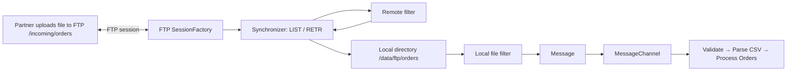
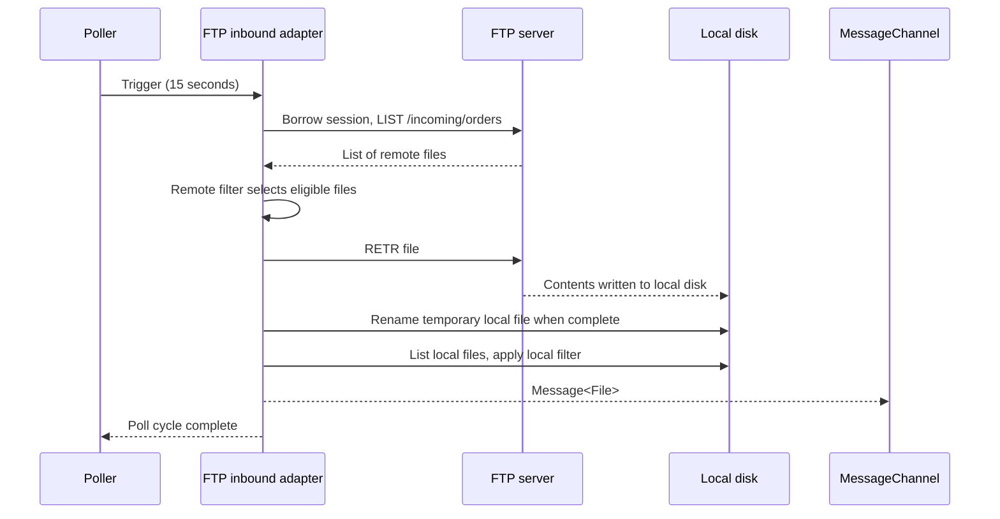

# FTP Inbound Adapter for Fetching Files from a Server

## 1. Objectives and Context

In many enterprise systems, a partner does not send orders via a REST API, but instead periodically places CSV files onto an FTP server. Our application needs to automatically detect new files, download them to a local directory, forward them into a processing pipeline, and avoid processing the same data repeatedly on every server check.

Spring Integration's **FTP inbound channel adapter** handles the *file retrieval* part: it uses a `SessionFactory` to connect to FTP, synchronizes files from a remote directory to a local directory, and then emits a **Spring Message whose payload is a `java.io.File`** for downstream components. It fits naturally into the **SPRING_INTEGRATION_ADAPTERS** module, where data flows through inbound/outbound adapters, gateways, pollers, and `MessageChannel`s to integrate external systems (files, SFTP, HTTP, JMS, AMQP, Kafka, databases) while handling message contracts, errors, and connection lifecycles.

This lesson belongs to the **FTP Adapter** chapter and focuses on *fetching files from a server* using the inbound adapter. After this lesson, you will be able to:

- Explain the two steps: **remote → local synchronization** and **emitting messages from local files**.
- Configure `SessionFactory<FTPFile>`, remote/local directories, and a **poller** using the Java DSL.
- Combine filename pattern filters with state-tracking filters to reduce re-downloading or re-emitting files.
- Handle files still being uploaded/downloaded, duplicates, retries, connection errors, and access permissions.
- Distinguish the inbound FTP adapter from the *streaming inbound adapter*, outbound FTP adapter, and FTP gateway.

## 2. Flow of the Inbound Adapter



The diagram depicts the **data flow**, not a separate FTP connection per step. The adapter uses the factory to borrow a session when synchronizing and closes/returns the session afterward.

An inbound FTP adapter typically involves **two distinct stages**:

1. **Remote synchronization:** inspects the FTP directory, selects eligible files via the *remote filter*, and downloads them locally over FTP (commands typically involving `LIST` and `RETR`). During download, the framework can use a temporary local suffix and rename to the final filename once complete.
2. **Local message emission:** the local file-reading source applies a *local filter* and then emits a `Message<File>` onto the channel. Downstream components open and process the file themselves.

This separation matters: **finishing a file download does not mean business processing succeeded**. If the CSV parser or database write fails, the file may still remain in the local directory. You must design retries, idempotency, and a mechanism to archive or quarantine failed files for inspection.

| Component | Role | Example Decision |
| --- | --- | --- |
| FTP server | Stores files provided by the partner | `/incoming/orders/order-2026-11-23.csv` |
| `SessionFactory<FTPFile>` | Creates or reuses FTP connections | Host, port, credentials, passive mode, timeouts |
| Remote file filter | Selects which files to **download** | Only `*.csv`, exclude already-received files |
| File synchronizer | Downloads from FTP to local disk | Download under a temp name, then rename |
| Local file filter | Selects which files to **emit as messages** | Do not re-emit previously emitted files |
| Poller | Triggers checks on a schedule | Every 15 seconds |
| `MessageChannel` | Passes messages to downstream handlers | `ftpIncomingOrders` |
| Business handler | Validates, parses, and persists data | CSV → domain order object → DB |

## 3. Preparing the Server, Dependencies, and Configuration

### 3.1. Server-Side Prerequisites

Suppose the partner has provided:

- Hostname `ftp.partner.example`, FTP control port 21 (for illustration only).
- An account with permissions to **log in, list the directory, and read files** in `/incoming/orders`.
- A convention for publishing completed files: upload as `*.uploading`, and once upload completes, **rename** to `*.csv`.
- Firewall/NAT rules allowing both the control channel and **passive data channel**. A successful TCP connection to port 21 alone does not prove `LIST` or `RETR` will work.

Plain FTP generally transmits passwords and data unencrypted. In environments with sensitive data, use **FTPS** or **SFTP** according to the actual partner agreement. FTPS uses an FTP-over-TLS factory; SFTP is a separate SSH-based protocol that requires Spring Integration SFTP rather than switching the FTP port to 22.

### 3.2. Adding Dependencies

For a Spring Boot project using a compatible BOM, Maven example:

```xml
<dependencies>
    <dependency>
        <groupId>org.springframework.boot</groupId>
        <artifactId>spring-boot-starter-integration</artifactId>
    </dependency>
    <dependency>
        <groupId>org.springframework.integration</groupId>
        <artifactId>spring-integration-ftp</artifactId>
    </dependency>
</dependencies>
```

If your project does not use the Spring Boot BOM, align Spring Integration module versions with the appropriate BOM. Do not arbitrarily mix versions of `spring-integration-core`, `spring-integration-file`, and `spring-integration-ftp`.

Externalize parameters by environment instead of hardcoding secrets:

```yaml
partner:
  ftp:
    host: ${PARTNER_FTP_HOST}
    port: ${PARTNER_FTP_PORT:21}
    username: ${PARTNER_FTP_USER}
    password: ${PARTNER_FTP_PASSWORD}
    remote-directory: /incoming/orders
    local-directory: /data/ftp/orders
```

**Note on the two paths:** `remote-directory` resides on the FTP server; `local-directory` resides on the filesystem of the Spring Boot process or container itself. When running on Docker/Kubernetes, ensure the local directory exists or can be created, is writable, and has sufficient disk space. If state must survive restarts, actively manage persistent volumes and the metadata store as well.

## 4. Java DSL Configuration: Periodically Receiving CSV Files

The following example uses the modern Spring Integration Java DSL. `Ftp.inboundAdapter(...)` is the DSL factory that creates the file-receiving endpoint, while `IntegrationFlow.from(..., e -> e.poller(...))` attaches the polling schedule. The code assumes a Spring Boot application with Spring Integration enabled via the starter.

### 4.1. Creating the FTP Session Factory

```java
import org.apache.commons.net.ftp.FTP;
import org.apache.commons.net.ftp.FTPClient;
import org.apache.commons.net.ftp.FTPFile;
import org.springframework.beans.factory.annotation.Value;
import org.springframework.context.annotation.Bean;
import org.springframework.context.annotation.Configuration;
import org.springframework.integration.file.remote.session.CachingSessionFactory;
import org.springframework.integration.file.remote.session.SessionFactory;
import org.springframework.integration.ftp.session.DefaultFtpSessionFactory;

@Configuration
public class OrdersFtpSessionConfig {

    @Bean("ordersFtpSessionFactory")
    public SessionFactory<FTPFile> ordersFtpSessionFactory(
            @Value("${partner.ftp.host}") String host,
            @Value("${partner.ftp.port}") int port,
            @Value("${partner.ftp.username}") String username,
            @Value("${partner.ftp.password}") String password) {

        DefaultFtpSessionFactory target = new DefaultFtpSessionFactory();
        target.setHost(host);
        target.setPort(port);
        target.setUsername(username);
        target.setPassword(password);

        target.setClientMode(FTPClient.PASSIVE_LOCAL_DATA_CONNECTION_MODE);
        target.setFileType(FTP.BINARY_FILE_TYPE);
        target.setConnectTimeout(10_000); // ms
        target.setDefaultTimeout(10_000); // ms
        target.setDataTimeout(30_000);    // ms

        CachingSessionFactory<FTPFile> cache =
                new CachingSessionFactory<>(target, 4);
        cache.setSessionWaitTimeout(3_000);
        cache.setTestSession(true);
        return cache;
    }
}
```

`PASSIVE_LOCAL_DATA_CONNECTION_MODE` usually suits clients behind NAT/firewalls; `BINARY_FILE_TYPE` preserves bytes for CSV, ZIP, images, and binary files. A cache limit of four sessions here is illustrative only and should be tuned based on concurrency and FTP server limits.

**Distinguishing the timeouts:** `connectTimeout` bounds connection establishment, `dataTimeout` applies to the FTP data transfer socket, and `sessionWaitTimeout` bounds how long to wait for a session from the pool when all sessions are busy. Do not rely on a single timeout to cover everything.

### 4.2. Declaring Filters and the Inbound Flow

```java
import java.io.File;
import java.time.Duration;
import org.apache.commons.net.ftp.FTPFile;
import org.springframework.beans.factory.annotation.Qualifier;
import org.springframework.beans.factory.annotation.Value;
import org.springframework.context.annotation.Bean;
import org.springframework.context.annotation.Configuration;
import org.springframework.integration.channel.DirectChannel;
import org.springframework.integration.dsl.IntegrationFlow;
import org.springframework.integration.dsl.Pollers;
import org.springframework.integration.file.filters.ChainFileListFilter;
import org.springframework.integration.file.filters.FileSystemPersistentAcceptOnceFileListFilter;
import org.springframework.integration.file.remote.session.SessionFactory;
import org.springframework.integration.ftp.dsl.Ftp;
import org.springframework.integration.ftp.filters.FtpPersistentAcceptOnceFileListFilter;
import org.springframework.integration.ftp.filters.FtpSimplePatternFileListFilter;
import org.springframework.integration.metadata.ConcurrentMetadataStore;
import org.springframework.integration.metadata.SimpleMetadataStore;
import org.springframework.messaging.MessageChannel;

@Configuration
public class OrdersFtpInboundConfig {

    @Bean("ftpIncomingOrders")
    public MessageChannel ftpIncomingOrders() {
        return new DirectChannel();
    }

    // For illustration only. SimpleMetadataStore data is lost when the application restarts.
    @Bean("ordersFtpMetadataStore")
    public ConcurrentMetadataStore ordersFtpMetadataStore() {
        return new SimpleMetadataStore();
    }

    @Bean
    public IntegrationFlow ordersFtpInboundFlow(
            @Qualifier("ordersFtpSessionFactory")
            SessionFactory<FTPFile> sessionFactory,
            @Qualifier("ordersFtpMetadataStore")
            ConcurrentMetadataStore metadataStore,
            @Value("${partner.ftp.remote-directory}") String remoteDirectory,
            @Value("${partner.ftp.local-directory}") String localDirectory) {

        // Order matters: filter for the .csv extension first, then record the file.
        ChainFileListFilter<FTPFile> remoteFilter = new ChainFileListFilter<>();
        remoteFilter.addFilter(new FtpSimplePatternFileListFilter("*.csv"));
        remoteFilter.addFilter(
                new FtpPersistentAcceptOnceFileListFilter(
                        metadataStore, "orders-remote:"));

        return IntegrationFlow.from(
                Ftp.inboundAdapter(sessionFactory)
                        .remoteDirectory(remoteDirectory)
                        .localDirectory(new File(localDirectory))
                        .autoCreateLocalDirectory(true)
                        .temporaryFileSuffix(".downloading")
                        .preserveTimestamp(true)
                        .filter(remoteFilter)
                        .localFilter(
                                new FileSystemPersistentAcceptOnceFileListFilter(
                                        metadataStore, "orders-local:")),
                endpoint -> endpoint.poller(
                        Pollers.fixedDelay(Duration.ofSeconds(15))
                                .maxMessagesPerPoll(5)))
                .channel("ftpIncomingOrders")
                .get();
    }
}
```

Explanation of each key setting:

| Setting | Effect |
| --- | --- |
| `remoteDirectory("/incoming/orders")` | Source directory on FTP to list and download files from. |
| `localDirectory(new File("/data/ftp/orders"))` | Location where newly downloaded copies are stored in the application. |
| `autoCreateLocalDirectory(true)` | Creates the local directory if missing; OS/container write permissions are still required. |
| `temporaryFileSuffix(".downloading")` | Uses a temporary filename while downloading locally before renaming to the final name. |
| `preserveTimestamp(true)` | Preserves the remote modification timestamp on the local file during synchronization. |
| `filter(remoteFilter)` | Applies the **remote file** filter before downloading. |
| `localFilter(...)` | Selects which local files can be emitted as messages. |
| `Pollers.fixedDelay(Duration.ofSeconds(15))` | After each poll completes, waits roughly 15 seconds before the next poll on the same trigger. |
| `maxMessagesPerPoll(5)` | Limits the number of **messages emitted per poll**; do not confuse this with a hard cap on how many files are synchronized locally in that pass. |
| `channel("ftpIncomingOrders")` | Sends messages containing `File` to the downstream handler. |

When a complete `order-42.csv` is downloaded, the consumer on `ftpIncomingOrders` receives a `Message<File>`; `message.getPayload()` is the `File` pointing to the local copy. The adapter **does not parse CSV, perform business validation, or write to a DB on its own**.

### 4.3. Attaching a Business Handler

Simple example:

```java
import java.io.File;
import org.springframework.integration.annotation.ServiceActivator;
import org.springframework.messaging.Message;
import org.springframework.stereotype.Component;

@Component
public class OrderFileConsumer {

    @ServiceActivator(inputChannel = "ftpIncomingOrders")
    public void process(Message<File> message) {
        File downloadedFile = message.getPayload();
        // 1. Validate filename, file type, and CSV format.
        // 2. Parse records and validate business rules.
        // 3. Use a business key (e.g., partnerId + orderId) to prevent duplicate writes.
        // 4. Persist to DB, record the outcome, and store/archive the file per policy.
        System.out.println("Downloaded: " + downloadedFile.getName());
    }
}
```

This consumer demonstrates receiving `Message<File>`, **not a complete order-processing implementation**. In a production system, replace `System.out.println` with a business service, idempotency checks, and sanitized logging. If the handler moves or deletes the file, coordinate the archive step and processing state carefully so it does not interfere with the local filter.

## 5. Two Filter Layers: Remote and Local

The distinction between these two filter layers determines whether the system re-emits files after a restart.

| Question | Remote filter | Local filter |
| --- | --- | --- |
| What data does it inspect? | List of `FTPFile` entries from the server | List of `java.io.File` entries on local disk |
| When does it intervene? | Before syncing files from FTP | Before emitting `Message<File>` |
| Example | Accept only `*.csv` not previously downloaded | Emit only local files not previously emitted |
| Without durable state | May re-download files on restart if the filter is in-memory only | May re-emit existing local files on restart |
| Metadata filter to use | `FtpPersistentAcceptOnceFileListFilter` | `FileSystemPersistentAcceptOnceFileListFilter` |

### 5.1. Pattern Filter First, Persistent Filter Second

`FtpSimplePatternFileListFilter("*.csv")` accepts names ending in `.csv`. The server should not publish `order.csv` **before** the upload completes, because the adapter could see an incomplete file. A workable agreement between both sides is:

1. Partner uploads `order-42.csv.uploading`.
2. Partner verifies the upload succeeded.
3. Partner performs an atomic rename within the same filesystem/server to `order-42.csv`.
4. The inbound adapter only selects `*.csv` for download.

The **local** `.downloading` suffix in the Java example does not solve the case where the partner is still uploading the **remote** file. Those two temporary suffixes protect opposite ends.

To apply the pattern filter and then the persistent filter in sequence, the example uses `ChainFileListFilter`. A chain feeds the output of one filter into the next, so the persistent filter only sees filenames that already passed `*.csv`. If you want to filter by modified date, file size, or `.done` marker files, design the rules around what the server supports and agree on them with the publisher.

### 5.2. Remembering Received Files

`FtpPersistentAcceptOnceFileListFilter` can persist state through a `ConcurrentMetadataStore` under a dedicated prefix. "Already received" depends on the remote key/attributes observed by the filter, **not on whether business processing succeeded**. If the server overwrites the contents of an existing filename, filtering behavior also depends on file attributes (such as modification timestamp) returned by the FTP server.

Using `SimpleMetadataStore` in the example is easy to learn, but it **is not durable across restarts**. Production systems must choose an appropriate metadata store to retain state across restarts; if multiple instances scan the same FTP directory, use a shared metadata store that supports concurrent operations and also guard against two instances competing to process the same file.

The prefixes `orders-remote:` and `orders-local:` are kept separate to avoid mixing keys between the two filters. Never casually reuse a single prefix across multiple partners, directories, or applications.

### 5.3. File Duplicates Differ from Business Duplicates

Suppose `order-42.csv` was downloaded and emitted as a message, but the DB service fails after inserting part of the data. When the poller runs again, the metadata store may stop the adapter from re-emitting the message; **the filter does not automatically retry failed business records**. Conversely, if metadata is lost, the same file may be re-emitted, so you must have safeguards against creating duplicate orders.

Therefore, separate the two layers:

- **File infrastructure:** filtering, synchronization, remote/local tracking, network error retries.
- **Business layer:** unique-key checks, proper transactions, `RECEIVED / PROCESSING / COMPLETED / FAILED` states, controlled retries, and retaining failed files.

**End-to-end exactly-once is not guaranteed solely by the inbound adapter or an accept-once filter.** When consistent results are required, build idempotency at the point where business data is persisted.

## 6. Understanding Pollers and Throughput

FTP is an external system that is **polled**: the server does not normally push a Spring Message into your application the moment a new file arrives. The poller only determines when the application checks.



This is the logical sequence. Exact counts of `LIST`/`RETR` calls, buffering, and when sessions are closed may depend on synchronizer configuration.

**Fixed delay vs. fixed rate:** `fixedDelay(15s)` waits a fixed delay after the previous execution finishes; `fixedRate(15s)` tries to maintain a periodic start cadence. When FTP is slow or files are large, fixed delay is usually easier to throttle safely. A 15-second schedule **does not mean** a file will always reach downstream within 15 seconds: sync duration, queuing, processing time, and network errors all add up.

**Max messages per poll:** with `maxMessagesPerPoll(5)`, one poll emits at most 5 messages from the local source. FTP synchronization may have already brought more than 5 files to local disk; remaining files wait to be emitted on subsequent polls. If you need to cap how many files are fetched from remote per sync cycle, check the fetch/batch settings supported by your adapter version rather than assuming `maxMessagesPerPoll` does that.

**Concurrency:** a session cache of 4 sessions **does not automatically make the poller process four files in parallel**. Concurrency is governed by scheduler, channel, executor, and downstream thread configuration. When increasing concurrency, measure server capacity and prevent two poll executions from racing over the same set of files.

## 7. Error Handling, Retries, and Incomplete Files

| Scenario | Common Symptom | Appropriate Handling |
| --- | --- | --- |
| Wrong host/port or firewall | `Connection refused`, connect timeout | Verify DNS, FTP control port from the runtime environment, and server configuration. |
| Invalid credentials | FTP reply `530` or login failure | Check secrets, account status, and permissions; never log passwords. |
| Login succeeds, `LIST`/`RETR` fails | `425 Can't open data connection`, hangs on download | Verify passive mode, data ports, NAT/firewall rules, and FTP server settings. |
| Directory missing or lacking permissions | `550` error, unable to list directory | Check remote path, list/read permissions, and the user's home/root directory on the server. |
| Partner is still uploading `*.csv` | Truncated CSV lines, size changes between checks | Agree on temp-name upload + rename, or a completion marker file. |
| Connection drops mid-download | Partial local file, exception | Use a local temporary suffix, timeouts, and controlled retries; never read before rename to the final name. |
| Cached session closed by server for idling | First poll after an idle period fails | Enable `testSession`, configure timeouts, and refresh broken sessions. |
| Old files re-emitted after restart | In-memory metadata store lost or local filter not persistent | Use a persistent metadata store, separate remote/local keys, and retain business idempotency. |
| Local directory runs out of space | Disk full, unable to write/rename file | Monitor disk/volume usage, pause or throttle sync, clean up/archive per policy. |
| Malformed CSV, DB unavailable | File downloaded, handler throws exception | Route errors to retry/quarantine flow; do not delete the file on FTP by default just to cope. |

### 7.1. Defining Error Handling Boundaries

In Spring Integration, errors can occur at several boundaries:

- **FTP transfer:** login, `LIST`, `RETR`, or connection drop errors. These usually arise inside the poller task; configure logging, error handling, and retries at the appropriate source endpoint.
- **Message delivery:** downstream channel/handler is unavailable or processing fails. Having the file on local disk does not confirm business success.
- **Business transaction:** the file is technically valid, but contains invalid records or key conflicts; provide detailed reporting, quarantine, or line-by-line handling according to the contract.

Do not assume every exception automatically goes to an error channel you have not configured. For polling endpoints, explicitly define the **error channel** and the poller's error-handling strategy according to your application architecture. Distinguish retryable errors (transient network drops, busy server) from errors requiring intervention (invalid credentials, malformed files).

### 7.2. Should You Delete Remote Files After Downloading?

The inbound synchronizer has an option to manage remote files after retrieval, **but you should not enable remote deletion just to avoid duplicates**. Successfully downloading locally and successfully committing to the DB are two different events. If remote files are deleted immediately after download, a downstream failure can make recovery difficult.

Only delete or move remote files if both sides have explicitly agreed on when receipt is acknowledged, retention periods, and replay procedures. A common strategy is to keep source files for a retention window while the application tracks processed filenames and order keys.

### 7.3. Temporary Names and Outcome Tracking

Suppose the partner plans to send `order-123.csv`. A safer timeline looks like this:

```text
Partner:
  order-123.csv.uploading  --(upload complete, rename)-->  order-123.csv

Application:
  FTP /incoming/orders/order-123.csv
       --(download locally with temp name)-->
  /data/ftp/orders/order-123.csv.downloading
       --(download complete, rename)-->
  /data/ftp/orders/order-123.csv
       --(Message<File>)-->
  Validate → Parse → Persist → COMPLETED / FAILED
```

The diagram highlights **two independent renames**: one performed by the partner to publish a completed remote file, and one performed by the application to publish a fully downloaded local file. Depending on the filesystem/FTP server, rename behavior and timestamps have specific limitations; verify them in a real environment before relying on them as an atomic guarantee.

## 8. When to Use a Streaming Inbound Adapter or Gateway?

| Option | Output Received | Best Suited When |
| --- | --- | --- |
| **FTP inbound adapter (local sync)** | `Message<File>` referencing local copy | You need the file on disk for parsing, re-inspection, archiving, or recovery after errors. |
| **FTP streaming inbound adapter** | `InputStream` content from the remote connection | You want to stream data directly and avoid staging the entire file on local disk; the handler must manage resource cleanup and session hold time. |
| **FTP inbound gateway** | Response for an executed FTP command (e.g., list/get) | You want explicit control over requests and request–reply result handling. |
| **FTP outbound adapter** | Receives messages from the app to **upload files** to the server | The application needs to send output files outward. |

With streaming inbound, streams and sessions must be released per the framework's contract; slow reads can keep a session pinned in the pool. The local-sync adapter uses extra disk space but simplifies recovery and asynchronous processing after download.

**Do not mix protocol names:** an FTP inbound file adapter is not an SFTP adapter; if the partner only provides SFTP over SSH, use the corresponding SFTP module. General concepts around pollers, filters, messages, and idempotency still apply, but the connection layer and authentication differ.

## 9. Testing and Production Operations

### 9.1. Minimum Test Scenarios

A meaningful integration test should run against a test FTP server (or a managed test server/container), not just a mocked factory. Set up a remote directory, credentials, and sample data; verify:

| Scenario | Expectation |
| --- | --- |
| Remote has valid `order-a.csv` | File is downloaded locally and emits one `Message<File>`; handler reads exact bytes. |
| Remote has `readme.txt` | Not downloaded due to `*.csv` filter. |
| Remote has `order-b.csv.uploading` | No message emitted yet; once renamed to `order-b.csv`, it is picked up. |
| Poller runs multiple times with unchanged files | File is not re-emitted while filter state persists. |
| Application restarts with persistent metadata store | Previously recorded files are not re-emitted under the active policy. |
| Metadata store cleared then restarted | File may be re-emitted; DB layer still prevents duplicate orders. |
| Connection drops mid-`RETR` | Downstream does not treat a partial local file as valid/complete. |
| Account lacks `LIST`/`RETR` permission | Clear diagnostic error, not falsely reported as an empty directory. |
| Local disk full | Logged/metered/alerted; incomplete files are not marked processed. |

### 9.2. Metrics to Monitor

Track poll counts, poll duration, successfully downloaded file count/bytes, connection/authentication/I/O errors, session cache wait time, local disk space, backlog of unprocessed files, and end-to-end latency from when a file appears on FTP to DB commit.

Configure alerts when **no new files arrive for an unusually long time** relative to the expected schedule, or when the backlog of unprocessed local files grows steadily. Log with correlation IDs such as filename and partner ID (with sensitive data scrubbed), and never log usernames/passwords or full order payloads.

### 9.3. Pre-Production Checklist

1. **File delivery contract:** agree on filenames, encoding, CSV layout, timestamp format, temporary names, completion signaling, and re-delivery handling.
2. **Recoverability:** persistent metadata store, backup/local volume, archive policy, and retry/quarantine workflow.
3. **Permissions and security:** least-privilege accounts, FTPS/SFTP where appropriate, secret manager, firewall rules for control/data channels.
4. **Performance:** poll interval, cache size, concurrency, bandwidth, FTP server limits, local storage capacity.
5. **Data correctness:** completeness checks, business-key deduplication, DB transactions, and file status tracking.

## 10. Applied Exercise

**Prompt:** A partner sends `*.csv` files into `/exports/orders` every 30 minutes. Uploads sometimes take 10 minutes. The application runs two replicas on Kubernetes, and each file can contain up to 100,000 orders. You want to ensure files still being uploaded are never processed and no duplicate orders are created when one replica or the entire cluster restarts.

**Questions:**

1. Why is `FtpSimplePatternFileListFilter("*.csv")` alone insufficient if the partner uploads directly under the `.csv` name?
2. How do the responsibilities of the remote filter and local filter differ?
3. Is `SimpleMetadataStore` suitable for surviving restarts or sharing across two replicas?
4. Does `maxMessagesPerPoll(5)` guarantee that at most 5 files are downloaded per poll?
5. If a file downloads completely but the DB fails at record 10,000, what must the system do so it can retry without duplicating orders 1–9,999?

**Answer hints:** (1) The `.csv` file can appear while incomplete; require the partner to upload under a temp name then rename, or use a completion marker. (2) The remote filter decides what to download; the local filter decides what to emit as messages. (3) No; use a durable, shared metadata store and coordinate replicas so they do not race on the same files. (4) No, it caps messages emitted per poll. (5) Use an appropriate transaction/batch strategy, idempotent business keys, file state tracking, and monitored retries/quarantine; never treat the adapter's accept-once state as a DB commit confirmation.

## Summary

- The FTP inbound adapter **syncs remote files to local disk**, then emits `Message<File>` onto a `MessageChannel`.
- `SessionFactory` manages connectivity; `poller` triggers checks; the **remote filter** chooses files to download; the **local filter** chooses files to emit.
- A remote file still being uploaded and a local file partially downloaded are **two separate problems**: coordinate temp names/renames at both ends.
- A metadata store only tracks filter state; final correctness requires **business idempotency**, a retry strategy, and explicit outcome tracking.
- Test against a real FTP server in a staging/test environment to catch passive data connection, permission, restart, and interrupted transfer issues.

## References

- [Spring Integration Reference — FTP Support](https://docs.spring.io/spring-integration/reference/ftp.html)
- [Spring Integration Reference — FTP Inbound Channel Adapter](https://docs.spring.io/spring-integration/reference/ftp/inbound.html)
- [Spring Integration Reference — FTP Session Factory](https://docs.spring.io/spring-integration/reference/ftp/session-factory.html)
- [Spring Integration Reference — FTP Session Caching](https://docs.spring.io/spring-integration/reference/ftp/session-caching.html)
- [Spring Integration API — FTP DSL](https://docs.spring.io/spring-integration/api/org/springframework/integration/ftp/dsl/Ftp.html)
