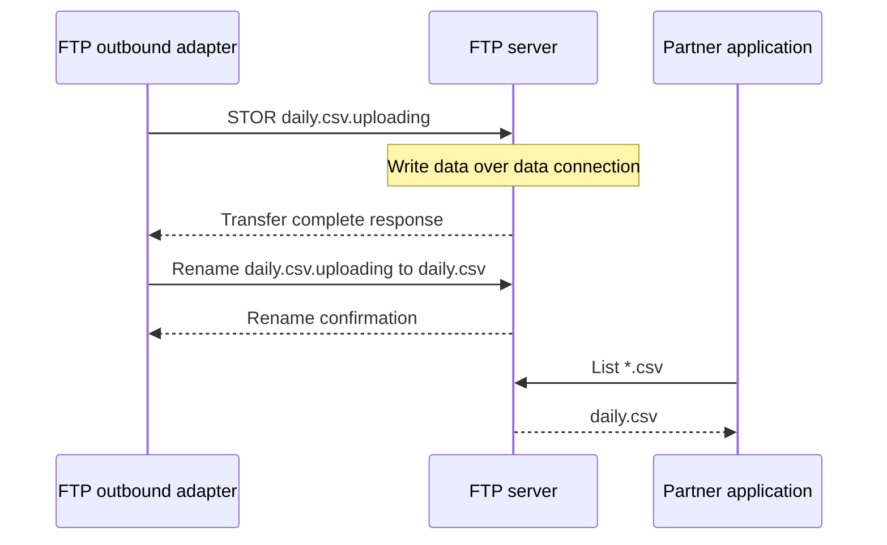

# FTP Outbound Adapter for Uploading Files to a Server

## 1. Problem Statement and Objectives

An accounting service exports a reconciliation report as a CSV file at the end of the day. The partner requires the application to **upload the file to an FTP server** at `/incoming/reports`; their system polls the directory for further processing. Instead of manually writing `FTPClient.connect()`, `login()`, `storeFile()`, and managing sessions in every service, we can use Spring Integration's **FTP outbound channel adapter**.

In the **SPRING_INTEGRATION_ADAPTERS** module, inbound/outbound adapters, gateways, pollers, and `MessageChannel`s connect the application with external systems such as files, SFTP, HTTP, JMS, AMQP, Kafka, and databases. This lesson in the **FTP Adapter** chapter focuses on the **application → FTP server** direction and how to ensure message contracts, connectivity, file writing, and error handling on the outbound path.

After this lesson, you will be able to:

1. Distinguish the **outbound adapter** from the inbound adapter and outbound gateway.
2. Set up a `SessionFactory<FTPFile>` and an `IntegrationFlow` that uploads a `File` to FTP using the Java DSL.
3. Configure the target directory, filename, passive/binary FTP modes, temporary names, and existing-file handling.
4. Understand when an upload operation completes, when errors are thrown, and why retries/idempotency must be designed explicitly.
5. Verify uploads through realistic tests and diagnose common failures.

## 2. How Does the Outbound Adapter Work?


An **outbound channel adapter** is a **one-way** endpoint (outgoing messages). It receives a message from a `MessageChannel`, borrows an FTP connection using `SessionFactory`, and transfers the payload to a remote directory. The adapter does not generate the CSV file itself; producing the content, performing business checks, and deciding when to send belong to upstream steps.

When the payload is a `java.io.File`, the adapter reads data from the file **on the Java process's filesystem**, writes it to FTP, and returns/closes the session according to the factory configuration. By default, the remote filename can be derived from the `File` payload or the handler's naming mechanism; when a specific naming contract is required, configure `fileNameGenerator` explicitly.

| Component | Responsibility | Example |
| --- | --- | --- |
| Producer | Generates content and decides to send | `daily-2026-11-23.csv` |
| `Message<File>` | Data contract between producer and adapter | Payload points to a local file that is closed and completely written |
| `MessageChannel` | Delivers messages to the handler | `ftpOutboundRequests` |
| FTP outbound adapter | Performs file **upload** | FTP `STOR`, optionally renaming after upload |
| `SessionFactory<FTPFile>` | Creates/reuses FTP sessions | Host, user, timeouts, passive mode |
| FTP server | Stores files in the partner's designated directory | `/incoming/reports` |
| Partner consumer | Polls and processes delivered files | Partner's data ingestion pipeline |

Distinguishing easily confused endpoints:

| Endpoint Type | Direction | Meaning |
| --- | --- | --- |
| **FTP inbound adapter** | Server → application | Polls FTP, downloads files locally, emits `Message<File>` |
| **FTP outbound adapter** | Application → server | Receives messages, uploads payload to FTP; no business reply returned |
| **FTP outbound gateway** | Application ↔ server | Executes FTP commands in request–reply style (e.g., `ls`, `get`, `put`, `rm`) |
| **FTP streaming inbound adapter** | Server → application | Reads content as a stream; requires special care for session/stream lifecycle |

A `MessageChannel` does not mean every message runs asynchronously: with `DirectChannel`, the handler typically runs **directly on the sender's thread**; with an executor, queue, or broker-backed channel, completion semantics and error handling differ.

## 3. Environment Setup

### 3.1. Dependencies

Maven example for a Spring Boot application using a compatible BOM to align Spring Integration versions:

```xml
<dependencies>
    <dependency>
        <groupId>org.springframework.boot</groupId>
        <artifactId>spring-boot-starter-integration</artifactId>
    </dependency>
    <dependency>
        <groupId>org.springframework.integration</groupId>
        <artifactId>spring-integration-ftp</artifactId>
    </dependency>
</dependencies>
```

If you do not use the Spring Boot BOM, use an appropriate Spring Integration BOM to avoid mixing versions of `spring-integration-core`, `spring-integration-file`, and `spring-integration-ftp`.

### 3.2. Contract with the FTP Server

Before implementing, agree with the partner on:

- **Host/port**: for example `ftp.partner.example:21`; this is an illustrative address only.
- **Account permissions**: `STOR` permission in `/incoming/reports`, plus **rename** permission in that directory if using temporary names; if the adapter must create directories, corresponding permissions are required.
- **Naming rules**: final filename, extension, encoding, timezone, and whether re-sending the same name is allowed.
- **Completed-file publishing rule**: partner ignores temporary names like `*.uploading` and only reads `*.csv`.
- **Duplicate file policy**: overwrite, reject, or use a unique name per version/batch.
- **Network constraints**: FTP uses both control and data connections, typically requiring a passive port range configured in firewalls/NAT.

Plain FTP transmits credentials and data unencrypted. Use **FTPS** or **SFTP** when the agreement requires data protection. FTPS is still FTP with TLS, whereas SFTP uses the SSH protocol and a different Spring Integration module; changing port 21 to 22 does not turn FTP into SFTP.

### 3.3. Application Configuration

```yaml
# application.yml
partner:
  ftp:
    host: ${PARTNER_FTP_HOST}
    port: ${PARTNER_FTP_PORT:21}
    username: ${PARTNER_FTP_USER}
    password: ${PARTNER_FTP_PASSWORD}
    remote-directory: /incoming/reports
```

Never place real passwords in source code, deployment docs, or logs. Supply environment variables or secrets through a secret management system. The `/incoming/reports` directory is **on the FTP server**; the path of the `File` payload on the application side is separate.

## 4. Complete Example: Sending a `File` from the Application

The example below uses the Spring Integration Java DSL so you can trace the full path: service sends message → `DirectChannel` → outbound adapter → FTP.

### 4.1. Initializing the Session Factory

```java
import org.apache.commons.net.ftp.FTP;
import org.apache.commons.net.ftp.FTPClient;
import org.apache.commons.net.ftp.FTPFile;
import org.springframework.beans.factory.annotation.Value;
import org.springframework.context.annotation.Bean;
import org.springframework.context.annotation.Configuration;
import org.springframework.integration.file.remote.session.CachingSessionFactory;
import org.springframework.integration.file.remote.session.SessionFactory;
import org.springframework.integration.ftp.session.DefaultFtpSessionFactory;

@Configuration
public class PartnerFtpConnectionConfiguration {

    @Bean("partnerFtpSessionFactory")
    public SessionFactory<FTPFile> partnerFtpSessionFactory(
            @Value("${partner.ftp.host}") String host,
            @Value("${partner.ftp.port}") int port,
            @Value("${partner.ftp.username}") String user,
            @Value("${partner.ftp.password}") String password) {

        DefaultFtpSessionFactory target = new DefaultFtpSessionFactory();
        target.setHost(host);
        target.setPort(port);
        target.setUsername(user);
        target.setPassword(password);
        target.setClientMode(FTPClient.PASSIVE_LOCAL_DATA_CONNECTION_MODE);
        target.setFileType(FTP.BINARY_FILE_TYPE);
        target.setConnectTimeout(10_000); // ms
        target.setDefaultTimeout(10_000); // ms
        target.setDataTimeout(30_000);    // ms

        CachingSessionFactory<FTPFile> cache =
                new CachingSessionFactory<>(target, 4);
        cache.setSessionWaitTimeout(3_000);
        cache.setTestSession(true);
        return cache;
    }
}
```

`DefaultFtpSessionFactory` creates FTP sessions; `CachingSessionFactory` reuses sessions and limits concurrent borrowed sessions. `setTestSession(true)` verifies that a session borrowed from the cache is still usable after sitting idle. Depending on network conditions, errors can still occur **after** the session passes the check, during the file transfer itself.

`FTP.BINARY_FILE_TYPE` is used for CSV, PDF, ZIP, images, and other files to preserve exact bytes. `PASSIVE_LOCAL_DATA_CONNECTION_MODE` usually works well for applications running in containers or behind NAT/firewalls; however, firewall rules for the server's passive data ports are still required.

### 4.2. Declaring the Channel and Outbound Flow

```java
import org.apache.commons.net.ftp.FTPFile;
import org.springframework.beans.factory.annotation.Qualifier;
import org.springframework.beans.factory.annotation.Value;
import org.springframework.context.annotation.Bean;
import org.springframework.context.annotation.Configuration;
import org.springframework.integration.channel.DirectChannel;
import org.springframework.integration.dsl.IntegrationFlow;
import org.springframework.integration.file.remote.session.SessionFactory;
import org.springframework.integration.file.support.FileExistsMode;
import org.springframework.integration.ftp.dsl.Ftp;
import org.springframework.messaging.MessageChannel;

@Configuration
public class PartnerFtpOutboundConfiguration {

    @Bean("ftpOutboundRequests")
    public MessageChannel ftpOutboundRequests() {
        return new DirectChannel();
    }

    @Bean
    public IntegrationFlow ftpOutboundFlow(
            @Qualifier("ftpOutboundRequests") MessageChannel requests,
            @Qualifier("partnerFtpSessionFactory")
            SessionFactory<FTPFile> sessionFactory,
            @Value("${partner.ftp.remote-directory}") String remoteDirectory) {

        return IntegrationFlow.from(requests)
                .handle(Ftp.outboundAdapter(sessionFactory)
                        .remoteDirectory(remoteDirectory)
                        .autoCreateDirectory(true)
                        .fileExistsMode(FileExistsMode.FAIL)
                        .useTemporaryFileName(true)
                        .temporaryFileSuffix(".uploading"))
                .get();
    }
}
```

Options used in the flow:

| Setting | Meaning |
| --- | --- |
| `IntegrationFlow.from(requests)` | Uses a channel as the starting point of the outbound flow. No poller is needed when messages are actively sent to the channel. |
| `Ftp.outboundAdapter(sessionFactory)` | Creates the handler that uploads files to FTP. |
| `remoteDirectory(...)` | Destination directory on the FTP server, not a local directory. |
| `autoCreateDirectory(true)` | Allows creating the remote directory if missing, provided the account has permission. |
| `fileExistsMode(FileExistsMode.FAIL)` | Requires raising an error if the destination file already exists rather than silently overwriting it. |
| `useTemporaryFileName(true)` | Uploads under a temporary filename and renames to the final name when complete. |
| `temporaryFileSuffix(".uploading")` | Temporary filename suffix on the **remote server**. |

In practice, if the destination directory is pre-created by administrators and the account only has file-write permission, you can set `autoCreateDirectory(false)`. Do not grant broad directory-creation permissions just to make an endpoint work.

### 4.3. Service Sending Files to the Channel

```java
import java.io.File;
import org.springframework.beans.factory.annotation.Qualifier;
import org.springframework.messaging.MessageChannel;
import org.springframework.messaging.support.MessageBuilder;
import org.springframework.stereotype.Service;

@Service
public class ReportFtpSender {

    private final MessageChannel requests;

    public ReportFtpSender(
            @Qualifier("ftpOutboundRequests") MessageChannel requests) {
        this.requests = requests;
    }

    public void sendCompletedReport(File report) {
        if (report == null || !report.isFile() || !report.canRead()) {
            throw new IllegalArgumentException(
                    "Report must be a readable file");
        }

        boolean sentToChannel = requests.send(
                MessageBuilder.withPayload(report).build(), 10_000);
        if (!sentToChannel) {
            throw new IllegalStateException(
                    "Failed to send report to FTP outbound channel");
        }
    }
}
```

Business usage example after the CSV has been completely written and its `OutputStream` closed:

```java
// reportFile created by the report export step, e.g., daily-2026-11-23.csv.
reportFtpSender.sendCompletedReport(reportFile);
```

**Important:** the example uses `DirectChannel`, so calling `send(...)` normally dispatches the handler synchronously on the calling thread; FTP errors can throw exceptions back to the caller. A `true` return value from `send` indicates the message was accepted/delivered by the channel—**not a business ACK from the partner**, nor proof that the partner successfully imported the data. If you switch to an `ExecutorChannel`, queue, or broker, `send` can return before the upload task even finishes.

Never construct a `File` pointing to a file the application is still writing. The local file must be complete, closed, and stable before calling `sendCompletedReport`. If content comes from user input, verify access permissions, size limits, and valid paths before passing it into the flow.

## 5. Controlling Filenames, Directories, and Overwrites

### 5.1. Filename from Payload and Naming Contracts

With a `File` payload, the remote filename is normally taken from the local filename by the handler's default behavior. For example:

```text
Local:  C:/app/reports/daily-2026-11-23.csv
Remote: /incoming/reports/daily-2026-11-23.csv
```

If the contract requires a different name, configure a generator. The example below accepts only `File` and derives the final name using a simple rule:

```java
.fileNameGenerator(message -> {
    File file = (File) message.getPayload();
    String name = file.getName();
    if (!name.matches("[A-Za-z0-9._-]+\\.csv")) {
        throw new IllegalArgumentException("Invalid report filename: " + name);
    }
    return name;
})
```

The snippet above is **a configuration fragment inside** `Ftp.outboundAdapter(...)`, not a standalone class-level method. In a real project, filename rules should incorporate a batch key, data version, or release date so two different reports never accidentally write to the same name. Always reject `../`, path separators, and unvalidated input filenames; never let untrusted payloads choose FTP directories outside the authorized scope.

### 5.2. Choosing `FileExistsMode`

A decision that very easily causes data loss is what to do when the remote path **already contains a file with the same name**.

| Mode | Practical Meaning | When to Use |
| --- | --- | --- |
| `FAIL` | Rejects writing if the destination already exists; caller sees an error | Reports that must be protected from accidental overwrite; used in the main example |
| `REPLACE` | Overwrites destination file contents if permitted | Snapshot files intended to be replaced, explicitly agreed with the partner |
| `IGNORE` | Skips upload when the file already exists | Only when an existing name guarantees valid content; weigh the risk of silently dropping updates |
| `APPEND` | Appends data to an existing file | Only when the business protocol explicitly specifies appending; risks duplicate data on retries |

Supported values and advanced mode capabilities depend on the Spring Integration version and endpoint. Never pick `REPLACE` or `APPEND` merely to silence errors; choose based on the data contract and retry strategy. `FAIL` generally fits reports with **immutable per-batch names**.

If you need to re-send the same batch for recovery, provide a way to verify that the remote file is complete and accurate (such as a business-level manifest/signature/hash file), or emit a new version with an explicit ID.

### 5.3. Why Use a Temporary Name During Upload?

Suppose a report file is 200 MB. If the adapter writes directly to `daily.csv`, a partner consumer polling the directory could read the file when only 30 MB have been uploaded.

With `useTemporaryFileName(true)` and `temporaryFileSuffix(".uploading")`, the typical sequence is:



The partner must agree to **read only final names** (e.g., `*.csv`) and ignore `*.uploading`. If an upload fails partway through or the rename command fails, the temporary file may remain on the remote server. Establish a policy to monitor and clean up stale temporary files after confirming no active transfer session owns them.

Renaming within the same server directory usually keeps consumers from seeing partial contents, **but it cannot be treated as an atomic transaction guaranteed by every FTP server**. Test against the real server and observe how the consumer watches files. If the server does not support rename or the account lacks permission, enabling `useTemporaryFileName(true)` can cause uploads to fail even though `STOR` writes the data.

## 6. Understanding Timeouts and FTP Session Lifecycle

FTP uses two distinct connection types:

- **Control connection**: sends commands such as `USER`, `PASS`, `STOR`, `RNFR`, `RNTO`.
- **Data connection**: transfers file bytes; in passive mode, the client actively opens a data connection to the port returned by the server.

A successful control connection **does not prove** the data connection is open. The error `425 Can't open data connection` is typically related to firewall/NAT rules, passive ports, and FTP server configuration.

| Parameter | Effect |
| --- | --- |
| `connectTimeout` | Time limit to establish the TCP control connection |
| `defaultTimeout` | FTP control socket timeout |
| `dataTimeout` | Data socket timeout during file transfer |
| `CachingSessionFactory<>(target, 4)` | Caps the number of managed and reused sessions |
| `sessionWaitTimeout` | Time to wait for an idle session when the cache is full |
| `testSession(true)` | Verifies a cached session is still alive before reuse |

Increasing pool size does not automatically create more throughput if the server only allows a few connections or bandwidth is constrained. Conversely, too small a pool forces concurrent jobs to wait. If multiple inbound/outbound flows share one pool, total concurrent uploads and polls all draw from those same sessions.

Every upload should acquire and return its session cleanly within its lifecycle. Never hold a `Session<FTPFile>` as a singleton field shared across threads. The outbound adapter manages borrowing/returning sessions; if you work directly with `FtpRemoteFileTemplate` or `SessionFactory`, follow the contract using callback APIs or `try-with-resources`.

## 7. What Does "Sent Successfully" Mean?

In a synchronous `DirectChannel` + outbound adapter setup, distinguish three milestones:

1. **Producer creates a complete local file**: finishes writing, closes the file, and verifies contents.
2. **Adapter executes the FTP upload**: server accepts the transfer and (if configured) renames the temp file to the final name; this step can throw exceptions due to network, permissions, or server issues.
3. **Partner processes the file successfully**: confirmed only through a separate **business ACK** mechanism (`.ack` file, callback API, reconciliation table, or contract response message).

```text
Local CSV ready
      |
      v
Message<File> -- DirectChannel --> FTP outbound adapter
                                      |
                                      +-- STOR / rename succeeded
                                      |      |
                                      |      v
                                      |   Status UPLOADED
                                      |      |
                                      |      v
                                      |   Await partner ACK (if applicable)
                                      |
                                      +-- Exception / timeout
                                             |
                                             v
                                       Verify remote state
                                       before deciding to retry
```

A successful upload command does not mean the partner parsed the CSV, validated record totals, or committed the data. If the application requires an SLA covering "partner received and processed," track separate states such as `CREATED`, `UPLOADING`, `UPLOADED`, `ACKNOWLEDGED`, and `FAILED` so operators can see exactly which step is missing.

## 8. Retries, Idempotency, and Error Handling

### 8.1. Why Can Retries Cause Duplicate Errors?

Suppose the adapter finishes transferring all bytes to the server, but the connection drops **before the application receives the final response**. From the application's perspective, whether the file "was sent or not" becomes **uncertain**. Retrying automatically with `REPLACE` could overwrite a file the partner is already reading; with `APPEND`, it can easily duplicate data.

A safer workflow:

1. Generate **deterministic filenames** from `partnerId + batchId + version`, and persist send state in the database.
2. For immutable filenames, use `FAIL` to detect collisions rather than overwriting by default.
3. On timeout or disconnect, inspect the **final name**, **temporary name**, and if possible the size/hash/manifest of the file on the server; never infer from an exception that the server received zero bytes.
4. Retry only after verifying the remote file state and cleanup policy. Re-send under a new version/name if the contract allows.
5. Wait for a business ACK if you need to know the partner processed the data; never use `send() == true` as a substitute for an ACK.

**Key takeaway:** the outbound adapter helps transport messages to FTP, but an FTP operation is not a distributed transaction spanning your internal database and the partner's system. "Exactly once" from report generation through partner processing must be designed using batch IDs, idempotency, and independent confirmation.

### 8.2. Error Boundaries Across Channel Types

**DirectChannel:** message handoff to the handler is synchronous; exceptions during connection/upload propagate back to the service calling `send`. You can apply retry advice, but bound the attempt count, backoff, and rules for identifying retryable errors.

**ExecutorChannel or queue:** a successful `send` may only mean the message was scheduled/queued; the upload happens later. Handler failures require an error channel, retries, state persistence, and alerting as appropriate. Never treat `MessageChannel.send` returning true as proof of remote upload completion when processing asynchronously.

**Request–reply gateway:** if you need to return response data to the caller or execute an FTP command with an explicit result, consider an outbound gateway. An outbound channel adapter is purely a one-way destination for a `Message`.

### 8.3. Common Errors and Troubleshooting

| Symptom | Likely Cause to Check | Resolution Approach |
| --- | --- | --- |
| `Connection refused`, connect timeout | Wrong host/port, DNS, server down, firewall | Test TCP connectivity to the control port from the actual container or host |
| FTP reply `530` | Invalid username/password or locked account | Verify secrets and user status; never log credentials |
| `425 Can't open data connection`, `STOR` hangs | Passive ports blocked, misconfigured NAT/proxy, or data channel timeout | Check passive mode and data port ranges on FTP server/firewall |
| FTP reply `550` on write | Missing write permission, wrong remote path, missing directory, filename rejected | Check account, directory permissions, and server file naming rules |
| `STOR` succeeds but rename fails | Missing rename permission, unsupported server command, or target name already exists | Check `RNFR/RNTO`, `FileExistsMode`, and temporary file cleanup |
| `FileExistsMode.FAIL` reports file exists | Remote filename already used by an earlier batch or a previous upload actually succeeded | Compare batch ID, file size/hash, then decide whether to skip, version, or recover |
| `Connection reset` or `SocketTimeoutException` mid-upload | Unstable network, server connection limits, timeout too low | Inspect server logs, file size, timeouts, and remote state before retrying |
| Session pool waits too long | Cache full, high job concurrency, unreturned sessions | Review concurrency, upload duration, `sessionWaitTimeout`, and server limits |
| `send` returns true but partner does not see report | Uploaded to wrong remote path, consumer expects another name, async processing, or missing ACK | Verify remote directory, final filename, and consumer contract |
| Remote file is 0 bytes or incomplete | Failed upload, local file still being written, consumer read before rename | Inspect local file creation, temp-name/rename flow, and server `STOR` logs |

Never log entire report contents, usernames/passwords, or FTP strings containing sensitive data. You can enable scoped diagnostic logging for Spring Integration FTP and compare it with server logs to separate control errors, data-connection setup, data writes, and renames.

## 9. Switching Protocols: FTPS and SFTP

Not every "file transfer" server speaks FTP. Pick the right factory:

| Protocol | Common Port | Spring Integration Factory | Notes |
| --- | --- | --- | --- |
| FTP | 21 | `DefaultFtpSessionFactory` | Unencrypted by default |
| FTPS explicit | 21 | `DefaultFtpsSessionFactory` | Starts FTP connection then upgrades to TLS |
| FTPS implicit | 990 | `DefaultFtpsSessionFactory` | TLS from connection establishment |
| SFTP | 22 | `DefaultSftpSessionFactory` in SFTP module | SSH protocol, host key verification |

Core configuration example for **explicit FTPS** when supported by the partner:

```java
import org.apache.commons.net.ftp.FTP;
import org.apache.commons.net.ftp.FTPClient;
import org.springframework.integration.ftp.session.DefaultFtpsSessionFactory;

DefaultFtpsSessionFactory ftps = new DefaultFtpsSessionFactory();
ftps.setHost("ftps.partner.example");
ftps.setPort(21);
ftps.setUsername(System.getenv("PARTNER_FTPS_USER"));
ftps.setPassword(System.getenv("PARTNER_FTPS_PASSWORD"));
ftps.setImplicit(false);
ftps.setProtocol("TLS");
ftps.setProt("P"); // protect the data channel
ftps.setEndpointCheckingEnabled(true);
ftps.setClientMode(FTPClient.PASSIVE_LOCAL_DATA_CONNECTION_MODE);
ftps.setFileType(FTP.BINARY_FILE_TYPE);
```

This illustrates only the factory setup, not a complete production configuration: you still need a trusted truststore/CA, certificate and server hostname validation, TLS version policies, timeouts, and firewall rules for the data channel. Do not disable certificate verification to "fix" handshake errors. If the server only supports **SFTP**, use the `spring-integration-sftp` dependency and the appropriate SFTP adapter/factory; never point `Ftp.outboundAdapter` at port 22.

## 10. Testing and Operations

### 10.1. Integration Test Scenarios

Test against a dedicated FTP server for testing, with proper accounts and target directories. Simply mocking the receiving service is **not sufficient** to verify file transfer and server-side rename:

| Scenario | Expected Observation |
| --- | --- |
| Send a valid CSV `File` | Remote has the final file at the expected path with exact byte contents |
| Send test PDF/ZIP | Bytes are unaltered by file type/mode |
| `FileExistsMode.FAIL`, name already exists | Does not silently overwrite; caller sees an error in synchronous flow |
| Large file, producer still writing | Workflow prevents premature sending; dispatches only after file completion |
| Partner reads only `*.csv` | Ignores `*.uploading`; sees final name only after upload completes |
| Drop connection mid-`STOR` | No partial file appears under the final name as valid; temp file detected and cleaned up per policy |
| Missing rename permission | Handler throws an error; verify temp file remains on server |
| Network drop after transfer but before response | Re-check remote state; do not blindly retry |
| Remote directory missing | Created automatically only if `autoCreateDirectory` is enabled and account has permission |
| Send multiple files concurrently | Session cache is not exhausted; server receives all files without name collisions |
| Server only allows FTP passive data ports | Test from the actual container runtime to catch missing firewall rules |

### 10.2. Operational Metrics to Monitor

- **Send throughput:** count and bytes of successful uploads, elapsed time from file creation to final-name completion.
- **Connection health:** DNS, login, timeout, `STOR`, and rename errors; active session count and cache wait time.
- **Backlog:** local reports awaiting upload, retries by batch ID, temporary files left unrenamed for too long.
- **Reconciliation:** files uploaded without timely business ACK, batches rejected by the partner, duplicate batch transmissions.

Set alerts for error spikes and reports past due without reaching `UPLOADED` or `ACKNOWLEDGED`. For critical data, record correlation IDs such as `partnerId`, `batchId`, and filename, while masking secrets.

### 10.3. Pre-Deployment Checklist

1. **Create complete files:** close streams and verify size/contents before emitting `Message<File>`.
2. **Pick the right protocol:** FTP, FTPS, or SFTP; configure certificates and firewalls accordingly.
3. **Apply least privilege:** grant write/rename only on required directories; omit delete permissions if unused.
4. **Enforce immutable naming:** name by batch/version and define explicit existing-file behavior.
5. **Use temporary names:** verify the partner consumer ignores temp files and the FTP server permits renaming.
6. **Controlled retries:** handle cases where upload may have succeeded before the caller timed out; persist state.
7. **Test on realistic transport:** large files, network drops, directory permissions, concurrent transfers, and restarts.
8. **Separate technical ACK from business ACK:** upload completion differs from the partner having ingested the data.

## 11. Scenario Exercise

**Requirement:** The application must send `settlement-<batchId>.csv` to `/incoming/settlements` daily. The partner polls `*.csv` every minute. Files can reach 500 MB, the network occasionally drops, and the partner rejects any file whose contents change after its final name is published.

Answer the following:

1. Should you use an outbound adapter or an inbound adapter? What payload type does the producer send in this example?
2. Why should you avoid writing directly to `*.csv` during transfer?
3. If you want to protect the report from being overwritten, which `FileExistsMode` should you choose?
4. If an upload times out at 99%, should you immediately auto-retry with `REPLACE`?
5. When using an `ExecutorChannel`, can `MessageChannel.send() == true` still be treated as FTP upload completion?
6. What confirms that the partner has successfully processed the file rather than merely received it?

**Answer hints:** (1) Outbound adapter, sending `Message<File>` pointing to a completed local file; (2) use a temporary name then rename so the consumer only sees the final name once transfer finishes; (3) `FAIL`; (4) no—first inspect the server for the temp/final filename and data state before deciding how to retry; (5) no—asynchronous execution can occur after `send()`; (6) a business ACK or an independent reconciliation mechanism from the partner is required.

## Summary

The FTP outbound adapter receives messages in Spring Integration and **pushes data to an FTP server**, typically via `Message<File>`. `SessionFactory` manages connectivity; `MessageChannel` and `IntegrationFlow` govern the outbound pipeline. For critical data, configure **binary mode**, **passive mode**, **fileExistsMode**, **temporary file name**, timeouts, and remote permissions in alignment with the partner's contract. Confirmation of "upload succeeded" is only one step in the chain; retries, idempotency, and business ACKs remain responsibilities to design at the application level.

## References

- [Spring Integration Reference — FTP Support](https://docs.spring.io/spring-integration/reference/ftp.html)
- [Spring Integration Reference — FTP Outbound Channel Adapter](https://docs.spring.io/spring-integration/reference/ftp/outbound.html)
- [Spring Integration Reference — FTP Session Factory](https://docs.spring.io/spring-integration/reference/ftp/session-factory.html)
- [Spring Integration Reference — FTP Session Caching](https://docs.spring.io/spring-integration/reference/ftp/session-caching.html)
- [Spring Integration API — FTP DSL](https://docs.spring.io/spring-integration/api/org/springframework/integration/ftp/dsl/Ftp.html)
