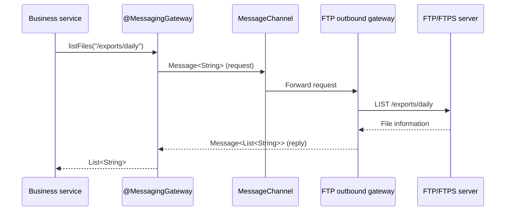
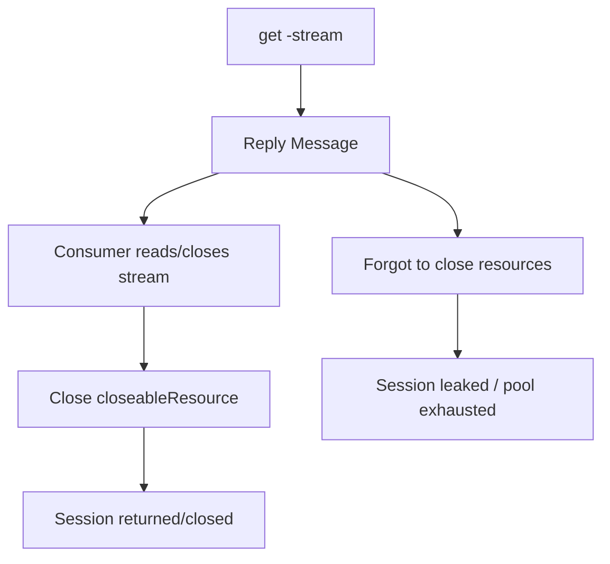

# FTP Outbound Gateway for Request–Reply Operations

## 1. Problem Statement: Needing a Return Result After an FTP Operation

Suppose a reconciliation service needs to inspect a partner's FTP server before importing data:

1. List the reports currently available in `/exports/daily`.
2. Select a filename matching the batch to reconcile.
3. Download the file to a local directory for inspection.
4. After processing succeeds, optionally rename the file on the server to `*.processed` if the contract permits.
5. Return to the calling service the **file list, local path, or operation result** so it can decide the next step.

If you only need to fetch files automatically on a schedule, an **FTP inbound channel adapter + poller** is usually appropriate. If you only need to upload files without needing a reply, use an **FTP outbound channel adapter**. Here, the application wants to **explicitly invoke FTP commands and receive results**, so it uses an **FTP outbound gateway**.

This lesson is part of the **FTP Adapter** chapter in the **SPRING_INTEGRATION_ADAPTERS** module. The module teaches how to connect external systems using inbound/outbound adapters, gateways, pollers, and `MessageChannel`s; integration channels include file, SFTP, HTTP, JMS, AMQP, Kafka, and databases, along with requirements around message contracts, error handling, and connection lifecycles. This lesson focuses on **request–reply communication with FTP/FTPS** rather than building an entire business ingestion pipeline.

After this lesson, you will be able to explain how a request message triggers an FTP command, receive a reply with the appropriate data type, configure the Java DSL together with `@MessagingGateway`, control paths and operation permissions, use `ls/get/put/mv/rm/mget/mput` in the right context, and handle errors when batch operations only partially succeed.

## 2. How Does a Gateway Differ from an Adapter?



In Spring Integration, **two kinds of gateways** are commonly paired together:

- **FTP outbound gateway**: an endpoint that executes commands like `ls`, `get`, `put`, `rm`, etc. against an FTP server; after the command runs, it produces a **reply message**.
- **`@MessagingGateway`**: a Java interface allowing business code to call methods like `listFiles(path)` instead of manually building `Message<?>`, wiring reply channels, and reading reply messages. The framework creates a proxy that connects the Java method call to the messaging flow.

These two components share a similar name, but sit at **opposite ends**: `@MessagingGateway` is the Java-friendly entry point; the FTP outbound gateway is the terminal endpoint talking to the remote server.

| Mechanism | Input | Output | Use Case |
| --- | --- | --- | --- |
| FTP inbound adapter | Poller actively scans FTP | `Message<File>` emitted into the flow | Automatically receive new files on a schedule |
| FTP outbound adapter | `Message<File>`, `byte[]`, or suitable `String` | No business reply | Upload files to FTP only |
| **FTP outbound gateway** | Request `Message<?>` with path/file and headers | **Reply `Message<?>`** with command-specific payload | List, download, upload, rename, or delete with a result |
| `@MessagingGateway` | Java method call | Java return value mapped from reply | Service invokes the gateway like an internal API |

The return value of the gateway is the **FTP operation result as reported by the server**, not necessarily a business confirmation from the partner. For example, `put` returns the remote file path after transfer completes, which does not prove the partner has read or recorded the data in their system.

## 3. Command List and Reply Contracts

The Spring Integration FTP outbound gateway supports the following commands:

| Command | What Does the Request Usually Carry? | Reply Payload | Key Notes |
| --- | --- | --- | --- |
| `ls` | Remote directory path, e.g., `/exports/daily` | `List<FileInfo<FTPFile>>` by default, or `List<String>` with `-1` option | Uses `LIST` to obtain file info; supports filtering and directory traversal |
| `nlst` | Remote directory path | `List<String>` | Sends FTP `NLST`, filenames only, without full metadata |
| `get` | Remote file path | Local `File`; or `InputStream` with `-stream` | Requires local directory configuration and file-exists mode |
| `mget` | Directory/pattern of files to fetch | `List<File>` | Downloads multiple files; can partially succeed |
| `put` | File, byte array, or string to upload | `String` remote path written | Writes a single file; configure existing-file policy |
| `mput` | Local directory or supported collection of files | `List<String>` remote paths | Uploads multiple files; can partially succeed |
| `rm` | Path of file to delete | `Boolean.TRUE`/`Boolean.FALSE` per result | Destructive command; restrict permissions tightly |
| `mv` | Source path; target path via `renameExpression` or header | `Boolean.TRUE` on success | Renames/moves remotely; requires rename permission |

**Return types depend on both the command and options**, so do not declare every method to return `String`. For `ls`, choose `-1` when you only need filenames; omit `-1` when you need to distinguish files from directories and inspect metadata. `nlst` is useful when a server does not support `LIST`, though because it returns names only, it lacks metadata for directory-type filtering or metadata-based recursive traversal.

Commonly used options:

| Command | Option | Meaning |
| --- | --- | --- |
| `ls` | `-1` | Return a list of `String` names instead of `FileInfo` |
| `ls` | `-a`, `-dirs`, `-links` | Include hidden files, directories, and symbolic links respectively |
| `ls` | `-R` | List directory tree recursively |
| `nlst` | `-f` | Do not sort |
| `get` | `-P` | Preserve remote timestamp on the local file |
| `get` | `-stream` | Return `InputStream` instead of downloading to a file first |
| `get` | `-D` | Delete remote file after successful download per gateway rules |
| `mget` | `-R`, `-x` | Recursive; throw an error if no files match |
| `mget` | `-P`, `-D` | Preserve timestamp; delete remote file after successful download |
| `mput` | `-R` | Upload files inside the local directory and subdirectories |

**Do not pass options arbitrarily across commands**: each command has its own valid set of options. For example, `-stream` applies to `get`, not standard `mget`; `mv` and `rm` do not support the options listed above.

## 4. Preparing Dependencies, Credentials, and Network

### 4.1. Maven Dependencies

For a Spring Boot application using a compatible BOM to manage Spring Integration versions:

```xml
<dependencies>
    <dependency>
        <groupId>org.springframework.boot</groupId>
        <artifactId>spring-boot-starter-integration</artifactId>
    </dependency>
    <dependency>
        <groupId>org.springframework.integration</groupId>
        <artifactId>spring-integration-ftp</artifactId>
    </dependency>
</dependencies>
```

Do not arbitrarily mix versions of `spring-integration-core`, `spring-integration-file`, and `spring-integration-ftp`. If you do not use the Spring Boot BOM, manage versions with a Spring Integration BOM matching your application's Spring Framework version.

### 4.2. Configuration Parameters

```yaml
# application.yml
partner:
  ftp:
    host: ${PARTNER_FTP_HOST}
    port: ${PARTNER_FTP_PORT:21}
    username: ${PARTNER_FTP_USER}
    password: ${PARTNER_FTP_PASSWORD}
    download-directory: /data/partner-downloads
```

The example partner server has `/exports/daily`. That is the **remote directory**; `/data/partner-downloads` is a **local directory** inside the machine/container running Spring Boot. Remote and local paths can differ in permissions, path resolution, and lifecycle. When running in a container, verify volumes, write permissions, and storage capacity.

Credential variables must be supplied from the deployment environment or a secret manager; never commit real values to Git, documentation, or logs.

### 4.3. FTP Session Lifecycle

FTP typically uses a **control connection** (commonly port 21) for commands like `LIST`, `RETR`, `STOR`, `RNFR`, `RNTO` and a separate **data connection** when listing or transferring file bytes. If the application runs behind NAT/firewalls, passive mode is usually easier to connect; the server must still allow passive data ports.

`DefaultFtpSessionFactory` creates FTP sessions. `CachingSessionFactory` is an optional wrapper to reuse sessions and cap the number of concurrently borrowed sessions. Proper session closing/returning is especially important when multiple request–reply flows run concurrently.

Plain FTP does not encrypt contents by default. When exchanging sensitive data, choose **FTPS** (FTP over TLS with verified certificates) or **SFTP** (over SSH) depending on what the server supports. SFTP does not work through `DefaultFtpSessionFactory` or `Ftp.outboundGateway` merely by changing the port.

## 5. Complete Java DSL Example: Invoking `ls` and `get`

The following example uses the Java DSL and `@MessagingGateway`. For clarity in testing, it uses two request channels for two separate commands. Each Java method contract matches the command's reply directly.

### 5.1. Configuring `SessionFactory<FTPFile>`

```java
import org.apache.commons.net.ftp.FTP;
import org.apache.commons.net.ftp.FTPClient;
import org.apache.commons.net.ftp.FTPFile;
import org.springframework.beans.factory.annotation.Value;
import org.springframework.context.annotation.Bean;
import org.springframework.context.annotation.Configuration;
import org.springframework.integration.file.remote.session.CachingSessionFactory;
import org.springframework.integration.file.remote.session.SessionFactory;
import org.springframework.integration.ftp.session.DefaultFtpSessionFactory;

@Configuration
public class PartnerFtpSessionConfiguration {

    @Bean("partnerFtpSessionFactory")
    public SessionFactory<FTPFile> partnerFtpSessionFactory(
            @Value("${partner.ftp.host}") String host,
            @Value("${partner.ftp.port}") int port,
            @Value("${partner.ftp.username}") String user,
            @Value("${partner.ftp.password}") String password) {

        DefaultFtpSessionFactory target = new DefaultFtpSessionFactory();
        target.setHost(host);
        target.setPort(port);
        target.setUsername(user);
        target.setPassword(password);
        target.setClientMode(FTPClient.PASSIVE_LOCAL_DATA_CONNECTION_MODE);
        target.setFileType(FTP.BINARY_FILE_TYPE);
        target.setConnectTimeout(10_000); // ms: control connection
        target.setDefaultTimeout(10_000); // ms: control socket
        target.setDataTimeout(30_000);    // ms: data socket

        CachingSessionFactory<FTPFile> cache =
                new CachingSessionFactory<>(target, 5);
        cache.setSessionWaitTimeout(3_000); // ms: wait for idle session
        cache.setTestSession(true);         // test reused session
        return cache;
    }
}
```

In this example, the cache is capped at five sessions. Real sizing should be based on concurrent calls, server quotas, and bandwidth. `testSession(true)` helps detect some sessions closed by the server while idle; it does not guarantee the connection cannot drop mid-`RETR` or mid-`STOR`.

### 5.2. Configuring Two Request–Reply Flows

```java
import java.io.File;
import org.apache.commons.net.ftp.FTPFile;
import org.springframework.beans.factory.annotation.Qualifier;
import org.springframework.beans.factory.annotation.Value;
import org.springframework.context.annotation.Bean;
import org.springframework.context.annotation.Configuration;
import org.springframework.integration.annotation.IntegrationComponentScan;
import org.springframework.integration.dsl.IntegrationFlow;
import org.springframework.integration.file.remote.session.SessionFactory;
import org.springframework.integration.file.support.FileExistsMode;
import org.springframework.integration.ftp.dsl.Ftp;

@Configuration
@IntegrationComponentScan
public class PartnerFtpGatewayFlows {

    @Bean
    public IntegrationFlow ftpListFlow(
            @Qualifier("partnerFtpSessionFactory")
            SessionFactory<FTPFile> sessionFactory) {

        return IntegrationFlow.from("ftpListRequests")
                .handle(Ftp.outboundGateway(sessionFactory, "ls", "payload")
                        .options("-1"))
                .get();
    }

    @Bean
    public IntegrationFlow ftpGetFlow(
            @Qualifier("partnerFtpSessionFactory")
            SessionFactory<FTPFile> sessionFactory,
            @Value("${partner.ftp.download-directory}") String downloadDirectory) {

        return IntegrationFlow.from("ftpGetRequests")
                .handle(Ftp.outboundGateway(sessionFactory, "get", "payload")
                        .localDirectory(new File(downloadDirectory))
                        .autoCreateLocalDirectory(true)
                        .fileExistsMode(FileExistsMode.FAIL))
                .get();
    }
}
```

Explanation:

- `IntegrationFlow.from("ftpListRequests")` and `from("ftpGetRequests")` create message sources listening on their respective request channels. For this simple flow, the default entry suits synchronous dispatching; no poller is needed because the service initiates requests actively.
- `Ftp.outboundGateway(sessionFactory, "ls", "payload")` reads the remote path from the **request payload** (SpEL `payload`). `.options("-1")` requests only filenames, so the reply contains `List<String>`.
- `Ftp.outboundGateway(sessionFactory, "get", "payload")` uses the payload as the **remote path of the file to download**. `.localDirectory(...)` specifies the **local** directory where the downloaded file is saved.
- `.fileExistsMode(FileExistsMode.FAIL)` protects existing local files; for `get`, this is also the gateway's default mode, though declaring it explicitly makes the policy clear to readers.
- Every FTP outbound gateway is a **reply-producing** handler. Spring Integration uses the request's reply channel managed by the messaging gateway to return the result to the Java caller.

`@IntegrationComponentScan` discovers `@MessagingGateway` interfaces within the appropriate scan scope. If the application already configures scanning on the main application class or elsewhere, enable it in only one place with the right package scope.

### 5.3. Defining the Request–Reply Java API

```java
import java.io.File;
import java.util.List;
import org.springframework.integration.annotation.Gateway;
import org.springframework.integration.annotation.MessagingGateway;

@MessagingGateway
public interface PartnerFtpClient {

    @Gateway(requestChannel = "ftpListRequests", replyTimeout = 30_000)
    List<String> listNames(String remoteDirectory);

    @Gateway(requestChannel = "ftpGetRequests", replyTimeout = 90_000)
    File download(String remoteFilePath);
}
```

The framework creates a proxy bean implementing the interface; business code neither opens FTP sockets nor sets up reply channels manually. Call example:

```java
import java.io.File;
import java.util.List;
import org.springframework.stereotype.Service;

@Service
public class DailyReportImportService {

    private final PartnerFtpClient ftp;

    public DailyReportImportService(PartnerFtpClient ftp) {
        this.ftp = ftp;
    }

    public File fetchReport(String batchId) {
        if (!batchId.matches("[A-Za-z0-9_-]{1,64}")) {
            throw new IllegalArgumentException("Invalid batchId");
        }
        String remoteDirectory = "/exports/daily";
        String remoteFile = "report-" + batchId + ".csv";

        List<String> names = ftp.listNames(remoteDirectory);
        if (names == null || !names.contains(remoteFile)) {
            throw new IllegalStateException("Report not yet available: " + remoteFile);
        }

        return ftp.download(remoteDirectory + "/" + remoteFile);
    }
}
```

The `batchId` value is validated before concatenating into a path. This prevents inputs like `../../private` from selecting files outside the permitted directory. The `ls` list reflects the state at the **time of inspection**; a file can still be deleted or modified before `get` runs. Business logic must handle exceptions when `get` fails rather than treating `ls` as a transactional lock.

### 5.4. What Happens When the Method Is Called?

1. The service invokes `ftp.listNames("/exports/daily")`.
2. The `@MessagingGateway` proxy builds a request `Message<String>` carrying the path plus necessary reply/error metadata, and sends it to `ftpListRequests`.
3. The FTP outbound gateway endpoint borrows a session from `SessionFactory`, runs `LIST`, applies the `-1` option, and constructs `Message<List<String>>`.
4. The reply is routed back to the reply channel associated with the request; the proxy unwraps the payload into `List<String>` and returns it to the service.
5. If the command or transport fails, the gateway may throw an exception or route through an error channel depending on configuration; design retries, timeouts, and exception handling at the boundary.

The `download` call follows the same request–reply path, except the result is a local `File`. Before opening the file, code should verify the returned path, size, format, and business records.

## 6. Timeouts and Synchronous Characteristics

There are **several different kinds of timeouts**:

| Timeout | Where? | Meaning |
| --- | --- | --- |
| `connectTimeout` | FTP session factory | Maximum time to establish the TCP connection to the server |
| `defaultTimeout` | FTP client | Control socket timeout as configured on the client |
| `dataTimeout` | FTP client | Timeout when communicating over the FTP data channel |
| `sessionWaitTimeout` | `CachingSessionFactory` | Time to wait to borrow a session from the cache when exhausted |
| `requestTimeout` | Messaging gateway proxy | Time to wait to send a request onto a **blocking channel** such as a bounded queue |
| `replyTimeout` | Messaging gateway proxy | Time to wait for the **reply message** once sending the request has returned to the gateway; mainly relevant for asynchronous flows |

**Common pitfall:** `@Gateway(replyTimeout = 30_000)` **is not an overall wall-clock cap on every FTP command**. With `DirectChannel`, the handler typically runs on the caller's thread; `LIST` or `RETR` can consume time right inside the request-send step. `replyTimeout` does not replace socket timeouts and does not necessarily abort an in-flight network operation.

If you need an SLA-level end-to-end timeout, add caller-side deadlines, resource caps, proper cancellation/retry policies, and real monitoring. Switching to an executor-backed channel makes the request–reply call wait asynchronously for the reply, but also introduces the need to govern thread pools, concurrency, and exception propagation.

## 7. Other Commands: `nlst`, `put`, `mput`, `rm`, `mv`

### 7.1. `nlst`: Fetching Names Only

If the server only permits `NLST` or you do not want to transfer `LIST` metadata, you can define a flow:

```java
@Bean
public IntegrationFlow ftpNamesFlow(
        @Qualifier("partnerFtpSessionFactory")
        SessionFactory<FTPFile> sessionFactory) {
    return IntegrationFlow.from("ftpNamesRequests")
            .handle(Ftp.outboundGateway(sessionFactory, "nlst", "payload"))
            .get();
}
```

The reply payload is `List<String>`. Unlike default `ls` returning `FileInfo`, `nlst` lacks attributes to identify directories, timestamps, or sizes; when directory structure filtering is needed, prefer `ls` if the server supports it.

### 7.2. `put`: Uploading One File and Receiving the Remote Path

`put` differs from the outbound adapter in that it **returns a `String` containing the remote path** written. Example configuration of a request–reply flow for a `File` payload:

```java
@Bean
public IntegrationFlow ftpPutFlow(
        @Qualifier("partnerFtpSessionFactory")
        SessionFactory<FTPFile> sessionFactory) {
    return IntegrationFlow.from("ftpPutRequests")
            .handle(Ftp.outboundGateway(sessionFactory, "put", "payload")
                    .remoteDirectoryExpression("'/incoming/reports'")
                    .fileExistsMode(FileExistsMode.FAIL)
                    .useTemporaryFileName(true)
                    .temporaryFileSuffix(".uploading"))
            .get();
}
```

With `@Gateway(requestChannel = "ftpPutRequests") String upload(File localFile);`, business code receives the remote path after the operation. The returned string is a gateway-level technical confirmation; to know whether the partner **successfully imported the report**, you need an ACK file, reconciliation API, or separate business event.

Send a local file only after writing is complete and streams are closed. `FileExistsMode.FAIL` makes collision behavior explicit if the remote name already exists; if recovering after a timeout, inspect remote state before retrying to avoid duplicate writes.

### 7.3. `mput`: Uploading Multiple Files; `mget`: Downloading Multiple Files

`mput` accepts a local directory (or version-supported input types) and returns `List<String>` of remote paths; `mget` accepts a remote directory/pattern and returns a `List<File>` of local files. The `-R` option enables recursion; `mput` can also filter local files using patterns or regex.

Concise example configuring filtering when uploading multiple files:

```java
@Bean
public IntegrationFlow ftpMultiPutFlow(
        @Qualifier("partnerFtpSessionFactory")
        SessionFactory<FTPFile> sessionFactory) {
    return IntegrationFlow.from("ftpMultiPutRequests")
            .handle(Ftp.outboundGateway(sessionFactory, "mput", "payload")
                    .remoteDirectoryExpression("'/incoming/batches'")
                    .patternMputFilter("*.csv")
                    .fileExistsMode(FileExistsMode.FAIL))
            .get();
}
```

In the example above, the request payload must be a suitable local directory/path, not a remote path. `patternMputFilter("*.csv")` is applied on the **local** side. If you add `.options("-R")`, account for subdirectory traversal rules, naming conventions, and target directory layout; do not assume every CSV at any depth will be uploaded solely because its filename matches.

**Never treat a single `mget` or `mput` call as an atomic transaction**: the first file may succeed while a later file fails. Inspect per-file results and reconcile with remote/local state to avoid repeating transfers on retry.

### 7.4. `mv`: Renaming or Moving a Remote File

For `mv`, the main expression specifies the **source path**, while `renameExpression` specifies the **destination path**. By default, the `file_renameTo` header can be used:

```java
@Bean
public IntegrationFlow ftpMoveFlow(
        @Qualifier("partnerFtpSessionFactory")
        SessionFactory<FTPFile> sessionFactory) {
    return IntegrationFlow.from("ftpMoveRequests")
            .handle(Ftp.outboundGateway(sessionFactory, "mv", "payload")
                    .renameExpression("headers['file_renameTo']"))
            .get();
}
```

Example direct request message:

```java
Message<String> request = MessageBuilder
        .withPayload("/exports/daily/report-42.csv")
        .setHeader("file_renameTo", "/exports/processed/report-42.csv")
        .build();
```

If the caller needs a reply, declare `@Gateway(requestChannel = "ftpMoveRequests") Boolean move(Message<String> request);` on the `@MessagingGateway` interface. A successful reply has payload `Boolean.TRUE`, and the target name can appear in the `file_renameTo` header. The destination path must be tightly controlled; the FTP account needs rename/move permissions, and the target directory must match the partner contract.

### 7.5. `rm`: Controlled Deletion of Remote Files

`rm` accepts a file path and returns a Boolean indicating success/failure. Because it can cause data loss, **do not delete files immediately after `get` solely to avoid duplicate downloads**. If deletion after receipt and processing is required, put approval/retention rules, idempotency, path validation, and a least-privilege account in place. Test `rm` against **synthetic files in a test environment** rather than real report files.

## 8. Request Payload, Headers, and SpEL

The properties `expression`, `remoteDirectoryExpression`, and `renameExpression` use **Spring Expression Language (SpEL)** and are evaluated against the request message.

| Expression | Evaluated Value | Case |
| --- | --- | --- |
| `"payload"` | Request payload value | `ls("/exports/daily")`, `get("/exports/daily/a.csv")` |
| `"'/incoming/reports'"` | A string literal wrapped in SpEL single quotes | Fixed remote directory in the `put` example |
| `"headers['file_renameTo']"` | Corresponding header value | Destination path for `mv` |
| `"headers['batchRemoteDir']"` | Remote directory supplied by caller via header | When multiple valid, validated directories exist |

For example, `"payload"` does **not** send the literal string `"payload"` to the server; it means "evaluate the message's payload." Meanwhile, `"'/incoming/reports'"` has two layers of quotes: the outer Java string and the inner SpEL string literal.

The gateway may populate useful additional headers such as `file_remoteDirectory`, `file_remoteFile`, and `file_renameTo` depending on the command. If business logic needs both payload and headers, define the messaging gateway method to return an appropriate `Message<T>` instead of bare `T`, then inspect `message.getHeaders()`. **Do not assume every command emits every header**; verify the contract of the specific command in use.

**Path safety:** an untrusted `remotePath` from an API can lead to path traversal or unauthorized file access. Restrict the root directory, normalize and validate paths, whitelist filenames, and configure the FTP account with permissions limited to the required scope. Never let external clients supply raw SpEL expressions; expressions must be defined by the application.

## 9. Stream Lifecycle and `get -stream`

With default `get`, the framework downloads the file locally and returns a `File` reply payload. When using `-stream`, the reply payload is an **`InputStream` tied to an open FTP session**. This avoids staging a full copy on local disk, but shifts resource cleanup responsibility onto the consumer.



One way to release the session using Spring Integration's API:

```java
import java.io.Closeable;
import java.io.IOException;
import org.springframework.integration.IntegrationMessageHeaderAccessor;
import org.springframework.messaging.Message;

public void consumeStream(Message<java.io.InputStream> reply) throws IOException {
    Closeable resource =
            new IntegrationMessageHeaderAccessor(reply).getCloseableResource();
    try (java.io.InputStream input = reply.getPayload()) {
        // Read/parse input; e.g., use InputStreamReader with the agreed charset.
    } finally {
        if (resource != null) {
            resource.close();
        }
    }
}
```

`closeableResource` is provided by the framework to release the underlying resource/session after consuming the stream. Certain components such as a file splitter or stream transformer close it per framework contract; when receiving the `InputStream` directly, **the consumer is responsible for closing it**. Do not hand off the stream to an async job and finish the request without an explicit design for session hold duration, cancellation, and cleanup.

If you need retries that re-read the file, long-term retention, or decoupled processing after FTP disconnects, using `get` to download to a local file is usually simpler and safer operationally.

## 10. Errors, Retries, and Partial Success

### 10.1. A Request Can Fail at Multiple Layers

```text
Caller
  -> Messaging gateway (send request, await reply)
  -> FTP outbound gateway (borrow session)
  -> DNS/TCP/control login
  -> FTP command: LIST / RETR / STOR / RNFR / RNTO ...
  -> Data connection when needed
  -> Build reply message
  -> Caller receives result
```

| Symptom | Common Cause | What to Check |
| --- | --- | --- |
| `Connection refused` / connect timeout | Wrong DNS/port, server down, firewall | Host/port from runtime, control connectivity |
| FTP `530` | Invalid username/password, locked account | Secrets and server-side account status |
| `425 Can't open data connection` on `ls/get/put` | Passive data port blocked by firewall/NAT | Passive port range, IP advertised by server, routing |
| FTP `550` | Missing permission, wrong path, or file missing | List/read/write/rename permissions, remote directory |
| `get` reports local file already exists | `FileExistsMode.FAIL` or target collision | Local naming rules, cleanup, and idempotency |
| `put` finishes bytes but caller times out | Response lost after server finished writing | Compare filename, size/hash, and server logs |
| `mv` fails | Invalid target or missing rename permission | `file_renameTo` header, target path, and permissions |
| No reply within timeout | Slow queue/executor, handler error, or lost connection | Channel configuration, reply timeout, socket timeout, error handling |
| `ls` returns empty | Directory has no matching files or filtered out | Distinguish an empty result from an exception/permission failure |
| Session cache congested | High concurrency or unclosed streams | Borrowed sessions, `sessionWaitTimeout`, `closeableResource` |

Never log passwords, sensitive report contents, or full payloads. Log the command, sanitized remote directory/file, correlation ID/batch ID, execution duration, error type, and FTP reply code when available.

### 10.2. `PartialSuccessException` for `mget` and `mput`

Suppose `mput` sends three files: `a.csv`, `b.csv`, and `c.csv`. The server receives `a.csv` and `b.csv`, then the network drops while uploading `c.csv`. Spring Integration can throw `PartialSuccessException` containing:

- **`partialResults`**: results for the files the gateway transferred successfully.
- **`derivedInput`**: the derived inputs generated from the original request.
- **`cause`** and `failedMessage`: helpful for tracing the root cause and failing request.

During recursive uploads/downloads, exceptions may be **nested**. For that reason, never blindly retry the entire directory. Collect the files that succeeded, reconcile against remote/local state, and retry only the missing items according to filename rules, `FileExistsMode`, and batch keys. For critical files, prefer manifests/checksums or a business status tracked separately from FTP command status.

### 10.3. `FileExistsMode` Contract and Idempotency

The `GET`, `MGET`, `PUT`, and `MPUT` commands support `FileExistsMode` options such as `FAIL`, `REPLACE`, `IGNORE`, and `APPEND` (some versions offer extended modes). This is a **file-layer** decision:

- `FAIL`: rejects when the destination already exists; makes conflicts easy to catch.
- `REPLACE`: overwrites; safe only when permitted by contract.
- `IGNORE`: skips existing destination files; does not verify content validity on its own.
- `APPEND`: appends data; can create duplicate records on retry if uncontrolled.

According to Spring Integration documentation, the default for `put/mput` is **`REPLACE`**, while for `get/mget` it is **`FAIL`**. Do not rely on defaults when your system needs strict data rules; configure the mode explicitly.

A successful reply does not represent an "exactly once" transaction from your application to the partner. Use batch IDs, immutable filenames, processing states, and a dedicated ACK mechanism to know when data has been fully processed.

### 10.4. Placing Error Handling in the Right Spot

In a synchronous flow over `DirectChannel`, FTP errors typically propagate back to the caller as exceptions from the gateway proxy call. In an asynchronous flow or an executor-backed handler, explicitly configure an error channel, retry advice, request state persistence, and timeouts. A timed-out call **does not prove** the FTP command failed; the server may have completed the command right before the caller lost the response.

## 11. Practice Exercise and Integration Scenario

**Context:** A partner places three files into `/exports/2026-11-23`: `report-01.csv`, `report-02.csv`, and `report-03.csv`. The application needs to:

1. Call `ls` to retrieve filenames.
2. Accept only `report-*.csv` files.
3. Download each file via `get`, parse the CSV, and save to the database.
4. Only after the commit succeeds, call `mv` to move/rename the remote file to `/processed/<filename>` if allowed by contract.
5. If downloading multiple files via `mget`, know which files succeeded before a connection failure.

Design and answer:

| Question | Answer Hint |
| --- | --- |
| Why does `ls -1` return `List<String>` while default `ls` without options returns metadata? | `-1` requests filenames only; default returns a list of `FileInfo`. |
| Why is `@MessagingGateway` needed when a service wants a Java API with return values? | The proxy creates request/reply messages, wires channels, and returns the reply payload to the method. |
| What return type should `get` have if you want to download a file locally? | `File` (without `-stream`). |
| Besides the source path, what else must `mv` be given? | The destination path via `renameExpression` or the `file_renameTo` header. |
| Does `replyTimeout` replace socket timeouts? | No; especially with `DirectChannel`, the handler can run synchronously inside the send step. |
| If `mget` downloaded 2 out of 3 files and then failed, what should you do? | Inspect `PartialSuccessException`, reconcile results, and retry only the missing items in a controlled manner. |
| If `get` succeeds but CSV parsing fails, should you immediately `rm` the remote file? | No; keep the file or move it to an error area per contract so recovery remains possible. |
| Does `put` returning a remote path confirm the partner imported the data? | No; a business ACK from the partner's system is required. |

### Recommended Integration Test Scenarios

When practicing against a test FTP server with appropriate permissions, run these scenarios:

1. **Empty directory**: `ls -1` returns an empty list rather than being treated as a connection error.
2. **Populated directory**: `ls` returns the expected type and names; `get` produces a local file with exact bytes.
3. **Local file collision**: `get` with `FAIL` throws an error instead of silently overwriting.
4. **Missing permissions**: `ls/get/mv` returns an error distinguishable from a missing file.
5. **Dropped connection** mid-`RETR`: verify partial local files and retry behavior.
6. **`mput/mget` failure mid-batch**: extract `partialResults` and `derivedInput`.
7. **Session pool exhaustion**: test wait timeouts, concurrent requests, and stream closing.
8. **Delayed reply**: verify `replyTimeout` is not mistaken for a full FTP transfer timeout.

Never run `rm` or `mv` against production data directories while testing. Use synthetic directories and files in a test environment, and verify read, write, and rename permissions per role.

## 12. Key Principles to Remember

- **The FTP outbound gateway is a request–reply endpoint**: it receives a request message, executes an FTP command, and builds a command-specific reply payload.
- **`@MessagingGateway` is a Java facade**: it lets services invoke `listNames` and `download` like regular methods and receive results from the messaging flow.
- **Match return types to commands**: `ls -1`/`nlst` → `List<String>`; `get` → `File`; `put` → `String`; `rm/mv` → `Boolean`; `mget/mput` → result lists.
- **Separate remote from local, and commands from options**; normalize and constrain caller-supplied paths.
- **Socket timeouts differ from gateway reply timeouts**; session pool limits and stream management are part of the connection lifecycle.
- **Partial success and idempotency must be handled explicitly**: multi-file commands are not distributed transactions, and FTP results do not replace business ACKs.

## References

- [Spring Integration Reference — FTP Outbound Gateway](https://docs.spring.io/spring-integration/reference/ftp/outbound-gateway.html)
- [Spring Integration Reference — FTP Session Factory](https://docs.spring.io/spring-integration/reference/ftp/session-factory.html)
- [Spring Integration Reference — FTP Session Caching](https://docs.spring.io/spring-integration/reference/ftp/session-caching.html)
- [Spring Integration Reference — Messaging Gateways](https://docs.spring.io/spring-integration/reference/gateway.html)
- [Spring Integration API — FTP Java DSL](https://docs.spring.io/spring-integration/docs/6.5.0/api/org/springframework/integration/ftp/dsl/Ftp.html)
- [Spring Integration API — FTP outbound gateway spec](https://docs.spring.io/spring-integration/docs/6.5.0/api/org/springframework/integration/ftp/dsl/FtpOutboundGatewaySpec.html)
