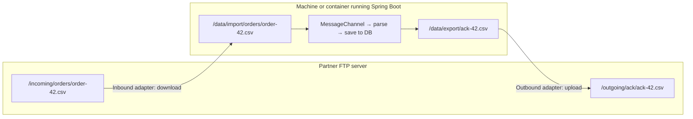
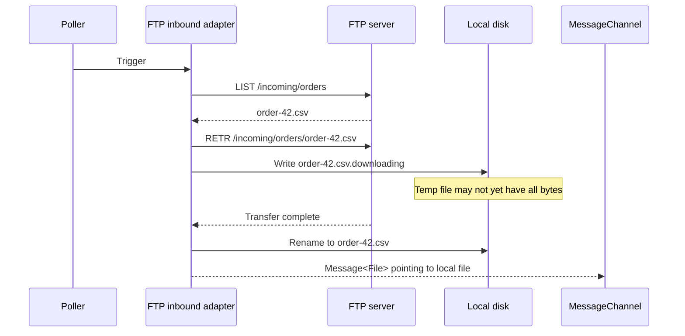

# Remote and Local Directories in Spring Integration FTP

## 1. Why Must We Distinguish Between the Two Directories?

A partner places `orders-2026-11-23.csv` in `/incoming/orders` **on the FTP server**. The Spring Boot application downloads this file to `/data/import/orders` **on the machine running the application** to validate, parse the CSV, and save records to the database. In the opposite direction, the application writes `/data/export/ack-42.csv` locally and uploads it to `/outgoing/ack` on the FTP server.

The two systems have **independent filesystems**. The same path string can exist on both sides yet point to completely different files. Confusing `remoteDirectory` with `localDirectory` can cause the application to read the wrong data, download files into an unwritable location, or upload files into the wrong partner folder.

This lesson belongs to the **FTP Adapter** chapter of the **SPRING_INTEGRATION_ADAPTERS** module. In this module, Spring Integration connects external systems using inbound/outbound adapters, gateways, pollers, and `MessageChannel`s; other integration channels include file, SFTP, HTTP, JMS, AMQP, Kafka, and databases. Rules regarding message contracts, errors, and connection lifecycles are all critical when data moves from FTP to a local directory or vice versa.

After this lesson, you will be able to:

- Distinguish **remote** paths on an FTP server from **local** paths inside the application.
- Identify where to configure `remoteDirectory`, `localDirectory`, `autoCreateLocalDirectory`, and `autoCreateDirectory`.
- Set up an inbound adapter to download from remote to local, an outbound adapter to upload to remote, and an outbound gateway to fetch files on demand.
- Understand how filenames, filters, temporary files, and sync state affect receiving or sending files.
- Diagnose errors involving wrong directories, missing permissions, partially transferred files, restarts, and multiple replicas sharing one FTP directory.

## 2. Two Storage Spaces on Two Different Machines



The diagram shows **file locations** and data direction. Adapters use a `SessionFactory` to communicate over FTP; `MessageChannel` passes messages between application steps. A poller typically triggers the inbound adapter periodically, while an outbound adapter is typically triggered when a message is sent to a channel.

| Concept | Example Path | Which Machine? | How Is It Accessed? |
| --- | --- | --- | --- |
| Remote source directory | `/incoming/orders` | FTP server | FTP `LIST`, `RETR`, and a session with read permission |
| Local download directory | `/data/import/orders` | Machine/container running Java | Java `File`/`Path`, process write permissions |
| Local upload source | `/data/export/ack-42.csv` | Machine/container running Java | `Message<File>` payload or supported data source |
| Remote target directory | `/outgoing/ack` | FTP server | FTP `STOR`, optionally followed by `RNFR`/`RNTO` |

**Do not use the same API to manage both sides**: Java's `Files.exists(Path.of("/incoming/orders"))` only checks the **local** filesystem, not directories on the FTP server. To inspect a remote directory, you must open an FTP session and have permissions to execute the appropriate commands.

## 3. How the FTP Server Interprets Paths

### 3.1. Absolute and Relative Paths on FTP

An FTP server may give an account a **virtual root** or chroot. For example, the administrator configures the real server path as `/srv/ftp/customer-a/incoming/orders`, yet after logging in, the client only sees `/incoming/orders`. The application must use **the paths visible to the FTP account**, rather than guessing the server's internal filesystem layout.

Two path styles to verify with the partner:

| Style | Example | Interpretation |
| --- | --- | --- |
| Remote absolute | `/incoming/orders` | Relative to the root visible to the FTP session |
| Remote relative | `incoming/orders` | May depend on the session's current working directory after login |
| Local absolute on Linux | `/data/import/orders` | Relative to the root of the Linux container/host |
| Local absolute on Windows | `D:\\ftp-data\\orders` | Relative to the drive on the Windows machine running Java |
| Local relative | `ftp-data/orders` | Depends on the Java process's working directory |

Remote FTP paths normally use `/`, even when the FTP server runs on Windows. **Do not build remote paths using `\\` based on the client OS.** Only configure a different separator if the server supports and specifies one in its contract.

For production systems, prefer **explicit, stable paths** instead of relying on a container's working directory or an FTP session's current directory. Running `PWD` from a test FTP client confirms how the server presents its root; a `README` file in the current directory does not prove the full folder structure the partner expects.

### 3.2. A Virtual Root Does Not Imply Read/Write Permission

An account might:

- Log in and run `PWD` successfully, yet lack `LIST` permission on `/incoming/orders`.
- Succeed with `LIST`, yet be denied `RETR` on files.
- Upload files with `STOR`, yet lack `RNFR/RNTO` permission to rename temporary files.
- Read files in `/incoming`, yet lack permission to create `/outgoing`.

Therefore, testing connectivity and testing directory operations are **two separate checks**. FTP `550` codes or permission errors during `LIST`, `RETR`, `STOR`, or `RNFR` must be checked against the specific account, path, and permissions.

### 3.3. Directory Path and Filename Are Two Separate Decisions

If the target directory is `/outgoing/ack` and the file is named `ack-42.csv`, the final path is usually:

```text
remoteDirectory = /outgoing/ack
remoteFileName  = ack-42.csv
remoteFilePath  = /outgoing/ack/ack-42.csv
```

Do not pass `/outgoing/ack/ack-42.csv` into a property expecting a **directory** and then append the filename again. Conversely, with the FTP outbound gateway `get` command, the request payload is normally the **remote path of the file**, such as `/incoming/orders/order-42.csv`, while `localDirectory` specifies where the downloaded copy is saved.

## 4. How Each Endpoint Uses Directories

| Endpoint | Remote Configuration | Local Configuration | Typical Result |
| --- | --- | --- | --- |
| FTP **inbound channel adapter** | `remoteDirectory` — source directory on server | `localDirectory` — target directory to store downloaded files | Emits `Message<File>` pointing to local file |
| FTP **outbound channel adapter** | `remoteDirectory` or target directory expression | **Local source** comes from `File` payload; `localDirectory` is not needed here | Uploads file to server; produces no business reply |
| FTP outbound gateway **`get`** | Request payload/expression identifies remote file | `localDirectory` — directory to save downloaded file | Reply is typically a local `File` |
| FTP outbound gateway **`put`** | `remoteDirectoryExpression` specifies remote directory | Source from `File` payload or supported data type | Reply is typically a `String` remote path |
| FTP streaming inbound adapter or gateway `get -stream` | Remote path | Does not necessarily write a full file locally | Streamed content; must manage resources/session |

**The two directory-creation properties do not substitute for each other:**

- `autoCreateLocalDirectory(true)`: creates the **local directory** for an inbound adapter or `get` when missing, provided the Java process has write access to the parent path.
- `autoCreateDirectory(true)`: allows creating the **remote directory** on an outbound adapter/gateway when needed, provided the FTP account has `MKD` permission and the server supports it.

Both mechanisms only handle **creating the directory**. They do not grant OS filesystem permissions, open firewalls, create persistent volumes, or guarantee the server allows `STOR`/`RETR` on files.

## 5. Sample Problem Configuration

Suppose there are two workflows:

- **Import:** server `/incoming/orders/*.csv` → container `/data/ftp/orders` → `MessageChannel` → business processing.
- **Export:** local file `/data/ftp/ack/ack-42.csv` → FTP server `/outgoing/ack/ack-42.csv`.

For a Spring Boot application using a compatible version-management BOM, add:

```xml
<dependencies>
    <dependency>
        <groupId>org.springframework.boot</groupId>
        <artifactId>spring-boot-starter-integration</artifactId>
    </dependency>
    <dependency>
        <groupId>org.springframework.integration</groupId>
        <artifactId>spring-integration-ftp</artifactId>
    </dependency>
</dependencies>
```

Keep paths outside source code:

```yaml
# application.yml
partner:
  ftp:
    host: ${PARTNER_FTP_HOST}
    port: ${PARTNER_FTP_PORT:21}
    username: ${PARTNER_FTP_USERNAME}
    password: ${PARTNER_FTP_PASSWORD}
    remote-inbox: /incoming/orders
    local-inbox: /data/ftp/orders
    local-ack: /data/ftp/ack
    remote-ack: /outgoing/ack
```

`host`, `port`, `username`, and `password` configure the **FTP connection**. Fields prefixed with `remote-` describe **FTP server directories**, while `local-` describes **application filesystem paths**. When integrating with multiple partners, give each partner its own configuration and separate filter-state prefixes so data never mixes.

### 5.1. Shared Session Factory

```java
import org.apache.commons.net.ftp.FTP;
import org.apache.commons.net.ftp.FTPClient;
import org.apache.commons.net.ftp.FTPFile;
import org.springframework.beans.factory.annotation.Value;
import org.springframework.context.annotation.Bean;
import org.springframework.context.annotation.Configuration;
import org.springframework.integration.file.remote.session.CachingSessionFactory;
import org.springframework.integration.file.remote.session.SessionFactory;
import org.springframework.integration.ftp.session.DefaultFtpSessionFactory;

@Configuration
public class PartnerFtpSessionConfiguration {

    @Bean("partnerFtpSessionFactory")
    public SessionFactory<FTPFile> partnerFtpSessionFactory(
            @Value("${partner.ftp.host}") String host,
            @Value("${partner.ftp.port}") int port,
            @Value("${partner.ftp.username}") String username,
            @Value("${partner.ftp.password}") String password) {

        DefaultFtpSessionFactory ftp = new DefaultFtpSessionFactory();
        ftp.setHost(host);
        ftp.setPort(port);
        ftp.setUsername(username);
        ftp.setPassword(password);
        ftp.setClientMode(FTPClient.PASSIVE_LOCAL_DATA_CONNECTION_MODE);
        ftp.setFileType(FTP.BINARY_FILE_TYPE);
        ftp.setConnectTimeout(10_000);
        ftp.setDefaultTimeout(10_000);
        ftp.setDataTimeout(30_000);

        CachingSessionFactory<FTPFile> cache =
                new CachingSessionFactory<>(ftp, 4);
        cache.setSessionWaitTimeout(5_000);
        cache.setTestSession(true);
        return cache;
    }
}
```

The factory supplies sessions to adapters on demand; business services do not open raw FTP sockets. `BINARY_FILE_TYPE` preserves file bytes; passive mode usually fits clients behind NAT/firewalls, though **passive data ports must still be open** on the server side. A cache size of 4 is illustrative only: if inbound polling and outbound uploads run in parallel, they draw from the same session pool.

Plain FTP does not encrypt passwords or contents. When security is required, use **FTPS** with verified TLS certificates or **SFTP** over SSH depending on what the partner supports. SFTP requires the `spring-integration-sftp` module and a dedicated session factory; changing the FTP port to 22 does not establish an SFTP connection.

## 6. Inbound: `remoteDirectory` Is the Source, `localDirectory` Is the Destination

Here is a Java DSL example using a remote filter to accept only CSVs and a local filter to avoid re-emitting the same file within an application run:

```java
import java.io.File;
import java.time.Duration;
import org.apache.commons.net.ftp.FTPFile;
import org.springframework.beans.factory.annotation.Qualifier;
import org.springframework.beans.factory.annotation.Value;
import org.springframework.context.annotation.Bean;
import org.springframework.context.annotation.Configuration;
import org.springframework.integration.dsl.IntegrationFlow;
import org.springframework.integration.dsl.Pollers;
import org.springframework.integration.file.filters.AcceptOnceFileListFilter;
import org.springframework.integration.file.remote.session.SessionFactory;
import org.springframework.integration.ftp.dsl.Ftp;
import org.springframework.integration.ftp.filters.FtpSimplePatternFileListFilter;

@Configuration
public class PartnerFtpInboundDirectoryFlow {

    @Bean
    public IntegrationFlow ftpOrdersInbound(
            @Qualifier("partnerFtpSessionFactory")
            SessionFactory<FTPFile> sessionFactory,
            @Value("${partner.ftp.remote-inbox}") String remoteInbox,
            @Value("${partner.ftp.local-inbox}") String localInbox) {

        return IntegrationFlow.from(
                Ftp.inboundAdapter(sessionFactory)
                        .remoteDirectory(remoteInbox)
                        .localDirectory(new File(localInbox))
                        .autoCreateLocalDirectory(true)
                        .temporaryFileSuffix(".downloading")
                        .preserveTimestamp(true)
                        .filter(new FtpSimplePatternFileListFilter("*.csv"))
                        .localFilter(new AcceptOnceFileListFilter<>()),
                endpoint -> endpoint.poller(
                        Pollers.fixedDelay(Duration.ofSeconds(20))
                                .maxMessagesPerPoll(10)))
                .channel("ftpOrdersFiles")
                .get();
    }
}
```

This flow uses an in-memory `AcceptOnceFileListFilter` **for illustration only**. That filter does not provide durable deduplication across restarts, and the remote `*.csv` pattern filter in this example does not remember previously downloaded files across polls. In real deployments, you typically need both a **remote persistent accept-once filter** and a **local persistent accept-once filter** backed by a durable metadata store. A later section explains how to separate their responsibilities.

Key properties in the example:

| Property | Which Directory/File Does It Affect? | Behavior |
| --- | --- | --- |
| `remoteDirectory(remoteInbox)` | Remote source | Lists `/incoming/orders`, selects files to download |
| `localDirectory(new File(localInbox))` | Local destination | Saves copies into `/data/ftp/orders` |
| `autoCreateLocalDirectory(true)` | Local | Creates local directory if write permissions allow |
| `temporaryFileSuffix(".downloading")` | **Local filename during download** | Uses a temporary name, then renames to final name once transfer succeeds |
| `preserveTimestamp(true)` | Local file metadata | Preserves remote modification timestamp when supported by the server |
| `filter(... "*.csv")` | Remote listing | Selects only matching filenames to sync |
| `localFilter(...)` | Local listing | Emits `Message<File>` only for files not yet accepted by the local filter |
| `maxMessagesPerPoll(10)` | Message emission | Caps how many messages the source emits in one poll; does not inherently cap how many remote files are synced |

After downloading completes, the adapter sends a message to `ftpOrdersFiles` whose payload is the local `File`, e.g., `/data/ftp/orders/order-42.csv`. The handler can open this file with standard Java I/O to parse the CSV. The adapter does **not** send a remote path for the handler to open with `Files.newInputStream()`.

### 6.1. Local Directory Is Not the FTP Session's Working Directory

When an FTP client sends `CWD /incoming/orders`, it changes the current directory **inside the FTP session**. That does not change `user.dir` or the JVM's working directory. Conversely, `File("/data/ftp/orders")` does not change the FTP server's current directory. Both path spaces are managed independently.

### 6.2. When Does the File Appear Locally?



The local `.downloading` temporary suffix reduces the chance of downstream consumers opening a partially downloaded file. However, it does **not** prevent reading a remote file while **the partner is still uploading**. If the partner writes directly to `order-42.csv`, the inbound adapter may see an incomplete file.

A safer file-publishing contract:

```text
On FTP server:
    order-42.csv.uploading
            |
            | partner finishes upload then renames
            v
    order-42.csv

On application machine:
    order-42.csv.downloading
            |
            | inbound adapter finishes download then renames
            v
    order-42.csv  ---> Message<File>
```

Two renames happen **on two different sides**, performed by two different parties. Test rename behavior and partner publishing conventions on the real server; do not assume every FTP server guarantees atomic renames in all cases.

## 7. Outbound: Remote Directory Is the Target, Local File Is in the Payload

Once the application has `/data/ftp/ack/ack-42.csv`, it can send a `Message<File>` to the outbound adapter. The adapter derives the filename from the payload or a `FileNameGenerator` and writes it to `remoteDirectory` on the FTP server.

```java
import org.apache.commons.net.ftp.FTPFile;
import org.springframework.beans.factory.annotation.Qualifier;
import org.springframework.beans.factory.annotation.Value;
import org.springframework.context.annotation.Bean;
import org.springframework.context.annotation.Configuration;
import org.springframework.integration.dsl.IntegrationFlow;
import org.springframework.integration.file.remote.session.SessionFactory;
import org.springframework.integration.file.support.FileExistsMode;
import org.springframework.integration.ftp.dsl.Ftp;

@Configuration
public class PartnerFtpOutboundDirectoryFlow {

    @Bean
    public IntegrationFlow ftpAcknowledgementsOutbound(
            @Qualifier("partnerFtpSessionFactory")
            SessionFactory<FTPFile> sessionFactory,
            @Value("${partner.ftp.remote-ack}") String remoteAck) {

        return IntegrationFlow.from("ftpAckToSend")
                .handle(Ftp.outboundAdapter(sessionFactory)
                        .remoteDirectory(remoteAck)
                        .autoCreateDirectory(false)
                        .fileExistsMode(FileExistsMode.FAIL)
                        .useTemporaryFileName(true)
                        .temporaryFileSuffix(".uploading"))
                .get();
    }
}
```

Sending example:

```java
import java.io.File;
import org.springframework.beans.factory.annotation.Qualifier;
import org.springframework.messaging.MessageChannel;
import org.springframework.messaging.support.MessageBuilder;
import org.springframework.stereotype.Service;

@Service
public class FtpAckSender {
    private final MessageChannel channel;

    public FtpAckSender(
            @Qualifier("ftpAckToSend") MessageChannel channel) {
        this.channel = channel;
    }

    public void send(File ack) {
        if (ack == null || !ack.isFile() || !ack.canRead()) {
            throw new IllegalArgumentException("ACK file is not yet completely created");
        }
        boolean accepted = channel.send(
                MessageBuilder.withPayload(ack).build());
        if (!accepted) {
            throw new IllegalStateException("Failed to send ACK into FTP flow");
        }
    }
}
```

The service receives the `ftpAckToSend` channel created by the flow or declared by the application. For example, call `ftpAckSender.send(new File("/data/ftp/ack/ack-42.csv"))` after finishing writing the file and closing its stream. With a synchronous `DirectChannel`, an exception in the FTP handler can propagate back to the caller; still, `send() == true` does not confirm **the partner processed the ACK**. If the flow switches to an asynchronous channel, `send()` may return before the upload completes.

Key points about directories:

- `remoteDirectory(remoteAck)` is the **destination FTP directory** `/outgoing/ack`; the adapter does not look for local files at that path.
- `autoCreateDirectory(false)` requires the remote directory to already exist; if the path is wrong or permissions are missing, the upload fails. Enable `autoCreateDirectory(true)` only when the contract permits creating remote directories and the account has permission.
- `fileExistsMode(FAIL)` prevents silently replacing an existing destination file. `REPLACE`, `IGNORE`, and `APPEND` have different semantics; choose based on the data contract rather than relying on defaults casually.
- `useTemporaryFileName(true)` and the `.uploading` suffix create a temporary name **on the remote server**, attempting to rename to the final name after all bytes transfer. The partner's consumer must ignore `*.uploading` and read only final names.
- If the remote filename must differ from the local `File` name, configure a `fileNameGenerator` with deterministic rules and avoid using untrusted user-supplied names directly.

**Distinction:** `.temporaryFileSuffix(".downloading")` on the inbound adapter applies to the locally downloaded copy; `.temporaryFileSuffix(".uploading")` on the outbound adapter applies to the remotely uploaded copy. Both prevent a consumer from reading an incomplete file, but at **opposite ends**.

## 8. Outbound Gateway `get`: Using Remote File Path and Local Directory

The FTP outbound gateway lets business code **actively send commands and await a reply**. Unlike an inbound adapter that polls automatically, the `get` command takes the **path of a remote file** from the request:

```java
import java.io.File;
import org.apache.commons.net.ftp.FTPFile;
import org.springframework.beans.factory.annotation.Qualifier;
import org.springframework.beans.factory.annotation.Value;
import org.springframework.context.annotation.Bean;
import org.springframework.context.annotation.Configuration;
import org.springframework.integration.dsl.IntegrationFlow;
import org.springframework.integration.file.remote.session.SessionFactory;
import org.springframework.integration.file.support.FileExistsMode;
import org.springframework.integration.ftp.dsl.Ftp;

@Configuration
public class PartnerFtpGetDirectoryFlow {

    @Bean
    public IntegrationFlow ftpGetFlow(
            @Qualifier("partnerFtpSessionFactory")
            SessionFactory<FTPFile> sessionFactory,
            @Value("${partner.ftp.local-inbox}") String localInbox) {

        return IntegrationFlow.from("ftpGetRequests")
                .handle(Ftp.outboundGateway(sessionFactory, "get", "payload")
                        .localDirectory(new File(localInbox))
                        .autoCreateLocalDirectory(true)
                        .fileExistsMode(FileExistsMode.FAIL))
                .get();
    }
}
```

If the request payload is `"/incoming/orders/order-42.csv"`, the reply of `get` typically contains the local `File` at `/data/ftp/orders/order-42.csv`. The `get` command uses the **remote file path** from the payload, while `localDirectory` only decides **where to save the file on the application machine**.

Other gateway commands serve distinct roles: `ls` takes a remote directory path to return a listing; `put` takes a file payload to upload to a remote directory; `mget`/`mput` handle multiple files. With `get -stream`, the reply is a stream and does not require staging a complete local copy, but the consumer must close the stream and resource/session per the framework contract.

## 9. Filters and State: A File Can Reappear

Two types of **file filter** are essential for inbound flows:

| Filter | Where Is It Applied? | What Question Does It Answer? |
| --- | --- | --- |
| **Remote file filter** | List of `FTPFile` entries fetched from the server | Which files should be downloaded locally? |
| **Local file filter** | List of `java.io.File` entries in the local directory | Which files should be emitted as `Message<File>`? |

For example, the remote filter accepts only `*.csv`; the local filter avoids re-emitting `order-42.csv` on every poll. However, **a downloaded file does not mean the business DB commit succeeded**. If the service fails after receiving the message, the filter may still mark the file as seen. Therefore, states like `RECEIVED`, `PROCESSING`, `COMPLETED`, and `FAILED` along with retry logic belong in the business management layer, separate from adapter filter state.

When you need to prevent duplicate downloads/emissions across restarts, you can use:

```java
// Illustrative configuration snippets using a durable ConcurrentMetadataStore
// already declared/injected by the application.
ChainFileListFilter<FTPFile> remoteFilters = new ChainFileListFilter<>();
remoteFilters.addFilter(new FtpSimplePatternFileListFilter("*.csv"));
remoteFilters.addFilter(
        new FtpPersistentAcceptOnceFileListFilter(metadataStore, "partner-a-remote:"));

FileSystemPersistentAcceptOnceFileListFilter localFilter =
        new FileSystemPersistentAcceptOnceFileListFilter(
                metadataStore, "partner-a-local:");
```

Import the corresponding classes from `org.springframework.integration.file.filters.ChainFileListFilter`, `org.springframework.integration.ftp.filters.FtpPersistentAcceptOnceFileListFilter`, `org.springframework.integration.file.filters.FileSystemPersistentAcceptOnceFileListFilter`, and `org.springframework.integration.ftp.filters.FtpSimplePatternFileListFilter`. Then attach `.filter(remoteFilters)` and `.localFilter(localFilter)` to the inbound adapter. `metadataStore` is a `ConcurrentMetadataStore` supplied by the application, **not a variable automatically created by the framework in the snippet**.

To survive restarts, use a durable metadata store (such as JDBC or Redis where appropriate) instead of an in-memory store. When running multiple replicas, evaluate shared state and distributed locking; sharing a metadata store alone does not automatically guarantee **exactly once** when multiple instances poll the same directory.

**Scenario:** The application downloads `order-42.csv` locally, and the DB write fails. After fixing the bug and restarting, durable remote/local filters may not re-emit the old file under their recorded policy. The system needs a retry queue or failed-file store for reprocessing; do not manually delete metadata and hope all data becomes consistent automatically.

## 10. Local Directory in Docker/Kubernetes and Multiple Replicas

In Docker/Kubernetes, `/data/ftp/orders` is a **path inside the container**, not automatically `/data/ftp/orders` on the physical host. If a pod is replaced and the local directory sits on ephemeral storage, downloaded files vanish. If the metadata filter remains in a durable store, the adapter may consider the file already received even though the local copy is gone.

Decisions to make before production:

1. **Volumes and lifecycle:** consider persistent volumes, object storage, or an intermediate queue when files must survive restarts or require reprocessing.
2. **Access permissions:** the container's UID/GID must be allowed to create, rename, and delete files in the local directory; `autoCreateLocalDirectory(true)` cannot bypass OS permissions.
3. **Capacity and cleanup:** monitor file counts, downloaded bytes, leftover `.downloading` files, completed/processed files, and archive policies.
4. **Multiple replicas:** if each pod has its own local directory while polling the same remote directory, they can download the same file simultaneously. Use a coordination/leader-poller/locking strategy if single-stream processing is required, and business keys to prevent duplicate DB writes.
5. **Durable metadata persistence:** coordinate remote/local filter state with business processing state. Plan recovery when one side exists while the other is missing.
6. **Observability:** log sanitized paths and batch IDs, uploaded/downloaded file counts, FTP session wait times, permission errors, or disk-full errors; mask credentials and never log full sensitive payloads.

A common pattern is separating into an **in-progress download directory**, a **completed download directory**, a **processing directory**, and an **error/archive directory**. Depending on the workflow, moving local files after a handler receives `Message<File>` must be coordinated with the local filter and business state so retry capability is not lost.

## 11. Errors Caused by Confusing or Mismanaging Directories

| Symptom | Common Cause | How to Check |
| --- | --- | --- |
| FTP login succeeds, but no files are seen | Wrong `remoteDirectory`, pointing to a different virtual root, or filter excludes everything | Use the actual credentials to inspect `PWD`, `LIST`, filenames, and patterns |
| FTP `550` on `LIST`/`RETR` | Wrong remote path or missing list/read permission | Verify permissions on that exact directory and the account's chroot |
| FTP `550` on `STOR` | Wrong target directory, missing write permission, quota, or existing file | Check `remoteDirectory`, `FileExistsMode`, and account/quota |
| `425 Can't open data connection` | Control connection works, but data connection is blocked | Check passive mode, NAT/firewall, and the FTP server's data port range |
| `AccessDeniedException` or `Permission denied` locally | Java lacks permission to write to the local directory | Check UID/GID, mounts, filesystem permissions, and local parent directory |
| `NoSuchFileException` after changing environments | Local path hardcoded to an old machine or container lacks volume mount | Check the active `localDirectory` property, volume mount, and permissions |
| Local `.downloading` file never disappears | Connection dropped mid-`RETR`, disk full, or rename failure | Check FTP/data timeouts, disk space, and download logs before cleanup |
| Remote `.uploading` file remains | `STOR`/rename failed or account lacks `RNFR/RNTO` permission | Check command logs, rename permission, and whether destination already exists |
| Already-processed files re-received after restart | In-memory filter, non-durable store, or changed prefix | Review remote/local filter strategy and metadata store |
| Failed file not re-received for retry | Filter marked the file as downloaded/emitted, but business logic failed | Use dedicated business state and retry queue; do not blindly edit metadata |
| Two pods process the same file | Both poll the same remote directory without coordination | Control contention, designate a single consumer, use DB idempotency |
| File has valid data but lands in wrong location | Remote/local path confusion or missing layout convention | Compare configured paths, request paths, and the path the partner actually uses |

### Step-by-Step Verification Sequence

```text
1. Determine whether the path is remote on FTP or local on the application host.
2. Verify properties are loaded properly for the active environment.
3. Remote: verify PWD, LIST, and RETR/STOR/RNFR/RNTO permissions with the app account.
4. Local: verify mounts, file-creation/rename permissions, disk capacity, and cleanup.
5. Check temporary file suffixes, filters, metadata store, and actual filenames.
6. Check business handler, retry state, ACKs, and processed file counts.
```

Never conclude an FTP directory is empty just because `Files.list(Path.of("/incoming/orders"))` inside a container returns an empty list. That check never touches FTP at all.

## 12. Security and Path Selection Rules

When paths come from an API/request or header, constrain the input:

- **Never let clients supply raw SpEL expressions:** expressions must be declared by the application; user input is strictly validated data.
- **Prevent path traversal:** reject `..`, absolute paths outside allowed boundaries, separators, or control characters in filenames when callers may only select a filename. Combine a **trusted base directory** with a filename validated by application policy.
- **Least-privilege FTP accounts:** separate read-only inbox accounts from outbound write accounts if infrastructure supports it; grant rename or delete only when required by contract.
- **Secrets and connectivity:** retrieve credentials from a secret manager; plain FTP fits only controlled environments, while FTPS/SFTP should be preferred when encryption is needed; validate TLS certificates or SSH host keys per protocol.
- **Do not delete remote files merely to avoid re-downloading:** downloading locally does not equate to business success. If enabling post-download delete/move behavior, establish clear recovery rules.

For multi-partner setups, isolate remote directories, local directories, metadata prefixes, and batch IDs so one flow cannot read or overwrite another partner's data.

## 13. Hands-On Verification in a Test Environment

Set up a test FTP server with an account permitted to read `/incoming/orders` and write/rename in `/outgoing/ack`. Place synthetic files and run these scenarios:

| Scenario | What to Observe |
| --- | --- |
| `/incoming/orders` contains `order-42.csv` | Local disk has `/data/ftp/orders/order-42.csv`; handler receives `Message<File>` |
| Remote has `order-43.csv.uploading` | `*.csv` pattern ignores it; synced only after renaming to `*.csv` |
| Local directory does not exist | `autoCreateLocalDirectory(true)` creates it when writable, then download succeeds |
| Local filesystem read-only or disk full | Download fails; incomplete file is never emitted as a valid success |
| `/outgoing/ack` does not exist, `autoCreateDirectory(false)` | Upload fails, clearly indicating the remote path cause |
| Upload `ack-42.csv` with `FAIL` mode when remote file exists | Does not overwrite; conflict handled per batch policy |
| Connection drops during upload | Temporary name may remain on remote; partner consumer ignores `*.uploading` |
| Restart app with in-memory filter | Observe re-download/re-emission to see why a durable metadata store is needed |
| Two replicas poll the same folder | Spot duplicate risk, evaluate coordination and idempotency mechanisms |

The checks above are **recommended test scenarios**, not claims that they have already been run in a project. When running them, compare **exact byte contents**, not merely file existence: a remote file with the right name but missing bytes is still a transfer failure. Keep synthetic test files isolated from real partner data, especially when testing write, rename, or delete permissions.

## 14. Scenario Exercise

**Prompt:** An application imports a `payments.csv` file from an FTP server. The partner sees the directory as `/exports/payment`. The application runs two pods on Kubernetes and downloads to `/work/payment` inside each pod. Some days a file reaches 800 MB, pods can restart mid-transfer, and the partner only reads confirmation files whose names end with `.ok.csv`.

Answer:

1. Which is `remoteDirectory` and which is `localDirectory` for the inbound flow?
2. Does the local file automatically appear on the Kubernetes node after configuring `localDirectory("/work/payment")`? If the pod is replaced, what can happen?
3. Why is the **partner's** temp-upload-then-rename contract still needed even when the inbound adapter uses `.downloading`?
4. When exporting `payment-42.ok.csv`, which property defines the remote target directory and where does the local data come from?
5. What should be done if both pods watch `payments.csv`?
6. If the file downloaded successfully but the DB failed, can you rely on the remote accept-once filter to automatically retry business processing?

**Suggested answers:** (1) `remoteDirectory = "/exports/payment"`, `localDirectory = "/work/payment"`; (2) the path lives **inside the pod/container**, not necessarily durable across restarts or mapped onto the host node unless a volume is mounted; (3) the local suffix only protects while **the application downloads**, not while **the partner is still uploading remotely**; (4) `remoteDirectory` on the outbound adapter sets the target, and the `File` payload supplies the local file; (5) use coordination/leader election or work partitioning, shared metadata, and business deduplication keys; (6) no—you need processing status tracking, retry/quarantine, and business-layer idempotency.

## Key Takeaways

For the **FTP inbound adapter**, `remoteDirectory` is where files are **fetched from**, and `localDirectory` is where **local copies are saved** before emitting `Message<File>`. For the **FTP outbound adapter**, `remoteDirectory` is where files are **uploaded to**, while the source data typically comes from a local `File` payload. With the outbound gateway `get` command, the request identifies the remote file and `localDirectory` specifies where to save the download.

Managing directories properly requires more than concatenating path strings: you must account for the FTP account's virtual root, `LIST/RETR/STOR/RNFR/RNTO` permissions, JVM filesystem mounts and permissions, temporary names, filters, metadata stores, and idempotency. Once those boundaries are clear, flows over `MessageChannel` can process files reliably and recover cleanly.

## References

- [Spring Integration Reference — FTP Inbound Channel Adapter](https://docs.spring.io/spring-integration/reference/ftp/inbound.html)
- [Spring Integration Reference — FTP Outbound Channel Adapter](https://docs.spring.io/spring-integration/reference/ftp/outbound.html)
- [Spring Integration Reference — FTP Outbound Gateway](https://docs.spring.io/spring-integration/reference/ftp/outbound-gateway.html)
- [Spring Integration Reference — FTP Session Factory](https://docs.spring.io/spring-integration/reference/ftp/session-factory.html)
- [Spring Integration Reference — FTP Session Caching](https://docs.spring.io/spring-integration/reference/ftp/session-caching.html)
