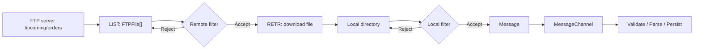
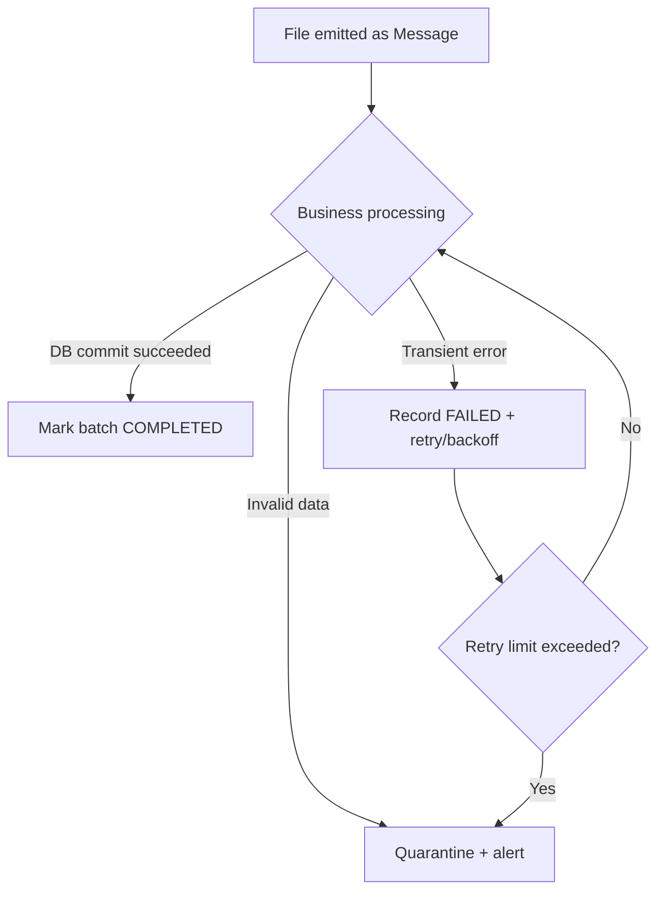

# FTP Filters and File-Tracking Mechanisms

## 1. Problem Statement: Why Should Repeated Polls Not Re-Receive the Same File?

A partner sends orders to the FTP directory `/incoming/orders`. Every 20 seconds, the Spring Integration application checks the directory, downloads new CSV files, and passes them to an order-import service. If every poll downloads and processes all existing files again, the same order could be created multiple times. Yet if a file is marked "processed" too early, a network glitch or database error could cause the file to be skipped forever.

This problem is **partially** solved by file list filtering (`FileListFilter`) and *accept-once* tracking. This lesson belongs to the **FTP Adapter** chapter of the **SPRING_INTEGRATION_ADAPTERS** module, where inbound/outbound adapters, gateways, pollers, and `MessageChannel`s connect the application with external systems such as files, SFTP, HTTP, JMS, AMQP, Kafka, and databases. The focus here is the **FTP inbound adapter**, since it is the endpoint that repeatedly scans and downloads files. Filter outcomes directly impact message lifecycles, errors, and data recovery.

After this lesson, you will be able to:

1. Distinguish **remote file filters** from **local file filters**.
2. Choose filters by filename pattern, regex, file age, and accept-once state.
3. Use `FtpPersistentAcceptOnceFileListFilter`, `FileSystemPersistentAcceptOnceFileListFilter`, and `ConcurrentMetadataStore` to track received files.
4. Understand when a file can be re-downloaded or re-emitted, and when acceptance marks are **not** automatically rolled back.
5. Design handling for restarts, power loss, multiple instances polling together, and business errors downstream of the FTP adapter.

## 2. Two Filter Layers in the FTP Inbound Adapter

An FTP inbound channel adapter that syncs files locally performs two stages:



The **remote filter** inspects the `FTPFile` list returned by the FTP server to decide **which files may be downloaded**. The **local filter** inspects `java.io.File` entries in the local directory to decide **which files may become messages** sent downstream. The two filters run at different stages and maintain independent state.

| Question | Remote filter | Local filter |
| --- | --- | --- |
| What data does it run on? | `FTPFile` on the server | `File` on the host/container |
| Which action does it precede? | Before downloading from FTP (`RETR`) | Before emitting `Message<File>` |
| How does it filter files? | By name, regex, file age, previously downloaded | By local name, in-progress suffix, previously emitted |
| Common persistent filter? | `FtpPersistentAcceptOnceFileListFilter` | `FileSystemPersistentAcceptOnceFileListFilter` |
| Observable goal | Avoid redundant downloads | Avoid re-emitting a local file |
| Does it prove DB commit succeeded? | **No** | **No** |

Suppose `order-42.csv` finishes downloading, but the consumer cannot reach the database. The remote filter may still retain the downloaded mark, and the local filter may also retain the emitted mark. They are **not a business retry queue**. The system must record failures and provide a separate recovery mechanism.

### 2.1. Timeline for a Single File

```text
FTP /incoming/orders/order-42.csv
           |
           | poll: LIST, evaluate remote filter
           v
      REMOTE ACCEPTED
           |
           | RETR over FTP data connection
           v
Local order-42.csv.downloading
           |
           | download complete, rename to order-42.csv
           v
Local order-42.csv
           |
           | local filter accepts
           v
Message<File> -> MessageChannel -> business processing
                                      |
                          COMPLETED or FAILED
```

The key distinction is that the "remote accepted" mark happens during **fetch**, the "local accepted" mark happens during **message emission**, and the business `COMPLETED` status can only be recorded **after processing genuinely succeeds**.

## 3. Common Filters

Spring Integration provides the generic `FileListFilter<F>` interface. Type parameter `F` determines whether the filter operates on remote or local files; you cannot arbitrarily pass a `FileListFilter<File>` where a `FileListFilter<FTPFile>` is expected.

| Category | FTP Example | Purpose |
| --- | --- | --- |
| Simple pattern | `FtpSimplePatternFileListFilter("*.csv")` | Accepts only names matching a simple wildcard pattern, usually an extension |
| Regex | `FtpRegexPatternFileListFilter` | Enforces complex naming rules, such as batch IDs |
| Modification age | `FtpLastModifiedFileListFilter` | Delays accepting brand-new files below an age threshold, when supported by the library version |
| Recent files only | `FtpRecentFileListFilter` | Excludes overly old files, available in newer supporting Spring Integration versions |
| Remote accept-once | `FtpPersistentAcceptOnceFileListFilter` | Uses metadata to avoid re-downloading unchanged remote files |
| Local accept-once | `FileSystemPersistentAcceptOnceFileListFilter` | Uses metadata to avoid re-emitting unchanged local files |
| In-memory accept-once | `AcceptOnceFileListFilter` | Remembers seen objects in process memory; state is lost on restart |
| Combining multiple filters | `ChainFileListFilter`, `CompositeFileListFilter` | Applies multiple selection rules |

Filtering with `*.csv` checks only the **filename**; it does not guarantee the CSV contents are valid or the upload is complete. Regex filters use regular expressions rather than simple wildcard syntax: `*.csv` is a wildcard pattern, whereas the equivalent regex is typically `.*[.]csv`.

### 3.1. Files Still Being Uploaded

A common bug: the partner writes directly to `order-42.csv` over 10 minutes; the poller sees `.csv` in the first minute and downloads an incomplete file. The accept-once filter may then mark the partial file as seen while the upload is still underway.

A more reliable agreement:

```text
Partner upload:     order-42.csv.uploading
                         |
                         | close file and rename on FTP server
                         v
                    order-42.csv

Application filter: match only *.csv
                         |
                         | download locally with temp name *.downloading
                         v
                    order-42.csv on application host
```

If you cannot require the partner to rename files, consider an age filter such as `FtpLastModifiedFileListFilter` (supported since Spring Integration 6.2) with a threshold comfortably larger than upload duration, clock skew, and server timestamp granularity. However, **relying on file age alone still carries risk**, especially if an upload stalls and resumes; a `.done` marker file or completion manifest is a stronger contract if the partner supports it.

### 3.2. `ChainFileListFilter` vs. `CompositeFileListFilter`

This difference directly affects accept-once state:

- **`ChainFileListFilter`** passes the files surviving one filter into the next filter. If an earlier filter rejects a file that is too young, a downstream accept-once filter **never sees and never marks** that file.
- **`CompositeFileListFilter`** lets each member filter evaluate the input list independently and takes the intersection of results. An accept-once filter may mark a file even if another filter rejects it, depending on the specific combination.

Therefore, for **"valid name → complete file → not yet downloaded"**, usually use a chain in the proper order:

```text
FtpSimplePatternFileListFilter("*.csv")
      -> (optional: filter waiting for file age/completion)
      -> FtpPersistentAcceptOnceFileListFilter(...)
```

`CompositeFileListFilter` remains useful when one filter must inspect the **entire listing** to confirm a companion marker file (for instance, accepting `order.csv` only when `order.done` is present in the same directory). In that setup, carefully analyze the side effects of any stateful filter so accept-once does not mark files prematurely.

## 4. What Does Accept-Once Actually Store?

`FtpPersistentAcceptOnceFileListFilter` records acceptance using a `ConcurrentMetadataStore`; the core tracked state relates to the **filename and modification time (modified time) reported by the FTP server**. If a file's name and timestamp remain unchanged, the filter typically skips re-downloading it. If the timestamp changes, the file can be accepted again per filter rules.

`FileSystemPersistentAcceptOnceFileListFilter` records a similar marker for local files using the filename/path and modification time on the local filesystem. Consequently, a **newly downloaded file overwriting an old name** can be re-emitted by the local filter if its modification time changed. `preserveTimestamp(true)` copies the remote modified time onto the local file when supported by the server, aligning the two comparison layers more closely.

**However, modification time is not a content hash.** If a partner alters data while preserving the timestamp, a persistent filter may treat the file as unchanged. Conversely, merely touching a file so its timestamp advances can trigger re-download/re-emission even when bytes did not change. When strict integrity is needed, use checksums/manifests, versions, or batch IDs at the business layer.

| Event | Remote persistent filter | Local persistent filter | Business Implication |
| --- | --- | --- | --- |
| Brand-new unseen file | Usually accepts | Accepts when complete local copy appears | Starts processing |
| Subsequent poll with unchanged name/timestamp | Usually skips fetch | Does not re-emit if local file unchanged | Reduces duplicates |
| Remote file timestamp updated | May accept and re-download | May re-emit if local timestamp changes | Could be a new data version |
| App restarts with in-memory metadata | Forgets prior marks | Forgets prior marks | Risk of re-downloading/re-emitting |
| App restarts with durable metadata store | Retains downloaded marks | Retains emitted marks | Prevents repeats, but disk state must be accounted for |
| File downloaded, DB handler fails | Does not auto-clear mark on downstream error | Does not auto-clear mark on downstream error | Requires separate business retry |
| I/O error during fetch | May roll back remote mark if filter supports rollback | No complete local file to emit yet | Requires transfer retry |
| Power loss mid-fetch | Acceptance mark may remain in metadata store | Local copy may be partial or missing | Requires reconciliation procedure |

Exact metadata store key formats and recursive path handling can vary across Spring Integration versions. Use distinct prefixes, plan upgrades carefully, and verify state before/after restarts. Avoid editing keys manually unless you know the exact convention the filter uses.

## 5. Metadata Stores: In-Memory, Durable, and Shared

A `MetadataStore` is where filters persist state. Persistent accept-once filters require appropriate concurrent update support, typically `ConcurrentMetadataStore`. Common options:

| Option | Survives Restart? | Shareable Across Replicas? | Notes |
| --- | --- | --- | --- |
| `SimpleMetadataStore` | No, in-memory by default | Not shared across JVMs | Convenient for demos and tests |
| JDBC-backed persistent metadata store | Yes, while DB data persists | Yes, depending on configuration | Needs schema, transactional/atomic updates, and cleanup policy |
| `RedisMetadataStore` | Depends on Redis persistence settings | Yes | Evaluate HA/persistence, prefixes, and compare-and-set behavior |
| Suitable file-backed metadata store | Yes, if file is durable | Not safe across multiple JVMs by default | Requires synchronization and concurrency analysis |

If two replicas poll `/incoming/orders` concurrently, a shared metadata store with **atomic** operations helps keep both from claiming the same remote file. Even so, failure windows still exist between **claim → download → emit message → DB commit**. Never treat Redis/JDBC metadata alone as proof of **end-to-end exactly-once**.

### 5.1. Prefixes Isolate Processing Scopes

Suppose two partners both drop a file named `orders.csv`. If they share a metadata store with an indistinct prefix, keys can collide depending on how the filter version builds paths. Use clear namespaces:

```text
partner-a:orders:remote:
partner-a:orders:local:
partner-b:orders:remote:
partner-b:orders:local:
```

Also separate prefixes per flow or directory when one partner has multiple inboxes. Changing a prefix can make old files appear **unseen**. Treat prefix changes or metadata schema changes as part of a data migration plan.

### 5.2. Received Does Not Mean Processed

A file filter metadata key reflects only a **file integration layer** decision. It does not track states such as `VALIDATED`, `IMPORTED`, or `RECONCILED`. You may have three separate state stores:

```text
FTP metadata:    order-42.csv was selected for download
Local metadata:  /data/orders/order-42.csv emitted Message<File>
Business DB:     batch 42 = PROCESSING / COMPLETED / FAILED
```

If the DB records `FAILED`, the application must re-read the local file or re-fetch the remote copy through a pre-designed recovery workflow. Never wipe the entire metadata store as a routine retry mechanism, as that can cause **all files** to be reprocessed.

## 6. Java DSL Example: Filtering CSVs and Tracking Remote/Local State

### 6.1. Dependencies and Configuration

Example for a Spring Boot application using a compatible Spring Integration BOM:

```xml
<dependencies>
    <dependency>
        <groupId>org.springframework.boot</groupId>
        <artifactId>spring-boot-starter-integration</artifactId>
    </dependency>
    <dependency>
        <groupId>org.springframework.integration</groupId>
        <artifactId>spring-integration-ftp</artifactId>
    </dependency>
</dependencies>
```

```yaml
# application.yml
partner:
  ftp:
    host: ${PARTNER_FTP_HOST}
    port: ${PARTNER_FTP_PORT:21}
    username: ${PARTNER_FTP_USER}
    password: ${PARTNER_FTP_PASSWORD}
    remote-directory: /incoming/orders
    local-directory: /data/ftp/orders
```

Credentials must come from the deployment environment or a secret manager; the remote directory lives **on the FTP server**, while the local directory lives **inside the application machine/container**. Ensure the local directory is writable and has sufficient disk space.

### 6.2. Configuring the FTP Session Factory

```java
import org.apache.commons.net.ftp.FTP;
import org.apache.commons.net.ftp.FTPClient;
import org.apache.commons.net.ftp.FTPFile;
import org.springframework.beans.factory.annotation.Value;
import org.springframework.context.annotation.Bean;
import org.springframework.context.annotation.Configuration;
import org.springframework.integration.file.remote.session.CachingSessionFactory;
import org.springframework.integration.file.remote.session.SessionFactory;
import org.springframework.integration.ftp.session.DefaultFtpSessionFactory;

@Configuration
public class OrdersFtpSessionConfiguration {

    @Bean("ordersFtpSessionFactory")
    public SessionFactory<FTPFile> ordersFtpSessionFactory(
            @Value("${partner.ftp.host}") String host,
            @Value("${partner.ftp.port}") int port,
            @Value("${partner.ftp.username}") String username,
            @Value("${partner.ftp.password}") String password) {
        DefaultFtpSessionFactory target = new DefaultFtpSessionFactory();
        target.setHost(host);
        target.setPort(port);
        target.setUsername(username);
        target.setPassword(password);
        target.setClientMode(FTPClient.PASSIVE_LOCAL_DATA_CONNECTION_MODE);
        target.setFileType(FTP.BINARY_FILE_TYPE);
        target.setConnectTimeout(10_000);
        target.setDefaultTimeout(10_000);
        target.setDataTimeout(30_000);

        CachingSessionFactory<FTPFile> cache =
                new CachingSessionFactory<>(target, 4);
        cache.setSessionWaitTimeout(3_000);
        cache.setTestSession(true);
        return cache;
    }
}
```

The factory handles connectivity and FTP session lifecycles. `CachingSessionFactory` bounds and reuses sessions; it does not track files. File tracking is handled by `FileListFilter` implementations and the metadata store.

### 6.3. Two Persistent Filters and One Inbound Flow

Complete configuration example wiring filters to the adapter. `SimpleMetadataStore` is used **only for trying things out and clarity**; when deduplicating across restarts or running clustered, replace it with an appropriate durable/shared `ConcurrentMetadataStore`.

```java
import java.io.File;
import java.time.Duration;
import org.apache.commons.net.ftp.FTPFile;
import org.springframework.beans.factory.annotation.Qualifier;
import org.springframework.beans.factory.annotation.Value;
import org.springframework.context.annotation.Bean;
import org.springframework.context.annotation.Configuration;
import org.springframework.integration.dsl.IntegrationFlow;
import org.springframework.integration.dsl.Pollers;
import org.springframework.integration.file.filters.ChainFileListFilter;
import org.springframework.integration.file.filters.FileSystemPersistentAcceptOnceFileListFilter;
import org.springframework.integration.file.remote.session.SessionFactory;
import org.springframework.integration.ftp.dsl.Ftp;
import org.springframework.integration.ftp.filters.FtpPersistentAcceptOnceFileListFilter;
import org.springframework.integration.ftp.filters.FtpSimplePatternFileListFilter;
import org.springframework.integration.metadata.ConcurrentMetadataStore;
import org.springframework.integration.metadata.SimpleMetadataStore;

@Configuration
public class OrdersFtpInboundFilteringConfiguration {

    @Bean("ordersMetadataStore")
    public ConcurrentMetadataStore ordersMetadataStore() {
        return new SimpleMetadataStore(); // In-memory only: not durable across restarts
    }

    @Bean
    public IntegrationFlow ordersInboundFlow(
            @Qualifier("ordersFtpSessionFactory")
            SessionFactory<FTPFile> sessionFactory,
            @Qualifier("ordersMetadataStore")
            ConcurrentMetadataStore metadataStore,
            @Value("${partner.ftp.remote-directory}") String remoteDirectory,
            @Value("${partner.ftp.local-directory}") String localDirectory) {

        // 1. Match CSV files first before marking them as seen.
        ChainFileListFilter<FTPFile> remoteFilters = new ChainFileListFilter<>();
        remoteFilters.addFilter(new FtpSimplePatternFileListFilter("*.csv"));
        remoteFilters.addFilter(new FtpPersistentAcceptOnceFileListFilter(
                metadataStore, "orders-remote:"));

        // 2. Track the local copy on disk separately.
        FileSystemPersistentAcceptOnceFileListFilter localFilter =
                new FileSystemPersistentAcceptOnceFileListFilter(
                        metadataStore, "orders-local:");

        return IntegrationFlow.from(
                Ftp.inboundAdapter(sessionFactory)
                        .remoteDirectory(remoteDirectory)
                        .localDirectory(new File(localDirectory))
                        .autoCreateLocalDirectory(true)
                        .temporaryFileSuffix(".downloading")
                        .preserveTimestamp(true)
                        .maxFetchSize(3)
                        .filter(remoteFilters)
                        .localFilter(localFilter),
                endpoint -> endpoint.poller(
                        Pollers.fixedDelay(Duration.ofSeconds(20))
                                .maxMessagesPerPoll(2)))
                .channel("incomingFtpOrderFiles")
                .get();
    }
}
```

In this configuration:

1. `FtpSimplePatternFileListFilter("*.csv")` rejects files without a `.csv` suffix.
2. `FtpPersistentAcceptOnceFileListFilter` only marks files that passed the pattern filter. For a file whose name and timestamp are unchanged, it prevents repeated fetches using the metadata store.
3. The adapter downloads accepted files to `localDirectory`, using `.downloading` while incomplete and renaming once transfer finishes.
4. `FileSystemPersistentAcceptOnceFileListFilter` decides which local files are emitted as `Message<File>` onto `incomingFtpOrderFiles`.
5. `maxFetchSize(3)` caps how many remote files are retrieved per fetch pass; `maxMessagesPerPoll(2)` caps how many **messages** are emitted per poll. These two numbers apply to **two different stages**.

When replacing `SimpleMetadataStore` with a durable store, keep the filter setup intact and swap only the metadata bean and backend configuration. Ensure both remote and local filters use the chosen backend with **distinct prefixes**. When running multiple replicas, verify durable persistence, atomicity, and per-instance metadata access.

### 6.4. Contract with the Downstream Handler

Example handler receiving `Message<File>` after the file has downloaded locally:

```java
import java.io.File;
import java.io.IOException;
import java.nio.file.Files;
import org.springframework.integration.annotation.ServiceActivator;
import org.springframework.messaging.Message;
import org.springframework.stereotype.Component;

@Component
public class OrdersFileConsumer {

    @ServiceActivator(inputChannel = "incomingFtpOrderFiles")
    public void accept(Message<File> message) throws IOException {
        File downloaded = message.getPayload();
        long bytes = Files.size(downloaded.toPath());
        if (bytes == 0) {
            throw new IllegalStateException("Empty CSV file: " + downloaded.getName());
        }
        // Next: validate, parse CSV, persist to DB with an idempotency key.
        // Record COMPLETED status only after the business transaction succeeds.
    }
}
```

This is a file-receiving stub, **not a complete business implementation**. If the handler throws an exception after the local filter has marked the file accepted, do not assume the next poll will automatically re-emit that file. Provide a retry/quarantine layer or dedicated state to allow controlled reprocessing.

## 7. Spring Integration Defaults and Limitations

In modern Spring Integration versions, the FTP inbound synchronizer already configures an **in-memory** remote persistent accept-once filter by default. The local filter may also default to `FileSystemPersistentAcceptOnceFileListFilter` backed by an in-memory `SimpleMetadataStore`. Therefore, **"persistent" in the class name does not automatically mean state survives restarts**: actual durability depends on the `MetadataStore` supplied to the filter.

By explicitly passing `.filter(remoteFilters)` and `.localFilter(localFilter)` as shown, the application cleanly controls both filter layers. If you upgrade versions or use `.patternFilter(...)`/`.regexFilter(...)`, verify how the DSL composes them with the active version's default filters; do not assume calling multiple setters automatically builds a properly ordered chain.

**Local temporary files:** the inbound adapter excludes files carrying the configured download suffix from message emission; the default suffix is typically `.writing` unless changed. The code above explicitly uses `.downloading`. The adapter's local filtering logic adds protection so files with this suffix are not emitted, in addition to custom filters.

**State at fetch time:** starting in Spring Integration 5.2, compatible persistent accept-once filters can mark a file right before fetching, helping avoid claiming too many files prematurely. If a transfer error occurs and the filter implements `ReversibleFileListFilter`, the framework attempts to roll back the acceptance mark so the file can be fetched on a later pass. An abrupt crash such as power loss can still leave a claim mark present even though the local copy is incomplete.

## 8. Distinguishing Fetch Limits from Message Emission Limits

Suppose the server has six new files: `a.csv`, `b.csv`, `c.csv`, `d.csv`, `e.csv`, and `f.csv`. Starting with an empty local directory:

| `maxFetchSize` | `maxMessagesPerPoll` | Possible Behavior in One Poll Cycle |
| --- | --- | --- |
| Unlimited (negative default) | 2 | Syncs many remote files, then emits at most 2 messages; remaining local files wait for later polls |
| 4 | 2 | Fetches up to 4 remote files in one fetch pass, emits at most 2; remaining local files wait |
| 2 | 2 | Fetches up to 2 files in one fetch pass, then emits up to 2; if the poll loop still has room for another receive call, it may fetch again |
| 1 | 2 | May fetch 1 file, emit 1, then fetch 1 more if configuration and source state permit |

Actual counts depend on leftover local files, filter ordering, library version, and how the `MessageSource` supplies items. The table explains **configuration intent**, not an exact guarantee of FTP command counts in every situation.

When running multiple instances, keeping `maxFetchSize` relatively small alongside an appropriate shared metadata store helps prevent one instance from claiming every new file at once. If you set only `maxMessagesPerPoll` and omit `maxFetchSize`, one instance can still download many files before emitting messages one by one.

## 9. Rollback and Retry Mechanisms: Three Error Types to Distinguish

### 9.1. Errors While Downloading from FTP

Suppose `RETR order-42.csv` drops at 60% due to a network disconnect. If the remote filter supports rollback and the synchronizer catches the I/O error, the framework can remove the file from the "accepted" set so a future poll retries fetching it. A temporary local file may remain on disk; never feed that temporary file to a parser as a complete file.

**Limitation:** rollback operates at the synchronizer/filter layer. If the JVM is killed or loses power right as metadata is written, there is no guarantee the rollback ran. On restart, implement a reconciliation check comparing metadata, temporary files, and remote files before deciding whether to reset state for a specific file.

### 9.2. Processing Errors After Message Emission

Suppose `order-42.csv` downloaded completely and was emitted to `incomingFtpOrderFiles`, but the parser hits a bad record and the handler throws an exception. Under the FTP inbound adapter contract, **file filters do not automatically roll back for downstream errors**.

Design options include:

- Keep the downloaded local file, record `FAILED` in a status table keyed by batch/file ID, and let a retry worker reprocess it under explicit rules.
- Move the file to a `quarantine` area recording the failure reason and owner; once the ingestion rule is fixed, replay the file from quarantine.
- Use transaction synchronization together with `ResettableFileListFilter` to build file/local state rollback where appropriate, after carefully analyzing transaction scope and data boundaries.

Do not wipe the entire metadata store, and do not enable `deleteRemoteFiles(true)` just to "solve duplicate files." Downloading a file does not mean the business transaction committed; deleting remote files prematurely can destroy your recovery source.

### 9.3. "Sent to Channel" Does Not Mean "Committed"

A `MessageChannel` can be a synchronous `DirectChannel` or an executor/queue-backed channel. When downstream processing is asynchronous, succeeding at sending a message is even further from a business commit. To prevent duplicate orders during replay, enforce business keys (`partnerId + orderId`, `batchId + lineId`, etc.) with unique constraints or an appropriate idempotent mechanism.



Here, `FAILED` and `COMPLETED` are **application-defined states**, not states automatically maintained by the FTP accept-once filter.

## 10. Multi-Replica Deployments, Restarts, and File Modifications

### 10.1. When a Pod Restarts

Suppose `/data/ftp/orders` lives on a container's ephemeral filesystem while the metadata store runs in Redis:

1. Pod A successfully downloads `order-42.csv` and records remote/local marks.
2. Pod A crashes before finishing DB processing.
3. A replacement pod starts with an **empty** local disk, yet Redis still shows the file as received.
4. Without reconciliation, `order-42.csv` may never be re-downloaded due to the filter decision.

Therefore, align the **local file lifecycle** with the **metadata lifecycle**. You can use persistent volumes, durable object storage/queues right after ingestion, or a reconciliation job that inspects and replays incomplete `FAILED/IN_PROGRESS` batches. Deleting a metadata key should only be a controlled, observable recovery action.

### 10.2. When Two Replicas Poll Together

Two replicas polling the FTP server simultaneously can both see `order-42.csv`. Sharing a `ConcurrentMetadataStore` with atomic operations helps coordinate claims, though you still face risks when:

- Replica A claims the file and dies before finishing the download.
- Replica A downloads successfully, while Pod B lacks the corresponding local copy.
- Two instances have skewed system clocks, or a file is modified mid-scan.
- The metadata store and filesystem/DB do not participate in a single distributed transaction.

Practical mitigations: designate a leader/poller owning the directory, partition directories by partner or batch, or combine a shared metadata store with **DB idempotency**. Test under real concurrency rather than trusting the `PersistentAcceptOnce` class name alone.

### 10.3. Remote File Content Changes Without a Name Change

`FtpPersistentAcceptOnceFileListFilter` inspects the FTP server's modified timestamp. If `order-42.csv` is overwritten with a newer timestamp, the filter may accept it again; if the timestamp stays the same, it may skip it even though bytes changed. The cleanest solution is requiring the partner to use **immutable per-batch/version filenames** and publish files only once complete. Use manifests/hashes if you must detect content changes when timestamps are unreliable.

## 11. Filter Troubleshooting Guide

| Symptom | Possible Cause | Verification / Resolution |
| --- | --- | --- |
| New file exists on FTP but is not downloaded | Pattern/regex mismatch, file too young, remote metadata already claimed it | Check remote listing, filename, timestamp, filter ordering, and metadata key |
| File still uploading is picked up early | Partner published final name too soon; filtering only on `*.csv` | Agree on temp-name/rename or completion marker |
| File downloaded locally but no message emitted | Local filter already marked it; download suffix still present; wrong local path | Inspect actual file, local metadata, suffix, and adapter logs |
| Old files re-emitted after restart | In-memory store or changed prefix | Use a durable metadata store; check migration and replay policy |
| New file not re-downloaded after restart | Metadata claimed it but local volume was lost, or crash happened before rollback | Compare files, metadata, and business state; recover specific key |
| Modified remote file not re-emitted | Remote/local timestamps do not reflect the change; local filter did not re-accept | Check `preserveTimestamp`, modified time, and versioning policy |
| Two pods process the same batch | Unshared metadata or missing final idempotency | Check atomic store, leader/partitioning, and DB unique keys |
| DB handler fails yet file never retries | Local accept-once recorded the mark; downstream errors do not roll back filter | Design retry/quarantine or controlled reset |
| Many files downloaded despite `maxMessagesPerPoll=1` | That setting caps emitted messages, not fetched files | Add an appropriate `maxFetchSize` |
| No files received because `LIST`/`RETR` fails | Missing permissions, timeout, passive data port, server unavailable | Distinguish FTP session errors from empty filter results |

When debugging, log minimal diagnostic fields such as `partnerId`, remote path, filename, modified timestamp, filter outcome, batch ID, and exception type; never log passwords or full file contents. In multi-replica deployments, include instance/pod ID to trace which node claimed and processed the file.

## 12. Testing Filter Behavior with Realistic Scenarios

Test against a dedicated integration-test FTP server, a test metadata store, and a controlled local directory; mocking `FileListFilter` alone will not validate FTP transfer, renames, or retries. Key scenarios:

| Scenario | Expectation |
| --- | --- |
| Server has `a.csv`, `readme.txt` | Only `a.csv` passes the remote pattern |
| Subsequent poll, `a.csv` unchanged | Not re-fetched while metadata filter retains state |
| Timestamp of `a.csv` changes | Filter can re-accept; local filter receives updated modified time |
| Server has `b.csv.uploading` | Not downloaded; picked up once renamed to `b.csv` |
| Connection drops during `RETR` | Partial local file is not emitted; metadata can roll back if filter supports it |
| Handler throws exception after `a.csv` is emitted | Do not assume poller auto-re-emits; business retry handles recovery |
| Restart with `SimpleMetadataStore` | In-RAM state lost; risk of re-fetch/re-emission |
| Restart with durable store and intact local volume | Filter state restored, avoiding unintended re-emissions |
| Restart with durable store but lost local volume | Reconciliation/recovery workflow required to avoid skipped files |
| Two replicas polling the same directory | No duplicate orders created despite claim contention or retries |
| `maxFetchSize=3`, `maxMessagesPerPoll=2` | Distinguishes fetched file count from emitted message count |
| `a.csv` content modified with same timestamp | Test confirms limitation of timestamp-based change detection |

This is a **recommended test checklist**, not output from a test suite run in this lesson. When testing network drops or restarts, record local file state, metadata keys, and business DB state for comparison. When resetting state for recovery, operate only in test environments or through controlled operational procedures.

## 13. Scenario Exercise

**Context:** A partner uploads `orders-<batchId>.csv` files to `/incoming/orders`. Files are up to 500 MB, and uploads can take 10 minutes. The application runs two Kubernetes pods, each with its own local directory, accept-once state is stored in Redis, and the poller runs every 15 seconds. Occasionally a pod is killed after downloading a file but before committing to the DB.

Answer:

1. Why can `FtpSimplePatternFileListFilter("*.csv")` still pick up an incomplete file?
2. For the sequence `pattern` → `last modified age` → `persistent accept once`, should you use `ChainFileListFilter` or `CompositeFileListFilter` if you do not want underage files marked?
3. How do `FtpPersistentAcceptOnceFileListFilter` and `FileSystemPersistentAcceptOnceFileListFilter` differ?
4. Why can Redis still holding metadata while a new pod loses its local file lead to missing data?
5. When `RETR` loses its connection, under what conditions can the remote filter roll back?
6. If the DB fails after the handler received `Message<File>`, does the filter automatically clear its mark so the poller re-emits it?
7. Do `maxFetchSize(2)` and `maxMessagesPerPoll(2)` have the same effect?
8. To prevent duplicate orders during replay, where must the idempotency key live?

**Suggested answers:** (1) The partner may write directly to `.csv` before finishing; require temp-name/rename or a marker file. (2) Use a **chain** so the accept-once filter only sees files that passed the age check. (3) Remote decides what to download from FTP; local decides what to emit as messages. (4) The "received" mark survives restart while the local copy is lost; reconciliation and durable storage are needed. (5) The synchronizer must catch the error and the filter must support rollback (`ReversibleFileListFilter`); an abrupt crash can still leave a mark behind. (6) No—business-level retry/quarantine is required. (7) No—one caps fetching, the other caps message emission. (8) In the business DB/consumer, keyed consistently by order or batch.

## Key Takeaways

**The FTP inbound adapter makes two independent decisions:** whether to **download** a file from FTP, and whether to **emit** a local file as a message. Remote and local persistent accept-once filters avoid redundant work based on name/timestamp, yet persistence across restarts depends on the metadata store. Filtering filenames alone does not guarantee complete files; filter composition order also determines when files get marked.

**An accept-once mark is not a business commit state.** I/O errors during fetch can be rolled back by supporting filters, whereas downstream errors and crashes require dedicated recovery mechanisms. A resilient system aligns filename/marker conventions, metadata, local storage, retries, and business-layer idempotency.

## References

- [Spring Integration Reference — FTP Inbound Channel Adapter](https://docs.spring.io/spring-integration/reference/ftp/inbound.html)
- [Spring Integration Reference — Remote Persistent File List Filters](https://docs.spring.io/spring-integration/reference/file/remote-persistent-flf.html)
- [Spring Integration Reference — Controlling Remote File Fetching](https://docs.spring.io/spring-integration/reference/sftp/max-fetch.html)
- [Spring Integration API — `FtpInboundChannelAdapterSpec`](https://docs.spring.io/spring-integration/api/org/springframework/integration/ftp/dsl/FtpInboundChannelAdapterSpec.html)
- [Spring Integration API — `ChainFileListFilter`](https://docs.spring.io/spring-integration/api/org/springframework/integration/file/filters/ChainFileListFilter.html)
- [Spring Integration API — `FileSystemPersistentAcceptOnceFileListFilter`](https://docs.spring.io/spring-integration/api/org/springframework/integration/file/filters/FileSystemPersistentAcceptOnceFileListFilter.html)
