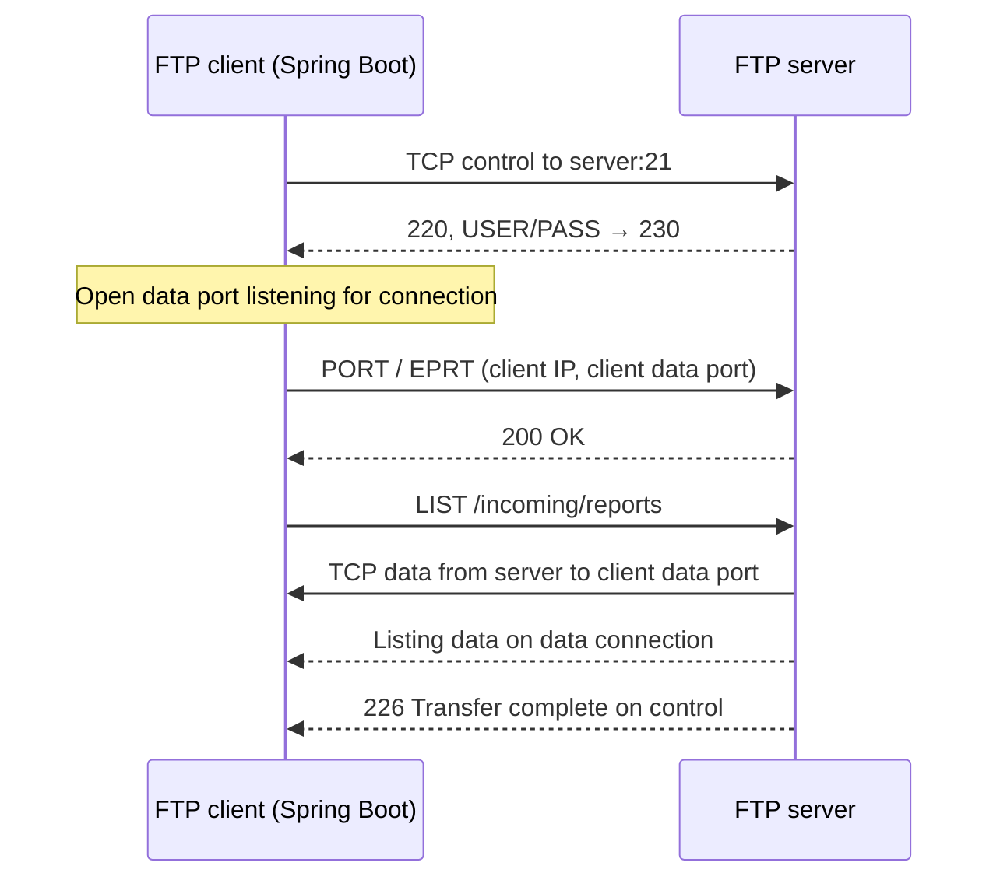
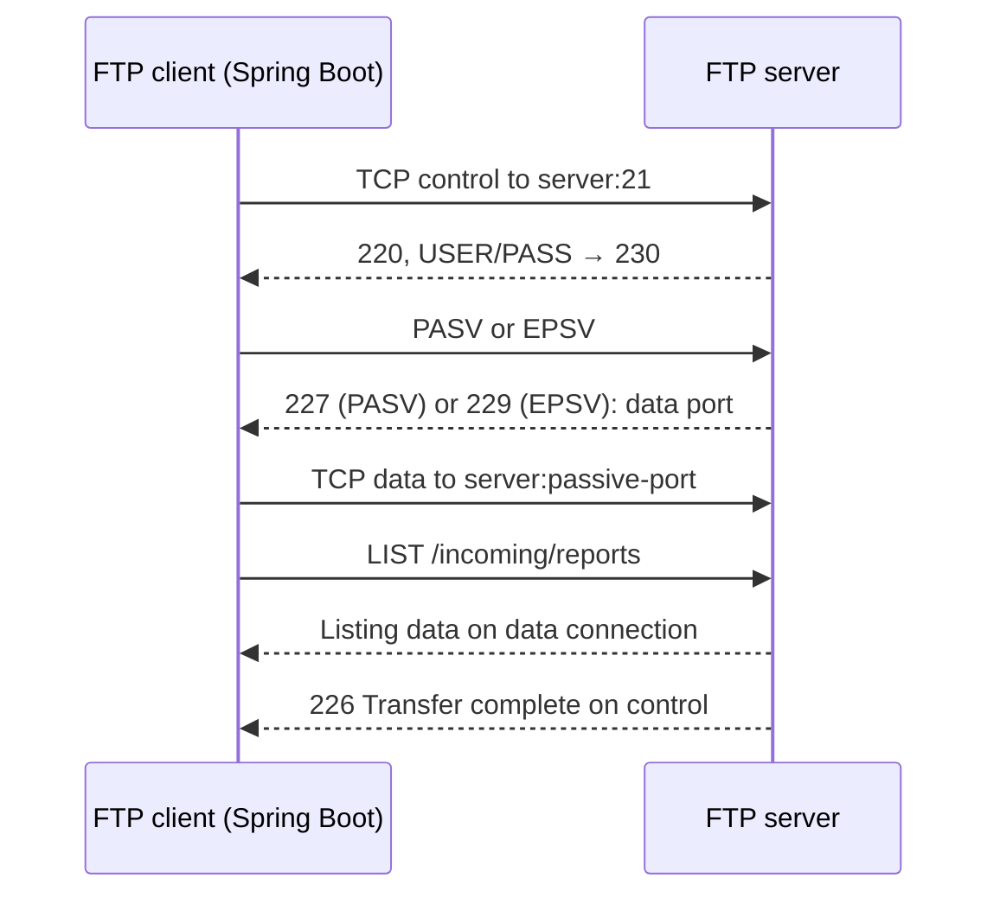
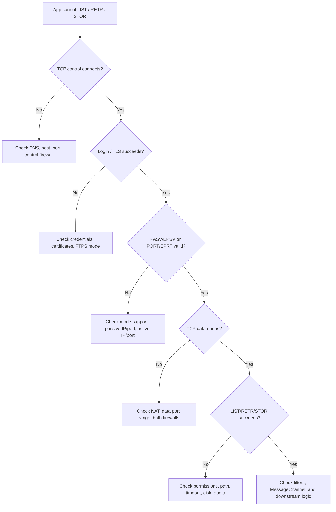

# Active Mode, Passive Mode, and Network Requirements When Using the FTP Adapter

## 1. Context: FTP Login Succeeds, Yet File Transfers Fail

A Spring Boot application uses an FTP inbound adapter to fetch CSV reports from `/incoming/reports`. It connects to `ftp.partner.example:21` and logs in successfully, yet when listing (`LIST`) or downloading (`RETR`) a file, it hangs for a long time and fails with `425 Can't open data connection`. The operations team tested TCP connectivity to port 21 and confirmed it works, leaving them puzzled about why FTP still fails.

The root cause usually lies in how FTP opens its **data connection**. FTP sends commands and transfers file contents over separate TCP connections. Whether **active** or **passive** mode is used determines **which side initiates the data TCP connection**. Choosing the wrong mode causes FTP to fail when the client sits behind NAT, a firewall, a proxy, a load balancer, or runs inside a container.

This lesson belongs to the **FTP Adapter** chapter of the **SPRING_INTEGRATION_ADAPTERS** module. The module explores how to integrate external systems with Spring Integration using inbound/outbound adapters, gateways, pollers, and `MessageChannel`s—spanning files, SFTP, HTTP, JMS, AMQP, Kafka, and databases—while managing message contracts, errors, and connection lifecycles. This lesson focuses on **active/passive modes and network infrastructure prerequisites** so FTP endpoints operate reliably.

By the end of this lesson, you will be able to:

1. Distinguish the **control connection** from the **data connection** in FTP.
2. Trace the command sequence for `PORT/EPRT` (active) and `PASV/EPSV` (passive).
3. Identify connection initiation direction and firewall/NAT rules for each mode.
4. Configure `DefaultFtpSessionFactory` and `CachingSessionFactory` to match your network environment in Spring Integration.
5. Diagnose why login succeeds while `LIST`, `RETR`, or `STOR` fails, and distinguish plain FTP, FTPS, and SFTP.

## 2. Background: FTP Uses Two TCP Connections

Unlike standard HTTP, FTP maintains a dedicated **control channel** and opens a **data channel** whenever executing commands that transfer directory listings or file contents.

| Connection | Responsibility | Who Initiates? | Common Ports |
| --- | --- | --- | --- |
| **Control connection** | Login `USER/PASS`, change directory `CWD`, send `LIST`, `RETR`, `STOR`, `RNFR/RNTO`, and receive FTP reply codes | **Client** connects to server | Server typically listens on TCP **21** for FTP and explicit FTPS |
| **Data connection** | Transfer directory listings and download/upload file bytes | **Client** in passive mode; **server** in active mode | Passive: a port specified by the server; active: a port advertised by the client |

With plain FTP on control port 21, the sequence typically looks like:

```text
Client → Server: TCP connect :21
Server → Client: 220 Service ready
Client → Server: USER my-user
Server → Client: 331 Password required
Client → Server: PASS ********
Server → Client: 230 User logged in

Client → Server: PASV or EPSV (if passive)
              or PORT/EPRT (if active)
Client → Server: LIST /incoming/reports
              or RETR report.csv / STOR upload.csv

Client ↔ Server: data connection opened to transfer data
Server → Client: 226 Closing data connection (when complete)
```

This is a logical overview. Exact ordering of certain commands and reply codes depends on the server, client, and operation. **A successful login only validates the control path.** Even `PWD` or `NOOP` succeeding does not prove a data connection can be opened.

### 2.1. Which Operations Require a Data Connection?

| Operation | Needs a Data Connection? | Testing Value |
| --- | --- | --- |
| `USER`, `PASS`, `PWD`, `CWD`, `NOOP` | Normally no | Tests control channel, authentication, or navigation |
| `LIST`, `NLST`, `MLSD` | Yes | Tests directory listing transfer |
| `RETR` | Yes | Tests downloading over the FTP data channel |
| `STOR`, `APPE` | Yes | Tests uploading over the FTP data channel |
| `RNFR`, `RNTO`, `DELE` | Normally no separate data connection | Still depends on permissions, path, and server state |

For that reason, a meaningful connectivity health check must exercise at least one **command that transfers data**, such as `LIST`, and for upload workflows should also test a `STOR` into an authorized test area.

## 3. Active Mode: The Server Connects Back to the Client

In **active FTP**, the client tells the server which IP address and port the client is listening on for the incoming data connection. For classic IPv4, the client sends `PORT`; the extended version is `EPRT`. When the client issues `LIST` or `RETR`, the server **actively opens a TCP connection from the server side to the client's advertised IP and port**.



Illustrative example:

```text
Control:  client:ephemeral   ------> server:21
Data:     server:data-source ------> client:41025

Client advertises its address and port 41025 using PORT/EPRT.
Server must be able to reach client:41025 from the server's network.
```

Classic active FTP is often associated with **TCP 20** as the server's data source port, but never assume every server and session uses source port 20. Base firewall rules on actual server configuration and connection flows rather than assuming "opening port 20 is enough."

### 3.1. Why Active Mode Struggles Through NAT/Firewalls

1. **The client needs an inbound TCP port.** When the application sits behind a firewall that blocks inbound connections by default, the server cannot connect to the port the client advertised.
2. **The advertised IP may be a private IP.** A client inside a container has an IP like `10.x.x.x`; a server on the Internet cannot route directly to that address.
3. **NAT must map dynamic data ports.** Without FTP-aware handling and appropriate routing/port-forwarding rules, return packets never reach the right socket.
4. **Kubernetes/cloud inbound policies** often prevent external servers from initiating connections directly to pods, even when pods can reach the Internet outbound.

Active mode can still work in a private network with bidirectional routing, firewall rules allowing the server to connect back to the client, and a partner mandate for active mode. When using active mode, the network team must align on **the client IP reachable by the server**, the client data port range, and the corresponding inbound firewall rules.

## 4. Passive Mode: The Client Initiates Both Connections

In **passive FTP**, the client opens the control connection to the server and also **actively opens the data connection from client to server**. Before transferring data, the client sends `PASV` or `EPSV`. The server replies with a listening port, and the client connects to that port.



Illustrative example if the FTP server configures passive range **50000–50100**:

```text
Control:  client:ephemeral1 ------> server:21
Data:     client:ephemeral2 ------> server:50023

Server allocates port 50023 from range 50000–50100.
Client must be able to reach both :21 and :50023 on the server address.
```

The range `50000–50100` is purely an **example**, not a mandatory FTP standard. Infrastructure teams must align on the exact range configured on the **actual server**, open matching firewall rules, and ensure those ports route to the FTP server.

### 4.1. `PASV`: Server Returns IP and Port

Example reply:

```text
227 Entering Passive Mode (203,0,113,20,195,103)
```

Typically, the six numbers represent IPv4 address `203.0.113.20` and port:

```text
port = p1 * 256 + p2
     = 195 * 256 + 103
     = 50023
```

If the server sits behind NAT and advertises an **internal IP** such as `10.0.1.20`, an external client cannot connect to that address. This is a classic passive FTP misconfiguration: the control connection to the public IP works, yet `LIST` or `RETR` fails.

In that case, configure the FTP server to advertise an address reachable by the client and forward the passive port range through NAT/load balancers. Some FTP clients apply safeguards when `PASV` returns a different IP than the control endpoint; do not assume all clients or versions ignore the server-returned IP in the same way.

### 4.2. `EPSV`: Often Simpler Across NAT and IPv6

`EPSV` (extended passive mode, RFC 2428) normally returns only a **port**; the client connects to the **same host address** used for the control connection:

```text
229 Entering Extended Passive Mode (|||50023|)
```

This avoids embedding an IPv4 address in the `PASV` reply, works with IPv6, and is often simpler when the server sits behind NAT. However, not every FTP server or FTP proxy supports and configures `EPSV` identically. Test against the actual server and verify the behavior of the Apache Commons Net version used by your application.

### 4.3. Passive Does Not Mean Zero Firewall Configuration

In passive mode, the client side normally only needs **outbound TCP connections** to the FTP server's control port and passive range; with a stateful firewall, return traffic is allowed by connection state. The server side must allow **inbound TCP** to both the control port and the passive data range, and ensure the server actually listens on the advertised range.

If your organization enforces an allowlist-based egress firewall, opening port 21 alone is **not enough**. Client egress rules must also allow connections to the passive ports. If the FTP server sits behind a load balancer, NAT, or proxy, data flows must reach the same backend holding the corresponding FTP session.

## 5. Comparing Active and Passive by Connection Direction

| Criterion | Active mode | Passive mode |
| --- | --- | --- |
| Control connection | Client → server | Client → server |
| Data connection | **Server → client** | **Client → server** |
| Who listens for data? | Client | Server |
| Negotiation commands | `PORT` (IPv4), `EPRT` | `PASV`, `EPSV` |
| Client behind NAT/firewall | Needs inbound/port mapping, usually harder | Usually easier to operate |
| Server behind NAT | Needs server → client routing | Needs proper advertised passive IP and port range |
| Rules typically needed on client side | Inbound from server to client data port; outbound to server control | Outbound to server control port **and** passive range |
| Rules typically needed on server side | Outbound to client data port, inbound control | Inbound control **and** passive data port range |
| Best suited for | Private networks with bidirectional routing, special mandates | Most server-side/cloud applications behind NAT |

**Practical recommendation:** for Spring Integration running in Docker/Kubernetes or enterprise cloud networks, **local passive mode** is usually preferred. If a partner mandates active mode, obtain a concrete network design from the infrastructure team rather than just flipping a constant in Java.

## 6. Network Requirements by Environment

### 6.1. When the Spring Boot Application Is the FTP Client

This applies to **FTP inbound adapters, outbound adapters, and outbound gateways**. Even though inbound receives files and outbound sends files, **the application is the FTP client in both cases**.

| Spring Integration Operation | FTP Commands Requiring Data | Does Data Mode Depend on Upload vs. Download? |
| --- | --- | --- |
| FTP inbound adapter downloading files | `LIST`, `RETR` | **No**; active/passive depends on who opens the data TCP socket |
| FTP outbound adapter uploading files | `STOR` | **No**; still uses the FTP client's configured mode |
| FTP outbound gateway listing | `LIST`/`NLST` | **No**; request–reply does not change connection roles |
| FTP outbound gateway `get`/`put` | `RETR`/`STOR` | **No** |

A common misconception is "downloads must use passive, uploads must use active." That is **false**: active/passive refers to **which side initiates the TCP data socket**, not the direction of file bytes. Both `RETR` and `STOR` work in either mode when the server and network allow it.

### 6.2. Applications in Docker or Kubernetes

Pods may only have private IP addresses, with Internet egress passing through a NAT gateway or proxy. In active mode, the server must connect to a listening port inside the pod—an inbound path that typically does not exist by default. In passive mode, the pod initiates outbound connections to the server, fitting egress NAT much better.

Still, verify:

1. **Namespace `NetworkPolicy`/egress firewalls** permit TCP to the control host/port and passive data port range.
2. **NAT gateways and security groups** permit return traffic over stateful connections without overly tight session limits.
3. **DNS/server address** remains consistent between control and data; egress control devices must know the passive port range too.
4. **Load balancers in front of the FTP server** route control and data consistently. A standard HTTP Ingress Controller does not automatically handle FTP control/data traffic.
5. **Passive port range** is large enough for concurrent transfers, and those ports are genuinely listened on and allowed on protective devices.

Example firewall agreement for **passive FTP** (assuming the server uses port 21 and passive range 50000–50100):

```text
From application subnet/pod egress:
    TCP outbound -> ftp.partner.example:21          (control)
    TCP outbound -> ftp.partner.example:50000-50100 (passive data)

On the FTP server side:
    TCP inbound  -> server:21
    TCP inbound  -> server:50000-50100

Return traffic: permitted by stateful connection tracking.
```

If the server uses explicit FTPS, the control port is still usually 21 and the passive range is still needed. With implicit FTPS, the control port is usually 990; confirm with the partner's operational documentation. **Never assume all FTPS servers use the same data port range.**

### 6.3. Application and FTP Server in the Same Internal Network

Active mode can work if the server can route back to the client address and firewalls permit the reverse connection. Even so, if the client is a VM or pod with dynamic addresses, managing active port ranges becomes cumbersome. Passive mode is still generally easier to monitor and keep firewall rules clean between the app and FTP server.

In environments with NAT on both sides, document the **advertised IP**, **port range**, NAT mappings, and connection initiator. Both sides must test end-to-end; an architecture diagram saying only "open FTP port 21" is not enough to deploy.

## 7. Spring Integration Configuration: Passive and Active

### 7.1. Dependencies and Externalized Configuration

Maven example with Spring Boot BOM or a compatible Spring Integration BOM managing aligned versions:

```xml
<dependencies>
    <dependency>
        <groupId>org.springframework.boot</groupId>
        <artifactId>spring-boot-starter-integration</artifactId>
    </dependency>
    <dependency>
        <groupId>org.springframework.integration</groupId>
        <artifactId>spring-integration-ftp</artifactId>
    </dependency>
</dependencies>
```

```yaml
# application.yml
partner:
  ftp:
    host: ${PARTNER_FTP_HOST}
    port: ${PARTNER_FTP_PORT:21}
    username: ${PARTNER_FTP_USER}
    password: ${PARTNER_FTP_PASSWORD}
    remote-inbox: /incoming/reports
    local-inbox: /data/ftp/reports
```

`PARTNER_FTP_*` values are injected from the deployment environment or secret manager. Never commit credentials to Git or print them in logs. `remote-inbox` resides on the **FTP server**, while `local-inbox` resides on the **machine/container running Spring Boot**.

### 7.2. Common Passive Mode Configuration

```java
import org.apache.commons.net.ftp.FTP;
import org.apache.commons.net.ftp.FTPClient;
import org.apache.commons.net.ftp.FTPFile;
import org.springframework.beans.factory.annotation.Value;
import org.springframework.context.annotation.Bean;
import org.springframework.context.annotation.Configuration;
import org.springframework.integration.file.remote.session.CachingSessionFactory;
import org.springframework.integration.file.remote.session.SessionFactory;
import org.springframework.integration.ftp.session.DefaultFtpSessionFactory;

@Configuration
public class PartnerFtpConfiguration {

    @Bean("partnerFtpSessionFactory")
    public SessionFactory<FTPFile> partnerFtpSessionFactory(
            @Value("${partner.ftp.host}") String host,
            @Value("${partner.ftp.port}") int port,
            @Value("${partner.ftp.username}") String username,
            @Value("${partner.ftp.password}") String password) {

        DefaultFtpSessionFactory target = new DefaultFtpSessionFactory();
        target.setHost(host);
        target.setPort(port);
        target.setUsername(username);
        target.setPassword(password);

        // Client actively opens the data connection to the passive port on the FTP server.
        target.setClientMode(FTPClient.PASSIVE_LOCAL_DATA_CONNECTION_MODE);
        target.setFileType(FTP.BINARY_FILE_TYPE);

        // Timeouts for control connect, control socket, and data socket (ms).
        target.setConnectTimeout(10_000);
        target.setDefaultTimeout(10_000);
        target.setDataTimeout(30_000);

        // Up to four sessions managed/borrowed concurrently.
        CachingSessionFactory<FTPFile> cache =
                new CachingSessionFactory<>(target, 4);
        cache.setSessionWaitTimeout(5_000);
        cache.setTestSession(true);
        return cache;
    }
}
```

The constant `FTPClient.PASSIVE_LOCAL_DATA_CONNECTION_MODE` means the **local client is in passive mode**; it has nothing to do with whether an adapter is receiving (*inbound*) or sending (*outbound*) messages.

Choose `FTP.BINARY_FILE_TYPE` to transfer bytes unmodified, including CSV, PDF, ZIP, or image files. In ASCII mode, the client or server may translate line endings per protocol rules, which is unsuitable when exact byte preservation is required.

`CachingSessionFactory` reduces session creation overhead, **but it cannot fix a blocked firewall**. `setTestSession(true)` validates a cached session before reuse; network drops can still occur right in the middle of `LIST`, `RETR`, or `STOR`.

### 7.3. When Active Mode Is Mandatory

If the partner supports only active mode and the network team has configured inbound routing back to the client, switch the mode in the factory:

```java
// Replace just the client mode line in the factory configuration above:
target.setClientMode(FTPClient.ACTIVE_LOCAL_DATA_CONNECTION_MODE);
```

**Changing this constant alone is not enough.** The infrastructure team must resolve which client address the FTP server can reach, which data port range the client listens on, and the corresponding inbound rules. In Apache Commons Net versions, controlling the advertised IP/port for active mode uses dedicated APIs; design and test against your exact `FTPClient` version, adapter settings, and NAT setup.

Do not confuse `ACTIVE_LOCAL_DATA_CONNECTION_MODE` with modes meant for server-to-server FTP transfers; the Spring Boot application acts as a **local FTP client** here.

### 7.4. Using One Session Factory Across FTP Endpoints

```java
import java.io.File;
import java.time.Duration;
import org.apache.commons.net.ftp.FTPFile;
import org.springframework.beans.factory.annotation.Qualifier;
import org.springframework.beans.factory.annotation.Value;
import org.springframework.context.annotation.Bean;
import org.springframework.context.annotation.Configuration;
import org.springframework.integration.dsl.IntegrationFlow;
import org.springframework.integration.dsl.Pollers;
import org.springframework.integration.file.remote.session.SessionFactory;
import org.springframework.integration.ftp.dsl.Ftp;
import org.springframework.integration.ftp.filters.FtpSimplePatternFileListFilter;

@Configuration
public class PartnerFtpInboundFlow {

    @Bean
    public IntegrationFlow ftpReportsInbound(
            @Qualifier("partnerFtpSessionFactory")
            SessionFactory<FTPFile> sessionFactory,
            @Value("${partner.ftp.remote-inbox}") String remoteInbox,
            @Value("${partner.ftp.local-inbox}") String localInbox) {

        return IntegrationFlow.from(
                Ftp.inboundAdapter(sessionFactory)
                        .remoteDirectory(remoteInbox)
                        .localDirectory(new File(localInbox))
                        .autoCreateLocalDirectory(true)
                        .temporaryFileSuffix(".downloading")
                        .filter(new FtpSimplePatternFileListFilter("*.csv")),
                endpoint -> endpoint.poller(
                        Pollers.fixedDelay(Duration.ofSeconds(20))
                                .maxMessagesPerPoll(5)))
                .channel("ftpReportFiles")
                .get();
    }
}
```

The poller periodically triggers the inbound adapter; the adapter uses the session factory to run `LIST`/`RETR`, downloads files locally, and emits `Message<File>` onto `ftpReportFiles`. Choosing active or passive **does not alter the payload contract**. For an outbound adapter or outbound gateway, the factory setup is the same—only the transfer commands (`STOR`, `LIST`, `RETR`, etc.) change.

Note: the `*.csv` pattern filter in this example is only an initial file-selection step; **it does not guarantee duplicate suppression or durable recovery**. For production, configure remote/local persistent accept-once filters, a durable metadata store, and business idempotency; those concerns are orthogonal to active/passive mode.

## 8. FTPS: TLS Does Not Eliminate Data Connection Requirements

**FTPS** is FTP secured with TLS. FTPS starts in one of two common ways:

| Variant | Common Control Port | Key Point |
| --- | --- | --- |
| **Explicit FTPS** | TCP 21 | Starts like standard FTP, then upgrades the control channel to TLS via `AUTH TLS` |
| **Implicit FTPS** | TCP 990 | Starts TLS immediately upon opening the control connection |

FTPS still has a **control channel** and a **data channel**; passive port ranges or active inbound ports must still be permitted. When configured with `PROT P`, the data channel is also encrypted with TLS. A concise example of an explicit FTPS factory:

```java
import org.apache.commons.net.ftp.FTP;
import org.apache.commons.net.ftp.FTPClient;
import org.springframework.integration.ftp.session.DefaultFtpsSessionFactory;

DefaultFtpsSessionFactory ftps = new DefaultFtpsSessionFactory();
ftps.setHost("ftps.partner.example");
ftps.setPort(21);
ftps.setUsername(System.getenv("FTPS_USER"));
ftps.setPassword(System.getenv("FTPS_PASSWORD"));
ftps.setImplicit(false);
ftps.setProtocol("TLS");
ftps.setProt("P"); // Require protection for the data channel.
ftps.setEndpointCheckingEnabled(true);
ftps.setClientMode(FTPClient.PASSIVE_LOCAL_DATA_CONNECTION_MODE);
ftps.setFileType(FTP.BINARY_FILE_TYPE);
```

This is an illustrative configuration snippet; production deployments must configure a CA/truststore, certificate hostname checking, TLS policies, and server validation. **Never disable certificate validation to work around network or handshake errors.**

### 8.1. Why Does FTPS Often Break FTP ALGs?

Some traditional firewalls/NAT gateways use an **FTP application layer gateway (ALG)** to inspect `PORT` commands or `PASV` replies on the control channel and dynamically open ports or rewrite IP addresses. With FTPS, the control channel is encrypted, so middleboxes **cannot easily inspect commands inside TLS**.

As a result, an environment where "plain FTP worked thanks to an ALG" can break when switching to FTPS, even though TCP 21 stays open. A more reliable approach is configuring explicitly:

- A fixed passive port range on the FTPS server with matching NAT mappings and firewall rules.
- Client-reachable IP/data endpoints, using `EPSV` when supported.
- Valid TLS policies and certificates instead of relying on middleboxes reading cleartext control traffic.

Do not assume a `425` error is always TLS or always a firewall; pinpoint **which exact step** of the session failed.

### 8.2. SFTP Is a Different Protocol

**SFTP** transfers files over SSH (commonly TCP port 22) and **does not use** FTP's separate control/data connection model. In Spring Integration, SFTP uses the `spring-integration-sftp` dependency and `DefaultSftpSessionFactory`, along with SSH host key verification. **Never use `DefaultFtpSessionFactory` on port 22** to talk to SFTP.

| Protocol | File Transfer Connections | Uses Active/Passive FTP? |
| --- | --- | --- |
| FTP | FTP control + data TCP | **Yes** |
| FTPS | FTP control + data protected by TLS per configuration | **Yes** |
| SFTP | Single SSH connection carrying SFTP requests | **No** |

## 9. Step-by-Step Diagnosis Instead of Only Testing TCP Port 21

### 9.1. Diagnostic Flow



Walking through control → auth/TLS → mode negotiation → data socket → permissions/files prevents false conclusions. If port 21 connects yet `LIST` fails, focus on mode and the data channel before changing business logic.

### 9.2. Common Symptoms and Causes

| Symptom | What to Check | How to Isolate |
| --- | --- | --- |
| `Connection refused` on connect | Server/control port not listening, firewall blocking, wrong host | Test host, DNS, and TCP control port from the exact runtime |
| `connect timed out` | Network path, firewall drop, routing, unresponsive server | Distinguish DNS failure from TCP handshake timeout |
| FTP `530 Login incorrect` | Account/password, or server requires FTPS | Confirm protocol, secrets, and server logs |
| Login succeeds, `LIST` hangs | Data port blocked, active client cannot accept inbound, passive server returns wrong IP | Inspect `PASV/EPSV` or `PORT/EPRT` exchange; test an actual `LIST` |
| FTP `425 Can't open data connection` | Unable to open data socket | Verify connection direction, port range, NAT, and firewalls |
| FTP `426 Connection closed; transfer aborted` | Data channel opened, then transfer dropped | Check timeouts, TCP resets, file size, and server logs |
| FTP `550 File unavailable` | Wrong remote path, missing permission, or file missing | Check `PWD`, `CWD`, permissions, and filename |
| Passive returns unreachable private IP | NAT advertising wrong address in `PASV` | Check public/advertised passive address; try `EPSV` if appropriate |
| Plain FTP works, FTPS throws `425` | ALG cannot inspect TLS control; passive range not opened | Check FTPS TLS, `PROT P`, passive IP/ports, and firewalls |
| Intermittent failures under concurrent files | Too few passive ports, too many sessions, or NAT state exhaustion | Measure concurrency, pool/session usage, port range, firewall logs |
| `LIST` works, `RETR`/`STOR` fails | File permissions, changing file, quota, data transfer timeout | Check specific files/paths and transfer logs |
| File downloaded yet no message emitted | Remote/local filter or downstream logic, not data connection | Inspect accept-once metadata, local directory, message handling |

### 9.3. Testing TCP Control Differs from Testing Real FTP

PowerShell example on Windows:

```powershell
Test-NetConnection -ComputerName ftp.partner.example -Port 21
```

`TcpTestSucceeded: True` only proves **TCP reachability to port 21**. It does not log in to FTP, send `PASV/EPSV`, or open a data connection. You still must test with an FTP client or program running from the application's actual runtime environment.

A check using Spring Integration's own session factory:

```java
import org.apache.commons.net.ftp.FTPFile;
import org.springframework.beans.factory.annotation.Qualifier;
import org.springframework.integration.file.remote.session.SessionFactory;
import org.springframework.integration.ftp.session.FtpRemoteFileTemplate;
import org.springframework.stereotype.Service;

@Service
public class FtpNetworkProbe {

    private final FtpRemoteFileTemplate ftp;

    public FtpNetworkProbe(
            @Qualifier("partnerFtpSessionFactory")
            SessionFactory<FTPFile> sessionFactory) {
        this.ftp = new FtpRemoteFileTemplate(sessionFactory);
    }

    // Call for diagnostics; no need to run continuously on startup.
    public int countRemoteEntries() {
        Integer count = ftp.execute(session -> {
            FTPFile[] entries = session.list("/incoming/reports");
            return entries.length;
        });
        if (count == null) {
            throw new IllegalStateException("Did not receive LIST result");
        }
        return count;
    }
}
```

This snippet actually requires the FTP session to transfer a directory listing, testing **both control and data channels at the `LIST` level**. It does not prove the application has `RETR` or `STOR` rights in every directory. To test uploads, use a small file and an authorized test directory provided by the partner; never upload test files into live business folders.

With FTPS, this probe also tests TLS and data-channel encryption rules in action. On failure, capture the FTP reply code, the IP/port used by the client, the active mode, and logs from **both sides**.

## 10. Observability, Timeouts, and Performance

### 10.1. Different Timeouts Solve Different Problems

| Parameter | Meaning | Suggested Failure Hint |
| --- | --- | --- |
| `connectTimeout` | Wait time to establish TCP to control endpoint | DNS/routing, firewall, unresponsive server |
| `defaultTimeout` | Control socket timeout | Slow server command response or control issue |
| `dataTimeout` | Data socket timeout during `LIST/RETR/STOR` | Slow/dropped data connection or server stalling byte delivery |
| `sessionWaitTimeout` | Wait time to borrow a session from `CachingSessionFactory` | Pool exhausted due to high concurrency or unclosed streams |
| Poller interval | Scheduled interval between file checks | Does not bound individual data transfer duration |

Raising timeouts can help on legitimately high-latency links or large files, **but it cannot substitute for opening the right data port range**. If the data connection is completely blocked by a firewall, larger timeouts only delay failure.

### 10.2. One Session Can Open Multiple Data Connections Across Operations

An FTP session can reuse its **control connection** across multiple commands, while each `LIST`, `RETR`, or `STOR` may open and close a separate **data connection**. Thus, a pool of four active sessions does not mean only four fixed data sockets exist over the application's lifetime.

When sizing the passive port range, consider real concurrent transfers, server limits, ports lingering in `TIME_WAIT`, and NAT/firewall state capacity. Too narrow a range causes intermittent failures when downloading multiple files in parallel. Never derive required data ports solely from `maxMessagesPerPoll`: that caps poller **messages**, not concurrent data connections.

### 10.3. Operational Metrics to Track

Useful metrics for production systems:

- Connect/login success rate; counts of FTP replies `425`, `426`, `530`, `550`.
- Successful `LIST` and `RETR/STOR` counts, transfer durations, and bytes transferred.
- Active/passive mode in use, configured server passive port range, and active data socket count.
- Session cache wait times and idle sessions closed by the server.
- Local files awaiting processing and leftover `.downloading`/`.uploading` files.

Never log credentials, full CSV contents, or control strings containing passwords. When enabling FTP debug logging, mask sensitive details and keep collection windows bounded.

## 11. Lab: Comparing Passive and Active in the Same Environment

Set up a **test** FTP server whose logs you can inspect, with a `/test-data` folder containing a small `hello.csv` file. In the Spring Boot client, prepare two configurations with the same host/user/password, changing only the mode. In NAT environments, ask the network team to help trace TCP flows.

| Step | Passive mode | Active mode |
| --- | --- | --- |
| 1. Control connect/login | Client opens TCP to server:21 | Client opens TCP to server:21 |
| 2. Prepare data channel | Client sends `PASV/EPSV`; server returns port | Client sends `PORT/EPRT`; client listens on port |
| 3. Run `LIST /test-data` | Client opens TCP to server passive port | Server opens TCP to client advertised port |
| 4. Run `RETR hello.csv` | Uses passive connection to download file | Uses active connection to download file |
| 5. Watch for errors | Server passive IP/range, client egress | Client inbound, NAT mapping, server egress |
| 6. Practical assessment | Suits cloud NAT when egress/data range is open | Needs inbound path to client, usually harder |

Additional lab scenarios:

1. **Control port open, passive range blocked:** login succeeds, `LIST` typically fails. Compare with the FTP probe code.
2. **Server advertises a private IP in `PASV`:** observe whether the client tries connecting to the unreachable IP; if so, fix server configuration or test `EPSV`.
3. **Client behind NAT using active mode:** observe the server trying to connect to the client's advertised IP; if unroutable, data commands fail.
4. **Switch plain FTP to explicit FTPS:** verify certificates and `PROT P`; verify passive ports still work when an ALG cannot inspect encrypted TLS control traffic.
5. **Change passive range without updating firewall in sync:** confirm that intermittent errors occur whenever the server picks a port outside the firewall rule.
6. **Download multiple files concurrently:** observe session limits, data socket counts, and NAT/firewall load.

These are **recommended lab exercises**, not results from an already-executed test run. Only modify firewall rules or enable FTPS in authorized test environments; never disrupt or alter security rules on a production FTP server.

## 12. Scenario Exercise

**Prompt:** A `SPRING_INTEGRATION_ADAPTERS` application runs in Kubernetes, using an FTP inbound adapter polling every 30 seconds and an FTP outbound adapter sending ACKs. The partner's FTP server sits behind NAT on control port 21 with passive range 51000–51100. Currently:

- The pod establishes TCP on port 21 and logs in successfully.
- `LIST /incoming/orders` fails with `425`.
- The pod's egress firewall allows only TCP 21 to the Internet.
- The FTP server occasionally returns `PASV` with IP `10.10.0.5`, while its public IP is `203.0.113.50`.
- A team member suggests switching to active mode because "the adapter is inbound."

**Questions:**

1. Why is opening TCP 21 insufficient for `LIST` to work?
2. In passive mode, what rules must be added to the egress firewall and the FTP server side?
3. What can IP `10.10.0.5` in the `PASV` reply cause? When does `EPSV` help?
4. Is switching to active mode because the adapter is inbound protocol-correct?
5. If switching to explicit FTPS, can you drop the passive port range?
6. Once `LIST` works, how do you verify download and ACK upload permissions next?
7. Does setting a huge `dataTimeout` solve a firewall completely blocking ports 51000–51100?

**Suggested answers:** (1) `LIST` uses a separate data connection; control login only verifies port 21. (2) Allow the client to open outbound TCP to 51000–51100, allow the server inbound TCP on the same range, and configure NAT/routing properly. (3) Clients outside NAT may fail to reach a private IP; `EPSV` returns only a port and reuses the control IP, reducing embedded-IP errors when both sides support it. (4) No; inbound/outbound describes Spring Integration message direction, whereas active/passive defines who opens the data TCP connection. (5) No, FTPS still uses a data connection. (6) Test `RETR` in the readable directory and `STOR` in an authorized writable test directory, verifying final bytes. (7) No, it only makes failures take longer to surface.

## Key Takeaways

**Active FTP:** the client opens the control connection, yet **the server opens the data connection back to the client** at the client's advertised IP/port (`PORT/EPRT`). **Passive FTP:** the client opens both control and data connections, while the server advertises a passive data port (`PASV/EPSV`). For Spring Integration apps behind NAT/firewalls, passive mode is typically easier to operate.

Choosing active vs. passive is completely **independent** of inbound/outbound adapters, gateways, or pollers. Reaching the control port **does not** mean `LIST`, `RETR`, or `STOR` will succeed. Verification must test a real data connection, accounting for the server's advertised address, firewall direction, port ranges, file permissions, TLS for FTPS, and session lifecycles.

## References

- [Spring Integration — FTP Session Factory](https://docs.spring.io/spring-integration/reference/ftp/session-factory.html)
- [Spring Integration — FTP Inbound Channel Adapter](https://docs.spring.io/spring-integration/reference/ftp/inbound.html)
- [Spring Integration — FTP Outbound Channel Adapter](https://docs.spring.io/spring-integration/reference/ftp/outbound.html)
- [Spring Integration — FTP Session Caching](https://docs.spring.io/spring-integration/reference/ftp/session-caching.html)
- [RFC 959 — File Transfer Protocol (FTP)](https://www.rfc-editor.org/rfc/rfc959)
- [RFC 2428 — FTP Extensions for IPv6 and NATs (EPRT/EPSV)](https://www.rfc-editor.org/rfc/rfc2428)
- [RFC 4217 — Securing FTP with TLS](https://www.rfc-editor.org/rfc/rfc4217)
