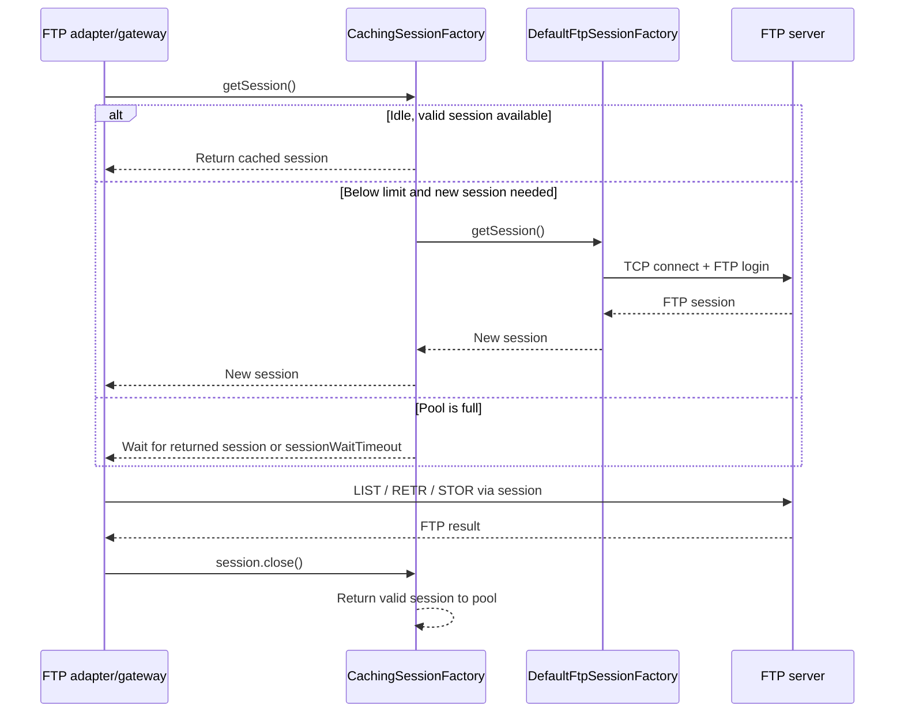
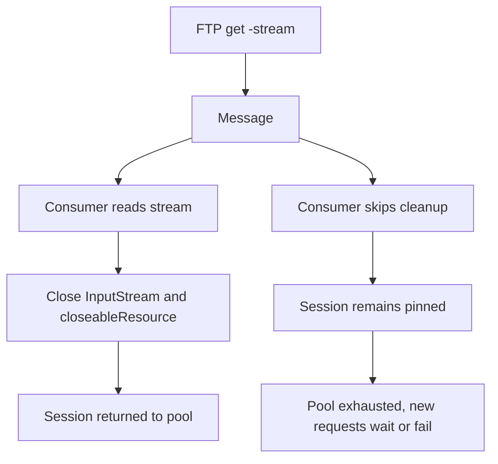

# Session Caching and Connection Lifecycle Management in Spring Integration FTP

## 1. Context and Objectives

A Spring Boot application checks an FTP server every 15 seconds to fetch CSV reports. At the same time, another flow uploads acknowledgment files through an FTP outbound adapter, and an internal API uses an FTP outbound gateway to query filenames on demand. If every operation logs in from scratch, the application incurs repeated TCP handshakes and authentication overhead. Yet if sessions are reused improperly, an old FTP connection may be closed by the server, the pool may be exhausted, or file transfers may stall under concurrent calls.

**Session caching** is the technique of reusing FTP connection sessions across operations while capping resources, validating session health, and returning sessions at the right moment. This is the topic **"Session Caching and Connection Lifecycle Management"** in the **FTP Adapter** chapter of the **SPRING_INTEGRATION_ADAPTERS** module. The module connects external systems using inbound/outbound adapters, gateways, pollers, and `MessageChannel`s—covering file, SFTP, HTTP, JMS, AMQP, Kafka, and databases—while governing message contracts, errors, and connection lifecycles. This lesson dives deeply into the lifecycle of **FTP/FTPS sessions** shared across endpoints.

After this lesson, you will be able to:

- Explain the roles of `DefaultFtpSessionFactory` and `CachingSessionFactory<FTPFile>`.
- Distinguish **session creation**, **borrowing a session**, **returning to cache**, **closing the physical connection**, and **resetting the cache**.
- Configure `sessionCacheSize`, `sessionWaitTimeout`, and `testSession` alongside FTP socket timeouts.
- Share one session pool across inbound adapters, outbound adapters, outbound gateways, or `FtpRemoteFileTemplate`.
- Prevent session leaks when coding manually or returning an `InputStream` downstream.
- Diagnose stale sessions, pool exhaustion, server connection limits, and thread contention.

## 2. Session Factory, Session, and Cache Are Three Distinct Concepts

| Component | Job | Primary Responsibility |
| --- | --- | --- |
| `DefaultFtpSessionFactory` | Creates new FTP sessions from host, port, credentials, mode, and timeout settings | Initializes sessions and configures the underlying FTP client |
| `Session<FTPFile>` | Represents an open working session to the FTP server | Executes `list`, `read`, `write`, `remove`, `rename`, and `close` per the `Session` contract |
| `CachingSessionFactory<FTPFile>` | Wraps a `SessionFactory<FTPFile>` to manage borrowed and reusable sessions | Limits session count, waits when exhausted, tests, and re-issues sessions |
| FTP adapter/gateway/template | Uses sessions to run FTP commands | Borrows and returns sessions via the factory per endpoint lifecycle |
| `MessageChannel` / poller | Coordinates messages and execution schedule | Decides when FTP operations occur; does not manage TCP sessions directly |

Since Spring Integration 3.0, **FTP sessions are not cached by default**. To reuse sessions, the application must wrap the target factory in `CachingSessionFactory`. Legacy `cache-sessions` endpoint attributes are no longer supported in modern versions.

### 2.1. Borrowing and Returning a Session



A common point of confusion is that `session.close()` **does not necessarily close the physical TCP connection** when the session is wrapped by `CachingSessionFactory`: that call normally **returns the session to the pool** so another caller can reuse it. Without caching, `close()` usually closes the real session. Even so, callers must **always call `close()`** after use, whether or not the session is cached.

### 2.2. FTP Control Connection Differs from Data Connection

FTP uses a **control connection** for commands such as `USER`, `PASS`, `CWD`, `NOOP`, `LIST`, `RETR`, and `STOR`; when transferring directory listings or files, it usually opens a separate **data connection**. Session caching mainly reuses the logged-in FTP session and control channel; it **does not turn every transfer into a single permanent data socket**.

In passive mode, the client connects to a data port advertised by the server via `PASV` or `EPSV`. Thus, a successful login and `NOOP` test **do not guarantee** `LIST`/`RETR`/`STOR` will succeed if passive ports are blocked by a firewall. In active mode, the server must open a data connection back to the client. **Caching cannot fix broken NAT/firewall rules.**

## 3. When Should You Use Session Caching?

Caching typically helps when the application polls FTP continuously, calls an FTP gateway multiple times within a workflow, or concurrently downloads and uploads multiple files against the same server. If a task runs very rarely, the cost of creating a fresh session may be acceptable; caching adds requirements to monitor idle sessions and connection quotas.

| Scenario | Without Cache | With Bounded Cache |
| --- | --- | --- |
| Poller checks every 15 seconds | Each cycle may open/login/close a new session | Can reuse an idle session |
| 30 concurrent gateway requests | May open many simultaneous connections unless throttled elsewhere | Borrows at most the configured session limit; excess requests wait |
| Server caps at 5 sessions/user | Risks hitting errors under traffic spikes | Can cap cache size below quota and share resources sensibly |
| Server closes sessions after idle timeout | Fresh operations open a new session | May encounter stale cached sessions; use `testSession(true)` to screen them |
| Server rotates credentials/rules | Next new session picks up deployed config | Cache must be refreshed so old sessions are not reused |

**Do not equate cache size with processing speed.** A 4-session cache does not guarantee 4 files transfer in parallel: concurrency also depends on pollers, schedulers, channels, executors, FTP server limits, bandwidth, and CPU/disk. Conversely, a single large file holding a session for a long time can force other requests to wait on the pool.

## 4. Key `CachingSessionFactory` Parameters

| Parameter | Meaning | Operational Notes |
| --- | --- | --- |
| `sessionCacheSize` | Caps active sessions managed concurrently by the cache/factory | If left unset, the default may be **unbounded**; set it explicitly |
| `sessionWaitTimeout` | Maximum wait time for a session when the limit is reached | In **milliseconds**; defaults to a very large value (`Integer.MAX_VALUE` ms) if unconfigured |
| `testSession` | Tests a session before reuse | For FTP, the framework sends **`NOOP`** to verify; enable explicitly when desired |
| `resetCache()` | Refreshes the cache: closes idle sessions and marks borrowed ones to close on return | Use selectively during connection refresh or maintenance |

### 4.1. `sessionCacheSize` Is a Resource Limit, Not Just Idle List Capacity

Suppose pool size is **3**. Two sessions are currently borrowed for file transfers, and one is idle:

```text
Pool size = 3
  [Session A: running RETR]  [Session B: running STOR]  [Session C: idle]
                                             |
                               Gateway can borrow C

When A, B, and C are all borrowed:
  fourth request -> WAITS up to sessionWaitTimeout
  if no session is returned -> fails waiting to acquire a session
```

Do not set cache size higher than the server's per-account limit without good reason. If the server permits at most 10 sessions for an account shared across multiple **JVMs/pods**, setting `sessionCacheSize = 10` on **each pod** can exceed the server's total quota.

### 4.2. `sessionWaitTimeout` Differs from TCP Timeouts

`sessionWaitTimeout` only comes into play when a caller must **wait for the pool to yield a session**. It does not bound how long the FTP server takes to reply to a command and does not abort an in-progress upload. Distinguish them clearly:

| Timeout | Where Configured | Diagnose When |
| --- | --- | --- |
| `connectTimeout` | `DefaultFtpSessionFactory` | Cannot establish the TCP control connection |
| `defaultTimeout` | FTP client/control socket | Server fails to respond to control commands in time |
| `dataTimeout` | FTP client/data socket | Data channel stalls or drops during `RETR`/`STOR` |
| `sessionWaitTimeout` | `CachingSessionFactory` | Many tasks hold sessions, blocking new callers at the pool |
| `replyTimeout` | `@MessagingGateway` for request–reply | Caller awaits reply message; does not necessarily bound synchronous FTP execution time |

If `sessionWaitTimeout` is 3 seconds and all three sessions stay busy longer than 3 seconds, a new request can fail **even while host, credentials, and FTP server are healthy**. Raising `connectTimeout` in that situation will not resolve pool exhaustion.

### 4.3. What Does `testSession(true)` Check?

An FTP server may close an idle control connection without the client noticing immediately. With `testSession(true)`, `CachingSessionFactory` sends `NOOP` upon borrowing a cached session to verify it is still usable; if not, the dead session is discarded and the factory creates a fresh one as needed.

However:

- A successful `NOOP` does not verify read/write permissions on remote directories.
- It does not open an FTP data connection, so it cannot verify passive ports or transfer throughput.
- The connection can still drop **after** the test and **during** file transfer.
- Each `NOOP` check adds a network round-trip; weigh that cost if latency is high or the server rate-limits commands.

Caching **reduces session creation overhead**; `testSession` **reduces the chance of borrowing a dead session**; controlled retries and idempotency are still required at the file/business layer.

## 5. Java Example: Configuring an FTP Session Pool

### 5.1. Dependencies and Configuration Parameters

Maven example for Spring Boot with a compatible Spring Integration BOM:

```xml
<dependencies>
    <dependency>
        <groupId>org.springframework.boot</groupId>
        <artifactId>spring-boot-starter-integration</artifactId>
    </dependency>
    <dependency>
        <groupId>org.springframework.integration</groupId>
        <artifactId>spring-integration-ftp</artifactId>
    </dependency>
</dependencies>
```

Real settings should come from the environment rather than hardcoding passwords or production addresses:

```yaml
# application.yml
partner:
  ftp:
    host: ${PARTNER_FTP_HOST}
    port: ${PARTNER_FTP_PORT:21}
    username: ${PARTNER_FTP_USERNAME}
    password: ${PARTNER_FTP_PASSWORD}
    remote-inbox: /incoming/reports
    local-inbox: /data/ftp/reports
    remote-outbox: /outgoing/ack
    cache-size: ${PARTNER_FTP_CACHE_SIZE:4}
    session-wait-ms: ${PARTNER_FTP_SESSION_WAIT_MS:5000}
```

Environment variables must be provided via a secret manager or platform security mechanism. `remote-inbox` and `remote-outbox` are **FTP server** paths; `local-inbox` is an **application/container filesystem** path.

### 5.2. Target Factory and Shared Pool

```java
import org.apache.commons.net.ftp.FTP;
import org.apache.commons.net.ftp.FTPClient;
import org.apache.commons.net.ftp.FTPFile;
import org.springframework.beans.factory.annotation.Qualifier;
import org.springframework.beans.factory.annotation.Value;
import org.springframework.context.annotation.Bean;
import org.springframework.context.annotation.Configuration;
import org.springframework.integration.file.remote.session.CachingSessionFactory;
import org.springframework.integration.ftp.session.DefaultFtpSessionFactory;

@Configuration
public class PartnerFtpSessionConfiguration {

    @Bean("partnerFtpDelegate")
    public DefaultFtpSessionFactory partnerFtpDelegate(
            @Value("${partner.ftp.host}") String host,
            @Value("${partner.ftp.port}") int port,
            @Value("${partner.ftp.username}") String username,
            @Value("${partner.ftp.password}") String password) {

        DefaultFtpSessionFactory factory = new DefaultFtpSessionFactory();
        factory.setHost(host);
        factory.setPort(port);
        factory.setUsername(username);
        factory.setPassword(password);
        factory.setClientMode(FTPClient.PASSIVE_LOCAL_DATA_CONNECTION_MODE);
        factory.setFileType(FTP.BINARY_FILE_TYPE);
        factory.setConnectTimeout(10_000); // ms
        factory.setDefaultTimeout(10_000); // ms
        factory.setDataTimeout(30_000);    // ms
        return factory;
    }

    @Bean("partnerFtpSessionPool")
    public CachingSessionFactory<FTPFile> partnerFtpSessionPool(
            @Qualifier("partnerFtpDelegate") DefaultFtpSessionFactory delegate,
            @Value("${partner.ftp.cache-size}") int cacheSize,
            @Value("${partner.ftp.session-wait-ms}") long sessionWaitMs) {

        if (cacheSize < 1 || sessionWaitMs < 1) {
            throw new IllegalArgumentException("Cache/wait limits must be positive");
        }
        CachingSessionFactory<FTPFile> pool =
                new CachingSessionFactory<>(delegate, cacheSize);
        pool.setSessionWaitTimeout(sessionWaitMs);
        pool.setTestSession(true);
        return pool;
    }
}
```

In the example above, `partnerFtpDelegate` only creates new FTP sessions, while `partnerFtpSessionPool` is the **factory endpoints must actually inject** to benefit from caching. If you accidentally inject `partnerFtpDelegate` directly into inbound/outbound flows, those endpoints **bypass caching**.

Both beans are explicitly named to avoid ambiguity when an application has multiple `SessionFactory<FTPFile>` beans. A pool size of 4 and wait timeout of 5 seconds are **illustrative defaults**, not universal optimal values for every FTP server.

### 5.3. Why Choose Passive and Binary Mode?

`PASSIVE_LOCAL_DATA_CONNECTION_MODE` suits clients behind NAT/firewalls because the application initiates the data channel. `BINARY_FILE_TYPE` preserves raw bytes. Both are **properties of the FTP session**, not separate settings for inbound vs. outbound adapters: when two endpoints share a pool, they inherit those settings.

For FTPS, swap the delegate for `DefaultFtpsSessionFactory` and enforce TLS certificate/hostname checks plus data-channel protection. For SFTP, use `DefaultSftpSessionFactory` from `spring-integration-sftp`; you cannot use `DefaultFtpSessionFactory` on port 22 to speak SSH. The concepts of caching and returning sessions are similar, though session health checks, resources, and underlying protocols differ.

## 6. Sharing One Pool Across FTP Endpoints

The session pool is an **infrastructure resource**. Inbound adapters, outbound adapters, outbound gateways, and templates can borrow sessions from the same factory if they share **the same server/account configuration** and concurrency limits have been budgeted.

### 6.1. FTP Inbound Adapter + Poller

```java
import java.io.File;
import java.time.Duration;
import org.apache.commons.net.ftp.FTPFile;
import org.springframework.beans.factory.annotation.Qualifier;
import org.springframework.beans.factory.annotation.Value;
import org.springframework.context.annotation.Bean;
import org.springframework.context.annotation.Configuration;
import org.springframework.integration.dsl.IntegrationFlow;
import org.springframework.integration.dsl.Pollers;
import org.springframework.integration.file.remote.session.SessionFactory;
import org.springframework.integration.ftp.dsl.Ftp;
import org.springframework.integration.ftp.filters.FtpSimplePatternFileListFilter;

@Configuration
public class PartnerFtpInboundConfiguration {

    @Bean
    public IntegrationFlow partnerFtpInboundFlow(
            @Qualifier("partnerFtpSessionPool") SessionFactory<FTPFile> ftp,
            @Value("${partner.ftp.remote-inbox}") String remoteInbox,
            @Value("${partner.ftp.local-inbox}") String localInbox) {

        return IntegrationFlow.from(
                Ftp.inboundAdapter(ftp)
                        .remoteDirectory(remoteInbox)
                        .localDirectory(new File(localInbox))
                        .autoCreateLocalDirectory(true)
                        .temporaryFileSuffix(".downloading")
                        .filter(new FtpSimplePatternFileListFilter("*.csv")),
                endpoint -> endpoint.poller(
                        Pollers.fixedDelay(Duration.ofSeconds(15))
                                .maxMessagesPerPoll(3)))
                .channel("ftpReceivedReports")
                .get();
    }
}
```

The poller triggers FTP checks. During `LIST` or `RETR`, the inbound adapter borrows a session from `partnerFtpSessionPool`; once synchronization finishes, the adapter returns the session to the pool for future polls. The flow emits `Message<File>` to `ftpReceivedReports` **after the file downloads locally**.

**Independence note:** the `.filter(..."*.csv")` example focuses on connectivity and **cannot** replace durable remote/local persistent accept-once filters and a persistent metadata store in production. Session caching **does not track processed file state**. These two mechanisms have distinct responsibilities:

| Session Caching | File Accept-Once Filter |
| --- | --- |
| Reuses **FTP connections** | Tracks **downloaded or emitted files** |
| Caps concurrent sessions | Reduces duplicate downloads/emissions |
| `CachingSessionFactory` | `FtpPersistentAcceptOnceFileListFilter`, local persistent filter |
| Does not know whether the DB committed | Also cannot replace business idempotency |

### 6.2. FTP Outbound Adapter

```java
import org.apache.commons.net.ftp.FTPFile;
import org.springframework.beans.factory.annotation.Qualifier;
import org.springframework.beans.factory.annotation.Value;
import org.springframework.context.annotation.Bean;
import org.springframework.context.annotation.Configuration;
import org.springframework.integration.dsl.IntegrationFlow;
import org.springframework.integration.file.remote.session.SessionFactory;
import org.springframework.integration.file.support.FileExistsMode;
import org.springframework.integration.ftp.dsl.Ftp;

@Configuration
public class PartnerFtpOutboundConfiguration {

    @Bean
    public IntegrationFlow partnerFtpOutboundFlow(
            @Qualifier("partnerFtpSessionPool") SessionFactory<FTPFile> ftp,
            @Value("${partner.ftp.remote-outbox}") String outbox) {

        return IntegrationFlow.from("ftpReportsToSend")
                .handle(Ftp.outboundAdapter(ftp)
                        .remoteDirectory(outbox)
                        .fileExistsMode(FileExistsMode.FAIL)
                        .useTemporaryFileName(true)
                        .temporaryFileSuffix(".uploading"))
                .get();
    }
}
```

The outbound adapter receives `Message<File>` from `ftpReportsToSend` and uses the **same session pool** to upload files to FTP. `FileExistsMode.FAIL` prevents silent overwrites; the `.uploading` temporary suffix keeps the partner from reading incomplete files prior to rename.

If inbound and outbound share a 4-session pool, four long-running uploads can force the inbound poller to wait for a session even when the FTP server itself is healthy. Assess **business priority** and **concurrency**, or split pools across workloads when genuine resource isolation is required. Keep in mind that two separate pools still draw against **the same FTP account's server-side connection quota**.

### 6.3. FTP Outbound Gateway and Request–Reply API

An outbound gateway running `ls`, `get`, `put`, `mv`, or `rm` also borrows a session per operation. When a service invokes `@MessagingGateway` over a `DirectChannel`, the FTP command typically executes on the caller's thread and **holds the session until the operation finishes**. If switching to an async flow, distinguish when the request entered the channel from when the FTP transfer finished and sent its reply.

In particular, with `get -stream`, the returned stream can **keep the session borrowed** until the consumer closes the associated resource. This is a frequent cause of pool exhaustion even when standard application logs show no active request threads.

## 7. Using `FtpRemoteFileTemplate`: Never Hold a Session Beyond Its Lifecycle

`FtpRemoteFileTemplate` is convenient when the application needs to execute explicit FTP operations programmatically without building a full messaging flow. The template manages borrowing and returning sessions when you use its callback APIs.

### 7.1. Borrowing and Returning via `execute` Callback

```java
import org.apache.commons.net.ftp.FTPFile;
import org.springframework.beans.factory.annotation.Qualifier;
import org.springframework.integration.file.remote.session.SessionFactory;
import org.springframework.integration.ftp.session.FtpRemoteFileTemplate;
import org.springframework.stereotype.Service;

@Service
public class PartnerFtpDirectoryService {

    private final FtpRemoteFileTemplate template;

    public PartnerFtpDirectoryService(
            @Qualifier("partnerFtpSessionPool")
            SessionFactory<FTPFile> sessionFactory) {
        this.template = new FtpRemoteFileTemplate(sessionFactory);
    }

    public int countEntries(String remoteDirectory) {
        Integer count = template.execute(session -> {
            FTPFile[] entries = session.list(remoteDirectory);
            return entries.length;
        });
        if (count == null) {
            throw new IllegalStateException("No LIST result received");
        }
        return count;
    }
}
```

`execute` allows multiple commands on the **same session within one callback**, and the template releases the session when the callback exits—even if an exception is thrown per the API contract. Never save `session` or any session-bound object in a singleton field to use after the callback returns.

### 7.2. If Calling `getSession()` Directly, `close()` on Every Path

```java
import org.apache.commons.net.ftp.FTPFile;
import org.springframework.integration.file.remote.session.Session;
import org.springframework.integration.file.remote.session.SessionFactory;

public int countFiles(SessionFactory<FTPFile> factory) throws Exception {
    try (Session<FTPFile> session = factory.getSession()) {
        FTPFile[] entries = session.list("/incoming/reports");
        return entries.length;
    }
}
```

`Session<FTPFile>` implements `Closeable`, so `try-with-resources` is the right pattern whenever managing sessions manually. For cached sessions, `close()` **returns the session to the pool** rather than tearing down the cache. If a session is broken and the framework detects it, it should not be retained for reuse.

**Anti-pattern causing pool exhaustion:**

```java
// DO NOT DO THIS: borrow a session without closing it.
Session<FTPFile> session = factory.getSession();
session.list("/incoming/reports");
// Missing session.close(): after a few calls, the entire pool can become held.
```

Even one exception path missing a `finally` block can trigger intermittent failures under load. `sessionWaitTimeout` does not fix this leak: it merely makes new callers **fail sooner** instead of waiting indefinitely.

## 8. Managing Stream Lifecycles and FTP Sessions

### 8.1. Why Is `InputStream` Harder Than `File`?

With a standard FTP inbound adapter, the framework downloads the file locally and emits `Message<File>`. The FTP session can be returned as soon as sync completes; downstream reads the file **from disk** without holding an FTP connection open.

By contrast, an FTP streaming inbound adapter or outbound gateway `get -stream` hands downstream a **live stream reading from an FTP session**. While downstream has not finished reading, the session cannot be returned or closed early. If the consumer forgets to close the stream or resource, the session stays pinned and starves other requests.



For `get -stream`, Spring Integration attaches a **closeable resource** in the message headers to release the session once the stream is consumed. Example when a handler manages the stream directly:

```java
import java.io.Closeable;
import java.io.IOException;
import java.io.InputStream;
import org.springframework.integration.IntegrationMessageHeaderAccessor;
import org.springframework.messaging.Message;

public void processFtpStream(Message<InputStream> message) throws IOException {
    Closeable resource =
            new IntegrationMessageHeaderAccessor(message).getCloseableResource();
    try (InputStream input = message.getPayload()) {
        // Read, validate, and process input per encoding/file contract.
    } finally {
        if (resource != null) {
            resource.close();
        }
    }
}
```

Certain Spring Integration components handle closing the resource under their own contract. Whenever you **write your own consumer** receiving `Message<InputStream>`, understand resource-closing responsibilities before deploying. Never guess about closing only the stream, and never hand off the stream to an async task and return without a corresponding lifecycle design.

### 8.2. Holding Sessions Too Long Degrades Responsiveness

Suppose cache size is 3 and each `get -stream` reads a 1 GB file very slowly. Three consumers hold all three sessions for 2 minutes; a fourth caller blocks on `getSession()` and can exceed `sessionWaitTimeout`. **Increasing cache size** can mask symptoms temporarily, yet if consumers hang or leak resources, the pool still drains over time. Bound stream read durations, apply timeouts, handle cancellation, and close resources immediately after reading.

## 9. Server-Closed Sessions and Cache Refresh

### 9.1. Stale Session Errors After Idle Periods

An FTP server often enforces an idle timeout that closes inactive connections. The cache may still hold a reference to that dead session, leading to:

```text
10:00  App borrows Session A, LIST succeeds, close() → returned to cache
10:15  FTP server closes A due to idle timeout
10:20  App borrows Session A again
       Without test: next command may fail on dead socket
       With testSession: NOOP fails → A discarded, new session created if needed
```

Consider `testSession(true)` when the server has an idle timeout or the network is unstable. Do not treat `NOOP` as a guarantee that all subsequent operations will succeed: the server can still close the session right after `NOOP`, or the data connection may be blocked by a firewall.

### 9.2. `resetCache()` to Refresh Sessions

Spring Integration provides `CachingSessionFactory.resetCache()` to **close idle sessions immediately** and **mark currently borrowed sessions to be closed when returned**. Subsequent borrow requests open fresh connections as needed.

Example internal maintenance method (invoke only under controlled procedures):

```java
import org.apache.commons.net.ftp.FTPFile;
import org.springframework.beans.factory.annotation.Qualifier;
import org.springframework.integration.file.remote.session.CachingSessionFactory;
import org.springframework.stereotype.Service;

@Service
public class PartnerFtpPoolMaintenance {
    private final CachingSessionFactory<FTPFile> pool;

    public PartnerFtpPoolMaintenance(
            @Qualifier("partnerFtpSessionPool")
            CachingSessionFactory<FTPFile> pool) {
        this.pool = pool;
    }

    public void refreshSessions() {
        pool.resetCache();
    }
}
```

**Do not call `resetCache()` after every poll.** Doing so defeats connection reuse. Also do not expose this method as an unauthenticated endpoint: it triggers fresh connections, which can impact FTP server load. Appropriate times to consider resetting: existing sessions became invalid, credentials/configuration rotated under a deployed rollout, or controlled maintenance after assessing active FTP transfers.

`resetCache()` **does not immediately kill a session currently transferring a file**, nor does it refresh credentials stored in the delegate factory's configuration. If username, password, or host changed, ensure the factory/config bean itself is updated via your deployment mechanism; resetting while the delegate still holds old settings means new sessions will still use old settings.

### 9.3. Separating Cache Refresh from Duplicate File Handling

```text
CachingSessionFactory.resetCache()   -> refreshes FTP sessions
MetadataStore / AcceptOnce filters   -> tracks whether files were seen/fetched/emitted
Business database                    -> tracks whether batches processed/committed
```

Resetting the session cache **does not clear file-filter metadata**; conversely, clearing filter metadata **does not fix a broken FTP socket**. Manage each state layer independently.

## 10. Sizing the Pool for Real-World Load

### 10.1. A Simple Estimation Model

Suppose peak concurrency involves at most 2 inbound downloads, 2 outbound uploads, and 1 gateway directory listing. If each operation holds one session while running, peak design demand may be **5 sessions**. However, you must also factor in server quotas, replica count, and how long each operation holds a session.

Sizing steps:

1. **Measure** actual concurrently borrowed FTP sessions at peak load, per-command duration, and error rates.
2. Check **server connection limits** per user/IP, and budget across all applications and replicas sharing the account.
3. Set **pool size** large enough for required concurrency with headroom under the quota; avoid unbounded defaults.
4. Set **sessionWaitTimeout** to match the maximum wait callers can tolerate, alongside connect/data timeouts and business-layer execution bounds.
5. Test scenarios with **large files, network drops, server idle resets, multiple pods**, and consumers that forget to close streams.

For instance, two pods each with pool size 4 can open **up to 8 sessions** under full load; if the FTP server allows 6 connections per user, that configuration carries risk. A local pool is not a distributed cross-JVM lock.

### 10.2. One Session Does Not Mean One File, and Vice Versa

- One session can run **many FTP commands sequentially** across borrow/return cycles.
- Downloading one file in one operation can still open a separate **data connection** even when the control session is cached.
- `maxMessagesPerPoll(5)` only caps emitted messages per poll; it **does not imply the pool must have 5 sessions**.
- Making the pool large does not make a synchronous `DirectChannel` run in parallel.
- A single session **must never** be borrowed and shared concurrently across threads by application code.

### 10.3. Single Pool or Multiple Pools?

**Sharing a pool** simplifies management and bounds total connections to a single endpoint/account. **Splitting pools** helps isolate inbound load from outbound load or when flows target different servers/credentials. Even then, if two pools hit the same server, the server enforces its quota on **total connections**, regardless of how Spring beans are divided.

Always prioritize returning sessions cleanly, bounding concurrent tasks, and measuring borrow durations before blindly raising pool sizes.

## 11. Common Errors and How to Distinguish Them

| Symptom | Possible Cause | Investigation Direction |
| --- | --- | --- |
| First poll succeeds; poll after long idle fails | FTP server closed idle session; cache held stale reference | Enable `testSession`, inspect FTP/NOOP replies and server idle timeout |
| Request waits then fails right around `sessionWaitTimeout` | Pool hit capacity, sessions not returned | Check concurrency, open streams, and missing `close()` paths |
| FTP server reports too many connections/user | Aggregate pool size across pods exceeds quota, or session leak | Sum pools/pods sharing the account; audit resource cleanup |
| `Connection refused` when creating new session | Wrong host/port, server not listening, control firewall | Test TCP to control port from the runtime environment |
| `530 Login incorrect` | Credentials/permissions, or delegate still holds stale config | Verify secrets/deployment and refresh factory/cache in order |
| Login and `NOOP` work, yet `LIST`/`RETR` fails with `425` | Passive data ports blocked or wrong NAT/IP | Test an actual data command; verify active/passive and firewall |
| Upload stalls midway then times out | Data connection dropped or server/quota/disk error | Check remote temp file and server logs; verify state before retrying |
| `get -stream` hangs the pool | Consumer holds `InputStream` or forgot to close `closeableResource` | Trace stream lifecycle; enforce cleanup in `finally` |
| Errors persist after calling `resetCache()` | Delegate config is still wrong; fresh connections also fail | Check DNS, credentials, TLS, passive range; do not reset in a tight loop |
| Raising cache size does not improve throughput | Slow bandwidth/server, sequential poller, or DB bottleneck | Measure FTP transfer vs. downstream timings before tuning pool |
| Files reprocessed after restart | File metadata filter is non-durable, unrelated to session cache | Use persistent accept-once metadata and business idempotency |
| Files not retried after DB error | Already marked by remote/local filters | Build business retry/quarantine flow; never reset sessions to retry files |

### 11.1. Never Confuse the Four Error Categories

```text
Cannot create session?          → connect / TLS / login / control firewall
Cannot borrow session?          → cache size / wait / leak / concurrency
Have session, command fails?    → server permission / data port / timeout / stale
FTP succeeds, DB fails?         → downstream retry / idempotency, not cache
```

Separating error layers prevents futile fixes like increasing pool size to cure a blocked data port, or resetting the session cache to fix malformed CSV rows.

## 12. Testing Session Lifecycle Behavior

Test against a dedicated integration FTP server (and/or an FTP container configured with explicit idle timeouts and connection limits). Mocking `SessionFactory` alone cannot verify real sockets, logout behavior, timeouts, or session reuse.

| Scenario | How to Execute | What to Verify |
| --- | --- | --- |
| Session reuse | Call `LIST` repeatedly, returning session between calls | Connection/login count drops when cache is active |
| Pool size = 2 | Hold two sessions open, start a third task | Third task waits rather than creating a third session above limit |
| Session wait timeout = 1s | Hold two sessions longer than the wait timeout | Third task fails upon exceeding wait timeout |
| Return session in `finally` | Force an operation to throw after borrowing | Pool continues serving subsequent requests |
| Server closes idle session | Leave a cached session idle past server timeout | `testSession(true)` detects and discards stale session on borrow |
| Network drop mid-`RETR` | Sever connection in test environment | Error is surfaced; partial file is never treated as valid |
| `resetCache()` with idle sessions | Call maintenance method in test workflow | Idle sessions close; next borrow opens a fresh connection |
| `resetCache()` while a session is busy | Reset during a test file transfer | In-use session closes on return per cache contract; do not assume abrupt mid-call kill |
| Unclosed stream | Simulate consumer omitting resource close in a time-bounded test | Session leak is caught and `sessionWaitTimeout` triggers |
| Multiple replicas | Run two instances with shared credentials and separate pools | Combined sessions stay within FTP server quota |
| Login succeeds yet `LIST` fails | Block passive port range in lab | Identified as data connection issue, not cache issue |

**Never run fault-injection tests or pool resets on production** while live files are transferring. For session-leak tests, use bounded timeouts, close all resources at the end of the test, and ensure the test environment can restore clean state.

### 12.1. Metrics Worth Observing

Because `CachingSessionFactory` does not track business history, add application-level monitoring or instrumentation:

- Borrowed/idle session counts, session wait durations, and wait-timeout failures (when instrumented).
- New connection/login counts, `NOOP` failure rate, and idle disconnects by the server.
- Successful/failed `LIST`, `RETR`, `STOR` counts, durations, and bytes transferred.
- Control/data connection error rates, server quotas, and sessions/user observed on the FTP server.
- Pending local/remote files, failed transfers, and batches awaiting business ACKs.

In logs, include correlation IDs by file/batch, durations, and endpoint names; **never log passwords or sensitive full payloads**. Distinguish returning a session to the pool from the partner successfully processing the file.

## 13. Scenario Exercise

**Prompt:** An application runs two Kubernetes replicas. Each replica configures `CachingSessionFactory<>(delegate, 4)` and `sessionWaitTimeout = 3000 ms`. The FTP server caps connections at 6 per account. Each pod runs an inbound poller fetching 600 MB files and an API using an FTP outbound gateway with `get -stream`. Occasionally three API calls keep their streams open without closing them; the server closes idle sessions after 10 minutes.

Answer:

1. Why can the combined configuration of the two pods exceed the FTP server's 6-connection quota?
2. If `get -stream` fails to close its resource, what happens to other requests even with cache size set to 4?
3. Does `sessionWaitTimeout = 3000 ms` guarantee a `RETR` command runs for at most 3 seconds?
4. When the server closes idle sessions, what does `testSession(true)` help with and what does it not prevent?
5. Why should `resetCache()` not be called at the end of every poll?
6. If the cache is reset while a file is transferring, should you assume that file's TCP transfer aborts immediately?
7. When login/`NOOP` works yet `LIST` fails with `425`, which components must you investigate?
8. If an FTP download succeeded yet the DB write failed, should you reset the session cache to re-download it?

**Suggested answers:** (1) Each pod owns a separate pool, allowing up to 8 sessions total with no cross-pod coordinator. (2) Unclosed streams hold borrowed sessions, exhausting the pool; other callers wait and time out. (3) No—it bounds waiting to **borrow** a session, not data transfer duration. (4) It uses `NOOP` to prune some dead sessions before reuse, but cannot guarantee data connections or subsequent file transfers won't fail. (5) Frequent resets destroy caching benefits and increase login churn. (6) No; in-use sessions are marked to close **when returned** per the cache contract. (7) Data channel, firewall/NAT, active/passive mode, permissions, and server logs. (8) No; use business state, retries, and idempotency, because the session cache does not track processed files.

## Key Takeaways

- `DefaultFtpSessionFactory` **creates connections**; `CachingSessionFactory` **caps, issues, and reuses sessions** across inbound/outbound adapters, gateways, or templates.
- **Always return sessions** via `close()` or template callbacks. With cached sessions, `close()` normally returns the session to the pool; with streaming, you must also close the resource attached to the message.
- `sessionCacheSize`, `sessionWaitTimeout`, `testSession`, and `resetCache` solve **different problems**. Never confuse pool wait timeouts with socket/data timeouts.
- `testSession` only tests session liveness via `NOOP`; it does not guarantee the FTP data channel or business outcome.
- Caching tracks **connection state**, which is distinct from file accept-once metadata and database commit state.
- In multi-replica deployments, sum connections across **all instances** to stay within FTP server quotas, and check for resource leaks before enlarging pool sizes.

## References

- [Spring Integration Reference — FTP Session Caching](https://docs.spring.io/spring-integration/reference/ftp/session-caching.html)
- [Spring Integration Reference — FTP Session Factory](https://docs.spring.io/spring-integration/reference/ftp/session-factory.html)
- [Spring Integration Reference — FTP Inbound Channel Adapter](https://docs.spring.io/spring-integration/reference/ftp/inbound.html)
- [Spring Integration Reference — FTP Outbound Channel Adapter](https://docs.spring.io/spring-integration/reference/ftp/outbound.html)
- [Spring Integration Reference — FTP Outbound Gateway](https://docs.spring.io/spring-integration/reference/ftp/outbound-gateway.html)
- [Spring Integration API — CachingSessionFactory](https://docs.spring.io/spring-integration/api/org/springframework/integration/file/remote/session/CachingSessionFactory.html)
