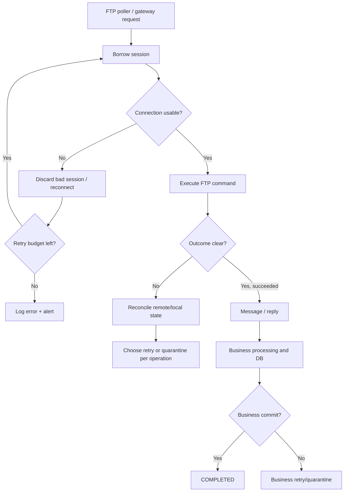
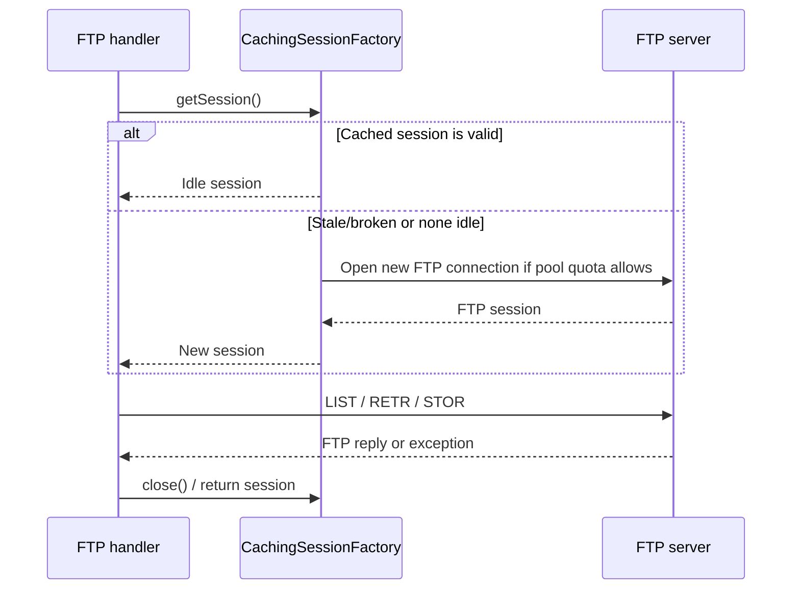
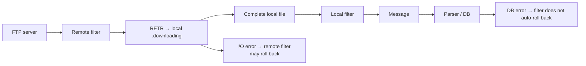
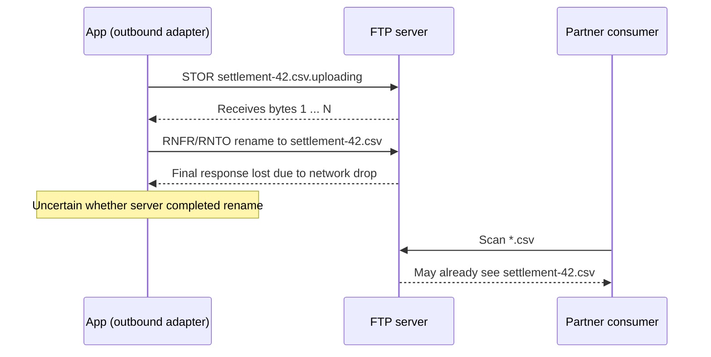

# Retries, Reconnects, and FTP Error Handling in Spring Integration

## 1. Problem Statement and Objectives

A system receives order files from a partner's FTP server every minute, processes the data, and sends an acknowledgment file back. In production, many scenarios can arise:

- The FTP server restarts while the poller is listing the directory.
- An idle connection in the session cache is closed by the server.
- The data channel drops while downloading a 500 MB file locally.
- The ACK file finishes uploading, yet the application loses its connection before receiving the final response.
- A CSV file downloads successfully, yet writing to the database fails.

If every error is "fixed" by immediately re-running the FTP command, the system can download duplicate data, overwrite already-delivered files, delete the wrong file, or generate thousands of requests while the server is overloaded. **Retries are safe only when you understand the operation, file state, and failure boundaries.**

This lesson belongs to the **FTP Adapter** chapter of the **SPRING_INTEGRATION_ADAPTERS** module. The module teaches integrating external systems using inbound/outbound adapters, gateways, pollers, and `MessageChannel`s across sources and targets including files, SFTP, HTTP, JMS, AMQP, Kafka, and databases. Within that context, this lesson focuses on **FTP retries, reconnects, and error handling**, tying together message contracts, file recovery, and connection lifecycles.

After this lesson, you will be able to:

1. Classify FTP failures into connection, login, data-connection, permission, file, and business errors.
2. Distinguish **creating a new session** from **retrying an FTP command** and **reprocessing a message**.
3. Configure `CachingSessionFactory`, `testSession`, timeouts, and refreshing broken sessions.
4. Apply bounded retries, exponential backoff, and retry predicates to appropriate operations.
5. Understand why `put/mput/mv/rm` must never be blindly retried after a timeout.
6. Separate FTP fetch failures from downstream failures, and design error channels, retry/quarantine workflows, and idempotency.

## 2. Classifying Errors Before Deciding to Retry

FTP uses two connections: a **control connection** for commands and a **data connection** for transferring listings or file contents. Errors can occur during TCP handshake, authentication, opening the data channel, transferring bytes, renaming, or committing business results.

| Stage | Common Symptoms | Initial Handling |
| --- | --- | --- |
| DNS/TCP control | `UnknownHostException`, `ConnectException`, connect timeout | Verify host/port, DNS, firewall; bounded retries may help if the service is transiently unavailable |
| Login | FTP `530`, TLS handshake error | Check credentials, account status, certificates; normally do **not** keep retrying the same config |
| Data connection setup | FTP `425`, hangs on `LIST/RETR/STOR` | Check active/passive mode, NAT, and data port range; retries cannot substitute for fixing firewalls |
| Data transfer | `426`, `SocketTimeoutException`, TCP reset | Check whether the local/remote file was partially or completely written before retrying |
| Permissions and paths | FTP `550` or `553` | Check file path, read/write/rename permissions, valid naming; avoid pointless retries |
| Resource limits | Server reports too many sessions, disk/quota full | Lower concurrency, release sessions, alert; retry only once the transient cause clears |
| Post-FTP transfer | Parser/DB error, partner rejects CSV | Perform **business** retry, not FTP connection retry |

### 2.1. FTP Reply Codes: 4xx and 5xx

In FTP, codes starting with **4** generally indicate *transient negative completion*, while codes starting with **5** generally indicate *permanent negative completion* for the current request.

| Code | Common Meaning | Appropriate Decision |
| --- | --- | --- |
| `421` | Service unavailable; server closing control connection | Try opening a new session after backoff; check server overload |
| `425` | Cannot open data connection | Fix passive/active mode, firewall, NAT; do not retry indefinitely |
| `426` | Data connection closed; transfer aborted | Verify target file state before retrying |
| `450` | Requested file action not taken (temporarily unavailable) | May retry if server holds a file lock; cap attempts |
| `451` | Local error in processing | Inspect server logs and file state |
| `452` | Insufficient storage space | Check quota/disk; blind retries usually achieve nothing |
| `530` | Not logged in / login rejected | Check account/secrets/protocol; do not loop bad credentials |
| `550` | File unavailable, often permission/path issue | Check file, directory, and server policy |
| `553` | Filename not allowed | Fix naming rules rather than retrying |

A reply code alone is **not enough** to know whether an operation changed server state. For instance, the application may have sent all bytes of `STOR` yet missed the `226` response. From the caller's standpoint, the outcome is **unknown**, not definitely failed.

### 2.2. Two Frequently Confused Concepts

**Recoverable error** does not mean **safe to immediately re-run the operation**. A transient network drop can be recovered by reconnecting, yet if the previous command was `STOR`, `DELE`, or `RNTO`, the application must verify what happened on the server before running it again.

**FTP errors** differ from **post-FTP processing errors**. Successfully downloading a file locally does not mean the data was inserted into the database; re-downloading will not fix a parser bug or database transaction failure.

## 3. Three Retry Layers to Keep Separate

`Retry` is often used as an umbrella term for three different actions:

| Layer | Repeated Action | Goal | Risk |
| --- | --- | --- | --- |
| **Reconnect/session** | Open a new FTP session after a failed/dropped session | Restore communication link | If old sessions remain leaked, the pool can exhaust |
| **Command/file transfer** | Re-run `LIST`, `RETR`, `STOR`, or another command | Complete the FTP request | May encounter partial files or ambiguous remote outcomes |
| **Message/business** | Reprocess the file/order/ACK downstream | Complete transaction and reconciliation | May create duplicate orders or files without idempotency |



A sound retry policy defines the **start/end boundaries of the operation**, attempt limits, retryable error conditions, wait delays, target-state verification, and reporting once retries are exhausted.

## 4. Reconnects and FTP Session Lifecycle

### 4.1. Target Factory and Session Cache

`DefaultFtpSessionFactory` creates fresh FTP sessions. `CachingSessionFactory<FTPFile>` wraps the target factory, lends idle sessions to adapters/gateways, and limits concurrent connections.

FTP sessions are not cached by default in modern Spring Integration versions. To reuse sessions, configure caching explicitly. When an endpoint finishes, it must **return the session** via `close()`; for a cached session, this normally means returning it to the pool rather than tearing down the physical TCP socket.



If the server closed an idle session due to an idle timeout, `testSession(true)` checks the session before reuse using FTP `NOOP`. If dead, the session is evicted from the cache and the factory creates a fresh one as needed. However, a successful `NOOP` does **not** prove the data connection can open or that TCP will not drop right afterward.

### 4.2. When Should You Use `resetCache()`?

`CachingSessionFactory.resetCache()` closes idle sessions and marks currently borrowed sessions to **close upon return**. It is useful when connections need refreshing under a controlled procedure.

**Never call `resetCache()` after every FTP exception or every poll.** Doing so triggers a login storm, adds server load, eliminates caching benefits, and fails to fix bad credentials, denied permissions, or blocked data ports. Moreover, resetting the cache **does not automatically update** host/username/password settings already configured on the delegate factory.

### 4.3. Manually Borrowed Sessions Must Be Returned

```java
import org.apache.commons.net.ftp.FTPFile;
import org.springframework.integration.file.remote.session.Session;
import org.springframework.integration.file.remote.session.SessionFactory;

public int countRemoteEntries(SessionFactory<FTPFile> factory) throws Exception {
    try (Session<FTPFile> session = factory.getSession()) {
        return session.list("/incoming/reports").length;
    }
}
```

With `try-with-resources`, the session is returned even if `list` throws an exception. If you forget `close()`, the entire session cache can become occupied and new requests stall at `sessionWaitTimeout`. Increasing pool size only delays the failure rather than fixing the leak.

### 4.4. Special Care for Streaming

When using the FTP streaming inbound adapter or FTP outbound gateway `get -stream`, the reply can contain an `InputStream` backed by an open FTP session. The handler must inspect the `closeableResource` header and close it per framework contract after consuming the stream; never abandon the resource or pass it to async work without managing session lifecycle.

## 5. Configuring FTP Connectivity and Timeouts

Example for a Spring Boot application using a BOM managing compatible Spring Integration and Spring Retry versions:

```xml
<dependencies>
    <dependency>
        <groupId>org.springframework.boot</groupId>
        <artifactId>spring-boot-starter-integration</artifactId>
    </dependency>
    <dependency>
        <groupId>org.springframework.integration</groupId>
        <artifactId>spring-integration-ftp</artifactId>
    </dependency>
    <dependency>
        <groupId>org.springframework.retry</groupId>
        <artifactId>spring-retry</artifactId>
    </dependency>
</dependencies>
```

```yaml
# application.yml
partner:
  ftp:
    host: ${PARTNER_FTP_HOST}
    port: ${PARTNER_FTP_PORT:21}
    username: ${PARTNER_FTP_USER}
    password: ${PARTNER_FTP_PASSWORD}
    remote-inbox: /incoming/reports
    local-inbox: /data/ftp/reports
    remote-outbox: /outgoing/ack
```

`remote-inbox` and `remote-outbox` live on the FTP server; `local-inbox` lives on the application/container filesystem. Supply credentials via a secret manager or environment variables—never hardcode or log them.

### 5.1. Factory and Cache

```java
import org.apache.commons.net.ftp.FTP;
import org.apache.commons.net.ftp.FTPClient;
import org.apache.commons.net.ftp.FTPFile;
import org.springframework.beans.factory.annotation.Value;
import org.springframework.context.annotation.Bean;
import org.springframework.context.annotation.Configuration;
import org.springframework.integration.file.remote.session.CachingSessionFactory;
import org.springframework.integration.file.remote.session.SessionFactory;
import org.springframework.integration.ftp.session.DefaultFtpSessionFactory;

@Configuration
public class PartnerFtpConnections {

    @Bean("partnerFtpSessionFactory")
    public SessionFactory<FTPFile> ftpSessionFactory(
            @Value("${partner.ftp.host}") String host,
            @Value("${partner.ftp.port}") int port,
            @Value("${partner.ftp.username}") String user,
            @Value("${partner.ftp.password}") String password) {

        DefaultFtpSessionFactory target = new DefaultFtpSessionFactory();
        target.setHost(host);
        target.setPort(port);
        target.setUsername(user);
        target.setPassword(password);

        target.setClientMode(FTPClient.PASSIVE_LOCAL_DATA_CONNECTION_MODE);
        target.setFileType(FTP.BINARY_FILE_TYPE);
        target.setConnectTimeout(10_000); // TCP control connect
        target.setDefaultTimeout(10_000); // control socket
        target.setDataTimeout(30_000);    // data socket

        CachingSessionFactory<FTPFile> pool =
                new CachingSessionFactory<>(target, 4);
        pool.setSessionWaitTimeout(5_000); // wait to borrow session
        pool.setTestSession(true);         // test via FTP NOOP
        return pool;
    }
}
```

This is an illustrative configuration, **not the optimal timeout/pool sizing for every server**. Passive FTP usually suits clients behind NAT/firewalls, provided both the control port and the server's passive data port range are reachable.

### 5.2. Timeouts Do Not Replace One Another

| Parameter | What Does It Bound? | What Can It Not Fix? |
| --- | --- | --- |
| `connectTimeout` | Waiting to establish the TCP control connection | Cannot fix broken DNS/routing/firewalls |
| `defaultTimeout` | Waiting on the control socket | Does not govern the full business request–reply cycle |
| `dataTimeout` | Waiting on the data transfer/listing socket | Does not ensure the target file wasn't already written |
| `sessionWaitTimeout` | Waiting to acquire a session from an exhausted pool | Does not abort an in-progress upload |
| `@Gateway(replyTimeout)` | Waiting for a reply message in messaging flows | With `DirectChannel`, does not necessarily interrupt a synchronous in-flight FTP call |
| Poller `fixedDelay` | Delay between poll executions | Not a timeout for `RETR` |

If a server blocks data connections, increasing `dataTimeout` only makes the application **wait longer** before failing. If every session is held by unclosed streams, raising `connectTimeout` will not free any sessions either.

## 6. Classifying Operations to Choose Safe Retries

A retry can **repeat the entire action**. Therefore, policies must depend on the nature of the FTP command, not solely on the exception type.

| Command | Primary Effect | Retry After Timeout? | Safety Conditions |
| --- | --- | --- | --- |
| `PWD`, `NOOP` | Check session/status | Usually yes | Valid session creation and bounded backoff |
| `LIST`, `NLST` | Read directory listing | Usually yes | Side-effect-free; still verify permissions and paths |
| `RETR` / gateway `get` | Download file locally | Conditional | Account for partial/temp local files, overwrite policy, and remote version |
| `mget` | Download multiple files | Do not blindly retry whole batch | Inspect `partialResults` and already-received local files |
| `STOR` / gateway `put` | Write remote file | **Never blindly auto-retry** | Inspect final/temp name, size/checksum, and immutable naming rules |
| `mput` | Upload multiple files | Do not blindly retry whole directory | Reconcile written files, missing files, and per-batch status |
| `RNFR/RNTO` / `mv` | Rename/move remotely | Not safe by default | Inspect both source and target path state |
| `DELE` / `rm` | Delete remote file | Not safe by default | Require strict permissions, audit log, and result verification |

**For `RETR`**, the FTP command reads remotely, yet the **local side writes a file**. When retrying after a partial download, rely on temporary names/renaming and `FileExistsMode` so parsers never open an incomplete copy.

**For `STOR`**, all bytes may reach the server right before the client misses `226 Transfer complete`. Immediately repeating `STOR` with `REPLACE` can overwrite a file the partner has already started reading, while `APPEND` can duplicate bytes.

## 7. Bounded Retry Example for Read-Only `ls`

This example deliberately attaches retry advice **only to an FTP outbound gateway running the read-only `ls` command**, because read commands typically do not mutate file state. This is **not** a configuration to copy verbatim onto `put/mput/mv/rm`.

Spring Integration's `RequestHandlerRetryAdvice` wraps a handler invocation with a retry policy. The Spring Integration 6.x example uses `RetryTemplate` from Spring Retry 2.x to:

- Execute **at most three total attempts**: the initial try plus up to two retries.
- Retry only when the cause chain contains an allowlisted socket/connection error.
- Apply exponential backoff to avoid hammering the server immediately.
- Re-throw the exception to the caller once retries are exhausted so orchestration can record/alert on it.

### 7.1. Declaring the Retry Advice

```java
import java.net.ConnectException;
import java.net.SocketException;
import java.net.SocketTimeoutException;
import java.util.HashMap;
import java.util.Map;
import org.springframework.context.annotation.Bean;
import org.springframework.context.annotation.Configuration;
import org.springframework.integration.handler.advice.RequestHandlerRetryAdvice;
import org.springframework.retry.backoff.ExponentialBackOffPolicy;
import org.springframework.retry.policy.SimpleRetryPolicy;
import org.springframework.retry.support.RetryTemplate;

@Configuration
public class FtpReadRetryConfiguration {

    @Bean("ftpListRetryAdvice")
    public RequestHandlerRetryAdvice ftpListRetryAdvice() {
        Map<Class<? extends Throwable>, Boolean> retryable = new HashMap<>();
        retryable.put(ConnectException.class, true);
        retryable.put(SocketTimeoutException.class, true);
        retryable.put(SocketException.class, true);

        // true: traverse nested causes inside MessagingException, if any.
        SimpleRetryPolicy policy =
                new SimpleRetryPolicy(3, retryable, true, false);

        ExponentialBackOffPolicy backoff = new ExponentialBackOffPolicy();
        backoff.setInitialInterval(500); // ms
        backoff.setMultiplier(2.0);
        backoff.setMaxInterval(2_000);    // ms

        RetryTemplate template = new RetryTemplate();
        template.setRetryPolicy(policy);
        template.setBackOffPolicy(backoff);

        RequestHandlerRetryAdvice advice = new RequestHandlerRetryAdvice();
        advice.setRetryTemplate(template);
        return advice;
    }
}
```

Here `SimpleRetryPolicy` sets `defaultValue=false` so it **never retries unlisted exceptions**. `traverseCauses` is enabled because Spring Integration may wrap root errors inside `MessagingException`. Different protocols or library versions may use different exception wrappers, so verify actual exception classes from your server before finalizing classifiers.

Note: `SocketTimeoutException` can occur **after** a mutating command already took effect on the server; this example is safer because it is scoped to the read-only `ls` command—the exception class alone never guarantees a retry is safe for every command.

### 7.2. Attaching the Advice to a Request–Reply Flow

```java
import java.util.List;
import org.apache.commons.net.ftp.FTPFile;
import org.springframework.beans.factory.annotation.Qualifier;
import org.springframework.context.annotation.Bean;
import org.springframework.context.annotation.Configuration;
import org.springframework.integration.annotation.Gateway;
import org.springframework.integration.annotation.IntegrationComponentScan;
import org.springframework.integration.annotation.MessagingGateway;
import org.springframework.integration.dsl.IntegrationFlow;
import org.springframework.integration.file.remote.session.SessionFactory;
import org.springframework.integration.ftp.dsl.Ftp;
import org.springframework.integration.handler.advice.RequestHandlerRetryAdvice;

@Configuration
@IntegrationComponentScan
public class FtpListFlowConfiguration {

    @Bean
    public IntegrationFlow ftpListFlow(
            @Qualifier("partnerFtpSessionFactory")
            SessionFactory<FTPFile> sessionFactory,
            @Qualifier("ftpListRetryAdvice")
            RequestHandlerRetryAdvice retryAdvice) {

        return IntegrationFlow.from("ftpListRequests")
                .handle(Ftp.outboundGateway(sessionFactory, "ls", "payload")
                                .options("-1"),
                        endpoint -> endpoint.advice(retryAdvice))
                .get();
    }
}

@MessagingGateway
interface PartnerFtpReadClient {
    @Gateway(requestChannel = "ftpListRequests", replyTimeout = 30_000)
    List<String> listNames(String remoteDirectory);
}
```

For example, a service calling `client.listNames("/incoming/reports")` receives `List<String>` on success. If retries exhaust without a result, the exception must be handled by the caller or an error channel depending on the channel/executor model. `@Gateway`'s `replyTimeout` is not an overall FTP connection timeout when the handler runs synchronously over `DirectChannel`.

In a real application, use **context-aware error classification**. Errors such as invalid passwords, missing directories, insufficient permissions, or untrusted certificates should not be retried repeatedly merely because the framework wrapped them in a generic exception.

## 8. Inbound Adapter: File Sync Failures vs. Downstream Processing Failures

A local-sync FTP inbound adapter has two steps: the **remote synchronizer downloads locally**, then the **local file source emits `Message<File>`**. Correspondingly, there are a **remote filter** and a **local filter**.



### 8.1. When `RETR` Fails

If a remote file was accepted by the remote filter but an I/O error occurs while the synchronizer is downloading, the framework can **roll back the remote acceptance mark** so the file can be re-fetched on the next poll—**provided the filter implements `ReversibleFileListFilter`**. This is not a distributed transaction: power loss or an abrupt JVM crash can still occur before rollback completes.

Sound designs include:

- A local temporary filename (e.g., `.downloading`), emitting files only after download and rename complete.
- Remote/local persistent accept-once filters backed by an appropriate `ConcurrentMetadataStore`.
- `maxFetchSize` to bound how many files are downloaded per pass; `maxMessagesPerPoll` only bounds emitted messages per poll and does not substitute for `maxFetchSize`.
- A reconciliation mechanism for when metadata says "received" yet the local file disappeared due to pod/volume loss.

### 8.2. When the Downstream Handler Fails

Suppose `order-42.csv` downloaded completely and was emitted to `MessageChannel`, yet the DB service fails. **Filters do not automatically roll back simply because a downstream handler failed.** Subsequent polls may not re-emit that file, especially if a persistent local filter already marked it as emitted.

The application must implement **dedicated business retries**, for example:

1. Persist batch status `RECEIVED / PROCESSING / COMPLETED / FAILED` in the DB.
2. On error, retain or safely archive the local file; do not auto-delete remote files.
3. Enqueue the batch onto a retry queue with backoff, or quarantine unrecoverable data errors.
4. Before every DB write, check an idempotency key (e.g., `partnerId + batchId + orderId`).
5. Mark `COMPLETED` only after the transaction commits successfully.

Clearing a filter metadata key to replay a file should be done **for a specific item with auditing**; never wipe the entire metadata store as a routine retry tactic.

### 8.3. Poller and Error Channel

Errors thrown by a **scheduled poller task** can be wrapped in an `ErrorMessage` and sent to an error channel. You can configure a dedicated channel for FTP polling errors to log and alert.

```java
import java.io.File;
import java.time.Duration;
import org.apache.commons.net.ftp.FTPFile;
import org.springframework.beans.factory.annotation.Qualifier;
import org.springframework.beans.factory.annotation.Value;
import org.springframework.context.annotation.Bean;
import org.springframework.context.annotation.Configuration;
import org.springframework.integration.channel.DirectChannel;
import org.springframework.integration.dsl.IntegrationFlow;
import org.springframework.integration.dsl.Pollers;
import org.springframework.integration.ftp.dsl.Ftp;
import org.springframework.integration.ftp.filters.FtpSimplePatternFileListFilter;
import org.springframework.integration.file.remote.session.SessionFactory;
import org.springframework.messaging.MessageChannel;

@Configuration
public class FtpInboundErrorHandlingConfiguration {

    @Bean("ftpPollErrors")
    public MessageChannel ftpPollErrors() {
        return new DirectChannel();
    }

    @Bean
    public IntegrationFlow ftpInboundFlow(
            @Qualifier("partnerFtpSessionFactory")
            SessionFactory<FTPFile> sessionFactory,
            @Value("${partner.ftp.remote-inbox}") String remoteInbox,
            @Value("${partner.ftp.local-inbox}") String localInbox) {

        return IntegrationFlow.from(
                Ftp.inboundAdapter(sessionFactory)
                        .remoteDirectory(remoteInbox)
                        .localDirectory(new File(localInbox))
                        .autoCreateLocalDirectory(true)
                        .temporaryFileSuffix(".downloading")
                        .maxFetchSize(5)
                        .filter(new FtpSimplePatternFileListFilter("*.csv")),
                endpoint -> endpoint.poller(
                        Pollers.fixedDelay(Duration.ofSeconds(20))
                                .maxMessagesPerPoll(3)
                                .errorChannel("ftpPollErrors")))
                .channel("ftpFiles")
                .get();
    }
}
```

Example handler receiving `ErrorMessage`:

```java
import org.springframework.integration.annotation.ServiceActivator;
import org.springframework.messaging.support.ErrorMessage;
import org.springframework.stereotype.Component;

@Component
public class FtpPollErrorConsumer {

    @ServiceActivator(inputChannel = "ftpPollErrors")
    public void onError(ErrorMessage error) {
        Throwable cause = error.getPayload();
        // Production: structured log + metric + alert per error category.
        // Never log credentials or sensitive file contents.
        System.err.println("FTP poll failed: " +
                cause.getClass().getSimpleName());
    }
}
```

This snippet illustrates **error routing**, not automatic retrying inside `onError`. A production error handler must classify errors, avoid repeatedly throwing unhandled exceptions, and log sufficient context (partner, flow, command, inspected path, correlation ID). The `*.csv` pattern filter in this example also **does not provide a production persistent accept-once policy**.

If you configure a custom `TaskScheduler`, ensure a compatible `MessagePublishingErrorHandler` is wired; never assume async exceptions automatically appear on an unconfigured channel.

## 9. Outbound Upload: Retrying When Outcomes Are Uncertain

### 9.1. Failure Between `STOR` and Final Response

Consider this sequence:



If the app immediately retries from scratch, it may collide with an already-existing destination file or overwrite a file the partner is actively processing. Thus, **a network timeout does not prove the remote upload did not happen**.

### 9.2. Recoverable File-Delivery Workflow

| Step | Suggested Status | Action Required |
| --- | --- | --- |
| Create local report | `CREATED` | Close stream, validate file, compute checksum, persist batch ID |
| Prepare upload | `UPLOADING` | Choose immutable remote filename from `batchId/version` |
| Transfer file | `UPLOADING` | Write remotely under `.uploading` if server supports rename |
| Clean FTP completion | `UPLOADED` | Record final path, size, and timestamp |
| Timeout/connection reset | `UNKNOWN` | Check final/temp filename, size/checksum/manifest before deciding to resend |
| Partner confirms | `ACKNOWLEDGED` | Only upon receiving a reliable business ACK |
| Unrecoverable failure | `FAILED` / `QUARANTINED` | Retain source file, log and alert; may need manual intervention |

For reports with immutable names, `FileExistsMode.FAIL` helps prevent accidental overwrites; if an earlier send succeeded while the app lost the technical ACK, retrying may hit "file already exists." That is a **signal to reconcile**, not automatically a data error.

Example outbound adapter configuration deliberately **omitting blind retry advice**:

```java
import org.apache.commons.net.ftp.FTPFile;
import org.springframework.beans.factory.annotation.Qualifier;
import org.springframework.context.annotation.Bean;
import org.springframework.context.annotation.Configuration;
import org.springframework.integration.dsl.IntegrationFlow;
import org.springframework.integration.file.remote.session.SessionFactory;
import org.springframework.integration.file.support.FileExistsMode;
import org.springframework.integration.ftp.dsl.Ftp;

@Configuration
public class FtpUploadFlowConfiguration {

    @Bean
    public IntegrationFlow ftpUploadFlow(
            @Qualifier("partnerFtpSessionFactory")
            SessionFactory<FTPFile> sessionFactory) {
        return IntegrationFlow.from("ftpFilesToUpload")
                .handle(Ftp.outboundAdapter(sessionFactory)
                        .remoteDirectory("/outgoing/ack")
                        .fileExistsMode(FileExistsMode.FAIL)
                        .useTemporaryFileName(true)
                        .temporaryFileSuffix(".uploading"))
                .get();
    }
}
```

With `DirectChannel`, exceptions in the outbound handler normally propagate back to the sender. With `ExecutorChannel` or a queue/broker, `send() == true` only means the message was accepted/dispatched—**not** that the upload finished. The report-producing layer must persist durable state and drive retries based on verified outcomes.

### 9.3. Do Not Use `APPEND` to Recover Partial Files Without Protocol Support

FTP supports resuming transfers in certain cases when client and server negotiate byte offsets, yet `APPEND` is not a synonym for "safe resumable upload." Appending at a mismatched offset, restarting from byte zero, or touching an altered remote file can duplicate or corrupt bytes.

Implement resume only when both sides explicitly agree on offsets, sizes, checksums, temporary file states, and final-name publication—and test directly against the partner's FTP server.

## 10. Gateway `mget/mput`: Partial Success and Per-File Retries

In an `mput` call, the first two files may reach the server before the third fails. Spring Integration can throw `PartialSuccessException` containing:

- `partialResults`: results of the file transfers **that succeeded**.
- `derivedInput`: inputs derived from the original request, such as the directory's file list.
- `failedMessage` and `cause`: error context. For recursive directories, `PartialSuccessException` instances may be **nested**.

Example:

```text
Batch upload includes:
    a.csv  -> succeeded
    b.csv  -> succeeded
    c.csv  -> network dropped

partialResults = [remotePath(a.csv), remotePath(b.csv)]
derivedInput   = [a.csv, b.csv, c.csv]
cause          = transfer error on c.csv

Do not immediately retry all of [a,b,c] with REPLACE/APPEND.
Instead: reconcile per-file state and handle c.csv.
```

`mget` has a parallel case, except you reconcile **local** results. If an error hits before a file finishes, inspect and safely clean up the temporary local copy. Use batch-level manifests/checksums/transactions if the business requires receiving an entire set of files atomically; FTP does not provide multi-file transactions.

### 10.1. `mv` and `rm` Must Not Be Retried by Guessing Either

- For `mv`, if the session drops right after the server renames the file, retrying from the **old path** can return `550` because the source already moved; inspect **the destination** as well before declaring failure.
- For `rm`, if the server deleted the file yet the reply was lost, retrying may return "file not found"; never treat a missing file as a reason to delete a different file instead.
- Destructive or path-mutating commands require least privilege, audit logging, batch IDs, and recovery plans. Never enable `-D` (delete remote after fetch) merely to avoid duplicates without an explicit data-acknowledgment contract.

## 11. Retry Budgets, Backoff, Jitter, and Preventing Request Storms

If the FTP server goes down for 5 minutes and 20 pods all retry three times per second, overload worsens dramatically. Even if each pod enforces its own cap, **system-wide total attempts** can still be huge.

Practical designs include:

1. **Max attempt count**: e.g., three total attempts for `ls` or short-lived reconnects.
2. **Exponential backoff**: progressively increasing wait intervals with an upper cap.
3. **Jitter**: controlled randomness so pods do not retry in lockstep.
4. **Layered timeouts**: TCP control, data socket, pool wait, caller deadline, total batch duration.
5. **Concurrency limit/bulkhead**: bound concurrent sessions and tasks instead of spawning unbounded requests.
6. **Circuit breaker** where appropriate: pause calling a failing server, probing periodically in a controlled way.
7. **Dead-letter/quarantine** for files or batches exhausting retries, allowing authorized manual replay.

Example with 500 ms initial backoff, multiplier 2, and 2-second cap across three total attempts:

| Attempt | Approximate Time (Excluding Command Runtime) | Notes |
| --- | --- | --- |
| Attempt 1 | 0 ms | Initial execution |
| Attempt 2 | After ~500 ms | Only if the error matches the retry policy |
| Attempt 3 | After another ~1,000 ms | Once exhausted, exception propagates outward |

`RequestHandlerRetryAdvice` normally runs **stateless retries on the calling thread** and can sleep that thread during backoff. Under high load, account for thread-pool impact and responsiveness. `Stateful retry` only fits when upstream (e.g., JMS/Kafka) supports consistent redelivery and message identity; do not enable it on an FTP poller just hoping for "smarter retries."

## 12. Error Handling Across Messaging Models

| Error Origin | Who Typically Receives It? | Design Approach |
| --- | --- | --- |
| Outbound adapter via `DirectChannel` | Message sender receives exception synchronously | Catch at boundary, persist send state, verify remote if outcome is ambiguous |
| Synchronous FTP outbound gateway request–reply | `@MessagingGateway` caller receives exception/timeout | Distinguish reply timeout from network timeout; apply per-command retry policy |
| Handler on executor/queue | Configured error handler / error channel | Ensure active subscriber, metrics, and persisted request context |
| FTP inbound polling | Poller error channel or scheduler error handler | Never block scheduler indefinitely; report errors by type and count |
| Downstream service/DB after `Message<File>` | Handler/transaction boundary | Use business retry/quarantine; filters do not auto-roll back |

**Key point:** never assume every exception automatically lands on the global `errorChannel`. With `DirectChannel`, exceptions usually propagate directly on the caller's thread. With a scheduled poller, error publishing belongs to the poller/scheduler. When customizing `TaskScheduler`, verify the corresponding `MessagePublishingErrorHandler`.

When recording errors, capture **enough context for controlled replay**:

```text
partnerId, batchId, fileName, remotePath, localPath
ftpCommand, ftpReplyCode, exceptionClass, rootCause
attemptCount, nextRetryAt, podId, correlationId
remoteFileExists?, tempFileExists?, observedFileSize?, checksum?
businessStatus: CREATED / UPLOADING / UNKNOWN / UPLOADED / FAILED
```

Never log passwords, sensitive file contents, tokens, or raw commands carrying credentials. Fields like `remoteFileExists`, `observedFileSize`, and checksum are **observations from actual inspection**, never guessed from a client exception.

## 13. FTPS, Networking, and Errors Retries Cannot Fix

**Passive FTP** requires client reachability to both the control port and the server's passive data port range. If only port 21 is open, login may succeed while `LIST`, `RETR`, or `STOR` fails with `425`. Switching to active mode will not fix it either if the server cannot connect back to a client behind NAT/firewalls.

**FTPS** uses TLS to protect control/data channels while still needing data connections; certificate/hostname errors must be fixed with proper truststore configuration and valid verification—**never disable certificate verification** just so retries run. FTP ALGs generally cannot inspect encrypted control traffic, so passive FTPS usually requires explicit passive port ranges on the server.

**SFTP** is an SSH protocol distinct from FTP/FTPS; if the server supports only SFTP, use Spring Integration's SFTP adapter and SFTP session factory. Changing port 21 to 22 in `DefaultFtpSessionFactory` does not produce SFTP.

Operational rule: **fix configuration errors first, retry second**. Bad credentials, untrusted certificates, missing directory permissions, nonexistent paths, or completely blocked firewalls are configuration issues. Excess retries only generate noise, load, and account lockouts.

## 14. Recovery Strategies for Restarts and Multiple Replicas

### 14.1. A Pod Dies Mid-Download

Suppose the remote filter uses a durable metadata store, while local files reside on ephemeral pod storage:

1. Pod A accepts `order-42.csv` and records the remote mark.
2. Pod A crashes mid-download, leaving an incomplete `.downloading` file.
3. Pod B / replacement pod lacks the complete local file, yet the metadata store may still hold the received mark.
4. Without reconciliation, the file can be skipped instead of re-downloaded.

Coordinate **persistent metadata**, **durable local/object storage**, transfer-error rollback, and a reconciliation job for batches not yet `COMPLETED`. An abrupt crash never guarantees filter rollback completed.

### 14.2. Multiple Replicas Sharing an FTP Server

Each JVM maintains its own session pool, so `CachingSessionFactory<>(target, 4)` across three pods can open up to 12 sessions if all are busy. If the server allows only six sessions per account, partition quotas and bound aggregate concurrency.

A shared metadata store reduces multiple replicas claiming the same file, yet does not turn **claim → download → parse → DB commit** into a single transaction. Database idempotency keys, durable queues, or leader/partition coordination remain necessary.

### 14.3. Uncertain ACK Upload Status

After an upload timeout, do not immediately mark the batch `FAILED` meaning "server never received the file." Record `UNKNOWN`, inspect the final/temporary path and server-side evidence, then transition to `UPLOADED` or schedule retry/quarantine. If the partner provides a business ACK, `ACKNOWLEDGED` applies only once that confirmation arrives.

## 15. Integration Test Scenarios

Run these tests only against a dedicated test FTP/FTPS server and authorized synthetic directories. Mocking `SessionFactory` helps unit tests, yet cannot prove real data-connection behavior, FTP replies, or timeouts.

| Scenario | What to Verify |
| --- | --- |
| Server briefly down then recovers | `ls` retries within budget and recovers without infinite loops |
| Wrong username/password | `530` is classified properly; wrong password is not retried repeatedly |
| Login succeeds, passive data range blocked | `425` is distinguished from connect/login; raising timeouts is not treated as a fix |
| Idle FTP session closed by server | `testSession(true)` checks cached session and opens a new one when needed |
| Pool size = 2 and three concurrent requests | Third request waits or hits `sessionWaitTimeout` without exceeding limit |
| Network drop mid-`RETR` | Partial local file is never emitted as complete; verify filter rollback |
| JVM killed mid-download | Reconciliation detects mismatch between metadata and remaining local files |
| `put` completes upload yet reply is lost | Does not blindly overwrite on retry; verifies final/temp name and contents |
| `mput` succeeds on 2/3 files then fails | Captures `partialResults`; processes only missing items per policy |
| `mv` renamed remotely yet client timed out | Inspects both source and destination before retrying |
| DB handler fails after receiving file | Business retry/quarantine recovers rather than relying on remote filter re-emission |
| 10 replicas retry after downtime | Backoff, jitter, and bulkheads prevent connection storms |
| Untrusted FTPS certificate | Never bypasses TLS; surfaces clear configuration error |

**Success criteria** go beyond "it connected next time": verify **exact file bytes**, remote/local state, processed message counts, zero duplicate orders, and zero lost incomplete batches.

## 16. Scenario Exercise

**Prompt:** A system runs three Kubernetes pods. Each pod has an FTP session pool capped at four sessions. The partner delivers 300 MB `orders-<batchId>.csv` files over passive FTP. The app downloads locally, writes to the database, and uploads `ack-<batchId>.csv` to the server. One day an incident occurs: the server closes stale sessions, `RETR` drops at 70%, the DB handler fails for another batch, and an ACK `STOR` finishes writing all bytes yet the caller times out before `226`.

Answer:

1. What does `testSession(true)` solve? Does it test passive data ports?
2. Why must you sum session counts across **all three pods** rather than looking at one cache?
3. When `RETR` fails at 70%, how must the local file and remote filter be checked?
4. If the remote filter supports rollback yet the pod dies abruptly, is metadata guaranteed to be rolled back?
5. When the DB fails after `Message<File>` was emitted, can you simply wait for the poller to re-emit the file?
6. When `STOR` may have completed, why are `REPLACE` or `APPEND` unsafe as default retries?
7. Should the `RequestHandlerRetryAdvice` configured for `ls` also be attached directly to `rm/mv`?
8. When multiple pods retry together, what measures should be used besides increasing timeouts?
9. Distinguish `UPLOAD_SUCCESS` from `PARTNER_ACKNOWLEDGED` in the business contract.

**Suggested answers:** (1) Checks stale control sessions via `NOOP`; does not verify the data channel. (2) Each pod owns a separate pool; three pools of size 4 can open 12 sessions total. (3) Never emit the temp file; rely on `ReversibleFileListFilter` rollback where supported and controlled download retries. (4) No; a crash can strike before rollback executes. (5) No; business retry/quarantine and DB idempotency are required. (6) Remote state is uncertain; re-sending can overwrite an active file or append duplicate bytes. (7) No; mutating/destructive commands require state verification prior to retry. (8) Backoff, jitter, concurrency limits, circuit breakers, quotas, and alerting. (9) Upload success only means FTP transfer finished; partner processing requires a separate business ACK.

## Summary

- **Reconnecting** opens a fresh FTP session after a broken one; **command retry** re-runs an FTP command; **business retry** reprocesses data after message emission. These are three distinct boundaries.
- `CachingSessionFactory`, `testSession`, timeouts, and `resetCache` help manage connectivity, yet **do not guarantee files are processed once**.
- Choose retry behavior by **command type and side effects**. `ls/nlst` are generally safe to retry, whereas `put/mput/mv/rm` require verifying remote state whenever a timeout leaves outcomes uncertain.
- For inbound flows, transfer errors can roll back supporting remote filters; **downstream errors do not auto-roll back**. Combine durable metadata, durable file storage, retry/quarantine, and idempotency.
- Always bound retry attempts, apply backoff and jitter, monitor failures, and separate **FTP technical success** from **partner business ACKs**.

## References

- [Spring Integration Reference — FTP Session Caching](https://docs.spring.io/spring-integration/reference/ftp/session-caching.html)
- [Spring Integration Reference — FTP Inbound Channel Adapter / Recovering from Failures](https://docs.spring.io/spring-integration/reference/ftp/inbound.html)
- [Spring Integration Reference — FTP Outbound Channel Adapter](https://docs.spring.io/spring-integration/reference/ftp/outbound.html)
- [Spring Integration Reference — FTP Outbound Gateway](https://docs.spring.io/spring-integration/reference/ftp/outbound-gateway.html)
- [Spring Integration Reference — Provided Advice Classes / Retry Advice](https://docs.spring.io/spring-integration/reference/handler-advice/classes.html)
- [Spring Integration Reference — Error Handling](https://docs.spring.io/spring-integration/reference/error-handling.html)
- [Spring Retry API — SimpleRetryPolicy](https://docs.spring.io/spring-retry/docs/current/apidocs/spring.retry/org/springframework/retry/policy/SimpleRetryPolicy.html)
- [RFC 959 — File Transfer Protocol](https://www.rfc-editor.org/rfc/rfc959)
