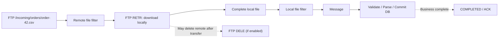
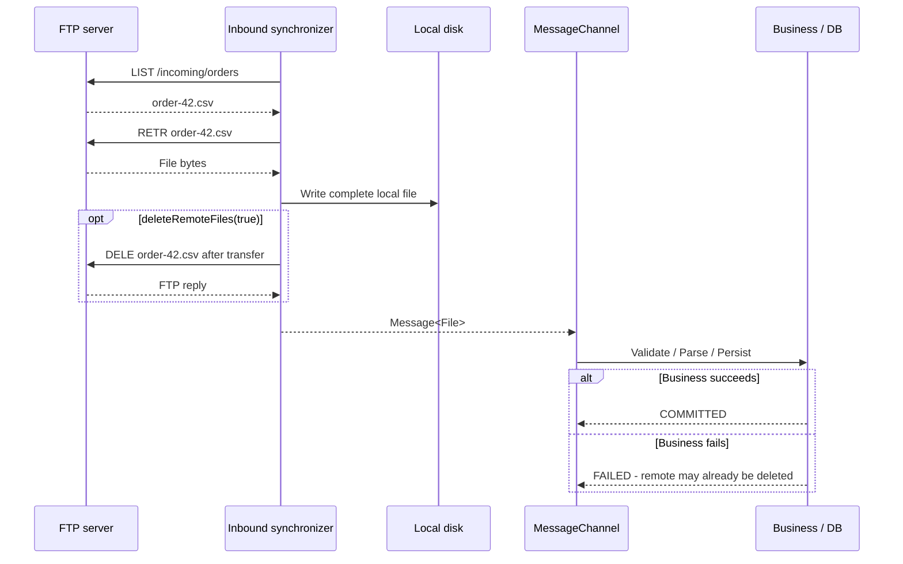
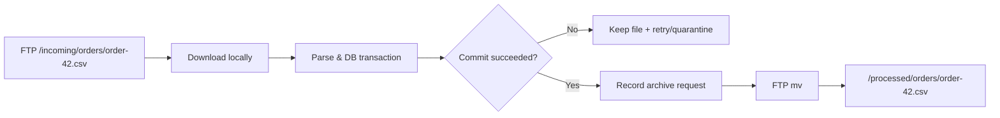
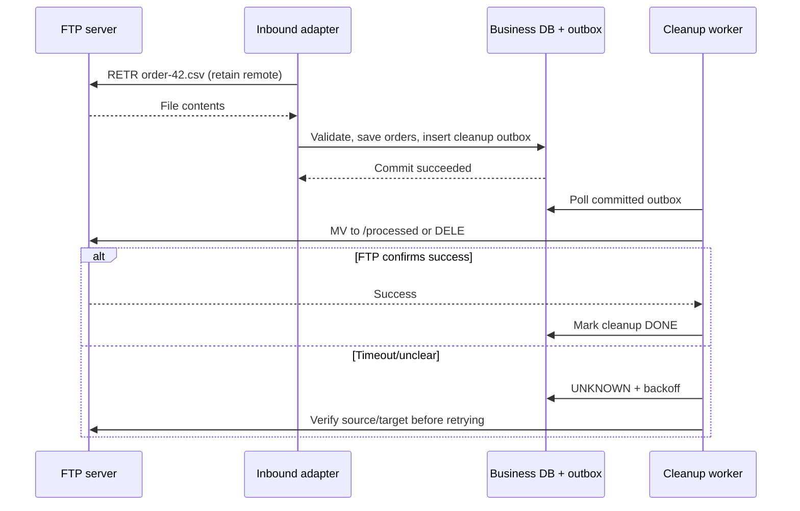

# Deleting or Retaining Remote Files After Retrieval in Spring Integration FTP

## 1. Problem Statement: Should You Delete the File on FTP After a Successful Download?

A partner drops `orders-2026-11-23.csv` into `/incoming/orders` on an FTP server. The Spring Boot application uses an FTP inbound adapter to download the file to `/data/ftp/orders`, emits `Message<File>` onto a `MessageChannel`, parses the CSV, and inserts orders into the database. After each run, the operations team asks: **should we delete the remote file right after downloading to prevent duplicate fetches and save server disk space?**

The answer depends on **what "received successfully" means**:

- If received successfully only means **a local copy was completely downloaded**, Spring Integration offers a mechanism to delete the remote file right after transfer succeeds.
- If received successfully means **the data was parsed, validated, and committed to business storage**, deleting immediately after transfer may be premature.
- If you require **reconciliation, replay, auditing, or timed retention**, keeping the file or moving it to an archive directory is usually better than immediate deletion.

This is the lesson **"Deleting or Retaining Remote Files After Retrieval"** in the **FTP Adapter** chapter of the **SPRING_INTEGRATION_ADAPTERS** module. The module practices integrating external systems using inbound/outbound adapters, gateways, pollers, and `MessageChannel`s across files, SFTP, HTTP, JMS, AMQP, Kafka, and databases—emphasizing message contracts, error handling, and connection lifecycles. This lesson focuses on **source file ownership, deletion timing, file retention, renaming/archiving, and error recovery**.

After this lesson, you will be able to:

1. Explain the difference between **transfer success**, **message emission success**, and **business processing success**.
2. Configure `deleteRemoteFiles(false/true)` on the FTP inbound adapter and understand when it takes effect.
3. Understand the `-D` option on FTP outbound gateway `get` and `mget`.
4. Compare strategies: **retain in place, rename/move, delete after commit, delete immediately after transfer**.
5. Build idempotency, replay, retention, audit, and cleanup workflows for disconnected scenarios.
6. Diagnose cases where a remote file is deleted before DB commit, files download repeatedly, or deletion fails.

## 2. Three Non-Equivalent Success Milestones

A local-sync FTP inbound adapter performs two stages: **the synchronizer downloads files from the server** and **the local file source emits messages**. Downstream services perform the business work.



| Milestone | What Has Been Proven? | What Has Not Been Proven? |
| --- | --- | --- |
| **Transfer succeeded** | The FTP client received and wrote the local copy per sync contract | Does not prove a message was emitted or a handler ran |
| **Message emitted** | The local file was sent by the local source to a channel/consumer | Does not prove the DB transaction committed; async work may not have even started |
| **Business commit succeeded** | Business records and statuses committed as designed | Does not guarantee the partner received a final ACK or the remote file was cleaned up |

**Key takeaway:** `deleteRemoteFiles(true)` on the inbound synchronizer and `get/mget -D` on the outbound gateway are tied to **transfer completion**, not to downstream database transactions. They do not turn FTP and your database into a single atomic transaction.

For example, if a file finishes downloading at 10:00:00, gets deleted on FTP at 10:00:01, and the parser fails at 10:00:05, the source file on the server is already gone. Your ability to retry then depends entirely on the local copy, durable storage, or a backup/resend from the partner.

## 3. Remote File Lifecycle Options

| Strategy | What Happens to Source File | Advantages | Risks and Prerequisites |
| --- | --- | --- | --- |
| **Keep remote file as-is** | File stays in inbox after download | Easy replay and reconciliation; no delete permission needed | Needs filters/metadata and retention policy; server can fill up |
| **Rename or move to `/processed`** | File leaves inbox yet remains on server | Cleanly separates pending queue from archive | Needs rename permission; DB commit and rename are not atomic |
| **Delete after DB commit** | Source file deleted only after business confirmation | Reduces risk of deleting before processing | Needs cleanup worker/retry/audit; delete outcome can be uncertain |
| **Delete immediately after transfer** | Inbound/gateway deletes file right upon transfer success | Minimizes remote backlog; simple for "fetched = done" dropboxes | Loses replay source if downstream fails or pod loses local disk |
| **Retain for a window then delete** | File is archived/kept for N days before cleanup | Provides recovery window and audit trail | Requires age-management job, storage monitoring, permissions, and compliance rules |

No single option fits every system. For transactional data, a safer baseline is **retaining the source or moving it to a time-bounded archive**, using persistent filters to prevent repeat ingestion, and cleaning up only after verified business completion.

### 3.1. Two Questions to Settle with the Partner

**Who owns the file after delivery?** A partner may treat files in `/incoming` as their own property and forbid clients from deleting them; or they may operate an "FTP dropbox" model where the client must pull and clean up. Having technical `DELE` permission **does not equate to business authority to delete**.

**What defines receipt confirmation?** Some partners treat a completed FTP download as handoff. Others require an `.ack` file, API callback, reconciliation table, or record-count confirmation. Specify explicitly which ACK permits archiving or deletion.

## 4. Safe Default Configuration: Retaining Remote Files

In the FTP inbound adapter, `deleteRemoteFiles` defaults to **false**: remote files are **not deleted merely because they were downloaded**. You can declare it explicitly to document policy.

### 4.1. Dependencies and Application Settings

Maven example for a Spring Boot project using a compatible BOM:

```xml
<dependencies>
    <dependency>
        <groupId>org.springframework.boot</groupId>
        <artifactId>spring-boot-starter-integration</artifactId>
    </dependency>
    <dependency>
        <groupId>org.springframework.integration</groupId>
        <artifactId>spring-integration-ftp</artifactId>
    </dependency>
</dependencies>
```

```yaml
# application.yml
partner:
  ftp:
    host: ${PARTNER_FTP_HOST}
    port: ${PARTNER_FTP_PORT:21}
    username: ${PARTNER_FTP_USER}
    password: ${PARTNER_FTP_PASSWORD}
    remote-inbox: /incoming/orders
    local-inbox: /data/ftp/orders
```

The remote path lives **on the FTP server**; the local path lives on the machine or container running Spring Boot. Ensure the local directory is writable, has ample disk space, and uses durable storage if replay is required. Never hardcode credentials; supply them via a secret manager or environment variables.

### 4.2. `SessionFactory` for FTP

```java
import org.apache.commons.net.ftp.FTP;
import org.apache.commons.net.ftp.FTPClient;
import org.apache.commons.net.ftp.FTPFile;
import org.springframework.beans.factory.annotation.Value;
import org.springframework.context.annotation.Bean;
import org.springframework.context.annotation.Configuration;
import org.springframework.integration.file.remote.session.CachingSessionFactory;
import org.springframework.integration.file.remote.session.SessionFactory;
import org.springframework.integration.ftp.session.DefaultFtpSessionFactory;

@Configuration
public class PartnerFtpConnectionConfiguration {

    @Bean("ordersFtpSessionFactory")
    public SessionFactory<FTPFile> ordersFtpSessionFactory(
            @Value("${partner.ftp.host}") String host,
            @Value("${partner.ftp.port}") int port,
            @Value("${partner.ftp.username}") String user,
            @Value("${partner.ftp.password}") String password) {

        DefaultFtpSessionFactory target = new DefaultFtpSessionFactory();
        target.setHost(host);
        target.setPort(port);
        target.setUsername(user);
        target.setPassword(password);
        target.setClientMode(FTPClient.PASSIVE_LOCAL_DATA_CONNECTION_MODE);
        target.setFileType(FTP.BINARY_FILE_TYPE);
        target.setConnectTimeout(10_000);
        target.setDefaultTimeout(10_000);
        target.setDataTimeout(30_000);

        CachingSessionFactory<FTPFile> cache =
                new CachingSessionFactory<>(target, 4);
        cache.setSessionWaitTimeout(5_000);
        cache.setTestSession(true);
        return cache;
    }
}
```

`PASSIVE_LOCAL_DATA_CONNECTION_MODE` works well for most clients behind NAT/firewalls; the server must still open its passive data port range. `BINARY_FILE_TYPE` preserves raw bytes. Session caching reuses connections and limits concurrent sessions—it does **not** track which files were downloaded or committed.

### 4.3. Inbound Flow Retaining Remote Files and Preventing Repeat Fetches/Emissions

```java
import java.io.File;
import java.time.Duration;
import org.apache.commons.net.ftp.FTPFile;
import org.springframework.beans.factory.annotation.Qualifier;
import org.springframework.beans.factory.annotation.Value;
import org.springframework.context.annotation.Bean;
import org.springframework.context.annotation.Configuration;
import org.springframework.integration.dsl.IntegrationFlow;
import org.springframework.integration.dsl.Pollers;
import org.springframework.integration.file.filters.ChainFileListFilter;
import org.springframework.integration.file.filters.FileSystemPersistentAcceptOnceFileListFilter;
import org.springframework.integration.file.remote.session.SessionFactory;
import org.springframework.integration.ftp.dsl.Ftp;
import org.springframework.integration.ftp.filters.FtpPersistentAcceptOnceFileListFilter;
import org.springframework.integration.ftp.filters.FtpSimplePatternFileListFilter;
import org.springframework.integration.metadata.ConcurrentMetadataStore;
import org.springframework.integration.metadata.SimpleMetadataStore;

@Configuration
public class OrdersFtpKeepRemoteConfiguration {

    // For demo: state is lost when the application restarts.
    // Production: replace with an appropriate durable/shared ConcurrentMetadataStore.
    @Bean("ordersMetadataStore")
    public ConcurrentMetadataStore ordersMetadataStore() {
        return new SimpleMetadataStore();
    }

    @Bean
    public IntegrationFlow ordersFtpInboundFlow(
            @Qualifier("ordersFtpSessionFactory")
            SessionFactory<FTPFile> sessionFactory,
            @Qualifier("ordersMetadataStore")
            ConcurrentMetadataStore metadataStore,
            @Value("${partner.ftp.remote-inbox}") String remoteInbox,
            @Value("${partner.ftp.local-inbox}") String localInbox) {

        ChainFileListFilter<FTPFile> remoteFilters = new ChainFileListFilter<>();
        remoteFilters.addFilter(new FtpSimplePatternFileListFilter("*.csv"));
        remoteFilters.addFilter(
                new FtpPersistentAcceptOnceFileListFilter(
                        metadataStore, "orders-remote:"));

        return IntegrationFlow.from(
                Ftp.inboundAdapter(sessionFactory)
                        .remoteDirectory(remoteInbox)
                        .localDirectory(new File(localInbox))
                        .autoCreateLocalDirectory(true)
                        .temporaryFileSuffix(".downloading")
                        .preserveTimestamp(true)
                        .deleteRemoteFiles(false) // KEEP-REMOTE POLICY
                        .maxFetchSize(5)
                        .filter(remoteFilters)
                        .localFilter(
                                new FileSystemPersistentAcceptOnceFileListFilter(
                                        metadataStore, "orders-local:")),
                endpoint -> endpoint.poller(
                        Pollers.fixedDelay(Duration.ofSeconds(20))
                                .maxMessagesPerPoll(3)))
                .channel("ftpOrdersReceived")
                .get();
    }
}
```

**Explanation of file-retention settings:**

| Component | Effect |
| --- | --- |
| `deleteRemoteFiles(false)` | Does not request deletion of source files on FTP after transfer completes |
| `FtpPersistentAcceptOnceFileListFilter` | Tracks selected/downloaded remote files by name and timestamp to avoid redundant fetches |
| `FileSystemPersistentAcceptOnceFileListFilter` | Tracks local files emitted as messages to avoid re-emitting them repeatedly |
| `temporaryFileSuffix(".downloading")` | Uses a **local** temporary filename during download, exposing the final name only once complete |
| `maxFetchSize(5)` | Caps how many remote files are retrieved per fetch pass |
| `maxMessagesPerPoll(3)` | Caps how many messages are emitted per poll; distinct from fetch limit |

**Note:** `SimpleMetadataStore` in the example lives in RAM; using a filter class with "Persistent" in its name does not make data survive restarts on its own. Production systems need a durable/shared metadata store where appropriate, plus database-layer idempotency. Keeping remote files **does not automatically prevent duplicate downloads** if filters or metadata are misconfigured.

When a remote file keeps the same name yet gets a newer timestamp, the remote persistent filter may treat it as a new version. If the partner changes contents while keeping the exact same timestamp, the filter may miss the update. For strict version control, use immutable filenames/batch IDs, checksums, or manifests per contract.

## 5. Enabling Deletion After Sync: `deleteRemoteFiles(true)`

Spring Integration provides this option:

```java
// Illustrates only the changed portion inside Ftp.inboundAdapter(...).
// Do not enable until a deletion policy is agreed upon with the partner.
Ftp.inboundAdapter(sessionFactory)
        .remoteDirectory("/incoming/orders")
        .localDirectory(new File("/data/ftp/orders"))
        .autoCreateLocalDirectory(true)
        .temporaryFileSuffix(".downloading")
        .deleteRemoteFiles(true);
```

`deleteRemoteFiles(true)` instructs the inbound synchronizer to **delete the remote file once transfer succeeds**. Even though it is a single boolean line in code, it can permanently destroy source data.

### 5.1. When Exactly Is "After Transfer Succeeds"?

Per the inbound synchronizer contract:

1. List remote files and select candidates through the filter.
2. Execute FTP transfer locally, typically under a temporary local filename.
3. Once transfer succeeds, the synchronizer can ask the FTP server to **delete the remote file** with the corresponding command.
4. The local file source emits `Message<File>` from the local copy per poller/local filter.
5. Downstream consumers process the CSV, call HTTP/JMS/Kafka, or write to the database.

Because remote deletion runs inside the **synchronizer layer**, never assume `deleteRemoteFiles(true)` means "delete only after step 5 succeeds." No automatic database transaction wraps both the FTP `DELE` command and the DB commit.



The diagram shows **logical ordering**, without guaranteeing identical server reply codes or shared transactionality. If the delete command fails or loses its response, remote state becomes uncertain and requires inspection.

### 5.2. When Is Immediate Deletion Acceptable?

Some architectures treat FTP as a **transient dropbox**. The agreement with the partner is: once a file lands safely in a **durable landing store**, the receiver may delete the source; all business processing can replay purely from the landing zone.

Consider this mode only when all of the following hold simultaneously:

- **Explicit contract** transferring file ownership to the receiver upon transfer.
- **Local/durable copy store** with backups, integrity verification, and persistence across pod restarts.
- **Idempotency and replay capability** from the stored copy, independent of the remote file.
- **Error workflow** covering download-succeeded-but-delete-failed and deleted-then-handler-failed cases.
- **Least-privilege FTP permissions** for deletion plus comprehensive logging/auditing.

If local files live solely on ephemeral container storage, enabling `deleteRemoteFiles(true)` risks **losing both remote and local copies** when a pod is replaced. That is a critical reason never to enable this setting out of habit.

## 6. FTP Outbound Gateway `get/mget -D`

Besides the inbound adapter, the FTP outbound gateway supports **request–reply** commands to fetch files explicitly by name or directory.

| Command | Without `-D` | With `-D` |
| --- | --- | --- |
| `get` | Downloads one remote file locally and returns `File` | Downloads successfully then deletes the **remote file** |
| `mget` | Downloads multiple matching files and returns `List<File>` | Deletes **each remote file right after that file transfers successfully** |

If `FileExistsMode.IGNORE` is configured and the destination local file already exists so **no transfer actually occurs**, the gateway **does not delete that remote file** solely because `-D` is set. Keep this detail in mind during testing and when avoiding accidental deletions.

### 6.1. Deliberate `get -D` Example

```java
import java.io.File;
import org.apache.commons.net.ftp.FTPFile;
import org.springframework.beans.factory.annotation.Qualifier;
import org.springframework.context.annotation.Bean;
import org.springframework.context.annotation.Configuration;
import org.springframework.integration.dsl.IntegrationFlow;
import org.springframework.integration.file.remote.session.SessionFactory;
import org.springframework.integration.file.support.FileExistsMode;
import org.springframework.integration.ftp.dsl.Ftp;

@Configuration
public class DeleteOnGetGatewayConfiguration {

    @Bean
    public IntegrationFlow deleteAfterGetFlow(
            @Qualifier("ordersFtpSessionFactory")
            SessionFactory<FTPFile> sessionFactory) {

        return IntegrationFlow.from("ftpGetAndDeleteRequests")
                .handle(Ftp.outboundGateway(sessionFactory, "get", "payload")
                        .options("-D")
                        .localDirectory(new File("/data/ftp/landing"))
                        .autoCreateLocalDirectory(true)
                        .fileExistsMode(FileExistsMode.FAIL))
                .get();
    }
}
```

The gateway request payload is a remote file path, such as `"/incoming/orders/order-42.csv"`. On successful transfer, the reply payload is normally the local `File`. The `-D` option tells the gateway to attempt deleting the **remote file** right after transfer, **without waiting for downstream business handlers to process the reply file**. This snippet illustrates the mechanism only; do not apply it verbatim to an inbox whose contents lack durable copies.

With `mget -D`, some files may be downloaded and deleted before an error hits. Never assume retrying the whole batch is safe: inspect per-file outcomes, local files, remote state, and the gateway's `PartialSuccessException`.

### 6.2. Do Not Equate `-D` with `rm`

`get -D` / `mget -D` means "**fetch and delete**" directly inside the gateway's fetch command flow. By contrast, `rm` is a **standalone remote delete command** returning a Boolean reply:

```java
// An outbound gateway dedicated to remote deletion.
// Deploy only after appropriate business approval/commit steps.
IntegrationFlow.from("ftpDeleteRequests")
        .handle(Ftp.outboundGateway(sessionFactory, "rm", "payload"))
        .get();
```

An `rm` call can run **after** the database commits and after a cleanup worker picks up an approved request. This gives far better business control than `-D`, though it still does not merge DB and FTP into an atomic transaction.

## 7. Retaining Files + Filters: Preventing Duplicates Without Deleting the Source

A common misconception is that remote files must be deleted so the inbound poller does not re-download them. In fact, the **remote file filter** prevents re-fetching unchanged files, and the **local file filter** prevents re-emitting already-processed local copies.

```text
REMOTE FTP                           LOCAL DISK
order-42.csv                         order-42.csv
     |                                    |
     v                                    v
FtpPersistentAcceptOnce...        FileSystemPersistentAcceptOnce...
     |                                    |
     +-- Fetch again?                     +-- Emit Message<File> again?
```

| Concern | Solving Mechanism | Do Not Confuse With |
| --- | --- | --- |
| Skip already-seen remote files | `FtpPersistentAcceptOnceFileListFilter` | Deleting remote files |
| Skip same-version local files | `FileSystemPersistentAcceptOnceFileListFilter` | DB commit |
| Preserve state across restarts | Appropriate durable `ConcurrentMetadataStore` | Making local files durable |
| Prevent duplicate orders | Unique key/idempotency in DB or consumer | Accept-once filter |
| Free FTP server disk space | Policy-driven archive/retention/cleanup | Resetting session cache |

**Metadata is not proof of business completion.** The remote filter can mark a file accepted before download, and the local filter can mark it emitted before DB commit. If the business handler fails, the poller will not automatically know to re-emit the file. Retention and retries must be designed independently from filters.

### 7.1. What Happens After a Restart?

With an in-memory `SimpleMetadataStore`, filter state is lost on JVM restart. Remote files still exist so they may be re-downloaded; local files still exist so they may be re-emitted. Conversely, with a durable store where local disk is wiped on pod restart, the system may retain "downloaded" metadata while lacking the local file. Therefore:

1. Use **durable local storage or object storage** whenever replayability is required.
2. Separate `RECEIVED / PROCESSING / COMPLETED / FAILED` states in the business layer.
3. Implement a **reconciliation** job across metadata, local files, remote files, and DB status.
4. When replay is necessary, adjust state only for the **exact batch/file** under a controlled procedure.

Never wipe all metadata keys just to "re-read one file," and never enable `deleteRemoteFiles(true)` just because duplicates occurred.

## 8. Moving Remote Files to an Archive Instead of Deleting

A balanced strategy is keeping the source file until the database commits, then **renaming or moving it remotely** to `/processed`. The FTP outbound gateway provides `mv`, executing a remote rename/move over FTP.



Example `mv` flow:

```java
import org.apache.commons.net.ftp.FTPFile;
import org.springframework.beans.factory.annotation.Qualifier;
import org.springframework.context.annotation.Bean;
import org.springframework.context.annotation.Configuration;
import org.springframework.integration.dsl.IntegrationFlow;
import org.springframework.integration.file.remote.session.SessionFactory;
import org.springframework.integration.ftp.dsl.Ftp;

@Configuration
public class FtpArchiveGatewayConfiguration {

    @Bean
    public IntegrationFlow moveAfterCommitFlow(
            @Qualifier("ordersFtpSessionFactory")
            SessionFactory<FTPFile> sessionFactory) {

        return IntegrationFlow.from("ftpMoveAfterCommitRequests")
                .handle(Ftp.outboundGateway(sessionFactory, "mv", "payload")
                        .renameExpression("headers['file_renameTo']"))
                .get();
    }
}
```

A request must carry the **source path** in the payload, e.g., `/incoming/orders/order-42.csv`, and the **destination path** via the `file_renameTo` header, e.g., `/processed/orders/order-42.csv`. A successful reply reflects FTP-level rename completion.

**Caveats:**

- The FTP account needs rename/move permissions and appropriate permissions on the target directory.
- Not every server supports cross-filesystem renames or guarantees strict atomicity.
- If the rename succeeds yet the caller times out, retrying from the old name may return "file not found"; inspect **both source and destination**.
- Files in `/processed` still consume server disk space: follow up with retention/cleanup if storage must be bounded.
- Do not treat `mv` success as a partner ACK when the contract requires explicit confirmation.

## 9. A Safer Pattern: Commit DB First, Then Clean Up

A production architecture commonly uses **two independent phases**, avoiding remote deletion inside the inbound synchronizer:

**Phase A — Ingestion and processing:**

1. Partner uploads `order-42.csv.uploading` and renames it to `order-42.csv` when complete.
2. Inbound adapter uses `deleteRemoteFiles(false)` and downloads to a local/durable landing area.
3. Service validates filename/content and verifies checksums/manifests if provided.
4. Service writes records to the DB with idempotency keys and sets batch status to `COMPLETED`.
5. Within the same DB transaction, write a **cleanup request** (outbox record) containing the verified remote path, batch ID, and `ARCHIVE` or `DELETE` action.

**Phase B — Controlled cleanup:**

6. A worker reads committed outbox entries and verifies retention policies and permissions.
7. The worker verifies the exact remote file by name/path/batch and version/checksum if needed.
8. The worker executes FTP `mv` or `rm`, recording the outcome and timestamp.
9. If the network drops or times out, the worker marks `UNKNOWN`, inspects remote state, and only then decides on retry.
10. Once archive/deletion is verified, update the outbox record to `DONE`; retain audit records per policy.



**Never call FTP `rm` inside a DB transaction expecting `@Transactional` to roll back the FTP command.** The FTP server does not participate in database transactions. Using an outbox records "business data committed" and "cleanup needed" atomically in one DB transaction; cleanup runs as a separate stateful, retryable task.

### 9.1. Illustrating Manual Cleanup with a Session Callback

Once the application has an approved cleanup request, `FtpRemoteFileTemplate` can execute it:

```java
import org.apache.commons.net.ftp.FTPFile;
import org.springframework.beans.factory.annotation.Qualifier;
import org.springframework.integration.file.remote.session.SessionFactory;
import org.springframework.integration.ftp.session.FtpRemoteFileTemplate;
import org.springframework.stereotype.Service;

@Service
public class ApprovedFtpCleanup {

    private final FtpRemoteFileTemplate template;

    public ApprovedFtpCleanup(
            @Qualifier("ordersFtpSessionFactory")
            SessionFactory<FTPFile> factory) {
        this.template = new FtpRemoteFileTemplate(factory);
    }

    // Call only after permissions and business preconditions are verified.
    public boolean removeApprovedFile(String remotePath) {
        Boolean removed = template.execute(
                session -> session.remove(remotePath));
        return Boolean.TRUE.equals(removed);
    }
}
```

This snippet is **not a complete production cleanup system**: the caller must validate authorization, constrain `remotePath` to the partner's authorized inbox, write audit logs, verify file versions, and handle ambiguous results. A `false` return or exception does not prove the file survived; a timeout can occur after the server already executed the command.

### 9.2. Idempotent Deletion Does Not Mean "Blindly Delete Forever"

Suppose `DELE order-42.csv` succeeded on the server, yet the network dropped before the client received the reply. A retry may find the file already gone. In that case:

- Verify the batch is `COMPLETED` and the cleanup request targets that exact file.
- Verify the filename is absent from the source area; if archived, verify it is present in the destination area.
- Record `DONE` when there is clear evidence that the **desired target state has been reached**.
- Never delete a different file just because the expected file is missing.

This is **workflow-level idempotency**: repeating an operation must never alter data outside the verified batch's scope.

## 10. Failure Windows to Analyze Before Enabling Delete

| Failure Timing | If Retaining Remote | If Deleting Immediately After Transfer | Recovery Path |
| --- | --- | --- | --- |
| Before download | Source intact | Delete not issued yet | Poll again once connectivity returns |
| Mid-`RETR` | Source usually intact | Not treated as transfer complete; verify state | Clean temp local file, controlled retry |
| Transfer complete, before message emission | Remote file still available for replay | Remote may already be deleted | Check local/durable landing, metadata, and replay capability |
| Message emitted, DB fails | Can re-read source | Remote may already be lost | Retry from local/durable copy or request partner resend |
| DB committed, before archive/delete | File remains on FTP | Not applicable if deleted early | Cleanup worker processes outbox |
| Deleted on FTP yet response lost | Can happen in decoupled cleanup | Can happen right inside synchronizer/gateway | Reconcile file presence rather than blind retry |
| Pod loses local disk while metadata persists | Can re-fetch if policy allows | No source left if remote was deleted | Requires persistent volume/object storage/backups |
| Two replicas scan inbox together | Source intact with claim-race risk | One replica may delete before the other finishes | Shared metadata, partitioning/leader, and idempotency |

FTP **provides no distributed transaction** making "download, delete source, emit message, commit DB" a single atomic action. Design intermediate states and post-incident verification accordingly.

## 11. Retention, Quotas, Compliance, and FTP Permissions

Retention and deletion rules are not purely technical settings—they also govern storage responsibility and auditability.

### 11.1. Lifecycle Policies Recommended in Partner Agreements

| Topic | Questions to Answer |
| --- | --- |
| Ownership | Who owns the source file after transfer? Who is authorized to delete it? |
| Retention | How many days are originals retained? Counted from creation or successful processing? |
| Replay | When downstream fails, where can files be replayed from and for how long? |
| Audit | Where are batch ID, path, filename, checksum, and download/rename/delete timestamps recorded? |
| Security | Does the file hold sensitive data requiring FTPS/SFTP or encryption at rest? |
| Quotas | Who monitors FTP server capacity and local/archive storage usage? |
| Concurrency | Can multiple replicas ingest or delete files concurrently? |
| Cleanup failure | If rename/delete fails, who owns remediation and what is the procedure? |

A concrete agreement example: "Files are retained in `/processed` for **7 days after batch status reaches `COMPLETED`**, after which the cleanup worker deletes them unless held for reconciliation." This is purely an **illustrative policy**; actual durations must be decided by business, security, and regulatory requirements.

### 11.2. Least Privilege

- **Ingest reader:** granted `LIST` and `RETR` on `/incoming`; does not necessarily need `DELE`.
- **Archive worker:** granted `RNFR/RNTO` into `/processed` if using renames.
- **Cleanup worker:** granted `DELE` strictly inside approved retention folders; cannot delete elsewhere.
- **Partner uploader:** permitted to upload and rename temporary files to final names per contract.

Do not use a single all-powerful account across every stage just to avoid permission errors. Separating credentials also strengthens control and auditing over destructive actions.

### 11.3. Guarding Paths Before Deletion

Never pass raw, unvalidated paths from HTTP requests or message headers into `rm` or `DELE`. Always:

1. Anchor paths to a **trusted remote base directory** configured per partner.
2. Accept only **whitelisted filenames**, e.g., batch IDs matching `[A-Za-z0-9_-]` with `.csv`.
3. Reject `..`, unexpected separators, out-of-scope absolute paths, empty names, or control characters.
4. Cross-check the remote path against batch state and partner identity.
5. Enforce least-privilege FTP accounts as defense-in-depth if application code ever has a bug.

With FTPS, verify TLS certificates and hostnames. When a partner provides SFTP, use Spring Integration's SFTP adapters/session factories—changing the FTP port to 22 is not SFTP. Both protocols still require retention/cleanup policies decoupled from business completion.

## 12. Diagnosing Deleted, Undeleted, or Reappearing Files

| Symptom | Causes to Check | How to Inspect |
| --- | --- | --- |
| Remote file vanishes right after download while DB has no data | Inbound `deleteRemoteFiles(true)` or gateway `-D` | Check synchronizer/gateway config and when business handler ran |
| Remote file stays despite expecting deletion | `deleteRemoteFiles(false)`, missing `DELE` permission, server rejection, incomplete transfer | Inspect config, FTP replies, and server logs |
| `get -D` does not delete when local file exists | `FileExistsMode.IGNORE` skipped transfer | Distinguish "already present locally" from "newly transferred" |
| `mget -D` deletes only some files | Partial batch transfer, network drop, or skipped files | Inspect `PartialSuccessException` and reconcile per file |
| Same file re-downloaded after restart | In-RAM metadata store or changed filter prefix | Inspect remote/local persistent accept-once filters and store |
| File needed for retry is not re-downloaded | Metadata accepted it, yet local/durable copy was lost | Run controlled reconciliation; never wipe all metadata |
| Delete times out yet file is gone | Server completed `DELE` before reply was lost | Check remote path and audit logs; record outcome from evidence |
| `mv` fails saying source missing | Previous attempt already renamed the file | Inspect both source and target paths; do not retry indefinitely |
| FTP folder fills up while inbound runs | Retain-source policy lacks retention/cleanup | Balance disk quotas, archiving, and controlled cleanup schedules |
| Pod restart loses downloaded files | Local directory sits on ephemeral filesystem | Use persistent volumes/object storage and audit metadata |
| Same file processed twice | Non-durable filter/metadata or missing idempotency | Check file state tracking and business unique keys |

### 12.1. Procedure for Investigating a Missing Batch

```text
1. Identify batchId, partnerId, remotePath, and publication timestamp.
2. Check FTP server: is the file in inbox, moved to processed, or deleted?
3. Check configuration: deleteRemoteFiles, gateway -D, rm/mv cleanup.
4. Check local/durable landing: is the file complete (size and checksum)?
5. Check remote/local filter metadata and claim/emission timestamps.
6. Check DB: RECEIVED / PROCESSING / COMPLETED / FAILED.
7. Check outbox/cleanup jobs and individual FTP command results.
8. Decide whether to replay, restore from backup, or request a partner resend.
```

Never rely solely on filename existence: a file could be truncated, overwritten with a new version, or handled by another pod. Log with per-batch correlation IDs, while **never logging passwords or sensitive file contents**.

## 13. Integration Test Scenarios

Run these tests against a **dedicated test** FTP server with synthetic directories and role-specific accounts. Never test `deleteRemoteFiles(true)` or `rm` against production data.

| Scenario | Expectation |
| --- | --- |
| Inbound with `deleteRemoteFiles(false)` | After download, remote file remains intact |
| Inbound with `deleteRemoteFiles(true)` | After transfer succeeds, remote delete is requested; does not wait for downstream DB |
| Connection drops mid-`RETR` | Remote file is not deleted solely due to partial bytes; check temp file/rollback |
| Download finishes, handler throws exception | With post-transfer delete, remote may be gone; recovery must still work from durable copy |
| `get -D` when local file does not exist | Transfer finishes and remote is deleted per gateway permissions/rules |
| `get -D` + `FileExistsMode.IGNORE` when local exists | Skips transfer and **does not delete remote** simply because it was ignored |
| `mget -D`, third file fails | Inspect which files downloaded/deleted; do not blindly retry entire batch |
| Delete without FTP `DELE` permission | Error is surfaced; remote is not marked cleaned |
| `mv` to `/processed` after commit | File leaves inbox and appears in archive when server permits |
| `mv` times out after rename | Cleanup worker inspects source/target rather than looping endlessly |
| DB commits then worker crashes before cleanup | Outbox preserves pending request; another worker resumes it |
| Pod dies after transfer, before DB commit | Recoverable from durable landing or retained remote file per policy |
| Two replicas poll inbox concurrently | Zero duplicate business records; cleanup does not delete another replica's file |
| Retention expires | Deletes only policy-eligible files and writes audit records |

These rows are **recommended test scenarios**, not outputs from an executed suite. During testing, verify **byte contents or checksums**, not merely filename presence/absence. For fault-injection tests, bound execution times and clean up test environments properly.

## 14. Scenario Exercise

**Prompt:** A partner delivers `payments-<batchId>.csv` to `/incoming/payments`. The application runs two Kubernetes replicas using an FTP inbound adapter polling every 30 seconds. Processing a single file can take 20 minutes. Local files currently live on ephemeral pod filesystems. The partner wants files cleaned up promptly to save FTP quota, while business rules require reconciliation or replay for 14 days.

Answer:

1. Should `deleteRemoteFiles(true)` be enabled right away under the current design? Why or why not?
2. Does `deleteRemoteFiles(true)` wait for **transfer** or **DB commit**?
3. If retaining remote files, which filters reduce duplicate downloads and message emissions?
4. Why is a persistent metadata store insufficient if pod local filesystems can be lost?
5. If archiving after commit, what components should handle the cleanup request?
6. With gateway `get -D` and `FileExistsMode.IGNORE`, if the local file already exists, will the remote file be deleted?
7. If remote deletion succeeds yet the reply is lost, what must be done before retrying?
8. If `mget -D` downloaded and deleted 2 out of 3 files before failing, is it safe to re-run the entire batch?
9. What FTP permissions are needed for the ingest service vs. the cleanup service?
10. How should 14-day retention be designed to reduce inbox clutter while still supporting replay?

**Suggested answers:** (1) Not yet; ephemeral local storage risks losing files after remote deletion. (2) It waits for transfer completion, **not** DB commit. (3) Remote `FtpPersistentAcceptOnceFileListFilter` and local `FileSystemPersistentAcceptOnceFileListFilter` backed by durable metadata; DB idempotency is still required. (4) Metadata may keep the "received" mark while the local copy vanishes. (5) DB outbox + cleanup worker with retries/auditing calling `mv` or `rm` once preconditions pass. (6) No, because transfer is ignored. (7) Verify whether the remote file still exists or was already archived before deciding. (8) No; reconcile per-file results. (9) Ingest needs only list/read; cleanup gets scoped rename/delete. (10) Move to `/processed` after commit, retain for 14 days, then purge via a policy-driven job with proper durable storage and auditing.

## Summary

- **Retaining remote files** is the safe default for the FTP inbound adapter; setting `deleteRemoteFiles(false)` documents this policy explicitly.
- `deleteRemoteFiles(true)` and gateway `get/mget -D` delete after **transfer succeeds**, without waiting for downstream DB commits. With `FileExistsMode.IGNORE`, skipped files are not deleted by `-D`.
- **Never delete remote files solely to prevent duplicates.** Use remote/local persistent filters, an appropriate metadata store, and business idempotency keys.
- When post-processing deletion is required, prefer **DB commit → outbox → cleanup worker** or archiving/retention with auditing. FTP and databases share no built-in distributed transaction.
- When connectivity drops after delete/rename commands, remote state is uncertain: reconcile source and target before retrying.
- Retention decisions must account for data ownership, security, quotas, replay windows, backups, and multi-replica deployments.

## References

- [Spring Integration Reference — FTP Inbound Channel Adapter](https://docs.spring.io/spring-integration/reference/ftp/inbound.html)
- [Spring Integration API — RemoteFileInboundChannelAdapterSpec.deleteRemoteFiles](https://docs.spring.io/spring-integration/api/org/springframework/integration/file/dsl/RemoteFileInboundChannelAdapterSpec.html)
- [Spring Integration Reference — FTP Outbound Gateway (get/mget/rm/mv)](https://docs.spring.io/spring-integration/reference/ftp/outbound-gateway.html)
- [Spring Integration Reference — FTP Session Factory](https://docs.spring.io/spring-integration/reference/ftp/session-factory.html)
- [Spring Integration Reference — Remote Persistent File List Filters](https://docs.spring.io/spring-integration/reference/file/remote-persistent-flf.html)
- [Spring Integration Reference — Error Handling](https://docs.spring.io/spring-integration/reference/error-handling.html)
- [RFC 959 — File Transfer Protocol](https://www.rfc-editor.org/rfc/rfc959)
