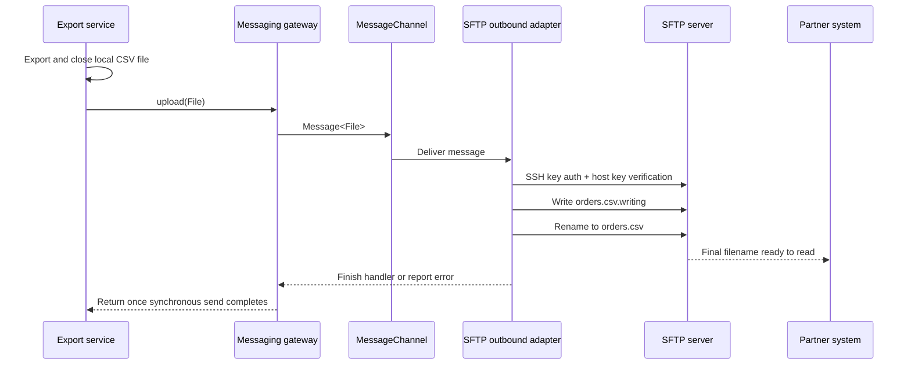
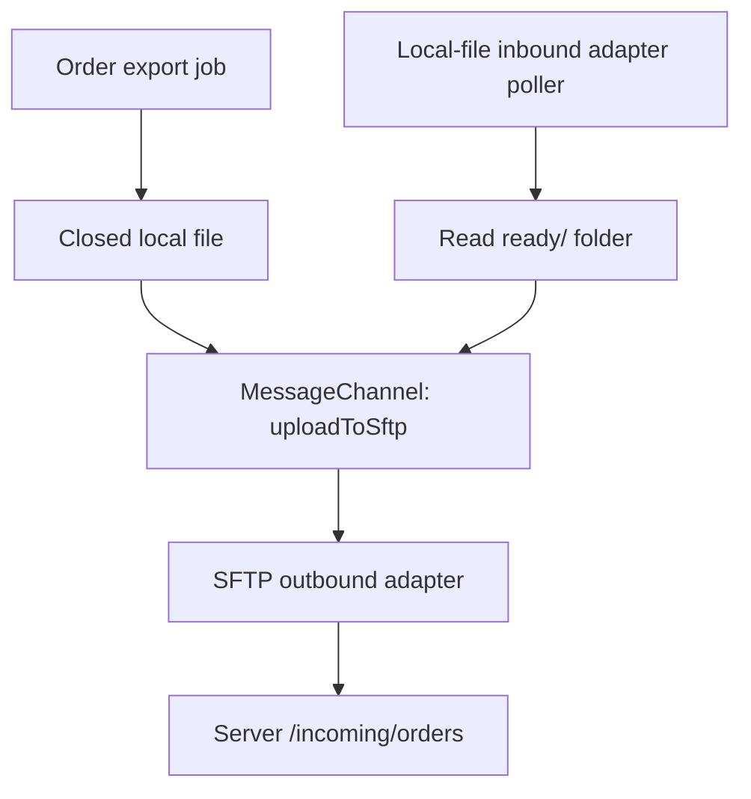

# SFTP Outbound Adapter for Uploading Files

## 1. Problem Statement and Objectives

A sales system aggregates daily orders into `orders-2026-11-23.csv`. The partner requires receiving the file via **SFTP**, in the `/incoming/orders` directory, using an account authenticated with **SSH keys**. The system must deliver the completed file accurately, avoid overwriting data from a previous period, prevent the partner from reading a partially uploaded file, and know how to recover when the network drops mid-transfer.

Spring Integration's **SFTP outbound channel adapter** solves the task of transferring files **from the application to an SFTP server**. It receives a Spring `Message` (in this lesson, `Message<File>`), uses a `SessionFactory` to open an SSH/SFTP session, and writes the payload as a remote file. The adapter is typically a **one-way endpoint** of an integration flow: the application invokes a file send, the adapter performs the side effect, and it does not emit a reply message containing the partner's business result.

In the `SPRING_INTEGRATION_ADAPTERS` module, this is a classic example of an **outbound adapter**, combined with a `MessageChannel`, Java DSL, and a gateway to connect the application to an external system. Do not confuse it with:

| Component | Role |
| --- | --- |
| **SFTP inbound adapter** | Polls a server directory, downloads files **to** the application machine, and emits `Message<File>` |
| **SFTP outbound adapter** | Receives a message from the application and **sends** the file to the server; one-way flow |
| **SFTP outbound gateway** | Executes an SFTP command in a request/reply model, suitable when you need results from operations such as `ls`, `get`, `put`, `rm`, `mv` |
| **Poller** | Triggers a polled input periodically; not required for an outbound flow starting from a `DirectChannel` and a gateway call |

After this lesson, you will be able to configure an SFTP session with an SSH private key and `known_hosts`, implement an outbound adapter using Java DSL, control file naming/overwriting/publishing behavior, invoke the flow through a gateway, and design controlled retries.

## 2. Upload Flow Architecture



Two points to keep in mind:

1. **The data source must be ready before sending.** The application must finish writing and closing the local file before emitting `Message<File>`; the adapter does not know whether another process is still writing to the source file.
2. **Completing the file upload does not mean the partner has successfully imported the data.** A successful write and rename over SFTP only confirms the operation at the file-transport layer. If business acceptance from the partner is needed, you must also have an acknowledgment (ACK), confirmation marker, API callback, or reconciliation process.

`DirectChannel` normally runs the handler on the caller's thread, so exceptions propagate back to the gateway caller. If replaced with an `ExecutorChannel` or an asynchronous queue, the caller may return before the upload completes. The choice of channel determines how errors are reported and how status is tracked.

## 3. Prerequisites and SSH Configuration

Assume the Spring Boot project uses Spring Integration **6.x or later**, with an SFTP client based on Apache MINA SSHD. If the project uses Spring Integration 5.x, several SFTP classes/types may differ because the underlying SSH library changed.

The partner must provide the hostname, port, username, destination directory, and accept the **application's public key** in `authorized_keys` on the server. The application holds the **private key** for authentication. In addition, the application must have a verified **server host public key** entry in `known_hosts` to detect connecting to the wrong server.

| Secret or Identity | Who Holds It? | Purpose |
| --- | --- | --- |
| Application private key | Application, via secret mount/secret manager | Authenticates the client on login |
| Application public key | SFTP account on the server | Allows the client holding the matching private key to log in |
| Server host key | Server and the application's `known_hosts` entry | Authenticates the server, preventing spoofed connections |
| Passphrase (if any) | Application secret | Decrypts the client's private key |

Generate a test key pair with OpenSSH:

```bash
ssh-keygen -t ed25519 -a 100 -f ~/.ssh/partner_outbound -C "sales-export"

# Send only the .pub file to the SFTP server administrator.
cat ~/.ssh/partner_outbound.pub
```

Obtain the host key fingerprint from the administrator through an independent channel. You can use the following command to **collect** the entry, but **do not trust the entry solely because `ssh-keyscan` succeeded**:

```bash
ssh-keyscan -p 22 -t ed25519 sftp.partner.example > partner_known_hosts

# Compare the collected entry's fingerprint against the confirmed fingerprint.
ssh-keygen -lf partner_known_hosts

# Verify login and write access to the target directory with an SFTP client before running the app.
sftp -i ~/.ssh/partner_outbound \
  -o UserKnownHostsFile=./partner_known_hosts \
  -P 22 exports_app@sftp.partner.example
```

Never store the private key or passphrase in Git, Docker images, or logs. Do not enable `allowUnknownKeys(true)` to bypass host key verification failures in real environments. When the partner rotates the host key, verify the new fingerprint and update `known_hosts` following a controlled change-management process.

## 4. Dependencies and Application Configuration

When using the Spring Boot BOM for version management, add the SFTP module:

```groovy
// build.gradle
dependencies {
    implementation 'org.springframework.integration:spring-integration-sftp'
}
```

Or Maven:

```xml
<dependency>
    <groupId>org.springframework.integration</groupId>
    <artifactId>spring-integration-sftp</artifactId>
</dependency>
```

Example `application.yml` without inline credentials:

```yaml
app:
  sftp:
    host: ${SFTP_HOST:sftp.partner.example}
    port: ${SFTP_PORT:22}
    username: ${SFTP_USERNAME:exports_app}
    private-key: file:${SFTP_PRIVATE_KEY_FILE}
    private-key-passphrase: ${SFTP_PRIVATE_KEY_PASSPHRASE:}
    known-hosts: file:${SFTP_KNOWN_HOSTS_FILE}
    remote-directory: ${SFTP_REMOTE_DIRECTORY:/incoming/orders}
```

`SFTP_PRIVATE_KEY_FILE` and `SFTP_KNOWN_HOSTS_FILE` are required environment variables in this example, pointing to **real files inside the runtime**. Grant least-privilege read access to those files; grant write permission for the partner account on the remote directory. If the private key is not protected by a passphrase, `SFTP_PRIVATE_KEY_PASSPHRASE` can be left empty.

## 5. Declaring `SessionFactory` with an SSH Key

In Spring Integration 6.x+, the remote SFTP entry type is `SftpClient.DirEntry`. Even though this lesson only **uploads** files, `SessionFactory<SftpClient.DirEntry>` is still the object the adapter uses to create SFTP sessions.

```java
import org.apache.sshd.sftp.client.SftpClient;
import org.springframework.beans.factory.annotation.Value;
import org.springframework.context.annotation.Bean;
import org.springframework.context.annotation.Configuration;
import org.springframework.core.io.Resource;
import org.springframework.integration.file.remote.session.CachingSessionFactory;
import org.springframework.integration.file.remote.session.SessionFactory;
import org.springframework.integration.sftp.session.DefaultSftpSessionFactory;

@Configuration
public class SftpConnectionConfig {

    @Bean
    public SessionFactory<SftpClient.DirEntry> outboundSftpSessionFactory(
            @Value("${app.sftp.host}") String host,
            @Value("${app.sftp.port}") int port,
            @Value("${app.sftp.username}") String username,
            @Value("${app.sftp.private-key}") Resource privateKey,
            @Value("${app.sftp.private-key-passphrase:}") String passphrase,
            @Value("${app.sftp.known-hosts}") Resource knownHosts) {

        DefaultSftpSessionFactory delegate = new DefaultSftpSessionFactory(false);
        delegate.setHost(host);
        delegate.setPort(port);
        delegate.setUser(username);
        delegate.setPrivateKey(privateKey);

        if (!passphrase.isBlank()) {
            delegate.setPrivateKeyPassphrase(passphrase);
        }

        delegate.setKnownHostsResource(knownHosts);
        delegate.setAllowUnknownKeys(false);
        delegate.setTimeout(30_000);

        // Limit the number of sessions retained for reuse.
        return new CachingSessionFactory<>(delegate, 4);
    }
}
```

**Why cache?** Opening a new SSH connection each time incurs connection setup and authentication overhead. `CachingSessionFactory` reuses sessions and caps the number of cached sessions. Size the pool according to concurrent uploads and the partner's connection limits; when encountering stale/dead session errors, consider testing sessions on checkout from the cache and cache-reset mechanisms per your version's documentation.

`DefaultSftpSessionFactory(false)` chooses not to share a single underlying SSH connection across sessions. Option `true` exists for shared-session mode, but it requires evaluating the connection lifecycle and combining caching properly; do not flip this option merely to chase higher throughput.

## 6. Writing the Outbound Adapter with Java DSL

The following flow listens on the `uploadToSftp` channel; each message carries a complete `java.io.File`. The adapter writes the file to `/incoming/orders`, uploads via a temporary `.writing` name, and then renames it to the final name. If the destination already has a file with the same name, the example uses `FileExistsMode.FAIL` to signal a conflict for the application to decide how to handle.

```java
import java.io.File;

import org.apache.sshd.sftp.client.SftpClient;
import org.springframework.beans.factory.annotation.Value;
import org.springframework.context.annotation.Bean;
import org.springframework.context.annotation.Configuration;
import org.springframework.integration.annotation.IntegrationComponentScan;
import org.springframework.integration.dsl.IntegrationFlow;
import org.springframework.integration.file.remote.session.SessionFactory;
import org.springframework.integration.file.support.FileExistsMode;
import org.springframework.integration.sftp.dsl.Sftp;

@Configuration
@IntegrationComponentScan(basePackageClasses = SftpUploadGateway.class)
public class SftpOutboundFlowConfig {

    @Bean
    public IntegrationFlow sftpOutboundFlow(
            SessionFactory<SftpClient.DirEntry> outboundSftpSessionFactory,
            @Value("${app.sftp.remote-directory}") String remoteDirectory) {

        return IntegrationFlow.from("uploadToSftp")
                .handle(Sftp.outboundAdapter(
                                outboundSftpSessionFactory, FileExistsMode.FAIL)
                        .remoteDirectory(remoteDirectory)
                        .autoCreateDirectory(false)
                        .useTemporaryFileName(true)
                        .temporaryFileSuffix(".writing")
                        .fileNameGenerator(message ->
                                ((File) message.getPayload()).getName()))
                .get();
    }
}
```

In a real project, place `SftpUploadGateway` in the package scanned by `@IntegrationComponentScan` (or adjust the scan package); below is a standalone interface example:

```java
import java.io.File;
import org.springframework.integration.annotation.Gateway;
import org.springframework.integration.annotation.MessagingGateway;

@MessagingGateway
public interface SftpUploadGateway {

    @Gateway(requestChannel = "uploadToSftp")
    void upload(File localFile);
}
```

A service that has finished generating the CSV can call:

```java
import java.nio.file.Files;
import java.nio.file.Path;
import org.springframework.stereotype.Service;

@Service
public class OrdersExportService {
    private final SftpUploadGateway sftpUploadGateway;

    public OrdersExportService(SftpUploadGateway sftpUploadGateway) {
        this.sftpUploadGateway = sftpUploadGateway;
    }

    public void publish(Path completedCsv) {
        if (!Files.isRegularFile(completedCsv) || !Files.isReadable(completedCsv)) {
            throw new IllegalArgumentException("CSV file is not ready: " + completedCsv);
        }

        // Only pass the file after the export process has closed the output stream.
        sftpUploadGateway.upload(completedCsv.toFile());
    }
}
```

`@MessagingGateway` turns a regular Java call into a `Message<File>` sent to `uploadToSftp`. When the default channel is synchronous and the handler fails, calling `upload()` can throw an exception. Because the method returns `void`, **there is no response payload containing a business confirmation**. If you need to track which files were sent successfully, persist the batch ID, filename, send status, timestamp, and correlation ID yourself in your business datastore.

### Meaning of Adapter Options

| API/Option | Meaning |
| --- | --- |
| `Sftp.outboundAdapter(sessionFactory, FileExistsMode.FAIL)` | Creates an outbound message handler with the rule for handling an already-existing destination file |
| `remoteDirectory(...)` | Directory **on the SFTP server**, not a local path |
| `autoCreateDirectory(false)` | Does not auto-create the target directory; requires pre-provisioned directories to restrict write permissions |
| `useTemporaryFileName(true)` | Writes first under a temporary name and renames after transfer completes |
| `temporaryFileSuffix(".writing")` | Suffix for in-flight files; the partner should ignore files with this suffix |
| `fileNameGenerator(...)` | Determines the destination filename from the `File` payload's name; validate inputs to prevent dangerous filenames |
| `IntegrationFlow.from("uploadToSftp")` | Entry point of the message channel; no poller needed when sending directly through a gateway |

**Why `autoCreateDirectory(false)`?** In partner integrations, the target directory is typically pre-provisioned by operations with restricted permissions. If the contract allows the application to create directories dynamically, you can choose `true`, but only after explicitly designing the allowed directory structure.

## 7. Target Filename and Existing-File Policy

The filename is part of the **integration contract**. For example, `orders-2026-11-23.csv` carries the data period; if re-exporting the same period, the application needs a clear policy regarding existing data.

| `FileExistsMode` | When the Target Name Already Exists | When Appropriate |
| --- | --- | --- |
| `FAIL` | Throws an error instead of silently overwriting | Each batch has a unique name; any name collision must be investigated |
| `IGNORE` | Does not replace the existing file | The sender accepts skipping duplicate files and has a separate reconciliation mechanism |
| `REPLACE` | Overwrites the target file contents | The contract allows publishing a new version over an older one |
| `APPEND` | Appends to the existing file | Only when the partner explicitly uses an append contract and retries are tightly controlled |

**Retry warning:** `APPEND` is especially prone to duplicating data if an upload wrote part of the file before the connection dropped. `REPLACE` also risks altering a file the partner has already processed. For immutable batches, use `FAIL` with unique filenames such as `orders-20261123-batch-0042.csv`.

Example naming convention:

```text
orders-20261123-batch-0042.csv      # Final name, published to the partner
orders-20261123-batch-0042.csv.writing  # Temporary name during upload
```

Do not let another client upload to **the same final/temporary name** simultaneously. If multiple threads/workers generate the same name, collisions can still occur even with `FileExistsMode.FAIL`; assign unique batch IDs, use coordination, or partition directories by partner/date. If the filename comes from a message header, HTTP input, or user data, validate it against an allowlist (e.g., alphanumeric, dot, hyphen, underscore only; no `..`, `/`, or `\\`).

### What Does the `.writing` Suffix Do?

When `useTemporaryFileName(true)` is set, the adapter transfers the content to a temporary path such as `orders.csv.writing`, then renames it to `orders.csv` once the transfer finishes. The partner only watches and processes the final name, reducing the risk of opening a file with missing bytes.

However, **rename is not a cross-system business transaction guarantee**. Atomicity and rename support can depend on the SFTP server, filesystem, and permissions. If a transfer breaks mid-way, a `.writing` file may be left behind; you need a cleanup process for sufficiently stale temporary files after confirming no upload is actively running. If the server does not support rename as required, test against the real server and agree on a separate marker file, or use a more suitable protocol.

## 8. From Producer to `MessageChannel`: When Do You Need a Poller?

The example above is an **internal push** flow: the service calls `sftpUploadGateway.upload()` after finishing export, the gateway sends a message to the channel, and the outbound adapter uploads it. No poller is needed because a direct call triggers the flow.

In practice, two trigger patterns are common:

1. **Event-driven:** after business logic commits and the file is generated, a job/service sends a message or writes an outbox event for a worker to transfer the file.
2. **Scheduled/polling:** another flow uses a file inbound adapter to poll a local `ready/` directory; each new file is placed onto `MessageChannel`, then forwarded to the SFTP outbound adapter. The poller sits at the **file-discovery source**, not at the SFTP upload adapter.



If the producer emits messages asynchronously, you need a durable queue or status tracking mechanism so requests are not lost when the process dies. `DirectChannel` suits simple examples and direct error propagation; `ExecutorChannel` decouples threads but makes determining upload outcomes require extra state/monitoring.

## 9. Error Handling and Safe Retries

Distinguish between **errors where delivery definitely did not happen** and **errors where it is unknown whether the server received everything**. For example, losing connection right after rename: the client may get a timeout while the final file is already on the server. Blind retries with `REPLACE` or `APPEND` can cause data loss or duplication.

| Scenario | Recommended Handling |
| --- | --- |
| Wrong private key/passphrase, host key mismatch | Stop and report a configuration/security error; do not keep retrying and masking the failure |
| Target directory missing or lacks write permission | Check `remoteDirectory`, account permissions, and `autoCreateDirectory` |
| Network drops before or during transfer | Retry with backoff after checking destination state; manage leftover `.writing` files |
| Timeout near successful rename | Reconcile remote filename/size or partner confirmation before resending |
| `FileExistsMode.FAIL` because name already exists | Determine whether the file is an already-sent batch or a name collision; do not blindly switch to `REPLACE` |
| Local file missing or still being written | Finish and finalize the source file; verify path/permissions before emitting the message |
| Server disk full or quota exceeded | Alert operations, wait for capacity to be freed; do not hammer with retries |

A durable upload workflow typically has an outbox/tracking table storing `(partner_id, batch_id, filename, checksum, status, attempt_count, last_error)`. Add a **unique constraint** on `(partner_id, batch_id)` so a batch is never published twice due to duplicate events.

```text
PREPARED  --file exported, checksum fixed-->
SENDING   --perform upload + rename-->
UPLOADED  --file transfer verified complete-->
CONFIRMED --partner sent ACK/reconciliation succeeded-->
ARCHIVED

On error: SENDING -> RETRY_PENDING or NEEDS_RECONCILIATION
```

For transient retries, cap the attempt count, use exponential backoff, and add jitter when multiple workers run. Spring Integration provides `RequestHandlerRetryAdvice` to wrap the outbound handler when needed, but you must **retry only retryable errors**, record attempt counts, and resolve uncertain states before retrying an upload that may have already finished. Avoid infinite retries when keys or permissions are wrong.

To prevent duplicate sends, combine:

- Immutable filenames keyed by batch ID, fixed content, and checksums for reconciliation.
- Durable status records; on process restart, resume `RETRY_PENDING` records instead of relying only on in-memory messages.
- Partner-side idempotency or an ACK contract. SFTP alone does not provide business-level exactly-once delivery.
- Separating upload success from partner import success; only a business-layer ACK should transition a batch to `CONFIRMED`.

## 10. Security and Operations

**Permissions.** The SFTP account should only be allowed to write to `/incoming/orders` and list/rename within the necessary scope. If the application does not delete or read old files, avoid granting those permissions. Never allow end users to directly dictate remote paths.

**File structure.** Both parties must agree on encoding, CSV delimiter, schema, timezone, batch naming, compression/encryption rules if needed, and when files may be read. For sensitive data, SFTP encrypts the transport channel but does not automatically encrypt files at rest on the server; consider application-level payload encryption per security requirements.

**Key management.** Use a secret manager or mounted volume rather than bundling keys inside the JAR; restrict read permissions, track key expiration/rotation, and verify host key changes. When authorization fails or a host key changes unexpectedly, alert for investigation rather than automatically trusting any server.

**Throughput.** With large files or high batch volumes, monitor remaining local disk space, concurrent SFTP connections, upload latency, error rates, and batches awaiting ACK. Tune `CachingSessionFactory` and worker counts to stay within the SFTP server's quota. Do not open unbounded parallel uploads into the same directory just because the internal network is fast.

**Observability.** Emit structured logs with `partner_id`, `batch_id`, `filename`, `bytes`, status, `attempt`, and duration; mask credentials and sensitive info. Measure upload duration, backlog, stale `.writing` files, and `NEEDS_RECONCILIATION` batch counts. Set alerts against agreed file-delivery SLAs rather than relying solely on seeing a "send" log entry.

## 11. End-to-End Verification Lab

**Prerequisites:** prepare a **test** SFTP server with an account accepting the application's public key, a verified `known_hosts` file, write access on `/incoming/orders`, and a complete CSV on local disk. Enable integration logging at an appropriate level without printing secrets.

1. **Happy path:** call `gateway.upload(file)`, verify `orders.csv.writing` appears during transfer (for a file large enough to observe), and finally `orders.csv` arrives with the expected size and checksum.
2. **Duplicate name:** send the same file again with `FileExistsMode.FAIL`, confirm an error is reported to the application and the remote file is not silently overwritten.
3. **Wrong host key:** use a mismatched `known_hosts` in test, confirm the connection is rejected; do not work around it with `allowUnknownKeys(true)`.
4. **Permission error:** remove write/rename permission on the test directory; observe the error and decide recovery actions instead of retrying endlessly.
5. **Network drop:** interrupt the transfer mid-way; inspect leftover temporary names and your retry/cleanup procedure.
6. **Ambiguous timeout:** simulate a failure right after rename; inspect remote state before allowing a job to resend the same batch.
7. **Restart:** stop and restart the application with pending batches; verify the system resumes from the durable state store if retries are implemented.
8. **Business ACK:** simulate a successful upload where the partner returns an import failure; the batch must remain non-`CONFIRMED`, even though the outbound handler threw no error.

| Symptom | What to Check |
| --- | --- |
| `Auth fail` | Username, public key in `authorized_keys`, private key, passphrase |
| Host key verification failure | Host/port, verified fingerprint, `known_hosts`, key-rotation event |
| `No such file` or cannot create remote folder | `remoteDirectory`, account permissions, `autoCreateDirectory` |
| `file already exists` error | `FileExistsMode`, batch ID and final-naming convention, previously sent batch |
| `.writing` lingers without final file | Network/session timeout, quota, rename permission, interrupted job |
| Remote file exists but client timed out | Uncertain state after rename; reconcile before retrying |
| Partner does not import despite successful upload | CSV schema/encoding, filename, ACK contract, and partner processing schedule |

## 12. Common Pitfalls

1. **Calling the outbound adapter while the local file is still being written:** the adapter may read an incomplete file. Finish exporting and close streams before sending.
2. **Believing `void upload(...)` confirms the partner imported the data:** it is only a transport command in the flow; business ACK requires a separate design.
3. **Using `REPLACE`/`APPEND` with unconditional retries:** can overwrite or duplicate content when the client does not know how far the server got.
4. **Exposing the SSH private key or enabling `allowUnknownKeys(true)`:** compromises confidentiality and server identity verification.
5. **Letting multiple workers share the same `.writing` name:** race conditions can corrupt the file or cause renames to fail. Use unique names and upload coordination.
6. **Assuming `.writing` always disappears after an error:** you must have a controlled cleanup strategy and avoid deleting files belonging to an active upload.
7. **Adding a poller to a simple outbound flow with no polled source:** a gateway/`DirectChannel` triggers the adapter immediately; a poller is only needed when the source component actually polls.

## 13. Self-Check Questions

1. What is the difference between `Sftp.inboundAdapter` and `Sftp.outboundAdapter`? When do you need an outbound gateway?
2. Why are **both the client private key and `known_hosts`** needed for a trustworthy SSH/SFTP connection?
3. What risk does `useTemporaryFileName(true)` mitigate, and why does it not replace a partner ACK?
4. For batch `orders-20261123-batch-0042.csv`, would you choose `FAIL`, `IGNORE`, `REPLACE`, or `APPEND`? What are your decision criteria?
5. If the client receives a timeout immediately after the server renames the file, how do you design retries to minimize duplicate sends?
6. If you replace `DirectChannel` with an asynchronous channel, what does the return of `gateway.upload()` mean regarding upload status?

## References

- [Spring Integration Reference – SFTP Outbound Channel Adapter](https://docs.spring.io/spring-integration/reference/sftp/outbound.html)
- [Spring Integration Reference – SFTP Session Factory](https://docs.spring.io/spring-integration/reference/sftp/session-factory.html)
- [Spring Integration Reference – SFTP Session Caching](https://docs.spring.io/spring-integration/reference/sftp/session-caching.html)
- [Spring Integration Reference – SFTP Outbound Gateway](https://docs.spring.io/spring-integration/reference/sftp/using-the-gateway.html)
- [Spring Integration Reference – Messaging Gateways](https://docs.spring.io/spring-integration/reference/gateway.html)
