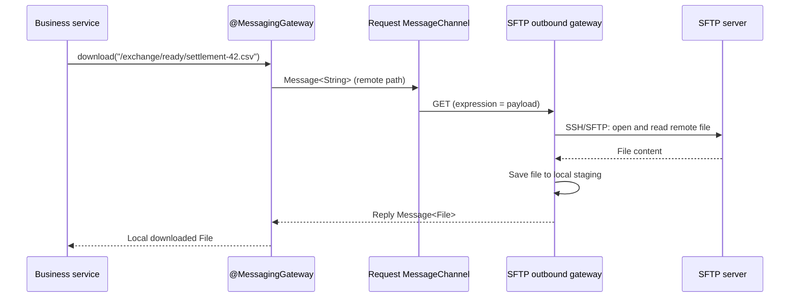
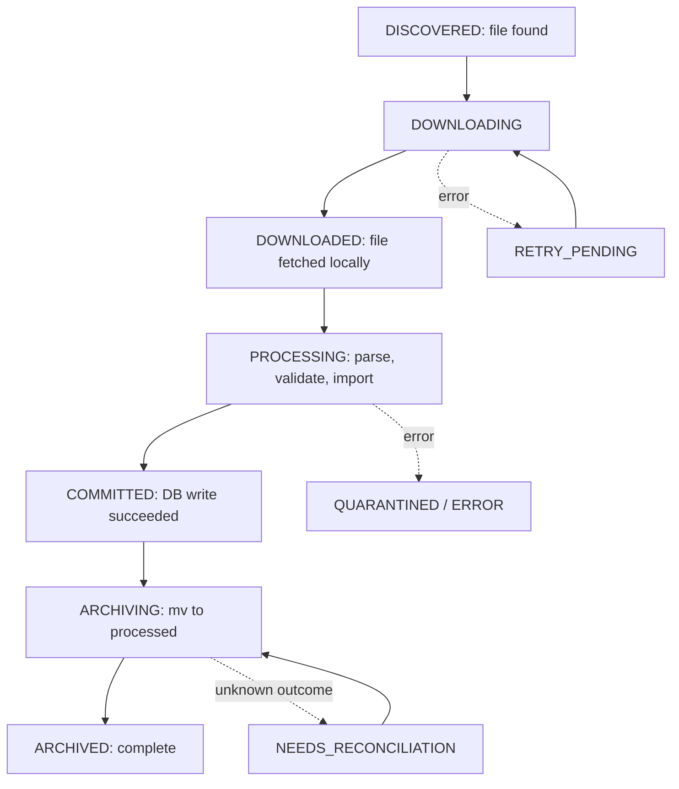

# SFTP Outbound Gateway for Remote Operations

## 1. Problem Statement: The Application Needs the SFTP Server to Execute an Operation

A reconciliation system needs to perform multiple steps against a partner's SFTP server:

1. List the files the partner has placed in `/exchange/settlement/ready`.
2. Download a specified file to a local staging area to verify its signature, schema, and data.
3. Only after processing succeeds, move the file from `ready` to `archive`, or request deleting the file per the partner agreement.
4. When the application sends a result file up to the server, receive information back from the transfer operation to record status.

These steps require a **call with a return value**. In Spring Integration, the **SFTP outbound gateway** is a message handler that executes an SFTP command and then produces a **reply message**. The application can invoke it through `@MessagingGateway`, or another flow can send a request to a `MessageChannel` and receive the reply.

In the `SPRING_INTEGRATION_ADAPTERS` module, the gateway is a building block for connecting to external systems alongside inbound/outbound adapters, pollers, and `MessageChannel`. The goal of this lesson is to clearly understand the **request/reply contract**, remote commands, error handling, SSH session lifecycle, and data-guarantee boundaries.

After this lesson, you will be able to:

- Distinguish the SFTP outbound gateway from the SFTP inbound adapter and outbound adapter.
- Configure an SFTP session authenticated with an SSH key and verify the server via `known_hosts`.
- Write Java DSL flows for `ls` and `get`, then invoke them from Java using `@MessagingGateway`.
- Understand the purpose of `put`, `mget`, `mput`, `mv`, and `rm` and the appropriate options for each command.
- Design path contracts, idempotency, retries, success confirmation, and remote operation permissions.

> **Scope:** code examples target Spring Integration **6.x and later**, where SFTP uses Apache MINA SSHD and remote entries have type `SftpClient.DirEntry`. In Spring Integration 5.x, the SSH library and several generic types differ; if you are using an older version, check the corresponding JavaDoc. Examples describe a Spring Boot application configured with Spring Integration.

## 2. Where Does a Gateway Differ from an Adapter?

| Endpoint | Data Direction | Result on the Spring Integration Side | Common Scenario |
| --- | --- | --- | --- |
| **SFTP inbound adapter** | SFTP → application | Polls the server, emits `Message<File>` for downloaded files | Automatically ingesting new batches of files |
| **SFTP outbound adapter** | Application → SFTP | Performs an upload as a one-way consumer | Pushing report export files to a partner |
| **SFTP outbound gateway** | Application → SFTP → application | Receives a request message, executes a command, then sends a **reply message** | Listing, on-demand downloading, renaming, deleting, or uploading that needs a result |

Consider the diagram of a `get` operation:



In a gateway, the **request payload** is typically a remote file or directory path; however, the result depends on the command and can be a list of entries, a local `File`, a path, or an operation status. Do not assume every command shares the same return type. `@MessagingGateway` is the **Java-facing proxy** for calling message flows, whereas `Sftp.outboundGateway(...)` is the **handler that executes the SFTP command**; despite similar names, they are two distinct components serving two different roles.

**Is a poller required?** No. A request/reply flow starting from a `DirectChannel` can run synchronously the moment the Java method is called. A poller is only needed when the **request source** itself is polled, such as a cron job scanning pending batches in a DB and issuing `get` commands, or a file inbound adapter watching control files.

## 3. SFTP Outbound Gateway Command Catalog

The common command set of `AbstractRemoteFileOutboundGateway` implemented for SFTP includes:

| Command | Intent | Request Typically Contains | Reply Meaning |
| --- | --- | --- | --- |
| `ls` | List directory contents | Remote directory path | List of `FileInfo` (or names when using the corresponding option) |
| `nlst` | List filenames | Remote path or name pattern | List of names rather than full file info |
| `get` | Download a single file locally | Remote file path | Local `File` after successful download |
| `mget` | Download multiple matching files | Remote file path/pattern | Collection of downloaded local files |
| `put` | Upload a single file **to** the server | Local file/data payload and destination directory | Target info/path after the operation |
| `mput` | Upload multiple files to the server | Collection of local files/file selection expression | Results for the multiple uploaded files |
| `mv` | Rename or move a remote file | Source and destination paths | Result of the rename/move operation |
| `rm` | Delete a remote file | Path of the file to delete | Result of the delete operation |

Exact options and reply shapes can vary by **command, options, and version**. When defining `@MessagingGateway`, verify them against JavaDoc or an appropriate integration test, especially when adding flags such as `-1` for name-only listing, `-R` for recursive operations, or options handling already-existing target files.

**How to choose a command?** For a specific file to download, use `get`; use `mget` only when you genuinely need multiple files and can bound count/size limits. Use `ls` to inspect metadata and choose files before downloading; do not run `ls` across an entire large directory tree when you only need a single file. `rm` and `mv` mutate server state, so they require stricter controls than `ls`.

## 4. Secure SSH Connection and Dependencies

SFTP runs over SSH. There are **two independent authentication directions**: the server authenticates the **client private key** against the public key in `authorized_keys`, and the client authenticates the **server host key** against a verified `known_hosts` file. The private key passphrase (if present) only unlocks the private key.

With Spring Boot, use the BOM to manage versions and declare the modules:

```groovy
dependencies {
    implementation 'org.springframework.boot:spring-boot-starter-integration'
    implementation 'org.springframework.integration:spring-integration-sftp'
}
```

Example `application.yml`:

```yaml
app:
  sftp:
    host: ${SFTP_HOST:sftp.partner.example}
    port: ${SFTP_PORT:22}
    username: ${SFTP_USERNAME:settlement_app}
    private-key: file:${SFTP_PRIVATE_KEY_FILE}
    private-key-passphrase: ${SFTP_PRIVATE_KEY_PASSPHRASE:}
    known-hosts: file:${SFTP_KNOWN_HOSTS_FILE}
    remote-root: ${SFTP_REMOTE_ROOT:/exchange/settlement}
    local-download-dir: ${SFTP_DOWNLOAD_DIR:./data/sftp-staging}
```

Both `SFTP_PRIVATE_KEY_FILE` and `SFTP_KNOWN_HOSTS_FILE` must point to files mounted into the **runtime**, not arbitrary filenames in the source tree. Never place private keys or passphrases in repositories or logs. If collecting host keys with `ssh-keyscan`, you must **verify the fingerprint with the administrator over a trusted channel** before using `known_hosts`; `ssh-keyscan` does not authenticate the server on its own.

Shared SFTP session configuration for the flows:

```java
import org.apache.sshd.sftp.client.SftpClient;
import org.springframework.beans.factory.annotation.Value;
import org.springframework.context.annotation.Bean;
import org.springframework.context.annotation.Configuration;
import org.springframework.core.io.Resource;
import org.springframework.integration.file.remote.session.CachingSessionFactory;
import org.springframework.integration.file.remote.session.SessionFactory;
import org.springframework.integration.sftp.session.DefaultSftpSessionFactory;

@Configuration
public class PartnerSftpSessionConfig {

    @Bean
    public SessionFactory<SftpClient.DirEntry> partnerSftpSessionFactory(
            @Value("${app.sftp.host}") String host,
            @Value("${app.sftp.port}") int port,
            @Value("${app.sftp.username}") String username,
            @Value("${app.sftp.private-key}") Resource privateKey,
            @Value("${app.sftp.private-key-passphrase:}") String passphrase,
            @Value("${app.sftp.known-hosts}") Resource knownHosts) {

        DefaultSftpSessionFactory delegate = new DefaultSftpSessionFactory(false);
        delegate.setHost(host);
        delegate.setPort(port);
        delegate.setUser(username);
        delegate.setPrivateKey(privateKey);
        if (!passphrase.isBlank()) {
            delegate.setPrivateKeyPassphrase(passphrase);
        }

        delegate.setKnownHostsResource(knownHosts);
        delegate.setAllowUnknownKeys(false);
        delegate.setTimeout(30_000);

        return new CachingSessionFactory<>(delegate, 4);
    }
}
```

`CachingSessionFactory` reuses sessions and limits the number of connections held in the cache. The cache size must align with parallel operations and server limits. `DefaultSftpSessionFactory(false)` avoids sharing one SSH connection across sessions in the basic example. For long-lived connections, watch for stale session errors, timeouts, and cache testing/reset mechanisms.

## 5. Complete Example: `ls` and `get` with Java DSL

Assume the caller already has a **validated path**. We create two internal inbound channels, each routing to an outbound gateway with a specific command:

```java
import java.io.File;

import org.apache.sshd.sftp.client.SftpClient;
import org.springframework.beans.factory.annotation.Value;
import org.springframework.context.annotation.Bean;
import org.springframework.context.annotation.Configuration;
import org.springframework.integration.annotation.IntegrationComponentScan;
import org.springframework.integration.dsl.IntegrationFlow;
import org.springframework.integration.file.remote.session.SessionFactory;
import org.springframework.integration.sftp.dsl.Sftp;

@Configuration
@IntegrationComponentScan(basePackageClasses = PartnerSftpOperations.class)
public class PartnerSftpGatewayFlows {

    @Bean
    public IntegrationFlow sftpListFlow(
            SessionFactory<SftpClient.DirEntry> partnerSftpSessionFactory) {

        return IntegrationFlow.from("sftpListRequests")
                .handle(Sftp.outboundGateway(
                        partnerSftpSessionFactory, "ls", "payload"))
                .get();
    }

    @Bean
    public IntegrationFlow sftpGetFlow(
            SessionFactory<SftpClient.DirEntry> partnerSftpSessionFactory,
            @Value("${app.sftp.local-download-dir}") String localDirectory) {

        return IntegrationFlow.from("sftpGetRequests")
                .handle(Sftp.outboundGateway(
                                partnerSftpSessionFactory, "get", "payload")
                        .localDirectory(new File(localDirectory))
                        .autoCreateLocalDirectory(true))
                .get();
    }
}
```

`"payload"` is a **SpEL** expression: the value in the incoming message is used as the remote path. In the `ls` flow, the payload is typically a directory; in `get`, it is a file path. Never concatenate raw user input from an HTTP client into the expression and call SFTP directly, as callers could access files outside the permitted scope.

Create a Java proxy as the invocation gateway for services:

```java
import java.io.File;
import java.util.List;

import org.springframework.integration.annotation.Gateway;
import org.springframework.integration.annotation.MessagingGateway;

@MessagingGateway
public interface PartnerSftpOperations {

    // With default ls, reply elements represent remote file metadata.
    @Gateway(requestChannel = "sftpListRequests")
    List<?> list(String remoteDirectory);

    // get returns a File on local disk after the copy finishes.
    @Gateway(requestChannel = "sftpGetRequests")
    File download(String remoteFile);
}
```

`List<?>` in the example keeps the interface independent of a specific metadata type. When processing the actual list, you can declare elements as `org.springframework.integration.file.remote.FileInfo<?>` matching your version's reply, then read `getFilename()`, `isDirectory()`, `getSize()`, and related metadata. Do not cast `ls` results to `List<String>` unless the corresponding filename-only option is enabled.

A business service should validate filenames itself and enforce a fixed root:

```java
import java.io.File;
import java.util.List;

import org.springframework.beans.factory.annotation.Value;
import org.springframework.stereotype.Service;

@Service
public class SettlementImportService {

    private final PartnerSftpOperations sftp;
    private final String remoteRoot;

    public SettlementImportService(
            PartnerSftpOperations sftp,
            @Value("${app.sftp.remote-root}") String remoteRoot) {
        this.sftp = sftp;
        this.remoteRoot = remoteRoot.replaceAll("/+$", "");
    }

    public List<?> listReady() {
        return sftp.list(remoteRoot + "/ready");
    }

    public File downloadReady(String fileName) {
        // Caller-supplied filename must be a single basename only.
        if (!fileName.matches("[A-Za-z0-9][A-Za-z0-9._-]{0,127}")
                || fileName.equals(".") || fileName.equals("..")) {
            throw new IllegalArgumentException("Invalid file name");
        }
        return sftp.download(remoteRoot + "/ready/" + fileName);
    }
}
```

In a production system, further restrict allowed extensions (`.csv`, `.xml`, etc.), check that the file is authorized against approved batch lists, and enforce file-size limits before processing. Normalizing and validating the remote path in the **business service** keeps the adapter from becoming an arbitrary SFTP file reader.

### Analyzing the Request/Reply Contract

| Observation Point | `ls` Flow | `get` Flow |
| --- | --- | --- |
| Request channel | `sftpListRequests` | `sftpGetRequests` |
| Request payload | Directory path, e.g. `/exchange/settlement/ready` | File path, e.g. `/exchange/settlement/ready/a.csv` |
| Command | `ls` | `get` |
| Reply payload | List of entries/metadata | `File` in local staging |
| Side effect | Primarily reads server state | Transfers data and creates/writes a local file |
| Key errors | Missing list permission, timeout | Missing read permission, file changed/deleted, local disk full, broken connection |

With a synchronous `DirectChannel`, when the gateway returns `File`, the SFTP-layer transfer has finished. That does **not** mean the file has been parsed or the data has been committed to the DB. If the service only passes along the `File` path and deletes staging prematurely, asynchronous downstream steps may no longer be able to read it.

## 6. `mv` and `rm`: Operations That Mutate Server Data

Renaming (`mv`) and deleting (`rm`) are typically later steps in a file-processing workflow. For example: after successfully importing a batch, move the file from `ready` to `processed`; after the retention period, delete files in `processed` according to the agreed policy.

In outbound gateway configuration, the `mv` command requires both **source** and **destination**; the source can come from `payload`, while the destination is determined by `rename-expression` (`renameExpression(...)` in Java DSL). For `rm`, pass the exact path of the file to delete. Sample configuration:

```java
import org.apache.sshd.sftp.client.SftpClient;
import org.springframework.context.annotation.Bean;
import org.springframework.context.annotation.Configuration;
import org.springframework.integration.dsl.IntegrationFlow;
import org.springframework.integration.file.remote.session.SessionFactory;
import org.springframework.integration.sftp.dsl.Sftp;

@Configuration
public class SftpRemoteMutationFlows {

    @Bean
    public IntegrationFlow sftpMoveFlow(
            SessionFactory<SftpClient.DirEntry> partnerSftpSessionFactory) {

        return IntegrationFlow.from("sftpMoveRequests")
                .handle(Sftp.outboundGateway(
                                partnerSftpSessionFactory, "mv", "payload")
                        .renameExpression("headers['remoteTarget']"))
                .get();
    }

    @Bean
    public IntegrationFlow sftpRemoveFlow(
            SessionFactory<SftpClient.DirEntry> partnerSftpSessionFactory) {

        return IntegrationFlow.from("sftpRemoveRequests")
                .handle(Sftp.outboundGateway(
                        partnerSftpSessionFactory, "rm", "payload"))
                .get();
    }
}
```

Before using flows that **write/delete**, design a service that blocks commands outside the root and verifies batch state. For `mv`, the input message must provide both the **source path** and the `remoteTarget` header; for `rm`, the payload is the file path. Only invoke `rm` after obtaining business proof that processing completed and deletion is permitted by the retention policy. Never expose an HTTP endpoint that accepts arbitrary `remoteTarget`/`payload` values from users without validation.

### Why Doesn't `mv` Guarantee Exactly-Once by Itself?

Suppose the application `get`s a file and writes the data into the DB. Immediately after the DB commit, but before calling `mv`, the process crashes. On restart, the file is still in `ready` and may be picked up again. **Moving the file only after commit** preserves the original for recovery, but it does not prevent duplicate processing across crashes. You need idempotency in the DB, such as a unique key on `(partner_id, batch_id)` or a partner-defined checksum.

Conversely, if you move/delete the file **before** the DB commit, a DB error can lose an unprocessed source file. Because SFTP and the DB do not share an atomic transaction, there is always a gap that must be bridged with durable state, retries, and reconciliation.

## 7. `put`, `mget`, `mput`: When More Than One File Is Involved

Beyond `ls`, `get`, `mv`, and `rm`, the outbound gateway supports reply-producing file-transfer operations:

**`put`**: sends a local file/data payload to a remote directory. When business logic needs the resulting path or operation outcome, `put` via an outbound gateway is a better fit than a one-way outbound adapter. Configure naming rules, existing-file handling (`FileExistsMode`), and temporary naming/rename just like the outbound adapter; exact supported options depend on the API version and command.

**`mget`**: downloads a group of files matching a remote expression/pattern. Scope it to an authorized directory, naming rule, and time window; avoid downloading an entire directory tree in a single call if volume is unbounded. Plan local staging capacity and partial-failure handling when some files succeed and others do not.

**`mput`**: uploads multiple files from a local source to the server. Use only when the application clearly knows the set of completed files and bounds file count/byte volume; for large sets, split into batches and record per-file success/failure for recovery.

| Decision | Single File | Multiple Files |
| --- | --- | --- |
| Fetch from server | `get` | `mget` |
| Send to server | `put` | `mput` |
| Name resolution | Exact path | Pattern/filter or explicit file set |
| Error handling | Single-file retry/reconciliation | Partial success possible; track per file |
| Resource allocation | One staging file | Bound total size and file count |

SFTP does not provide an all-or-nothing transaction for an `mget`/`mput` batch: if the command fails on the third file, the first two may already have been transferred. Downstream design must treat **each file as a stateful unit**, with duplicate detection and controlled retries.

## 8. Reply Channels, Timeouts, and Connection Lifecycle

A `@Gateway` method typically waits for a reply via a temporary reply channel attached to the message by Spring Integration. With a `DirectChannel` and a synchronous handler, SFTP errors surface directly in the call. If a flow has an asynchronous channel in the middle, the method must wait for the result on the reply channel, making `replyTimeout` critical.

Distinguish at least three timeout categories:

| Timeout | Scope | When Exceeded |
| --- | --- | --- |
| SSH connection/IO | `DefaultSftpSessionFactory` and network | Connection or SFTP operation fails/closes per client state |
| Messaging Gateway reply wait | Boundary between Java method and Spring Integration flow | Method may time out even while asynchronous work keeps running |
| Business SLA | Deadline to receive/process/ACK a batch | Requires monitoring and alerts; cannot be inferred from individual SFTP calls |

In a synchronous flow, do not add queues just to run a quick `ls` or `get`. For `mget` over many large files, consider asynchronous processing with durable state; a waiting request should not tie up an HTTP thread for too long. When using `CachingSessionFactory`, monitor active session count, timeouts, and server quotas; caching assists reuse, it does **not** guarantee a network session stays alive indefinitely.

**Message headers** can carry correlation IDs, tenant/partner IDs, batch IDs, and rename targets. These headers must be trusted or validated before the handler acts on them. Reply messages can also include command-specific metadata/headers; the application should define clear return types and map them to business DTOs, avoiding leaking SFTP internals into public APIs.

## 9. Errors, Retries, and Idempotency: Subtle Edge Cases

An SFTP gateway can fail due to invalid paths, host key mismatch, wrong private key, missing permissions, timeouts, or files changing between `ls` and `get`. For remote-mutating commands, errors can also occur **after the operation actually completed on the server**: for example, the server renamed the file successfully, but the client lost connectivity before receiving the response.

| Stage | Risk | Resolution |
| --- | --- | --- |
| SSH authentication | Wrong key, passphrase, hostname, host key | Stop and report configuration error; never disable host verification or retry endlessly |
| `ls`/`get` | File missing, modified mid-read, network error, local disk full | Record failure; re-check listing/metadata before retrying |
| `put`/`mput` | Upload succeeded but reply timed out | Reconcile remote name/size/checksum; avoid blind append or replace |
| `mv` | Server already renamed but reply was lost | Check both source and target before deciding to retry |
| `rm` | Server already deleted but reply was lost | Verify file state; do not treat "does not exist" blindly as a new failure |
| DB commit and SFTP | One side succeeds, the other fails | Persist durable batch state and run reconciliation |

Specifically for `rm`, **do not retry unconditionally** when it is unknown whether the previous attempt succeeded. Deleting an already-deleted file can return an error; if the business goal is "the file is gone," verifying its absence can be treated as **target state achieved** by policy rather than demanding a single `rm` call succeed.

To curb duplicate processing, persist a durable record with `partner_id`, `batch_id`, `remote_path`, `checksum`, `status`, `attempt_count`, `last_error`, and operation timestamps. Add a unique constraint on the verified batch ID. Example state machine:



This state machine is a **business design pattern**, not state stored automatically by the SFTP gateway. To achieve near-exactly-once behavior in the DB, each batch ingestion must check prior state; commit the import results together with a completion marker inside the appropriate DB transaction, and only then invoke `mv`. If `mv` fails, a reconciliation job can finish archiving without re-importing.

## 10. Path Safety and Remote Operation Permissions

An outbound gateway can run `get`, `rm`, or `mv` using paths passed in messages. Therefore **path validation is part of application security**, not just readable file naming.

Apply the following principles:

1. **Fix the remote root** per partner, such as `/exchange/settlement`; the service only constructs paths within permitted `ready`, `processed`, and `outgoing` directories.
2. **Accept only valid basenames** from clients; reject `/`, `\\`, `..`, empty names, control characters, and abnormally long values.
3. **Least-privilege SFTP permissions**: an account used for listing and downloading may only need read/list; an account capable of `mv`/`rm` needs those permissions and should be separated if risk is high.
4. **Do not rely on string path concatenation as an absolute boundary**: the server may allow symlinks or edge cases; verify server-side policy and constrain accounts with filesystem/chroot limits where possible.
5. **Use per-batch local staging paths** when downloading; avoid two workers writing the same basename into the same directory and corrupting or overwriting each other's files.
6. **Audit state-changing actions**: log batch ID, source, target, actor, timestamp, and outcome; never log private keys, passphrases, or sensitive file contents.

For sensitive data, SFTP encrypts the **transport**, not the contents sitting on the server disk or local staging. Design staging retention/cleanup policies and application-layer encryption if required by agreement.

## 11. End-to-End Practice Lab

**Prerequisites:** a test SFTP server, an account with the public key matching the application's private key, a verified `known_hosts` file, a `ready` directory with at least two CSV files, an existing `processed` directory, and write access for the application in staging. Use synthetic data, never production files, for `rm`/`mv` tests.

1. **Connection:** test `sftp -i ...` with the same account and `known_hosts`. Confirm the target directory can be listed and only expected permissions exist.
2. **`ls`:** call `listReady()`. Verify the reply is a list of metadata/names per your options; handle directory entries, temporary files, and out-of-contract files separately.
3. **`get`:** call `downloadReady("settlement-42.csv")`. Verify a complete local file exists with byte size/checksum matching the source; parsing must only begin after download completes.
4. **Validation:** supply a schema-broken CSV file. The application must record a business error and preserve the raw file for reprocessing or quarantine per procedure.
5. **`mv`:** after the DB commits `settlement-42.csv`, move the file from `ready` to `processed`. Verify the file is gone from source and present at destination before marking `ARCHIVED`.
6. **`rm`:** test only on a test file explicitly approved for deletion; verify permissions and post-operation state. Never put `rm` in the default flow solely to delete right after download.
7. **Timeout:** simulate a disconnect right after `mv`. Run reconciliation to verify whether the server already renamed the file before retrying.
8. **Concurrency:** have two workers request `get` for the same batch simultaneously. Verify DB idempotency and isolated staging areas, confirming the batch is never committed twice.
9. **Security:** pass basename `../private.txt`, names containing `/`, and empty strings; the service must reject them before calling SFTP.

### Quick Troubleshooting Table

| Symptom | Check First |
| --- | --- |
| `Auth fail` / permission denied on login | Username, authorized public key on server, private key, passphrase |
| Host key verification failure | Host/port and `known_hosts`; verify fingerprint from a trusted source |
| `ls` returns empty | Remote path, list permissions, hidden files, filters/options, whether partner published files yet |
| `get` fails even though `ls` saw the file | File renamed/deleted after listing, read permission, local disk, network |
| Local file name collision | Multiple workers sharing a staging directory, `get` file exists mode, basename convention |
| `mv` fails | Source/target paths, rename permissions, target already exists, server rename support |
| `rm` cannot delete | Delete permission, file moved, correct account, retention policy |
| Gateway timeout yet server renamed the file | Reply lost; reconcile state before retrying |
| DB imported yet file remains in `ready` | Gap between commit and `mv`; check `COMMITTED` state to finish archiving |

## 12. Common Pitfalls

- **Treating the gateway like an inbound poller:** an outbound gateway runs when a request message arrives; it does not continuously watch the server on its own.
- **Expecting `ls`, `get`, and `rm` to return the same payload type:** define the contract per command and option set.
- **Passing user-supplied paths straight into `payload` without validation:** can allow reading, renaming, or deleting files outside business scope.
- **Using `mget` on thousands of files without limits:** fills staging, holds sessions open too long, and complicates partial-success recovery.
- **Believing `mv` after download guarantees exactly-once:** a crash between DB commit and rename still leaves the source file visible.
- **Using `rm` as confirmation of business import:** deletion is a side effect on the SFTP server and does not share a transaction with the DB.
- **Disabling host verification to connect faster:** skipping `known_hosts` makes it hard for the client to detect spoofed servers.
- **Retrying every exception identically:** auth errors need config fixes; network errors can be retried; ambiguous `mv`/`rm` outcomes need reconciliation first.

## 13. Self-Check Questions

1. When you need to list files to decide which specific file to download, why is `ls` followed by `get` a better fit than an inbound adapter polling everything?
2. What is the difference between `@MessagingGateway` and `Sftp.outboundGateway(...)`? Where does each participate in the flow?
3. Why does `get` usually return a local `File`, whereas `ls` returns a list of metadata or names?
4. For `mv`, why must both source and destination paths be defined? What should you check before retrying after a timeout?
5. What can happen if two workers call `get` for the same basename into the same staging directory?
6. After the DB commits successfully but before `mv` runs, how do you handle a restart without importing the batch twice?
7. To allow a service to run `ls`/`get` while forbidding `rm`, at which layers must you enforce controls?

## References

- [Spring Integration Reference – SFTP Outbound Gateway](https://docs.spring.io/spring-integration/reference/sftp/using-the-gateway.html)
- [Spring Integration Reference – SFTP Outbound Channel Adapter](https://docs.spring.io/spring-integration/reference/sftp/outbound.html)
- [Spring Integration Reference – SFTP Session Factory](https://docs.spring.io/spring-integration/reference/sftp/session-factory.html)
- [Spring Integration Reference – SFTP Session Caching](https://docs.spring.io/spring-integration/reference/sftp/session-caching.html)
- [Spring Integration Reference – Messaging Gateways](https://docs.spring.io/spring-integration/reference/gateway.html)
- [Spring Integration Reference – Message Channels](https://docs.spring.io/spring-integration/reference/channel.html)
