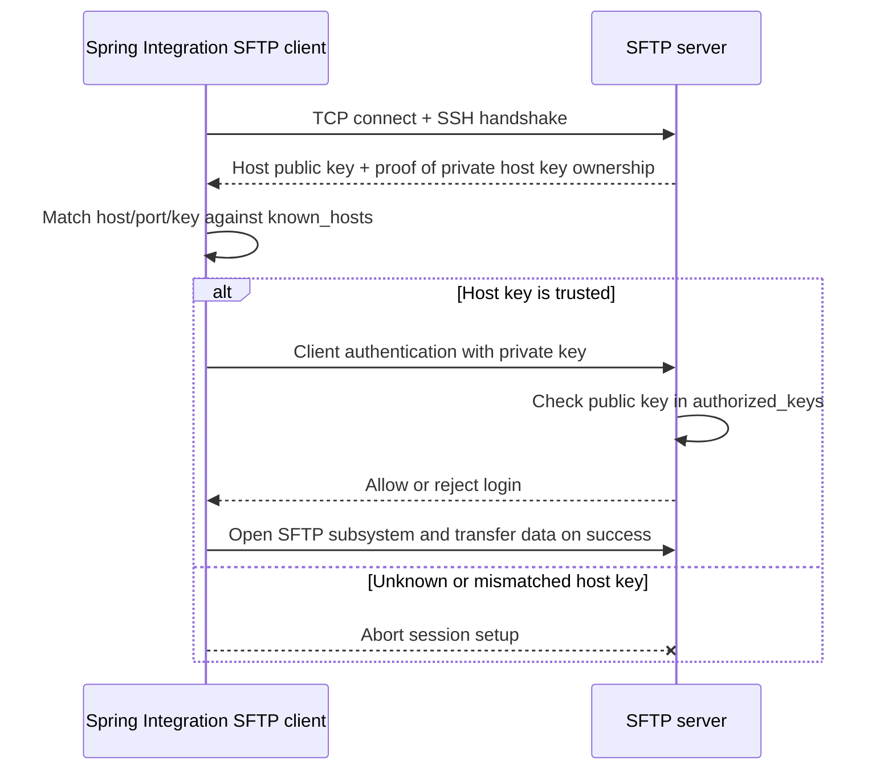
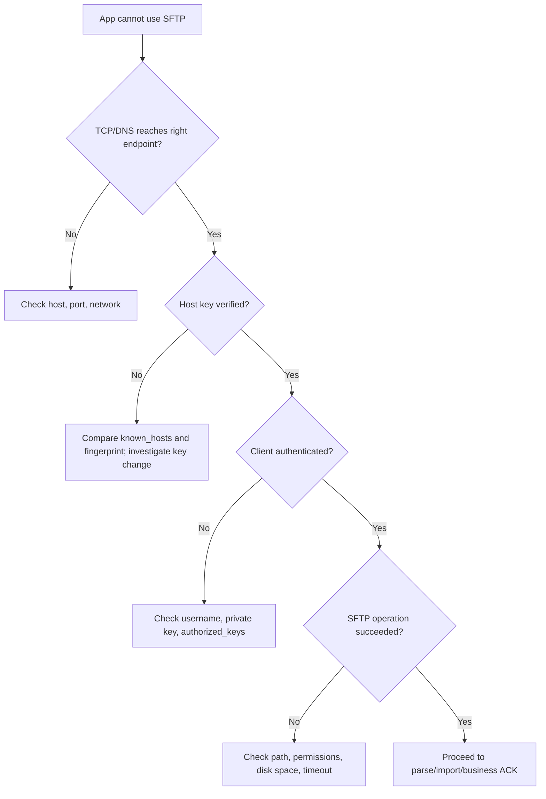

# Known Hosts and Server Verification

## 1. Why Does an SFTP Connection Need Server Verification?

Suppose a Spring Boot service uploads reconciliation files every night to `sftp.partner.example:2222`. The application already has a valid private key and an authorized SFTP account. One day, DNS or the network path is tampered with so this domain points to a different server. If the client only knows how to **prove its own identity** without checking the **server's identity**, data can be sent to the wrong destination.

SSH solves this problem with **host key verification**. The server owns an SSH key pair for its host identity; during the handshake, it proves possession of the private host key corresponding to its advertised public host key. The client must check whether that public host key belongs to the list of trusted servers. In a Spring Integration application, this trusted list is provided via a **`known_hosts`** file.

This is a foundational topic of the **SFTP Adapter** chapter in the `SPRING_INTEGRATION_ADAPTERS` module: whether you use an inbound adapter, an outbound adapter, or an outbound gateway, all of them require a secure SSH/SFTP session before exchanging files and messages. `MessageChannel`, pollers, and gateways define how the processing flow operates; they do not replace server verification at the transport connection layer.

After this lesson, you will be able to:

- Distinguish **client authentication** via private key from **server authentication** via host key.
- Understand OpenSSH `known_hosts` structure, hostnames, ports, algorithms, and fingerprints.
- Collect and verify host keys through an independent channel, avoiding trusting a key supplied by an attacker.
- Configure `DefaultSftpSessionFactory` with `knownHostsResource` and `allowUnknownKeys=false`.
- Diagnose unknown host key, changed host key, wrong hostname/port, and mismatched algorithm errors.
- Organize host key rotation, connection testing, and safe operations.

> **API scope:** Java examples use Spring Integration **6.x and later**, where the SFTP client is based on Apache MINA SSHD. Spring Integration 5.x uses a different SSH foundation, so consult the documentation/JavaDoc for your running version.

## 2. Two Different Authentication Directions in SSH

SSH performs key exchange and authentication steps before running SFTP operations. Distinguish the two key pairs:

| Component | Who Owns the Private Key? | Where Does the Public Key Live? | Question Answered |
| --- | --- | --- | --- |
| **Client identity key** | Spring Boot application | `authorized_keys` of the account on the SFTP server | "Is this application allowed to log in?" |
| **Server host key** | SFTP server | Application's `known_hosts` | "Is this really the approved partner server?" |

These two key pairs are **not interchangeable**. The `authorized_keys` file on the server side decides who may log in. The `known_hosts` file on the client side stores public host keys used to verify the server the client is connecting to. A passphrase protects the **client's private key** if the key is encrypted; a passphrase is neither a host key nor information for verifying the server.



In the threat model, host key verification defends against **server spoofing / man-in-the-middle** attacks. It does not replace remote directory permissions, encryption of data at rest on disk, CSV content validation, or business-transaction confirmation. A valid SSH connection confirms the server's identity per the client's trust policy; it does not guarantee that files sent by a partner always have valid contents.

## 3. What Does `known_hosts` Store?

OpenSSH `known_hosts` is a collection of records associating a **server identifier** with a trusted **public host key**. A typical line looks like:

```text
<hostname-or-host-pattern> <host-key-algorithm> <base64-encoded-public-host-key> [comment]
```

Format illustration (the `<...>` strings are placeholders only, **not real host keys**):

```text
sftp.partner.example ssh-ed25519 <PUBLIC_HOST_KEY_BASE64>
[sftp.partner.example]:2222 ssh-ed25519 <PUBLIC_HOST_KEY_BASE64>
```

Key parts:

| Part | Example | Meaning |
| --- | --- | --- |
| Host / host pattern | `sftp.partner.example` | Server identifier matching the name the client uses |
| Host and non-default port | `[sftp.partner.example]:2222` | For ports other than 22, OpenSSH uses square brackets and a colon |
| Public host key algorithm | `ssh-ed25519`, `ecdsa-sha2-nistp256`, `ssh-rsa` | Key type advertised by the server; must align with policy and SSH library |
| Public key data | Long Base64 string | Actual public key value to match, not the private key |
| Fingerprint | `SHA256:...` | Short hash summary of the public key for humans to compare out-of-band |

**A fingerprint is not the full host key.** Operators can exchange compact SHA-256 fingerprints for verification, but the `known_hosts` file needs the properly formatted **full public key** record. Do not paste a `SHA256:...` string into the Base64 column of the file and expect SSH to parse it.

A server can advertise **multiple host keys** across different algorithms, such as Ed25519 and ECDSA. When the client and server negotiate an algorithm, the selected key must match a trusted record for that server identifier. Having one known key present does not mean another unverified key can be accepted automatically.

OpenSSH also supports host patterns, comma-separated hostname lists, hashed hostnames, and special markers such as `@cert-authority`. With Spring Integration based on Apache MINA SSHD, basic setups should use **standard public host key entries** and test advanced formats on the actual library version before relying on them. Do not assume all OpenSSH extensions behave identically across all SSH clients.

### Hostname, IP, and Port Can Cause Confusion

A single physical server may be reachable via `sftp.partner.example`, `10.20.30.40`, or a DNS alias. The identifier matched in `known_hosts` corresponds to the **host/port the client actually connects to**. If the application uses a hostname while the file only lists an IP address, or the port changes from `22` to `2222` without a matching entry, verification can fail even though the server's private host key has not changed.

For example, `sftp.partner.example` and `[sftp.partner.example]:2222` are **two different identifiers** in OpenSSH syntax. When troubleshooting a verification failure, check the host and port in application configuration before concluding the server was attacked or rotated its key.

## 4. Establishing Initial Trust: Out-of-Band Fingerprint Verification

For the client to know which key to trust, there must be an **initial host public key onboarding procedure** (trust bootstrap). Simply having a TCP connection to the server does not prove server identity: if the network is intercepted, the client may receive the attacker's host key.

Agree on this procedure with the partner's administrator:

1. Obtain the **hostname, port, host key type, and official SHA-256 fingerprint** via a channel authenticated independently from the SFTP connection being set up, such as an authoritative security ticket or an agreed exchange channel.
2. Use `ssh-keyscan` to collect the **public host key** presented by the server at the target host/port. This is only a data-collection step.
3. Compute the fingerprint from the collected record and **compare it exact-for-exact** against the official fingerprint. If they differ, halt and investigate. Never auto-accept merely because DNS resolved or TCP connected.
4. Once verification matches, publish the verified `known_hosts` record into the application's runtime configuration.
5. Test connecting with strict host key checking enforced before configuring `DefaultSftpSessionFactory`.

OpenSSH example on Linux/macOS (Windows can run equivalent OpenSSH utilities). Paths and hosts are illustrative only:

```bash
# Port 2222; fetch the host key record currently advertised by the server.
ssh-keyscan -p 2222 -t ed25519 sftp.partner.example > partner_known_hosts.pending

# Display the SHA-256 fingerprint of the collected public key.
ssh-keygen -lf partner_known_hosts.pending -E sha256

# Only if the fingerprint matches the value confirmed out-of-band by the partner:
cp partner_known_hosts.pending partner_known_hosts

# Verify the file contains an entry for the target hostname and port.
ssh-keygen -F '[sftp.partner.example]:2222' -f partner_known_hosts
```

If the server has no Ed25519 host key, `ssh-keyscan -t ed25519` may return no record. In that case, ask the partner for the actual algorithm and compare the corresponding fingerprint (e.g., ECDSA). Never force the client to trust an arbitrary key just to "get past" the check. Keep the verification channel and server identifier consistent, especially when test/staging/production environments have distinct host keys.

Test logging in with OpenSSH using the verified `known_hosts`:

```bash
sftp -P 2222 \
  -i ~/.ssh/settlement_client \
  -o IdentitiesOnly=yes \
  -o StrictHostKeyChecking=yes \
  -o UserKnownHostsFile=./partner_known_hosts \
  settlement_app@sftp.partner.example
```

`StrictHostKeyChecking=yes` causes the client to **reject untrusted or mismatched host keys**. If the OpenSSH command succeeds while the Java application fails, inspect how the Java runtime reads the `known_hosts` file, the SSH library version, the effective hostname/port, and algorithm policies before changing any security setting.

### Unsafe Practices

- **`ssh-keyscan host >> known_hosts` and using it immediately** without verifying the fingerprint: scanning does not authenticate the server.
- **Accepting the fingerprint read from the very connection that just flagged an unknown key** as independent proof: if the connection is spoofed, the displayed fingerprint belongs to the impostor.
- **Deleting the entire `known_hosts` file when seeing a key-changed warning**: discards older trusted records and usually just hides the root cause.
- **Enabling `allowUnknownKeys=true` in the application to silence warnings**: allows connections to unknown hosts or hosts with changed keys, defeating the protection altogether.

## 5. Configuring Spring Integration for Host Key Verification

In a Spring Boot application using dependency management/BOM, add the dependencies:

```groovy
dependencies {
    implementation 'org.springframework.boot:spring-boot-starter-integration'
    implementation 'org.springframework.integration:spring-integration-sftp'
}
```

Create `application.yml` with environment placeholders so secrets do not live in source code:

```yaml
app:
  sftp:
    host: ${SFTP_HOST:sftp.partner.example}
    port: ${SFTP_PORT:2222}
    username: ${SFTP_USERNAME:settlement_app}
    private-key: file:${SFTP_PRIVATE_KEY_FILE}
    private-key-passphrase: ${SFTP_PRIVATE_KEY_PASSPHRASE:}
    known-hosts: file:${SFTP_KNOWN_HOSTS_FILE}
    remote-directory: ${SFTP_REMOTE_DIRECTORY:/exchange/settlement/ready}
```

`SFTP_PRIVATE_KEY_FILE` and `SFTP_KNOWN_HOSTS_FILE` must point to actual file paths mounted into the runtime. `SFTP_PRIVATE_KEY_PASSPHRASE` is only needed when the private key is encrypted. `known_hosts` holds **public** host keys, so it is not confidential in the same way as a private key; nevertheless, you must protect its **integrity**, because tampering with an entry can change which servers the application trusts.

Java example configuring the session factory:

```java
import org.apache.sshd.sftp.client.SftpClient;
import org.springframework.beans.factory.annotation.Value;
import org.springframework.context.annotation.Bean;
import org.springframework.context.annotation.Configuration;
import org.springframework.core.io.Resource;
import org.springframework.integration.file.remote.session.CachingSessionFactory;
import org.springframework.integration.file.remote.session.SessionFactory;
import org.springframework.integration.sftp.session.DefaultSftpSessionFactory;

@Configuration
public class VerifiedSftpSessionConfig {

    @Bean
    public SessionFactory<SftpClient.DirEntry> verifiedSftpSessionFactory(
            @Value("${app.sftp.host}") String host,
            @Value("${app.sftp.port}") int port,
            @Value("${app.sftp.username}") String username,
            @Value("${app.sftp.private-key}") Resource clientPrivateKey,
            @Value("${app.sftp.private-key-passphrase:}") String passphrase,
            @Value("${app.sftp.known-hosts}") Resource verifiedKnownHosts) {

        DefaultSftpSessionFactory factory = new DefaultSftpSessionFactory(false);
        factory.setHost(host);
        factory.setPort(port);
        factory.setUser(username);

        // CLIENT identity verified by the server.
        factory.setPrivateKey(clientPrivateKey);
        if (!passphrase.isBlank()) {
            factory.setPrivateKeyPassphrase(passphrase);
        }

        // SERVER identity verified by the client.
        factory.setKnownHostsResource(verifiedKnownHosts);
        factory.setAllowUnknownKeys(false);
        factory.setTimeout(30_000);

        return new CachingSessionFactory<>(factory, 4);
    }
}
```

The two core lines:

```java
factory.setKnownHostsResource(verifiedKnownHosts);
factory.setAllowUnknownKeys(false);
```

Per the Spring Integration Reference, `knownHostsResource` accepts an `org.springframework.core.io.Resource` containing OpenSSH `known_hosts` formatted entries. When `allowUnknownKeys=false` (the default), a pre-populated host key repository is required. Setting `false` explicitly makes the security policy easy to audit during config review. `setPrivateKey(...)` handles **client authentication**, whereas the two settings above handle **server authentication**.

`CachingSessionFactory` can reuse sessions, but **already-open** sessions do not necessarily re-verify host keys immediately when the `known_hosts` file on disk changes. During a controlled key rotation or suspected spoofing, manage the session lifecycle: close/recreate affected sessions, redeploy the trust configuration, and verify that **new connections** use the updated list. Do not assume modifying the file alone immediately applies to all active sessions.

## 6. Practical Verification in an Integration Flow

To prove the configuration works, you must actually **open an SFTP session**. Merely creating the `DefaultSftpSessionFactory` bean does not prove host key verification succeeded, because many connections only open when a handler receives its first message.

Example minimal `ls` outbound gateway to verify connectivity/directory read access once `known_hosts` is configured:

```java
import org.apache.sshd.sftp.client.SftpClient;
import org.springframework.context.annotation.Bean;
import org.springframework.context.annotation.Configuration;
import org.springframework.integration.annotation.IntegrationComponentScan;
import org.springframework.integration.dsl.IntegrationFlow;
import org.springframework.integration.file.remote.session.SessionFactory;
import org.springframework.integration.sftp.dsl.Sftp;

@Configuration
@IntegrationComponentScan(basePackageClasses = VerifiedSftpOperations.class)
public class VerifiedSftpFlowConfig {

    @Bean
    public IntegrationFlow inspectRemoteDirectory(
            SessionFactory<SftpClient.DirEntry> verifiedSftpSessionFactory) {

        return IntegrationFlow.from("inspectSftpRequest")
                .handle(Sftp.outboundGateway(
                        verifiedSftpSessionFactory, "ls", "payload"))
                .get();
    }
}
```

The Java gateway sends messages onto the channel; the method returns `List<?>` to focus on connection verification without locking into a specific `ls` metadata type:

```java
import java.util.List;
import org.springframework.integration.annotation.Gateway;
import org.springframework.integration.annotation.MessagingGateway;

@MessagingGateway
public interface VerifiedSftpOperations {

    @Gateway(requestChannel = "inspectSftpRequest")
    List<?> list(String verifiedRemoteDirectory);
}
```

Example service passing only a configured directory, avoiding arbitrary remote paths from external requests:

```java
import java.util.List;
import org.springframework.beans.factory.annotation.Value;
import org.springframework.stereotype.Service;

@Service
public class SftpDirectoryCheckService {

    private final VerifiedSftpOperations sftp;
    private final String directory;

    public SftpDirectoryCheckService(
            VerifiedSftpOperations sftp,
            @Value("${app.sftp.remote-directory}") String directory) {
        this.sftp = sftp;
        this.directory = directory;
    }

    public List<?> listConfiguredDirectory() {
        return sftp.list(directory);
    }
}
```

When calling `listConfiguredDirectory()`, the logical order is: `Message<String>` enters the request channel → the SFTP gateway requests a session → SSH verifies the host key and authenticates the client → SFTP runs `ls` → the reply returns to the caller. If the host key does not match, the flow will **not** proceed to reading files. If `ls` reports a permission error after host key verification and login succeeded, that is an **authorization/permission** issue to diagnose separately.

In a real system, a single session factory can supply connections to an inbound adapter, outbound adapter, outbound gateway, and poller. When all share the same `known_hosts` policy, those flows have consistent trust. When connecting to multiple partners, separate `SessionFactory` configurations by **host/port/account and trust source** to avoid mixing up trust files or secrets across partners.

## 7. Diagnosing Failures: Unknown Host, Changed Host Key, or Wrong Client Key?

All these failures can show up as the app "cannot connect to SFTP," yet their causes and remedies differ:

| Symptom | Likely Causes to Check | Appropriate Action |
| --- | --- | --- |
| Unknown host key / host not in known_hosts | Missing entry for hostname/port, or file not read properly | Verify fingerprint independently; add the proper entry, check `knownHostsResource` path |
| Host key changed / verification failed | Legitimate server key rotation or intercepted connection | **Stop**, verify new fingerprint with admin, never auto-accept |
| Host key mismatch only on port `2222` | Entry recorded for default port `22` (`host`) instead of `[host]:2222` | Check actual host/port and matching entry format |
| IP login works while FQDN fails | `known_hosts` only has IP or different hostname; alias/load balancer | Check the identifier used to connect and host keys on each endpoint |
| No matching host key algorithm / unsupported key | Client and server share no common algorithm or unsupported key format | Check JDK/MINA SSHD version and algorithm policy; prefer secure compatible settings |
| Authentication failed after host verification passes | Client private key, passphrase, username, or `authorized_keys` mismatch | Check **client** identity; never edit `known_hosts` to fix login errors |
| Permission denied on `ls`/`put` | SSH auth succeeded, but account lacks directory/file permissions | Check SFTP permissions and folder contract; do not alter host keys |
| Error appears only after a deployment | Wrong secret/`known_hosts` mount, changed hostname/port, stale session cache | Compare runtime config, fingerprints, session lifecycle, and previous release |

Exact error messages depend on the library and version; do not rely solely on a single exception wording. Diagnose by **stage**: DNS/TCP → SSH key exchange/host verification → client authentication → SFTP command → business processing.



## 8. Host Key Rotation Without Losing Spoofing Detection

A server may need to rotate its host key due to policy lifecycle expiration, platform migration, machine recovery, or security incident response. A **host key changed** warning does not by itself prove an attack, nor should it be dismissed as harmless noise.

Controlled rotation plan:

1. **Advance notice:** the partner provides the cutover time, affected host/port, algorithm, and fingerprint of the new public host key through a trusted channel.
2. **Verification:** operations verifies the sender's identity, confirms the fingerprint independently, and logs the change event.
3. **Preparation:** if the server supports a transition window, configure both old and new verified host key records as supported by server/client. Do not allow arbitrary unknown keys.
4. **Cutover:** the partner switches the host key; the application establishes a **new connection** to the server and tests host verification, client authentication, and a safe `ls` operation.
5. **Cleanup:** once the new key is confirmed working and the rollback window closes, remove the old key per procedure, redeploy, and re-verify connectivity.
6. **Audit:** record fingerprint evidence, approver, timestamp, affected environments, and test results; never write the server's private host key into tickets or source code.

For a configuration-managed `known_hosts` file, update **the exact entry**. You can use `ssh-keygen -F` to look up and `ssh-keygen -R` to remove the old identifier in a working copy, then add the new key **after verification**:

```bash
# Find entries for host/port, even when hostnames are hashed.
ssh-keygen -F '[sftp.partner.example]:2222' -f partner_known_hosts

# Only within an approved change: remove the old entry for that exact identifier.
ssh-keygen -R '[sftp.partner.example]:2222' -f partner_known_hosts

# Add the newly verified record (fingerprint checked) per config management process.
# Then re-check with ssh-keygen -F and test sftp with StrictHostKeyChecking=yes.
```

**Never run `ssh-keygen -R` automatically on a mismatch**, and never use it as a substitute for verifying server identity. `ssh-keygen -R` only mutates trust data in the file; it does not prove the new key is authentic. For deployments using secret volumes or immutable ConfigMaps, update the authoritative configuration source and redeploy instead of manually patching an ephemeral container.

### Load Balancers and Multiple Servers Behind One Name

If `sftp.partner.example` routes to multiple backends, each backend may present a different host key. Require the partner to supply the **verified set of valid host keys** or design an endpoint with a consistent host identity. Seeing different fingerprints across consecutive connections must be explained by confirmed architecture; never blindly accept any fingerprint just because a load balancer sits in front.

## 9. Positive and Negative Testing

A good test suite does not only check that the application connects to the right server—it also proves **connections with the wrong identity are rejected**. Run these tests in a test environment where you control host keys, avoiding deliberate host key changes in production.

| Scenario | Action | Expected Result |
| --- | --- | --- |
| Valid host key | `known_hosts` contains the verified key for the exact hostname/port | SSH verifies the server, proceeds to client authentication and SFTP operations |
| Unknown host | `known_hosts` has no entry for the host/port | Connection is rejected when `allowUnknownKeys=false` |
| Wrong host key | Test server presents a key different from the trusted record | Connection is rejected; no files uploaded/downloaded |
| Port change | App connects to another port without a matching entry | Verification fails until the right identifier/verified host key is present |
| Wrong client key | Host key is valid, client private key is rejected by server | Host verification passes, authentication fails |
| Directory permission error | Both SSH and client authentication pass | SFTP command reports permission error; not confused with host key mismatch |
| Valid key rotation | Rotate key on test server per plan, then update `known_hosts` | New connections succeed only after the new key is verified and deployed |

A manual test procedure:

1. Inspect the actual `known_hosts` file in runtime; verify owner, read permissions, and entries matching hostname/port.
2. Run OpenSSH with `StrictHostKeyChecking=yes` to confirm both host key and private key before starting the application.
3. Call `VerifiedSftpOperations.list(...)` on a readable directory. Check logs only enough to observe result/exceptions—never print keys, passphrases, or full file contents.
4. On the test server, swap the host key to an untrusted key. Open a **new connection** from the application and confirm `ls` cannot execute.
5. Restore the server and `known_hosts` to the approved record; retry to confirm connectivity recovers.

In environments with caching, to genuinely test handshake behavior you must ensure no SSH session created before the key change is reused. Either restart the test application or reset/reinitialize the session cache using the mechanism supported in your version. Merely sending another request over an existing session makes a host-key-rotation test produce misleading results.

## 10. Operations and Risk Control

**Protect `known_hosts` integrity.** Even though it holds public keys, anyone who can modify it can change which servers the client trusts. Mount the file read-only where possible, manage changes via code review and deployment permissions. Across multiple partners/environments, separate configuration sources per system rather than mixing all entries into an uncontrolled file.

**Protect the client private key.** The private key used for **login** must reside in a secret manager or least-privilege volume, never committed or logged. Rotating a client private key is a separate procedure from rotating a server host key: changing the client key involves `authorized_keys` on the server side, whereas changing the server host key involves `known_hosts` on the client side.

**Monitor categorized errors.** Emit logs/metrics for: network connectivity, host key verification failures, authentication failures, permission denied, timeouts, active session counts, poll counts, and file transfer latency. Separate server verification errors from business errors. When an unexpected host key mismatch occurs, prioritize alerting operators, as it may be a critical security signal.

**Set timeouts and session bounds.** `CachingSessionFactory` reduces connection overhead but also impacts key rotation. Monitor stale sessions, size caches appropriately, and plan connection recreation when trust configuration changes. Never conclude server identity is still valid merely because an older existing session continues transferring files.

**Do not skip the data contract.** Host verification authenticates the SFTP peer under the provisioned keys. Afterward, the application must still validate filenames, schemas, checksums, duplicate data, retries, and ACK workflows. A `Message<File>` arriving from an inbound adapter or a successful return from an outbound adapter does not prove partner-side business processing has committed.

## 11. Self-Check Questions

1. Why cannot `authorized_keys` replace `known_hosts`, even though both contain SSH public keys?
2. Why is having the right client private key not enough to guarantee the application sends files to the right SFTP server?
3. How can `ssh-keyscan` help collect a host key? Why is an independent fingerprint source still required?
4. When a server's port changes from `22` to `2222`, what information in the `known_hosts` record may need updating?
5. What roles do `DefaultSftpSessionFactory#setKnownHostsResource` and `setAllowUnknownKeys(false)` play? Why should you not set `true` to resolve connection errors?
6. After replacing the `known_hosts` file on disk, why might an already-open SSH session not immediately check the new host key?
7. When a connection reports a host key mismatch, which hypotheses should you investigate before updating the trusted key?
8. In a deployment with multiple backends behind a load balancer, how would you agree on host identity and host key rotation procedures with the partner?

## References

- [Spring Integration Reference — SFTP Session Factory](https://docs.spring.io/spring-integration/reference/sftp/session-factory.html)
- [Spring Integration API — DefaultSftpSessionFactory](https://docs.spring.io/spring-integration/docs/6.5.0/api/org/springframework/integration/sftp/session/DefaultSftpSessionFactory.html)
- [Spring Integration Reference — SFTP Session Caching](https://docs.spring.io/spring-integration/reference/sftp/session-caching.html)
- [OpenBSD Manual — ssh-keyscan(1)](https://man.openbsd.org/ssh-keyscan.1)
- [OpenBSD Manual — ssh-keygen(1)](https://man.openbsd.org/ssh-keygen.1)
- [OpenBSD Manual — ssh(1)](https://man.openbsd.org/ssh.1)
