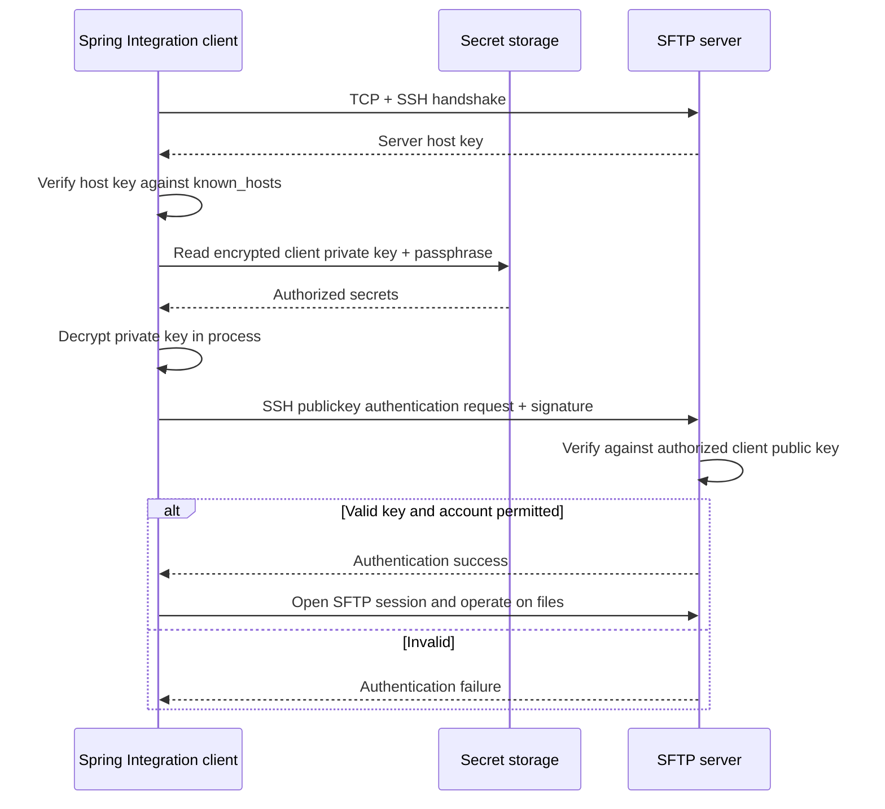

# Private Key Passphrase and Authentication

## 1. Problem Statement: Logging into SFTP with a Passphrase-Protected Private Key

A Spring Boot application sends nightly transaction reports to a partner's SFTP server. The partner provisions the `reporting_app` account and requires **SSH public key** authentication instead of a login password. The operations team generates a key pair for the application, registers the public key on the partner side, and encrypts the private key with a **passphrase**. When deployed, the application must be supplied with both the private key and the passphrase so it can connect automatically, even when no human is present to type a password at a terminal.

In Spring Integration, the same `SessionFactory` can be used by an SFTP **inbound adapter** (polling and receiving files), an **outbound adapter** (sending files), and an **outbound gateway** (executing commands such as `ls`, `get`, `put`, `mv`, `rm` with replies). Properly configuring the private key and passphrase is therefore a common prerequisite for `MessageChannel` flows, gateways, and pollers to exchange data with external systems.

After this lesson, you will be able to:

- Distinguish between an **SFTP account password**, an **SSH private key**, a **private key passphrase**, a **public key**, and a **server host key**.
- Generate a passphrase-protected private key with OpenSSH and identify exactly what to send to the SFTP administrator.
- Configure `DefaultSftpSessionFactory#setPrivateKey(...)` and `setPrivateKeyPassphrase(...)` in Spring Integration 6.x and later.
- Store the passphrase in a secret manager or managed environment instead of hardcoding it in source code.
- Diagnose key decryption errors, authentication failures, host verification errors, and directory permission errors.
- Design a passphrase/key rotation workflow and test connectivity without leaking secrets.

> **Version scope:** examples use Spring Integration **6.x and later**, where the SFTP module is based on Apache MINA SSHD. In Spring Integration 5.x, several APIs and SSH key types may differ because the SFTP implementation relies on a different library. Cross-check your Spring Boot BOM, Spring Integration, and actual SSH library when using this code in a project.

## 2. A Passphrase Is Not an Account Password

Many configuration errors stem from using the word "password" loosely for every secret. In reality, they serve distinct roles:

| Component | Where Is It Used? | Purpose | Sent Verbatim Over the SSH Connection? |
| --- | --- | --- | --- |
| **Client private key** | Application, read from file/secret | Proves the application owns the account's secret key | Private key is never sent to the server |
| **Client public key** | Account's `authorized_keys` on the SFTP server | Tells the server which keys are authorized to log in | Used by the server to verify the auth signature |
| **Private key passphrase** | Client side, before using the encrypted private key | Decrypts the private key protected at rest | **Not** sent as a login password |
| **SFTP account password** | Managed by server if password auth is enabled | Authenticates via the `password` method, distinct from `publickey` | Sent within the SSH auth protocol over the encrypted channel when password auth is chosen |
| **Server host public key** | Client-side `known_hosts` | Verifies the target server before exchanging data | Server proves ownership of its private host key during the SSH handshake |

A passphrase-protected private key goes through **two steps**: the application uses the passphrase to decrypt the private key on the client side; then SSH uses the private key to perform public-key authentication with the server. The server only needs the authorized public key to verify the signature—it **does not need to know the client's passphrase**.



**A passphrase protects the private key at rest:** if a copy of the key file leaks while the passphrase remains secret, an attacker must defeat the encryption layer to use the key. Even so, the application needs both to run unattended, so if an attacker obtains **both the private key and the passphrase**, this protection is no longer sufficient. Separate access controls and monitor secrets at both locations.

### Three Commonly Confused Scenarios

**Scenario A: unencrypted private key.** The application can use the key without a passphrase, but any leaked copy of the key file can be used immediately. This requires careful evaluation of how disk storage, container images, and secret mounts are protected.

**Scenario B: passphrase-protected private key.** The application must receive the right passphrase and use a compatible key decoder. Without the passphrase, SFTP operations typically fail before or during authentication.

**Scenario C: server only allows password authentication.** Even if the private key and passphrase are valid, if the server does not accept `publickey`, login still fails. Changing the passphrase will not enable an authentication method the server disallows.

## 3. Generating a Key Pair and Setting a Passphrase Safely

Example using OpenSSH on a managed workstation. The command below creates an **Ed25519** key pair and prompts interactively for the passphrase. Never pass the passphrase as a CLI argument to keep it out of shell history, process listings, or logs:

```bash
# Run on a secure admin machine; enter a strong passphrase when prompted.
ssh-keygen -t ed25519 -a 100 -f ~/.ssh/partner_reporting -C "reporting-app"

# Inspect the fingerprint of the client PUBLIC KEY.
ssh-keygen -lf ~/.ssh/partner_reporting.pub -E sha256

# Unix/Linux: restrict read permissions on the private key.
chmod 600 ~/.ssh/partner_reporting
```

Afterwards, two files exist:

```text
~/.ssh/partner_reporting       # Private key, encrypted once a passphrase is entered
~/.ssh/partner_reporting.pub   # Public key, sent to the server administrator
```

The partner must add **the contents of the `.pub` file** to `authorized_keys` for the exact `reporting_app` account and configure matching SSH/SFTP permissions. Never send the private key or passphrase to the partner. The fingerprint computed from `partner_reporting.pub` verifies the registered **client public key**; it is **different** from the server host key fingerprint used to verify `known_hosts`.

`-a 100` specifies 100 key-derivation rounds when saving the private key in OpenSSH format, raising the cost of guessing the passphrase if the file is stolen; choose a reasonable value balancing performance and organizational policy. No flag in this command keeps a private key safe if operators share the passphrase over an insecure channel.

If the partner does not support Ed25519 or infrastructure imposes specific requirements (such as FIPS policies), request the list of permitted algorithms and choose a securely supported key type, such as RSA with an appropriate key size. Do not enable legacy/weak signature algorithms just to bypass compatibility errors.

### Provisioning Contract with the Partner

To avoid repeated configuration mistakes, the application team and partner should agree in writing on:

| Attribute | Example | Managed By |
| --- | --- | --- |
| SFTP endpoint | `sftp.partner.example:2222` | Partner |
| SFTP username | `reporting_app` | Partner |
| Client public key | `.pub` contents, SHA-256 fingerprint | Provided by application; authorized by partner |
| Authentication method | SSH `publickey` | Configured on server by partner |
| Remote directory | `/incoming/reports` | Authorized by partner |
| Server host key fingerprint | Fingerprint of server's host key | Confirmed by partner over an independent channel |
| Key rotation procedure | Cutover timing, overlap window | Coordinated by both sides |

Do not run `ssh-keyscan` and immediately trust the host key just because it was returned: that tool **collects**, it does not authenticate. Compare the server fingerprint through an independent channel before placing the full record into `known_hosts`.

## 4. Dependencies and Environment-Based Configuration

In a Spring Boot project using the BOM to manage versions, declare the Spring Integration and SFTP modules:

```groovy
// build.gradle
dependencies {
    implementation 'org.springframework.boot:spring-boot-starter-integration'
    implementation 'org.springframework.integration:spring-integration-sftp'
}
```

Or if Integration dependencies are already managed elsewhere, add only `spring-integration-sftp` matching your existing version. Example `application.yml`:

```yaml
app:
  sftp:
    host: ${SFTP_HOST:sftp.partner.example}
    port: ${SFTP_PORT:2222}
    username: ${SFTP_USERNAME:reporting_app}
    private-key: file:${SFTP_PRIVATE_KEY_FILE}
    private-key-passphrase: ${SFTP_PRIVATE_KEY_PASSPHRASE:}
    known-hosts: file:${SFTP_KNOWN_HOSTS_FILE}
    remote-directory: ${SFTP_REMOTE_DIRECTORY:/incoming/reports}
```

In this example:

- `SFTP_PRIVATE_KEY_FILE`: path to the **encrypted** private key mounted into the application runtime environment.
- `SFTP_PRIVATE_KEY_PASSPHRASE`: secret supplying the passphrase; no real default value. If the key has no passphrase, this variable can be empty.
- `SFTP_KNOWN_HOSTS_FILE`: path to the trusted host key list; protect file integrity.
- `SFTP_USERNAME`: server account authorized to use the client public key; the username is not the passphrase.

Never commit private key files, passphrase values, or production configs with secrets into Git. In Docker/Kubernetes or VMs, supply the private key via a secret volume with restricted read permissions, and supply the passphrase via a controlled secret management system. Using an environment variable for the passphrase is easy to illustrate, but in some environments env vars can be read via admin privileges, process inspection, or crash dumps; evaluate the right secret injection mechanism for production. You can use Spring Boot config trees or a secret manager to populate the same property without passing it through an environment variable.

## 5. `DefaultSftpSessionFactory` with a Private Key and Passphrase

Starting in Spring Integration 6.x, `DefaultSftpSessionFactory` accepts private key configuration as a Spring `Resource`. To authenticate the client via SSH public key, specify **both the key and the passphrase if the key is encrypted**, along with the host key verification policy:

```java
import org.apache.sshd.sftp.client.SftpClient;
import org.springframework.beans.factory.annotation.Value;
import org.springframework.context.annotation.Bean;
import org.springframework.context.annotation.Configuration;
import org.springframework.core.io.Resource;
import org.springframework.integration.file.remote.session.CachingSessionFactory;
import org.springframework.integration.file.remote.session.SessionFactory;
import org.springframework.integration.sftp.session.DefaultSftpSessionFactory;

@Configuration
public class ReportingSftpSessionConfig {

    @Bean
    public SessionFactory<SftpClient.DirEntry> reportingSftpSessionFactory(
            @Value("${app.sftp.host}") String host,
            @Value("${app.sftp.port}") int port,
            @Value("${app.sftp.username}") String username,
            @Value("${app.sftp.private-key}") Resource privateKey,
            @Value("${app.sftp.private-key-passphrase:}") String passphrase,
            @Value("${app.sftp.known-hosts}") Resource knownHosts) {

        DefaultSftpSessionFactory delegate = new DefaultSftpSessionFactory(false);
        delegate.setHost(host);
        delegate.setPort(port);
        delegate.setUser(username);

        // Client authentication: private key read from secret mount.
        delegate.setPrivateKey(privateKey);
        if (!passphrase.isBlank()) {
            delegate.setPrivateKeyPassphrase(passphrase);
        }

        // Server authentication: connect only to verified host keys.
        delegate.setKnownHostsResource(knownHosts);
        delegate.setAllowUnknownKeys(false);
        delegate.setTimeout(30_000);

        // Reuse sessions with a cap on cached sessions.
        return new CachingSessionFactory<>(delegate, 4);
    }
}
```

These lines serve distinct roles:

```java
delegate.setPrivateKey(privateKey);                  // Key used to authenticate the CLIENT
delegate.setPrivateKeyPassphrase(passphrase);         // Unlocks the private key if encrypted

delegate.setKnownHostsResource(knownHosts);           // Verifies the SERVER
delegate.setAllowUnknownKeys(false);                  // Rejects unknown host keys
```

`setPrivateKeyPassphrase(...)` is not equivalent to `setPassword(...)`. `setPassword(...)`, when used, configures a credential for SFTP account **password authentication**; it does not decrypt an encrypted private key. When the contract permits only `publickey`, do not arbitrarily add password authentication as an unapproved fallback.

**When there is no passphrase:** leave `passphrase` empty and do not call `setPrivateKeyPassphrase`. When a passphrase exists but the secret is missing, the application may still initialize the beans at startup and **fail only when opening a session or loading the key**. Because connections are typically opened when an endpoint runs, do not infer from a successful Spring context startup that SFTP authentication has been verified.

**With multiple connections:** `CachingSessionFactory` amortizes handshake cost and caps open sessions. When secrets change, active sessions may hold old authentication state. Manage configuration/bean lifecycles and establish fresh connections during key rotation; do not assume modifying a secret file on disk updates already-open sessions.

## 6. Verifying Configuration with an `ls` Outbound Gateway

To test authentication without writing or deleting partner data, invoke an `ls` command on an authorized directory. This is a request/reply **SFTP outbound gateway**; it uses the exact same session factory that inbound/outbound adapters will use.

```java
import org.apache.sshd.sftp.client.SftpClient;
import org.springframework.context.annotation.Bean;
import org.springframework.context.annotation.Configuration;
import org.springframework.integration.annotation.IntegrationComponentScan;
import org.springframework.integration.dsl.IntegrationFlow;
import org.springframework.integration.file.remote.session.SessionFactory;
import org.springframework.integration.sftp.dsl.Sftp;

@Configuration
@IntegrationComponentScan(basePackageClasses = ReportingSftpGateway.class)
public class ReportingSftpVerificationFlow {

    @Bean
    public IntegrationFlow listReportsFlow(
            SessionFactory<SftpClient.DirEntry> reportingSftpSessionFactory) {

        return IntegrationFlow.from("listReportsRequests")
                .handle(Sftp.outboundGateway(
                        reportingSftpSessionFactory, "ls", "payload"))
                .get();
    }
}
```

Java interface using `@MessagingGateway` to invoke the flow:

```java
import java.util.List;
import org.springframework.integration.annotation.Gateway;
import org.springframework.integration.annotation.MessagingGateway;

@MessagingGateway
public interface ReportingSftpGateway {

    @Gateway(requestChannel = "listReportsRequests")
    List<?> list(String remoteDirectory);
}
```

Service passing a fixed configured path, avoiding exposing arbitrary path input to HTTP clients:

```java
import java.util.List;
import org.springframework.beans.factory.annotation.Value;
import org.springframework.stereotype.Service;

@Service
public class ReportingSftpConnectivityCheck {

    private final ReportingSftpGateway sftpGateway;
    private final String directory;

    public ReportingSftpConnectivityCheck(
            ReportingSftpGateway sftpGateway,
            @Value("${app.sftp.remote-directory}") String directory) {
        this.sftpGateway = sftpGateway;
        this.directory = directory;
    }

    public List<?> listConfiguredDirectory() {
        return sftpGateway.list(directory);
    }
}
```

When `listConfiguredDirectory()` is called, the message enters `listReportsRequests`, the outbound gateway opens/acquires a session, verifies the host key, authenticates with the decrypted private key, and executes `ls`. The reply returns file metadata depending on gateway options. With the default synchronous `DirectChannel`, exceptions propagate directly to the caller; if switched to an asynchronous channel, manage reply timeouts and error channels.

This is a **read-only connectivity check**: success proves the application authenticated and had `ls` permission on that directory at the time of the check. It does not prove the account has `put`, `rename`, or `delete` permissions, nor does it guarantee partner files have valid content. Never embed a live SFTP `ls` call inside a frequent liveness probe; use appropriate cadence and timeouts.

## 7. How to Verify the Private Key and Passphrase Are Correct

You do not need to dump private key contents into logs or paste passphrases into websites to verify them. Check layer by layer:

1. **Verify paths:** confirm the runtime can read `SFTP_PRIVATE_KEY_FILE` and `SFTP_KNOWN_HOSTS_FILE`, and can access the passphrase secret source.
2. **Verify the key pair:** confirm the public key given to the partner matches the private key used by the application by comparing client key fingerprints with SFTP administration.
3. **Test from an admin workstation:** use OpenSSH with the matching private key; when prompted for the passphrase, type it interactively in a trusted terminal. Never save the passphrase in shell history or scripts.
4. **Test inside the application:** invoke the `ls` outbound gateway to exercise the same key-loading and decryption path Spring Integration uses. Success in OpenSSH does not automatically prove the Java runtime has the right secret or supports the same key format.
5. **Record results:** log hostname/port, account, bean name, error type, and correlation ID; never log the passphrase, raw private key, or full secret configuration.

OpenSSH example; `partner_known_hosts` must already have its host fingerprint verified independently:

```bash
sftp -P 2222 \
  -i ~/.ssh/partner_reporting \
  -o IdentitiesOnly=yes \
  -o StrictHostKeyChecking=yes \
  -o UserKnownHostsFile=./partner_known_hosts \
  reporting_app@sftp.partner.example
```

OpenSSH can rely on interactive user prompts or an SSH agent to unlock/use keys. Spring Integration's `DefaultSftpSessionFactory#setPrivateKey(Resource)` reads the private key **inside the Java process**; do not assume the application automatically uses the `ssh-agent` state of the terminal where you tested `sftp`. Hence, when the CLI logs in while the application fails, inspect file paths, passphrase config, and Java-side key format support separately.

### Checking the Client Public Key Fingerprint

```bash
# This fingerprint verifies the key authorized on the SFTP server.
ssh-keygen -lf ~/.ssh/partner_reporting.pub -E sha256
```

Do not confuse it with:

```bash
# Server HOST KEY fingerprint, used to verify known_hosts.
ssh-keygen -lf partner_known_hosts -E sha256
```

These two fingerprints describe **two different identities**, so it is completely normal for them to differ.

## 8. Authentication Troubleshooting Table

Do not debug by randomly changing the passphrase, key, or `known_hosts`. Identify which stage failed:

| Stage | Common Symptoms | Possible Causes | What to Check |
| --- | --- | --- | --- |
| Resource loading | File not found, unreadable, invalid resource | Wrong env var, unmounted secret, bad file permissions | Check runtime path and read permissions |
| Private key parse/decrypt | Unable to decrypt key, format or passphrase error | Missing/wrong passphrase, corrupted key file, unsupported format in library | Check key source, secret, and SSH library version |
| SSH host verification | Unknown host key, host key mismatch | Wrong `known_hosts`, changed endpoint/port, server key rotation, or spoofing risk | Verify host fingerprint out-of-band; never enable `allowUnknownKeys=true` |
| SSH user authentication | Authentication failed, public key rejected | Unregistered public key, wrong username, `publickey` disabled on server, mismatched key | Check `authorized_keys`, account, `publickey` policy, client key fingerprint |
| SFTP operation | Permission denied during `ls`/`put` | Login succeeded, but account lacks read/write/rename permissions on directory | Check permissions and exact remote path |
| Connection/sessions | Timeout, connection reset, session refused | Network, firewall, quota, stale session cache, server rejecting new connections | Check host/port/network, timeouts, concurrent sessions |

Exceptions may be wrapped by Spring Integration or Apache MINA SSHD; exact messages vary by version. It is more effective to classify in order: **TCP → host verification → private key/decryption → client authentication → SFTP command**. A `Permission denied` error while writing a file **does not mean the private key or passphrase is wrong**, as the session may already have authenticated successfully.

### Is a Wrong Passphrase Different from an Unauthorized Key?

Yes. If the passphrase cannot decrypt the private key, the client cannot even use the key to generate a valid auth signature. If decryption succeeds but the server does not trust the corresponding public key, authentication is still rejected. Both can appear close together under a generic `Auth fail` log message, yet their fixes differ. Ask the SFTP administrator to verify the authorized public key fingerprint rather than asking them to know or test your application's passphrase.

### When Keys Are Generated by Other Tools

Some tools export keys in OpenSSH, PEM/PKCS#8, or proprietary formats such as PuTTY `.ppk`. Never rename the file extension and assume the format changed. If Java reports it cannot parse the key, inspect the actual file format, algorithm, and what your running Apache MINA SSHD version supports. Perform any key format conversion on a secure machine, verify the public key afterwards, and never paste private keys into online conversion websites.

## 9. Secret Management and Access Control in Production

For an unattended flow without a human typing a passphrase, the application must access secrets at runtime. Design around least privilege, environment isolation, and change auditing:

- **Private key:** mount from a secret manager/volume, read-only if possible, readable only by the required application process. Never bake into JARs or container images.
- **Passphrase:** store in a secret store with tight ACLs; avoid real values in `application.yml`, logs, and config dumps. Never transmit via message headers/payloads.
- **`known_hosts`:** contains public host keys, yet requires **integrity** protection. A tampered entry can make the application trust the wrong server.
- **Accounts:** each environment or partner should have its own identity key/access scope; avoid sharing one key pair across all environments without clear operational justification.
- **Server permissions:** an account uploading reports may only need write/rename inside `/incoming/reports`; do not grant delete or read permissions on unrelated directories unless needed.
- **Audit:** log grant, read, rotation, and revocation events in your secret management system, with clear ownership and compromise recovery procedures.

If multiple application replicas use the same account/key, the server sees multiple connections under the same identity. Bound session counts (`CachingSessionFactory` and concurrency controls), monitor quotas, and enforce business idempotency when multiple instances could send the same file. **A passphrase does not prevent duplicate sends**: it only protects the private key at rest.

## 10. Rotating the Passphrase vs. Rotating the Key Pair Are Different Tasks

At least three operational activities are frequently confused:

| Activity | What Changes? | Does the Partner Need to Update `authorized_keys`? | Required Updates on Application Side |
| --- | --- | --- | --- |
| **Passphrase change** | How the client private key is encrypted | Typically **no** if keeping the same key pair | Re-encrypted private key file and new passphrase secret |
| **Client key pair rotation** | Application account's private/public key | **Yes**, must add the new public key before removing the old one | New private key, new passphrase if used, and secret references |
| **Server host key rotation** | SFTP server's SSH identity | No, that is a server-side key | Verified host key entry in `known_hosts` |

### Changing the Passphrase While Keeping the Key Pair

On a secure admin machine, back up the key file through controlled procedures before making changes. `ssh-keygen -p` prompts interactively for the old and new passphrases; never supply them on the command line:

```bash
# Run on an admin-managed private key; never run ad-hoc inside a production container.
ssh-keygen -p -f ~/.ssh/partner_reporting

# Verify the public key fingerprint remains unchanged afterward.
ssh-keygen -lf ~/.ssh/partner_reporting.pub -E sha256
```

Changing the passphrase only re-encrypts the private key material. With the same key pair, the partner's public key remains valid. You must **deploy in lockstep** the re-encrypted private key file and the new passphrase secret to the application, verify login on a fresh connection, and then revoke the old secret version per procedure. If you update only the passphrase in the secret manager while the private key file is still encrypted with the old passphrase, the application will fail.

### Rotating the Entire Client Key Pair

Choose this when a key reaches end-of-life, is suspected compromised, or needs an algorithm upgrade. A safe workflow typically includes:

1. Generate a new key pair with its own passphrase in a secure environment.
2. Send the **new public key** to the partner and have it added to `authorized_keys` before revoking the old key.
3. Deploy the new private key/passphrase to staging or a canary group and verify `ls`/`put` under granted permissions.
4. Roll remaining instances/sessions over to the new key; open fresh connections rather than relying on stale cached sessions.
5. Once confirmed no producer uses the old key, coordinate removing the old public key and revoking the old secret.

Because SSH/SFTP does not participate in DB transactions, rotating keys during active uploads must be coordinated with job state: in-flight transfers may be interrupted and require reconciliation before retrying. Do not mark a batch as successfully delivered merely because the new key can log in.

### When Must the Session Cache Be Reset?

An already-authenticated SSH session does not necessarily re-read the private key or passphrase on every SFTP command. When secrets rotate, existing connections may continue running until closed, while new connections may still use config captured at startup. A straightforward control is to **recreate the session factory and establish fresh connections with the new configuration**, such as a planned rollout/restart after secrets are updated. For systems requiring hot reload, verify exact cache-reset APIs and property-reload behavior in your version before relying on them.

## 11. Scenario-Based Testing

Practice on a **test SFTP server** with an authorized public key and verified host key; use synthetic data and never swap production credentials just to test failure modes.

1. **Valid key and passphrase:** mount the encrypted key, supply the right secret, run `ls`, and confirm success.
2. **Missing passphrase:** omit the secret in a test deployment while using the encrypted key; observe decryption or authentication failure per version. Do not assume the app automatically reads passphrases from a terminal/SSH agent.
3. **Wrong passphrase:** change the secret value in test; confirm the key cannot be used and logs do not print the passphrase.
4. **Wrong client key:** use a different valid key not registered on the server; confirm host verification can still pass while user authentication fails.
5. **Wrong username:** use the right key with another account that lacks the authorized public key; confirm rejection.
6. **Wrong server host key:** configure the test server with a host key absent from `known_hosts`; confirm the client rejects before exchanging files.
7. **Wrong directory permissions:** log in successfully, then try `ls` on a restricted folder; confirm permission errors are distinguished from passphrase errors.
8. **Passphrase rotation:** re-encrypt the same key in test, update both key file and passphrase secret, establish a new connection, and confirm the public key fingerprint is unchanged.
9. **Key pair rotation:** allow two authorized public keys temporarily, verify the new key works, and confirm the old key stops working after the cutover window.
10. **Multiple replicas:** check session limits, load, and whether any instance clings to stale sessions when secrets rotate.

A test matrix helps prevent misdiagnosis:

| Private Key | Passphrase | Server `authorized_keys` | `known_hosts` | Expected Outcome |
| --- | --- | --- | --- | --- |
| Encrypted, valid | Correct | Matching public key present | Correct server | Authenticates and runs commands if permitted |
| Encrypted, valid | Wrong/missing | Matching public key present | Correct server | Cannot use private key to authenticate |
| Encrypted, valid | Correct | Matching public key absent | Correct server | Server rejects public-key authentication |
| Encrypted, valid | Correct | Matching public key present | Unknown/mismatched host key | Client rejects server before operations |
| Unencrypted, valid | Not required | Matching public key present | Correct server | Can authenticate, but key at rest lacks passphrase encryption |

Expected outcomes also depend on whether the server enables `publickey`, algorithm compatibility, account status, and filesystem permissions. Never treat a successful login as proof that business file import/export transactions succeeded.

## 12. Common Pitfalls

- **Putting the passphrase into `setPassword` and thinking an encrypted key is configured:** the two methods serve completely different purposes.
- **Sending the passphrase to the SFTP administrator:** the server side only needs the public key; it should never receive the client's passphrase or private key.
- **Putting the private key into `src/main/resources` or a Docker image:** source code and images can be copied or archived long-term, exposing secrets.
- **Passing the passphrase directly in CLI commands or committing real YAML:** secrets can leak into history, logs, backups, or CI pipelines.
- **Changing the passphrase immediately upon seeing `Auth fail`:** the issue could be username, unregistered public key, `publickey` disabled on server, host key verification, or permissions.
- **Enabling `allowUnknownKeys(true)` to fix client auth:** this skips server verification and does nothing to decrypt the private key.
- **Assuming a developer machine's `ssh-agent` is the Java app's default secret source:** verify how `SessionFactory` actually reads keys/passphrases at runtime.
- **Updating only the passphrase secret without re-encrypting the key:** the old key file and new secret no longer match.
- **Rotating a key pair and forgetting to provision the new public key:** the server keeps rejecting even though the app has the right private key and passphrase.
- **Testing only Spring Boot startup:** many sessions open only on the first message, so run a safe SFTP operation to verify authentication.

## 13. Self-Check Questions

1. At which step in the SSH flow do an SFTP account password and a private key passphrase differ?
2. Why does the SFTP server not need to know the passphrase even when the client uses a passphrase-protected key?
3. What information do you give the partner to enable `publickey` authentication, and what must you never send?
4. If `ssh -i key` works from the terminal while Spring Integration fails, which differences in runtime, secrets, and key format should you check?
5. Why must `setKnownHostsResource` and `setAllowUnknownKeys(false)` still be configured when using `setPrivateKeyPassphrase`?
6. When changing a passphrase while keeping the same key pair, does `authorized_keys` on the server need updating? Which secrets on the client must stay synchronized?
7. When rotating an entire key pair, how do you design the cutover window and old-key revocation to minimize disruption?
8. Why does a successful `ls` call not prove the account has `put` permission or confirm the partner processed business files?

## References

- [Spring Integration Reference — SFTP Session Factory](https://docs.spring.io/spring-integration/reference/sftp/session-factory.html)
- [Spring Integration Reference — SFTP Session Caching](https://docs.spring.io/spring-integration/reference/sftp/session-caching.html)
- [Spring Integration Reference — SFTP Outbound Gateway](https://docs.spring.io/spring-integration/reference/sftp/using-the-gateway.html)
- [Spring Integration API — DefaultSftpSessionFactory](https://docs.spring.io/spring-integration/docs/current/api/org/springframework/integration/sftp/session/DefaultSftpSessionFactory.html)
- [OpenBSD Manual — ssh-keygen(1)](https://man.openbsd.org/ssh-keygen.1)
- [OpenBSD Manual — ssh(1)](https://man.openbsd.org/ssh.1)
